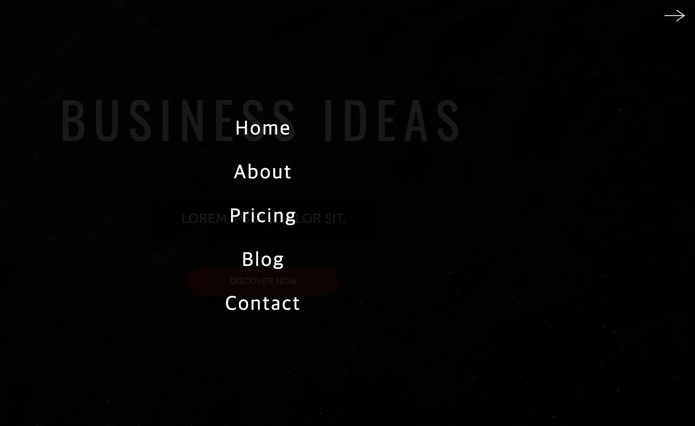
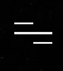
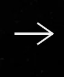
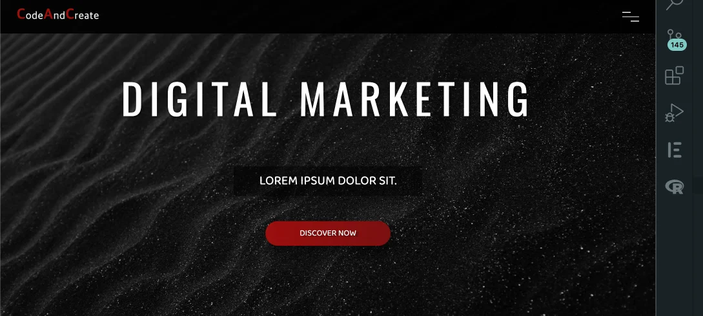
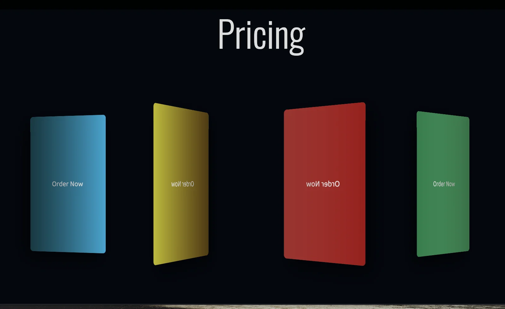
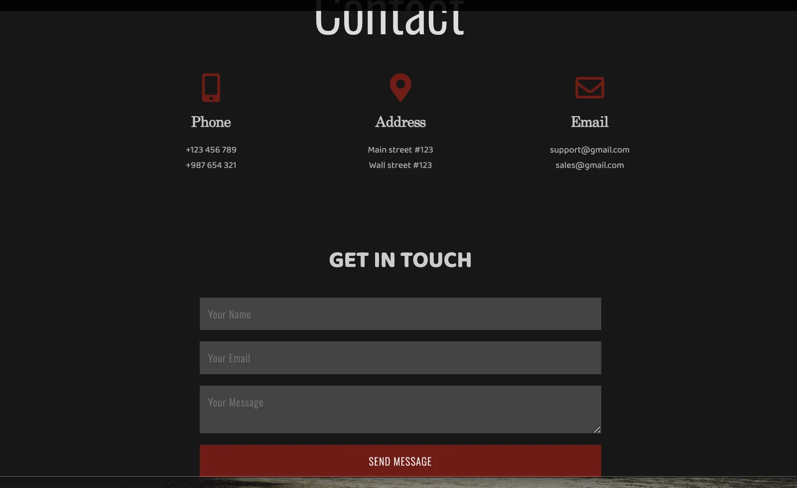

<a id="1c3eda9b0fe181d2b5e5f49ce1d59fb4"></a>

## Section  1 &#45; navbar



<a id="1c3eda9b0fe181c3b556ec8e716b7c7a"></a>

### 🧐 <code>display&#58; none</code> vs <code>visibility&#58; hidden;</code> , <code>opacity&#58; 0</code> 

<details>
<summary><code>display&#58;none</code></summary>

- 영역 사라짐

- 이벤트(ex&#46;클릭) 작동 안함

- tab focus 안됨

</details>

<details>
<summary><code>visibility&#58;hidden</code></summary>

- 영역 있음

- 이벤트(ex&#46;클릭) 작동 안함

- tab focus 안됨

- 뒤에 있는 요소 클릭 가능

</details>

<details>
<summary><code>opacity&#58;0</code></summary>

- 영역 있음

- 이벤트(ex&#46;클릭) 작동 함

- tab focus 됨

- 뒤에 있는 요소 클릭 불가능

</details>

<a id="1c3eda9b0fe1810eb044d930a8a87e4d"></a>

요소에 <em><strong>fade In </strong></em>효과를 주고 싶을 때 <code>display</code>를 사용하면

<a id="1c3eda9b0fe1817a9446fef17f02d734"></a>

영역 자체가 없어졌다가 보여지기 때문에 <code>transition</code> 효과가 보이지 않음&#46;

<a id="1c3eda9b0fe181e0b4f7d4c15d72d92d"></a>

```scss
.box {
	tansition: 0.3s;
    display: none;

&.fadeIn {
    	display: block;
	}
}
```

<a id="1c3eda9b0fe1811e8392d068866687ed"></a>

 

<a id="1c3eda9b0fe1818bac81e31f65193ae9"></a>

<code>opacity</code>와 <code>visibiliy</code>를 사용하면 요소에 있는 클릭 이벤트의 작동도 방지하면서 <code>transition</code> 효과를 줄 수 있음&#46;

<a id="1c3eda9b0fe181aebda0eecb0afa655e"></a>

```scss
.box {
	tansition: 0.3s;
    opacity: 0;
    visibility: hidden;

&.fadeIn {
      opacity: 1;
      visibility: visible;
	}
}
```

<a id="1c3eda9b0fe181b9bd5ee33a435581a8"></a>

Reference &#124;  <a href="https://velog.io/@kya754/no1">https&#58;//velog&#46;io/&#64;kya754/no1</a>

<a id="1c3eda9b0fe18115bcd5d7545c120686"></a>

### html

<a id="1c3eda9b0fe181b8a1c1ead45b16bd30"></a>

```html
<nav class="navbar">
  <div class="navbar-logo">
    <a href="#">
      <span>C</span>ode<span>A</span>nd<span>C</span>reate
    </a>
  </div>
  <div class="nav-list">
      <a href="#" class="nav-link">Home</a>
      <a href="#" class="nav-link">About</a>
      <a href="#" class="nav-link">Pricing</a>
      <a href="#" class="nav-link">Blog</a>
      <a href="#" class="nav-link">Contact</a>
  </div>
</nav>

<!-- Menu -->
<div class="menu">
  <div class="line line-1"></div>
  <div class="line line-2"></div>
  <div class="line line-3"></div>
</div>
```

<a id="1c3eda9b0fe18130ad34ffcfea2faa3c"></a>

### css

<a id="1c3eda9b0fe1816c9f6ceb6d6dbb8da8"></a>

```css
.navbar {
  width: 100%;
  height: 8rem;
  background-color: rgba(0, 0, 0, 0.9);
  position: fixed;
  top: -8rem;
  padding: 3rem;
  z-index: 10;
  animation: animateNavbar 1s 0.5s forwards;
  transition: height 0.5s;
}

.navbar.change {
  height: 100vh;
}

@keyframes animateNavbar {
  0% {
    top: -8rem;
  }
  100% {
    top: 0;
  }
}

.navbar-logo {
  position: absolute;
  top: 1.5rem;
  left: 4rem;
}

.navbar-logo a {
  font-family: "MADE Soulmaze", sans-serif;
  font-size: 2.5rem;
  color: #eee;
  letter-spacing: 0.1rem;
}

.navbar-logo span {
  font-size: 3.5rem;
  font-weight: bold;
  color: #9e0e09;
  font-family: "MADE Soulmaze";
}

.menu {
  width: 4rem;
  height: 4rem;
  position: fixed;
  z-index: 500;
  top: 2rem;
  right: 4rem;
  display: flex;
  flex-direction: column;
  justify-content: space-evenly;
  cursor: pointer;
}

.line {
  width: 100%;
  height: 0.2rem;
  background-color: #eee;
  transition: transform 0.3s;
}

.line-1 {
  width: 50%;
}

.line-3 {
  width: 50%;
  margin-left: auto;
}

.change .line-1 {
  transform: translate(100%, 1rem) rotate(-35deg);
  transform-origin: right;
}

.change .line-3 {
  transform: translateY(-1rem) rotate(35deg);
  transform-origin: right;
}

.nav-list {
  position: absolute;
  top: 25%;
  left: 50%;
  transform: translateX(-50%);
  display: flex;
  flex-direction: column;
  align-items: center;
  opacity: 0;
  visibility: hidden;
  transition: all 0.2s;
}

.change .nav-list {
  opacity: 1;
  visibility: visible;
  transition: all 0.7s 0.5s;
}

.nav-link {
  font-family: "MADE Soulmaze", sans-serif;
  font-size: 4rem;
  letter-spacing: 0.3rem;
  color: #fff;
  margin: 2rem 0;
  transition: color 0.4s;
}

.nav-link:hover {
  color: #9e0e09;
}
```

<a id="1c3eda9b0fe181de99dcffb50205df07"></a>

### js

<a id="1c3eda9b0fe181578b5cc1bc6131c62e"></a>

```javascript
const navbar = document.querySelector(".navbar ");
const menu = document.querySelector(".menu");

menu.addEventListener("click", () => {
  navbar.classList.toggle("change");
  menu.classList.toggle("change");
});
```

<a id="1c3eda9b0fe1816eafc3e56b91cad22c"></a>

### ● menu &#45; icons

<a id="1c3eda9b0fe18138a8d1f4fad8aa80a3"></a>

```html
<!-- Menu -->
    <div class="menu">
      <div class="line line-1"></div>
      <div class="line line-2"></div>
      <div class="line line-3"></div>
    </div>
```

<a id="1c3eda9b0fe1813dbc5ffa3c063310d0"></a>

```css
.menu {
  width: 4rem;
  height: 4rem;
  position: fixed;
  z-index: 500;
  top: 2rem;
  right: 4rem;
  display: flex;
  flex-direction: column;
  justify-content: space-evenly;
  cursor: pointer;
}
```



<a id="1c3eda9b0fe181db9751c3cb27f57129"></a>

```css
.line {
  width: 100%;
  height: 0.2rem;
  background-color: #eee;
  transition: transform 0.3s;
}

.line-1 {
  width: 50%;
}

.line-3 {
  width: 50%;
  margin-left: auto;
}
```



<a id="1c3eda9b0fe181f28410df4ac77a3b04"></a>

```css
.change .line-1 {
  transform: translate(100%, 1rem) rotate(-35deg);
  transform-origin: right;
}

.change .line-3 {
  transform: translateY(-1rem) rotate(35deg);
  transform-origin: right;
}
```

<a id="1c3eda9b0fe181ffb0a7dacaa67f6e57"></a>

## Section  2 &#45; header( banner  aniamtion)



<a id="1c3eda9b0fe18195b6dae95a06f1c4c4"></a>

### html

<a id="1c3eda9b0fe181c0bb16d9efb91b9b5e"></a>

```html
<section class="section-1" id="home">
  <div class="banner">
    <h1 class="banner-heading">
      <span class="heading-1">Business Ideas</span>
      <span class="heading-2">Consulting</span>
      <span class="heading-3">Digital Marketing</span>
      <span class="heading-4">Strategy</span>
    </h1>
    <p class="banner-paragraph">Lorem ipsum dolor sit.</p>
    <button class="banner-btn">Discover Now</button>
  </div>
</section>
```

<a id="1c3eda9b0fe1818cb7a5eb8031d1f4c3"></a>

### css

<a id="1c3eda9b0fe181358252e31bdf56182d"></a>

```css
.section-1 {
  width: 100%;
  height: 100vh;
  background: url(../images/dark-bg.jpeg) no-repeat;
  background-size: cover;
}

.banner {
  position: absolute;
  top: 20%;
  left: 50%;
  transform: translateX(-50%);
  text-align: center;
  width: 100%;
}

.banner-heading {
  height: 20rem;
  margin-bottom: 4rem;
  perspective: 50rem;
  overflow: hidden;
}

.banner-heading span {
  font-family: "Oswald", sans-serif;
  font-size: 12rem;
  font-weight: 400;
  text-transform: uppercase;
  color: #fff;
  text-shadow: 0.3rem 0.3rem 0.6rem rgba(0, 0, 0, 0.5);
  position: absolute;
  width: 100%;
  display: flex;
  justify-content: center;
  transform: translateZ(8rem);
  opacity: 0;
  letter-spacing: 3rem;
}

.heading-1 {
  animation: animateHeading 12s 3s infinite;
}

.heading-2 {
  animation: animateHeading 12s 6s infinite;
}

.heading-3 {
  animation: animateHeading 12s 9s infinite;
}

.heading-4 {
  animation: animateHeading 12s 12s infinite;
}

@keyframes animateHeading {
  0% {
    transform: translateZ(8rem);
    opacity: 0;
    letter-spacing: 3rem;
  }

  3% {
    transform: translateZ(0);
    opacity: 1;
    letter-spacing: 1.5rem;
  }

  25% {
    transform: translateZ(0);
    opacity: 1;
    letter-spacing: 1.5rem;
  }

  28% {
    transform: translateZ(8rem);
    opacity: 0;
    letter-spacing: 3rem;
  }

  100% {
    transform: translateZ(8rem);
    opacity: 0;
    letter-spacing: 3rem;
  }
}

.banner-paragraph {
  font-size: 4rem;
  font-weight: 400;
  text-transform: uppercase;
  color: #fff;
  background-color: rgba(0, 0, 0, 0.6);
  width: 30%;
  margin: 0 auto 6rem auto;
  padding: 1rem 0;
  box-shadow: 1rem 1rem 5rem rgba(0, 0, 0, 0.5);
  opacity: 0;
  visibility: hidden;
  animation: fadeAnimation 1s 1.5s forwards;
}

@keyframes fadeAnimation {
  0% {
    opacity: 0;
    visibility: hidden;
  }
  100% {
    opacity: 1;
    visibility: visible;
  }
}

.banner-btn {
  width: 30rem;
  height: 6rem;
  background: linear-gradient(to right, #9b0e0e, #7a1010);
  color: #fff;
  font-size: 2rem;
  text-transform: uppercase;
  border-radius: 3rem;
  border: 0.1rem solid #800505;
  box-shadow: 1rem 2rem 3rem rgba(0, 0, 0, 0.5);
  text-shadow: 0.6rem 0.3rem 0.2rem rgba(0, 0, 0, 0.4);
  cursor: pointer;
  opacity: 0;
  visibility: hidden;
  position: relative;
  overflow: hidden;
  animation: fadeAnimation 1s 2s forwards;
}

.banner-btn::before {
  content: "";
  width: 100%;
  height: 100%;
  background: linear-gradient(to right, transparent, #fff, transparent);
  position: absolute;
  top: 0;
  left: -100%;
  transform: skewX(-30deg);
  transition: left 0.5s;
}

.banner-btn:hover::before {
  left: 100%;
}
```

---

<a id="1c3eda9b0fe181a7b4eadcd5de9287f8"></a>

### 1&#46; banner &#45; animation

[Untitled](https://s3-us-west-2.amazonaws.com/secure.notion-static.com/ed681271-a712-4e94-9e60-d2128d743628/Untitled.qt)

- html
    <a id="1c3eda9b0fe181689129dae704783df3"></a>

    ```html
    <h1 class="banner-heading">
      <span class="heading-1">Business Ideas</span>
      <span class="heading-2">Consulting</span>
      <span class="heading-3">Digital Marketing</span>
      <span class="heading-4">Strategy</span>
    </h1> 
    ```

- css
    <a id="1c3eda9b0fe181f0a50fd0d0e4cd4d3a"></a>

    ```css
    .banner-heading {
      height: 20rem;
      margin-bottom: 4rem;
      perspective: 50rem;
      overflow: hidden;
    }

    .banner-heading span {
      font-family: "Oswald", sans-serif;
      font-size: 12rem;
      font-weight: 400;
      text-transform: uppercase;
      color: #fff;
      text-shadow: 0.3rem 0.3rem 0.6rem rgba(0, 0, 0, 0.5);
      position: absolute;
      width: 100%;
      display: flex;
      justify-content: center;
      transform: translateZ(8rem);
      opacity: 0;
      letter-spacing: 3rem;
    }

    .heading-1 {
      animation: animateHeading 12s 3s infinite;
    }

    .heading-2 {
      animation: animateHeading 12s 6s infinite;
    }

    .heading-3 {
      animation: animateHeading 12s 9s infinite;
    }

    .heading-4 {
      animation: animateHeading 12s 12s infinite;
    }

    @keyframes animateHeading {
      0% {
        transform: translateZ(8rem);
        opacity: 0;
        letter-spacing: 3rem;
      }

      3% {
        transform: translateZ(0);
        opacity: 1;
        letter-spacing: 1.5rem;
      }

      25% {
        transform: translateZ(0);
        opacity: 1;
        letter-spacing: 1.5rem;
      }

      28% {
        transform: translateZ(8rem);
        opacity: 0;
        letter-spacing: 3rem;
      }

      100% {
        transform: translateZ(8rem);
        opacity: 0;
        letter-spacing: 3rem;
      }
    }
    ```

<a id="1c3eda9b0fe181cc9bd0f1dae2ff84dd"></a>

### 2&#46; paragraph &#45;animation

- css 
    <a id="1c3eda9b0fe1818eb99bdd4ec3f3b764"></a>

    ```css
    .banner-paragraph {
      font-size: 4rem;
      font-weight: 400;
      text-transform: uppercase;
      color: #fff;
      background-color: rgba(0, 0, 0, 0.6);
      width: 30%;
      margin: 0 auto 6rem auto;
      padding: 1rem 0;
      box-shadow: 1rem 1rem 5rem rgba(0, 0, 0, 0.5);
      opacity: 0;
      visibility: hidden;
      animation: fadeAnimation 1s 1.5s forwards;
    }

    @keyframes fadeAnimation {
      0% {
        opacity: 0;
        visibility: hidden;
      }
      100% {
        opacity: 1;
        visibility: visible;
      }
    }
    ```

<a id="1c3eda9b0fe181baab1fde67c4e36dab"></a>

### 3&#46; button&#45;animation

- css
    <a id="1c3eda9b0fe1815299f5cadbf07e02fa"></a>

    ```css
    .banner-btn {
      width: 30rem;
      height: 6rem;
      background: linear-gradient(to right, #9b0e0e, #7a1010);
      color: #fff;
      font-size: 2rem;
      text-transform: uppercase;
      border-radius: 3rem;
      border: 0.1rem solid #800505;
      box-shadow: 1rem 2rem 3rem rgba(0, 0, 0, 0.5);
      text-shadow: 0.6rem 0.3rem 0.2rem rgba(0, 0, 0, 0.4);
      cursor: pointer;
      opacity: 0;
      visibility: hidden;
      position: relative;
      overflow: hidden;
      animation: fadeAnimation 1s 2s forwards;
    }

    .banner-btn::before {
      content: "";
      width: 100%;
      height: 100%;
      background: linear-gradient(to right, transparent, #fff, transparent);
      position: absolute;
      top: 0;
      left: -100%;
      transform: skewX(-30deg);
      transition: left 0.5s;
    }

    .banner-btn:hover::before {
      left: 100%;
    }
    ```

---

<a id="1c3eda9b0fe18109b98bd11973b5593b"></a>

## Section  3 &#45; main 1 (Video Control)


<a id="1c3eda9b0fe181859b34d71ec0fad917"></a>

### html

<a id="1c3eda9b0fe181e8802eee4b492543f2"></a>

```html
<section class="section-2" id="about-us">
          <h1 class="section-heading">About Us</h1>
          <div class="section-heading-line"></div>
          <div class="video-wrapper">
            <video src="images/about-us-video.mp4" class="video"></video>
            <div class="controls">
              <div class="video-bar-wrapper">
                <div class="video-bar"></div>
              </div>
              <div class="buttons">
                <button id="play-pause">
                  <i class="far fa-play-circle"></i>
                </button>
              </div>
            </div>
          </div>
          <p class="section-2-paragraph">
            <i class="fas fa-quote-left"></i>
            Lorem ipsum dolor sit amet consectetur adipisicing elit. Numquam voluptatibus ipsum expedita perspiciatis unde repellat eligendi quisquam optio neque sint consequuntur, dolore delectus nisi eveniet nostrum explicabo. Quiarepellat, ut. Lorem ipsum dolor sit amet. Lorem ipsum dolor sit amet. Lorem ipsum dolor sit amet.
            <i class="fas fa-quote-right"></i>
          </p>      
        </section>
```

<a id="1c3eda9b0fe18192bc54cd4f844b3f92"></a>

### css

<a id="1c3eda9b0fe1818f8d56ee8e845d44d9"></a>

```css
/* Section 2 */
.section-2 {
  width: 100%;
  height: 100vh;
  background-color: #222020;
  display: flex;
  align-items: center;
  padding: 0 10rem;
  position: relative;
}

.section-heading {
  font-size: 10rem;
  font-family: "Oswald", sans-serif;
  font-weight: 300;
  color: #ddd;
  margin-right: 4rem;
}

.section-heading-line {
  width: 15rem;
  height: 0.2rem;
  background-color: #ddd;
}

.video-wrapper {
  width: 100rem;
  height: 50rem;
  position: absolute;
  top: 5rem;
  right: 15rem;
  box-shadow: 3rem 3rem 6rem rgba(0, 0, 0, 0.7);
  overflow: hidden;
}

.video-wrapper:hover .controls {
  transform: translateY(0);
}

.video {
  width: 100%;
  height: 100%;
  object-fit: cover;
  opacity: 0.3;
  transition: opacity 0.3s;
}

.controls {
  width: 100%;
  position: absolute;
  bottom: 0;
  background-color: rgba(0, 0, 0, 0.7);
  transform: translateY(calc(100% - 0.4rem));
  transition: transform 0.4s;
}

.video-bar-wrapper {
  width: 100%;
  height: 0.7rem;
  background-color: #000;
  position: absolute;
  top: 0;
  left: 0;
}

.video-bar {
  height: 100%;
  width: 0;
  background-color: #d30819;
  transition: width 0.2s linear;
}

.buttons {
  padding: 2rem 1rem 1rem 1rem;
}

.buttons button {
  background: none;
  border: none;
  cursor: pointer;
}

.buttons i {
  width: 3rem;
  height: 3rem;
  font-size: 2.8rem;
  color: #fff;
}

.section-2-paragraph {
  width: 100rem;
  position: absolute;
  bottom: 8rem;
  right: 15rem;
  font-size: 2rem;
  line-height: 1.5;
  color: #ddd;
  border-top: 0.3rem double #aaa;
  border-bottom: 0.3rem double #aaa;
  padding: 2rem;
  display: flex;
  flex-direction: column;
  justify-content: center;
  align-items: center;
  text-align: justify;
  text-shadow: 1rem 1rem 2rem rgba(0, 0, 0, 0.7);
}

.fa-quote-left {
  align-self: flex-start;
  font-size: 5rem;
  color: #bbb;
  margin-bottom: 2rem;
}

.fa-quote-right {
  align-self: flex-end;
  font-size: 5rem;
  color: #bbb;
}

/* End of Section 2 */
```

<a id="1c3eda9b0fe1812cae6ac368f62aa77f"></a>

### js

<a id="1c3eda9b0fe18153b88ae2a30946b36a"></a>

```javascript
const video = document.querySelector(".video");
const btn = document.querySelector(".buttons button i");
const bar = document.querySelector(".video-bar");

const playPause = () => {
  if (video.paused) {
    video.play();
    btn.className = "far fa-pause-circle";
    video.style.opacity = ".7";
  } else {
    video.pause();
    btn.className = "far fa-play-circle";
    video.style.opacity = ".3";
  }
};

btn.addEventListener("click", () => {
  playPause();
});

video.addEventListener("timeupdate", () => {
  console.log(video.currentTime, video.duration);
  const barWidth = video.currentTime / video.duration;
  bar.style.width = `${barWidth * 100}%`;
  if (video.ended) {
    btn.className = "far fa-play-circle";
    video.style.opacity = ".3";
  }
});
```

<a id="1c3eda9b0fe181658438ed5028eddd44"></a>

## Section  4 &#45; main 2 (3D Cards)



<a id="1c3eda9b0fe18123b327e23a584dd8cf"></a>

### html

<a id="1c3eda9b0fe181019f09cfc99ef84071"></a>

```html
<section class="section-3" id="pricing">
  <h1 class="section-heading">Pricing</h1>
  <div class="section-heading-line"></div>
  <div class="swiper-container">
  <div class="pricing-cards-wrapper swiper-wrapper">
    <div class="pricing-card swiper-slide">
      <div class="pricing-card-front">
        <h1 class="pricing-card-heading heading-free">FREE</h1>
        <h3 class="pricing-card-price">$0</h3>
        <ul class="pricing-card-list list-free">
          <li>
            <i class="fas fa-check"></i>
            <span>Pricing Card Item</span>
          </li>
          <li>
            <i class="fas fa-check"></i>
            <span>Pricing Card Item</span>
          </li>
          <li>
            <i class="fas fa-times"></i>
            <span>Pricing Card Item</span>
          </li>
          <li>
            <i class="fas fa-times"></i>
            <span>Pricing Card Item</span>
          </li>
          <li>
            <i class="fas fa-times"></i>
            <span>Pricing Card Item</span>
          </li>
        </ul>
        <button class="pricing-card-btn btn-free">Choose Plan</button>
      </div>
      <div class="pricing-card-back back-free">
        <a href="#">Order Now</a>
      </div>
    </div>
    <div class="pricing-card swiper-slide">
      <div class="pricing-card-front">
        <h1 class="pricing-card-heading heading-basic">BASIC</h1>
        <h3 class="pricing-card-price">$299</h3>
        <ul class="pricing-card-list list-basic">
          <li>
            <i class="fas fa-check"></i>
            <span>Pricing Card Item</span>
          </li>
          <li>
            <i class="fas fa-check"></i>
            <span>Pricing Card Item</span>
          </li>
          <li>
            <i class="fas fa-check"></i>
            <span>Pricing Card Item</span>
          </li>
          <li>
            <i class="fas fa-check"></i>
            <span>Pricing Card Item</span>
          </li>
          <li>
            <i class="fas fa-times"></i>
            <span>Pricing Card Item</span>
          </li>
        </ul>
        <button class="pricing-card-btn btn-basic">Choose Plan</button>
      </div>
      <div class="pricing-card-back back-basic">
        <a href="#">Order Now</a>
      </div>
    </div>
    <div class="pricing-card swiper-slide">
      <div class="pricing-card-front">
        <h1 class="pricing-card-heading heading-standard">STANDARD</h1>
        <h3 class="pricing-card-price">$699</h3>
        <ul class="pricing-card-list list-standard">
          <li>
            <i class="fas fa-check"></i>
            <span>Pricing Card Item</span>
          </li>
          <li>
            <i class="fas fa-check"></i>
            <span>Pricing Card Item</span>
          </li>
          <li>
            <i class="fas fa-check"></i>
            <span>Pricing Card Item</span>
          </li>
          <li>
            <i class="fas fa-check"></i>
            <span>Pricing Card Item</span>
          </li>
          <li>
            <i class="fas fa-check"></i>
            <span>Pricing Card Item</span>
          </li>
        </ul>
        <button class="pricing-card-btn btn-standard">Choose Plan</button>
      </div>
      <div class="pricing-card-back back-standard">
        <a href="#">Order Now</a>
      </div>
    </div>
    <div class="pricing-card swiper-slide">
      <div class="pricing-card-front">
        <h1 class="pricing-card-heading heading-premium">PREMIUM</h1>
        <h3 class="pricing-card-price">$999</h3>
        <ul class="pricing-card-list list-premium">
          <li>
            <i class="fas fa-check"></i>
            <span>Pricing Card Item</span>
          </li>
          <li>
            <i class="fas fa-check"></i>
            <span>Pricing Card Item</span>
          </li>
          <li>
            <i class="fas fa-check"></i>
            <span>Pricing Card Item</span>
          </li>
          <li>
            <i class="fas fa-check"></i>
            <span>Pricing Card Item</span>
          </li>
          <li>
            <i class="fas fa-check"></i>
            <span>Pricing Card Item</span>
          </li>
            <i class="fas fa-check"></i>
            <span>Pricing Card Item</span>
          </li>
        </ul>
        <button class="pricing-card-btn btn-premium">Choose Plan</button>
      </div>
      <div class="pricing-card-back back-premium">
        <a href="#">Order Now</a>
      </div>
    </div>
  </div>
</div>
</section>
```

<a id="1c3eda9b0fe181a8b6ffc3baf762e5cc"></a>

### css

<a id="1c3eda9b0fe181c4b411e30c1bc4ddc6"></a>

```css
.section-3 {
  width: 100%;
  height: 100vh;
  background-color: #03070e;
  display: flex;
  align-items: center;
  padding-left: 10rem;
}

.pricing-cards-wrapper {
  width: 100%;
  display: flex;
  justify-content: space-evenly;
  padding: 5rem;
}

.pricing-card {
  width: 28rem !important;
  height: 45rem !important;
  background-color: #181b1d;
  border-radius: 1rem;
  box-shadow: 2rem 2rem 6rem rgba(0, 0, 0, 0.7);
}

.pricing-card-front {
  width: 100%;
  height: 100%;
  display: flex;
  flex-direction: column;
  align-items: center;
  justify-content: space-between;
}

.pricing-card-heading {
  font-size: 2rem;
  font-weight: 300;
  color: #fff;
  width: 100%;
  height: 5rem;
  display: flex;
  align-items: center;
  padding-left: 2rem;
  border-radius: 1rem 1rem 0 0;
}

.heading-free {
  background: linear-gradient(to right, #087285, #0da5d3);
}

.heading-basic {
  background: linear-gradient(to right, #946809, #bdba0e);
}

.heading-standard {
  background: linear-gradient(to right, #a10c14, #e23b3b);
}

.heading-premium {
  background: linear-gradient(to right, #0b7e48, #3be286);
}

.pricing-card-price {
  font-family: "MADE Soulmaze", sans-serif;
  font-size: 7rem;
  font-weight: 300;
  color: #fff;
}

.pricing-card-list li {
  margin-bottom: 0.5rem;
}

.pricing-card-list i {
  font-size: 1.8rem;
  width: 3rem;
}

.pricing-card-list span {
  font-size: 1.8rem;
  font-weight: 300;
  letter-spacing: 0.1rem;
}

.list-free {
  color: #0da5d3;
}

.list-basic {
  color: #bdba0e;
}

.list-standard {
  color: #e23b3b;
}

.list-premium {
  color: #3be286;
}

.pricing-card-btn {
  width: 18rem;
  height: 5rem;
  margin-bottom: 3rem;
  border-radius: 3rem;
  border: none;
  font-size: 1.6rem;
  text-transform: uppercase;
  color: #fff;
  text-shadow: 0.3rem 0.3rem 0.6rem rgba(0, 0, 0, 0.5);
}

.btn-free {
  background-color: #0da5d3;
}

.btn-basic {
  background-color: #bdba0e;
}

.btn-standard {
  background-color: #e23b3b;
}

.btn-premium {
  background-color: #3be286;
}

.pricing-card-back {
  position: absolute;
  top: 0;
  left: 0;
  width: 100%;
  height: 100%;
  display: flex;
  justify-content: center;
  align-items: center;
  transform: rotateY(180deg);
  border-radius: 1rem;
}

.pricing-card-back a {
  font-size: 2.5rem;
  color: #fff;
}

.back-free {
  background: linear-gradient(to right, #087285, #0da5d3);
}

.back-basic {
  background: linear-gradient(to right, #946809, #bdba0e);
}

.back-standard {
  background: linear-gradient(to right, #a10c14, #e23b3b);
}

.back-premium {
  background: linear-gradient(to right, #0b7e48, #3be286);
}
```

<a id="1c3eda9b0fe1813db92cf59f85eaee24"></a>

### js

<a id="1c3eda9b0fe181b89667db9fa3038925"></a>

```javascript
// section 3 - 3D Cards
var swiper = new Swiper(".swiper-container", {
  effect: "coverflow",
  grabCursor: true,
  centeredSlides: true,
  slidesPerView: "auto",
  coverflowEffect: {
    rotate: 70,
    stretch: 0,
    depth: 100,
    modifier: 1,
    slideShadows: true,
  },
}); 
```

<a id="1c3eda9b0fe18116990ee9f59f63052d"></a>

## Section  5 &#45; main 3 (Contact)



<a id="1c3eda9b0fe181869a89fedc0200c2f2"></a>

### html

<a id="1c3eda9b0fe181bca20acd8ecb1a26b3"></a>

```html
<section class="section-4" id="contact">
      <h1 class="section-heading">Contact</h1>
      <div class="section-heading-line"></div>
      <div class="contact-wrapper">
        <div class="contact-details">
          <div class="phone">
            <i class="fas fa-mobile-alt"></i>
            <h3>Phone</h3>
            <p>+123 456 789</p>
            <p>+987 654 321</p>
          </div>
          <div class="address">
            <i class="fas fa-map-marker-alt"></i>
            <h3>Address</h3>
            <p>Main street #123</p>
            <p>Wall street #123</p>
          </div>
          <div class="email">
            <i class="far fa-envelope"></i>
            <h3>Email</h3>
            <p>support@gmail.com</p>
            <p>sales@gmail.com</p>
          </div>
        </div>
        <h1>Get In Touch</h1>
        <form class="contact-form">
          <input type="text" placeholder="Your Name">
          <input type="email" placeholder="Your Email">
          <textarea placeholder="Your Message"></textarea>
          <input type="submit" value="Send Message">
        </form>
      </div>
    </section>
```

<a id="1c3eda9b0fe18138be30cbb5feee13c5"></a>

### css<br>

<a id="1c3eda9b0fe181eeae95f5918a5928a4"></a>

```css
.section-4 {
  width: 100%;
  height: 100vh;
  background-color: #171718;
  display: flex;
  align-items: center;
  padding: 0 10rem;
}

.contact-wrapper {
  width: 80%;
  display: flex;
  flex-direction: column;
  align-items: center;
}

.contact-details {
  display: flex;
  margin-bottom: 8rem;
}

.contact-details div {
  width: 25rem;
  text-align: center;
  margin: 4rem;
}

.contact-details i {
  font-size: 5rem;
  color: #7a1010;
}

.contact-details h3 {
  font-family: "MADE Soulmaze", serif;
  font-size: 2.5rem;
  margin: 2rem 0;
  color: #ccc;
}

.contact-details p {
  font-size: 1.6rem;
  color: #aaa;
}

.contact-wrapper h1 {
  font-size: 4rem;
  color: #ccc;
  text-transform: uppercase;
  margin-bottom: 3rem;
}

.contact-form {
  width: 70rem;
  display: flex;
  flex-direction: column;
}

.contact-form input,
.contact-form textarea {
  padding: 1.5rem;
  background-color: #444;
  color: #eee;
  border: none;
  margin-bottom: 2rem;
  font-family: "Oswald", sans-serif;
  font-size: 1.8rem;
  font-weight: 300;
  letter-spacing: 0.1rem;
}

.contact-form textarea {
  max-width: 100%;
  max-height: 15rem;
  min-height: 5.5rem;
}

.contact-form input[type="submit"] {
  background-color: #7a1010;
  text-transform: uppercase;
  cursor: pointer;
  transition: background-color 0.3s;
}

.contact-form input[type="submit"]:hover {
  background-color: #5f0303;
}
```

<a id="1c3eda9b0fe18138a5f4c95ce9b4e9b3"></a>

## Section 6 &#45; footer

<a id="1c3eda9b0fe181d38213fd74a9368264"></a>

### html

<a id="1c3eda9b0fe1812aa3f7e2c0cd72f68d"></a>

```html
<!-- Footer -->
  <footer class="footer">
    <div class="footer-nav">
      <a href="#home">Home</a>
      <a href="#about-us">About Us</a>
      <a href="#pricing">Pricing</a>
      <a href="#contact">Contact</a>
    </div>
    <p class="copyright">Copyright &copy; CodeAndCreate All Rights Reserved</p>
  </footer>
```

<a id="1c3eda9b0fe181ed9f90eeaf9eb2381b"></a>

### css

<a id="1c3eda9b0fe181a78ffefa959216e1f2"></a>

```css
.footer {
  width: 100%;
  height: 12rem;
  background-color: #202122;
  display: flex;
  justify-content: space-between;
  align-items: center;
  padding: 0 10rem;
}

.footer-nav a {
  font-family: "MADE Soulmaze", serif;
  font-size: 2rem;
  color: #ccc;
  margin-right: 3rem;
  letter-spacing: 0.1rem;
  transition: color 0.3s;
}

.footer-nav a:hover {
  color: #862323;
}

.copyright {
  font-size: 2rem;
  color: #ddd;
}
```

<a id="1c3eda9b0fe181e7b8a9e799879de58c"></a>

## Section 7 &#45; responsive

<a id="1c3eda9b0fe181e293e6ce129d6ab056"></a>

### css

<a id="1c3eda9b0fe1813a99def29cad143808"></a>

```css
@media (max-width: 1800px) {
  .video-wrapper {
    width: 90rem;
    height: 45rem;
    right: 10rem;
  }

  .section-2-paragraph {
    width: 90rem;
    right: 10rem;
  }

  .section-3 .section-heading-line {
    margin-right: 3rem;
  }
}

@media (max-width: 1650px) {
  html {
    font-size: 57%;
  }

  .video-wrapper {
    width: 85rem;
    height: 40rem;
    right: 5rem;
  }

  .section-2-paragraph {
    width: 85rem;
    right: 5rem;
    bottom: 10rem;
  }
}

@media (max-width: 1500px) {
  .section-heading-line {
    display: none;
  }
}

@media (max-width: 1400px) {
  html {
    font-size: 45%;
  }

  .banner-heading span {
    font-size: 10rem;
  }

  .banner-paragraph {
    width: 45rem;
    font-size: 3rem;
  }

  .section-2,
  .section-3,
  .section-4 {
    flex-direction: column;
  }

  .section-2 {
    height: 120vh;
  }

  .video-wrapper {
    top: 20%;
    left: 50%;
    transform: translateX(-50%);
    width: 80rem;
  }

  .section-2-paragraph {
    left: 50%;
    transform: translateX(-50%);
    width: 80rem;
  }

  .section-3 {
    height: auto;
    padding: 5rem 0 10rem 0;
  }

  .section-3 .section-heading {
    margin-bottom: 7rem;
  }

  .swiper-container {
    width: 100%;
  }

  .section-4 {
    height: auto;
    padding: 5rem 0;
  }
}

@media (max-width: 900px) {
  html {
    font-size: 40%;
  }

  .banner {
    top: 25%;
  }

  .banner-heading {
    height: 15rem;
  }

  .banner-heading span {
    font-size: 8rem;
  }

  .footer {
    padding: 0 5rem;
  }

  .footer-nav a {
    font-size: 1.8rem;
  }
}

@media (max-width: 700px) {
  html {
    font-size: 35%;
  }

  .section-2 {
    height: 100vh;
  }

  .contact-details div {
    margin: 3rem 2rem;
  }

  .footer {
    flex-direction: column;
    justify-content: center;
  }

  .footer-nav {
    margin-bottom: 2rem;
  }
}

@media (max-width: 500px) {
  html {
    font-size: 30%;
  }

  .banner-heading span {
    font-size: 4.5rem;
    letter-spacing: 2rem;
  }

  @keyframes animateHeading {
    0% {
      transform: translateZ(8rem);
      opacity: 0;
      letter-spacing: 2rem;
    }

    3% {
      transform: translateZ(0);
      opacity: 1;
      letter-spacing: 1rem;
    }

    25% {
      transform: translateZ(0);
      opacity: 1;
      letter-spacing: 1rem;
    }

    28% {
      transform: translateZ(8rem);
      opacity: 0;
      letter-spacing: 2rem;
    }

    100% {
      transform: translateZ(8rem);
      opacity: 0;
      letter-spacing: 2rem;
    }
  }

  .video-wrapper {
    width: 60rem;
  }

  .section-2-paragraph {
    width: 60rem;
  }

  .contact-details div {
    width: 18rem;
    margin: 3rem 1rem;
  }

  .contact-form {
    width: 60rem;
  }
}
```
