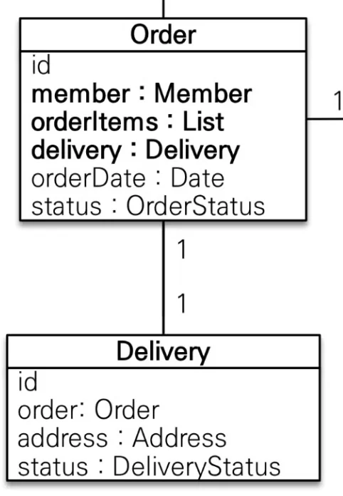
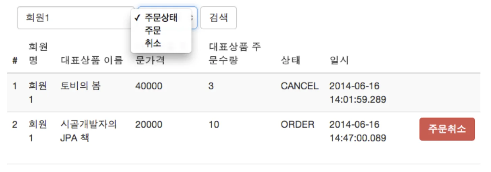

> Item에 Category를 추가하여 테스트할려고 하니 잘 안된다…&#46;<br>우선 강의 내용부터 정리하고 추가적으로 진행하자…

<details>
<summary>🧐 <strong><code>도메인 모델 패턴</code></strong><strong>  vs </strong><strong><code>트랜젝션 스크립트 패턴</code></strong></summary>

<details>
<summary><a href="https://martinfowler.com/eaaCatalog/domainModel.html">도메인 모델 패턴</a></summary>

> <strong><u>엔티티</u></strong>에서 <u>비지니스 로직을 처리</u>한다&#46; 

<a id="1c3eda9b0fe18129bc99e71ab982049d"></a>

아래 예시를 보면 주문 엔티티에서 비지니스 로직(주문 취소)을 처리한다&#46;<br>서비스 계층에서는 엔티티의 비지니스 로직을 호출하여 위임하는 역할만 한다&#46; 

<details>
<summary><strong> &#91; 코드 &#93; Order</strong></summary>

<a id="1c3eda9b0fe1811a865cc63a798bee3e"></a>

```java
@Entity
@Table(name = "orders")
@Getter @Setter
public class Order {
		
		 .  .  .
	
		//==비지니스 로직==//
    /** 주문 취소 */
    public void cancel() {
        if (delivery.getStatus() == DeliveryStatus.COMPLETE) {
            throw new IllegalStateException("이미 배송 완료된 상품은 취소가 불가능합니다.");
        }

        this.setStatus(OrderStatus.CANCEL);
        for (OrderItem orderItem : orderItems) {
            orderItem.cancel();
        }
    }
```

</details>

<details>
<summary> &#91;<strong> 코드 &#93; OrderService</strong></summary>

<a id="1c3eda9b0fe181ceab94fc14f5b85eb1"></a>

```java
@Service
@Transactional(readOnly = true)
@RequiredArgsConstructor
public class OrderService {
		 
		 .  .  .

		/** 주문 취소 */
    public void cancel(Long orderId){

        // 주문 엔티티 조회
        Order order = orderRepository.findOne(orderId);

        // 주문 취소
        order.cancel();
    }
```

</details>

</details>

<details>
<summary><a href="https://martinfowler.com/eaaCatalog/transactionScript.html">트랜젝션 스크립트 패턴</a></summary>

> <strong><u>서비스 계층</u></strong>에서 <u>비지니스 로직을 처리</u>한다&#46; 

<a id="1c3eda9b0fe181ecb3afd893bfac05b8"></a>

아래와 같이 서비스 계층에서 비지니스 로직을 처리한다&#46; 

<details>
<summary> &#91;<strong> 코드 &#93; OrderService</strong></summary>

<a id="1c3eda9b0fe181368381e0f86b53af2f"></a>

```java
@Service
@Transactional(readOnly = true)
@RequiredArgsConstructor
public class OrderService {
		 
		 .  .  .
		 		 

		/** 주문 취소 */
    public void cancel(Long orderId){

        // 주문 엔티티 조회
        Order order = orderRepository.findOne(orderId);

        // 배송 정보 조회
        Delivery delivery = order.getDelivery();
				
				// 전체 주문 상품 조회
				List<OrderItem> orderItems = order.getOrderItems();
				
				
	      // 배송 완료 처리된 주문이면 예외처리 
        if (delivery.getStatus() == DeliveryStatus.COMPLETE) {
            throw new IllegalStateException("이미 배송 완료된 상품은 취소가 불가능합니다.");
        }
				
				// 주문 상태 - 취소
        order.setStatus(OrderStatus.CANCEL);
        
        // 주문 상품마다 취소된 물량만큼 재고를 더함
        for (OrderItem orderItem : orderItems) {
            orderItem.cancel();
        }
    }
```

</details>

</details>

</details>

<details>
<summary>🧐 <code>&#64;Setter</code>  access 설정(<code>public</code>, <code>protected</code>, <code>private</code> …) 변경</summary>

<a id="1c3eda9b0fe1816a8761e92af881d519"></a>

```java
@Setter(AccessLevel.PRIVATE)
```

</details>

<details>
<summary>🧐 <u>생성자(</u><u>Constructor</u><u>)가 아닌</u>  <strong><u>생성 메서드</u></strong>를 통해 <strong><u>인스턴스 생성</u></strong> 및 <strong><u>데이터를 설정</u></strong>하는 이유는 무엇인가?</summary>

<a id="1c3eda9b0fe181b99f06f086ad1a6b56"></a>

<strong><u>생성 메서드</u></strong>를 통해 인스턴스 생성 및 필드 초기화 시 <strong><u>더 구체적으로 생성 로직을 작성</u></strong>할 수 있다&#46; 

<a id="1c3eda9b0fe181ebbd67f062e61d75fa"></a>

즉, 생성자의 필드 초기화를 벗어나 <strong><u>비지니스의 로직</u></strong>이나  <u>연관관계 메서드</u>를 초기화 시에 함꼐 처리 할 수 있다&#46; 

<details>
<summary>ex) 생성 메서드</summary>

<details>
<summary>Order</summary>

<details>
<summary>연관관계 메서드&#58; <code>setMember</code>, <code>setDelivery</code>, <code>addOrderItem</code></summary>

<a id="1c3eda9b0fe181139a9ddb5ec746930e"></a>

```java
 //== 연관관계 메서드 ==//
    public void setMember(Member member) {
        this.member = member;
        member.getOrders().add(this);
    }

    public void addOrderItem(OrderItem orderItem) {
        orderItems.add(orderItem);
        orderItem.setOrder(this);
    }

    public void setDelivery(Delivery delivery) {
        this.delivery = delivery;
        delivery.setOrder(this);
    }

```

</details>

<a id="1c3eda9b0fe181358571f640d0ee7eb8"></a>

```java
//==생성 메서드==//
public static Order createOrder(Member member, Delivery delivery, OrderItem... OrderItems){
    Order order = new Order();
    order.setMember(member);
    order.setDelivery(delivery);
    for (OrderItem orderItem : OrderItems) {
        order.addOrderItem(orderItem);
    }
    order.setStatus(OrderStatus.ORDER);
    order.setOrderDate(LocalDateTime.now());
    return order;
}
```

</details>

<details>
<summary>OrderItem</summary>

<details>
<summary>🧐  <code>setItem()</code>  해당 메서드를 연관관계 메서드로 착각함   </summary>

<a id="1c3eda9b0fe181e8988cd9f7c7fc5f98"></a>

주문상품에서 상품을 조회하는 경우는 필요하지만, 상품에서 주문상품을 조회하는 경우는 불필요하다&#46; 

<a id="1c3eda9b0fe181a08da2ff685edb1c88"></a>

따라서 <strong><u>&#91; OrderItem &#45; Item &#93;</u></strong>은 <u><code>N&#58;1</code></u><u> 단방향 연관관계</u>를 갖는다&#46; 

<a id="1c3eda9b0fe181278432da12ec39a13e"></a>

<br>연관관계 메서드는 <strong><u>양뱡향 연관관계를 한번에 설정</u></strong>하기 위한 편의 메서드이다&#46;

<a id="1c3eda9b0fe181079921eaf350e9676f"></a>

즉, 단방향 연관관계를 가지므로 연관관계 메서드가 존재하지 않는다&#46; 

</details>

<details>
<summary>비지니스 로직&#58; <code>item&#46;removeStock(count)</code></summary>

<a id="1c3eda9b0fe1811b9a3bf7ecf2dbfbce"></a>

```java
// Item
public void removeStock(int quantity) {
    int restStock = this.stockQuantity - quantity;
    if ( restStock < 0) {
        throw new NoEnoughStockException("재고 수량이 부족합니다.");
    }
    this.stockQuantity = restStock;
}
```

</details>

<a id="1c3eda9b0fe181d6a4affc77860dcc0d"></a>

```java
//==생성 메서드==//
    public static OrderItem createOrderItem(Item item, int orderPrice, int count) {
    OrderItem orderItem = new OrderItem();
    orderItem.setItem(item);
    orderItem.setOrderPrice(orderPrice);
    orderItem.setCount(count);
    item.removeStock(count);
    return orderItem;
}
```

</details>

</details>

<a id="1c3eda9b0fe181e190fdf902a19a6b11"></a>

해당하는 엔티티의 생성 내용이 변경 시, 생성 메서드만 확인하며 변경하면 되기 때문에 <strong><u>유지보수 용이</u></strong>하다&#46; 

</details>

<details>
<summary><strong>🧐 </strong><strong><u>생성 메서드(정적 팩토리 메서드)</u></strong> 사용 시, <strong><u>생성자를 </u></strong><strong><u><code>protected</code></u></strong><strong><u>로 선언</u></strong>해야 한다&#46; </summary>

<a id="1c3eda9b0fe181b49d90e655890c804a"></a>

생성 메서드를 사용 시 <strong><u>생성자의 외부 호출을 막</u></strong>아야 한다&#46; <br>생성 메서드 와 생성자를 둘다 열어두면, 생성 메서드가 아닌 <strong><u>생성자를 통해 인스턴스가 초기화</u></strong> 될 수 있다&#46;  즉,  <strong><u>엔티티 생성 방식에 대한 일관성을 깨뜨릴 수 있</u></strong>다&#46; 

<a id="1c3eda9b0fe181f4886ff9f38d14b204"></a>

<strong><u><code>protected</code></u></strong><strong><u> 생성자</u></strong>는 <strong><u>동일한 패키지 내</u></strong> 또는 <strong><u>자식 클래스</u></strong>에만 호출 할 수 있으므로 <strong><u>외부에서 호출을 막을 수 있</u></strong>다&#46;

- <strong><u><code>protected</code></u></strong><strong>로 선언한 </strong><u>기본 생성자</u><strong> 생성 방법</strong>
    <details>
    <summary>1&#46; <code>protected</code>로  기본 생성자 선언</summary>

    <a id="1c3eda9b0fe18143aa6ed9fefcef5d32"></a>

    ```java
    protected Order() {}
    ```

    </details>

    <details>
    <summary>2&#46; 롬복을 통한 생성 &#45; <code>access</code> 옵션을 통해 선언 키워드 변경</summary>

    <a id="1c3eda9b0fe1817fa7b5ecf20491bb18"></a>

    ```java
    @NoArgsConstructor(access = AccessLevel.PROTECTED)
    ```

    </details>

- ex) 
    <details>
    <summary><strong>&#91; 코드 &#93;  Item</strong> </summary>

    <details>
    <summary><code>protected Item() {}</code></summary>

    <a id="1c3eda9b0fe181d7aec4d690640d4c18"></a>

    JPA는 프록시 객체 생성 시, 기본 생성자가 필요하다&#46; <br>따라서 기본 생성자를 protected로 선언하여 JPA 프레임워크에서는 사용될 수 있지만, 외부 코드에서는 직접 호출 될 수 없도록 한다&#46; 

    </details>

    <details>
    <summary><code>protected Item(String name, int price, int stockQuantity)</code></summary>

    <a id="1c3eda9b0fe181a2b1c2e5ed168043ee"></a>

    객체를 생성 시 사용되는 생성자로 <code>protected</code>로 선언되었기 때문에 <u>외부에서 직접 호출할 수 없</u>다&#46; <br><strong><u>생성 메서드(정적 팩토리 메서드)를 통해서만 초기화</u></strong>가 되도록하여  <strong><u>엔티티 생성 방식에 대한 일관성을 유지</u></strong>할 수 있다&#46; 

    </details>

    <details>
    <summary><code>createItem()</code></summary>

    <a id="1c3eda9b0fe181f19ebcfef0c1d83714"></a>

    생성 메서드, 외부에서 객체 생성 시 해당 메서드를 사용하여 초기화 해야한다&#46; <br>또한 해당 메서드를 통해 인스턴스의 초기화 뿐만아니라  연관관계도 같이 설정할 수 있다&#46;

    </details>

    <a id="1c3eda9b0fe1810ca54dc0dd1d9b4e2d"></a>

    ```java
    @Entity
    @Inheritance(strategy = InheritanceType.SINGLE_TABLE)
    @DiscriminatorColumn(name = "ITEM_TYPE")
    @Getter @Setter
    public abstract class Item {

    			.  .  .

        // 연관관계 메서드: Item에 Category 추가
        public void addCategory(Category category) {
            ItemCategory itemCategory = new ItemCategory(this, category);
            itemCategories.add(itemCategory);
            category.getItemCategories().add(itemCategory);
        }

        // 생성 메서드: Item 생성 시 초기 데이터와 연관관계 설정
        public static Item createItem(String name, int price, int stockQuantity, Category... categories) {
            Item item = new Item(name, price, stockQuantity);  // 생성자 사용
            for (Category category : categories) {
                item.addCategory(category);  // 카테고리 추가
            }
            return item;
        }

        // protected 생성자: 외부에서 직접 호출 불가
        protected Item(String name, int price, int stockQuantity) {
            this.name = name;
            this.price = price;
            this.stockQuantity = stockQuantity;
        }

        // JPA 기본 생성자: JPA 사용을 위한 기본 생성자 (protected로 설정)
        protected Item() {
        }
    }
    ```

    </details>

    <details>
    <summary><strong>&#91; 코드 &#93; 테스트</strong></summary>

    <details>
    <summary><code>testCreateItemWithCategoriesUsingCreationMethod()</code></summary>

    - <code>createItem() </code>생성 메서드를 통한 Item을 생성 및 연관관계를 설정 테스트 

    </details>

    <details>
    <summary><code>testDirectConstructorCallShouldFail()</code></summary>

    - <strong>직접 생성자 호출하여 객체를 생성 시,</strong> 컴파일 오류가 발생
        <a id="1c3eda9b0fe1817487fbe4ee6e68a5ce"></a>

        ```java
        Book book = new Book("Effective Java", 40000, 50, "Joshua Bloch", "978-0134685991");
        ```

        <a id="1c3eda9b0fe181e290b3e2387e0d570e"></a>

        아래의 코드에선 주석 처리 되어있음<br>주석 제거 시, protected 접근 제한자로 인해 외부에서 생성자 호출이 불가능함따라서 컴파일 오류가 발생함

        <a id="1c3eda9b0fe18126bd37d7e171c03225"></a>

        따라서 객체 생성 시에는, 반드시 생성 메서드(<code>createItem()</code>)를 사용을 강제하는 것을 확인할 수 있음

    </details>

    <a id="1c3eda9b0fe181b1b8b5dbeb14119614"></a>

    ```java
    @SpringBootTest
    class ItemCategoryTest {

        @Autowired
        private EntityManager em;

        @Test
        @Transactional
        void testCreateItemWithCategoriesUsingCreationMethod() {
            // 카테고리 생성
            Category category1 = new Category("Programming");
            Category category2 = new Category("Best Sellers");

            // 생성 메서드로 Item 생성 (연관관계도 함께 설정)
            Book book = (Book) Item.createItem("Effective Java", 40000, 50, category1, category2);

            // 영속화 (Book과 Category 모두 저장)
            em.persist(book);

            // 검증
            Book foundBook = em.find(Book.class, book.getId());
            assertThat(foundBook.getItemCategories().size()).isEqualTo(2);  // Book에 2개의 카테고리가 설정되어 있어야 함
        }

    		@Test
        @Transactional
        void testDirectConstructorCallShouldFail() {
            // 아래와 같이 생성자로 인스턴스 초기화 시, 컴파일 에러 발생
            // Book book = new Book("Effective Java", 40000, 50, "Joshua Bloch", "978-0134685991");

            // 생성 메서드로만 객체를 생성하도록 강제
            Category category = new Category("Programming");
            Book book = (Book) Item.createItem("Effective Java", 40000, 50, category);

            // 영속화
            em.persist(book);

            // 검증
            Book foundBook = em.find(Book.class, book.getId());
            assertThat(foundBook.getItemCategories().size()).isEqualTo(1);
        }
    }
    ```

    </details>

<details>
<summary>☝🏻 <code>private</code> 선언 → 런타임 오류 발생, 테스트 </summary>

> protected를 사용하여 컴파일 타입에서 바로 오류를 잡는 것이 아닌<br> 런타임 시 에 발생되는 오류(<u><code>UnsupportedOperationException</code></u>)로 변경하여 exception 테스트 <br>궁금해서 해봄, 실제 사용 X

<details>
<summary>&#91;<strong> 코드 &#93; Item &#45; 생성자 </strong><strong><code>private</code></strong><strong> 선언</strong></summary>

<a id="1c3eda9b0fe18125aa03d4580b7db5c1"></a>

```java
@Entity
@Inheritance(strategy = InheritanceType.SINGLE_TABLE)
@DiscriminatorColumn(name = "ITEM_TYPE")
@Getter @Setter
public abstract class Item {

		. . .
 
		// private 생성자: 외부에서 직접 호출 불가
		private Item(String name, int price, int stockQuantity) {
		    this.name = name;
		    this.price = price;
		    this.stockQuantity = stockQuantity;
		}
		
		// JPA를 위한 기본 생성자: 외부 호출을 막기 위해 private으로 설정
		private Item() {
		}
}
```

</details>

<details>
<summary><strong>&#91; 코드 &#93; 테스트</strong></summary>

<a id="1c3eda9b0fe181b89c78cb443c9654c0"></a>

```java
@SpringBootTest
class ItemConstructorCallTest {

		@Test
    void testDirectConstructorCallShouldThrowException() {
        // 생성자를 직접 호출하는 경우 예외가 발생하는지 확인
        assertThrows(UnsupportedOperationException.class, () -> {
            // 직접 생성자를 호출하려고 시도할 때 UnsupportedOperationException을 던지도록 처리
            new Item("Invalid Item", 10000, 10);  // 생성자 호출 시도
        });
    }
}
			
```

</details>

</details>

</details>

<details>
<summary>🧐   가변 인자(<code>OrderItem…</code>) 처리</summary>

-  생성 메서드(<code>createOrder()</code>) &#45; 가변 인자 
    <a id="1c3eda9b0fe181688d29e86714b3ba63"></a>

    ```java
    public static Order createOrder(Member member, Delivery delivery, 
    																OrderItem... orderItems) {

        Order order = new Order();
        order.setMember(member);
        order.setDelivery(delivery);
        
        // 가변 인자 처리
        for (OrderItem orderItem : orderItems) {
            order.addOrderItem(orderItem);  // Order에 각 OrderItem 추가
        }
        
        order.setStatus(OrderStatus.ORDER);
        order.setOrderDate(LocalDateTime.now());
        
        return order;
    }
    ```

<details>
<summary>가변 인자&#58; <code>OrderItem&#46;&#46;&#46; orderItems</code> </summary>

<a id="1c3eda9b0fe181818b4fe9bb8282f62e"></a>

<code>…</code> 문법 java 에서 가변 인자를 처리하는 방법이다&#46; <br> 가변 인자는 메서드 호출 시 <strong><u>전달되는 인자의 수가 가변적 즉, 여러 개</u></strong><strong> </strong>일 때 사용된다&#46; 

<a id="1c3eda9b0fe1811bafcfe36dd3bea01f"></a>

따라서 위 예시에서 <code>OrderItem&#46;&#46;&#46; orderItems</code> 는 <strong><u>OrderItem 타입의 여러 개의 인자를 받아들일 수 있다</u></strong>는 뜻 이다&#46; 

</details>

<details>
<summary>가변 인자 처리&#58;  <strong><u>for&#45;each 문</u></strong></summary>

<a id="1c3eda9b0fe181ef9b83ca57fba443f0"></a>

OrderItem…은 여러 개의 OrderItem 객체를 인자로 전달 받을 수 있다&#46; 

<a id="1c3eda9b0fe181b3be22edd2b8ceb579"></a>

내부적으로는 <strong><u>배열</u></strong>처럼 처리된다&#46; 

<a id="1c3eda9b0fe1812b9e69f402ee8efdc5"></a>

따라서 아래와 같이 <strong><u>for&#45;each 문</u></strong>을 통해서 반복적으로 처리한다&#46;

<a id="1c3eda9b0fe1816d93f3f0f904bb476b"></a>

```java
// 가변 인자 처리
for (OrderItem orderItem : orderItems) {
    order.addOrderItem(orderItem);  // Order에 각 OrderItem 추가
}
```

</details>

- 테스트 코드 
    <details>
    <summary><strong>ex1) 두 개의 OrderItem 전달</strong></summary>

    <a id="1c3eda9b0fe18142a60ec122c2645ca0"></a>

    ```java
    public class OrderTest {
        public static void main(String[] args) {
            Member member = new Member("John");  // 멤버 생성
            Delivery delivery = new Delivery("123 Street");  // 배송 정보 생성
            
            // OrderItem 2개 생성
            OrderItem item1 = new OrderItem("Laptop", 1, 1000);
            OrderItem item2 = new OrderItem("Mouse", 2, 50);
            
            // createOrder 호출 시 두 개의 OrderItem 전달
            Order order = Order.createOrder(member, delivery, item1, item2);
            
            System.out.println(order);
        }
    }
    ```

    </details>

    <details>
    <summary><strong>ex2) 세 개의 OrderItem 전달</strong></summary>

    <a id="1c3eda9b0fe18136a756ebdfd84db38c"></a>

    ```java
    public class OrderTest {
        public static void main(String[] args) {
            Member member = new Member("Jane");
            Delivery delivery = new Delivery("456 Avenue");
            
            // OrderItem 3개 생성
            OrderItem item1 = new OrderItem("Phone", 1, 800);
            OrderItem item2 = new OrderItem("Headphones", 1, 200);
            OrderItem item3 = new OrderItem("Charger", 3, 30);
            
            // createOrder 호출 시 세 개의 OrderItem 전달
            Order order = Order.createOrder(member, delivery, item1, item2, item3);
            
            System.out.println(order);
        }
    }
    ```

    </details>

    <details>
    <summary><strong>ex3) 가변 인자 없이 호출</strong></summary>

    <a id="1c3eda9b0fe1817a813accb9883109ed"></a>

    ```java
    public class OrderTest {
        public static void main(String[] args) {
            Member member = new Member("Alice");
            Delivery delivery = new Delivery("789 Boulevard");
            
            // OrderItem 없이 createOrder 호출
            Order order = Order.createOrder(member, delivery);
            
            System.out.println(order);
        }
    }
    ```

    </details>

</details>

<details>
<summary><strong>🧐  &#91; </strong><code>&#46;&#46;&#46;</code> &#93; 문법 ⇒ <strong> </strong><strong><u>자바 &#45; 가변인자 처리</u></strong><strong>  vs </strong><strong><u>자바스크립트 &#45; 스프레드 문법</u></strong></summary>

<details>
<summary><strong>자바 &#45; 가변인자 처리</strong><strong><u>(</u></strong><strong>“varargs”, Variable Arguments)</strong></summary>

<a id="1c3eda9b0fe18182a910fb27db9ab7d8"></a>

Java에서 <code>&#46;&#46;&#46;</code>는 가변 인자를 받기 위한 문법으로, 여러 개의 인자를 배열처럼 받을 수 있게 해준다&#46; 

<a id="1c3eda9b0fe18135975dff51625301e1"></a>

메서드 <u>내부에서는 실제로 </u><strong><u>배열</u></strong><u>로 변환</u>되어 사용되며 가변 인자를 사용하는 <u>메서드를 호출</u>할 때는 단순히 <strong><u>여러 개의 인자를 콤마로 구분하여 전달</u></strong>할 수 있다&#46;<br>

> 아래의 예시에서 &#34;apple&#34;, &#34;banana&#34;, &#34;cherry&#34;는 모두 String 배열로 변환되어 myMethod 메서드 내에서 배열처럼 사용된다&#46; 
> 
> <a id="1c3eda9b0fe181939289fa7549cdf4b0"></a>
> 
> ```java
> public static void myMethod(String... values) {
>     for (String value : values) {
>         System.out.println(value);
>     }
> }
> 
> // 호출 예시
> myMethod("apple", "banana", "cherry");
> ```

</details>

<details>
<summary><strong>자바스립트 &#45; 스프레드 문법<br></strong></summary>

<a id="1c3eda9b0fe181c1a96de03fafa33387"></a>

<strong><u>JavaScript의 스프레드 문법(spread syntax)</u></strong>는 <strong><u>배열이나 객체를 펼</u></strong>쳐서 <strong>함수의 인자나 다른 배열/객체의 요소로 전달하는 방식</strong>이다&#46; <br>이 문법은 <strong><u>배열</u></strong>이나 <strong><u>객체</u></strong>의 내용을 <strong><u>개별적으로 풀어서 사용</u></strong>하고자 할 때 유용하다&#46;

> arr 배열을 스프레드 문법으로 펼쳐서 함수에 전달한다&#46; 
> 
> <a id="1c3eda9b0fe181779d71c5580d5b695a"></a>
> 
> ```java
> const arr = [1, 2, 3];
> console.log(...arr);  // 1 2 3
> 
> function myFunc(x, y, z) {
>   console.log(x, y, z);
> }
> 
> myFunc(...arr);  // 1 2 3
> ```

</details>

- <strong>정리</strong>
    - <strong>Java의 </strong><code>&#46;&#46;&#46;</code><strong>(varargs)<br></strong>메서드가 여러 개의 인자를 배열로 받아 처리하는 방식으로<br>메서드 선언 시에 사용하며, 호출 시 배열을 넘기거나 여러 인자를 넘길 수 있다,&#46;

    - <strong>JavaScript의 스프레드 문법<br></strong>배열이나 객체를 펼쳐서 함수 인자에 전달하거나, 배열/객체 간 병합 등을 할 때 사용한다&#46;

    - Java의 &#46;&#46;&#46;는 <strong>가변 인자</strong>(varargs) 처리에 중점을 두고 있고, JavaScript의 스프레드 문법은 <strong>배열/객체의 개별 요소를 풀어서</strong> 전달하는 방식에 중점을 둔다&#46; <br>

</details>

<details>
<summary><strong>🧐 </strong><strong>읽기 전용 트랜잭션&#58; </strong><strong><code>Transactional(</code></strong><strong><code>readOnly=true</code></strong><strong><code>)</code></strong></summary>

> 조회 로직에 읽기 전용 옵션(<strong><code>readOnly=true</code></strong><strong>)</strong> 적용 ⇒   <strong>성능 개선</strong>

<details>
<summary>영속성 컨텍스트  <strong><u>flush</u></strong><u> ❌</u></summary>

<a id="1c3eda9b0fe1819ebae5e5a9c001710a"></a>

DB에 <u>저장을 하지 않</u>고 <strong><u>조회만 처리</u></strong>한다&#46;

</details>

<details>
<summary>변경 감지(Dirty Checking) ❌</summary>

<a id="1c3eda9b0fe181dcb339f5a6223b8d30"></a>

Dirty Checking을 하지 않기 때문에, <strong><u>데이터의 변경을 확인 및 업데이트 하지 않</u></strong>는다&#46; 

</details>

- DB에 따라서는 <u>읽기 전용 transaction임을 전달</u>해 <strong><u>리소스를 단순히 읽기용 모드로 제한</u></strong>하여 사용하도록 함

<details>
<summary>조회 로직에만 적용해야 한다&#46; 쓰기 로직의 경우 <code>readOnly=false</code>를 적용해야 한다&#46; 그렇지 않으면 DB에 데이터가 저장되지 않는다&#46; </summary>

- <code>주문 서비스(OrderService)</code>에서 전체 클래스에 읽기전용(<code>readOnly=true</code>)적용하고 <strong><u>쓰기(저장) 메서드</u></strong>에만 <strong><u><code>false</code></u></strong><strong><u>(&#64;Transaction)를 재적용</u></strong><strong>함&#46;<br></strong>

</details>

</details>

<details>
<summary>🧐 JPA에서의 <strong><code>상속</code></strong> 구현 방법</summary>

- 추상 클래스 &#45; 상속&#58; abstract class &#45; extends

- 하위 엔티티를 구별할 컬럼 및 값 생성
    - DiscriminatorColumn

    - DiscriminatorValue

- 상속 구조 → 테이블 구현 전략 설정
    - &#64;Inheritance(strategy = Inheritance&#46;XXX)

</details>

<details>
<summary>🧐 <u>&#91; Item &#45; Book &#93; </u><strong><u><code>상속 관계</code></u></strong> &#45; 인스턴스 생성 및 초기화 방법</summary>

<details>
<summary>1&#46; <code>Setter</code>를 통한 초기화 </summary>

<details>
<summary><strong>&#91; 코드 &#93; Item</strong></summary>

<a id="1c3eda9b0fe1811bb352ebcc3d10444f"></a>

```java
@Entity
@Inheritance
@DiscriminatorColumn(name = "ITME_TYPE")
@Getter @Setter
public abstract class Item {

    @Id @GeneratedValue
    @Column(name = "item_id")
    private Long id;
    
    private String name;
    private int price;
    private int  stockQuantity;

		@ManyToMany(mappedBy = "items")
    private List<Category> categories = new ArrayList<>();
}
```

</details>

<details>
<summary><strong>&#91; 코드 &#93; Book</strong></summary>

<a id="1c3eda9b0fe181e9bac0e71d94114b74"></a>

```java
@Entity
@DiscriminatorValue("Book")
@Getter @Setter
public class Book extends Item {

    private String author;
    private String isbn;
}

```

</details>

<details>
<summary><strong>&#91; 코드 &#93; 테스트 &#45; Book 인스턴스 생성</strong></summary>

<a id="1c3eda9b0fe1817399fccdf10b79a9ec"></a>

```java
@SpringBootTest
class ItemInheritanceTest {

    @Autowired
    private EntityManager em;

    @Test
    void createBook() {
        EntityTransaction tx = em.getTransaction();
        try {
            tx.begin();

            // Book 엔티티 생성
            Book book = new Book();
            book.setName("Spring Framework");
            book.setPrice(50000);
            book.setStockQuantity(100);
            book.setAuthor("Rod Johnson");
            book.setIsbn("123-4567890123");

            // Book 엔티티 저장
            em.persist(book);

            // 트랜잭션 커밋
            tx.commit();

            // 엔티티가 잘 저장되었는지 검증
            Book foundBook = em.find(Book.class, book.getId());
            assertThat(foundBook.getName()).isEqualTo("Spring Framework");
            assertThat(foundBook.getAuthor()).isEqualTo("Rod Johnson");

        } catch (Exception e) {
            tx.rollback();
            throw e;
        }
    }
}
```

</details>

</details>

<details>
<summary>2&#46; <code>생성자(constructor)</code>를 통한 초기화</summary>

<details>
<summary><strong>&#91; 코드 &#93; Item</strong></summary>

<a id="1c3eda9b0fe18101ac22d4e135ea41df"></a>

```java
@Entity
@Inheritance(strategy = InheritanceType.SINGLE_TABLE)
@DiscriminatorColumn(name = "ITEM_TYPE")
@Getter
public abstract class Item {

    @Id @GeneratedValue
    @Column(name = "item_id")
    private Long id;

    private String name;
    private int price;
    private int stockQuantity;

    @ManyToMany(mappedBy = "items")
    private List<Category> categories = new ArrayList<>();

    // 부모 클래스의 생성자
    public Item(String name, int price, int stockQuantity) {
        this.name = name;
        this.price = price;
        this.stockQuantity = stockQuantity;
    }
}
```

</details>

<details>
<summary><strong>&#91; 코드 &#93; Book</strong></summary>

> <code>super()</code> 를 통해 부모 클래스의 생성자 호출

<a id="1c3eda9b0fe181229c26fe2c2517a4ea"></a>

```java
@Entity
@DiscriminatorValue("Book")
@Getter
public class Book extends Item {

    private String author;
    private String isbn;

    // 생성자 정의 (필요한 필드에 대해 데이터를 초기화)
    public Book(String name, int price, int stockQuantity, String author, String isbn) {
        super(name, price, stockQuantity);  // 부모 클래스의 생성자 호출
        this.author = author;
        this.isbn = isbn;
    }
}
```

</details>

<details>
<summary><strong>&#91; 코드 &#93; 테스트 </strong></summary>

<details>
<summary>순수 자바로 테스트 </summary>

<a id="1c3eda9b0fe181d3a5c6c5d77ca93390"></a>

```java
@Test
void createBookUsingConstructor() {
    EntityTransaction tx = em.getTransaction();
    try {
        tx.begin();

        // 생성자를 사용하여 Book 객체 생성
        Book book = new Book("Effective Java", 40000, 50, "Joshua Bloch", "978-0134685991");

        // Book 객체를 영속화
        em.persist(book);

        // 트랜잭션 커밋
        tx.commit();

        // 데이터베이스에서 Book을 다시 조회하여 검증
        Book foundBook = em.find(Book.class, book.getId());
        assertThat(foundBook.getName()).isEqualTo("Effective Java");
        assertThat(foundBook.getAuthor()).isEqualTo("Joshua Bloch");
        assertThat(foundBook.getIsbn()).isEqualTo("978-0134685991");

    } catch (Exception e) {
        tx.rollback();
        throw e;
    }
}
```

</details>

<a id="1c3eda9b0fe181219e86e0f122459413"></a>

```java
@SpringBootTest
@RequiredArgsConstructor
class ItemInheritanceTest {

    private final EntityManager em;

    @Test
    @Transactional
    void createBookUsingConstructor() {
    
        // 생성자를 사용하여 Book 객체 생성
        Book book = new Book("Effective Java", 40000, 50, "Joshua Bloch", "978-0134685991");

        // Book 객체를 영속화
        em.persist(book);

        // 데이터베이스에서 Book을 다시 조회하여 검증
        Book foundBook = em.find(Book.class, book.getId());
        
        assertThat(foundBook.getName()).isEqualTo("Effective Java");
        assertThat(foundBook.getAuthor()).isEqualTo("Joshua Bloch");
        assertThat(foundBook.getIsbn()).isEqualTo("978-0134685991");
    }
}
```

</details>

</details>

<details>
<summary>3&#46; <code>생성 메서드(정적 팩토리 메서드)</code>를 통한 초기화</summary>

- 생성 메서드(정적 팩토리 메서드)&#58; <code>static</code> 키워드 

<details>
<summary><strong>&#91; 코드 &#93; Category &#45; 연관관계 편의 메서드 </strong></summary>

<a id="1c3eda9b0fe18167b622c5a55d74fc07"></a>

```java
@Entity
@Getter
public class Category {

    @Id @GeneratedValue
    @Column(name = "category_id")
    private Long id;

    private String name;

    @ManyToMany
    @JoinTable(name = "category_item", 
               joinColumns = @JoinColumn(name = "category_id"),
               inverseJoinColumns = @JoinColumn(name = "item_id"))
    private List<Item> items = new ArrayList<>();

    //== 연관관계 편의 메서드 ==//
    public void addItem(Item item) {
        items.add(item);
        item.getCategories().add(this);
    }
}
```

</details>

<details>
<summary><strong>&#91; 코드 &#93; Book</strong></summary>

<a id="1c3eda9b0fe181b79286c21d69a10788"></a>

```java
@Entity
@DiscriminatorValue("Book")
@Getter
public class Book extends Item {

    private String author;
    private String isbn;

    // 생성자
    public Book(String name, int price, int stockQuantity, String author, String isbn) {
        super(name, price, stockQuantity);  // 부모 클래스 생성자 호출
        this.author = author;
        this.isbn = isbn;
    }

    // 연관관계까지 한 번에 처리하는 생성 메서드
    public static Book createBook(String name, int price, int stockQuantity,String author, String isbn, Category category) {
        Book book = new Book(name, price, stockQuantity, author, isbn);
        category.addItem(book);  // 카테고리와 연관관계 설정
        return book;
    }
}
```

</details>

<details>
<summary><strong>&#91; 코드 &#93; 테스트 </strong></summary>

<details>
<summary>순수  자바로 테스트 </summary>

<a id="1c3eda9b0fe181d9be3ee86adaffb2c4"></a>

```java
@Test
void createBookWithCategory() {
    EntityTransaction tx = em.getTransaction();
    try {
        tx.begin();

        // 카테고리 생성
        Category category = new Category();
        category.setName("Programming");

        // 생성 메서드를 사용하여 Book 생성 및 카테고리와 연관관계 설정
        Book book = Book.createBook("Clean Code", 35000, 100, "Robert C. Martin", "978-0132350884", category);

        // 영속화
        em.persist(category);  // Category와 Book이 연관되었으므로 둘 다 저장됨
        em.persist(book);

        // 트랜잭션 커밋
        tx.commit();

        // 데이터베이스에서 Book과 Category를 조회하여 검증
        Book foundBook = em.find(Book.class, book.getId());
        assertThat(foundBook.getName()).isEqualTo("Clean Code");
        assertThat(foundBook.getCategories().size()).isEqualTo(1);  // 카테고리가 하나여야 함
        assertThat(foundBook.getCategories().get(0).getName()).isEqualTo("Programming");

    } catch (Exception e) {
        tx.rollback();
        throw e;
    }
}
```

</details>

<a id="1c3eda9b0fe181718041c5ba52b3ff42"></a>

```java
@SpringBootTest
@RequiredArgsConstructor
class ItemInheritanceTest {

    private final EntityManager em;

    @Test
    @Transactional
    void createBookWithCategory() {
        // 카테고리 생성
        Category category = new Category();
        category.setName("Programming");

        // 생성 메서드를 사용하여 Book 생성 및 카테고리와 연관관계 설정
        Book book = Book.createBook("Clean Code", 35000, 100, "Robert C. Martin", "978-0132350884", category);

        // 영속화
        em.persist(category);  // Category와 Book이 연관되었으므로 둘 다 저장됨
        em.persist(book);

        // 데이터베이스에서 Book과 Category를 조회하여 검증
        Book foundBook = em.find(Book.class, book.getId());
        assertThat(foundBook.getName()).isEqualTo("Clean Code");
        assertThat(foundBook.getCategories().size()).isEqualTo(1);  // 카테고리가 하나여야 함
        assertThat(foundBook.getCategories().get(0).getName()).isEqualTo("Programming");
    }
}
```

<details>
<summary><code>영속성 전이</code>, <code>고아 객체</code> 적용</summary>


</details>

</details>

</details>

1. &#91; <code>N&#58;M</code> &#93;연관관계, &#91; <code>1&#58;N</code>, <code>M&#58;1</code> &#93; 연관관계로 재설계
    > Item ↔ Category ( <code>N&#58;M</code>)  ⇒ Item ↔ ItemCategory ↔ Category (<code>1&#58;N</code>, <code>M&#58;1</code>)

    <details>
    <summary><strong>&#91; 코드 &#93; ItemCategory</strong></summary>

    <a id="1c3eda9b0fe1815d95f5dc096d09f473"></a>

    ```java
    package com.prac.jpa1.domain;

    import jakarta.persistence.*;
    import lombok.Getter;
    import lombok.NoArgsConstructor;

    @Entity
    @Table(name = "item_category")
    @Getter
    @NoArgsConstructor
    public class ItemCategory {

        @Id
        @GeneratedValue
        @Column(name = "item_category_id")
        private Long id;

        @ManyToOne(fetch = FetchType.LAZY)
        @JoinColumn(name = "item_id")
        private Item item;

        @ManyToOne(fetch = FetchType.LAZY)
        @JoinColumn(name = "category_id")
        private Category category;

        // 생성자
        public ItemCategory(Item item, Category category) {
            this.item = item;
            this.category = category;
        }
    }
    ```

    </details>

    <details>
    <summary><strong>&#91; 코드 &#93; Item</strong></summary>

    <a id="1c3eda9b0fe181f5b470c3c4023f73dc"></a>

    ```java
    package com.prac.jpa1.domain;

    import com.prac.jpa1.exception.NoEnoughStockException;
    import jakarta.persistence.*;
    import lombok.Getter;
    import lombok.NoArgsConstructor;

    import java.util.ArrayList;
    import java.util.List;

    @Entity
    @Inheritance(strategy = InheritanceType.SINGLE_TABLE)
    @DiscriminatorColumn(name = "ITME_TYPE")
    @Getter
    @NoArgsConstructor
    public abstract class Item {

        @Id @GeneratedValue
        @Column(name = "item_id")
        private Long id;

        private String name;
        private int price;
        private int  stockQuantity;

        @OneToMany(mappedBy = "item", cascade = CascadeType.ALL, orphanRemoval = true)
        private List<ItemCategory> itemCategories = new ArrayList<>();

        // 생성자
        protected Item(String name, int price, int stockQuantity) {
            this.name = name;
            this.price = price;
            this.stockQuantity = stockQuantity;
        }

        //== 카테고리 추가 메서드 ==//
        public void addCategory(Category category) {
            ItemCategory itemCategory = new ItemCategory(this, category);
            getItemCategories().add(itemCategory);
            category.getItemCategories().add(itemCategory);
        }


        //== 비지니스 로직 ==//
        public void addStock(int quantity){
            this.stockQuantity +=quantity;
        }

        public void removeStock(int quantity) {
            int restStock = this.stockQuantity - quantity;
            if ( restStock < 0) {
                throw new NoEnoughStockException("재고 수량이 부족합니다.");
            }
            this.stockQuantity = restStock;
        }

    }

    ```

    </details>

    <details>
    <summary><strong>&#91; 코드 &#93; Category</strong></summary>

    <a id="1c3eda9b0fe181d58961e646a526dcd3"></a>

    ```java

    ```

    </details>

    <details>
    <summary><strong>&#91; 코드 &#93; 테스트</strong></summary>

    <a id="1c3eda9b0fe181689815f54c52ad897b"></a>

    ```java

    ```

    </details>

</details>

<details>
<summary><strong>🧐 EntityManager를 주입 &#45; </strong><strong><code>&#64;PersistenceContext</code></strong><strong>, </strong><strong><code>&#64;Autowired</code></strong></summary>

<details>
<summary><strong><code>&#64;PersistenceContext</code></strong></summary>

<a id="1c3eda9b0fe1819ba509c65c68d5c12e"></a>

```java
@PersistenceContext
private EntityManager em;
```

<a id="1c3eda9b0fe181d2b421f64316a266bc"></a>

<code>&#64;PersistenceContext</code>는 JPA에서 <strong>EntityManager</strong>를 주입할 때 사용하는 표준적인 방식입니다&#46; <br>해당 Anotation은 JPA 표준에 의해 제공되며, <strong>트랜잭션 스코프에서 관리되는 EntityManager</strong>를 주입합니다&#46;

- <strong>EntityManager 관리<br></strong>JPA는 <strong><u>트랜잭션 범위 내</u></strong>에서 EntityManager를 관리한다&#46; <br>따라서 트랜잭션이 시작될 때 EntityManager가 생성되고, 트랜잭션이 끝나면 자동으로 제거된다&#46; 

- <strong>Thread&#45;Safe하지 않음<br></strong>트랜잭션 범위 내에서만 사용되므로 스레드마다 각기 다른 EntityManager를 사용한다&#46;<br>따라서 여러 스레드에서 동시에 같은 EntityManager를 사용할 수 없다&#46;<br>

</details>

<details>
<summary><strong><code>&#64;Autowired</code></strong></summary>

<a id="1c3eda9b0fe181f3aeacfdb21c9f09b3"></a>

```java
@Autowired
private EntityManager em;
```

<a id="1c3eda9b0fe181b49e48dccca6572e07"></a>

<strong><code>&#64;Autowired</code></strong><strong>는 </strong><u>스프링</u>에서 <strong><u>의존성 주입</u></strong>을 할 때 사용하는 어노테이션 이다&#46; 

<a id="1c3eda9b0fe181349381e0e2859c2d10"></a>

<strong>EntityManager</strong>도 스프링 컨테이너에 의해 관리될 수 있기 때문에 <code>&#64;Autowired</code>로 주입할 수 있다&#46;

<a id="1c3eda9b0fe181b5b523c76e27ee3ebb"></a>

그러나 스프링은 일반적으로 <strong><u>프록시 객체(스프링이 제공하는 가짜 객체)</u></strong>를 주입하여 트랜잭션 관리를 처리한다&#46;

- <strong>프록시 방식<br></strong>스프링은 실제 EntityManager 대신 <strong>프록시 객체</strong>를 주입한다&#46; <br>이 프록시 객체는 <strong><u>트랜잭션이 시작될 때 진짜 EntityManager를 연결</u></strong>한다&#46; 

- <strong>유연성<br></strong>스프링 컨테이너의 빈 관리 기능을 사용할 수 있기 때문에 다양한 설정이 가능하다&#46; <br>하지만 이 방식은 JPA 표준 방식이 아니다&#46;                                                                                                                                                                                                                                                                                                                                                

</details>

---

<details>
<summary><strong>정리</strong></summary>

- <strong>JPA 표준을 따르고 싶다면</strong> &#64;PersistenceContext를 사용, 일반적으로 JPA 표준 따른다&#46;

- <strong>스프링의 유연한 기능을 활용하고 싶다면</strong> &#64;Autowired도 사용, 이 경우 스프링에 의존하며 트랜잭션 관리와 같은 세부 동작이 다를 수 있으니 주의해야 한다&#46; <br>

| 항목 | <code>&#64;PersistenceContext</code> | <code>&#64;Autowired</code> |
| --- | --- | --- |
| <strong>표준</strong> | JPA 표준 방식 | 스프링의 의존성 주입 방식 |
| <strong>EntityManager 관리 방식</strong> | JPA에서 직접 관리하며 트랜잭션 범위에 맞춰 생성, 해제 | 스프링에서 프록시를 통해 관리 |
| <strong>트랜잭션 관리</strong> | 자동으로 트랜잭션 범위 내에서 관리 | 프록시 객체를 통해 트랜잭션 시작 시 관리 |
| <strong>호환성</strong> | JPA 표준에 맞춰 다양한 구현체에서 호환됨 | 스프링 환경에서만 주로 사용됨 |

</details>

</details>

<details>
<summary>⚠️ <strong><code>영속성 전이(cascade) </code></strong><strong>사용 시 주의점</strong></summary>

<details>
<summary><strong>영속성 전이(Persistence Cascade)</strong></summary>

<a id="1c3eda9b0fe1811f85d9ff5ae281354c"></a>

JPA에서 엔티티 간 관계를 다룰 때, 특정 엔티티 상태 변환(저장, 삭제 등)가 연관된 엔티티로 전파되는 기능을 말한다&#46; 

<a id="1c3eda9b0fe181d3a5aacf08033fa06d"></a>

예를 들어, 부모 엔티티에 영속성 전이(cascade) 설정 시, <strong><u>부모 엔티티 저장 되면 자식 엔티티도 함께 저장</u></strong><em><strong> </strong></em>된다&#46; 

<a id="1c3eda9b0fe181ceb89ec30bb0cf3594"></a>

<br>

</details>

<details>
<summary><strong>프라이빗 오너(Private Owner)</strong></summary>

<a id="1c3eda9b0fe18114b69bddfa72c587e3"></a>

<strong><u>관계의 소유권이 어느 한쪽 엔티티에 명확하게 있다</u></strong>는 것을 말한다&#46; <br>즉, 두 엔티티가 서로 연관되어 있을 경우, 해당하는 <strong><u>관계를 관리할 책임이 한 쪽 엔티티에만 있다</u></strong>는 것을 의미한다&#46; 

<details>
<summary>ex) &#91; 부모 &#45; 자식 &#93; 관계</summary>

<a id="1c3eda9b0fe18199a2bff1845bd18e9f"></a>

아래의 예시에서 Parent(부모) 엔티티 와 Child(자식) 엔티티는 <code>1&#58;N</code> 연관관계를 가진다&#46; <br>

<details>
<summary><strong>&#91; 코드 &#93; Parent</strong></summary>

<a id="1c3eda9b0fe1811a8681eef9412b0556"></a>

```java
@Entity
public class Parent {
    @Id
    @GeneratedValue(strategy = GenerationType.IDENTITY)
    private Long id;

    @OneToMany(mappedBy = "parent", cascade = CascadeType.ALL)
    private List<Child> children = new ArrayList<>();

    public void addChild(Child child) {
        this.children.add(child);
        child.setParent(this);  // 관계를 명확하게 설정
    }
}
```

</details>

<details>
<summary><strong>&#91; 코드 &#93; Child</strong></summary>

<a id="1c3eda9b0fe1811ab41edf08c861aa55"></a>

```java
@Entity
public class Child {
    @Id
    @GeneratedValue(strategy = GenerationType.IDENTITY)
    private Long id;

    @ManyToOne
    @JoinColumn(name = "parent_id")
    private Parent parent;

    public void setParent(Parent parent) {
        this.parent = parent;
    }
}
```

</details>

</details>

</details>

- 동일한 라이프사이클
    - 독립된 라이프사이클을 가지는 경우에는 사용하면 안됨

- <strong>프라이빗 오너(Private Owner)</strong>

<details>
<summary>🧐 어느 범위까지  <strong><code>영속성 전이(cascade)</code></strong>를 적용해야 하는가? </summary>



<a id="1c3eda9b0fe181779a64d5b23d0560fd"></a>

위 와 같이 &#91; Order &#45; Delivery &#93; 처럼 

<a id="1c3eda9b0fe181afb1ead84a376f65cc"></a>

프라이빗 오너 일 경우에만 사용

</details>

</details>

<details>
<summary>🧐  여러 개의 상품을  한번에 주문하는 경우, 리펙토링이 필요하다&#46; </summary>

<details>
<summary>기존 코드&#58; <code>OrderService&#46;order()</code></summary>

<a id="1c3eda9b0fe18135a414feb4bdd6ed58"></a>

주문 생성 시, 하나의 상품(item) id 값만을 인자로 받고 주문 상품을 생성한다&#46; 

<a id="1c3eda9b0fe181fda782c3e5be5eb32c"></a>

하나의 주문에 여러 개의 아이템이 담길 시, id 값 대신 controller에서 클라이언트에서 받은 상품 정보들을  담을 수 있는 dto를 만들어서 넘기는 것으로 수정이 필요하다&#46;  ( 스프링 MVC )

<a id="1c3eda9b0fe181349f28fb17ee4093f5"></a>

```java
@Service
@Transactional(readOnly = true)
@RequiredArgsConstructor
public class OrderService {

    private final OrderRepository orderRepository;
    private final MemberRepository memberRepository;
    private final ItemRepository itemRepository;

		@Transactional
    public Long order(Long memberId, Long itemId, int count) {

        // 엔티티 조회
        Member member = memberRepository.findOne(memberId);
        Item item = itemRepository.findOne(itemId);

        // 배송정보 생성
        Delivery delivery = new Delivery();
        delivery.setAddress(member.getAddress());
        delivery.setStatus(DeliveryStatus.DELIVERY);

        // 주문상품 생성
        OrderItem orderItem = OrderItem.createOrderItem(item, item.getPrice(), count);

        // 주문 생성
        Order order = Order.createOrder(member, delivery, orderItem);

        // 주문 저장
        orderRepository.save(order);

        return order.getId();
    }
```

</details>

<a id="1c3eda9b0fe181c2bb64cae4ee0f73c2"></a>

Spring mvc를 통해 array로 받아와서 처리, dro

</details>

<details>
<summary>🧐 메모리? 로 테스트 </summary>


</details>

<a id="1c3eda9b0fe1810da498d2073fd6f513"></a>

### 코드 

> 주문 도메인은 회원, 상품 과 동일하게 <strong><u>도메인 모델 패턴</u></strong>을 사용하여 <strong><u>비지니스 로직</u></strong>을 <strong><u>엔티티</u></strong>에서 <strong><u>처리</u></strong>한다&#46;<strong><u><br>서비스 계층</u></strong>은 단순히 <strong><u>엔티티에 필요한 요청을 위임</u></strong>하는 역할을 한다

<details>
<summary><strong>&#91; 코드 &#93; 엔티티 &#45; Order</strong></summary>

<details>
<summary>주문 생성 메서드</summary>

<a id="1c3eda9b0fe181a886d7e4672e6595df"></a>

```java
public static Order createOrder(Member member, Delivery delivery, OrderItem... OrderItems) {
    Order order = new Order();
    order.setMember(member);
    order.setDelivery(delivery);
    for (OrderItem orderItem : OrderItems) {
        order.addOrderItem(orderItem);
    }
    order.setStatus(OrderStatus.ORDER);
    order.setOrderDate(LocalDateTime.now());
    return order;
}
```

</details>

<details>
<summary>비지니스 로직 </summary>

- 주문 취소
    > 코드 스타일 Tip) <code>this</code>는 강조, 이름이 똑같은 경우 외에는 사용 안함

    <a id="1c3eda9b0fe181c686d5e3b357e41eaf"></a>

    ```java
    ** 주문 취소 */
    public void cancel() {
        if (delivery.getStatus() == DeliveryStatus.COMPLETE) {
            throw new IllegalStateException("이미 배송 완료된 상품은 취소가 불가능합니다.");
        }

        this.setStatus(OrderStatus.CANCEL);
        for (OrderItem orderItem : orderItems) {
            orderItem.cancel();
        }
    }
    ```

</details>

<details>
<summary>조회 로직</summary>

> 계산이 필요한 경우를 위한 조회 로직

<a id="1c3eda9b0fe18133aa0fccab2b2f506c"></a>

```java
/** 전체 주문 가격 조회 */
public int getTotalPrice(){
    int totalPrice = 0;
    for (OrderItem orderItem : orderItems) {
        totalPrice += orderItem.getTotalPrice();
    }
    return totalPrice;
}
```

- 스트림, 람다 사용
    <a id="1c3eda9b0fe1818f8d7df72393e4a71f"></a>

    ```java
    public int getTotalPrice(){
        return orderItems.stream()
                .mapToInt(OrderItem::getTotalPrice)
                .sum();
    }
    ```

</details>

<a id="1c3eda9b0fe181659bcfc1a8be4f99ad"></a>

```java
package com.prac.jpa1.domain;

import com.prac.jpa1.domain.enums.DeliveryStatus;
import com.prac.jpa1.domain.enums.OrderStatus;
import jakarta.persistence.*;
import lombok.Getter;
import lombok.Setter;

import java.time.LocalDateTime;
import java.util.ArrayList;
import java.util.List;

@Entity
@Table(name = "orders")
@Getter @Setter
public class Order {

    @Id @GeneratedValue
    @Column(name="order_id")
    private Long id;

    @ManyToOne(fetch = FetchType.LAZY)
    @JoinColumn(name = "member_id")
    private Member member;

    @OneToMany(mappedBy = "order", cascade = CascadeType.ALL)
    private List<OrderItem> orderItems = new ArrayList<>();

    @OneToOne(cascade = CascadeType.ALL, fetch = FetchType.LAZY)
    @JoinColumn(name="delivery_id")
    private Delivery delivery;

    private LocalDateTime orderDate;

    @Enumerated(EnumType.STRING)
    private OrderStatus status;

    //== 연관관계 메서드 ==//
    public void addMember(Member member) {
        this.member = member;
        member.getOrders().add(this);
    }

    public void addOrderItem(OrderItem orderItem) {
        orderItems.add(orderItem);
        orderItem.setOrder(this);
    }

    public void setDelivery(Delivery delivery) {
        this.delivery = delivery;
        delivery.setOrder(this);
    }

    //==생성 메서드==//
    public static Order createOrder(Member member, Delivery delivery, OrderItem... OrderItems) {
        Order order = new Order();
        order.setMember(member);
        order.setDelivery(delivery);
        for (OrderItem orderItem : OrderItems) {
            order.addOrderItem(orderItem);
        }
        order.setStatus(OrderStatus.ORDER);
        order.setOrderDate(LocalDateTime.now());
        return order;
    }

    //==비지니스 로직==//
    /** 주문 취소 */
    public void cancel() {
        if (delivery.getStatus() == DeliveryStatus.COMPLETE) {
            throw new IllegalStateException("이미 배송 완료된 상품은 취소가 불가능합니다.");
        }

        this.setStatus(OrderStatus.CANCEL);
        for (OrderItem orderItem : orderItems) {
            orderItem.cancel();
        }
    }

    //==조회 로직==//
    /** 전체 주문 가격 조회 */
    public int getTotalPrice(){
        int totalPrice = 0;
        for (OrderItem orderItem : orderItems) {
            totalPrice += orderItem.getTotalPrice();
        }
        return totalPrice;
    }

}

```

</details>

<details>
<summary><strong>&#91; 코드 &#93; 엔티티 &#45; OrderItem</strong></summary>

<details>
<summary>생성 메서드</summary>

<a id="1c3eda9b0fe181cdbf35d081e7210c2c"></a>

```java
//==생성 메서드==//
public static OrderItem createOrderItem(Item item, int orderPrice, int count) {
    OrderItem orderItem = new OrderItem();
    orderItem.setItem(item);
    orderItem.setOrderPrice(orderPrice);
    orderItem.setCount(count);
    item.removeStock(count);
    return orderItem;
}
```

</details>

<details>
<summary>비지니스 로직</summary>

<a id="1c3eda9b0fe18107b110cc26f3650ba5"></a>

```java
/** 주문 취소 시 해당하는 상품의 취소된 수량을 복구*/
public void cancel() {
    getItem().addStock(count);
}
```

</details>

<details>
<summary>조회 로직</summary>

<a id="1c3eda9b0fe181398b38cde06a70fa8b"></a>

```java
/==조회 로직==//
/** 주문 상품의 총 가격 조회 */
public int getTotalPrice() {
    return getOrderPrice() * getCount();
}
```

</details>

<a id="1c3eda9b0fe181d280c1eb58c9160a1d"></a>

```java
package com.prac.jpa1.domain;

import jakarta.persistence.*;
import lombok.Getter;
import lombok.Setter;

@Entity
@Table(name ="order_item")
@Getter @Setter
public class OrderItem {

    @Id @GeneratedValue
    @Column(name="order_item_id")
    private Long id;

    @ManyToOne(fetch = FetchType.LAZY)
    @JoinColumn(name="order_id")
    private Order order;   // 주문

    @ManyToOne(fetch = FetchType.LAZY)
    @JoinColumn(name="item_id")
    private Item item;

    private Integer orderPrice;  // 주문 가격
    private Integer count;       // 주문 수량


    //==생성 메서드==//
    public static OrderItem createOrderItem(Item item, int orderPrice, int count) {
        OrderItem orderItem = new OrderItem();
        orderItem.setItem(item);
        orderItem.setOrderPrice(orderPrice);
        orderItem.setCount(count);
        item.removeStock(count);
        return orderItem;
    }

    //== 비지니스 로직==//
    /** 주문 취소 시 해당하는 상품의 취소된 수량을 복구*/
    public void cancel() {
        getItem().addStock(count);
    }

		//==조회 로직==//
    /** 주문 상품의 총 가격 조회 */
    public int getTotalPrice() {
        return getOrderPrice() * getCount();
    }
}

```

</details>

<details>
<summary><strong>&#91; 코드 &#93; 저장소 &#45; OrderRepository</strong></summary>

<a id="1c3eda9b0fe1819590a7cd25e0455169"></a>

```java
@Repository
@RequiredArgsConstructor
public class OrderRepository {

    private final EntityManager em;

		// 주문 저장
    public void save(Order order) {
        em.persist(order);
    }

		// 주문 조회 
    public Order findOne(Long id) {
        return em.find(Order.class, id);
    }

		// 전체 주문 조회
//    public List<Order> findAll(OrderSearch orderSearch) {}
}
```

</details>

<details>
<summary><strong>&#91; 코드 &#93; 서비스 &#45;  OrderService</strong></summary>

<details>
<summary>주문 &#45; <code>order()</code></summary>

<details>
<summary><code>&#64;Transctional</code> 설정</summary>

<a id="1c3eda9b0fe18177b08bfd5694c4ce2e"></a>

<code>OrderService</code>는 <strong><u>읽기 전용(</u></strong><strong><u><code>&#64;Transctional(readOnly=true)</code></u></strong><strong><u>)</u></strong>으로 설정하였다&#46; 

<a id="1c3eda9b0fe181c18957d62f23b493d2"></a>

따라서 생성한 주문을 저장하기 위해서는 readOnly 옵션을 false로 설정해야 한다&#46; <br><code>&#64;Transactional</code>의 기본 옵션이 <code>readOnly=false</code> 이므로 주문 생성 로직에 <code>&#64;Transaction</code>을 다시 적용하면 된다&#46; 

</details>

<details>
<summary>인자 값들로  <code>회원 id</code>, <code>상품 id</code>,  <code>주문 수량</code>을 받음</summary>

<a id="1c3eda9b0fe1815bb2c7ee8e01b03e83"></a>

```java
@Transactional
public Long order(Long memberId, Long itemId, int count) {
```

</details>

<details>
<summary>인자로 받은 <code>id값</code>들로 엔티티 조회</summary>

<a id="1c3eda9b0fe18134b13adc08ef8a2a67"></a>

```java
// 엔티티 조회
Member member = memberRepository.findOne(memberId);
Item item = itemRepository.findOne(itemId);
```

</details>

<details>
<summary>배송정보 생성</summary>

- 배송 인스턴스 생성&#58; <code>new Delivery();</code>

- 배송 주소&#58; 조회한 회원 엔티티에서 가져옴&#58; <code>delivery&#46;setAdress(member&#46;getAdress());</code>

- 주문 상태 설정&#58; <code>delivery&#46;setStatus(DeliveryStatus&#46;DELIVERY);</code>

<a id="1c3eda9b0fe181efa07cf4542284d889"></a>

```java
// 배송정보 생성
Delivery delivery = new Delivery();
delivery.setAdress(member.getAdress());
delivery.setStatus(DeliveryStatus.DELIVERY);
```

</details>

<details>
<summary>생성 메서드를 통해 주문 상품(<code>orderItem</code>) 생성</summary>

<details>
<summary>생성 메서드&#58; <code>OrderItem&#46;createOrderItem()</code></summary>

<a id="1c3eda9b0fe181118245fb373899388a"></a>

```java
//==생성 메서드==//
public static OrderItem createOrderItem(Item item, int orderPrice, int count) {
    OrderItem orderItem = new OrderItem();
    orderItem.setItem(item);
    orderItem.setOrderPrice(orderPrice);
    orderItem.setCount(count);
    item.removeStock(count);
    return orderItem;
}
```

</details>

<a id="1c3eda9b0fe18101bc85c97da8ab4cf3"></a>

```java
// 주문상품 생성
OrderItem orderItem = OrderItem.createOrderItem(item, item.getPrice(), count);
```

</details>

<details>
<summary>생성 메서드를 통해 주문(order) 생성</summary>

<details>
<summary>생성 메서드&#58; <code>Order&#46;createOrder()</code></summary>

<a id="1c3eda9b0fe1813b8404dce00ff64b45"></a>

```java
public static Order createOrder(Member member, Delivery delivery, OrderItem... OrderItems) {
    Order order = new Order();
    order.setMember(member);
    order.setDelivery(delivery);
    for (OrderItem orderItem : OrderItems) {
        order.addOrderItem(orderItem);
    }
    order.setStatus(OrderStatus.ORDER);
    order.setOrderDate(LocalDateTime.now());
    return order;
}
```

</details>

> 1개의 주문 상품으로만 주문 진행 

<a id="1c3eda9b0fe18112b30ae0100447c928"></a>

```java
// 주문 생성
Order order = Order.createOrder(member, delivery, orderItem)
```

</details>

<details>
<summary>주문 저장</summary>

<details>
<summary><code>OrderRepository&#46;save()</code></summary>

<a id="1c3eda9b0fe181fa9a98e8f56565d919"></a>

```java
// 주문 저장
public void save(Order order) {
    em.persist(order);
}
```

</details>

<a id="1c3eda9b0fe18105b594ca0c5d529409"></a>

```java
// 주문 저장
orderRepository.save(order);
```

</details>

<a id="1c3eda9b0fe181ad8d23fb267ac75ce4"></a>

```java
/** 주문 */
@Transactional
public Long order(Long memberId, Long itemId, int count) {

    // 엔티티 조회
    Member member = memberRepository.findOne(memberId);
    Item item = itemRepository.findOne(itemId);

    // 배송정보 생성
    Delivery delivery = new Delivery();
    delivery.setAdress(member.getAdress());
    delivery.setStatus(DeliveryStatus.DELIVERY);

    // 주문상품 생성
    OrderItem orderItem = OrderItem.createOrderItem(item, item.getPrice(), count);

    // 주문 생성
    Order order = Order.createOrder(member, delivery, orderItem);

    // 주문 저장
    orderRepository.save(order);

    return order.getId();
}
```

</details>

<details>
<summary>주문 취소 &#45; <code>cancel()</code></summary>

<details>
<summary> Order 엔티티에서 해당하는 비지니스 로직을 요청 ( <code>도메인 모델 패턴</code> )</summary>

<details>
<summary><strong>Order</strong></summary>

<a id="1c3eda9b0fe181aea07ef0aaec510ff6"></a>

```java
@Entity
@Table(name = "orders")
@Getter @Setter
public class Order {
		
		 .  .  .
	
		//==비지니스 로직==//
    /** 주문 취소 */
    public void cancel() {
        if (delivery.getStatus() == DeliveryStatus.COMPLETE) {
            throw new IllegalStateException("이미 배송 완료된 상품은 취소가 불가능합니다.");
        }

        this.setStatus(OrderStatus.CANCEL);
        for (OrderItem orderItem : orderItems) {
            orderItem.cancel();
        }
    }
```

</details>

</details>

<a id="1c3eda9b0fe18172873ed75024ce89a6"></a>

```java
/** 주문 취소 */
public void cancel(Long orderId){

    // 주문 엔티티 조회
    Order order = orderRepository.findOne(orderId);

    // 주문 취소
    order.cancel();
}
```

</details>

<details>
<summary>주문 검색</summary>

<a id="1c3eda9b0fe18162ac15e763ffdbe3ee"></a>

```java

```

</details>

<a id="1c3eda9b0fe181b296b2ff40eb0bb6e0"></a>

```java
package com.prac.jpa1.service;

import com.prac.jpa1.domain.*;
import com.prac.jpa1.domain.enums.DeliveryStatus;
import com.prac.jpa1.domain.enums.OrderStatus;
import com.prac.jpa1.repository.ItemRepository;
import com.prac.jpa1.repository.MemberRepository;
import com.prac.jpa1.repository.OrderRepository;
import lombok.RequiredArgsConstructor;
import org.springframework.stereotype.Service;
import org.springframework.transaction.annotation.Transactional;

import java.util.List;

@Service
@Transactional(readOnly = true)
@RequiredArgsConstructor
public class OrderService {

    private final OrderRepository orderRepository;
    private final MemberRepository memberRepository;
    private final ItemRepository itemRepository;

    /** 주문 */
    @Transactional
    public Long order(Long memberId, Long itemId, int count) {

        // 엔티티 조회
        Member member = memberRepository.findOne(memberId);
        Item item = itemRepository.findOne(itemId);

        // 배송정보 생성
        Delivery delivery = new Delivery();
        delivery.setAdress(member.getAdress());
        delivery.setStatus(DeliveryStatus.DELIVERY);

        // 주문상품 생성
        OrderItem orderItem = OrderItem.createOrderItem(item, item.getPrice(), count);

        // 주문 생성
        Order order = Order.createOrder(member, delivery, orderItem);

        // 주문 저장
        orderRepository.save(order);

        return order.getId();
    }

    /** 주문 취소 */
    public void cancel(Long orderId){

        // 주문 엔티티 조회
        Order order = orderRepository.findOne(orderId);

        // 주문 취소
        order.cancel();
    }

    /** 주문 검색 */
    /*
    public List<Order> findOrders(OrderSearch orderSearch){
        return orderRepository.findAll(orderSearch);
    }
    */

}

```

</details>

<details>
<summary><strong>&#91; 코드 &#93; 테스트 &#45; OrderServiceTest</strong></summary>

<details>
<summary>상품 주문</summary>

<a id="1c3eda9b0fe18106900cd25db5aaac76"></a>

```java
@Test
void 상품주문() throws Exception {
    // given
    Member member = createMember();
    Item item = createItem("book1", 10000, 10);
    int orderCount = 2;

    // when
    Long orderId = orderService.order(member.getId(), item.getId(), orderCount);

    // then
    Order getOrder = orderRepository.findOne(orderId);

    assertEquals(OrderStatus.ORDER, getOrder.getStatus(), "상품 주문 시 상태는 ORDER");
    assertEquals(1, getOrder.getOrderItems().size(), "주문한 상품 종류 수가 정확해야 한다.");
    assertEquals(10000 * 2, getOrder.getTotalPrice(), "주문 가격은 '가격 * 수량' 이다. ");
    assertEquals(8, item.getStockQuantity(), "주문 수량만큼 재고가 줄어야 한다.");
}
```

</details>

<details>
<summary><strong>상품 주문 &#45; 재고 수량 초과</strong></summary>

<details>
<summary><strong>OderService&#46;order()</strong></summary>

<a id="1c3eda9b0fe18109ae4dcce511382703"></a>

```java
@Transactional
    public Long order(Long memberId, Long itemId, int count) {

        // 엔티티 조회
        Member member = memberRepository.findOne(memberId);
        Item item = itemRepository.findOne(itemId);

        // 배송정보 생성
        Delivery delivery = new Delivery();
        delivery.setAddress(member.getAddress());
        delivery.setStatus(DeliveryStatus.DELIVERY);

        // 주문상품 생성
        OrderItem orderItem = OrderItem.createOrderItem(item, item.getPrice(), count);

        // 주문 생성
        Order order = Order.createOrder(member, delivery, orderItem);

        // 주문 저장
        orderRepository.save(order);

        return order.getId();
    }
```

</details>

<details>
<summary><strong>OrderItem&#46;createOrderItem()</strong></summary>

<a id="1c3eda9b0fe181c59ca1fc158e343d71"></a>

```java
public static OrderItem createOrderItem(Item item, int orderPrice, int count) {
    OrderItem orderItem = new OrderItem();
    orderItem.setItem(item);
    orderItem.setOrderPrice(orderPrice);
    orderItem.setCount(count);
    item.removeStock(count);
    return orderItem;
}
```

</details>

<details>
<summary><strong>Item&#46;removeStock()</strong></summary>

> 재고 수량을 초과 주문 시, 예외(<code>NoEnoughStockException</code>) 처리

<a id="1c3eda9b0fe1810f8554fd75c4ac36bc"></a>

```java
public void removeStock(int quantity) {
    int restStock = this.stockQuantity - quantity;
    if ( restStock < 0) {
        throw new NoEnoughStockException("재고 수량이 부족합니다.");
    }
    this.stockQuantity = restStock;
}
```

</details>

<a id="1c3eda9b0fe181209645d8bca28e0f31"></a>

```java
@Test
@DisplayName("상품의 재고를 초과하는 수량은 주문이 불가능합니다.")
void 상품주문_재고수량초과() throws Exception {
    // given
    Member member = createMember();
    Item item = createItem("book2", 20000, 5);
    int orderCount = 10;

    // then
    assertThrows(NoEnoughStockException.class, () ->{
        orderService.order(member.getId(), item.getId(), orderCount);
    });
}
```

</details>

<details>
<summary>주문 취소 </summary>

<a id="1c3eda9b0fe181188eccca57568fd71a"></a>

```java
@Test
void 주문취소() throws Exception {
    // given
    Member member = createMember();
    Item item = createItem("book3", 10000, 10);
    int orderCount = 2;

    // when
    Long orderId = orderService.order(member.getId(), item.getId(), orderCount);

    orderService.cancel(orderId);

    // then
    assertEquals(10, item.getStockQuantity(), "주문이 취소 시 해당하는 상품의 재고수량운 복구 되어야 한다. ");
}
```

</details>

<details>
<summary><strong>주문 취소  &#45; 배송 완료</strong></summary>

<details>
<summary><strong>OrderService&#46;cancel()</strong></summary>

<a id="1c3eda9b0fe181fe852cf3d232d7d0d0"></a>

```java
/** 주문 취소 */
public void cancel(Long orderId){

    // 주문 엔티티 조회
    Order order = orderRepository.findOne(orderId);

    // 주문 취소
    order.cancel();
}
```

</details>

<details>
<summary><strong>Order&#46;cancel()</strong></summary>

> 배송이 완료된 상품인 경우(<code>DeliveryStatus&#46;COMPLETE</code>), 예외(<code>IllegalStateException</code>)가 발생된다&#46;  

<a id="1c3eda9b0fe181cfb0d0e00306d1d68b"></a>

```java
//==비지니스 로직==//
/** 주문 취소 */
public void cancel() {
    if (delivery.getStatus() == DeliveryStatus.COMPLETE) {
        throw new IllegalStateException("이미 배송이 완료된 상품은 취소가 불가능 합니다.");
    }

    this.setStatus(OrderStatus.CANCEL);
    for (OrderItem orderItem : orderItems) {
        orderItem.cancel();
    }
}
```

</details>

<a id="1c3eda9b0fe181f5b2c0daed35685ddb"></a>

```java
@Test
@DisplayName("배송이 완료된 상품은 주문 취소가 불가능 합니다.")
void 주문취소_배송완료() throws Exception {
    // given
    Member member = createMember();
    Item item = createItem("book3", 10000, 10);
    int orderCount = 2;

    // when
    Long orderId = orderService.order(member.getId(), item.getId(), orderCount);

    Order getOrder = orderRepository.findOne(orderId);
    getOrder.getDelivery().setStatus(DeliveryStatus.COMPLETE);

    // then
    assertThrows(IllegalStateException.class, ()->{
        orderService.cancel(getOrder.getId());
    });
}
```

</details>

<a id="1c3eda9b0fe1813c9973d9e46f0657d5"></a>

```java
package com.prac.jpa1.service;

import com.prac.jpa1.domain.Item;
import com.prac.jpa1.domain.Member;
import com.prac.jpa1.domain.Order;
import com.prac.jpa1.domain.embed.Address;
import com.prac.jpa1.domain.enums.DeliveryStatus;
import com.prac.jpa1.domain.enums.OrderStatus;
import com.prac.jpa1.domain.items.Book;
import com.prac.jpa1.exception.NoEnoughStockException;
import com.prac.jpa1.repository.OrderRepository;
import jakarta.persistence.EntityManager;
import jakarta.persistence.PersistenceContext;
import org.junit.jupiter.api.DisplayName;
import org.junit.jupiter.api.Test;
import org.springframework.beans.factory.annotation.Autowired;
import org.springframework.boot.test.context.SpringBootTest;
import org.springframework.transaction.annotation.Transactional;

import static org.junit.jupiter.api.Assertions.*;

@SpringBootTest
@Transactional
class OrderServiceTest {

    @Autowired EntityManager em;
    @Autowired OrderService orderService;
    @Autowired OrderRepository orderRepository;

    @Test
    void 상품주문() throws Exception {
        // given
        Member member = createMember();
        Item item = createItem("book1", 10000, 10);
        int orderCount = 2;

        // when
        Long orderId = orderService.order(member.getId(), item.getId(), orderCount);

        // then
        Order getOrder = orderRepository.findOne(orderId);

        assertEquals(OrderStatus.ORDER, getOrder.getStatus(), "상품 주문 시 상태는 ORDER");
        assertEquals(1, getOrder.getOrderItems().size(), "주문한 상품 종류 수가 정확해야 한다.");
        assertEquals(10000 * 2, getOrder.getTotalPrice(), "주문 가격은 '가격 * 수량' 이다. ");
        assertEquals(8, item.getStockQuantity(), "주문 수량만큼 재고가 줄어야 한다.");
    }

    @Test
    void 상품주문_재고수량초과() throws Exception {
        // given
        Member member = createMember();
        Item item = createItem("book2", 20000, 5);
        int orderCount = 10;

        // then
        assertThrows(NoEnoughStockException.class, () ->{
            orderService.order(member.getId(), item.getId(), orderCount);
        });
    }

    @Test
    void 주문취소() throws Exception {
        // given
        Member member = createMember();
        Item item = createItem("book3", 10000, 10);
        int orderCount = 2;

        // when
        Long orderId = orderService.order(member.getId(), item.getId(), orderCount);

        orderService.cancel(orderId);

        // then
        assertEquals(10, item.getStockQuantity(), "주문이 취소 시 해당하는 상품의 재고수량운 복구 되어야 한다. ");

    }

    @Test
    @DisplayName("배송이 완료된 상품은 주문 취소가 불가능 합니다.")
    void 주문취소_배송완료() throws Exception {
        // given
        Member member = createMember();
        Item item = createItem("book3", 10000, 10);
        int orderCount = 2;

        // when
        Long orderId = orderService.order(member.getId(), item.getId(), orderCount);

        Order getOrder = orderRepository.findOne(orderId);
        getOrder.getDelivery().setStatus(DeliveryStatus.COMPLETE);

        // then
        assertThrows(IllegalStateException.class, ()->{
            orderService.cancel(getOrder.getId());
        });
    }

    private Member createMember() {
        Member member = new Member();
        member.setName("LEE");
        member.setAddress( new Address("city1", "street1", "123-456"));
        em.persist(member);
        return member;
    }

    private Item createItem(String name, int price, int stockQuantity) {
        Book book = new Book();
        book.setName(name);
        book.setPrice(price);
        book.setStockQuantity(stockQuantity);
        em.persist(book);
        return book;
    }
}
```

</details>

<a id="1c3eda9b0fe18182b601c15ec9575348"></a>

### 상품검색 

> ⚠️ 
> 
> <a id="1c3eda9b0fe181fd8ddcda57a99a42d6"></a>
> 
> <strong>동적 쿼리</strong>
> 
> - JPQL
> 
> - JPA Criteria
> 
> - <strong>Querydsl (권장)</strong>



<details>
<summary><strong>&#91; 코드 &#93; 엔티티 &#45; SearchOrder</strong></summary>

<a id="1c3eda9b0fe181d29561d12a7abf5ab7"></a>

```java
package jpabook.jpashop.domain;

@Getter @Setter
public class OrderSearch {

		private String memberName; //회원 이름
		private OrderStatus orderStatus;//주문 상태[ORDER, CANCEL]

}
```

</details>

<details>
<summary><strong>&#91; 코드 &#93; 서비스 &#45;  OrderService</strong></summary>

<details>
<summary><strong>주문 검색</strong></summary>

<a id="1c3eda9b0fe181b7ac78eca74af95b97"></a>

```java
/** 주문 검색 */
public List<Order> findOrders(OrderSearch orderSearch){
    return orderRepository.findAll(orderSearch);
}
```

</details>

<a id="1c3eda9b0fe18161a371c150ed1b8c20"></a>

```java
@Service
@Transactional(readOnly = true)
@RequiredArgsConstructor
public class OrderService {

    private final OrderRepository orderRepository;
    private final MemberRepository memberRepository;
    private final ItemRepository itemRepository;

     . . .

    /** 주문 검색 */
    public List<Order> findOrders(OrderSearch orderSearch){
        return orderRepository.findAll(orderSearch);
    }
}

```

</details>

<details>
<summary><strong>&#91; 코드 &#93; 저장소 &#45; OrderRepository</strong></summary>

<a id="1c3eda9b0fe181a4bf21f61362f4f455"></a>

```java
package com.prac.jpa1.repository;

import com.prac.jpa1.domain.Member;
import com.prac.jpa1.domain.Order;
import com.prac.jpa1.domain.OrderSearch;
import com.prac.jpa1.service.OrderService;
import jakarta.persistence.EntityManager;
import jakarta.persistence.TypedQuery;
import jakarta.persistence.criteria.*;
import lombok.RequiredArgsConstructor;
import org.springframework.stereotype.Repository;
import org.springframework.util.StringUtils;

import java.util.ArrayList;
import java.util.List;

@Repository
@RequiredArgsConstructor
public class OrderRepository {

    private final EntityManager em;

    public void save(Order order) {
        em.persist(order);
    }

    public Order findOne(Long id) {
        return em.find(Order.class, id);
    }

    public List<Order> findAllByString(OrderSearch orderSearch) {
        //language=JPAQL
        String jpql = "select o From Order o join o.member m";

        boolean isFirstCondition = true;

        //주문 상태 검색
        if (orderSearch.getOrderStatus() != null) {
            if (isFirstCondition) {
                jpql += " where";
                isFirstCondition = false;
            } else {
                jpql += " and";
            }
            jpql += " o.status = :status";
        }

        //회원 이름 검색
        if (StringUtils.hasText(orderSearch.getMemberName())) {
            if (isFirstCondition) {
                jpql += " where";
                isFirstCondition = false;
            } else {
                jpql += " and";
            }
            jpql += " m.name like :name";
        }

        TypedQuery<Order> query = em.createQuery(jpql, Order.class).setMaxResults(1000); //최대 1000건

        if (orderSearch.getOrderStatus() != null) {
            query = query.setParameter("status", orderSearch.getOrderStatus());
        }

        if (StringUtils.hasText(orderSearch.getMemberName())) {
            query = query.setParameter("name", orderSearch.getMemberName());
        }

        return query.getResultList();
    }


    public List<Order> findAllByCriteria(OrderSearch orderSearch) {
        CriteriaBuilder cb = em.getCriteriaBuilder();
        CriteriaQuery<Order> cq = cb.createQuery(Order.class);
        Root<Order> o = cq.from(Order.class);
        Join<Order, Member> m = o.join("member", JoinType.INNER); //회원과 조인

        List<Predicate> criteria = new ArrayList<>();

        //주문 상태 검색
        if (orderSearch.getOrderStatus() != null) {
            Predicate status = cb.equal(o.get("status"), orderSearch.getOrderStatus());
            criteria.add(status);
        }

        //회원 이름 검색
        if (StringUtils.hasText(orderSearch.getMemberName())) {
            Predicate name = cb.like(m.<String>get("name"), "%" + orderSearch.getMemberName() + "%");
            criteria.add(name);
        }

        cq.where(cb.and(criteria.toArray(new Predicate[criteria.size()])));
        TypedQuery<Order> query = em.createQuery(cq).setMaxResults(1000); //최대 1000 건

        return query.getResultList();
    }


    //  권장) QueryDSL
    //  public List<Order> findAllByQueryDSL(OrderSearch orderSearch) {
    //
    //  }
}

```

</details>

<details>
<summary><strong>방법 1) JPQL 문자</strong></summary>

<details>
<summary><strong>🧐 JPQL(Java Persistence Query Language)</strong></summary>

- JPQL(Java Persistence Query Language)은 JPA(Java Persistence API)에서 사용하는 쿼리 언어이다&#46;

- SQL과 비슷하지만, JPQL은 데이터베이스 테이블이 아닌 <strong>엔티티(Entity)</strong> 객체를 대상으로 쿼리를 작성한다&#46;

- 이를 통해 객체 지향 프로그래밍과 관계형 테이터 베이스를 연결하는 역할을 한다&#46; 

</details>

> ⚠️ 
> 
> <a id="1c3eda9b0fe1814bbe9be5e1eecfc27e"></a>
> 
> 아래와 같이 <strong><u>JPQL을 문자로 생성</u></strong>하여 동적 쿼리 처리는 번거롭고, 실수로 인한 버그가 발생될 수 있는 좋지 않는 방식이다&#46; <br>(강의에선 무식한 방법이다 표현 하심)<br><br>당연히 실무에서 사용하지 않는다

<details>
<summary><strong>&#91; 코드 &#93; 동적 쿼리 처리1 &#45; JPQL 문자 생성</strong></summary>

<details>
<summary><strong>1&#46; 기본 JPQL 쿼리</strong></summary>

<a id="1c3eda9b0fe181199f2ac0d41f577a41"></a>

```java
String jpql = "select o From Order o join o.member m";
```

- <code>Order</code> 엔티티에서 <code>Order</code> 객체 <code>o</code>를 선택하고, <code>o</code>와 연관된 <code>Member</code> 엔티티를 조인한다&#46;<br>즉, 주문과 그 주문을 한 회원의 데이터를 가져온다&#46; 

</details>

<details>
<summary><strong>2&#46; 조건 추가 (동적 쿼리 생성)</strong></summary>

<a id="1c3eda9b0fe181d38563d094f9390241"></a>

```java
boolean isFirstCondition = true;
```

- 첫 번째 조건 추가 시, <code>where</code> 키워드를 추가하기 위한 플래그이다&#46; <br>

</details>

<details>
<summary><strong>3&#46; 주문 상태 검색</strong></summary>

<a id="1c3eda9b0fe181d9ba6cc0483533ae45"></a>

```java
if (orderSearch.getOrderStatus() != null) {
    if (isFirstCondition) {
        jpql += " where";
        isFirstCondition = false;
    } else {
        jpql += " and";
    }
    jpql += " o.status = :status";
}
```

- OrderSearch 객체에 orderStatus 값이 있으면(<code>orderSearch&#46;getOrderStatus() &#33;= null</code>), 주문 상태를 기준으로 검색 조건을 추가한다&#46; 
    - <code>true</code> 인 경우, <code>where</code>를 추가하고

    - <code>false</code>인 경우, <code>and</code>를 추가

- <code>where</code>(or <code>and</code>)  키워드  추가 후, <code>o&#46;status</code>가 파라미터 값(<code>&#58;status</code>)과 같은지 확인한다&#46; 

</details>

<details>
<summary><strong>4&#46; 회원 이름 검색</strong></summary>

<details>
<summary>🧐 <code>StringUtils&#46;hasText()</code></summary>

<a id="1c3eda9b0fe181669723f9db529e61ce"></a>

```java
public static boolean hasText(@Nullable String str) {
    return str != null && !str.isBlank();
}
```

<details>
<summary><strong>1&#46; </strong><strong><code>&#64;Nullable String str</code></strong></summary>

- <code>&#64;Nullable</code>&#58; 인자(str) <strong><u>‘</u></strong><u>null일 수 있음’</u><strong>을 나타낸다&#46; </strong>

- 인자(str)이 <code>null</code>일 수 있기 때문에 <code>null 체크</code>가 필요한 상황에서 이 애노테이션을 붙여 명시적으로 경고하는 역할을 한다&#46; 

</details>

<details>
<summary><strong> 2&#46; </strong><strong><code>str &#33;= null</code></strong></summary>

- 문자열이 null인지 확인
    - str == null → false<br>해당 하는 경우, 텍스트가 없는 경우로 판단함

</details>

<details>
<summary><strong>3&#46; </strong><strong><code>&#33;str&#46;isBlank()</code></strong></summary>

- <code>isBlank()</code>&#58; Java 11에서 추가된 기능, <strong><u>문자열이 </u></strong><strong><u>‘공백’ </u></strong><strong><u>만으로 이루어졌는지 확인</u></strong>한다&#46; 
    - 공백 문자&#58; <code>스페이스( )</code>, <code>탭(&#92;t)</code>, <code>개행(&#92;n)</code> …

    - <code>isBlank()</code>는 공백만 있는 문자열도 <strong>true</strong>를 반환한다&#46; 

    - 반대로 공백이 아닌 문자가 하나라도 있으면 false를 반환한다&#46; 

</details>

<a id="1c3eda9b0fe18171832ddcac994b446a"></a>

 

- <code>hasText()</code> → <strong><code>true</code></strong>
    - 문자열&#58; <code>null</code> 이 아니고, 공백이 아닌 문자를 포함하고 있을 때

</details>

<a id="1c3eda9b0fe181bf9592d970981e971a"></a>

```java
if (StringUtils.hasText(orderSearch.getMemberName())) {
    if (isFirstCondition) {
        jpql += " where";
        isFirstCondition = false;
    } else {
        jpql += " and";
    }
    jpql += " m.name like :name";
}
```

- <code>where</code>( or <code>and</code> ) 추가, 위와 동일

- <code>OrderSearch</code> 객체에 <strong><u>회원 이름이 있</u></strong>다면, <code>Member</code> 엔티티의 <code>name</code> 필드에 대해 <strong><u><code>like</code></u></strong><strong><u> 연산자</u></strong>를 사용해 <strong><u>부분 검색 가능한 조건을 추가</u></strong>함&#46;

</details>

<details>
<summary>5&#46; <strong>TypedQuery 생성 및 파라미터 설정</strong></summary>

<a id="1c3eda9b0fe181bfa828d88aeb20293c"></a>

```java
TypedQuery<Order> query = em.createQuery(jpql, Order.class).setMaxResults(1000);
```

<a id="1c3eda9b0fe181a48131cfc2cde0bb14"></a>

jpql 쿼리 문자열을 이용해 JPA의 TypedQuery 객체를 생성<br>최대 1000건의 결과를 제한<br>

<a id="1c3eda9b0fe181e5aed2d55f0fe3afba"></a>

```java
if (orderSearch.getOrderStatus() != null) {
    query = query.setParameter("status", orderSearch.getOrderStatus());
}
```

<a id="1c3eda9b0fe18116bd6eee477bd6887f"></a>

<code>&#58;status</code>에 해당하는 파라미터 값을 orderSearch 객체에서 가져와 쿼리에 설정

<a id="1c3eda9b0fe181cebc6ffca5212a4442"></a>

```java
if (StringUtils.hasText(orderSearch.getMemberName())) {
    query = query.setParameter("name", orderSearch.getMemberName());
}
```

<a id="1c3eda9b0fe181c5969ffc1ea6c24cf4"></a>

<code>&#58;name</code>에 해당하는 파라미터도 설정

</details>

<details>
<summary><strong>6&#46; 결과 반환</strong></summary>

<a id="1c3eda9b0fe181b79989f9e4fba91d63"></a>

```java
return query.getResultList();
```

<a id="1c3eda9b0fe18116813ff9ebbb2e0609"></a>

쿼리 실행 후, 결과 리스트를 반환함

</details>

<a id="1c3eda9b0fe1819da0ebef7175b59461"></a>

```java
public List<Order> findAllByString(OrderSearch orderSearch) {
    //language=JPAQL
    String jpql = "select o From Order o join o.member m";

    boolean isFirstCondition = true;

    //주문 상태 검색
    if (orderSearch.getOrderStatus() != null) {
        if (isFirstCondition) {
            jpql += " where";
            isFirstCondition = false;
        } else {
            jpql += " and";
        }
        jpql += " o.status = :status";
    }

    //회원 이름 검색
    if (StringUtils.hasText(orderSearch.getMemberName())) {
        if (isFirstCondition) {
            jpql += " where";
            isFirstCondition = false;
        } else {
            jpql += " and";
        }
        jpql += " m.name like :name";
    }

    TypedQuery<Order> query = em.createQuery(jpql, Order.class) .setMaxResults(1000); //최대 1000건

    if (orderSearch.getOrderStatus() != null) {
        query = query.setParameter("status", orderSearch.getOrderStatus());
    }

    if (StringUtils.hasText(orderSearch.getMemberName())) {
        query = query.setParameter("name", orderSearch.getMemberName());
    }

    return query.getResultList();
}
```

<a id="1c3eda9b0fe18180b455e8a7e25aeacd"></a>

 

</details>

</details>

<details>
<summary><strong>방법 2) Criteria </strong></summary>

> ⚠️ 
> 
> <a id="1c3eda9b0fe181c09f4bf96483f20b38"></a>
> 
> <strong>실제 실무에서 사용 ❌</strong>
> 
> - <strong>복잡함<br></strong>동일한 쿼리라도, Criteria API를 사용하면 <strong>코드가 길고 복잡해진다&#46;<br></strong>쿼리가 간단할 때는 큰 차이가 없을 수 있지만, 여러 조건이 복잡하게 추가되면 가독성이 급격히 떨어진다&#46; 
> 
> - <strong>가독성 문제<br></strong>SQL에 비해 쿼리 로직을 한눈에 이해하기 어렵다&#46; SQL이 SQL답지 않게 표현되다 보니 코드만 보고 쿼리의 동작을 파악하기 힘들다&#46;
> 
> - <strong>유지보수 어려움<br></strong>조건이 많아지거나 쿼리를 자주 변경해야 하는 경우, 이 복잡한 코드 구조를 수정하고 관리하는 것이 어렵다&#46;

<details>
<summary><strong>&#91; 코드 &#93; 동적 쿼리 처리2 &#45; JPA Criteria</strong></summary>

<details>
<summary><strong>1&#46; CriteriaBuilder와 CriteriaQuery 생성</strong></summary>

<a id="1c3eda9b0fe1816cab90d5c9609dc88a"></a>

```java
CriteriaBuilder cb = em.getCriteriaBuilder();
CriteriaQuery<Order> cq = cb.createQuery(Order.class);
Root<Order> o = cq.from(Order.class);
Join<Order, Member> m = o.join("member", JoinType.INNER); //회원과 조인
```

</details>

<details>
<summary><strong>2&#46; 동적 쿼리 조건 설정 (Predicate)</strong></summary>

<details>
<summary><strong>주문 상태 검색 조건 </strong></summary>

<a id="1c3eda9b0fe181b5aaf0cc61a982f401"></a>

```java
if (orderSearch.getOrderStatus() != null) {
    Predicate status = cb.equal(o.get("status"), orderSearch.getOrderStatus());
    criteria.add(status);
}
```

</details>

<details>
<summary><strong>회원 이름 검색 조건</strong></summary>

<a id="1c3eda9b0fe18194a340dd318991ef4a"></a>

```java
if (StringUtils.hasText(orderSearch.getMemberName())) {
    Predicate name = cb.like(m.<String>get("name"), "%" + orderSearch.getMemberName() + "%");
    criteria.add(name);
}
```

</details>

</details>

<details>
<summary><strong>3&#46; where 절로 조건 추가</strong></summary>

<a id="1c3eda9b0fe1816eb20be963f6f3d9fe"></a>

```java
cq.where(cb.and(criteria.toArray(new Predicate[criteria.size()])));
```

</details>

<details>
<summary><strong>4&#46; 쿼리 실행</strong></summary>

<a id="1c3eda9b0fe18122bb0ed2e5887b52ac"></a>

```java
TypedQuery<Order> query = em.createQuery(cq).setMaxResults(1000); //최대 1000 건
return query.getResultList();
```

</details>

<a id="1c3eda9b0fe18161a355ccd321305d56"></a>

```java
public List<Order> findAllByCriteria(OrderSearch orderSearch) {
    CriteriaBuilder cb = em.getCriteriaBuilder();
    CriteriaQuery<Order> cq = cb.createQuery(Order.class);
    Root<Order> o = cq.from(Order.class);
    Join<Order, Member> m = o.join("member", JoinType.INNER); //회원과 조인

    List<Predicate> criteria = new ArrayList<>();

    //주문 상태 검색
    if (orderSearch.getOrderStatus() != null) {
        Predicate status = cb.equal(o.get("status"),
                orderSearch.getOrderStatus());
        criteria.add(status);
    }

    //회원 이름 검색
    if (StringUtils.hasText(orderSearch.getMemberName())) {
        Predicate name =
                cb.like(m.<String>get("name"), "%" + orderSearch.getMemberName() + "%");
        criteria.add(name);
    }

    cq.where(cb.and(criteria.toArray(new Predicate[criteria.size()])));
    TypedQuery<Order> query = em.createQuery(cq).setMaxResults(1000); //최대 1000 건

    return query.getResultList();
}
```

</details>

</details>
