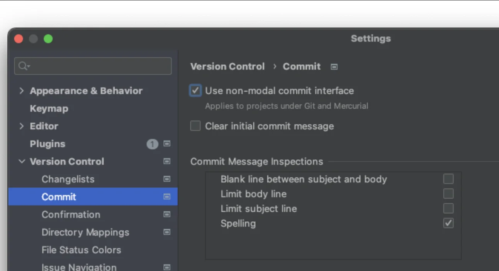
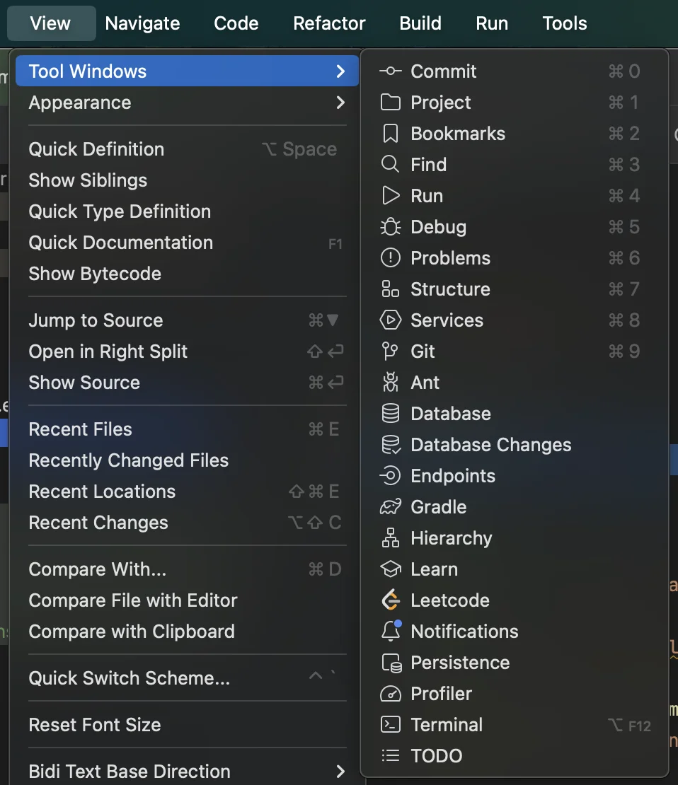
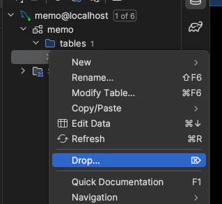
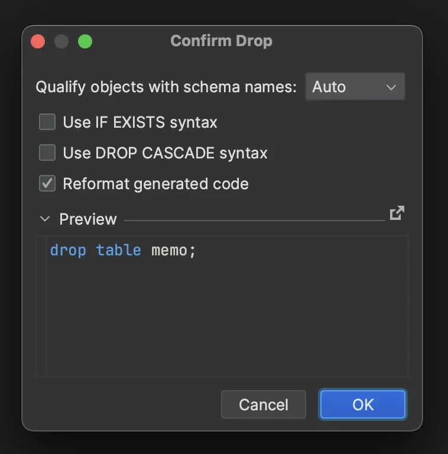

[인텔리제 단축키](#/post/1c3eda9b-0fe1-8159-b9f7-cf882d372b0b)

<a href="https://engineerinsight.tistory.com/90">commit 아이콘 사려졌을 시</a>

> settings →  version control →  commit

- Use non&#45;model commit interface 체크

Tool Windows bar

intelliJ 에서의 테이블 <code>drop</code>

[인텔리제이에서 로컬 히스토리 작업 내역 보기](#/post/1c3eda9b-0fe1-81b4-8170-e9dcc623c807)

[IntelliJ에서의 환경변수 설정](#/post/1c3eda9b-0fe1-81d1-b646-c18c81213091)
