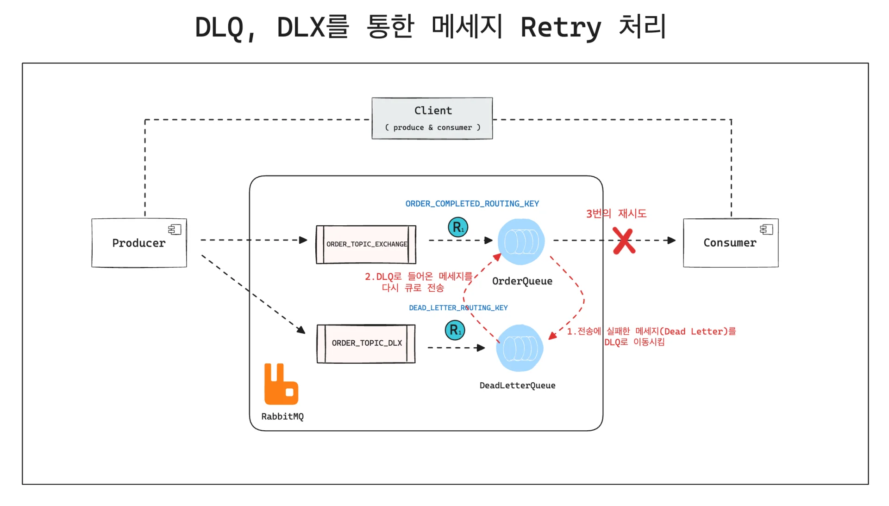
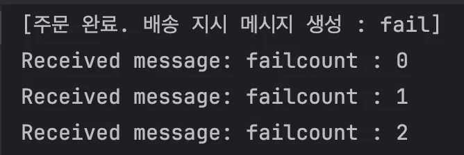
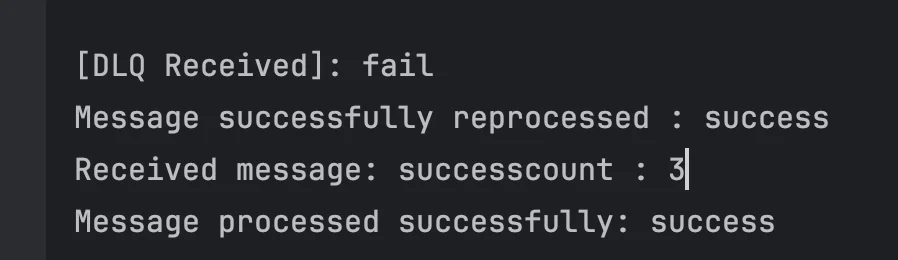

<a id="1c3eda9b0fe181868c47e1c3dc007243"></a>

## Retry 설정을 통한 DeadLetter 재처리

---



<a id="1c3eda9b0fe18165a097cb5e07a9b1af"></a>

### 코드

[step8.2: 설정 파일(application.yml)을 통한 retry 처리](https://github.com/gyungsubLee/RabbitMQ_prac/commit/02e2162ba3560e55522b3725692afd8d92fd655d)

<details>
<summary><code>retry 설정</code>&#58; application&#46;yml</summary>

<a id="1c3eda9b0fe181809a98dbced4a9e066"></a>

```yaml
spring:
  rabbitmq:
    host: ${RABBITMQ_HOST:localhost}
    port: 5672
    username: ${RABBITMQ_USER:admin}
    password: ${RABBITMQ_PASS:admin}
    listener:
      simple:
        retry:
          enabled: true # 재시도 활성화
          initial-interval: 1000 # 첫 재시도 대기 시간 1초
          max-attempts: 3 # 최대 재시도 횟수
          max-interval: 1000 #최 시도간 최대 대기시간
        default-requeue-rejected: false
  application:
    name: rabbitmq
server:
  port: 8080
```

</details>

<details>
<summary><code>retry 처리</code>&#58; OrderDeadLetterRetry</summary>

<a id="1c3eda9b0fe181eaa623c58905fb1622"></a>

```java
package com.prac.rabbimq.step8_2;

import org.springframework.amqp.rabbit.annotation.RabbitListener;
import org.springframework.amqp.rabbit.core.RabbitTemplate;
import org.springframework.stereotype.Component;

/**
 * 데드레터로 들어온 메시지를 Requeue
 *
 * @author gyungsubLee:
 * @fileName : OrderDeadLetterRetry
 * @since : 03/09/25
 */
@Component
public class OrderDeadLetterRetry {

    private final RabbitTemplate rabbitTemplate;

    public OrderDeadLetterRetry(RabbitTemplate rabbitTemplate) {
        this.rabbitTemplate = rabbitTemplate;
    }

    @RabbitListener(queues = RabbitMQConfig.DLQ)
    public void processDlqMessage(String failedMessage) {
        try {
            System.out.println("[DLQ Received]: " + failedMessage);

            // 실패한 메시지를 성공 메시지로 변경
            String message = "success";

            // 수정된 메시지를 원래 큐로 재전송
            rabbitTemplate.convertAndSend(RabbitMQConfig.ORDER_TOPIC_EXCHANGE,
                    "order.completed.shipping",
                    message);

            System.out.println("Message successfully reprocessed : " + message);

        } catch (Exception e) {
            System.err.println("Error processing DLQ message : " + e);
        }
    }
}
```

</details>

<details>
<summary><code>config</code>&#58; RabbitMQConfig</summary>

<a id="1c3eda9b0fe1816b92fef3f745fa16b2"></a>

```java
package com.prac.rabbimq.step8_2;

import org.springframework.amqp.core.*;
import org.springframework.context.annotation.Bean;
import org.springframework.context.annotation.Configuration;

@Configuration
public class RabbitMQConfig {

    public static final String ORDER_COMPLETED_QUEUE = "orderCompletedQueue";
    public static final String DLQ = "deadLetterQueue";
    public static final String ORDER_TOPIC_EXCHANGE = "orderExchange";
    public static final String ORDER_TOPIC_DLX = "deadLetterExchange";
    public static final String DEAD_LETTER_ROUTING_KEY = "dead.letter";
    @Bean

    public TopicExchange exchange() {
        return new TopicExchange(ORDER_TOPIC_EXCHANGE);
    }

    @Bean
    public TopicExchange deadLetterExchange() {
        return new TopicExchange(ORDER_TOPIC_DLX);
    }

    @Bean
    public Queue queue() {
        return QueueBuilder.durable(ORDER_COMPLETED_QUEUE)
                .withArgument("x-dead-letter-exchange", ORDER_TOPIC_DLX)
                .withArgument("x-dead-letter-routing-key", DEAD_LETTER_ROUTING_KEY)
                .build();
    }

    @Bean
    public Queue deadLetterQueue() {
        return new Queue(DLQ);
    }

    @Bean
    public Binding binding() {

        return BindingBuilder.bind(queue()).to(exchange()).with("order.completed.*");
    }

    @Bean
    public Binding deadLetterBinding() {
        return BindingBuilder.bind(deadLetterQueue()).to(deadLetterExchange()).with(DEAD_LETTER_ROUTING_KEY);
    }

}
```

</details>

<details>
<summary><code>producer</code>&#58; OrderProducer</summary>

<a id="1c3eda9b0fe1811f87eada7e6e6f90a1"></a>

```java
package com.prac.rabbimq.step8_1;

import org.springframework.amqp.rabbit.core.RabbitTemplate;
import org.springframework.stereotype.Component;

@Component
public class OrderProducer {
    private final RabbitTemplate rabbitTemplate;

    public OrderProducer(RabbitTemplate rabbitTemplate) {
        this.rabbitTemplate = rabbitTemplate;
    }

    public void sendShipping(String message) {
        rabbitTemplate.convertAndSend(RabbitMQConfig.ORDER_TOPIC_EXCHANGE, "order.completed", message);
        System.out.println("[주문 완료. 배송 지시 메시지 생성 : " + message + "]");
    }
}
```

</details>

<details>
<summary><code>consumer</code>&#58; OrderConsumer</summary>

<a id="1c3eda9b0fe181a0850bf677520758ea"></a>

```java
package com.prac.rabbimq.step8_2;

import org.springframework.amqp.rabbit.core.RabbitTemplate;
import org.springframework.stereotype.Component;

@Component
public class OrderProducer {
    private final RabbitTemplate rabbitTemplate;

    public OrderProducer(RabbitTemplate rabbitTemplate) {
        this.rabbitTemplate = rabbitTemplate;
    }

    public void sendShipping(String message) {
        rabbitTemplate.convertAndSend(RabbitMQConfig.ORDER_TOPIC_EXCHANGE, "order.completed.shipping", message);
        System.out.println("[주문 완료. 배송 지시 메시지 생성 : " + message + "]");
    }
}
```

</details>

<details>
<summary><code>controller</code>&#58; OrderController</summary>

<a id="1c3eda9b0fe181a19b22ef43999e9570"></a>

```java
package com.prac.rabbimq.step8_2;

import org.springframework.http.ResponseEntity;
import org.springframework.web.bind.annotation.*;

@RestController
@RequestMapping("/api/order")
public class OrderController {

    private final OrderProducer orderProducer;

    public OrderController(OrderProducer orderProducer) {
        this.orderProducer = orderProducer;
    }

    @GetMapping
    public ResponseEntity<String> sendOrderMessage(@RequestParam String message) {

        orderProducer.sendShipping(message);
        return ResponseEntity.ok("Order Completed Message sent: " + message);
    }
}
```

</details>

---

<details>
<summary>curl 테스트</summary>

<a id="1c3eda9b0fe181a0b9b7d279b07ff679"></a>

```plaintext
curl -X GET "http://localhost:8080/api/order?message=fail"
```

<details>
<summary>로그 출력 내용</summary>

<a id="1c3eda9b0fe1814e9648e30fa326382d"></a>

```java
[주문 완료. 배송 지시 메시지 생성 : fail]
Received message: failcount : 0
Received message: failcount : 1
Received message: failcount : 2
2025-03-09T22:20:15.888+09:00  WARN 4013 --- [rabbitmq] [ntContainer#0-1] o.s.a.r.r.RejectAndDontRequeueRecoverer  : Retries exhausted for message (Body:'fail' MessageProperties [headers={}, contentType=text/plain, contentEncoding=UTF-8, contentLength=0, receivedDeliveryMode=PERSISTENT, priority=0, redelivered=false, receivedExchange=orderExchange, receivedRoutingKey=order.completed.shipping, deliveryTag=6, consumerTag=amq.ctag-qqwGrxkTV2kuZ8yfjYRrTA, consumerQueue=orderCompletedQueue])

org.springframework.amqp.rabbit.support.ListenerExecutionFailedException: Listener method 'public void com.prac.rabbimq.step8_2.OrderConsumer.processMessage(java.lang.String)' threw exception
	at org.springframework.amqp.rabbit.listener.adapter.MessagingMessageListenerAdapter.invokeHandler(MessagingMessageListenerAdapter.java:279) ~[spring-rabbit-3.2.3.jar:3.2.3]
	at org.springframework.amqp.rabbit.listener.adapter.MessagingMessageListenerAdapter.invokeHandlerAndProcessResult(MessagingMessageListenerAdapter.java:217) ~[spring-rabbit-3.2.3.jar:3.2.3]
	at org.springframework.amqp.rabbit.listener.adapter.MessagingMessageListenerAdapter.onMessage(MessagingMessageListenerAdapter.java:148) ~[spring-rabbit-3.2.3.jar:3.2.3]
	at org.springframework.amqp.rabbit.listener.AbstractMessageListenerContainer.doInvokeListener(AbstractMessageListenerContainer.java:1694) ~[spring-rabbit-3.2.3.jar:3.2.3]
	at org.springframework.amqp.rabbit.listener.AbstractMessageListenerContainer.actualInvokeListener(AbstractMessageListenerContainer.java:1616) ~[spring-rabbit-3.2.3.jar:3.2.3]
	at java.base/jdk.internal.reflect.NativeMethodAccessorImpl.invoke0(Native Method) ~[na:na]
	at java.base/jdk.internal.reflect.NativeMethodAccessorImpl.invoke(NativeMethodAccessorImpl.java:77) ~[na:na]
	at java.base/jdk.internal.reflect.DelegatingMethodAccessorImpl.invoke(DelegatingMethodAccessorImpl.java:43) ~[na:na]
	at java.base/java.lang.reflect.Method.invoke(Method.java:569) ~[na:na]
	at org.springframework.aop.support.AopUtils.invokeJoinpointUsingReflection(AopUtils.java:359) ~[spring-aop-6.2.3.jar:6.2.3]
	at org.springframework.aop.framework.ReflectiveMethodInvocation.invokeJoinpoint(ReflectiveMethodInvocation.java:196) ~[spring-aop-6.2.3.jar:6.2.3]
	at org.springframework.aop.framework.ReflectiveMethodInvocation.proceed(ReflectiveMethodInvocation.java:163) ~[spring-aop-6.2.3.jar:6.2.3]
	at org.springframework.retry.interceptor.RetryOperationsInterceptor$1.doWithRetry(RetryOperationsInterceptor.java:114) ~[spring-retry-2.0.11.jar:na]
	at org.springframework.retry.support.RetryTemplate.doExecute(RetryTemplate.java:357) ~[spring-retry-2.0.11.jar:na]
	at org.springframework.retry.support.RetryTemplate.execute(RetryTemplate.java:246) ~[spring-retry-2.0.11.jar:na]
	at org.springframework.retry.interceptor.RetryOperationsInterceptor.invoke(RetryOperationsInterceptor.java:135) ~[spring-retry-2.0.11.jar:na]
	at org.springframework.aop.framework.ReflectiveMethodInvocation.proceed(ReflectiveMethodInvocation.java:184) ~[spring-aop-6.2.3.jar:6.2.3]
	at org.springframework.aop.framework.JdkDynamicAopProxy.invoke(JdkDynamicAopProxy.java:223) ~[spring-aop-6.2.3.jar:6.2.3]
	at org.springframework.amqp.rabbit.listener.$Proxy72.invokeListener(Unknown Source) ~[na:3.2.3]
	at org.springframework.amqp.rabbit.listener.AbstractMessageListenerContainer.invokeListener(AbstractMessageListenerContainer.java:1604) ~[spring-rabbit-3.2.3.jar:3.2.3]
	at org.springframework.amqp.rabbit.listener.AbstractMessageListenerContainer.doExecuteListener(AbstractMessageListenerContainer.java:1595) ~[spring-rabbit-3.2.3.jar:3.2.3]
	at org.springframework.amqp.rabbit.listener.AbstractMessageListenerContainer.executeListenerAndHandleException(AbstractMessageListenerContainer.java:1540) ~[spring-rabbit-3.2.3.jar:3.2.3]
	at org.springframework.amqp.rabbit.listener.AbstractMessageListenerContainer.lambda$executeListener$8(AbstractMessageListenerContainer.java:1518) ~[spring-rabbit-3.2.3.jar:3.2.3]
	at io.micrometer.observation.Observation.observe(Observation.java:498) ~[micrometer-observation-1.14.4.jar:1.14.4]
	at org.springframework.amqp.rabbit.listener.AbstractMessageListenerContainer.executeListener(AbstractMessageListenerContainer.java:1518) ~[spring-rabbit-3.2.3.jar:3.2.3]
	at org.springframework.amqp.rabbit.listener.SimpleMessageListenerContainer.doReceiveAndExecute(SimpleMessageListenerContainer.java:1086) ~[spring-rabbit-3.2.3.jar:3.2.3]
	at org.springframework.amqp.rabbit.listener.SimpleMessageListenerContainer.receiveAndExecute(SimpleMessageListenerContainer.java:1022) ~[spring-rabbit-3.2.3.jar:3.2.3]
	at org.springframework.amqp.rabbit.listener.SimpleMessageListenerContainer$AsyncMessageProcessingConsumer.mainLoop(SimpleMessageListenerContainer.java:1425) ~[spring-rabbit-3.2.3.jar:3.2.3]
	at org.springframework.amqp.rabbit.listener.SimpleMessageListenerContainer$AsyncMessageProcessingConsumer.run(SimpleMessageListenerContainer.java:1326) ~[spring-rabbit-3.2.3.jar:3.2.3]
	at java.base/java.lang.Thread.run(Thread.java:840) ~[na:na]
Caused by: java.lang.RuntimeException: - Processing failed. Retry
	at com.prac.rabbimq.step8_2.OrderConsumer.processMessage(OrderConsumer.java:14) ~[main/:na]
	at java.base/jdk.internal.reflect.NativeMethodAccessorImpl.invoke0(Native Method) ~[na:na]
	at java.base/jdk.internal.reflect.NativeMethodAccessorImpl.invoke(NativeMethodAccessorImpl.java:77) ~[na:na]
	at java.base/jdk.internal.reflect.DelegatingMethodAccessorImpl.invoke(DelegatingMethodAccessorImpl.java:43) ~[na:na]
	at java.base/java.lang.reflect.Method.invoke(Method.java:569) ~[na:na]
	at org.springframework.messaging.handler.invocation.InvocableHandlerMethod.doInvoke(InvocableHandlerMethod.java:169) ~[spring-messaging-6.2.3.jar:6.2.3]
	at org.springframework.amqp.rabbit.listener.adapter.KotlinAwareInvocableHandlerMethod.doInvoke(KotlinAwareInvocableHandlerMethod.java:45) ~[spring-rabbit-3.2.3.jar:3.2.3]
	at org.springframework.messaging.handler.invocation.InvocableHandlerMethod.invoke(InvocableHandlerMethod.java:119) ~[spring-messaging-6.2.3.jar:6.2.3]
	at org.springframework.amqp.rabbit.listener.adapter.HandlerAdapter.invoke(HandlerAdapter.java:75) ~[spring-rabbit-3.2.3.jar:3.2.3]
	at org.springframework.amqp.rabbit.listener.adapter.MessagingMessageListenerAdapter.invokeHandler(MessagingMessageListenerAdapter.java:270) ~[spring-rabbit-3.2.3.jar:3.2.3]
	... 29 common frames omitted

2025-03-09T22:20:15.897+09:00  WARN 4013 --- [rabbitmq] [ntContainer#0-1] s.a.r.l.ConditionalRejectingErrorHandler : Execution of Rabbit message listener failed.

org.springframework.amqp.rabbit.support.ListenerExecutionFailedException: Retry Policy Exhausted
	at org.springframework.amqp.rabbit.retry.RejectAndDontRequeueRecoverer.recover(RejectAndDontRequeueRecoverer.java:76) ~[spring-rabbit-3.2.3.jar:3.2.3]
	at org.springframework.amqp.rabbit.config.StatelessRetryOperationsInterceptorFactoryBean.recover(StatelessRetryOperationsInterceptorFactoryBean.java:78) ~[spring-rabbit-3.2.3.jar:3.2.3]
	at org.springframework.retry.interceptor.RetryOperationsInterceptor$ItemRecovererCallback.recover(RetryOperationsInterceptor.java:150) ~[spring-retry-2.0.11.jar:na]
	at org.springframework.retry.support.RetryTemplate.handleRetryExhausted(RetryTemplate.java:573) ~[spring-retry-2.0.11.jar:na]
	at org.springframework.retry.support.RetryTemplate.doExecute(RetryTemplate.java:418) ~[spring-retry-2.0.11.jar:na]
	at org.springframework.retry.support.RetryTemplate.execute(RetryTemplate.java:246) ~[spring-retry-2.0.11.jar:na]
	at org.springframework.retry.interceptor.RetryOperationsInterceptor.invoke(RetryOperationsInterceptor.java:135) ~[spring-retry-2.0.11.jar:na]
	at org.springframework.aop.framework.ReflectiveMethodInvocation.proceed(ReflectiveMethodInvocation.java:184) ~[spring-aop-6.2.3.jar:6.2.3]
	at org.springframework.aop.framework.JdkDynamicAopProxy.invoke(JdkDynamicAopProxy.java:223) ~[spring-aop-6.2.3.jar:6.2.3]
	at org.springframework.amqp.rabbit.listener.$Proxy72.invokeListener(Unknown Source) ~[na:3.2.3]
	at org.springframework.amqp.rabbit.listener.AbstractMessageListenerContainer.invokeListener(AbstractMessageListenerContainer.java:1604) ~[spring-rabbit-3.2.3.jar:3.2.3]
	at org.springframework.amqp.rabbit.listener.AbstractMessageListenerContainer.doExecuteListener(AbstractMessageListenerContainer.java:1595) ~[spring-rabbit-3.2.3.jar:3.2.3]
	at org.springframework.amqp.rabbit.listener.AbstractMessageListenerContainer.executeListenerAndHandleException(AbstractMessageListenerContainer.java:1540) ~[spring-rabbit-3.2.3.jar:3.2.3]
	at org.springframework.amqp.rabbit.listener.AbstractMessageListenerContainer.lambda$executeListener$8(AbstractMessageListenerContainer.java:1518) ~[spring-rabbit-3.2.3.jar:3.2.3]
	at io.micrometer.observation.Observation.observe(Observation.java:498) ~[micrometer-observation-1.14.4.jar:1.14.4]
	at org.springframework.amqp.rabbit.listener.AbstractMessageListenerContainer.executeListener(AbstractMessageListenerContainer.java:1518) ~[spring-rabbit-3.2.3.jar:3.2.3]
	at org.springframework.amqp.rabbit.listener.SimpleMessageListenerContainer.doReceiveAndExecute(SimpleMessageListenerContainer.java:1086) ~[spring-rabbit-3.2.3.jar:3.2.3]
	at org.springframework.amqp.rabbit.listener.SimpleMessageListenerContainer.receiveAndExecute(SimpleMessageListenerContainer.java:1022) ~[spring-rabbit-3.2.3.jar:3.2.3]
	at org.springframework.amqp.rabbit.listener.SimpleMessageListenerContainer$AsyncMessageProcessingConsumer.mainLoop(SimpleMessageListenerContainer.java:1425) ~[spring-rabbit-3.2.3.jar:3.2.3]
	at org.springframework.amqp.rabbit.listener.SimpleMessageListenerContainer$AsyncMessageProcessingConsumer.run(SimpleMessageListenerContainer.java:1326) ~[spring-rabbit-3.2.3.jar:3.2.3]
	at java.base/java.lang.Thread.run(Thread.java:840) ~[na:na]
Caused by: org.springframework.amqp.AmqpRejectAndDontRequeueException: null
	... 21 common frames omitted
Caused by: org.springframework.amqp.rabbit.support.ListenerExecutionFailedException: Listener method 'public void com.prac.rabbimq.step8_2.OrderConsumer.processMessage(java.lang.String)' threw exception
	at org.springframework.amqp.rabbit.listener.adapter.MessagingMessageListenerAdapter.invokeHandler(MessagingMessageListenerAdapter.java:279) ~[spring-rabbit-3.2.3.jar:3.2.3]
	at org.springframework.amqp.rabbit.listener.adapter.MessagingMessageListenerAdapter.invokeHandlerAndProcessResult(MessagingMessageListenerAdapter.java:217) ~[spring-rabbit-3.2.3.jar:3.2.3]
	at org.springframework.amqp.rabbit.listener.adapter.MessagingMessageListenerAdapter.onMessage(MessagingMessageListenerAdapter.java:148) ~[spring-rabbit-3.2.3.jar:3.2.3]
	at org.springframework.amqp.rabbit.listener.AbstractMessageListenerContainer.doInvokeListener(AbstractMessageListenerContainer.java:1694) ~[spring-rabbit-3.2.3.jar:3.2.3]
	at org.springframework.amqp.rabbit.listener.AbstractMessageListenerContainer.actualInvokeListener(AbstractMessageListenerContainer.java:1616) ~[spring-rabbit-3.2.3.jar:3.2.3]
	at java.base/jdk.internal.reflect.NativeMethodAccessorImpl.invoke0(Native Method) ~[na:na]
	at java.base/jdk.internal.reflect.NativeMethodAccessorImpl.invoke(NativeMethodAccessorImpl.java:77) ~[na:na]
	at java.base/jdk.internal.reflect.DelegatingMethodAccessorImpl.invoke(DelegatingMethodAccessorImpl.java:43) ~[na:na]
	at java.base/java.lang.reflect.Method.invoke(Method.java:569) ~[na:na]
	at org.springframework.aop.support.AopUtils.invokeJoinpointUsingReflection(AopUtils.java:359) ~[spring-aop-6.2.3.jar:6.2.3]
	at org.springframework.aop.framework.ReflectiveMethodInvocation.invokeJoinpoint(ReflectiveMethodInvocation.java:196) ~[spring-aop-6.2.3.jar:6.2.3]
	at org.springframework.aop.framework.ReflectiveMethodInvocation.proceed(ReflectiveMethodInvocation.java:163) ~[spring-aop-6.2.3.jar:6.2.3]
	at org.springframework.retry.interceptor.RetryOperationsInterceptor$1.doWithRetry(RetryOperationsInterceptor.java:114) ~[spring-retry-2.0.11.jar:na]
	at org.springframework.retry.support.RetryTemplate.doExecute(RetryTemplate.java:357) ~[spring-retry-2.0.11.jar:na]
	... 16 common frames omitted
Caused by: java.lang.RuntimeException: - Processing failed. Retry
	at com.prac.rabbimq.step8_2.OrderConsumer.processMessage(OrderConsumer.java:14) ~[main/:na]
	at java.base/jdk.internal.reflect.NativeMethodAccessorImpl.invoke0(Native Method) ~[na:na]
	at java.base/jdk.internal.reflect.NativeMethodAccessorImpl.invoke(NativeMethodAccessorImpl.java:77) ~[na:na]
	at java.base/jdk.internal.reflect.DelegatingMethodAccessorImpl.invoke(DelegatingMethodAccessorImpl.java:43) ~[na:na]
	at java.base/java.lang.reflect.Method.invoke(Method.java:569) ~[na:na]
	at org.springframework.messaging.handler.invocation.InvocableHandlerMethod.doInvoke(InvocableHandlerMethod.java:169) ~[spring-messaging-6.2.3.jar:6.2.3]
	at org.springframework.amqp.rabbit.listener.adapter.KotlinAwareInvocableHandlerMethod.doInvoke(KotlinAwareInvocableHandlerMethod.java:45) ~[spring-rabbit-3.2.3.jar:3.2.3]
	at org.springframework.messaging.handler.invocation.InvocableHandlerMethod.invoke(InvocableHandlerMethod.java:119) ~[spring-messaging-6.2.3.jar:6.2.3]
	at org.springframework.amqp.rabbit.listener.adapter.HandlerAdapter.invoke(HandlerAdapter.java:75) ~[spring-rabbit-3.2.3.jar:3.2.3]
	at org.springframework.amqp.rabbit.listener.adapter.MessagingMessageListenerAdapter.invokeHandler(MessagingMessageListenerAdapter.java:270) ~[spring-rabbit-3.2.3.jar:3.2.3]
	... 29 common frames omitted

[DLQ Received]: fail
Message successfully reprocessed : success
Received message: successcount : 3
Message processed successfully: success
```

</details>





</details>
