<a id="1c3eda9b0fe18147a02af1509311004b"></a>

## Database

<details>
<summary><strong>DBMS</strong></summary>

> <em><strong>D</strong></em><em><strong>ata</strong></em><em><strong>b</strong></em><em><strong>ase </strong></em><em><strong>M</strong></em><em><strong>anagement </strong></em><em><strong>S</strong></em><em><strong>ystem</strong></em>

<a id="1c3eda9b0fe18132ae4ad61e5f038126"></a>

 Database를 관리하고 운영하는 소프트웨어를 의미

</details>

<details>
<summary><strong>RDBMS</strong></summary>

> <em><strong>Relational DBMS, </strong></em>관계형 데이터베이스

<a id="1c3eda9b0fe1816e8c29e3c640a3fa72"></a>

RDBMS는 테이블(table)이라는 최소 단위로 구성되며, 이 테이블은 열(column)과 행(row)으로 이루어져 있다&#46;

<a id="1c3eda9b0fe18139b8d9cec5e0fcec5a"></a>

테이블간 FK(Foreign Key)를 통해 다른 데이터를 조합해서 함께 볼수 있다는 장점이 있다&#46; 

> 💡 유료인 Oracle을 제외하고 보통 MySQL, PostgreSQL을 많이 사용함

- MySQL
    - 실제 서비스를 배포할 때 사용할 데이터베이스

    - AWS RDS 라는 서비스를 사용해 붙여볼 예정임

    - Spring과 궁합이 좋아서 많은 회사에서 사용하고 있음

</details>

<a id="1c3eda9b0fe181fb9d4fc4fd307233e5"></a>

### MySQL 인텔리제이 연동

<a id="1c3eda9b0fe1818f8548d3c5f638d2d3"></a>

<a href="#/post/1c3eda9b-0fe1-81ef-9506-cdc300921ef3">페이지</a> 

<details>
<summary>mysql 설치 &#45; homebrew</summary>

- mysql 설치
    <a id="1c3eda9b0fe181a6b455c69883ef224a"></a>

    ```shell
    brew install mysql
    ```

- 연결 실행
    <a id="1c3eda9b0fe1818c968ee2797ba96114"></a>

    ```shell
    mysql -u root
    ```

</details>

<details>
<summary><a href="https://velog.io/@dltjq2323/homebrew-Path-%EB%93%B1%EB%A1%9D">🧐 homebrew 환경변수 등록 </a></summary>


<a id="1c3eda9b0fe1815caa56da8b014cec68"></a>

brew 사용 시 위와 같은 오류가 발생함

> /opt/homebrew/bin is not in your PATH

<a id="1c3eda9b0fe18118a33cc9aca1376c71"></a>

PATH를 등록하지 않아서 발생하는 문제이다&#46; 

<a id="1c3eda9b0fe181eabda1f98536651805"></a>

아래의 명령어 입력

<a id="1c3eda9b0fe181c89393e7954eb610d0"></a>

```shell
echo 'export PATH=/opt/homebrew/bin:$PATH' >> ~/.zshrc
```

<a id="1c3eda9b0fe18165b07be4d079f13b1b"></a>

vim 으로  확인 시 아래와 같이 잘 등록된 것을 확인할 수 있음

<a id="1c3eda9b0fe181bf8284fa7a941ebd65"></a>

```shell
vi ./.zshrc
```

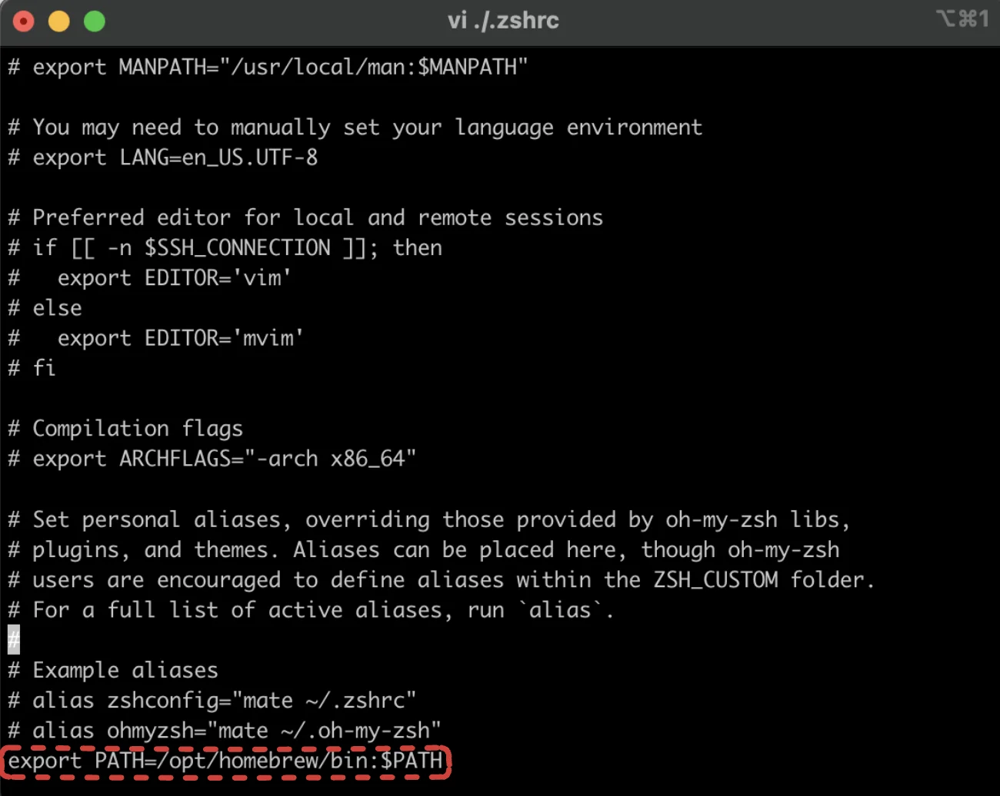

</details>

<details>
<summary>🤔 <strong>ERROR 2002 (HY000)</strong>&#58; Can&#39;t connect to local MySQL server through socket &#39;/tmp/mysql&#46;sock’</summary>

<a id="1c3eda9b0fe1814c9c2ac00bb39e39f1"></a>

<a href="#/post/1c3eda9b-0fe1-8128-aafa-c2c7162ce044">페이지</a> 

</details>

<details>
<summary>🧐 사용 중인 <a href="http://localhost:8080"><code>localhost&#58;8080</code></a>  kill 하기 </summary>

- <a href="http://localhost">localhost</a>&#58;8080 검색 → PID 확인
    <a id="1c3eda9b0fe18137806de9e86ae7758b"></a>

    ```shell
    lsof -n -i4TCP:8080
    ```

    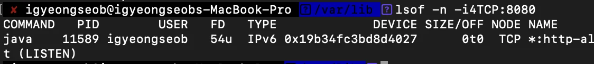

- 종료 
    <a id="1c3eda9b0fe1817a8073e7d7328c4801"></a>

    ```shell
    kill -15 [PID번호]
    ```

</details>

<details>
<summary>MySQL 실행 및 접속 </summary>

- MySQL 실행
    <a id="1c3eda9b0fe181969e5dd8b71852f158"></a>

    ```shell
    mysql.server start
    ```

- MySQL 접속
    <a id="1c3eda9b0fe1817a8ecdfba7ac80e2fa"></a>

    ```shell
     mysql -u root -p
    ```

</details>

<details>
<summary>Database 생성 및 접속</summary>

- academy 데이터베이스 생성
    <a id="1c3eda9b0fe181269232e1cd8eefedb5"></a>

    ```shell
    CREATE DATABASE academy
    ```

- 데이터베이스 목록 확인 
    <a id="1c3eda9b0fe18113b22df72fed80a0d0"></a>

    ```shell
    show databases
    ```

    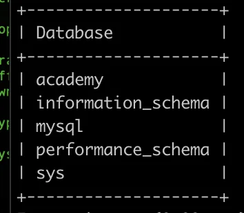

</details>

<details>
<summary>데이터베이스 이동 (사용)</summary>

<a id="1c3eda9b0fe181be8d20e391545fee65"></a>

```shell
use academy;
```

</details>

<a id="1c3eda9b0fe181798cf9dc4c93670f19"></a>

### 인텔리제이 연동

<details>
<summary>연동 순서</summary>

1. Database 탭 클릭 → <code>&#43;</code>
    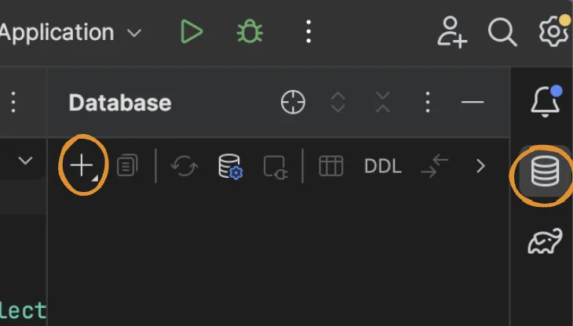

1. Data Source → MySQL
    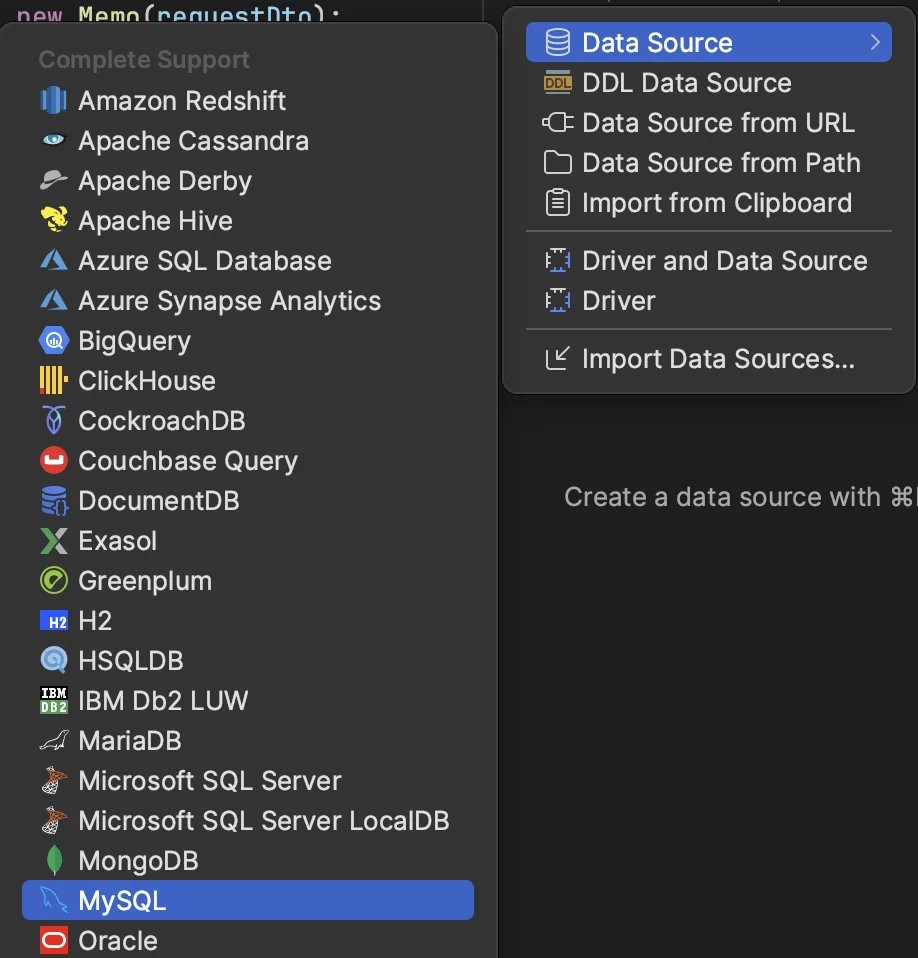

1. User, Password, Database 정보 추가 후 OK
    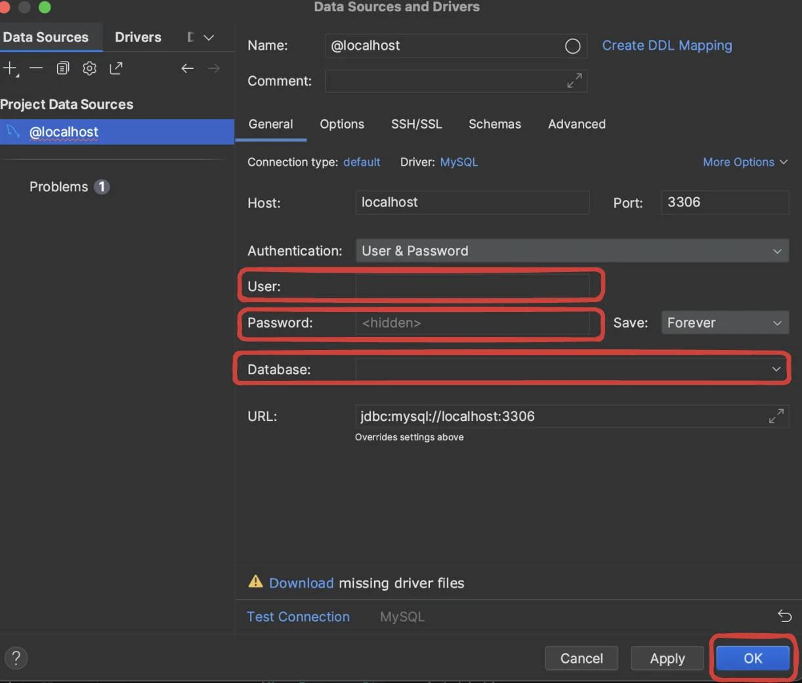

1. MySQL Database 연결 
    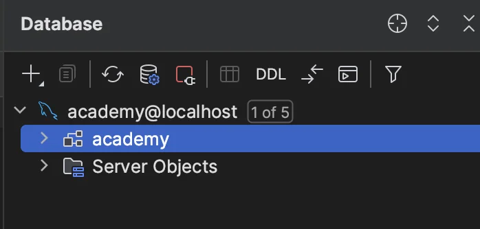

</details>

<details>
<summary>인텔리제이에서 mysql 콘솔창 열기</summary>

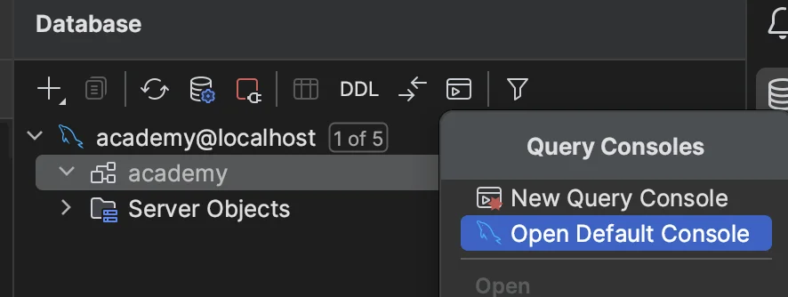

</details>

- 콘솔창 실행&#58; <code>cmd</code> &#43; <code>enter</code>

<a id="1c3eda9b0fe181629a6ff7956f4c7ca4"></a>

## SQL

> <a href="#/post/1c3eda9b-0fe1-81d1-803d-e9d68b415784">페이지</a> 

<a id="1c3eda9b0fe181349cf3cd94d4a18acf"></a>

### DDL

> <strong>D</strong><strong>ata </strong><strong>D</strong><strong>efinition </strong><strong>L</strong><strong>anguage</strong>

<a id="1c3eda9b0fe181f39882e81806e8b129"></a>

<strong><u>테이블</u></strong>이나 <strong><u>관계의 구조</u></strong>를 <strong>생성</strong>

---

<details>
<summary><code>CREATE</code>&#58; 새로운 데이터베이스 및 테이블을 <strong>생성</strong></summary>

<a id="1c3eda9b0fe181ca8ae4e1cfc39d2385"></a>

```sql
CREATE DATABASE 데이터베이스이름;
CREATE TABLE 테이블이름
(
		필드이름1 필드타입1,
    필드이름2 필드타입2,
    ...
);
```

</details>

<details>
<summary><code>ALTER</code>&#58; 데이터베이스와 테이블의 내용을 <strong>수정</strong></summary>

<a id="1c3eda9b0fe1812cab45d3c667c76bb3"></a>

```sql
ALTER TABLE 테이블이름 ADD 필드이름 필드타입;
ALTER TABLE 테이블이름 DROP 필드이름;
ALTER TABLE 테이블이름 MODIFY COLUMN 필드이름 필드타입;
```

</details>

<details>
<summary><code>DROP</code>&#58; <strong>삭제</strong><strong>, 데이터 및 테이블 </strong><strong><u>전체</u></strong>를 삭제</summary>

<a id="1c3eda9b0fe1818596b1fd2ddc3b41a6"></a>

```sql
DROP DATABASE 데이터베이스이름;
DROP TABLE 테이블이름;
```

</details>

<details>
<summary><code>TRUNCATE</code>&#58; <strong>삭제</strong>, <strong>최초 테이블이 만</strong>들어졌던 상태 즉, <strong>컬럼 값만 남</strong>김</summary>

<a id="1c3eda9b0fe18148bc7df8f429ff7b59"></a>

```sql
TRUNCATE DATABASE 데이터베이스이름;
TRUNCATE TABLE 테이블이름;
```

</details>

<a id="1c3eda9b0fe181159536d99050588375"></a>

### DCL

> <strong>D</strong><strong>ata </strong><strong>C</strong><strong>ontrol </strong><strong>L</strong><strong>anguage</strong>

<a id="1c3eda9b0fe1813cb919f9ec6b7ef7a6"></a>

데이터의<strong> 사용 권한을 관리</strong>하는데 사용

---

<details>
<summary><code>GRANT</code> &#58; 사용자 또는 ROLE에 대해 <strong><u>권한을 부여</u></strong></summary>

<a id="1c3eda9b0fe1816789a8fd47c2076a85"></a>

```sql
GRANT [객체권한명] (컬럼)
ON [객체명]
TO { 유저명 | 롤명 | PUBLC} [WITH GRANT OPTION];
```

<a id="1c3eda9b0fe181caa21df0aeb550157e"></a>

```sql
//ex
GRANT SELECT ,INSERT 
ON mp
TO scott WITH GRANT OPTION;
```

</details>

<details>
<summary><code>REVOKE</code>&#58; 사용자 또는 ROLE에 <strong><u>부여한 권한을 회수</u></strong></summary>

<a id="1c3eda9b0fe1819faa0aced0cc825286"></a>

```sql
REVOKE { 권한명 [, 권한명...] ALL}
ON 객체명
FROM {유저명 [, 유저명...] | 롤명(ROLE) | PUBLIC} 
[CASCADE CONSTRAINTS];
```

<a id="1c3eda9b0fe181bd9d40d1d7f0dafff3"></a>

```sql
//ex
REVOKE SELECT , INSERT
ON emp
FROM scott
[CASCADE CONSTRAINTS];
```

</details>

<a id="1c3eda9b0fe18120b9c2c458f72baa11"></a>

### DML

> <strong>D</strong><strong>ata </strong><strong>M</strong><strong>anipulation </strong><strong>L</strong><strong>anguage, 데이터 조작어</strong>

<a id="1c3eda9b0fe181e981bbd6d10cc729ee"></a>

<strong>테이블 내  데이터</strong>를 <strong>검색, 삽입, 수정, 삭제</strong>

---

<details>
<summary><code>INSERT</code>&#58; 테이블에 <strong>새로운 row를 추가</strong></summary>

<a id="1c3eda9b0fe181eb8957fa0d5c95a527"></a>

```sql
INSERT INTO 테이블이름(필드이름1, 필드이름2, 필드이름3, ...) VALUES(데이터값1, 데이터값2, 데이터값3, ...);
```

<a id="1c3eda9b0fe18185bbbbccc063be8f32"></a>

```sql
INSERT INTO 테이블이름 VALUES(데이터값1, 데이터값2, 데이터값3, ...);
```

</details>

<details>
<summary><code>SELECT</code>&#58; 테이블의 <strong>row를 선택</strong></summary>

<a id="1c3eda9b0fe181e7af83d64044c7d98d"></a>

```sql
SELECT 필드이름 FROM 테이블이름 [WHERE 조건];
```

</details>

<details>
<summary><code>UPDATE</code>&#58; 테이블의 <strong>row의 내용을 수정</strong></summary>

<a id="1c3eda9b0fe181e59fe4e649c7c8e4e0"></a>

```sql
UPDATE 테이블이름 SET 필드이름1=데이터값1, 필드이름2=데이터값2, ... WHERE 필드이름=데이터값;
```

</details>

<details>
<summary><code>DELETE</code>&#58; 테이블의<strong> row를 삭제</strong></summary>

<a id="1c3eda9b0fe18134a4d3e0adbe562c02"></a>

```sql
DELETE FROM 테이블이름 WHERE 필드이름=데이터값;
```

</details>

<a id="1c3eda9b0fe181e7a277d386e386a45a"></a>

## SQL 연습하기 

> 📌 <strong>제약조건</strong>
> 
> <details>
> <summary><code>AUTO&#95;INCREMENT</code> &#58; 컬럼의 값이 중복되지 않게 1씩 자동으로 증가시켜 고유번호를 생성함 ( <strong>&#43;&#43;</strong> )</summary>
> 
> <a id="1c3eda9b0fe181edab0bf98e805ecd1a"></a>
> 
> ```sql
> CREATE TABLE 테이블이름
> (
>     필드이름 필드타입 AUTO_INCREMENT,
>     // id bigint AUTO_INCREMENT,
>     ...
> );
> ```
> 
> </details>
> 
> <details>
> <summary><code>NOT NULL</code> &#58; 해당 필드에 NULL 값 저장 ❌</summary>
> 
> <a id="1c3eda9b0fe18153bca5e50314c04d21"></a>
> 
> ```sql
> CREATE TABLE 테이블이름
> (
>     필드이름 필드타입 NOT NULL,
>     ...
> );
> ```
> 
> </details>
> 
> <details>
> <summary><code>UNIQUE</code> &#58; 해당 필드의 데이터들은 서로 다른 값, 즉 고유의 값을 가져야함</summary>
> 
> <a id="1c3eda9b0fe181a98b3cc27fd3fc2607"></a>
> 
> ```sql
> CREATE TABLE 테이블이름
> (
>     필드이름 필드타입 UNIQUE,
>     ...
> );
> ```
> 
> </details>
> 
> <details>
> <summary><code>PRIMARY KEY(PK)</code>&#58; 해당 필드는 <code>NOT NULL</code>과 <code>UNIQUE</code> 제약 조건을 모두 만족하는, <u>null 값이 아닌 </u><strong><u>고유한 key값</u></strong><u>을 가져야한</u>다&#46;  각 테이블마다 고유한 id 값을 지정헤애하는데, 이때 사용한다&#46;</summary>
> 
> <a id="1c3eda9b0fe1812a88eadb90ff9eeffc"></a>
> 
> ```sql
> CREATE TABLE 테이블이름
> (
>     필드이름 필드타입 PRIMARY KEY,
>     ...
> );
> ```
> 
> </details>
> 
> <details>
> <summary><code>FOREIGN KEY(FK)</code> &#58; <strong><u>테이블 간의 의존성을 더</u></strong>해주는 <strong>참조값을 형성</strong>한다&#46; <br>→ <strong>데이터의 </strong><strong><u>무결성</u></strong><strong>을 보장</strong></summary>
> 
> > 참조 테이블의 열은 반드시 <code>PK</code>, <code>UNIQUE </code>제약조건이 성립 해야한다&#46;
> 
> <a id="1c3eda9b0fe1817b8981e84cd7e63181"></a>
> 
> ```sql
> CREATE TABLE 테이블이름
> (
>     필드이름 필드타입,
>     ...
> 		FOREIGN KEY(필드이름)
>     REFERENCES 테이블이름(필드이름)
> );
> ```
> 
> </details>
> 
> <details>
> <summary><code>CASCADE</code> &#58; <strong><u>FK로 연관된 데이터를 삭제,변경</u></strong> 가능케 한다&#46;</summary>
> 
> <a id="1c3eda9b0fe1812bad6cd52cbf66e0da"></a>
> 
> ```sql
> CREATE TABLE 테이블이름
> (
>     필드이름 필드타입,
>     ...
> 		FOREIGN KEY(필드이름)
>     REFERENCES 테이블이름(필드이름) ON DELETE CASCADE 
> 														 //ON UPDATE CASCADE
> );
> ```
> 
> </details>

<a id="1c3eda9b0fe1813cac2cf266c103bca3"></a>

### 기본 키 ( PK, PRIMARY KEY )

> 📌 테이블 내에서 ‘<strong>고유한 값</strong>&#39;을 설정해서 <strong>중복된 데이터</strong>가 <strong>테이블에 삽입되는 것을 방지</strong>하는 제약조건이다&#46;

> <strong>🧐  왜 기본 키를 사용하는가?</strong>

<details>
<summary><strong>👍🏻  데이터 중복 방지 </strong></summary>

<a id="1c3eda9b0fe1816292a4d44264a0cd95"></a>

만약 회원 관리 테이블에 기본키를 설정하지 않는다고 가정하자<br>예전에 가입한 회원이 가입한 사실을 잊고서 다시 회원가입하여 동일한 회원 정보를 저장하는 2개의 테이블이 생겼다고 하자&#46; 해당 회원이 살던 곳을 옮기거나 전화번호가 바뀌어서 예전 테이블 정보와 새로 생긴 테이블의 정보가 다르다고 할때, 어떤 것이 새로 생긴 정보인지 구분할 것인가? 

> 🧐 그냥 테이블 생성 시간을 저장해서 구분하면 되는 것 아닌가?

<a id="1c3eda9b0fe1815caabbdc2314b3d6f4"></a>

PK를 만족하는 조건은 <strong><u><code>null</code></u></strong><strong><u> 값이 아</u></strong>니며 <strong><u>중복되지 않는 고유값</u></strong>을 가지는 것이다&#46;

<a id="1c3eda9b0fe1812082d5fd17f709217d"></a>

즉, 시간 컬럼을 만들어 저장하면 PK값을 부여하는 것과 동일한 의미이다&#46; 

<a id="1c3eda9b0fe18149b87bd34472507af9"></a>

따라서<strong><u> 각 테이블마다 </u></strong><strong><u>PK값</u></strong><strong><u>을 부여하</u></strong>여 <strong>데이터의 중복을 방지</strong>하여 <strong>데이터의 무결성</strong>을 지켜야 한다&#46; 

<a id="1c3eda9b0fe181bb8897c2966bd632a7"></a>

 

</details>

<details>
<summary>👍🏻 <strong>데이터 접근 속도 향상</strong></summary>

<a id="1c3eda9b0fe181bebbd9c114ac71af69"></a>

기본키 설정을 통해 <strong><u>각각의 테이블을 구분</u></strong>할 수 있으며, 이를 통해 DBMS는 <strong>테이블에 인덱스를 부여</strong>함으로써 <strong><u>빠르게 접근 가능</u></strong>하다&#46; 

<details>
<summary>ex) 주민번호 컬럼 &#45; 기본 키 설정 ❌ </summary>

<a id="1c3eda9b0fe18121bff0da25fb1bfe1d"></a>

우리는 주민번호가 절대 중복될 수 없다는 것을 알지만 DBMS는 그것을 모르기 때문에 주민번호가 중복될 수 있는 것을 가정하여 테이블의 row를 전부 확인한다&#46; 

<a id="1c3eda9b0fe1816a9523f96eba5ecbba"></a>

만약 1000만개라면 1000만개를 다 뒤져본다&#46; <br>이럴 때 주민번호에 <em><strong>기본 키 설정</strong></em>이 되어있으면 row를 전부 확인하지 않고 <strong><u>인덱스로  해당 데이터를 바로 접근</u></strong>하여 반환한다&#46;<br>

</details>

</details>

<a id="1c3eda9b0fe18184ab51e4aed8eaa731"></a>

### 외래 키 ( FK, FOREIGN KEY )

> 📌 <strong>두개의 테이블을 연결</strong>하는 <strong>다리</strong> 역할을 해주는 키이다&#46;

<details>
<summary>ex) 회원주문 테이블</summary>

<a id="1c3eda9b0fe181449852c477b1ad1bf9"></a>

손님이 주문 했을 때, 아래와 같이 하나의 테이블로 생성된다고 하자

| 회원&#95;id | 회원&#95;이름 | 주문&#95;id | 상품&#95;이름 | 상품&#95;수량 |
| --- | --- | --- | --- | --- |
| u&#95;1 | userA | o&#95;1 | item&#95;1 | 5 |
| u&#95;1 | userA | o&#95;2 | item&#95;2 | 3 |
| u&#95;1 | userA | o&#95;3 | item&#95;1 | 10 |
| u&#95;2 | userB | o&#95;4 | item&#95;3 | 7 |
| u&#95;2 | userB | o&#95;5 | item&#95;2 | 3 |

<a id="1c3eda9b0fe181b5b318dcee9344ad9a"></a>

위 테이블에 <code>회원&#95;id</code> 와 <code>회원&#95;이름</code>은  굳이 같은 의미를 나타내기 때문에 함께 관리할 필요가 없는 중복된 데이터이다&#46; 

> 🧐 그렇다면 2개의 테이블로 분리를 하는가?

- 회원테이블
    | 회원&#95;id | 회원&#95;이름 |
    | --- | --- |
    | u&#95;1 | userA |
    | u&#95;2 | userB |

- 주문 테이블
    | 주문&#95;id | 상품&#95;이름 | 상품&#95;수량 |
    | --- | --- | --- |
    | o&#95;1 | item&#95;1 | 5 |
    | o&#95;2 | item&#95;2 | 3 |
    | o&#95;3 | item&#95;1 | 10 |
    | o&#95;4 | item&#95;3 | 7 |
    | o&#95;5 | item&#95;2 | 3 |

<a id="1c3eda9b0fe181948043cb2b1e8208c0"></a>

위와 같이 2개의 테이블로 분리한다고 한다면 중복되는 의미를 나타내는  <code>회원&#95;id</code> 와 <code>회원&#95;이름</code>는 해결되지만 <strong><u>각 주문들에 대한 회원 정보가 사라진다</u></strong>&#46; 

<a id="1c3eda9b0fe18137a72ff6d2c9768e5d"></a>

이때 사용하는 것이 <strong>외래키</strong>이다&#46; 

> 👍🏻 외래키를 사용한 회원 주문 정보(<code>회원&#95;id</code>)추가


| 주문&#95;id | 상품&#95;이름 | 상품&#95;수량 | 회원&#95;id |
| --- | --- | --- | --- |
| o&#95;1 | item&#95;1 | 5 | u&#95;1 |
| o&#95;2 | item&#95;2 | 3 | u&#95;1 |
| o&#95;3 | item&#95;1 | 10 | u&#95;1 |
| o&#95;4 | item&#95;3 | 7 | u&#95;2 |
| o&#95;5 | item&#95;2 | 3 | u&#95;2 |

<a id="1c3eda9b0fe181b183c7fb66f0f486cd"></a>

위와 같이 <strong><u>외래키를 사용</u></strong>하여 <strong>중복 데이터를 제거</strong>하고 <strong>사용자 테이블에 접근해 주문을 한 사용자의 정보도 가져올 수 있</strong>다&#46;

<a id="1c3eda9b0fe1810ca490fa4f8931db63"></a>

또한 기본키와 같은 역활을 하여 중복된 데이터가 삽입되는 것을 방지하며

<a id="1c3eda9b0fe181a2a9dcf60ea2c9a701"></a>

데이터가 새롭게 추가될 때 외래 키에 해당하는 값이 외래 키가 참조하는 테이블에 존재하는지를 check 한다&#46;

</details>

<a id="1c3eda9b0fe18129b49ed2d8507378b1"></a>

### JOIN 

> 📌 테이블을 하나로 합치기 위해 데이터베이스가 제공하는 기능
> 
> - <code>ON</code> 이라는 키워드를 통해 기준이 되는 컬럼을 선택하여 2개의 테이블을 합친다&#46;
> 
> - <strong><u>JOIN을 할 때에는 적어도 하나의 컬럼을 서로 공유</u></strong>하고 있어야 하기 때문에 <strong>테이블에 외래 키가 설정 </strong>되어 있다면 <strong>해당 컬럼을 통해 JOIN 조건을 충족</strong>한다&#46;

> ⚠️ <strong>JOIN을 하기 위해 외래 키를 설정은 아래와 같은 단점이 존재한다&#46;</strong>
> 
> - 외래 키를 설정하면 <strong><u>데이터 무결성을 확인</u></strong><u>하는 </u><strong><u>추가 연산</u></strong><u>이 발생</u>
> 
> - <strong><u>무결성을 지켜</u></strong>야하기 때문에 <strong>상황에 따라 개발하는데 불편</strong>할 수 있음

<a id="1c3eda9b0fe1810999cef4940cb0292c"></a>

항상 테이블에 모든 제약조건을 걸어야 하는 것은 아니며 <strong><u>프로젝트의 상황에 따라 가장 효율적인 제약조건을 테이블에 적용</u></strong>해야 한다&#46;

---

<a id="1c3eda9b0fe18101ae37c9b87dc67925"></a>

## 실습

<a id="1c3eda9b0fe18141b885ed8cfe594cf8"></a>

<a href="#/post/1c3eda9b-0fe1-81a1-a602-c9cc2c6475a5">페이지</a> 

<a id="1c3eda9b0fe18176ae64d45fac1f6c34"></a>

### <code>CREATE</code>&#58; 테이블, 필드 생성

> 📌 <strong>ERD</strong>
> 
> 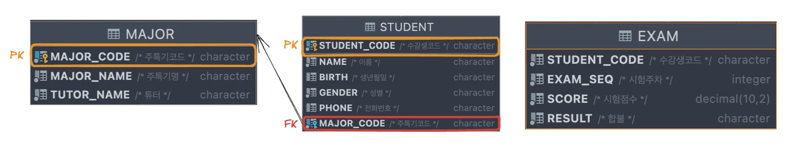

> 🧐 <strong>Point</strong>
> 
> <details>
> <summary>PK 설정</summary>
> 
> <a id="1c3eda9b0fe181e5bfc3fbb8ac97ec40"></a>
> 
> ```sql
> CREATE TABLE 테이블이름
> (
>     필드이름 필드타입 PRIMARY KEY,
> );
> ```
> 
> </details>
> 
> <details>
> <summary>FK 설정</summary>
> 
> <a id="1c3eda9b0fe1817e805bfffb2e17eb17"></a>
> 
> ```sql
> CREATE TABLE 테이블이름
> (   ...
> 		FOREIGN KEY(필드이름) REFERENCES 테이블이름(필드이름)
> );
> ```
> 
> </details>

<details>
<summary>MAJOR 테이블</summary>

<a id="1c3eda9b0fe181369199ecaf1869f9ee"></a>

```sql
CREATE TABLE IF NOT EXISTS MAJOR
(	
	major_code varchar(100) primary key comment '주특기코드', 
	major_name varchar(100) not null comment '주특기명',
	tutor_name varchar(100) not null comment '튜터'
);
```

</details>

<details>
<summary>STUDENT 테이블</summary>

<a id="1c3eda9b0fe1810692fac7e901c984c1"></a>

```sql
CREATE TABLE IF NOT EXISTS STUDENT
(
	student_code varchar(100) primary key comment '수강생코드', 
	name varchar(100) not null comment '이름',
	birth varchar(8) null comment '생년월일',
	gender varchar(1) not null comment '성별',
	phone varchar(11) null comment '전화번호',
	major_code varchar(100) not null comment '주특기코드',
	foreign key(major_code) references major(major_code)
);
```

</details>

<details>
<summary>EXAM 테이블</summary>

<details>
<summary><strong>🧐 pk 값이 테이블에 존재하지 않음</strong></summary>

<a id="1c3eda9b0fe181489199c1671103a4b4"></a>

다음 실습에서의 제약 조건 추가를 위한 설정

</details>

<a id="1c3eda9b0fe181118fd2da24f25eadda"></a>

```sql
CREATE TABLE IF NOT EXISTS EXAM
(
	student_code varchar(100) not null comment '수강생코드', 
	exam_seq int not null comment '시험주차', 
	score decimal(10,2) not null comment '시험점수',
	result varchar(1) not null comment '합불'
);
```

</details>

<a id="1c3eda9b0fe1818da90ddd064127f52b"></a>

### <code>ALTER</code>, <code>ADD</code>&#58; 테이블, 필드 수정 및 제약조건 추가

> 📌 <strong>ERD</strong>
> 
> 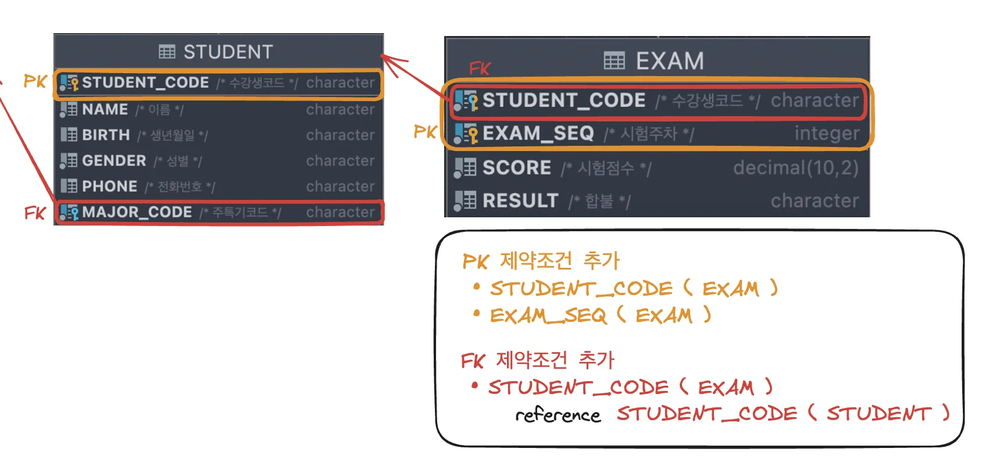

> 🧐 <strong>Point</strong>
> 
> - <code>ALTER</code>&#58;  데이터베이스와 테이블의 내용을 <strong>수정</strong>
> 
> <details>
> <summary><a href="https://www.w3schools.com/sql/sql_ref_add.asp"><code>ADD</code></a>&#58; 기존 테이블에 <strong><u>열을 추가</u></strong>하는 데 사용</summary>
> 
> <a id="1c3eda9b0fe1814e9f11f674810fd369"></a>
> 
> ```sql
> ALTER TABLE Customers
> ADD Email varchar(255);
> ```
> 
> </details>
> 
> <details>
> <summary><a href="https://www.w3schools.com/sql/sql_ref_add_constraint.asp"><code>ADD CONSTRAINT</code></a>&#58; <strong><u>이미 생성된 테이블의 필드</u></strong>에 <strong><u>제약 조건을 추가</u></strong>하는 데 사용</summary>
> 
> <a id="1c3eda9b0fe1819182cccf75cf50fbd8"></a>
> 
> ```sql
> ALTER TABLE Persons
> ADD CONSTRAINT PK_Person PRIMARY KEY (ID,LastName);
> ```
> 
> </details>

<details>
<summary>🧐 <code>ADD</code> 와 <code>ADD CONSTRAINT</code> 차이점은? </summary>

> 📌 <strong>제약조건을 설정할 시</strong>에는 <code>CONSTRAINT</code>를 통해 <strong><u>제약조건의 이름을 명시</u></strong>해야한다&#46; 

<a id="1c3eda9b0fe181118fb6cd7f22fe1d6f"></a>

<code>ADD</code> 는 기존의 테이블에 열을 추가한다&#46;

<a id="1c3eda9b0fe181a09571d840e6f83b6a"></a>

<code>ADD CONSTRAINT</code>는 기존 필드에 제약조건을 추가한다&#46; 

<a id="1c3eda9b0fe181ecba1af02fc797cdb6"></a>

<strong> </strong>

<a id="1c3eda9b0fe181a18f81c4429107fb68"></a>

```sql
ALTER TABLE EXAM ADD PRIMARY KEY(student_code, exam_seq);
```

<a id="1c3eda9b0fe18174823ef5d396597702"></a>

그러나 위의 sql을 실행시켜 보면  기존에 존재한 <code>student&#95;code</code>, <code>exam&#95;seq</code> 필드들에 PK 제약 조건이 추가된다&#46;


<a id="1c3eda9b0fe181fcaad9f4e1ddf6f6f6"></a>

이를 통해서 <code>ADD</code>도 <strong><u>기존에 존재하는 필드에 제약조건을 추가</u></strong>한다는 것을 알수 있다&#46; <br>( 설마<a href="https://www.w3schools.com/sql/sql_ref_add.asp"> w3 doc</a> 에서 사기를 친 것인가&#46;&#46;?)

<a id="1c3eda9b0fe181339aced9ca621e0867"></a>

그렇다면  ‘🧐 아래의 두 코드의 차이점은 무엇인가?’ 라는 의문점이 또 생긴다&#46; 

- 1) 제약조건 명 ❌
    <a id="1c3eda9b0fe1810d93b0ee09a388237c"></a>

    ```sql
    ALTER TABLE EXAM ADD FOREIGN KEY(student_code) REFERENCES STUDENT(student_code);
    ```

- 2) 제약조건 이름 명시&#58; <code>CONSTRAINT exam&#95;fk&#95;student&#95;code</code>
    <a id="1c3eda9b0fe18150a77ac9374c788cca"></a>

    ```sql
    ALTER TABLE EXAM ADD CONSTRAINT exam_fk_student_code FOREIGN KEY(student_code) REFERENCES STUDENT(student_code);
    ```

<a id="1c3eda9b0fe181d7a637d975c0ed7c80"></a>

첫번째 SQL문을 실행한 결과 아래와 같이 FK를 중복해서 계속 생성하는 것을 확인할 수 있었다&#46; 


<a id="1c3eda9b0fe181baad97cad706d92ed5"></a>

또한 제약조건 명을 붙인 2번째 SQL문은 아래와 같이 중복 실행하면 이미 존재하는 제약조건이라는 오류를 발생시켜 중복 생성을 방지해 주었다&#46;

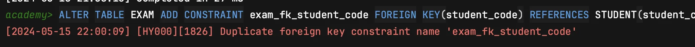

<a id="1c3eda9b0fe181cf8f1bdbdf77fc80e7"></a>

따라서  <code>ADD</code>를 통해서도 제약조건을 추가할 수 있지만 위와 같이 <strong>제약조건의 명칭을 자동으로 생성</strong>하여<strong> 동일한 제약 조건을 계속해서 생성</strong>한다&#46;

<a id="1c3eda9b0fe1812cbc21c84d72bae81e"></a>

그러므로 <strong>제약조건을 설정할 시</strong>에는 <code>CONSTRAINT</code>를 통해 <strong><u>제약조건의 이름을 명시</u></strong>해야한다&#46; <br>

</details>

<details>
<summary>🧐 제약조건에도 이름이 존재하는가?</summary>

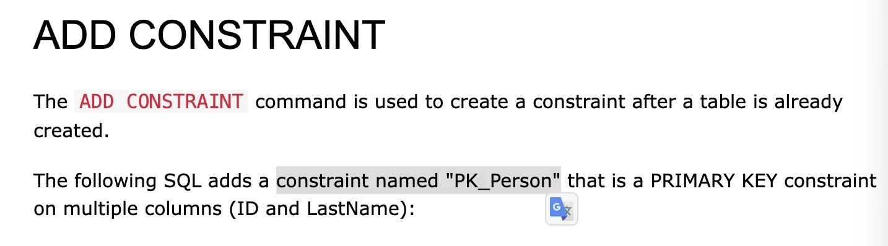

- <a href="https://www.w3schools.com/sql/sql_ref_add_constraint.asp">참조 문서</a>

<a id="1c3eda9b0fe181d18f55d7e9334a57c7"></a>

위 Doc 내용을 보면 “ <code>PK&#95;Person</code> 이라 불리는 제약조건” 이라는 표현이 있다&#46; 

<a id="1c3eda9b0fe1813b8ab5f5a74d91e0c9"></a>

이를 보면서 ‘🧐 제약조건에도 이름이 있나?’ 라는 의문점이 생겼다&#46;

<a id="1c3eda9b0fe181729eb0f08a316689f1"></a>

실제 아래 실습 코드를 보면 <code>exam&#95;fk&#95;student&#95;code</code> 라는 알수 없는 명칭이 나온다&#46; 

<a id="1c3eda9b0fe181ccb8ccc3577938987c"></a>

```sql
ALTER TABLE EXAM ADD CONSTRAINT exam_fk_student_code FOREIGN KEY(student_code) REFERENCES STUDENT(student_code);
```

<a id="1c3eda9b0fe181bb81dcf1135d9fd3a4"></a>

해당 코드를 실행 후 아래와 같이 DB를 확인해본 결과 <code>exam&#95;fk&#95;student&#95;code</code>  가 FK의 제약조건 명칭으로 붙은 것을 확인 가능했다&#46; 

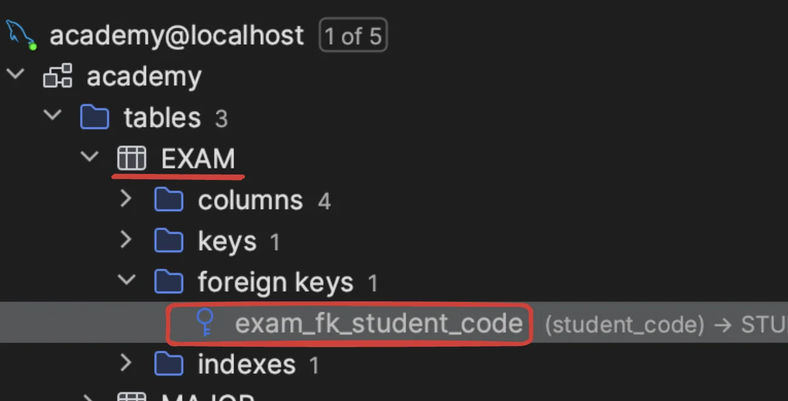

<a id="1c3eda9b0fe181e3a807e6c8644fc828"></a>

따라서 결론은 ‘<strong>제약조건의 명칭’</strong>이 존재한다

> 

</details>

<details>
<summary>EXAN 테이블&#58;  제약조건 추가</summary>

<a id="1c3eda9b0fe181d5ab68da6dc187b24f"></a>

```sql
ALTER TABLE EXAM ADD PRIMARY KEY(student_code, exam_seq);
ALTER TABLE EXAM ADD CONSTRAINT exam_fk_student_code FOREIGN KEY(student_code) REFERENCES STUDENT(student_code);
```

</details>

<a id="1c3eda9b0fe181cbb899ca3dcad580f2"></a>

### <code>INSERT</code>&#58; 컬럼(필드)생성

> 🧐 <strong>Point</strong>
> 
> <details>
> <summary><code>INSERT</code>&#58; 테이블에 <strong>새로운 row를 추가</strong></summary>
> 
> <a id="1c3eda9b0fe1814aa676e900c0b70983"></a>
> 
> ```sql
> INSERT INTO 테이블명 VALUES(필드1, 필드2, ...)
> ```
> 
> </details>

<details>
<summary>MAJOR 테이블 </summary>

<details>
<summary>SQL</summary>

<a id="1c3eda9b0fe181f69de9c5bf721b9e83"></a>

```sql
INSERT INTO MAJOR VALUES('m1', '스프링', '남병관');
INSERT INTO MAJOR VALUES('m2', '노드', '강승현');
INSERT INTO MAJOR VALUES('m3', '플라스크', '이범규');
INSERT INTO MAJOR VALUES('m4', '루비온레일즈', '차은서');
INSERT INTO MAJOR VALUES('m5', '라라벨', '구름');
INSERT INTO MAJOR VALUES('m6', '리엑트', '임민영');
INSERT INTO MAJOR VALUES('m7', '뷰', '김서영');
INSERT INTO MAJOR VALUES('m8', '엥귤러', '한현아');
```

</details>

<details>
<summary>데이터 생성 확인 </summary>

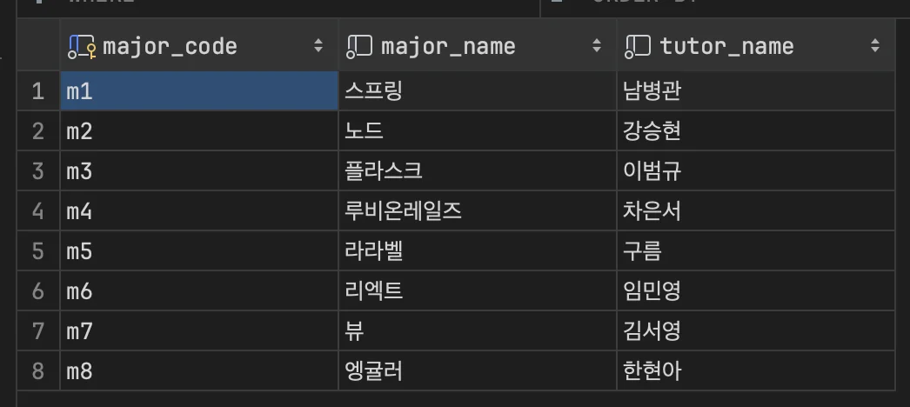

</details>

</details>

<details>
<summary>STUDENT 테이블</summary>

<details>
<summary>SQL</summary>

<a id="1c3eda9b0fe181918233cf31c9c18dc8"></a>

```sql
INSERT INTO STUDENT VALUES('s1', '최원빈', '20220331', 'M', '01000000001', 'm1');
INSERT INTO STUDENT VALUES('s2', '강준규', '20220501', 'M', '01000000002', 'm1');
INSERT INTO STUDENT VALUES('s3', '김영철', '20220711', 'M', '01000000003', 'm1');
INSERT INTO STUDENT VALUES('s4', '예상기', '20220408', 'M', '01000000004', 'm6');
INSERT INTO STUDENT VALUES('s5', '안지현', '20220921', 'F', '01000000005', 'm6');
INSERT INTO STUDENT VALUES('s6', '이대호', '20221111', 'M', '01000000006', 'm7');
INSERT INTO STUDENT VALUES('s7', '정주혜', '20221117', 'F', '01000000007', 'm8');
INSERT INTO STUDENT VALUES('s8', '고미송', '20220623', 'F', '01000000008', 'm6');
INSERT INTO STUDENT VALUES('s9', '이용우', '20220511', 'M', '01000000009', 'm2');
INSERT INTO STUDENT VALUES('s10', '심선아', '20220504', 'F', '01000000010', 'm8');
INSERT INTO STUDENT VALUES('s11', '변정섭', '20220222', 'M', '01000000020', 'm2');
INSERT INTO STUDENT(student_code, name, gender, major_code) VALUES('s12', '권오빈', 'M', 'm3');
INSERT INTO STUDENT VALUES('s13', '김가은', '20220121', 'F', '01000000030', 'm1');
INSERT INTO STUDENT(student_code, name, gender, major_code) VALUES('s14', '김동현', 'M', 'm4');
INSERT INTO STUDENT VALUES('s15', '박은진', '20221101', 'F', '01000000040', 'm1');
INSERT INTO STUDENT(student_code, name, birth, gender, phone, major_code) VALUES('s16', '정영호', '20221105', 'M', '01000000050', 'm5');
INSERT INTO STUDENT(student_code, name, gender, major_code) VALUES('s17', '박가현', 'F', 'm7');
INSERT INTO STUDENT(student_code, name, birth, gender, phone, major_code) VALUES('s18', '박용태', '20220508', 'M', '01000000060', 'm6');
INSERT INTO STUDENT VALUES('s19', '김예지', '20220505', 'F', '01000000070', 'm2');
INSERT INTO STUDENT VALUES('s20', '윤지용', '20220909', 'M', '01000000080', 'm3');
INSERT INTO STUDENT VALUES('s21', '손윤주', '20220303', 'F', '01000000090', 'm6');
```

</details>

<details>
<summary>데이터 생성 확인</summary>

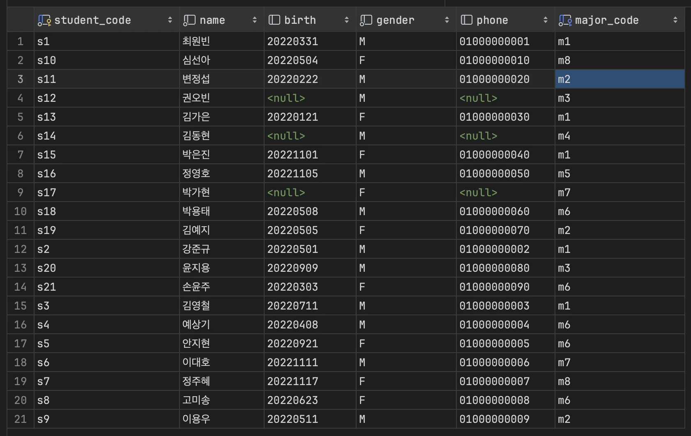

</details>

</details>

<details>
<summary>EXAM 테이블 </summary>

<details>
<summary>SQL</summary>

<a id="1c3eda9b0fe181978c0acbb61e66469e"></a>

```sql
INSERT INTO EXAM VALUES('s1', 1, 8.5, 'P');
INSERT INTO EXAM VALUES('s1', 2, 9.5, 'P');
INSERT INTO EXAM VALUES('s1', 3, 3.5, 'F');
INSERT INTO EXAM VALUES('s2', 1, 8.2, 'P');
INSERT INTO EXAM VALUES('s2', 2, 9.5, 'P');
INSERT INTO EXAM VALUES('s2', 3, 7.5, 'P');
INSERT INTO EXAM VALUES('s3', 1, 9.3, 'P');
INSERT INTO EXAM VALUES('s3', 2, 5.3, 'F');
INSERT INTO EXAM VALUES('s3', 3, 9.9, 'P');
INSERT INTO EXAM VALUES('s4', 1, 8.4, 'P');
INSERT INTO EXAM VALUES('s5', 1, 9.5, 'P');
INSERT INTO EXAM VALUES('s5', 2, 3.5, 'F');
INSERT INTO EXAM VALUES('s6', 1, 8.3, 'P');
INSERT INTO EXAM VALUES('s7', 1, 9.2, 'P');
INSERT INTO EXAM VALUES('s7', 2, 9.9, 'P');
INSERT INTO EXAM VALUES('s7', 3, 3.6, 'F');
INSERT INTO EXAM VALUES('s8', 1, 8.4, 'P');
INSERT INTO EXAM VALUES('s9', 1, 9.7, 'P');
INSERT INTO EXAM VALUES('s10', 1, 8.4, 'P');
INSERT INTO EXAM VALUES('s10', 2, 9.8, 'P');
INSERT INTO EXAM VALUES('s10', 3, 8.4, 'P');
INSERT INTO EXAM VALUES('s11', 1, 8.6, 'P');
INSERT INTO EXAM VALUES('s12', 1, 9.2, 'P');
INSERT INTO EXAM VALUES('s13', 1, 8.1, 'P');
INSERT INTO EXAM VALUES('s13', 2, 9.5, 'P');
INSERT INTO EXAM VALUES('s13', 3, 2.1, 'F');
INSERT INTO EXAM VALUES('s14', 1, 9.2, 'P');
INSERT INTO EXAM VALUES('s15', 1, 9.7, 'P');
INSERT INTO EXAM VALUES('s15', 2, 1.7, 'F');
INSERT INTO EXAM VALUES('s16', 1, 8.4, 'P');
INSERT INTO EXAM VALUES('s17', 1, 9.3, 'P');
INSERT INTO EXAM VALUES('s17', 2, 9.9, 'P');
INSERT INTO EXAM VALUES('s17', 3, 1.3, 'F');
INSERT INTO EXAM VALUES('s18', 1, 9.9, 'P');
INSERT INTO EXAM VALUES('s19', 1, 9.4, 'P');
INSERT INTO EXAM VALUES('s19', 2, 8.9, 'P');
INSERT INTO EXAM VALUES('s19', 3, 7.4, 'F');
INSERT INTO EXAM VALUES('s20', 1, 8.1, 'P');
INSERT INTO EXAM VALUES('s20', 2, 6.4, 'F');
INSERT INTO EXAM VALUES('s21', 1, 9.5, 'P');
INSERT INTO EXAM VALUES('s21', 2, 8.8, 'P');
INSERT INTO EXAM VALUES('s21', 3, 8.2, 'P');
```

</details>

<details>
<summary>데이터 생성 확인</summary>

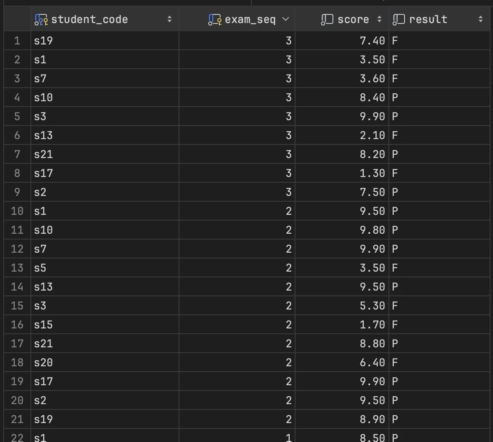

</details>

</details>

<a id="1c3eda9b0fe1814eb7acce63f7eb3678"></a>

### <code>UPDATE</code>&#58; 컬럼(필드) 수정

> 🧐 <strong>Point</strong>
> 
> <details>
> <summary><code>UPDATE</code>&#58; 테이블의 <strong>row의 내용을 수정</strong></summary>
> 
> <a id="1c3eda9b0fe181f48ebefa530c4e993c"></a>
> 
> ```sql
>  UPDATE 테이블명 SET [수정하려는 필드명] = [수정내용] WHERE 수정하려는 필드 위치( 필드명 = 필드값 ) 
> ```
> 
> </details>

<a id="1c3eda9b0fe181d3a83ff25a268713b4"></a>

```sql
INSERT INTO STUDENT VALUES('s0', '수강생', '20220331', 'M', '01000000005', 'm1');
UPDATE STUDENT SET major_code= 'm2' where student_code= 's0';
```

<a id="1c3eda9b0fe181a88bcbeeb52db59c8d"></a>

### <code>DELETE</code>&#58;  컬럼(필드) 삭제

> 🧐 <strong>Point</strong>
> 
> <details>
> <summary><code>DELETE</code>&#58; 테이블의<strong> row를 삭제</strong></summary>
> 
> <a id="1c3eda9b0fe181208126eb584aff4624"></a>
> 
> ```sql
> DELETE FROM 테이블이름 WHERE 필드이름=데이터값;
> ```
> 
> </details>

<a id="1c3eda9b0fe181a19acae005a5eb7162"></a>

```sql
DELETE FROM STUDENT WHERE student_code = 's0';
```

<a id="1c3eda9b0fe18169980cf792c0129f80"></a>

### <code>SELECT</code>&#58; 컬럼(필드) 조회

> 🧐 <strong>Point</strong>
> 
> <details>
> <summary><code>SELECT</code>&#58; 테이블의 <strong>row를 선택</strong></summary>
> 
> <a id="1c3eda9b0fe181af8ee4cfe16041f1d5"></a>
> 
> ```sql
> SELECT 필드이름 FROM 테이블이름 [WHERE 조건];
> ```
> 
> </details>

<a id="1c3eda9b0fe18197a83cc72a33ec9a3b"></a>

```sql
SELECT * FROM STUDENT;
SELECT * FROM STUDENT WHERE STUDENT_CODE = 's1';
SELECT name, major_code FROM STUDENT WHERE student_code = 's1';
```

<a id="1c3eda9b0fe181708591ffe012cd9a4c"></a>

### <code>JOIN</code>&#58; 테이블 합침

> 🧐 <strong>Point</strong>
> 
> <details>
> <summary><code>JOIN</code>&#58; 테이블 합침</summary>
> 
> <a id="1c3eda9b0fe181d08b37d774d4c7da02"></a>
> 
> ```sql
> SELECT s.name, s.major_code, m.major_name FROM STUDENT s JOIN MAJOR m ON s.major_code = m.major_code;
> ```
> 
> </details>
> 
> > ⚠️ <strong><u>JOIN을 할 때에는 적어도 하나의 컬럼을 서로 공유</u></strong>하고 있어야 한다&#46;<br>따라서 <strong><u>두 테이블 사이에  외래 키가 설정 </u></strong>되어 있다면 <strong>해당 컬럼을 통해 JOIN 할 수 있다&#46; </strong>

<details>
<summary>SQL</summary>

<a id="1c3eda9b0fe1817b8df0eaad985721b7"></a>

```sql
SELECT s.name, s.major_code, m.major_name FROM STUDENT s JOIN MAJOR m ON s.major_code = m.major_code;
SELECT s.name, s.major_code, m.major_name FROM STUDENT s, MAJOR m WHERE s.major_code = m.major_code;
```

</details>

<details>
<summary>Join Table</summary>

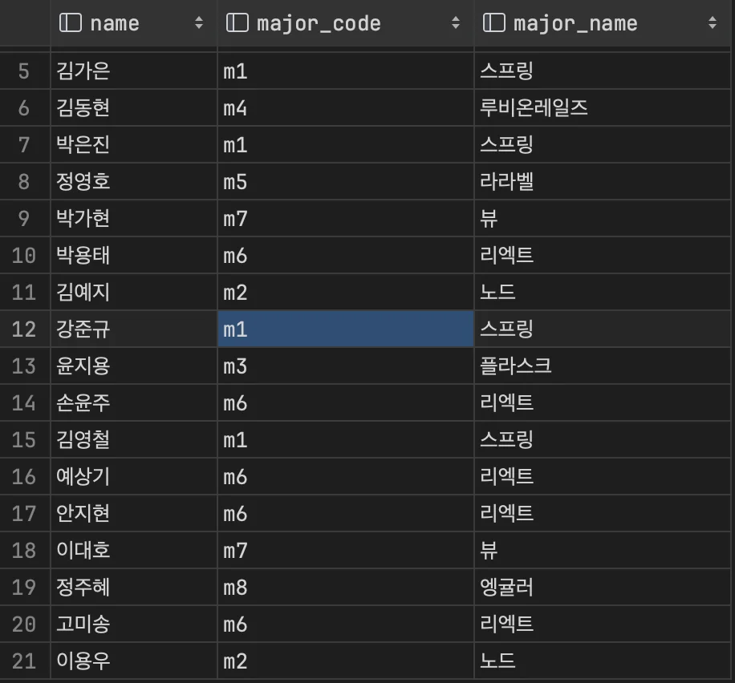

</details>

<details>
<summary> <strong>STUDENT</strong>에 존재하지 않는 <code>major&#95;name</code>컬럼이  <code>major&#95;code</code> 에 맞게 join 시 매핑된다&#46;</summary>

- <code>STUDENT</code>, <code>MAJOR</code> 테이블 조회
    <a id="1c3eda9b0fe1817cb8dfed47cde03e9b"></a>

    ```sql
    SELECT * From STUDENT;
    SELECT * From MAJOR;
    ```

    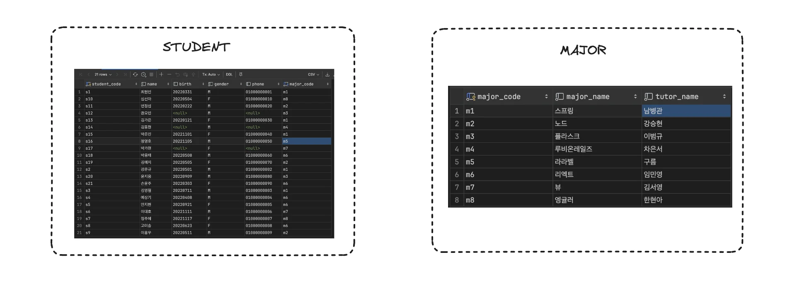


<a id="1c3eda9b0fe18121b69ff8a77cbdd34a"></a>

<strong><code>STUDENT</code></strong>는 <strong><code>MAJOR</code></strong>의 <strong><u>PK(</u></strong><strong><u><code>major&#95;code</code></u></strong><strong><u>)</u></strong>를 <strong><u>FK(</u></strong><strong><u><code>major&#95;code</code></u></strong><strong><u>)</u></strong>로 참조한다&#46; <br>따라서 두 테이블을 <strong><code>Join</code></strong> 시 <strong><code>STUDENT</code></strong>에 존재하지 않는 <code>major&#95;name</code>  데이터가  <strong><code>MAJOR</code></strong>에 <code>major&#95;code</code> 매핑되는 <code>major&#95;name</code> 값을 참조하여  아래와 같이 생성한다&#46; 

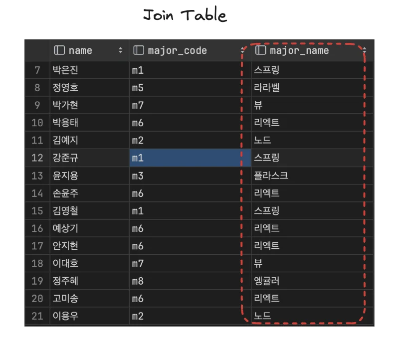

</details>

<a id="1c3eda9b0fe1816dbe8cf5684acf8e5b"></a>

## JDBC

<a id="1c3eda9b0fe181b58dcff633da7014db"></a>

### JDBC의 등장배경

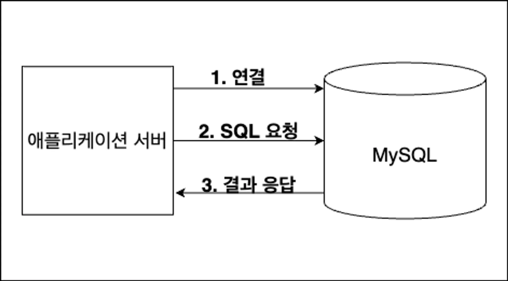

> 애플리케이션 서버 → DB, 접근 시 아래와 같은 작업이 필요하다&#46;

1. DB 연결을 위한 커넥션 연결 ( TCP/IP &#45; 3 Way HandShake ) 

<details>
<summary>🧐 TCP/IP &#45; 3 Way HandShake </summary>

<a id="1c3eda9b0fe18181b162ce12859af804"></a>

<a href="#/post/1c3eda9b-0fe1-815d-b96f-fb22f04b49f2">페이지</a> 

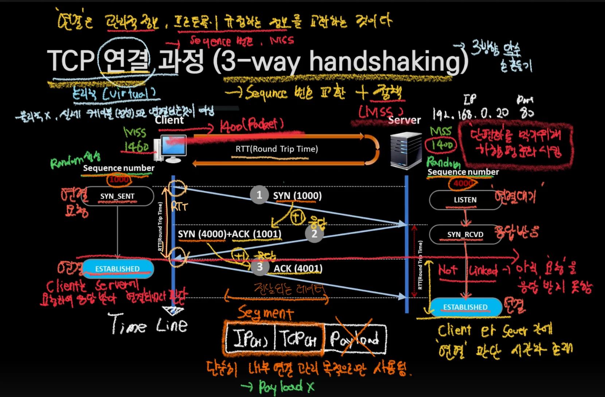

</details>

1. SQL을 작성한 후 커넥션을 통해 SQL을 요청

1. 요청한 SQL에 대한 결과를 응답 

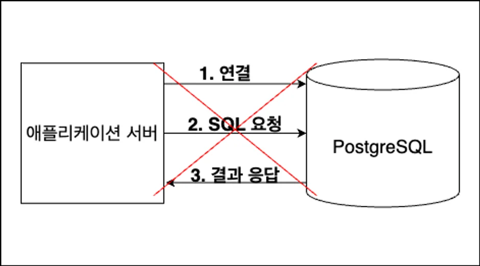

> MySQL → PostgreSQL 변경

<a id="1c3eda9b0fe1815a9396f12df98b6b38"></a>

<code>MySQL</code>과 <code>PostgreSQL</code>은 <strong><u>커넥션을 연결하는 방법, SQL을 전달하는 방법, 결과를 응답받는 방법 모두 다를 수 있</u></strong>기 때문에 <strong>애플리케이션 서버에서 작성했던 DB 연결 로직들을 전부 수정</strong>해야한다&#46;

<a id="1c3eda9b0fe181af9b7ad557df7f1eb2"></a>

따라서<strong><u> 이러한 문제점을 해결</u></strong>하기 위해 나온 기술이 <strong><code>JDBC</code></strong>이다&#46;

<a id="1c3eda9b0fe181c292a9ed5d3c8a331b"></a>

아래와 같이 <u>애플리케이션 서버와 DB 사이에</u> <strong>JDBC 계층</strong>을 두어 <strong>드라이버 변경</strong>만으로 <strong><u>DB를 손쉽게 변경할</u></strong> 수 있다&#46; 

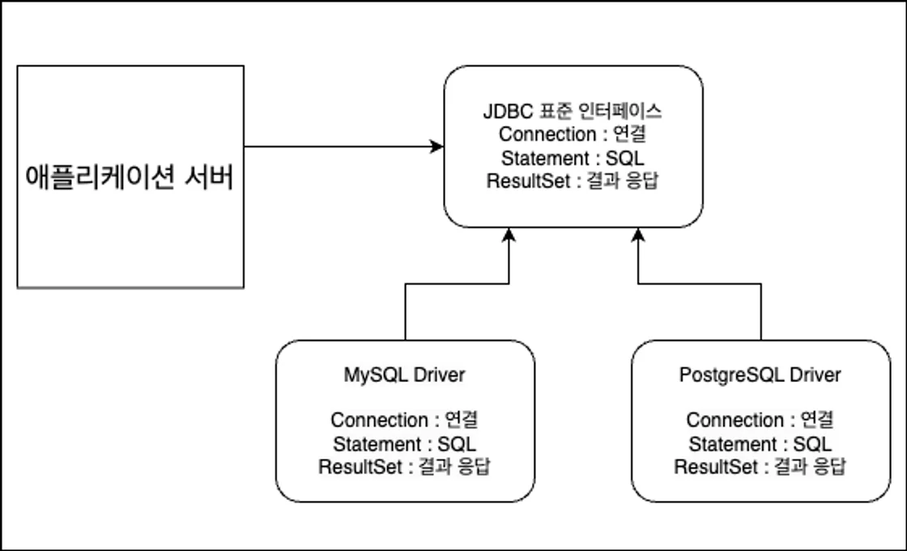

> JDBC는 <strong>Java Database Connectivity</strong>로<strong><u> DB에 접근할 수 있도록 Java에서 제공하는 API</u></strong>이다&#46;<br><strong><u>DB 회사들은 자신들의 DB에 맞도록 JDBC 인터페이스를 구현한 후 라이브러리로 제공</u></strong>하는데 이를 <strong><code>JDBC 드라이버</code></strong>라 부른다&#46;<br>따라서, MySQL 드라이버를 사용해 DB에 연결을 하다 PostgreSQL <strong><u>서버로 변경이 필요</u></strong>할 때 <strong>드라이버만 교체</strong>하면 <strong><u>손쉽게 DB 변경이 가능</u></strong>하다&#46;

<a id="1c3eda9b0fe181a59f33eac63dff2d62"></a>

### JdbcTemplate

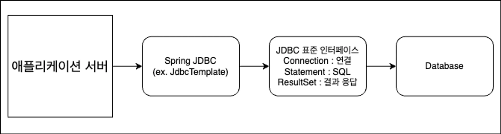

<a id="1c3eda9b0fe181b3a96ee87e1ec3cf29"></a>

DBC의 등장으로 손쉽게 DB교체가 가능해졌지만<u> DB에 연결하기 위해 여러가지 작업 로직들을 직접 작성해야한다는 불편함</u>이 있었다&#46;

<a id="1c3eda9b0fe181708c24d068ba7214d0"></a>

이러한 불편함을 해결하기 위해 <strong><u>커넥션 연결, statement 준비 및 실행, 커넥션 종료 등의 반복적이고 중복되는 작업들을 대신 처리</u></strong><u>해주는 </u><strong><u><code>JdbcTemplate</code></u></strong>이 등장했다

<a id="1c3eda9b0fe1815d8f20d524466d7549"></a>

### JdbcTemplate 사용방법

<details>
<summary>1&#46; <code>application&#46;properties</code>  &#45; DB에 접근하기 위한 정보를 작성</summary>

> src/main/resources/application&#46;properties

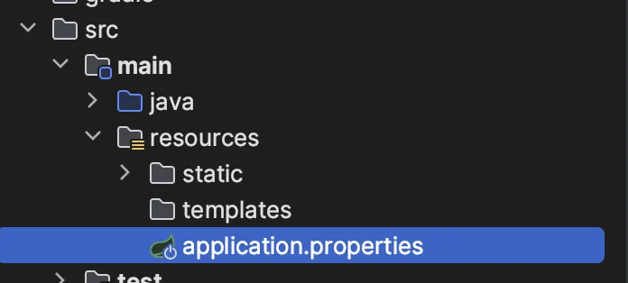

<details>
<summary><strong>application&#46;properties</strong></summary>

<a id="1c3eda9b0fe181c5abedf50e696a244c"></a>

```plaintext
spring.datasource.url=jdbc:mysql://localhost:3306/memo
spring.datasource.username=root
spring.datasource.password={비밀번호}
spring.datasource.driver-class-name=com.mysql.cj.jdbc.Driver
```

</details>

</details>

<details>
<summary>2&#46;<code> build&#46;gradle</code>에 JDBC 라이브러리와 MySQL을 등록</summary>

<details>
<summary><code> build&#46;gradle</code>&#58; JDBC, MySQL 추가</summary>

<a id="1c3eda9b0fe18150a09ee5d743f04354"></a>

```groovy
// MySQL
implementation 'mysql:mysql-connector-java:8.0.28'
implementation 'org.springframework.boot:spring-boot-starter-data-jdbc'
```

</details>

<details>
<summary>프로젝트 설정</summary>

<details>
<summary><strong><u>memo 데이터베이스 생성</u></strong> 및 <strong><u>Intellij Database 연동</u></strong></summary>

<details>
<summary>CREATE DATABASE</summary>

<a id="1c3eda9b0fe18154a111d43871e145c3"></a>

```sql
CREATE DATABASE memo;
```

</details>

<details>
<summary>연동 순서</summary>

1. Database 탭을 클릭하시고 &#43; 버튼을 누릅니다&#46;
    

1. Data Source &#62; MySQL 를 클릭합니다&#46;
    

1. User, Password, Database 정보를 추가한 후 Ok를 클릭합니다&#46;
    

1. MySQL Database에 연결이 완료되었습니다&#46;
    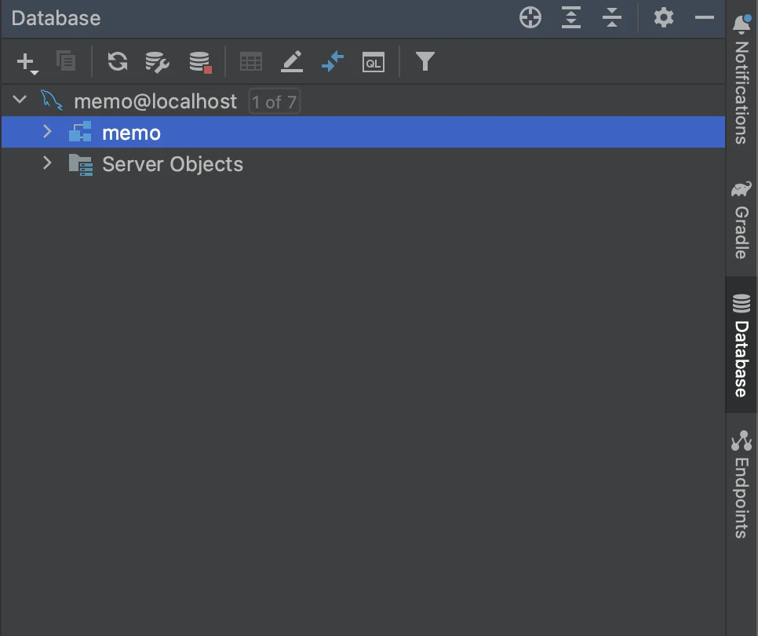

</details>

</details>

<details>
<summary><strong>memo 테이블 생성</strong></summary>

<a id="1c3eda9b0fe181789ad0e62851d37694"></a>

```sql
create table memo
(
    id       bigint       not null auto_increment,
    contents varchar(500) not null,
    username varchar(255) not null,
    primary key (id)
);
```

</details>

</details>

</details>

<details>
<summary>3&#46; DB연결이 필요한 곳에서 JdbcTemplate을 주입 받아 사용</summary>

> 생성자의 파라미터를 통해 JdbcTemplate 객체가 자동으로 넘어와 jdbctemplate 변수에 저장됨

<a id="1c3eda9b0fe1819f906dece8ded1764f"></a>

```java
private final JdbcTemplate jdbctemplate;

public MemoRepository(JdbcTemplate jdbcTemplate) {
        this.jdbcTemplate = jdbcTemplate;
}
```

</details>

---

<details>
<summary>INSERT</summary>

<a id="1c3eda9b0fe18147bc87eef8d0d16629"></a>

```java
String sql = "INSERT INTO memo (username, contents) VALUES (?, ?)";
jdbcTemplate.update(sql, "Robbie", "오늘 하루도 화이팅!");
```

- INSERT SQL을 작성해 String 변수에 저장합니다&#46;
    - 이때, 넣고자 하는 데이터 부분에 ?를 사용하면 유동적으로 데이터를 넣어줄 수 있습니다&#46;

- <code>jdbcTemplate&#46;update()</code> 메서드는 INSERT, UPDATE, DELETE 와 같이 생성, 수정, 삭제에 사용될 수 있는데 첫 번째 파라미터로 SQL을 받고 그 이후에는 ?에 들어갈 값을 받습니다&#46;

</details>

<details>
<summary>UPDATE</summary>

<a id="1c3eda9b0fe181b5a906d6e24698abc8"></a>

```java
String sql = "UPDATE memo SET username = ? WHERE id = ?";
jdbcTemplate.update(sql, "Robbert", 1);
```

- UPDATE SQL을 작성해 String 변수에 저장한 후 <code>update()</code> 메서드 첫 번째 파라미터에 넣어줍니다&#46;
    - 이때, 넣고자 하는 데이터 부분에 ?를 사용하면 유동적으로 데이터를 넣어줄 수 있습니다&#46;

</details>

<details>
<summary>DELETE</summary>

<a id="1c3eda9b0fe181148890ff204fb5de4f"></a>

```java
String sql = "DELETE FROM memo WHERE id = ?";
jdbcTemplate.update(sql, 1);
```

- DELETE SQL을 작성해 String 변수에 저장한 후 <code>update()</code> 메서드 첫 번째 파라미터에 넣어줍니다&#46;
    - 이때, 넣고자 하는 데이터 부분에 ?를 사용하면 유동적으로 데이터를 넣어줄 수 있습니다&#46;

</details>

<details>
<summary>SELECT</summary>

<a id="1c3eda9b0fe181b8b8becad842f77fa0"></a>

```java
String sql = "SELECT * FROM memo";
return jdbcTemplate.query(sql, new RowMapper<MemoResponseDto>() {
    @Override
    public MemoResponseDto mapRow(ResultSet rs, int rowNum) throws SQLException {
        // SQL 의 결과로 받아온 Memo 데이터들을 MemoResponseDto 타입으로 변환해줄 메서드
        Long id = rs.getLong("id");
        String username = rs.getString("username");
        String contents = rs.getString("contents");
        return new MemoResponseDto(id, username, contents);
    }
});
```

- SELECT SQL을 작성해 String 변수에 저장한 후 <code>query()</code> 메서드 첫 번째 파라미터에 넣어줍니다&#46;

- SELECT의 경우 결과가 여러 줄로 넘어오기 때문에 RowMapper를 사용하여 한 줄씩 처리 할 수 있습니다&#46;
    - RowMapper는 인터페이스 이기 때문에 익명 클래스를 구현하여 처리합니다&#46;

    - 오버라이딩 된 mapRow 메서드는 제네릭스에 선언한 MemoResponseDto 타입으로 데이터 한 줄을 변환하는 작업을 수행합니다&#46;

</details>

<a id="1c3eda9b0fe181f6ba79df8eeda96535"></a>

### JdbcTemplate  적용

> ☝🏻 JDBC의 복잡한 사용방법을 보안하기 위해 <strong><u>DB와 객체를 매핑하여 소통할 수 있는 ORM이라는 기술이 등장</u></strong><strong>했다&#46; </strong><br>( JdbcTemplate 사용방법은 가볍게 보고 넘어가도록… )

<details>
<summary><strong>MemberController</strong></summary>

<a id="1c3eda9b0fe181e2983ee34e37e0986a"></a>

```java
package com.sparta.memo.controller;

import com.sparta.memo.dto.MemoRequestDto;
import com.sparta.memo.dto.MemoResponseDto;
import com.sparta.memo.entity.Memo;
import org.springframework.jdbc.core.JdbcTemplate;
import org.springframework.jdbc.core.RowMapper;
import org.springframework.jdbc.support.GeneratedKeyHolder;
import org.springframework.jdbc.support.KeyHolder;
import org.springframework.web.bind.annotation.*;

import java.sql.PreparedStatement;
import java.sql.ResultSet;
import java.sql.SQLException;
import java.sql.Statement;
import java.util.List;

@RestController
@RequestMapping("/api")
public class MemoController {

    private final JdbcTemplate jdbcTemplate;

    public MemoController(JdbcTemplate jdbcTemplate) {
        this.jdbcTemplate = jdbcTemplate;
    }

    @PostMapping("/memos")
    public MemoResponseDto createMemo(@RequestBody MemoRequestDto requestDto) {
        // RequestDto -> Entity
        Memo memo = new Memo(requestDto);

        // DB 저장
        KeyHolder keyHolder = new GeneratedKeyHolder(); // 기본 키를 반환받기 위한 객체

        String sql = "INSERT INTO memo (username, contents) VALUES (?, ?)";
        jdbcTemplate.update( con -> {
                    PreparedStatement preparedStatement = con.prepareStatement(sql,
                            Statement.RETURN_GENERATED_KEYS);

                    preparedStatement.setString(1, memo.getUsername());
                    preparedStatement.setString(2, memo.getContents());
                    return preparedStatement;
                },
                keyHolder);

        // DB Insert 후 받아온 기본키 확인
        Long id = keyHolder.getKey().longValue();
        memo.setId(id);

        // Entity -> ResponseDto
        MemoResponseDto memoResponseDto = new MemoResponseDto(memo);

        return memoResponseDto;
    }

    @GetMapping("/memos")
    public List<MemoResponseDto> getMemos() {
        // DB 조회
        String sql = "SELECT * FROM memo";

        return jdbcTemplate.query(sql, new RowMapper<MemoResponseDto>() {
            @Override
            public MemoResponseDto mapRow(ResultSet rs, int rowNum) throws SQLException {
                // SQL 의 결과로 받아온 Memo 데이터들을 MemoResponseDto 타입으로 변환해줄 메서드
                Long id = rs.getLong("id");
                String username = rs.getString("username");
                String contents = rs.getString("contents");
                return new MemoResponseDto(id, username, contents);
            }
        });
    }

    @PutMapping("/memos/{id}")
    public Long updateMemo(@PathVariable Long id, @RequestBody MemoRequestDto requestDto) {
        // 해당 메모가 DB에 존재하는지 확인
        Memo memo = findById(id);
        if(memo != null) {
            // memo 내용 수정
            String sql = "UPDATE memo SET username = ?, contents = ? WHERE id = ?";
            jdbcTemplate.update(sql, requestDto.getUsername(), requestDto.getContents(), id);

            return id;
        } else {
            throw new IllegalArgumentException("선택한 메모는 존재하지 않습니다.");
        }
    }

    @DeleteMapping("/memos/{id}")
    public Long deleteMemo(@PathVariable Long id) {
        // 해당 메모가 DB에 존재하는지 확인
        Memo memo = findById(id);
        if(memo != null) {
						// memo 삭제
            String sql = "DELETE FROM memo WHERE id = ?";
            jdbcTemplate.update(sql, id);

            return id;
        } else {
            throw new IllegalArgumentException("선택한 메모는 존재하지 않습니다.");
        }
    }

    private Memo findById(Long id) {
        // DB 조회
        String sql = "SELECT * FROM memo WHERE id = ?";

        return jdbcTemplate.query(sql, resultSet -> {
            if(resultSet.next()) {
                Memo memo = new Memo();
                memo.setUsername(resultSet.getString("username"));
                memo.setContents(resultSet.getString("contents"));
                return memo;
            } else {
                return null;
            }
        }, id);
    }
}
```

</details>
