<a id="1cfeda9b0fe180c5bcbacd19e8a1444e"></a>

## 직접 구현하는 Set

<a id="1cfeda9b0fe1803dbda3d9b426735c6d"></a>

###  V1&#58; 기본 구현

---

>  <strong>Set은 중복을 허용하지 않고, 순서를 보장하지 않는 자료 구조이다&#46;</strong>	

> ✏️ 
> 
> <a id="1cfeda9b0fe180eaa4e9c126863dfb47"></a>
> 
> <code>Set</code>  구현
> 
> ---
> 
> - 인덱스가 없기 때문에 <u>단순히 데이터를 저장</u>하고, <u>데이터가 있는지 확인</u>하고, <strong><u>데이터를 삭제</u></strong><strong>하는 메서드로  구현 가능하다&#46;</strong>
>     - 저장&#58; <code>add()</code>, 조회&#58; <code>cotains()</code>, 삭제&#58; <code>remove()</code>

<a id="1cfeda9b0fe1808589d0d37daaec9054"></a>

### 코드 

<details>
<summary>&#91; 코드 &#93; MyHashSetV1</summary>

<a id="1cfeda9b0fe1808e9028fce6fc868c42"></a>

```java
package collection.hashset.v1;

import java.util.Arrays;
import java.util.LinkedList;
import java.util.stream.IntStream;

public class MyHashSetV1 {

    static final int DEFAULT_INITIAL_CAPACITY = 16;

    LinkedList<Integer>[] buckets;

    private int size = 0;
    private int capactity = DEFAULT_INITIAL_CAPACITY;

    public MyHashSetV1() {
        initBuckets();
    }

    public MyHashSetV1(int capactity) {
        this.capactity = capactity;
        initBuckets();
    }

    private void initBuckets() {
        buckets = new LinkedList[capactity];
        IntStream.range(0, capactity).forEach(i -> buckets[i] = new LinkedList<>());
    }

    public boolean add(int value) {
        int hashIndex = hashIndex(value);
        LinkedList<Integer> bucket = buckets[hashIndex];

        if (bucket.contains(value)) {
            return false;
        }
        bucket.add(value);
        size++;
        return true;
    }

    public boolean contains(int searchValue) {
        int hashIndex = hashIndex(searchValue);
        LinkedList<Integer> bucket = buckets[hashIndex];
        return bucket.contains(searchValue);
    }

    public boolean remove(int value) {
        int hashIndex = hashIndex(value);
        LinkedList<Integer> bucket = buckets[hashIndex];

        // 버킷에서 값을 제거하고 성공했다면 size 감소 및 true 반환
        if (bucket.remove(Integer.valueOf(value))) {
            size--;
            return true;
        }

        // 값이 존재하지 않아 제거 실패 시 false 반환
        return false;
    }

    private int hashIndex(int value) {
        return value % capactity;
    }

    public int getSize() {
        return size;
    }

    @Override
    public String toString() {
        return "MyHashSetV1{" +
                "buckets=" + Arrays.toString(buckets) +
                ", size=" + size +
                '}';
    }
}

```

</details>

<details>
<summary>&#91; 코드 &#93; MyHashSetV1Main</summary>

<a id="1cfeda9b0fe180b78e16c88cd5a075da"></a>

```java
package collection.hashset.v1;

public class MyHashSetV1Main {

    public static void main(String[] args) {
        MyHashSetV1 set = new MyHashSetV1(10);
        set.add(1);
        set.add(2);
        set.add(5);
        set.add(8);
        set.add(14);
        set.add(99);
        set.add(9); //hashIndex 중복
        System.out.println(set);

        //검색
        int searchValue = 9;
        boolean result = set.contains(searchValue);
        System.out.println("set.contains(" + searchValue + ") = " + result);

        //삭제
        boolean removeResult = set.remove(searchValue);
        System.out.println("removeResult = " + removeResult);
        System.out.println(set);

    }
}

```

</details>

<details>
<summary>실행 결과</summary>

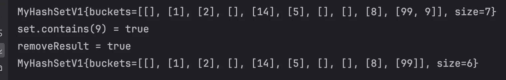

</details>

<a id="1cfeda9b0fe180369afcd6a1d982d03d"></a>

### 개선점

<a id="1cfeda9b0fe180a2a3e1f401bbf9f57b"></a>

해시 인덱스를 사용하려면 데이터의 값을 배열의 인덱스로 사용해야 한다

<a id="1cfeda9b0fe18087bbb7c009e16e846c"></a>

그러나 <strong><u>&#34;A&#34;, &#34;B&#34;와 같은 문자열</u></strong>은 <strong>배열의 인덱스로 사용할 수 없</strong>다&#46;

<a id="1cfeda9b0fe1809f998dd71430abfd50"></a>

```java
 MyHashSetV1 set = new MyHashSetV1(10);
 set.add("A");
 set.add("B");
 set.add("HELLO");
```

<a id="1cfeda9b0fe18055904acecc19687999"></a>

그렇다면 숫자가 아닌 <strong><u>문자열 데이터를 저장할 때, 해시 인덱스를 사용</u></strong>하려면 어떻게 해야하는가?

<a id="1cfeda9b0fe18098a3d6ecb1f42be15d"></a>

### 문자열 해시 코드

---

> 🧐 
> 
> <a id="1cfeda9b0fe180049acfdd4050e8bfde"></a>
> 
> 문자 데이터를 기반으로 숫자 해시 인덱스를 구하려면 어떻게 해야 할까?

<a id="1cfeda9b0fe180a0916fe7df5489a7e5"></a>

### 코드 

<details>
<summary>&#91; 코드 &#93; StringHashMain</summary>

<a id="1cfeda9b0fe180848180dd692c331849"></a>

```java
package collection.hashset.v2;

public class StringHashMain {

    static final int CAPACITY = 10;

    public static void main(String[] args) {
        //char
        char charA = 'A';
        char charB = 'B';
        System.out.println(charA + " = " + (int)charA);
        System.out.println(charB + " = " + (int)charB);

        //hashCode
        System.out.println("hashCode(A) = " + hashCode("A"));
        System.out.println("hashCode(B) = " + hashCode("B"));
        System.out.println("hashCode(AB) = " + hashCode("AB"));

        //hashIndex
        System.out.println("hashIndex(A) = " + hashIndex(hashCode("A")));
        System.out.println("hashIndex(B) = " + hashIndex(hashCode("B")));
        System.out.println("hashIndex(AB) = " + hashIndex(hashCode("AB")));
    }

    static int hashCode(String str) {
        char[] charArray = str.toCharArray();
        int sum = 0;
        for (char c : charArray) {
            sum += c;
        }
        return sum;
    }

    static int hashIndex(int value) {
        return value % CAPACITY;
    }
}

```

</details>

<details>
<summary>실행 결과</summary>

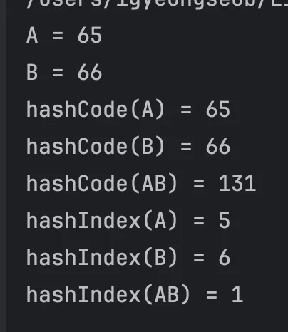

</details>

<a id="1cfeda9b0fe180edb4cbfdb7338c711e"></a>

### NOTES

<details>
<summary><strong>ASCII 코드</strong></summary>

> ✏️ 
> 
> <details>
> <summary><strong>ASCII 코드 표</strong></summary>
> 
> | Char | Dec | Hex | 설명 |
> | --- | --- | --- | --- |
> | &#39; &#39; | 32 | 20 | Space (공백) |
> | &#39;&#33;&#39; | 33 | 21 | Exclamation mark |
> | &#39;&#34;&#39; | 34 | 22 | Double quote |
> | &#39;&#35;&#39; | 35 | 23 | Number sign |
> | &#39;&#36;&#39; | 36 | 24 | Dollar sign |
> | &#39;%&#39; | 37 | 25 | Percent |
> | &#39;&#38;&#39; | 38 | 26 | Ampersand |
> | &#39;&#39;&#39; | 39 | 27 | Single quote |
> | &#39;(&#39; | 40 | 28 | Left parenthesis |
> | &#39;)&#39; | 41 | 29 | Right parenthesis |
> | &#39;&#42;&#39; | 42 | 2A | Asterisk |
> | &#39;&#43;&#39; | 43 | 2B | Plus |
> | &#39;,&#39; | 44 | 2C | Comma |
> | &#39;&#45;&#39; | 45 | 2D | Hyphen |
> | &#39;&#46;&#39; | 46 | 2E | Period |
> | &#39;/&#39; | 47 | 2F | Slash |
> | &#39;0&#39; | 48 | 30 | Digit 0 |
> | 숫자 |  |  |  |
> | &#39;1&#39; | 49 | 31 | Digit 1 |
> | &#39;2&#39; | 50 | 32 | Digit 2 |
> | &#39;3&#39; | 51 | 33 | Digit 3 |
> | &#39;4&#39; | 52 | 34 | Digit 4 |
> | &#39;5&#39; | 53 | 35 | Digit 5 |
> | &#39;6&#39; | 54 | 36 | Digit 6 |
> | &#39;7&#39; | 55 | 37 | Digit 7 |
> | &#39;8&#39; | 56 | 38 | Digit 8 |
> | &#39;9&#39; | 57 | 39 | Digit 9 |
> | 알파벳 대문자 |  |  |  |
> | &#39;A&#39; | 65 | 41 | Uppercase A |
> | &#39;B&#39; | 66 | 42 | Uppercase B |
> | &#39;C&#39; | 67 | 43 | Uppercase C |
> | &#39;D&#39; | 68 | 44 | Uppercase D |
> | &#39;E&#39; | 69 | 45 | Uppercase E |
> | &#39;F&#39; | 70 | 46 | Uppercase F |
> | &#39;G&#39; | 71 | 47 | Uppercase G |
> | &#39;H&#39; | 72 | 48 | Uppercase H |
> | &#39;I&#39; | 73 | 49 | Uppercase I |
> | &#39;J&#39; | 74 | 4A | Uppercase J |
> | &#39;K&#39; | 75 | 4B | Uppercase K |
> | &#39;L&#39; | 76 | 4C | Uppercase L |
> | &#39;M&#39; | 77 | 4D | Uppercase M |
> | &#39;N&#39; | 78 | 4E | Uppercase N |
> | &#39;O&#39; | 79 | 4F | Uppercase O |
> | &#39;P&#39; | 80 | 50 | Uppercase P |
> | &#39;Q&#39; | 81 | 51 | Uppercase Q |
> | &#39;R&#39; | 82 | 52 | Uppercase R |
> | &#39;S&#39; | 83 | 53 | Uppercase S |
> | &#39;T&#39; | 84 | 54 | Uppercase T |
> | &#39;U&#39; | 85 | 55 | Uppercase U |
> | &#39;V&#39; | 86 | 56 | Uppercase V |
> | &#39;W&#39; | 87 | 57 | Uppercase W |
> | &#39;X&#39; | 88 | 58 | Uppercase X |
> | &#39;Y&#39; | 89 | 59 | Uppercase Y |
> | &#39;Z&#39; | 90 | 5A | Uppercase Z |
> | 알파벳 소문자 |  |  |  |
> | &#39;a&#39; | 97 | 61 | Lowercase a |
> | &#39;b&#39; | 98 | 62 | Lowercase b |
> | &#39;c&#39; | 99 | 63 | Lowercase c |
> | &#39;d&#39; | 100 | 64 | Lowercase d |
> | &#39;e&#39; | 101 | 65 | Lowercase e |
> | &#39;f&#39; | 102 | 66 | Lowercase f |
> | &#39;g&#39; | 103 | 67 | Lowercase g |
> | &#39;h&#39; | 104 | 68 | Lowercase h |
> | &#39;i&#39; | 105 | 69 | Lowercase i |
> | &#39;j&#39; | 106 | 6A | Lowercase j |
> | &#39;k&#39; | 107 | 6B | Lowercase k |
> | &#39;l&#39; | 108 | 6C | Lowercase l |
> | &#39;m&#39; | 109 | 6D | Lowercase m |
> | &#39;n&#39; | 110 | 6E | Lowercase n |
> | &#39;o&#39; | 111 | 6F | Lowercase o |
> | &#39;p&#39; | 112 | 70 | Lowercase p |
> | &#39;q&#39; | 113 | 71 | Lowercase q |
> | &#39;r&#39; | 114 | 72 | Lowercase r |
> | &#39;s&#39; | 115 | 73 | Lowercase s |
> | &#39;t&#39; | 116 | 74 | Lowercase t |
> | &#39;u&#39; | 117 | 75 | Lowercase u |
> | &#39;v&#39; | 118 | 76 | Lowercase v |
> | &#39;w&#39; | 119 | 77 | Lowercase w |
> | &#39;x&#39; | 120 | 78 | Lowercase x |
> | &#39;y&#39; | 121 | 79 | Lowercase y |
> | &#39;z&#39; | 122 | 7A | Lowercase z |
> 
> </details>

<a id="1cfeda9b0fe180ebacbad14fa9496824"></a>

모든 문자는 본인만의 고유한 숫자로 표현할 수 있다&#46;

- ex) <code>&#39;A&#39;</code>&#58; <code>65</code> , <code>&#39;B&#39;</code>&#58; <code>66</code> 

<a id="1cfeda9b0fe18035b3f2c9feb2cdf3fe"></a>

가장 단순하게 <code>char</code> 형을 <code>int</code> 형으로 캐스팅 하면 <strong><u>문자의 고유한 숫자를 확인</u></strong>할 수 있다&#46;

- 캐스팅&#58; <code>char</code> → <code>int</code> 

<a id="1cfeda9b0fe180df87c9dae89d7ea1ba"></a>

<br>

</details>

<details>
<summary>문자열 → 해시 코드, 해시 인덱스 </summary>

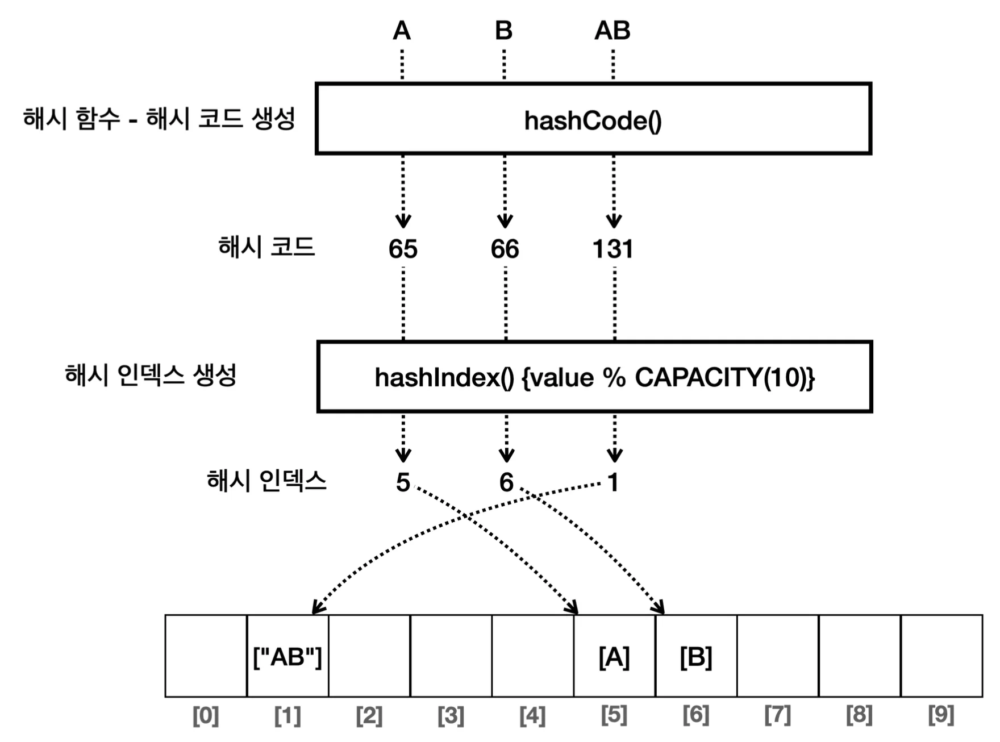

<details>
<summary>&#91; 코드 &#93; hashCode</summary>

<a id="1cfeda9b0fe180f3ac15e8f8e7923bd8"></a>

```java
static int hashCode(String str) {
    char[] charArray = str.toCharArray();
    int sum = 0;
    for (char c : charArray) {
        sum += c;
    }
    return sum;
}
```

</details>

<a id="1cfeda9b0fe180ebb6cbd0dc24830025"></a>

<code>hashCode()</code> 메서드를 통해서 문자를 기반으로 고유한 숫자 변경했다&#46;

<a id="1cfeda9b0fe180179e33c229ccaa1bb5"></a>

그러면 고유한 정수 숫자 값이 나오는데, 이를 해시 코드라 한다&#46;

- 문자열 → 해시 코드 → 해시 인덱스 

</details>

<a id="1cfeda9b0fe180f0b4d8fa3023a0c577"></a>

### 용어 정리

> ✏️ 
> 
> - <code>해시 코드</code>&#58; 데이터를 대표하는 값
> 
> - <code>해시 함수</code>&#58; 해시 코드를 생성하는 함수
> 
> - <code>해시 인덱스</code>&#58; 해시 코드를 사용해서 데이터의 저장 위치를 결정하는 값

<details>
<summary>해시 함수 ( Hash Function )</summary>

- 해시 함수는<strong><u> 임의의 길이의 데이터를 입력으로 받아, </u></strong><strong><u>고정된 길이의 해시값(해시 코드)을 출력</u></strong><strong><u>하는 함수</u></strong>이다&#46;

- 여기서 의미하는 <strong><u>고정된 길이는 </u></strong><strong><u>저장 공간</u></strong>의 크기를 뜻한다&#46; 
    - ex) <strong><u>int 형</u></strong> <code>1</code>, <code>100</code> 은 둘다 <strong><u>4byte</u></strong>를 차지하는 저장 공간 즉, <strong><u>고정된 길이</u></strong>를 가진다&#46;

- 같은 데이터를 입력하면 항상 같은 해시 코드가 출력된다&#46;

- 다른 데이터를 입력해도 같은 해시 코드가 출력될 수 있다&#46; 
    <a id="1cfeda9b0fe1800c8b1dc282cea33632"></a>

    이것을 해시 충돌이라 한다&#46;

    <details>
    <summary>ex) 해시 충돌</summary>

    - &#34;BC&#34;  → B(66) &#43; C(67) = 133

    - &#34;AD&#34;  → A(65) &#43; D(68) = 133

    </details>

</details>

<details>
<summary><strong>해시 코드(Hash Code)</strong></summary>

- 해시 코드는 데이터를 대표하는 값을 뜻한다&#46;

- 보통 해시 함수를 통해 만들어진다&#46;
    - ex) <strong>ASCII</strong> 코드
        - ‘A’&#58; <code>65</code>

        - ‘B’&#58; <code>66</code> 

        - ‘AB’&#58; <code>131</code>

</details>

<details>
<summary><strong>해시 인덱스(Hash Index)</strong></summary>

- 해시 인덱스는 <strong><u>데이터의 저장 위치를 결정</u></strong>하는데, 주로 <u>해시 코드를 사용</u>해서 만든다&#46;

- <strong>보통 해시 코드의 결과에 배열의 크기를 나누어 구</strong>한다&#46;


</details>

<a id="1cfeda9b0fe18020b10ee249139bc415"></a>

###  

> 🗒️ 
> 
> <a id="1cfeda9b0fe180ceaf7ec4ca9add4464"></a>
> 
> <strong>정리</strong>
> 
> ---
> 
> <a id="1cfeda9b0fe1802f9a59fa41985eee83"></a>
> 
> <strong><u>문자 데이터</u></strong>를 사용할 때도, <code>해시 함수</code>를 사용해서 <strong><u>정수 기반의 해시 코드로 변환</u></strong>한 덕분에, <strong><u>해시 인덱스를 사용</u></strong>할 수 있 게 되었다
> 
> <a id="1cfeda9b0fe1802aa290e287f0e365cf"></a>
> 
> 세상의 <strong><u>어떤 객체</u></strong>든지 <strong><u>정수로 만든 해시 코드로 정의</u></strong>할 수 있다면 <strong><u>해시 인덱스를 사용</u></strong>할 수 있다&#46; 
> 
> > 🧐 
> > 
> > <a id="1cfeda9b0fe180b4b341fd6beaaf0702"></a>
> > 
> > <strong>그렇다면 문자 뿐만 아니라 내가 직접 만든 </strong><strong><code>Member</code></strong><strong> , </strong><strong><code>User</code></strong><strong> 와 같은 객체는 어떻게 해시코드 할 수 있는가?</strong>
> 
> <a id="1cfeda9b0fe180c2b5bfd2024db3e075"></a>
> 
> 자바의 <code>hashCode()</code> 메서드를 통해 가능하다 → 다음 챕터 

- 

<a id="1cfeda9b0fe18092bfe0e4a7eaa3699c"></a>

### 자바 &#45; <code>hashCode()</code>

---

> 📖 
> 
> <a id="1cfeda9b0fe180149420f02c496f033c"></a>
> 
> <strong><u>해시 인덱스를 사용</u></strong>하는 해시 자료 구조는 <strong><u>데이터 추가, 검색, 삭제</u></strong>의 성능이 <code class="language-math">O(1)</code>로 매우 빠르다&#46; 따라서 많은 곳에서 자주 사용된다&#46; 
> 
> <a id="1cfeda9b0fe180f9b712d84ab06ab369"></a>
> 
> 그런데 앞서 학습한 것 처럼 해시 자료 구조를 사용하려면 정수로 된 숫자 값인 해시 코드가 필요하다&#46;
> 
> <a id="1cfeda9b0fe1802aa80ce6c5de499648"></a>
> 
>  자바에는 정수 <code>int</code> , <code>Integer</code> 뿐만 아니라 <code>char</code> , <code>String</code> , <code>Double</code> , <code>Boolean</code> 등 수 많은 타입이 있다&#46; 뿐만 아니라 개발자가 직접 정의한 <code>Member</code> , <code>User</code> 와 같은 사용자 정의 타입도 있다&#46;
> 
> <a id="1cfeda9b0fe18034b18afd160d2f1ced"></a>
> 
> 이 모든 타입을 해시 자료 구조에 저장하려면 <strong><u>모든 객체</u></strong><strong>가 </strong><strong><u>숫자 해시 코드</u></strong><strong>로 제공</strong>될 수 있어야 한다&#46;

<a id="1cfeda9b0fe180689b5bd0e7b147a769"></a>

### <code>Object&#46;hashCode()</code>

> ✏️ 
> 
> <a id="1cfeda9b0fe180a3bfcef330da39be76"></a>
> 
> 자바는 <strong><u>모든 객체</u></strong><strong>가 </strong><strong><u>자신만의 해시 코드를 표현</u></strong>할 수 있는 <strong>기능을 제공</strong>한다
> 
> - <code>Object</code> &#45; <code>hashCode()</code> 

<a id="1cfeda9b0fe18023b091dae75fb51710"></a>

### 코드 

<details>
<summary>&#91; 코드 &#93; Member</summary>

<a id="1cfeda9b0fe1800ab982ebb053acdafc"></a>

```java
package collection.hashset.v2;

import java.util.Objects;

public class Member {

    private String id;

    public Member(String id) {
        this.id = id;
    }

    public String getId() {
        return id;
    }

    @Override
    public boolean equals(Object object) {
        if (this == object) return true;
        if (object == null || getClass() != object.getClass()) return false;
        Member member = (Member) object;
        return Objects.equals(id, member.id);
    }

    @Override
    public int hashCode() {
        return Objects.hash(id);
    }

    @Override
    public String toString() {
        return "Member{" +
                "id='" + id + '\'' +
                '}';
    }
}
```

</details>

<details>
<summary>&#91; 코드 &#93; JavaHashCodeMain</summary>

<a id="1cfeda9b0fe180519443f68eb3c6dbd0"></a>

```java
package collection.hashset.v2;

public class JavaHashCodeMain {

    public static void main(String[] args) {
        // Object의 기본 hashCode는 객체의 참조 값을 기반으로 생성된다.
        Object obj1 = new Object();
        Object obj2 = new Object();
        System.out.println("obj1.hashCode() = " + obj1.hashCode());
        System.out.println("obj2.hashCode() = " + obj2.hashCode());


        //각 클래스마다 hashCode를 이미 오버라이딩 해두었다.
        Integer i = 10;
        String strA = "A";
        String strAB = "AB";
        System.out.println("10.hashCode = " + i.hashCode());
        System.out.println("'A'.hashCode = " + strA.hashCode());
        System.out.println("'AB'.hashCode = " + strAB.hashCode());

        //hashCode는 마이너스 값이 들어올 수 있다.
        System.out.println("-1.hashCode = " + Integer.valueOf(-1).hashCode());

        // 아래의 경우, 인스턴스는 다르지만, equals는 같다. ( 동일한 클래스(메타 정보)로 생성 )
        Member member1 = new Member("idA");
        Member member2 = new Member("idA");

        //equals, hashCode를 오버라이딩 하지 않은 경우와, 한 경우를 비교
        System.out.println("(member1 == member2) = " + (member1 == member2));
        System.out.println("member1 equals member2 = " + member1.equals(member2));
        System.out.println("member1.hashCode() = " + member1.hashCode());
        System.out.println("member2.hashCode() = " + member2.hashCode());
    }
}
```

</details>

<details>
<summary>실행 결과</summary>

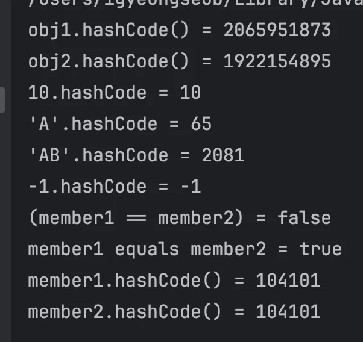

</details>

<a id="1cfeda9b0fe180949600fce221467531"></a>

### 설명

<details>
<summary><strong>Object의 해시 코드 비교</strong></summary>

- <code>Object</code> 가 기본으로 제공하는 <code>hashCode()</code> 는 객체의 참조 값을 해시 코드로 사용한다&#46; <br>따라서 각각의 인스턴스마다 서로 다른 값을 반환한다&#46;

- 그 결과 <code>obj1</code> , <code>obj2</code> 는 서로 다른 해시 코드를 반환한다&#46;

</details>

<details>
<summary><strong>자바의 기본 클래스(</strong><strong><code>Integer</code></strong><strong> … )의 해시 코드</strong></summary>

- <code>Integer</code> , <code>String</code> 같은 자바의 기본 클래스들은 대부분 내부 값을 기반으로 해시 코드를 구할 수 있도록 <code>hashCode()</code> 메서드를 재정의해 두었다&#46;

- 따라서 데이터의 값이 같으면 같은 해시 코드를 반환한다&#46;

- 해시 코드의 경우 정수를 반환하기 때문에 마이너스 값이 나올 수 있다&#46;

</details>

<details>
<summary><strong>동일성, 동등성</strong></summary>

> ✏️ 
> 
> > <strong><code>동일성(Identity)</code></strong>
> 
> - <code>==</code>
> 
> -  두 객체의 참조가 동일한 객체를 가리키고 있는지 확인
> 
> > <strong><code>동등성(Equality)</code></strong>
> 
> - <code>equals()</code>
> 
> -  두 객체가 논리적으로 동등한지 확인

- 동일성(Identity)은 물리적으로 같은 메모리에 있는 객체인지 참조값을 확인하는 것이고, 동등성은 논리적으로 같은지 확인하는 것이다&#46;

- 동일성은 자바 머신 기준이고 메모리의 참조가 기준으로 물리적이다&#46; 동등성은 보통 사람이 생각하는 논리적인 것에 기준을 맞춘다&#46; 따라서 논리적이다&#46;

<details>
<summary>ex)</summary>

<a id="1cfeda9b0fe180f0869be4d2b3099806"></a>

```java
// ex 1
User a = new User("id-100")
User b = new User("id-100")

// => a, b: 물리적 동등 ❌, 논리적 동등 O
```

<a id="1cfeda9b0fe180918f39d628920099d1"></a>

```java
// ex 1
String s1 = new String("hello");
String s2 = new String("hello");

// => a, b: 물리적 동등 ❌, 논리적 동등 O
```

</details>

</details>

<details>
<summary><strong>직접 구현하는 해시 코드</strong></summary>

> ✏️ 
> 
> <a id="1cfeda9b0fe1806299e3c7221d2c13f3"></a>
> 
> <code>Member</code> 의 경우 회원의 <code>id</code> 가 같으면 논리적으로 같은 회원으로 표현할 수 있다&#46; 따라서 회원 <code>id</code> 를 기반으로 동등성 을 비교하도록 <code>equals</code> 를 재정의해야 한다&#46;<br>여기에 <code>hashCode()</code> 도 같은 원리가 적용된다&#46; 회원의 <code>id</code> 가 같으면 논리적으로 같은 회원으로 표현할 수 있다&#46; 따라 서 회원 <code>id</code> 를 기반으로 해시 코드를 생성해야 한다&#46;

<a id="1cfeda9b0fe1803a8c9ff29249256552"></a>

<strong>Member의 hashCode() 구현</strong>

- <code>Member</code> 는 <code>hashCode()</code> 를 재정의했다&#46;

- <code>hashCode()</code> 를 재정의 할 때 <code>Objects&#46;hash()</code> 에 해시 코드로 사용할 값을 지정해주면 쉽게 해시 코드를 생성할 수 있다&#46;

- <code>hashCode()</code> 를 재정의하지 않으면 <code>Object</code> 가 기본으로 제공하는 <code>hashCode()</code> 를 사용하게 된다&#46; 

- 이것은 객체의 참조값을 기반으로 해시 코드를 제공한다&#46; 따라서 회원의 <code>id</code> 가 같아도 인스턴스가 다르면 다른 해시 코드를 반환하게 된다&#46;

- <code>hashCode()</code> 를 <code>id</code> 를 기반으로 재정의한 덕분에 인스턴스가 달라도 <code>id</code> 값이 같으면 같은 해시 코드를 반환한 다&#46;

- 따라서 인스턴스가 다른 <code>member1</code> , <code>member2</code> 둘다 같은 해시 코드를 반환하는 것을 확인할 수 있다&#46;

</details>

> 🗒️ 
> 
> <a id="1cfeda9b0fe1805da1f7d51d2f06c813"></a>
> 
> <strong>정리</strong>
> 
> ---
> 
> <a id="1cfeda9b0fe1802cafb7d0cef96faef7"></a>
> 
> 자바가 기본으로 제공하는 클래스 대부분은 <code>hashCode()</code> 를 재정의 해두었다&#46;
> 
> <a id="1cfeda9b0fe180b4bb41f5c0a17690f5"></a>
> 
> 따라서 직접 만들어야 하는 경우, <code>hashCode()</code>를 재정의 하면 된다&#46; 
> 
> <a id="1cfeda9b0fe180039e47f0fa15db27ba"></a>
> 
> <code>hashCode()</code> 만 재정의하면 필요한 모든 종류의 객체를 해시 자료 구조에 보관할 수 있다&#46;
> 
> <a id="1cfeda9b0fe18092b65fc1c06fcc417b"></a>
> 
> 정리하면 <strong><u>해시 자료 구조에 데이터를 저장</u></strong>하는 경우<strong> </strong><strong><u>hashCode()</u></strong><u> 를 구현</u>해야 한다&#46;

<a id="1cfeda9b0fe18038b54ffbf01791245e"></a>

###  V2&#58;  <code>hashCode()</code>  적용

---

> ✏️ 
> 
> <a id="1cfeda9b0fe180108a18e5ed4e9c0a4a"></a>
> 
> 모든 타입을 저장할 수 있는 <code>Set</code>  구현
> 
> - <code>hashCode()</code>  적용

<a id="1cfeda9b0fe1807fa7a0e4de37f00105"></a>

### 코드 

<details>
<summary>&#91; 코드 &#93; MyHashSetV2</summary>

<details>
<summary>변경점</summary>

1. Integer → Object
    <a id="1cfeda9b0fe1807fafacfd7d77d92805"></a>

    ```java
    private LinkedList<Object>[] buckets
    ```

    - <code>MyHashSetV1</code> 은 <code>Integer</code> 숫자만 저장할 수 있었다&#46; 여기서는 모든 타입을 저장할 수 있도록 <code>Object</code> 를 사용한다&#46;

    - 추가로 저장, 검색, 삭제 메서드의 매개변수도 <code>Object</code> 로 변경했다

1. <strong>hashIndex()</strong>
    - <code>hashIndex()</code> 부분이 변경되었다&#46;

    - 먼저 <code>Object</code> 의 <code>hashCode()</code> 를 호출해서 해시 코드를 찾는다&#46; 그리고 찾은 해시 코드를 배열의 크기( <code>capacity</code> )로 나머지 연산을 수행한다&#46; 

    - 이렇게 해시 코드를 기반으로 해시 인덱스를 계산해서 반환한다&#46;

    - <code>Object</code> 의 <code>hashCode()</code> 를 사용한 덕분에 모든 객체의<code>hashCode()</code> 를 구할 수 있다&#46; 

    - 물론 다형성에 의해 오버라이딩 된 <code>hashCode()</code> 가 호출된다&#46;

    - <code>hashCode()</code> 의 실행 결과로 음수가 나올 수 있는데, 배열의 인덱스로 음수는 사용할 수 없다&#46;

    -  <code>Math&#46;abs()</code> 를 사용하면 마이너스를 제거해서 항상 양수를 얻을 수 있다

</details>

<a id="1cfeda9b0fe180128aecc8290cf2d95e"></a>

```java
package collection.hashset.v2;

import java.util.Arrays;
import java.util.LinkedList;
import java.util.stream.IntStream;

public class MyHashSetV2 {

    static final int DEFAULT_INITIAL_CAPACITY = 16;

    private LinkedList<Object>[] buckets;

    private int size = 0;
    private int capacity = DEFAULT_INITIAL_CAPACITY;

    public MyHashSetV2() {
        initBuckets();
    }

    public MyHashSetV2(int capactity) {
        this.capacity = capactity;
        initBuckets();
    }

    private void initBuckets() {
        buckets = new LinkedList[capacity];
        IntStream.range(0, capacity).forEach(i -> buckets[i] = new LinkedList<>());
    }

    public boolean add(Object value) {
        int hashIndex = hashIndex(value);
        LinkedList<Object> bucket = buckets[hashIndex];
        if (bucket.contains(value)) {
            return false;
        }
        bucket.add(value);
        size++;
        return true;
    }

    public boolean contains(Object searchValue) {
        int hashIndex = hashIndex(searchValue);
        LinkedList<Object> bucket = buckets[hashIndex];
        return bucket.contains(searchValue);
    }

    public boolean remove(Object value) {
        int hashIndex = hashIndex(value);
        LinkedList<Object> bucket = buckets[hashIndex];

        // 버킷에서 값을 제거하고 성공했다면 size 감소 및 true 반환
        if (bucket.remove(value)) {
            size--;
            return true;
        }

        // 값이 존재하지 않아 제거 실패 시 false 반환
        return false;
    }


    private int hashIndex(Object value) {
        //hashCode의 결과로 음수가 나올 수 있다. abs()를 사용해서 마이너스를 제거한다.
        return Math.abs(value.hashCode()) % capacity;
    }

    public int getSize() {
        return size;
    }

    @Override
    public String toString() {
        return "MyHashSetV2{" +
                "buckets=" + Arrays.toString(buckets) +
                ", size=" + size +
                '}';
    }
}
```

</details>

<details>
<summary>&#91; 코드 &#93; MyHashSetV2Main1</summary>

<a id="1cfeda9b0fe180b5a547ce17652a3cbc"></a>

```java
package collection.hashset.v2;

public class MyHashSetV2Main1 {

    public static void main(String[] args) {
        MyHashSetV2 set = new MyHashSetV2(10);
        set.add("A");
        set.add("B");
        set.add("C");
        set.add("D");
        set.add("AB");
        set.add("SET");
        System.out.println(set);

        System.out.println("A.hashCode=" + "A".hashCode());
        System.out.println("B.hashCode=" + "B".hashCode());
        System.out.println("AB.hashCode=" + "AB".hashCode());
        System.out.println("SET.hashCode=" + "SET".hashCode());

        //검색
        String searchValue = "SET";
        boolean result = set.contains(searchValue);
        System.out.println("set.contains(" + searchValue + ") = " + result);

    }
}

```

</details>

<details>
<summary>실행 결과</summary>

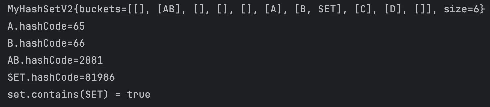

</details>

<a id="1cfeda9b0fe180a99013d5ef6ffa1a09"></a>

### NOTES

<details>
<summary><code>String&#46;haschCode()</code></summary>

- 자바 String은 내부적으로 <code>hashCode()</code>가 재정의 되어있다&#46; 
    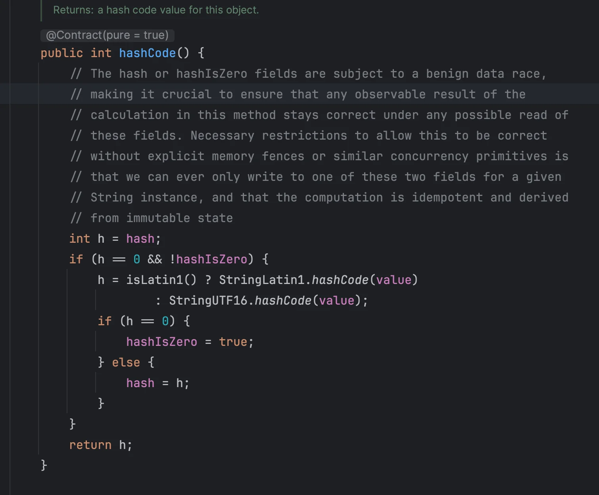

- 따라서 재정의 없이 사용하면 된다&#46;
    <a id="1cfeda9b0fe18040b4d9fac4ab18f308"></a>

    ```java
    System.out.println("A.hashCode=" + "A".hashCode());
    System.out.println("B.hashCode=" + "B".hashCode());
    System.out.println("AB.hashCode=" + "AB".hashCode());
    System.out.println("SET.hashCode=" + "SET".hashCode());
    ```

- String 해시 코드 → 해시 인덱스
    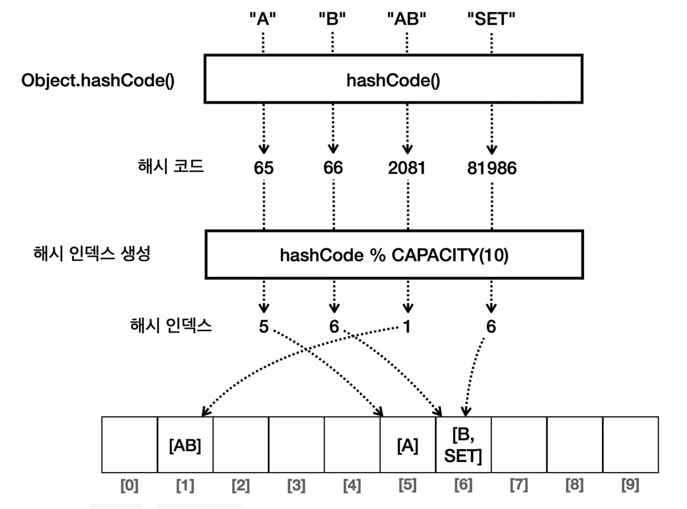

    - <code>hashIndex(Object value)</code> 에서 <code>value&#46;hashCode()</code> 를 호출하면 실제로는 <code>String</code> 에서 재정의한 <code>hashCode()</code> 가 호출된다&#46;

    - 이렇게 반환된 해시 코드를 기반으로 해시 인덱스를 생성한다&#46;

> ☝🏻 
> 
> <a id="1cfeda9b0fe1805d9affdb6bfc5bc8bd"></a>
> 
> 참고
> 
> ---
> 
> <a id="1cfeda9b0fe180dda8a3d3b099a2ce65"></a>
> 
> <strong><code>자바의 해시 함수</code></strong>는 단순히 문자들을 더하기만 하는 것이 아니라 <u>더 복잡한 연산을 사용</u>해서 해시 코드를 구한다&#46;
> 
> - 해당 부분 뒤에서 설명한다&#46;

</details>

<a id="1cfeda9b0fe1805aacd6f46e80aa5e94"></a>

###  V3&#58; <code>equals()</code>

---

<a id="1cfeda9b0fe180bb9a52c2a6aaac69f0"></a>

### 코드 

<details>
<summary>&#91; 코드 &#93; MyHashSetV2Main2</summary>

<a id="1cfeda9b0fe180508389f09def32bfba"></a>

```java
package collection.hashset.v3;

import collection.hashset.v2.MyHashSetV2;
import collection.hashset.v2.hashcode.Member;

public class MyHashSetV2Main2 {

    public static void main(String[] args) {
        MyHashSetV2 set = new MyHashSetV2(10);
        Member hi = new Member("hi");
        Member jpa = new Member("JPA");
        Member java = new Member("java");
        Member spring = new Member("spring");

        System.out.println("hi.hashCode() = " + hi.hashCode());
        System.out.println("jpa.hashCode() = " + jpa.hashCode());
        System.out.println("java.hashCode() = " + java.hashCode());
        System.out.println("spring.hashCode() = " + spring.hashCode());

        set.add(hi);
        set.add(jpa);
        set.add(java);
        set.add(spring);
        System.out.println(set);

        //검색
        Member searchValue = new Member("JPA");
        boolean result = set.contains(searchValue);
        System.out.println("set.contains(" + searchValue + ") = " + result);
    }
}

```

</details>

<details>
<summary>실행 결과</summary>

<a id="1cfeda9b0fe1803196c7dd3b77d53072"></a>

```plaintext
hi.hashCode() = 3360
jpa.hashCode() = 73690
java.hashCode() = 3254849
spring.hashCode() = -895679956

MyHashSetV2{buckets=[[Member{id='hi'}, Member{id='JPA'}], [], [], [], [], [],
[Member{id='spring'}], [], [], [Member{id='java'}]], size=4, capacity=10}

//검색
bucket.contains(Member{id='JPA'}) = true
```

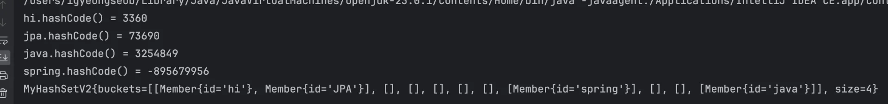

</details>

<a id="1cfeda9b0fe180879ab1ca49fc487e32"></a>

### NOTES

<details>
<summary><code>equals()</code>  재정의 필수</summary>

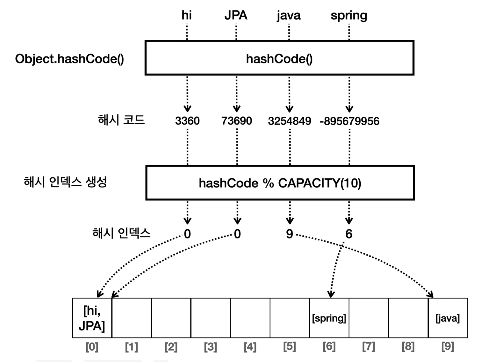

- <code>hashIndex(Object value)</code> 에서 <code>value&#46;hashCode()</code> 를 호출하면 실제로는 <code>Member</code> 에서 재정의한 <code>hashCode()</code>가 호출된다

- 이렇게 반환된 해시 코드를 기반으로 해시 인덱스를 생성한다&#46;

> <strong>equals() 사용처</strong>

- &#34;JPA&#34;를 조회할 때 해시 인덱스는 0이다&#46; <br>따라서 배열의 <code>0</code> 번 인덱스를 조회한다&#46;

- 배열의 <code>0</code>번 인덱스에는 <code>&#91;hi, JPA&#93;</code> 두개의 요소가 있기 때문에 비교를 통해서 <strong><u>해당 값을 확인</u></strong>해야 한다&#46;

- 이때, <code>equals()</code> 를 사용한다&#46;

<a id="1cfeda9b0fe180828173eae5369506e4"></a>

따라서  해시 자료 구조를 사용할 때는 <code>hashCode()</code> 는 물론이고, <code>equals()</code> 도 반드시 재정의해야 한다&#46;

<a id="1cfeda9b0fe1804f9d38e060abe15c15"></a>

참고로 자바가 제공하는 기본 클래스들은 대부분 <code>hashCode()</code> , <code>equals()</code> 를 함께 재정의해 두었다&#46;

</details>

<a id="1cfeda9b0fe180bf92fdc34c6588cca2"></a>

### equals, hashCode<strong>의 중요성</strong>

> ✏️ 
> 
> <a id="1cfeda9b0fe18025b90dfa909c1eb12d"></a>
> 
> <strong>Object의 기본 기능</strong>
> 
> - <code>hashCode()</code> &#58; 객체의 참조값을 기반으로 해시 코드 반환
> 
> - <code>equals()</code> &#58; <code>==</code> 동일성 비교, 객체의 참조값이 같아야 <code>true</code> 를 반환함	

<a id="1cfeda9b0fe18076aa28c112276a58be"></a>

해시 충돌이 발생되어 하나의 인덱스에 여러 개의 데이터가 들어가는 경우, <br>해당하는 데이터를 판별하기 위해 <code>equals()</code> 를 통해 비교한다&#46;

<a id="1cfeda9b0fe1802da7baf1080b2b2c43"></a>

따라서 직접 만드는 경우, haschCode와 equals 메서드를 같이 오버라이딩 해야한다&#46; 

- <code>hashCode()</code>를 만들면 보통 <code>equals()</code>도 같이 만들어짐

<a id="1cfeda9b0fe180b1ab60c6b5fb77f921"></a>

### hashCode, equals를 제대로 구현하지 않고 해시 자료 사용 시 발생되는 문제점

<details>
<summary>Case 1) hashCode ❌,   equals ❌</summary>

<a id="1cfeda9b0fe1804891abfbb153151084"></a>

### 코드

<details>
<summary>&#91; 코드 &#93; MemberNoHashNoEq</summary>

<a id="1cfeda9b0fe18060a15ff3f685d5d6e1"></a>

```java
package collection.set.member;

public class MemberNoHashNoEq {
   private String id;
   
   public MemberNoHashNoEq(String id) {
       this.id = id;
	 }
   
   public String getId() {
         return id;
	 }
	 
	 @Override
	 public String toString() {
	      return "MemberNoHashNoEq{" +
	              "id='" + id + '\'' +
	              '}';
   } 
}
```

</details>

<details>
<summary>&#91; 코드 &#93; HashAndEqualsMain1</summary>

<a id="1cfeda9b0fe180f5b9ebd0e3d9cd5436"></a>

```java
package collection.hashset.v3;

public class HashAndEqualsMain1 {

    public static void main(String[] args) { 
        //중복 등록
        MyHashSetV2 set = new MyHashSetV2(10);
        MemberNoHashNoEq m1 = new MemberNoHashNoEq("A");
        MemberNoHashNoEq m2 = new MemberNoHashNoEq("A");
        System.out.println("m1.hashCode() = " + m1.hashCode());
        System.out.println("m2.hashCode() = " + m2.hashCode());
        System.out.println("m1.equals(m2) = " + m1.equals(m2));
        
        set.add(m1);
        set.add(m2);
        System.out.println(set);
        
        //검색 실패
        MemberNoHashNoEq searchValue = new MemberNoHashNoEq("A"); 
        System.out.println("searchValue.hashCode() = " + searchValue.hashCode());
        boolean contains = set.contains(searchValue);
        System.out.println("contains = " + contains);
    }
}
```

<a id="1cfeda9b0fe180e0b46cfd28c7b715f7"></a>

실행 결과

<a id="1cfeda9b0fe18035982bfc243f06cadc"></a>

```java
m1.hashCode() = 1004 //인스턴스의 참조이므로 변한다.
m2.hashCode() = 1007 //인스턴스의 참조이므로 변한다.
m1.equals(m2) = false 
MyHashSetV2{buckets=[[MemberNoHashNoEq{id='A'}], [], [], [],
[MemberNoHashNoEq{id='A'}], [], [], [], [], []], size=2, capacity=10}
searchValue.hashCode() = 1008
contains = false
```

</details>

<a id="1cfeda9b0fe1804eacb1d4b99b228009"></a>

### 문제점

<details>
<summary>데이터 저장 문제</summary>

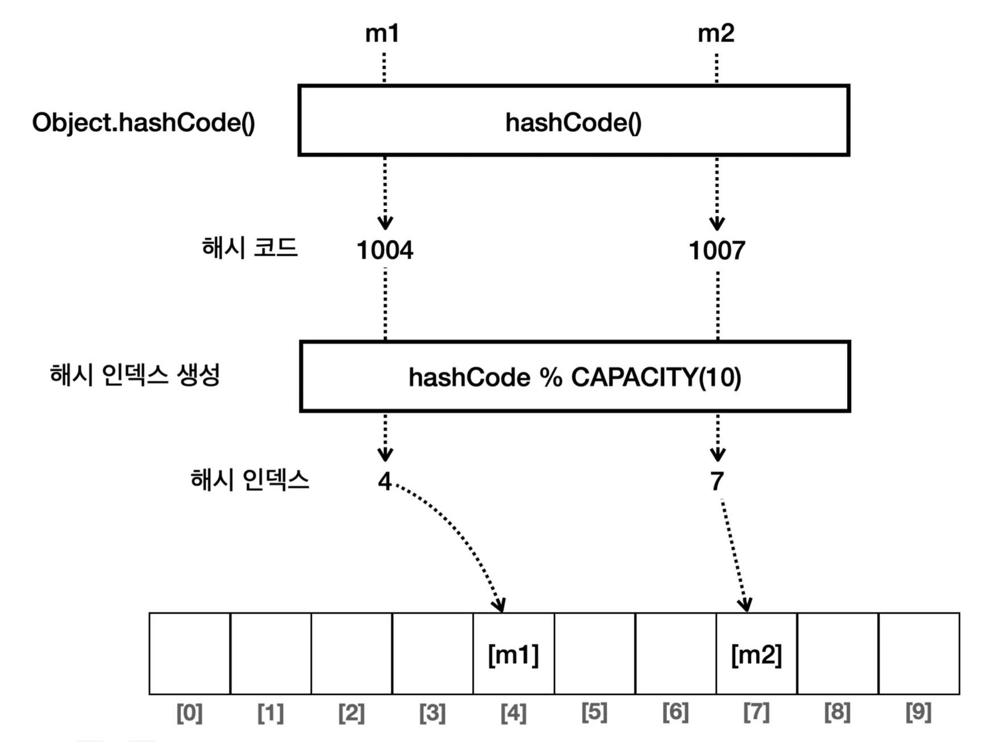

- <code>m1</code> 과 <code>m2</code> 의 해시 코드가 서로 다르기 때문에 다른 위치에 각각 저장된다&#46; 

- 회원 id가 &#34;A&#34;로 같은 회원의 데이터가 데이터가 중복 저장된다&#46;

</details>

<details>
<summary>데이터 검색 문제</summary>

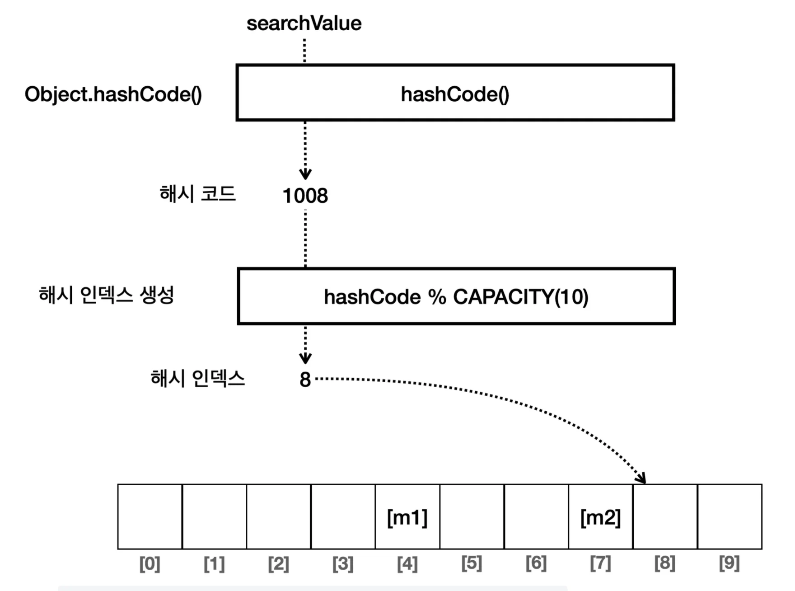

- 회원 id가 &#34;A&#34;인 객체를 검색하기 위해 회원 id가 &#34;A&#34;인 객체를 만들었다&#46; (가정&#46; 참조값&#58;1008)
    <a id="1cfeda9b0fe1804cb12dc7be57f3bbe0"></a>

    ```java
    MemberNoHashNoEq searchValue = new MemberNoHashNoEq("A")`
    ```

- 데이터를 검색할 때 <code>searchValue</code> 객체의 해시 코드는 <code>1008</code> 이다&#46; 따라서 다른 위치에서 데이터를 찾게 되고, 검색에 실패한다&#46;

</details>

</details>

<details>
<summary>Case 2) hashCode <strong>O</strong>,  equals ❌</summary>

> ✏️ 
> 
> <a id="1cfeda9b0fe1807cb4e9cf81bdb6a624"></a>
> 
> <code>hashCode()</code>만 재정의하고, <code>equals()</code>는 재정의하지 않으면 어떤 문제가 발생되는지 알아보자

<details>
<summary>&#91; 코드 &#93; MemberOnlyHash</summary>

<a id="1cfeda9b0fe180b1b66dd2d12c6f02f2"></a>

```java
public class MemberOnlyHash {

    private String id;

    public MemberOnlyHash(String id) {
        this.id = id;
    }
    
    public String getId() {
        return id;
    }
    
    @Override
    public int hashCode() {
        return Objects.hash(id);
    }
    
    @Override
    public String toString() {
        return "MemberOnlyHash{" +
                "id='" + id + '\'' +
                '}';
    } 
}
```

</details>

<details>
<summary>&#91; 코드 &#93; HashAndEqualsMain2</summary>

<a id="1cfeda9b0fe18039b4cade431812c60c"></a>

```java
public class HashAndEqualsMain2 {
    public static void main(String[] args) { //중복 등록
        MyHashSetV2 set = new MyHashSetV2(10);
        MemberOnlyHash m1 = new MemberOnlyHash("A");
        MemberOnlyHash m2 = new MemberOnlyHash("A");
        System.out.println("m1.hashCode() = " + m1.hashCode());
        System.out.println("m2.hashCode() = " + m2.hashCode());
        System.out.println("m1.equals(m2) = " + m1.equals(m2));
        set.add(m1);

        set.add(m2);
        System.out.println(set);

        //검색 실패
        MemberOnlyHash searchValue = new MemberOnlyHash("A");
        System.out.println("searchValue.hashCode() = " + searchValue.hashCode());
        boolean contains = set.contains(searchValue);
        System.out.println("contains = " + contains);
    }
}
```

<a id="1cfeda9b0fe180f28372e9df4bb0ac76"></a>

실행 결과

<a id="1cfeda9b0fe180af892eddf709b6de81"></a>

```java
 m1.hashCode() = 96
 m2.hashCode() = 96
 m1.equals(m2) = false
 MyHashSetV2{buckets=[[], [], [], [], [], [], [MemberOnlyHash{id='A'},
 MemberOnlyHash{id='A'}], [], [], []], size=2, capacity=10}
 searchValue.hashCode() = 96
 contains = false
```

</details>

<a id="1cfeda9b0fe18051ac2fe899745fc9c9"></a>

문제점

<details>
<summary><strong>데이터 저장 문제</strong></summary>

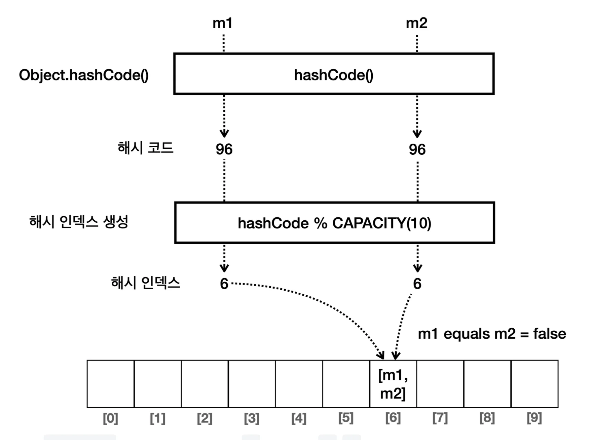

</details>

<details>
<summary>데이터 검색 문제</summary>

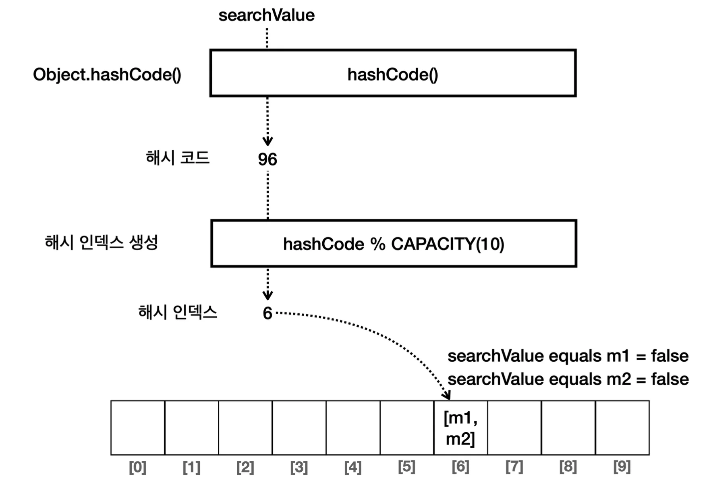

<a id="1cfeda9b0fe180299b64e6eb3aac0187"></a>

```java
public boolean add(Object value) {
    int hashIndex = hashIndex(value);
    LinkedList<Object> bucket = buckets[hashIndex];
    
		//중복 체크 로직
		if (bucket.contains(value)) { <- Object.equalts 사용
		      return false;
	  }
	  bucket.add(value);
	  size++;
	  return true;
	 
```

<a id="1d0eda9b0fe180dea0c3ee5553beca94"></a>

MemberOnlyHash는 equals()를 재정의하지 않았으므로 Object의 equals()를 상속 받아서 사용한다&#46; <br>따라서 인스턴스의 참조값을 비교한다&#46; <br>인스턴스가 서로 다른 searchValue와 m1, m2 는 비교에 실패한다&#46;

<a id="1d0eda9b0fe180629b47c0fcf4df2102"></a>

결국 데이터를 찾을 수 없다&#46;

</details>

</details>

<details>
<summary>Case 3) hashCode <strong>O</strong>,  equals <strong>O</strong></summary>

<a id="1d0eda9b0fe180f38875d4b4d20ee24b"></a>

### 코드

<details>
<summary>&#91; 코드 &#93; MemberNoHashNoEq</summary>

<a id="1cfeda9b0fe18063afe9c4ec54a1ab51"></a>

```java
package collection.set.member;

public class MemberOnlyHash {
   private String id;
   
   public MemberOnlyHash(String id) {
       this.id = id;
	 }
   
   public String getId() {
		    return id;
	 }
	 
	 @Override
	 public int hashCode() {
		    return Objects.hash(id);
	 }
	 
	 @Override
	 public String toString() {
	      return "MemberNoHashNoEq{" +
	              "id='" + id + '\'' +
	              '}';
   } 
}
```

</details>

<details>
<summary>&#91; 코드 &#93; HashAndEqualsMain2</summary>

<a id="1cfeda9b0fe180feb892d52d18070017"></a>

```java
public class HashAndEqualsMain2 {
    public static void main(String[] args) { //중복 등록
        MyHashSetV2 set = new MyHashSetV2(10);
        MemberOnlyHash m1 = new MemberOnlyHash("A");
        MemberOnlyHash m2 = new MemberOnlyHash("A");
        System.out.println("m1.hashCode() = " + m1.hashCode());
        System.out.println("m2.hashCode() = " + m2.hashCode());
        System.out.println("m1.equals(m2) = " + m1.equals(m2));
        set.add(m1);

        set.add(m2);
        System.out.println(set);

        //검색 실패
        MemberOnlyHash searchValue = new MemberOnlyHash("A");
        System.out.println("searchValue.hashCode() = " + searchValue.hashCode());
        boolean contains = set.contains(searchValue);
        System.out.println("contains = " + contains);
    }
}
```

<a id="1cfeda9b0fe180aab3cbf3d263137461"></a>

실행 결과

<a id="1cfeda9b0fe180d2b9fadbc5b3e9db35"></a>

```java
 m1.hashCode() = 96
 m2.hashCode() = 96
 m1.equals(m2) = false
 MyHashSetV2{buckets=[[], [], [], [], [], [], [MemberOnlyHash{id='A'},
 MemberOnlyHash{id='A'}], [], [], []], size=2, capacity=10}
 searchValue.hashCode() = 96
 contains = false
```

</details>

<a id="1d0eda9b0fe180d09a0ada56ea9a536e"></a>

### 설명

<details>
<summary>데이터 추가 </summary>

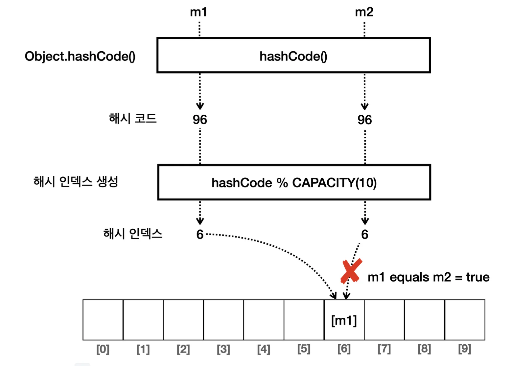

</details>

<details>
<summary>데이터 검색</summary>

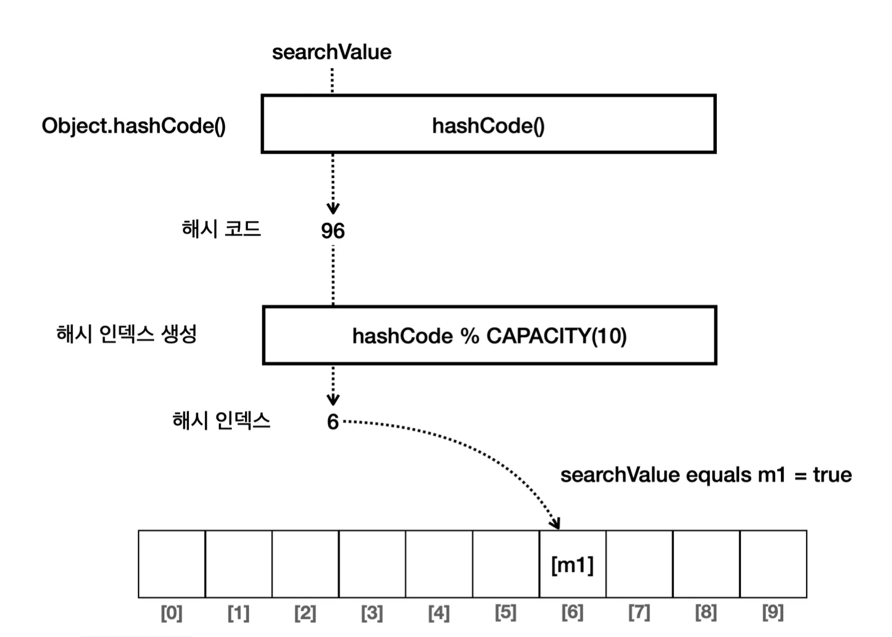

</details>

</details>

<a id="1cfeda9b0fe180248015de844077e437"></a>

###  V4&#58; 제네릭, 인터페이스 도입

---

> ✏️ 
> 
> <a id="1cfeda9b0fe1805ea541fd25fe005fb2"></a>
> 
> 인터페이스와 제네릭을 도입하여 타입 안정성이 높고, 확장성을 증가시키는 설계로 변경

<a id="1cfeda9b0fe180c88adcd75c28b0081a"></a>

### 코드 

<details>
<summary>&#91; 코드 &#93; &#60;interface&#62; MySet</summary>

<a id="1cfeda9b0fe180f2af80c524aeb7fced"></a>

```java
public interface MySet<E> {
    boolean add(E element);
    boolean remove(E value);
    boolean contains(E value);
}
```

</details>

<details>
<summary>&#91; 코드 &#93; MyHashSetV3</summary>

<a id="1cfeda9b0fe18080b0cfe7d0faec7157"></a>

```java
package collection.hashset.v3;

import java.util.Arrays;
import java.util.LinkedList;
import java.util.stream.IntStream;

public class MyHashSetV3<E> implements MySet<E> {

    static final int DEFAULT_INITIAL_CAPACITY = 16;

    LinkedList<E>[] buckets;

    private int size = 0;
    private int capacity = DEFAULT_INITIAL_CAPACITY;

    public MyHashSetV3() {
        initBuckets();
    }

    public MyHashSetV3(int capacity) {
        this.capacity = capacity;
        initBuckets();
    }

    private void initBuckets() {
        buckets = new LinkedList[capacity];
        IntStream.range(0, capacity).forEach(i -> buckets[i] = new LinkedList<>());
    }

    @Override
    public boolean add(E value) {
        int hashIndex = hashIndex(value);
        LinkedList<E> bucket = buckets[hashIndex];
        if (bucket.contains(value)) {
            return false;
        }
        bucket.add(value);
        size++;
        return true;
    }

    @Override
    public boolean contains(E searchValue) {
        int hashIndex = hashIndex(searchValue);
        LinkedList<E> bucket = buckets[hashIndex];
        return bucket.contains(searchValue);
    }

    @Override
    public boolean remove(E value) {
        int hashIndex = hashIndex(value);
        LinkedList<E> bucket = buckets[hashIndex];

        if (bucket.remove(value)) {
            size--;
            return true;
        }

        return false;
    }


    private int hashIndex(E value) {
        //hashCode의 결과로 음수가 나올 수 있다. abs()를 사용해서 마이너스를 제거한다.
        return Math.abs(value.hashCode()) % capacity;
    }

    public int getSize() {
        return size;
    }

    @Override
    public String toString() {
        return "MyHashSetV3{" +
                "buckets=" + Arrays.toString(buckets) +
                ", size=" + size +
                ", capacity=" + capacity +
                '}';
    }
}
```

</details>

<details>
<summary>&#91; 코드 &#93; MyHashSetV3Main</summary>

<a id="1cfeda9b0fe18009bfc3dcc33b4636d2"></a>

```java
package collection.hashset.v3;

public class MyHashSetV3Main {

    public static void main(String[] args) {
        MySet<String> set = new MyHashSetV3<>(10);
        set.add("A");
        set.add("B");
        set.add("C");
        System.out.println(set);
        
        //검색
        String searchValue = "A";
        boolean result = set.contains(searchValue); 
        System.out.println("set.contains(" + searchValue + ") = " + result);
    }
}

```

</details>

<details>
<summary>실행 결과</summary>

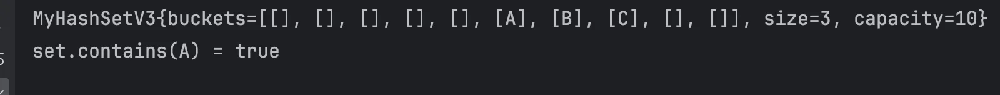

</details>

<a id="1cfeda9b0fe180aebdfdeb5a8675a75d"></a>

### 동시성 제어&#58; set

<a id="1d0eda9b0fe180c9a211f88b0dfa6468"></a>

### 문제점)  멀티스레딩 환경 &#45; 동시성 문제 발생


<a id="1d0eda9b0fe18053bf63c046d828a91d"></a>

데이터 추가 상황에서 중복 확인을 위해 contains 메서드 사용한다&#46;

<a id="1d0eda9b0fe18017bb4dc8f17cf05acc"></a>

만약 <strong>동시에 쓰레드가 접근</strong><strong>하여 데이터를 추가</strong>하는 경우, <strong><u>내부 배열에 요소가 존재하지 않</u></strong>기 때문에 <code>contains()</code> 메서드를 통해서는<strong><u> 요소의 중복 생성을 막을 수 없</u></strong>다&#46;

- <strong>동시성 문제 발생</strong>

<a id="1d0eda9b0fe18094a2e5cc40b55c5b19"></a>

### 해결 1) <code>synchronized</code> 

<details>
<summary><code>synchronized</code> 키워드</summary>

<a id="1d0eda9b0fe1806cac67e206723951c3"></a>

이때 간단하기 <code>synchronized</code> 키워드를 사용하면 해결할 수 있다&#46;

<a id="1d0eda9b0fe18077b44ed0c184579733"></a>

```java
public boolean add(E e) {
    synchronized (mutex) {
        return s.add(e);
    }
}
```

- 처음 접근한 쓰레드가 락을 획득한 후, 해당 작업이 끝날 때까지 다른 쓰레드들은 대기한다&#46;

- 작업이 끝난 이후, 락을 해제하고 다른 쓰레드가 락을 획득하여 작업을 진행한다&#46;

</details>

<details>
<summary><strong><code>Ceollections&#46;</code></strong><strong><code>SynchronizedSet</code></strong></summary>

<a id="1d0eda9b0fe18077bcb0c32ea3fd4e45"></a>

자바에서는 <code>synchronized</code>  내부적으로 구현한 자료구조를 지원한다&#46;

<details>
<summary>Collections의 내부 중첩 클래스로 정의된 것을 확인할 수 있다&#46;</summary>

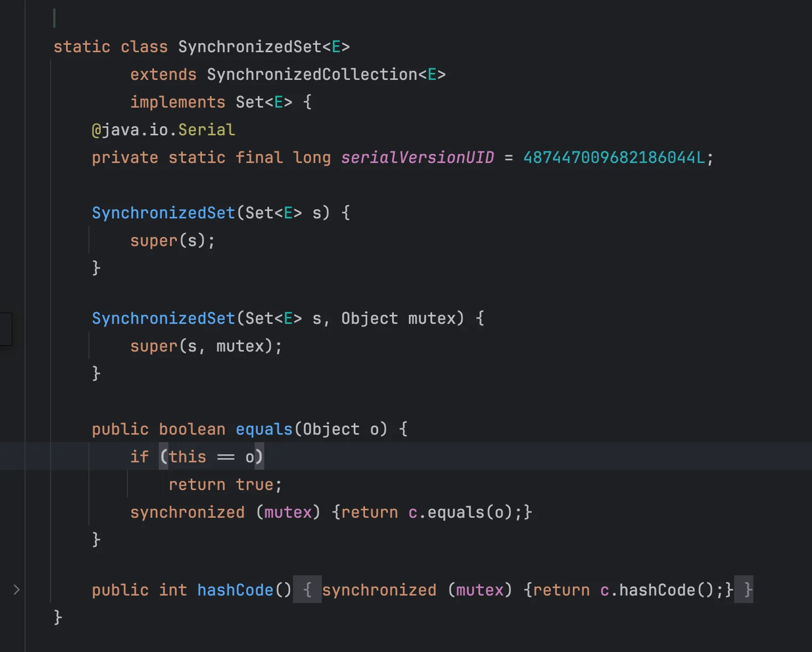

</details>

</details>

<details>
<summary><strong>장•단점</strong></summary>

- 장점
    - 구현이 간단하고 기존의 HashSet을 쉽게 동기화할 수 있다&#46;

- 단점
    - 성능 오버헤드
        - 모든 메서드 호출이 동기화되어야 하므로, 높은 경쟁이 발생하는 경우 성능이 저하된다&#46;

    - 확장성 부족
        - 많은 스레드가 동시에 접근하는 환경에서 성능이 좋지 않을 수 있다&#46;

        - 스레드간의  경쟁이 많아지면 동기화로인한 병목현상이 발생될 수 있다&#46;

</details>

<a id="1d0eda9b0fe180d5b04fd989a7bee4fc"></a>

### 해결 2) <strong><code>ConcurrentHashMap</code></strong>

> 📖 
> 
> <a id="1d0eda9b0fe1802a9e80cfc3e5347ef7"></a>
> 
> <code>synchronized</code>는 구현이 간단하지만, 성능에 대한 오버헤드 및 병목 지점이 될수  있다는 단점있다&#46;
> 
> <a id="1d0eda9b0fe18039a826f09e75002fd5"></a>
> 
> 이를 <strong><code>ConcurrentHashMap</code></strong><strong>을 통해 개선 가능하다&#46;</strong>

<details>
<summary><strong><code>ConcurrentHashMap&#46;</code></strong><strong><code>newKeySet</code></strong><strong><code>()</code></strong></summary>

> ✏️ 
> 
> <a id="1d0eda9b0fe180ffbffef559e9503f32"></a>
> 
> <code>ConcurrentHashMap</code>을 기반으로 하는 <code>newKeySet</code>은 동시성 제어를 <strong><u>더욱 효율적으로 처</u></strong>리한다&#46; 
> 
> <a id="1d0eda9b0fe180bdb12ed527e3929e6a"></a>
> 
> 내부적으로 <strong><code>세그먼트 잠금</code></strong>과 <strong><code>CAS(Compare&#45;And&#45;Swap</code></strong><code>)</code> 기술을 사용하여 높은 동시성을 제공한다&#46;

<a id="1d0eda9b0fe180c0b350f6112cab43f1"></a>

```java
Set<String> concurrentSet = ConcurrentHashMap.newKeySet();
```

- 내부적으로 세그먼트 잠금과 CAS 연산을 사용하여 동시성을 제어한다&#46;

- 키와 값을 여러 세그먼트로 나누어 부분적인 잠금을 사용한다&#46;

</details>

<details>
<summary>장•단점</summary>

- 장점
    - <strong>높은 성능</strong>
        - 높은 동시성을 제공하며, 많은 스레드가 동시에 접근해도 성능이 우수하다&#46;

    - <strong>확장성</strong>
        - 스레드 수가 증가해도 성능이 상대적으로 안정적으로 유지된다&#46;

- <strong>단점</strong>
    - 메모리 사용량이 상대적으로 많을 수 있다&#46; <br>그러나 이는 보통 성능상의 장점에 비해 작은 trade&#45;off이다&#46;

</details>

<a id="1d0eda9b0fe1803aa076d228a86fd57c"></a>

### 비교

<details>
<summary><strong>Collections&#46;synchronizedSet의 동기화 방식</strong></summary>

<a id="1d0eda9b0fe18095a70bfaf1b9ed2d58"></a>

Collections&#46;synchronizedSet은 <strong><u>단일 잠금</u></strong><strong><u>을 사용</u></strong>하여 <strong>모든 접근을 동기화</strong>한다&#46; 이는 <strong><u>경쟁이 많은 상황에서 병목 현상을 초래</u></strong>할 수 있다&#46;

<a id="1d0eda9b0fe18095ba0ee70829d1ebda"></a>

```java
//  synchronized 키워드로 인해 단일 스레드만 접근할 수 있다.
synchronizedSet.add(value);
```

</details>

<details>
<summary><strong>ConcurrentHashMap&#46;newKeySet의 동기화 방식</strong></summary>

<a id="1d0eda9b0fe18028b1d7e4b253a5b490"></a>

```java
// 내부적으로 세그먼트 잠금과 CAS를 사용하여 다수의 스레드가 동시에 접근할 수 있게 한다.
concurrentSet.add(value);
```

<a id="1d0eda9b0fe1803da7b7f8c83eb27364"></a>

ConcurrentHashMap&#46;newKeySet은 <code>세그먼트 잠금</code>과 <code>CAS</code>를 사용하여 <strong><u>여러 스레드가 동시에 다른 세그먼트에 접근</u></strong>할 수 있게 한다&#46; 

<a id="1d0eda9b0fe1809e815cc40082e57697"></a>

이는 병목 현상을 줄여주고 성능을 높여준다&#46;

</details>

<a id="1d0eda9b0fe1800cb763c3437d0a8ac2"></a>

### 정리

<a id="1d0eda9b0fe180719a15f34ba57ad468"></a>

<strong><code>synchronized</code></strong><strong>는  단일 쓰레드만 제약하기 때문에 상대적으로 </strong><strong><code>ConcurrentHashMap</code></strong><strong>보다 성능이 떨어진다&#46;</strong>

- <strong><code>ConcurrentHashMap</code></strong><strong> 는 </strong><strong><u>세그먼트 잠금과 CAS 연산</u></strong><strong>을 통해 다수 스레드가 접근하여 처리할 수 있다&#46;</strong>

<a id="1d0eda9b0fe180ca9524f3a21f558dfb"></a>

<strong><code>synchronized</code></strong>, <strong><code>ConcurrentHashMap</code></strong><strong> 모두 </strong><strong><u>단일 JVM 내의 멀티스레딩 환경</u></strong><strong>에 대한 동기화 문제를 다룬다&#46;</strong>

<a id="1d0eda9b0fe18055a9eefae2cbbaad7e"></a>

따라서 만약 <strong><u>클러스터 환경(여러 JVM/서버 인스턴스</u></strong>)의 경우는 외부 미들웨어를 통한 분삭 락 구현이 필요하다&#46;

> <strong>추가 공부 키워드</strong>

- redis 분삭 락

- 세그먼트 잠금

- CAS 연산

<a id="1d0eda9b0fe180ea8647ed5d4fbb80cf"></a>

<strong>Reference</strong>

<a id="1d0eda9b0fe180118d84fbc6b91dfaad"></a>

‣
