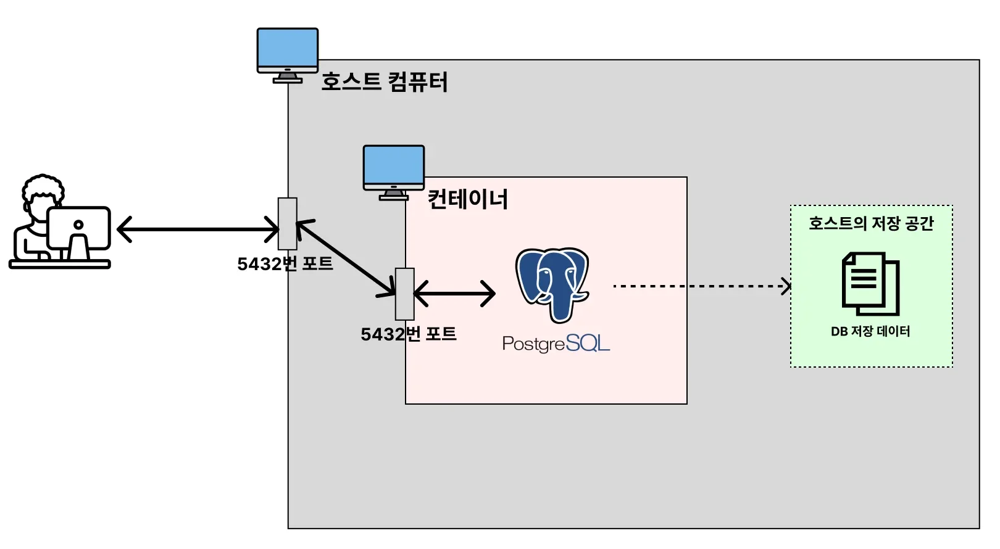
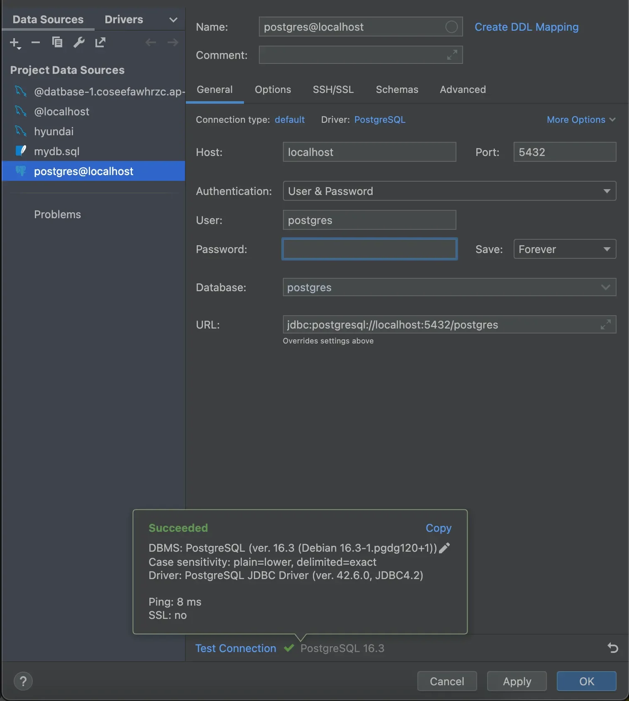

<a id="1c3eda9b0fe181dc8630da3965463e97"></a>

### &#91; Volume O  &#93;   Docker로 <strong><code>PostgreSQL</code></strong> 실행

---



<details>
<summary>dockerhub &#45; Postgre SQL</summary>

[postgres &#45; Official Image &#124; Docker Hub]()

</details>

<details>
<summary>1&#46; <strong>PostgreSQL</strong> 데이터를 저장할 volume 폴더 생성</summary>

<a id="1c3eda9b0fe1815084b0dfedad06db95"></a>

```bash
cd /Users/igyeongseob/Develop

mkdir docker-postgresql
```

</details>

<details>
<summary>2&#46; <strong>PostgreSQL </strong>컨테이너 실행 &#45; volume 설정 추가 </summary>

<a id="1c3eda9b0fe1810c888dcc865f20a121"></a>

```bash
docker run -e POSTGRES_PASSWORD=pws123 -p 5432:5432 -v /Users/igyeongseob/Develop/docker-postgresql/postgresql_data:/var/lib/postgresql/data -d postgres
```

</details>

<details>
<summary>3&#46; 컨테이너 bash 접속 </summary>

<a id="1c3eda9b0fe181ecb069cc5be5aa09ac"></a>

```bash
# 컨테이너 실행 및 ID 확인
docker ps 

# 컨테이너 실행시킬 때 에러 없이 잘 실행됐는 지 로그 체크
docker logs [컨테이너 ID 또는 컨테이너명]

# 컨테이너 내부 bash 접속
docker exec -it [컨테이너 ID] bash
```

</details>

<details>
<summary>4&#46; PostgreSQL 접속 및 확인 &#91; CLI &#93;</summary>

<a id="1c3eda9b0fe18189b633f058bcbb84c7"></a>

```bash
# PostgreSQL 접속
psql -U postgres

# 특정 DB에 접속
psql -U postgres -d mydatabase

# DB 목록 조회
\l

# 특정 데이터베이스로 접속
\c <데이터베이스 명>

# 현재 DB의 데이블 목록 조회
\dt

# 특정 테이블의 스키마 조회
\d <테이블 명>

# 사용자 목록 조회
\du

# psql 종료
\q
```

<a id="1c3eda9b0fe181d08448f4a022df6a5c"></a>

```bash
# DB 생성
CREATE DATABASE [DB명];

# 사용자 생성 및 비밀번호 설정
CREATE USER myuser WITH ENCRYPTED PASSWORD 'mypassword';

# 데이터베이스 권한 부여 
GRANT ALL PRIVILEGES ON DATABASE mydatabase TO myuser;

# 테이블 생성 
CREATE TABLE users (
    id SERIAL PRIMARY KEY,
    name VARCHAR(100),
    email VARCHAR(100) UNIQUE NOT NULL
);

# 데이터 삽입
INSERT INTO users (name, email) VALUES ('Alice', 'alice@example.com');

# 데이터 조회
SELECT * FROM users;
```

</details>

<details>
<summary>5&#46; <strong>PostgreSQL 연결</strong></summary>



</details>

<details>
<summary>6&#46; <strong>PostgreSQL 데이터가 볼륨에 잘 저장되고 있는 지 확인해보기</strong></summary>

<a id="1c3eda9b0fe181bf8614d26074658481"></a>

```bash
cd /Users/igyeongseob/Develop/docker-postgresql/postgresql_data
ls
```

</details>
