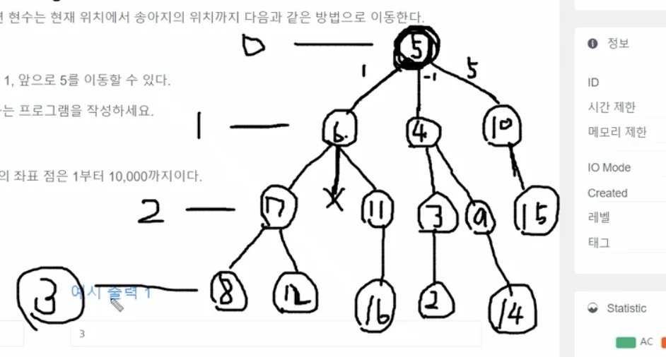

<a id="1c3eda9b0fe181ed987ec5caff1ad8d5"></a>

# 문제

<a id="1c3eda9b0fe1812ca71fce59079553b6"></a>

## <strong>8&#46; 송아지 찾기 1(BFS &#58; 상태트리탐색)</strong>

---

<a id="1c3eda9b0fe1818c9fdfd8cfca845a4b"></a>

### 설명

<a id="1c3eda9b0fe181ff99e0d93a83db1b00"></a>

현수는 송아지를 잃어버렸다&#46; 다행히 송아지에는 위치추적기가 달려 있다&#46;

<a id="1c3eda9b0fe181e9aafce1734f0345e6"></a>

현수의 위치와 송아지의 위치가 수직선상의 좌표 점으로 주어지면 현수는 현재 위치에서 송아지의 위치까지 다음과 같은 방법으로 이동한다&#46;

<a id="1c3eda9b0fe181f3bf1cfdcafac72c0f"></a>

송아지는 움직이지 않고 제자리에 있다&#46;

<a id="1c3eda9b0fe1814aaf21c62bb867d68c"></a>

현수는 스카이 콩콩을 타고 가는데 한 번의 점프로 앞으로 1, 뒤로 1, 앞으로 5를 이동할 수 있다&#46;

<a id="1c3eda9b0fe181248244dd1ab8935470"></a>

최소 몇 번의 점프로 현수가 송아지의 위치까지 갈 수 있는지 구하는 프로그램을 작성하세요&#46;

<a id="1c3eda9b0fe1815aa86ee82554608bd3"></a>

### 입력

<a id="1c3eda9b0fe1816c839fca57003e544d"></a>

첫 번째 줄에 현수의 위치 S와 송아지의 위치 E가 주어진다&#46; 직선의 좌표 점은 1부터 10,000까지이다&#46;

<a id="1c3eda9b0fe1811b89a4db64cfec0794"></a>

### 출력

<a id="1c3eda9b0fe181ff9659e08c8b8fe1b3"></a>

점프의 최소횟수를 구한다&#46; 답은 1이상이며 반드시 존재합니다&#46;

---

<a id="1c3eda9b0fe18113a372da5e2149edd4"></a>

### 예시 입력 1

<a id="1c3eda9b0fe18146807cc06f70b163eb"></a>

```plaintext
5 14

```

<a id="1c3eda9b0fe181179fffca2400e893c5"></a>

### 예시 출력 1

<a id="1c3eda9b0fe18145bfe1ca8fc0201028"></a>

```plaintext
3
```

<a id="1c3eda9b0fe1811caeb6d6ac025ca3b6"></a>

# 풀이



<a id="1c3eda9b0fe1817fa16cf614ab392d28"></a>

## 풀이1) BFS, 메모제이션

<a id="1c3eda9b0fe1818a8978d4d0894eada3"></a>

```java
import java.util.*;

public class Main {
    int[] ch;
    int[] dist={-1, 1, 5};
    Queue<Integer> Q=new LinkedList<>();

    public int BFS(int s, int e){
        ch=new int[10001];
        ch[s]=1;
        int L=1;
        Q.offer(s);
        while(!Q.isEmpty()){
            int len=Q.size();
            for(int i=0; i<len; i++){
                int x=Q.poll();
                for(int dx: dist){
                    int nx=x+dx;
                    if(nx==e) return L;
                    if(ch[nx]==0 & nx>0 & nx<10000) {
                        Q.offer(nx);
                        ch[nx]=1;
                    }
                }
            }
            L++;
        }
        return 0;
    }

    public static void main(String args[]) {
        Main T = new Main();
        Scanner sc=new Scanner(System.in);
        int s = sc.nextInt();
        int e = sc.nextInt();
        System.out.println(T.BFS(s, e));
    }
}
```
