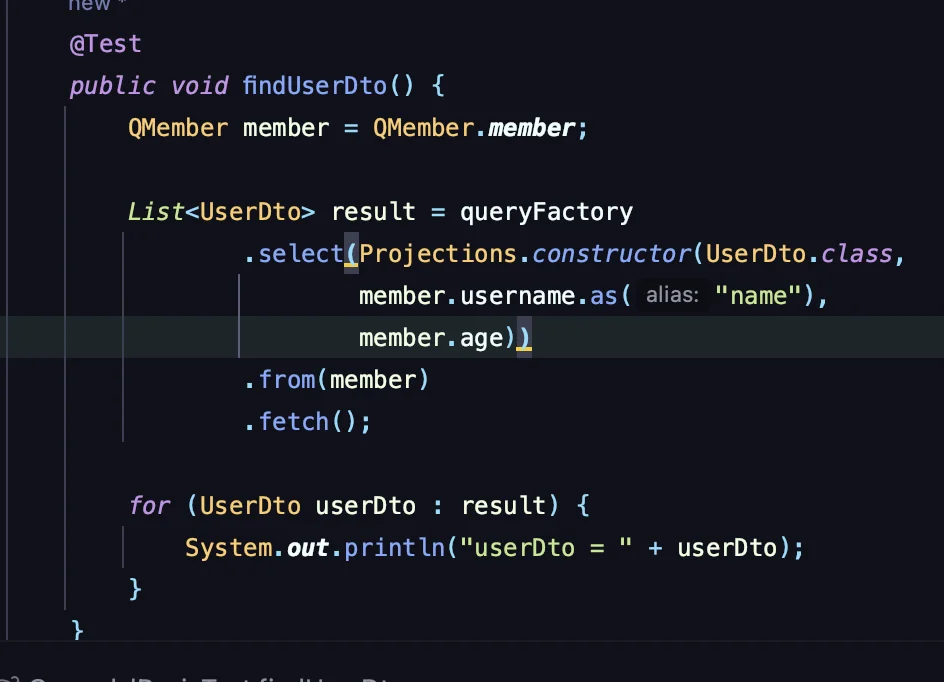
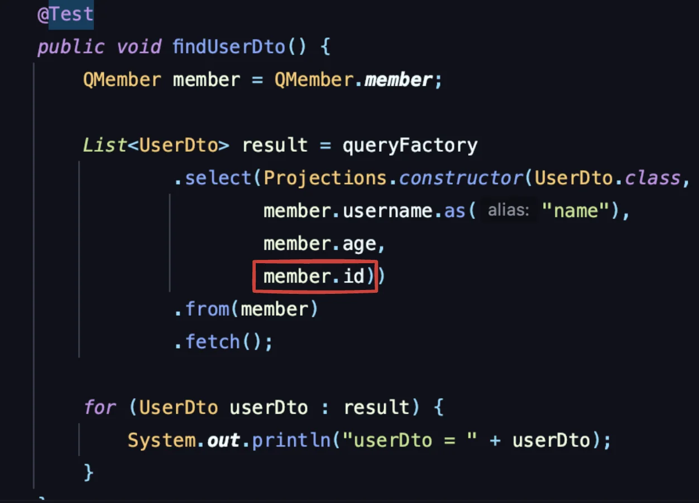
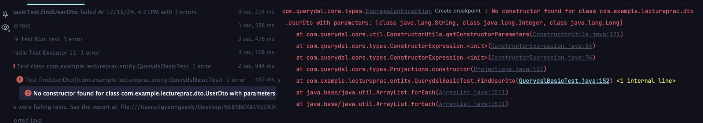
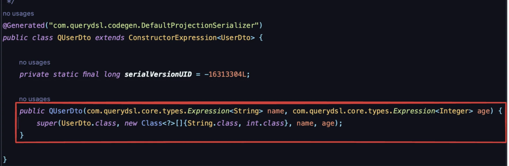
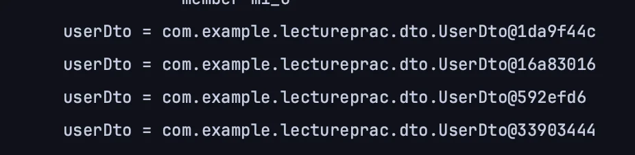

<a id="1c3eda9b0fe1817bbe13cba4bfdcbc34"></a>

## <strong>프로젝션과 결과 반환 </strong>&#45; &#64;QueryProjection

---

> 📖 
> 
> <a id="1c3eda9b0fe1812690f1c286441660e5"></a>
> 
> <code>&#64;QueryProjection</code>를 사용한 방법은 <strong><u>컴파일러</u></strong>에서 <strong><u>타입 체크</u></strong><strong> </strong>할 수 있는 <u>가장 안전한 방법</u>이다&#46; <br>다만<u> DTO에 QueryDSL 어노테이션을 유지</u> 해야 하는 점과 <u>DTO까지 Q 파일을 생성</u>해야 하는 단점이 있다&#46;
> 
> - 아키텍처 의존관계 문제&#58; DTO가 Querydsl 라이브러의 의존적이게 된다&#46; 

> ☝🏻 
> 
> <a id="1c3eda9b0fe18100acfded490cf9fd2a"></a>
> 
> 이전 Projections을 통한 결과 반환은 <strong><u>컴파일에서 오류를 잡지 못</u></strong>한다&#46; <br>즉, 런타입에서 오류를 확인한다&#46;  따라서 실제 유저가 해당 코드를 실행하는 순간에서 문제점을 발견할 수 있다&#46;  
> 
> <a id="1c3eda9b0fe18118a2c6fa2ecf504f14"></a>
> 
> 만약 테스트 코드가 없다면, 실제 서비스 운영에서 오류가 발견되고 이는 서비스의 신뢰정과 정합성을 훼손하는 매우 크리티컬한 상황을 발생시킨다&#46; 
> 
> <details>
> <summary>ex) </summary>
> 
> - Projections를 사용한 DTO 반환
>     
> 
> - 아래와 같이 <u>해당 DTO에 정의되지 않는 필드를 추가</u>해도, <strong>컴파일 계층에서 체크하지 못</strong>한다&#46; 
>     
> 
> - 테스트 코드 실행 &#45; 아래와 같은  <code>ExpressionException</code>이 발생된다&#46;
>     
> 
>     - <code>com&#46;querydsl&#46;core&#46;types&#46;ExpressionException</code>
>         <a id="1c3eda9b0fe181e4b087cd6c4bf3d664"></a>
> 
>         Querydsl에서 <code>Projections&#46;constructor()</code>를 사용하여 <u>DTO로 데이터를 매핑</u>하는 과정에서 <strong>해당 클래스에 </strong><strong><u>매개변수 타입</u></strong><strong>과 </strong><strong><u>순서</u></strong><strong>가 </strong><strong><u>일치하는 생성자를 찾지 못</u></strong>했기 때문에 발생한다&#46;
> 
> </details>

<details>
<summary><strong><code>생성자</code></strong><strong> &#43; </strong><strong><code>&#64;QueryProjection</code></strong></summary>

<details>
<summary>1&#46; DTO(<strong><code>UserDto</code></strong>) 생성자에 <strong><code>&#64;QueryProjection</code></strong><strong> 정의</strong></summary>

<details>
<summary>Q 타입 클래스를 생성해야 한다&#46;</summary>

<a id="1c3eda9b0fe181a68cb7ddd2e991eefb"></a>

```java
./gradlew clean
./gradlew compileJava
```

</details>

<a id="1c3eda9b0fe181b68050dba990d722b4"></a>

```java
) study.querydsl.dto;

import com.querydsl.core.annotations.QueryProjection;
import lombok.Data;

@Data
		public class UserDto {
		private String name;
		private int age;
		
		public MemberDto() {}
		
		@QueryProjection
		public MemberDto(String username, int age) {
		    this.username = username;
		    this.age = age;
		}
}
```

</details>

<details>
<summary>2&#46; <code>new</code> 키워드를 사용하여 Q&#45;타입 인스턴스를 생생하여 변환한다&#46; </summary>

<details>
<summary>Q Type 클래스(<code>QUserDto</code>)의 생성자를 사용하여 생성</summary>



</details>

<a id="1c3eda9b0fe1818dbf2fc28cffe156d8"></a>

```java
@Test
public void findUseDtoByQueryProjection() {
    QMember member = QMember.member;

    List<UserDto> result = queryFactory
        .select(new QUserDto(member.username, member.age))  // 생성자로 값을 넘기기 때문에, 별칭 상관없음
            .from(member)
            .fetch();

    for (UserDto userDto : result) {
        System.out.println("userDto = " + userDto);
    }
} 
```

- 출력
    - 아래와 같이 정삭적으로 UserDto로 변환되어 출력되는 것을 확인할 수 있다&#46;

    

</details>

</details>

<details>
<summary>결과값 DTO 변환 시, <strong><u>트레이드 오프</u></strong> ( <strong><code>Projections</code></strong> vs <strong><code>&#64;QueryProjection</code></strong> )</summary>

- <strong><code>Projections</code></strong>
    - <strong><u>순수한 DTO로 깔끔한 설계를 원</u></strong>한다면, <strong><code>Projections</code></strong>를 사용한다&#46;

    - <u>하부 기술이 변경될 여지가 있</u>으면, Controller, Service, Repository에 전반적인 영향을 주는 DTO에 의존성을 추가하면 이후 변경이 어렵다&#46;

-  <strong><code>&#64;QueryProjection</code></strong>
    - <strong><u>실용적인 사용</u></strong>을 원한다면 <strong><code>&#64;QueryProjection</code></strong>을  사용한다&#46; 

    - Querydsl을 많이 사용하고 <u>하부 기술이 변경되지 않을 경우</u>, DTO에 의존성을 추가하여도 큰 문제가 없다&#46;

</details>
