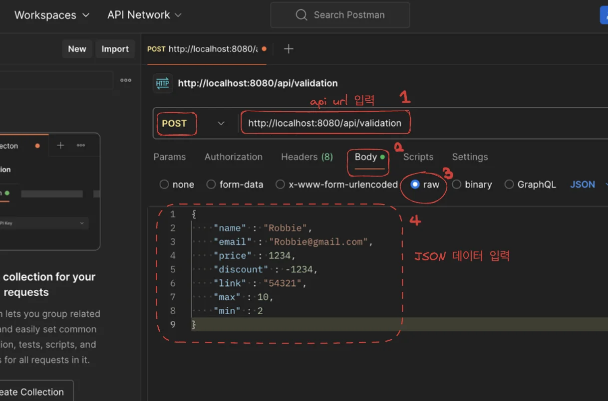
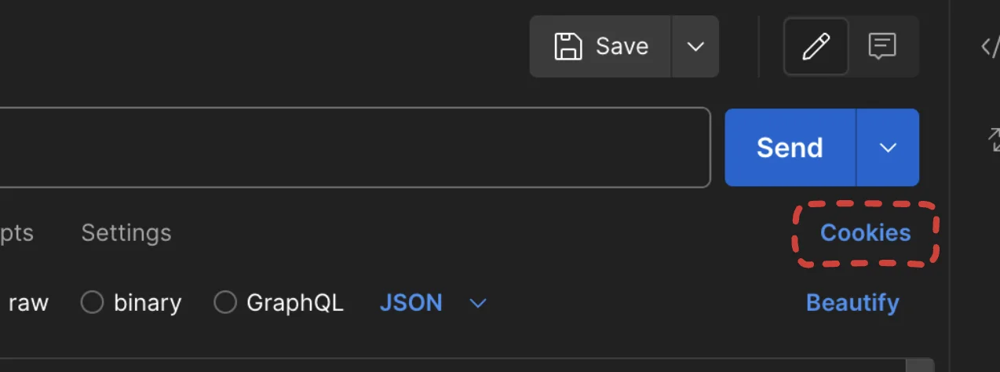
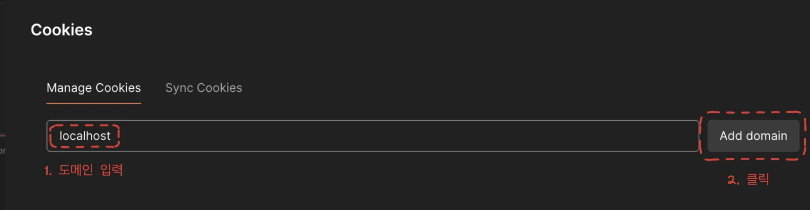
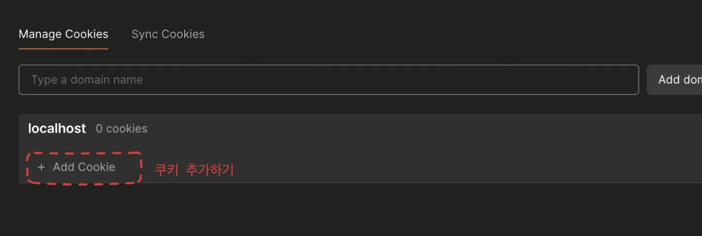
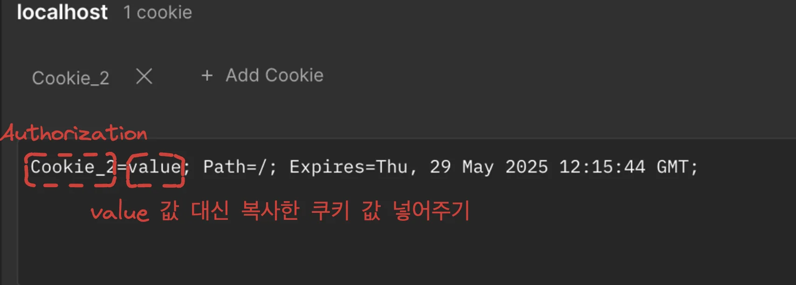
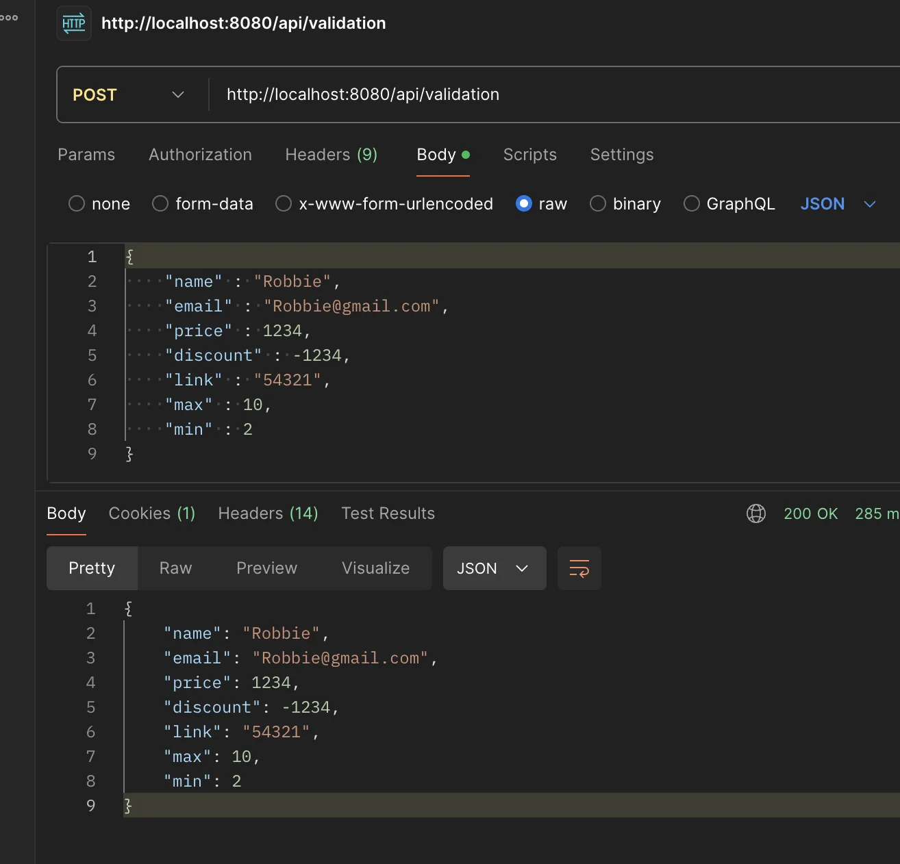

<a id="1c3eda9b0fe181da83c3d9cbb2902671"></a>

## Validation

> 🤔 <strong>Validation </strong>이란?<br>프로그래밍하는데 있어 가장 중요한 부분이다<br>Java는 null 값에 대한 접근에 대해 <code>NullPointerException</code> 오류를 발생 시킨다&#46; 따라서 Validation을 사용한 검증은 꼭 필요하다<br><br>이를 Spring에서는 <code>null 확인</code> 뿐 아니라 <code>문자의 길이 측정</code>과 <strong><u>같은 다른 검증 과정도 쉽게 처리할 수 있</u></strong>도록 <strong>Bean Validation</strong> 제공한다&#46;

<a id="1c3eda9b0fe181579766d71f725af1a8"></a>

### Bean Validation Anotation을 사용한 검증

<details>
<summary>Bean Validation</summary>

|  |  |
| --- | --- |
| <code>&#64;NotNull</code> | null 불가 |
| <code>&#64;NotEmpty</code> | null, “” 불가 |
| <code>&#64;NotBlank</code> | null, “”&#46; “ “ 불가 |
| <code>&#64;Size</code> | 문자 길이 측정 |
| <code>&#64;Max</code> | 최대값 |
| <code>&#64;Min</code> | 최소값 |
| <code>&#64;Positive</code> | 양수 |
| <code>&#64;Negative</code> | 음수 |
| <code>&#64;Email</code> | E&#45;mail 형식 |
| <code>&#64;Pattern</code> | 정규 표현식 |

</details>

<details>
<summary><strong>의존성 추가&#58; build&#46;gradle&#58; validation</strong></summary>

<a id="1c3eda9b0fe181adad3ccc505f637cce"></a>

```groovy
implementation 'org.springframework.boot:spring-boot-starter-validation'
```

</details>

<details>
<summary><strong>Bean Validation 적용&#58; ProductRequestDto</strong></summary>

<a id="1c3eda9b0fe1811f839cc8d57428c1e4"></a>

```java
package com.sparta.springauth.dto;

import jakarta.validation.constraints.*;
import lombok.Getter;

@Getter
public class ProductRequestDto {
    @NotBlank
    private String name;
    @Email
    private String email;
    @Positive(message = "양수만 가능합니다.")
    private int price;
    @Negative(message = "음수만 가능합니다.")
    private int discount;
    @Size(min=2, max=10)
    private String link;
    @Max(10)
    private int max;
    @Min(2)
    private int min;
}
```

</details>

<a id="1c3eda9b0fe181b89b8ef48a7b1dbc9d"></a>

### Postman으로 JSON 데이터 테스트 해보기

<details>
<summary>테스트를 위한 api 추가 </summary>

- ProductController
    <a id="1c3eda9b0fe181d083e9d419c272f063"></a>

    ```java
    @PostMapping("/validation")
    @ResponseBody
    public ProductRequestDto testValid(@RequestBody @Valid ProductRequestDto requestDto) {
        return requestDto;
    }
    ```

</details>

<details>
<summary>Postman에서 테스트할 JSON 데이터</summary>

<a id="1c3eda9b0fe18192ae89ee2284e99e11"></a>

```java
{
    "name" : "Robbie",
    "email" : "Robbie@gmail.com",
    "price" : 1234,
    "discount" : -1234,
    "link" : "54321",
    "max" : 10,
    "min" : 2
}
```

</details>

<a id="1c3eda9b0fe1811795e4c25c542fa9fc"></a>

아래와 같이 PostMan 에서 Post 요청을 보낸다&#46;



> 🧐<strong> 위와 같이 설정해서 api 테스트 시 오류 발생&#33;</strong>

<a id="1c3eda9b0fe181f586e7ed3ebd5cb912"></a>

<strong><u>세션 쿠기가 없</u></strong>어서 <strong><u>인가</u></strong><u> 되지 않</u><u>아</u><strong><u> </u></strong>그렇다&#46;

<a id="1c3eda9b0fe181ff8c6ff42162832d03"></a>

따라서 <strong><u>브라우저에서 로그인하여 받은 세션 쿠기를 복사</u></strong>해 와서<strong><u> 붙여넣기</u></strong> 한다&#46; 

<a id="1c3eda9b0fe1815b8a47df1ddbb5fcc0"></a>

그러면 요청 시마다 세션 쿠기도 같이 보내 인가 받는다&#46;

<details>
<summary><strong>postman </strong>에 <strong><u>쿠기 값 추가</u></strong>하기 </summary>

- <code>Cookies</code> 클릭



- 도메인 입력 후, <code>add domain</code> 클릭



- <code>Add Cookie</code> 클릭 후



- key값인 Cookie&#95;2  → Authorization

-  value  → 복사해온 쿠키 값 



</details>

<a id="1c3eda9b0fe1814fb736feeea562c440"></a>

아래와 같이 설정한 대로 보낸 JSON 데이터 똑같이 출력해 오는 것을 알 수 있다&#46;



<a id="1c3eda9b0fe181159c66cdb8613fc951"></a>

## 회원가입에 Validation 적용하기 

<details>
<summary><strong>SignupRequestDto</strong></summary>

<a id="1c3eda9b0fe181ee9ebcf6416515f1e6"></a>

```java
package com.sparta.springauth.dto;

import jakarta.validation.constraints.Email;
import jakarta.validation.constraints.NotBlank;
import lombok.Getter;
import lombok.Setter;

@Getter
@Setter
public class SignupRequestDto {
    @NotBlank
    private String username;
    @NotBlank
    private String password;
    @Email
    @NotBlank
    private String email;
    private boolean admin = false;
    private String adminToken = "";
}
```

</details>

<details>
<summary><strong>UserController</strong></summary>

<a id="1c3eda9b0fe18133b98fe3076fa45b80"></a>

```java
@PostMapping("/user/signup")
public String signup(@Valid SignupRequestDto requestDto, BindingResult bindingResult) {
    // Validation 예외처리
    List<FieldError> fieldErrors = bindingResult.getFieldErrors();
    if(fieldErrors.size() > 0) {
        for (FieldError fieldError : bindingResult.getFieldErrors()) {
            log.error(fieldError.getField() + " 필드 : " + fieldError.getDefaultMessage());
        }
        return "redirect:/api/user/signup";
    }

    userService.signup(requestDto);

    return "redirect:/api/user/login-page";
}
```

</details>
