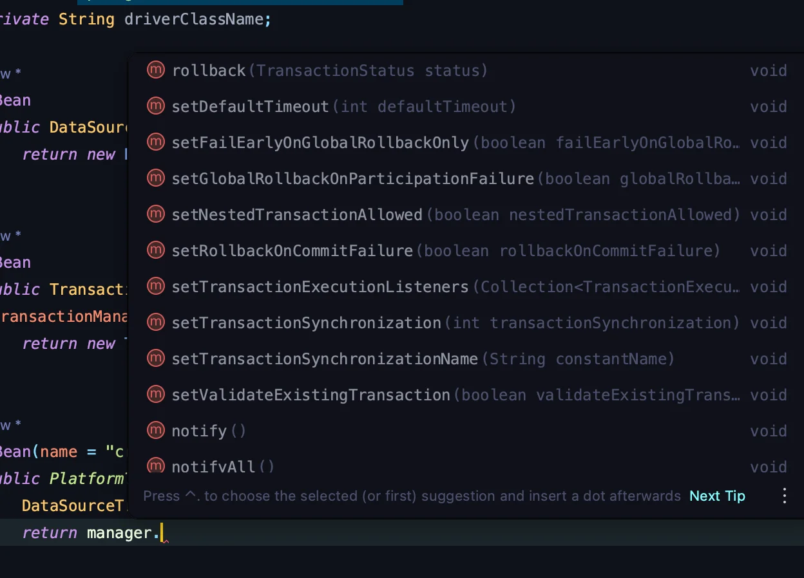

<a id="1c3eda9b0fe181ee9c6ad551e03b8bce"></a>

### DB(transaction) Configuration 설정

<details>
<summary>🧐 위와 같이 따로 Config 설정을 하는 이유</summary>

- 특정 서비스 로직이나 API에 대해 템플릿을 등록하여 사용하면, 원하는 TX에 대해서 자기가 원하는 대로 조율 가능하기 때문에, 위와 같이 config 템플릿을 만들어서 많이 사용한다&#46; 

- 명시적으로 transaction을 처리를 해야할 때, 커스텀 처리를 한다&#46; 
    - 일반적이지도 않고, 무작정 좋지도 않다&#46; 

    - 의존성을 줄이고, 자바 로우 코드로  짤경우

    - transaction 기본 설정이 아닌, 명시적으로 관리하고 싶은때 사용한다&#46; 

    - <u>보통은 그냥 있는 기본값을 사용</u>하면 된다&#46; 
        - 스프링의 트랜젝션 어노테이션, 리플렉션이나 편하게 지원된다&#46;

</details>

<details>
<summary><code>&#64;Value</code></summary>

- 기본적으로 <code>application&#46;yaml</code>, <code>application&#46;properties</code>의 설정 값들을 참조한다&#46;

</details>

<details>
<summary>옵션을 추가하여 커스텀 가능하다&#46; </summary>



</details>

---

<details>
<summary>&#91; 코드 &#93; MySQLConfig</summary>

<a id="1c3eda9b0fe1812babb8d0c0e14d1599"></a>

```java
package com.example.lecture_prac.config;

import org.springframework.context.annotation.Bean;
import org.springframework.context.annotation.Configuration;
import org.springframework.jdbc.datasource.DataSourceTransactionManager;
import org.springframework.transaction.PlatformTransactionManager;
import org.springframework.transaction.annotation.EnableTransactionManagement;
import org.springframework.beans.factory.annotation.Value;
import org.springframework.transaction.support.TransactionTemplate;

import javax.sql.DataSource;


@Configuration
@EnableTransactionManagement
public class MySQLConfig {

    @Value("${spring.datasource.url}")
    private String url;

    @Value("${spring.datasource.username}")
    private String username;

    @Value("${spring.datasource.password}")
    private String password;

    @Value("${spring.datasource.driver-class-name}")
    private String driverClassName;

    @Bean
    public DataSourceTransactionManager transactionManager(DataSource dataSource){
        return new DataSourceTransactionManager(dataSource);
    }

    @Bean
    public TransactionTemplate transactionTemplate(PlatformTransactionManager transactionManager){
        return new TransactionTemplate(transactionManager);
    }

    @Bean(name = "createUserTranscationManager")
    public PlatformTransactionManager createUserTranscationManager(DataSource datasource) {
        DataSourceTransactionManager manager = new DataSourceTransactionManager(datasource);
        return manager;
    }
}
```

</details>
