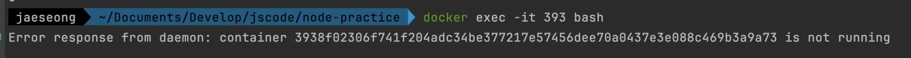
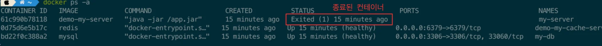
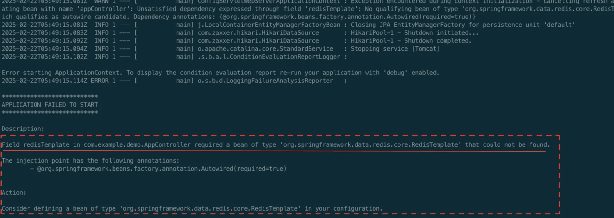

> ☝🏻 
> 
> <a id="1c3eda9b0fe1814a8e3ccc6eb8334933"></a>
> 
> 프로그래밍을 할 때 중간중간 잘 작동하는 지 확인하는 습관은 중요하다&#46; 
> 
> <a id="1c3eda9b0fe18103b253d73d0e256254"></a>
> 
> 어떤 명령어를 입력하고 난 뒤, <strong><u>명령어가 정상적으로 수행 됐는지 확인하는 방법을 찾</u></strong>아봐야 한다&#46; <br><br>이 습관이 몸에 익으면 어떤 명령어를 수행하더라고, 해당 명령어가 <strong><u>어떻게 작동하는지 알</u></strong><strong> </strong>수 있게 된다&#46; <br>따라서 <strong><u>에러가 생기더라고 금방 발견</u></strong> 가능하며, <strong><u>디버깅도 훨씬 수월</u></strong>하다&#46; 

<a id="1c3eda9b0fe181d1a946caa298de128a"></a>

## 컨테이너 디버깅

---

<a id="1c3eda9b0fe1812bbcfbd42b627f7757"></a>

```bash
# 컨테이너 로그 확인
docker logs [컨테이너 ID]

# 컨테이너 내부 접속
docker exec -it [컨테이너 ID] [실행할 내부 프로그램]
```

<a id="1c3eda9b0fe18167a8e2e605cf458979"></a>

### 컨테이너 종료 지연 설정

---

<a id="1c3eda9b0fe181bc809eeb9fcc3870d0"></a>

<code>docker exec &#45;it</code>를  활용하여 컨테이너 내부에 직접 접속할 수 있다&#46; 

<a id="1c3eda9b0fe181fc8592ea397596f9f0"></a>

그러나 실행 중인 컨테이너만 가능하다&#46; 

- 종료된 컨테이너는 <u>내부 접속 시, 오류</u>가 발생한다&#46;
    

<a id="1c3eda9b0fe1811d8f49f4b3fd8cf420"></a>

이미지를 만들면서 컨테이너를 실행시키면, 컨테이너 특성상 <strong><u>명령어 처리가 다 끝나면 컨테이너가 종료</u></strong>된다 

<a id="1c3eda9b0fe18149952fd85721439797"></a>

이로인해, 컨테이너 내부에 접속하여 디버깅하는데 어려움이 생긴다&#46; 

<a id="1c3eda9b0fe18103a221ddc54b4da6ae"></a>

이를 아래와 같이,<strong> </strong><strong><u>종료 지연 설정</u></strong>을 하여 명령어가 끝내도 컨테이너가 종료되지 않도록 하여 해결한다&#46; 

- <code>ENTRYPOINT &#91;&#34;/bin/bash&#34;, &#34;&#45;c&#34;, &#34;sleep 500&#34;&#93;</code>

<a id="1c3eda9b0fe18175b629f0d8f2d331bd"></a>

```bash
FROM openjdk:17-jdk

...

ENTRYPOINT ["/bin/bash", "-c", "sleep 500"] # 500초 동안 시스템을 일시정지 시키는 명령어
```

<a id="1c3eda9b0fe181fc8da4f252301df2a1"></a>

### 종료된 컨테이너 디버깅

---

1. 종료된 컨테이너의 ID or 이름을 확인
    <a id="1c3eda9b0fe1818d9466fde521c727ad"></a>

    ```bash
    docker ps -a
    ```

1. 종료된 컨테이너를 <code>logs</code> 명령어를 통해 <strong><u>종료되기 전 까지의 로그 내역을 확인</u></strong>할 수 있다&#46;
    <a id="1c3eda9b0fe181cfb46bc4625ab8f833"></a>

    ```bash
    docker logs [컨테이너 ID or 이름]
    ```

    

1. 로그에서 오류 내용 확인
    <details>
    <summary>ex)</summary>

    <a id="1c3eda9b0fe18133a381eec042eee409"></a>

    ```plaintext

      .   ____          _            __ _ _
     /\\ / ___'_ __ _ _(_)_ __  __ _ \ \ \ \
    ( ( )\___ | '_ | '_| | '_ \/ _` | \ \ \ \
     \\/  ___)| |_)| | | | | || (_| |  ) ) ) )
      '  |____| .__|_| |_|_| |_\__, | / / / /
     =========|_|==============|___/=/_/_/_/

     :: Spring Boot ::                (v3.4.2)

    2025-02-22T05:49:13.451Z  INFO 1 --- [           main] com.example.demo.DemoApplication         : Starting DemoApplication v0.0.1-SNAPSHOT using Java 17.0.2 with PID 1 (/app.jar started by root in /)
    2025-02-22T05:49:13.453Z  INFO 1 --- [           main] com.example.demo.DemoApplication         : The following 1 profile is active: "dev"
    2025-02-22T05:49:13.889Z  INFO 1 --- [           main] .s.d.r.c.RepositoryConfigurationDelegate : Multiple Spring Data modules found, entering strict repository configuration mode
    2025-02-22T05:49:13.890Z  INFO 1 --- [           main] .s.d.r.c.RepositoryConfigurationDelegate : Bootstrapping Spring Data JPA repositories in DEFAULT mode.
    2025-02-22T05:49:13.903Z  INFO 1 --- [           main] .s.d.r.c.RepositoryConfigurationDelegate : Finished Spring Data repository scanning in 7 ms. Found 0 JPA repository interfaces.
    2025-02-22T05:49:13.915Z  INFO 1 --- [           main] .s.d.r.c.RepositoryConfigurationDelegate : Multiple Spring Data modules found, entering strict repository configuration mode
    2025-02-22T05:49:13.916Z  INFO 1 --- [           main] .s.d.r.c.RepositoryConfigurationDelegate : Bootstrapping Spring Data Redis repositories in DEFAULT mode.
    2025-02-22T05:49:13.922Z  INFO 1 --- [           main] .s.d.r.c.RepositoryConfigurationDelegate : Finished Spring Data repository scanning in 0 ms. Found 0 Redis repository interfaces.
    2025-02-22T05:49:14.269Z  INFO 1 --- [           main] o.s.b.w.embedded.tomcat.TomcatWebServer  : Tomcat initialized with port 8080 (http)
    2025-02-22T05:49:14.278Z  INFO 1 --- [           main] o.apache.catalina.core.StandardService   : Starting service [Tomcat]
    2025-02-22T05:49:14.278Z  INFO 1 --- [           main] o.apache.catalina.core.StandardEngine    : Starting Servlet engine: [Apache Tomcat/10.1.34]
    2025-02-22T05:49:14.298Z  INFO 1 --- [           main] o.a.c.c.C.[Tomcat].[localhost].[/]       : Initializing Spring embedded WebApplicationContext
    2025-02-22T05:49:14.299Z  INFO 1 --- [           main] w.s.c.ServletWebServerApplicationContext : Root WebApplicationContext: initialization completed in 816 ms
    2025-02-22T05:49:14.393Z  INFO 1 --- [           main] o.hibernate.jpa.internal.util.LogHelper  : HHH000204: Processing PersistenceUnitInfo [name: default]
    2025-02-22T05:49:14.427Z  INFO 1 --- [           main] org.hibernate.Version                    : HHH000412: Hibernate ORM core version 6.6.5.Final
    2025-02-22T05:49:14.448Z  INFO 1 --- [           main] o.h.c.internal.RegionFactoryInitiator    : HHH000026: Second-level cache disabled
    2025-02-22T05:49:14.626Z  INFO 1 --- [           main] o.s.o.j.p.SpringPersistenceUnitInfo      : No LoadTimeWeaver setup: ignoring JPA class transformer
    2025-02-22T05:49:14.646Z  INFO 1 --- [           main] com.zaxxer.hikari.HikariDataSource       : HikariPool-1 - Starting...
    2025-02-22T05:49:14.841Z  INFO 1 --- [           main] com.zaxxer.hikari.pool.HikariPool        : HikariPool-1 - Added connection com.mysql.cj.jdbc.ConnectionImpl@37986daf
    2025-02-22T05:49:14.842Z  INFO 1 --- [           main] com.zaxxer.hikari.HikariDataSource       : HikariPool-1 - Start completed.
    2025-02-22T05:49:14.889Z  INFO 1 --- [           main] org.hibernate.orm.connections.pooling    : HHH10001005: Database info:
    	Database JDBC URL [Connecting through datasource 'HikariDataSource (HikariPool-1)']
    	Database driver: undefined/unknown
    	Database version: 9.2
    	Autocommit mode: undefined/unknown
    	Isolation level: undefined/unknown
    	Minimum pool size: undefined/unknown
    	Maximum pool size: undefined/unknown
    2025-02-22T05:49:15.071Z  INFO 1 --- [           main] o.h.e.t.j.p.i.JtaPlatformInitiator       : HHH000489: No JTA platform available (set 'hibernate.transaction.jta.platform' to enable JTA platform integration)
    2025-02-22T05:49:15.073Z  INFO 1 --- [           main] j.LocalContainerEntityManagerFactoryBean : Initialized JPA EntityManagerFactory for persistence unit 'default'
    2025-02-22T05:49:15.081Z  WARN 1 --- [           main] ConfigServletWebServerApplicationContext : Exception encountered during context initialization - cancelling refresh attempt: org.springframework.beans.factory.UnsatisfiedDependencyException: Error creating bean with name 'appController': Unsatisfied dependency expressed through field 'redisTemplate': No qualifying bean of type 'org.springframework.data.redis.core.RedisTemplate<java.lang.String, java.lang.Object>' available: expected at least 1 bean which qualifies as autowire candidate. Dependency annotations: {@org.springframework.beans.factory.annotation.Autowired(required=true)}
    2025-02-22T05:49:15.081Z  INFO 1 --- [           main] j.LocalContainerEntityManagerFactoryBean : Closing JPA EntityManagerFactory for persistence unit 'default'
    2025-02-22T05:49:15.083Z  INFO 1 --- [           main] com.zaxxer.hikari.HikariDataSource       : HikariPool-1 - Shutdown initiated...
    2025-02-22T05:49:15.092Z  INFO 1 --- [           main] com.zaxxer.hikari.HikariDataSource       : HikariPool-1 - Shutdown completed.
    2025-02-22T05:49:15.094Z  INFO 1 --- [           main] o.apache.catalina.core.StandardService   : Stopping service [Tomcat]
    2025-02-22T05:49:15.102Z  INFO 1 --- [           main] .s.b.a.l.ConditionEvaluationReportLogger :

    Error starting ApplicationContext. To display the condition evaluation report re-run your application with 'debug' enabled.
    2025-02-22T05:49:15.114Z ERROR 1 --- [           main] o.s.b.d.LoggingFailureAnalysisReporter   :

    ***************************
    APPLICATION FAILED TO START
    ***************************

    Description:

    Field redisTemplate in com.example.demo.AppController required a bean of type 'org.springframework.data.redis.core.RedisTemplate' that could not be found.

    The injection point has the following annotations:
    	- @org.springframework.beans.factory.annotation.Autowired(required=true)


    Action:

    Consider defining a bean of type 'org.springframework.data.redis.core.RedisTemplate' in your configuration.
    ```

    </details>

    
