<details>
<summary>프로젝트 세팅</summary>

- <strong>jar</strong>

- lombok

- thymeleaf

- spring&#45;web

</details>

<a id="1c3eda9b0fe1815ea492e38291e522ee"></a>

### 로깅

<details>
<summary><strong>이전 정리 내용</strong></summary>

<a id="1c3eda9b0fe181deb8ded237f1d72891"></a>

<a href="#/post/1c3eda9b-0fe1-8116-aed4-eb44b8e8c618">페이지</a> 

<a id="1c3eda9b0fe181c6ac20db17de67d2a1"></a>

### 로깅

<details>
<summary><strong>방법1)</strong> <code>LoggerFactory&#46;getLogger()</code>&#58; 로거를 생성할 클래스의 Class 객체를 인자로 넘긴다&#46; </summary>

<a id="1c3eda9b0fe181d88a11d41ed337ade8"></a>

```java
public class MyClass {
    // Logger 객체 생성
    private static final Logger logger = LoggerFactory.getLogger(MyClass.class);
    
    public void performTask() {
        logger.info("Task is being performed");
        // 다른 로깅 수준의 예시
        logger.debug("This is a debug message");
        logger.error("An error occurred");
    }
}
```

</details>

<details>
<summary><strong>방법2) </strong><code>&#64;Slf4j</code>&#58; 해당 애노테이션을 사용하여<strong> Lombok</strong> 라이브러리가 <strong><u>자동으로 Logger객체를 생성</u></strong>한다&#46; </summary>

- <code>log</code>로 초기화

<a id="1c3eda9b0fe181b38f00ccd29e428f26"></a>

```java
import lombok.extern.slf4j.Slf4j;

@Slf4j
public class MyClass {

    public void performTask() {
        log.info("Task is being performed");
        // 다른 로깅 수준의 예시
        log.debug("This is a debug message");
        log.error("An error occurred");
    }
}
```

</details>

- <code>info</code>&#58; 일반적인 정보를 기록할 때 사용

- <code>debug</code>&#58; 디버깅을 위한 자세한 정보를 기록할 때 사용

- <code>error</code>&#58; 오류가 발생했을 때 사용

</details>

<a id="1c3eda9b0fe181099909fce64839185d"></a>

<strong>로깅 라이브러리</strong>

- 운영 시스템에서는 별도의 로깅 라이브러리를 사용해서 로그를 출력함

- 스프링 부트 라이브러리를 사용하면 스프링 부트 로깅 라이브러리(<code>spring&#45;boot&#45;starter&#45;logging</code>)가 함께 포함된다&#46;

- 스프링 부트 로깅 라이브러리 기본값
    - <a href="http://www.slf4j.org/">SLF4J</a>

    - <a href="http://logback.qos.ch/">Logback</a>

- 로그 라이브러리는 Logback, Log4J, Log4J2 등등 수 많은 라이브러리가 있는데, 그것을 <strong><u>통합</u></strong>해서<strong> </strong><strong><u>인터페이스로 제공</u></strong>하는 것이 바로 <strong><u>SLF4J 라이브러리</u></strong>다&#46;
    - <code>인터페이스</code>&#58; SLF4J , <code>구현체</code>&#58; Logback 

<a id="1c3eda9b0fe18189b2d8c6d6470cbf9c"></a>

<br><strong>로그 선언</strong>	

- <code>private Logger log = LoggerFactory&#46;getLogger(getClass());</code>

- <code>private static final Logger log = LoggerFactory&#46;getLogger(Xxx&#46;class)</code>;

- <code>&#64;Slf4j</code>&#58; 롬복 사용 가능

<a id="1c3eda9b0fe181d7bec3ea72838a1e27"></a>

<strong>로그 호출</strong>

- <code>log&#46;info(&#34;hello&#34;)</code>

- <code>System&#46;out&#46;println(&#34;hello&#34;)</code>


- <code>System&#46;</code><em><code>out</code></em><code>&#46;println(&#34;name = &#34; &#43; name);</code>
    <a id="1c3eda9b0fe181c9a95fccc4fe04ea51"></a>

    ```bash
    name = String
    ```

- <code>log&#46;info(&#34; info log={}&#34;, name);</code>
    <a id="1c3eda9b0fe18180a8b1e40891d31232"></a>

    ```plaintext
    2024-07-06T21:03:40.879+09:00  INFO 6289 --- [nio-8080-exec-1] c.e.s.springmvc.basic.LogTestController  :  info log=String
    ```


<a id="1c3eda9b0fe18139ab0dc3cdee1ca05a"></a>

### <u>로그 설정</u>으로 <u>출력 레벨 정</u>할 수 있다

<a id="1c3eda9b0fe18168b781f6c1ba90faec"></a>

trace, debug 개발 서버에서만 사용

<a id="1c3eda9b0fe18140bbbec0ff850b8189"></a>

운영서버에서는 info만 사용

<a id="1c3eda9b0fe181199588f2497d0bf026"></a>

운영서버에 로그를 남기면 로그 폭탄 맞는다…

<a id="1c3eda9b0fe1812faf49e33057567f83"></a>

System&#46;out&#46;println() 말고 로깅 사용

<a id="1c3eda9b0fe1814d8835ef1914aeba6b"></a>

```plaintext
// logging.level.[direct 설정] = 레벨 설정 ( trace, debug, info )
logging.level.example.springmvc1=trace
```

- 개발서버
    <a id="1c3eda9b0fe1818e9094f7b1b0cf871a"></a>

    ```plaintext
    // trace, debug, info, warn, error
    logging.level.example.springmvc1=trace

    // debug, info, warn, error
    logging.level.example.springmvc1=debug
    ```

- 운영서버 
    - info, warn, error 레벨 로깅만 출력됨

    <a id="1c3eda9b0fe18133b038cc08c6e6f814"></a>

    ```plaintext
    logging.level.example.springmvc1=info
    ```

    - <strong>전체 로그 레벨 설정</strong>
        <a id="1c3eda9b0fe181d987bddb605ce8ac81"></a>

        ```plaintext
        # 전체 로그 레벨 설정(기본 info) 
        logging.level.root=info
        ```

<a id="1c3eda9b0fe181649bf4d77fef95f2a7"></a>

### 올바른 로그 사용법

- 잘못된 방법
    <a id="1c3eda9b0fe181098314d86bccbb8724"></a>

    System&#46;out&#46;print() 에 작성하는 방법 처럼 작성하면 안된다&#46;

    <a id="1c3eda9b0fe181388c2cfba6c5288060"></a>

    ```plaintext
    log.info(" info log=" + name);
    ```

    <a id="1c3eda9b0fe181a39571f0f07bfcf912"></a>

    로그 처리 연산보다 <strong><u>산술연산자(&#43;, &#45;, &#42;, / &#46;&#46;)</u></strong> 기호가 <strong><u>더 우선순위를 가져 </u></strong>먼저 처리된다&#46;

    <a id="1c3eda9b0fe181ce99c1c4849c07a431"></a>

    → 따라서 쓸모없는 리소스가 낭비된다&#46; 

    <details>
    <summary>ex) info&#46;trace</summary>

    - application&#46;properties
        - 로깅 레벨&#58; <code>debug</code>, trace 출력 안됨

        <a id="1c3eda9b0fe181388f71fa6ff131b5e4"></a>

        ```java
        logging.level.example.springmvc1=debug
        ```

    - 잘못된 방법
        - 문자열에  <code>&#43;</code> 연산 처리가 된 후, trace의 파라미터로 넘어간다&#46; 

        <a id="1c3eda9b0fe181fbb70efc30cc1d126b"></a>

        ```java
        log.trace(" trace my log=" + name);
        ```

    - 올바른 방법
        - 그냥 파라미터를 넘긴다&#46; 

        <a id="1c3eda9b0fe18178b4e5f60e9489987b"></a>

        ```java
        log.trace("tracelog={}", name);
        ```

    </details>

> 📌 정리
> 
> - 개발서버&#58; debug
> 
> - 운영서버&#58; info
> 
> - 성능에서도 로그를 사용하는 것이 훨씬 빠르다&#46;

<a id="1c3eda9b0fe1812c8e87e3f5c64c9632"></a>

### 요청 매핑

<details>
<summary><strong>🧐 </strong><strong><code>&#64;Controller</code></strong><strong> vs </strong><strong><code>&#64;RestController</code></strong></summary>

- <strong><code>&#64;Controller</code></strong>
    <a id="1c3eda9b0fe181bf8e19d0369e4279e8"></a>

    반환 값이 <strong><u><code>String</code></u></strong><strong> </strong>이면<u> </u><strong><u>뷰 이름</u></strong>으로<strong><u> </u></strong>인식, 그래서 <strong>뷰를 찾고 뷰가 랜더링 </strong>된다&#46;<br>	

- <strong><code>&#64;RestController</code></strong>
    <a id="1c3eda9b0fe181c4acf8cfc6c330a918"></a>

    반환 값이 <strong>HTTP 메시지 바디에 바로 입력</strong>됨, 따라서 실행 결과로 <code>String</code>(‘ok’ 메세지)을  받을 수 있음<br>

</details>

<details>
<summary>🧐<strong> URL 다중 매핑 &#45; </strong><strong><code>&#64;RequestMapping()</code></strong></summary>

- <code>&#64;RequestMapping(/hello&#45;basic)</code>
    - <code>/hello&#45;basic</code> URL 호출이 오면 이 메서드가 실행되도록 매핑한다&#46;

- 대부분의 속성을 <code>배열&#91;&#93;</code> 로 제공하므로 다중 설정이 가능하다&#46; 
    - <strong><code>{&#34;/hello&#45;basic&#34;, &#34;/hello&#45;go&#34;}</code></strong>
        - <code>&#64;RequestMapping(</code><strong><code>{&#34;/hello&#45;basic&#34;, &#34;/hello&#45;go&#34;}</code></strong><code>)</code>

<details>
<summary>ex) </summary>

<a id="1c3eda9b0fe181948a1af62cbac3a6a6"></a>

```java
@RestController
public class MappingController {

    private Logger log = LoggerFactory.getLogger(getClass());

    /**
     * 기본 요청: @RequestMapping
     *      path:
     *          • /hello-basic
     *          • /hello-basic/
     *      HTTP 메서드 모두 허용:
     *          • GET, HEAD, POST, PUT, PATCH, DELETE
     */
    @RequestMapping({"/hello-basic", "/hello-test"})
    public String helloBasic() {
        log.info("helloBasic");
        return "ok";
    }
}
```

- http&#58;//localhost&#58;8080<strong><u>/hello&#45;basic</u></strong>
    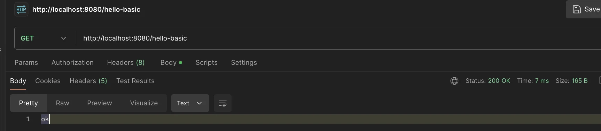

- http&#58;//localhost&#58;8080<strong><u>/hello&#45;test</u></strong>
    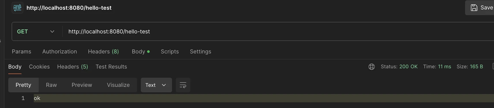

</details>

</details>

<details>
<summary><code>&#64;RequestMapping</code>  ex) MappingController</summary>

<a id="1c3eda9b0fe181ff93dcd2dd260c5583"></a>

```java
package com.example.springmvc1.springmvc.basic.requestmapping;


import org.slf4j.Logger;
import org.slf4j.LoggerFactory;
import org.springframework.web.bind.annotation.RequestMapping;
import org.springframework.web.bind.annotation.RestController;

@RestController
public class MappingController {

    private Logger log = LoggerFactory.getLogger(getClass());

    /**
     * 기본 요청: @RequestMapping
     *      path:
     *          • /hello-basic
     *          • /hello-basic/
     *      HTTP 메서드 모두 허용:
     *          • GET, HEAD, POST, PUT, PATCH, DELETE
     */
    @RequestMapping("/hello-basic")
    public String helloBasic() {
        log.info("helloBasic");
        return "ok";
    }
}

```

</details>

<details>
<summary>메서드 명시&#58; <code>&#64;RequestMapping(method = RequestMethod&#46;METHOD)</code></summary>

- 명시한 메서드 외 요청 시 (ex&#46; Post)  <strong>HTTP 405 상태코드(Method Not Allowed)</strong>를 반환함

<a id="1c3eda9b0fe18199af64e77b1eaefa07"></a>

```java
/**
* method 특정 HTTP 메서드 요청만 허용
* GET, HEAD, POST, PUT, PATCH, DELETE */
 @RequestMapping(value = "/mapping-get-v1", method = RequestMethod.GET)
 public String mappingGetV1() {
     log.info("mappingGetV1");
     return "ok";
 }
 
```

</details>

<details>
<summary><strong>HTTP 메서드 매핑 축약</strong><strong> </strong></summary>

> ✏️ 
> 
> - <code>&#64;GetMapping</code>
> 
> - <code>&#64;PostMapping</code>
> 
> -  <code>&#64;PutMapping</code>
> 
> - <code>&#64;DeleteMapping</code>
> 
> - <code>&#64;PatchMapping</code>

<a id="1c3eda9b0fe181b0b8f7ef08499f0357"></a>

````java
/**
* 편리한 축약 애노테이션 (코드보기) * @GetMapping
* @PostMapping
* @PutMapping
* @DeleteMapping
* @PatchMapping
*/
 @GetMapping(value = "/mapping-get-v2")
 public String mappingGetV2() {
     log.info("mapping-get-v2");
return "ok";
}```
````

</details>

<details>
<summary><strong>PathVariable(경로 변수)</strong></summary>

- <code>&#64;RequestMapping</code> 은 URL 경로를 템플릿화 할 수 있는데, <br><code>&#64;PathVariable</code> 을 사용하면 매칭 되는 부분을 편리하게 조회할 수 있다&#46;

- <code>PathVariable</code> 의 이름과 파라미터 이름이 같으면 생략할 수 있다&#46;

<details>
<summary><strong>PathVariable</strong></summary>

<a id="1c3eda9b0fe181348940f839b91e4877"></a>

```java
/**
 * PathVariable
 *   • 변수명이 같으면 생략 가능
 *       @PathVariable("userId") String userId
 *        => @PathVariable String userId
 */
@GetMapping("/mapping/{userId}")
public String mappingPath(@PathVariable("userId") String data) {
    log.info("mappingPath userId={}", data);
    return "ok";
}
```

- <strong>postman 테스트 </strong>
    > http&#58;//localhost&#58;8080<strong><u>/mapping/test</u></strong>

    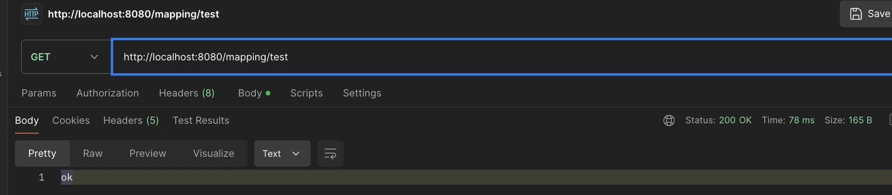

    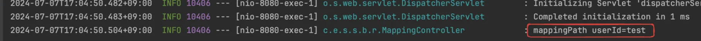

</details>

<details>
<summary><strong>다중 PathVariable</strong></summary>

<a id="1c3eda9b0fe18124bc51d9b946111f55"></a>

```java
/**
 *  다중 PathVariable
 */
@GetMapping("/mapping/users/{userId}/orders/{orderId}")
public String mappingPath(@PathVariable String userId, @PathVariable Long
        orderId) {
    log.info("mappingPath userId={}, orderId={}", userId, orderId);
    return "ok";
}
```

- Postman 테스트 
    - http&#58;//localhost&#58;8080<strong><u>/mapping/users/userA/orders/100</u></strong>
        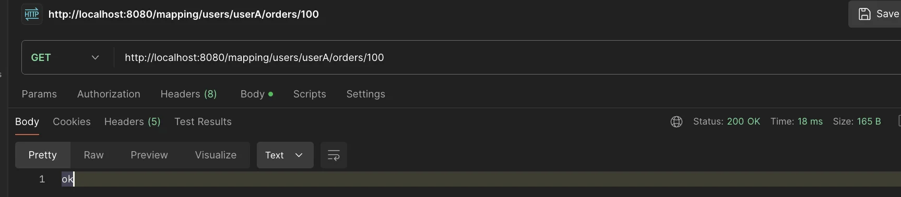

    

</details>

</details>

<details>
<summary><strong>특정 파라미터 조건 매핑</strong></summary>

- <code>params = “ “</code>

- <code>?</code>

<a id="1c3eda9b0fe1812292d9c6e1a74936c5"></a>

```java
/**
 * 파라미터로 추가 매핑
	 * 'And 조건' 으로 추가 파라미터까지 매핑 URI에 추가
		 * params="mode",
		 * params="!mode"
		 * params="mode=debug"
		 * params="mode!=debug" (! = )
		 * params = {"mode=debug","data=good"}
 * */
@GetMapping(value = "/mapping-param", params = "mode=debug")
public String mappingParam() {
    log.info("mappingParam");
    return "ok";
}
```

<details>
<summary>postman 테스트</summary>

- http&#58;//localhost&#58;8080/mapping&#45;param?mode=debug

</details>

</details>

<details>
<summary>특정 헤더 조건 매핑</summary>

<a id="1c3eda9b0fe1816e81f8f4009ebf2c8f"></a>

```java
/**
 * 특정 헤더로 추가 매핑
 * headers="mode",
 * headers="!mode"
 * headers="mode=debug"
 * headers="mode!=debug" (! = ) */
@GetMapping(value = "/mapping-header", headers = "mode=debug")
public String mappingHeader() {
    log.info("mappingHeader");
    return "ok";
}
```

</details>

<details>
<summary>미디어 타입 조건 매핑 &#45; HTTP 요청 Content&#45;Type, consume</summary>

<a id="1c3eda9b0fe181c5889fcc9d6cc1aa9a"></a>

```java
/**
 * Content-Type 헤더 기반 추가 매핑 Media Type * consumes="application/json"
 * consumes="!application/json"
 * consumes="application/*"
 * consumes="*\/*"
 * MediaType.APPLICATION_JSON_VALUE
 */
@PostMapping(value = "/mapping-consume", consumes = "application/json")
public String mappingConsumes() {
    log.info("mappingConsumes");
    return "ok";
}
```

</details>

<details>
<summary>미디어 타입 조건 매핑 &#45; HTTP 요청 Accept, produce</summary>

<a id="1c3eda9b0fe1816585f6e542182a5e89"></a>

```java
/**
 * Accept 헤더 기반 Media Type * produces = "text/html"
 * produces = "!text/html"
 * produces = "text/*"
 * produces = "*\/*"
 */
@PostMapping(value = "/mapping-produce", produces = "text/html")
public String mappingProduces() {
    log.info("mappingProduces");
    return "ok";
}
```

</details>

<a id="1c3eda9b0fe18151b29ed6e474667b23"></a>

### 요청 매핑  &#45; API 예시

[회원 목록 조회](#/post/1c3eda9b-0fe1-816f-8d19-f9ae6700b7ea)

[회원 등록](#/post/1c3eda9b-0fe1-813c-a015-d4d4e5b2846a)

[회원 조회](#/post/1c3eda9b-0fe1-81b6-853c-c69abe732551)

[회원 수정](#/post/1c3eda9b-0fe1-8173-be66-f0dfd0d9e1ed)

[회원 삭제](#/post/1c3eda9b-0fe1-8192-9409-dc953cd0720d)

> 📌 <strong>Point</strong>
> 
> - <code>&#64;{HTTP 메서드}Mapping</code>
>     - ex)  <code>&#64;GetMapping</code>, <code>&#64;PostMapping</code>
> 
> - <code>&#64;PathVariable</code>

<details>
<summary><strong>MappingClassController</strong></summary>

- 실제 데이터가 넘어가는 부분은 생략하고 URL 매핑만 테스트
    - <code>/mapping</code> &#58;는 강의의 다른 예제들과 구분하기 위해 사용

<a id="1c3eda9b0fe1818cb346f3c9658fb2bc"></a>

```java
package com.example.springmvc1.springmvc.basic.requestmapping;

import org.springframework.web.bind.annotation.*;

@RestController
@RequestMapping("/mapping/users")
public class MappingClassController {

    /**
     * GET /mapping/users
     */
    @GetMapping
    public String users() {
        return "get users";
    }

    /**
     * POST /mapping/users
     */
    @PostMapping
    public String addUser() {
        return "post user";
    }

    /**
     * GET /mapping/users/{userId}
     */
    @GetMapping("/{userId}")
    public String findUser(@PathVariable String userId) {
        return "get userId=" + userId;
    }

    /**
     * PATCH /mapping/users/{userId}
     */
    @PatchMapping("/{userId}")
    public String updateUser(@PathVariable String userId) {
        return "update userId=" + userId;
    }


    /**
     * DELETE /mapping/users/{userId}
     */
    @DeleteMapping("/{userId}")
    public String deleteUser(@PathVariable String userId) {
        return "delete userId=" + userId;
    }
}
```

</details>

<details>
<summary><strong>테스트, Path 출력 결과</strong></summary>

|  |  |  |  |
| --- | --- | --- | --- |
| 기능 | 메서드 | 경로 | 반환 |
| 회원 목록 조회 | GET | <code>/mapping/users</code> | “get user” |
| 회원 등록 | POST | <code>/mapping/users</code> | &#34;post user&#34; |
| 회원 조회 | GET | <code>/mapping/users/id1</code> | &#34;get userId=id1&#34; |
| 회원 수정 | PATCH | <code>/mapping/users/id1</code> | &#34;update userId=id1&#34; |
| 회원 삭제 | DELETE | <code>/mapping/users/id1</code> | &#34;delete userId=id1&#34; |

</details>

<a id="1c3eda9b0fe1811293fcf786db1071e0"></a>

### HTTP <strong>요청 </strong>&#45; <strong>기본</strong>, <strong>헤더 조회</strong>

<details>
<summary>참고) <code>&#64;Controller</code>의 사용 가능한 <strong>parameter</strong>, <strong>return value</strong> 목록</summary>

- <a href="https://docs.spring.io/spring-framework/docs/current/reference/html/web.html#mvc-ann-arguments">parmeter 목록</a>

- <a href="https://docs.spring.io/spring-framework/docs/current/reference/html/web.html#mvc-ann-return-types">return value 목록</a>

</details>

<details>
<summary>🧐 <strong>MultiValueMap</strong></summary>

- Map과 유사, 하나의 키에 여러 값 할당 가능
    - value  → array(<code>&#91;&#93;</code>)

- HTTP header, HTTP 쿼리 파라미터와 같이 하나의 키에 여러 값을 받을 때 사용
    - keyA=value1&#38;keyA=value2

<a id="1c3eda9b0fe181509eceeeffbf0112f5"></a>

```java
 MultiValueMap<String, String> map = new LinkedMultiValueMap();
 map.add("keyA", "value1");
 map.add("keyA", "value2");
 
 //[value1,value2]
List<String> values = map.get("keyA");
```

</details>

<details>
<summary><strong>🧐 Slf4j</strong></summary>

<a id="1c3eda9b0fe1815f8496c805a5dfbce5"></a>

아래의 코드 자동으로 생성하여 로그를 선언해준다&#46;

<a id="1c3eda9b0fe181799d7ed8c9ca6efb41"></a>

```java
private static final org.slf4j.Logger log = org.slf4j.LoggerFactory.getLogger(RequestHeaderController.class);
```

<a id="1c3eda9b0fe181458e87e4e0ad77d1c7"></a>

<br>로그 사용 시, 아래와 같이 <code>log</code>만 사용하면 된다&#46;

<a id="1c3eda9b0fe1813d9f3fce3af30a81e4"></a>

```java
@Slf4j
public class LogTest {
		
		public void test() {
				log.info("로그 테스트")
```

</details>

<details>
<summary><strong>예제 코드 &#45; headers</strong></summary>

- HttpServletRequest

- HttpServletResponse

<details>
<summary><code>HttpMethod</code>&#58; HTTP 메서드 조회 </summary>

- <code>org&#46;springframework&#46;http&#46;HttpMethod</code>

</details>

- <code>Locale</code>&#58; Locale 정보 조회

<details>
<summary><code>&#64;RequestHeader MultiValueMap&#60;String, String&#62; headerMap</code></summary>

- 모든 HTTP 헤더를 MultiValueMap 형식으로 조회한다&#46;

</details>

<details>
<summary><code>&#64;RequestHeader(”host”) String host</code></summary>

- 특정 HTTP 헤더를 조회한다&#46;

- 속성
    - 필수 값 여부&#58; required

    - 기본 값 속성&#58; defaultValue

</details>

<details>
<summary><code>&#64;CookieValue(value = ”myCookie”, required = false) String cookie</code><br></summary>

- 특정 쿠키를 조회한다&#46;

- 속성
    - 필수 값 여부&#58; reuired

    - 기본 값&#58; defaultValue

</details>

<a id="1c3eda9b0fe1818fba0ccf5bc0cbe38d"></a>

```java
package com.example.springmvc1.springmvc.basic.request;

import jakarta.servlet.http.HttpServletRequest;
import jakarta.servlet.http.HttpServletResponse;
import lombok.extern.slf4j.Slf4j;
import org.springframework.http.HttpMethod;
import org.springframework.util.MultiValueMap;
import org.springframework.web.bind.annotation.CookieValue;
import org.springframework.web.bind.annotation.RequestHeader;
import org.springframework.web.bind.annotation.RequestMapping;
import org.springframework.web.bind.annotation.RestController;

import java.util.Locale;

@Slf4j
@RestController
public class RequestHeaderController {

    @RequestMapping("/headers")
    public String headers(HttpServletRequest request,
                          HttpServletResponse response,
                          HttpMethod httpMethode,
                          Locale locale,
                          @RequestHeader MultiValueMap<String, String> headerMap,
                          @RequestHeader("host") String host,
                          @CookieValue(value = "myCookie", required = false) String cookie
                          ) {

        log.info("request={}", request);
        log.info("request={}", response);
        log.info("httpMethod={}", httpMethod);
        log.info("locale={}", locale);
        log.info("headerMap={}", headerMap);
        log.info("header host={}", host);
        log.info("myCookie={}", cookie);

        return "ok";
    }
}
```

</details>

- <strong>실행 </strong>
    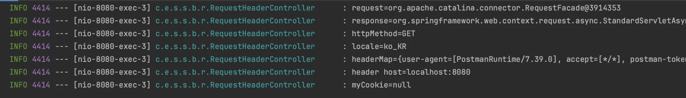

<a id="1c3eda9b0fe181319b9efba2f0f54374"></a>

## HTTP <strong>요청 파라미터</strong>

<details>
<summary><strong>복습) HTTP 요청 데이터를 조회 방법 (3)</strong></summary>

> HTTP 요청 메세지를 통한 &#91; 클라이언트 → 서버 &#93;로 데이터 전달하는 방법

<details>
<summary><strong>1&#46;  GET &#45; 쿼리 파라미터</strong></summary>

- /url<strong><u>?username=hello&#38;age=20</u></strong>
    - ex) <code>http&#58;//localhost&#58;8080/request&#45;param?username=hello&#38;age=20</code>

- 메세지 바디 없이, <strong><u>URL의 쿼리 파라미터</u></strong>에<strong><u> 데이터를 포함</u></strong>해서 전달

- 예) 검색, 필터, 페이징 등에서 많이 사용하는 방식

</details>

<details>
<summary><strong>2&#46; POST &#45; HTML Form</strong></summary>

- content&#45;type&#58; application/x&#45;www&#45;form&#45;urlencoded

- 메세지 바디에 쿼리 파라미터 형식으로 전달 
    <details>
    <summary>ex) username=hello&#38;age=20</summary>

    <a id="1c3eda9b0fe181279af3cc743b6c540d"></a>

    ```java
     POST /request-param ...
     content-type: application/x-www-form-urlencoded
     
     username=hello&age=20
    ```

    </details>

- 예) 회원 가입, 상품 주문, HTML Form 사용

</details>

<details>
<summary><strong>3&#46; HTTP message body</strong>에 데이터를 직접 담아서 요청</summary>

- <strong><u>HTTP API</u></strong>에서 주로 사용, JSON, XML, TEXT

- 데이터 형식은 <u>주로 </u><strong><u>JSON</u></strong><u> 사용</u>

- POST, PUT, PATCH

</details>

</details>

<a id="1c3eda9b0fe181e4a173e63491a1d78d"></a>

### <strong>쿼리 파라미터</strong>, HTML Form

<details>
<summary><strong>요청 파라미터 &#45; 쿼리 파라미터, HTML Form</strong></summary>

<a id="1c3eda9b0fe181518b44f93c3ca1c877"></a>

HttpServletRequest<code>&#46;getParameter()</code>를 사용하면 다음 두가지 요청 파라미터를 조회할 수 있다&#46;

> GET 쿼리 파라미터 전송 방식, POST HTML Form 전송 방식이든 둘다 형식이 동일하므로 구분 없이 조회 가능함

<details>
<summary><strong>GET, 쿼리 파라미터 전송</strong></summary>

- ex) <code>http&#58;//localhost&#58;8080/request&#45;param?username=hello&#38;age=2</code>

</details>

<details>
<summary><strong>POST, HTML Form 전송</strong></summary>

- ex) 

<a id="1c3eda9b0fe18167bfb4f1e25b8e0c64"></a>

```java
 POST /request-param ...
 content-type: application/x-www-form-urlencoded
 
 username=hello&age=20
```

</details>

</details>

<details>
<summary><strong>리소스 접근 path</strong></summary>

- 리소스는 <code>/resources/static</code> 아래에 두면 스프링 부트가 자동으로 인식한다&#46;
    

- 리소스에 <code>/resource/static</code> 경로를 기본 경로(<code>/</code> )로 매핑하여 접근 가능하다&#46;
    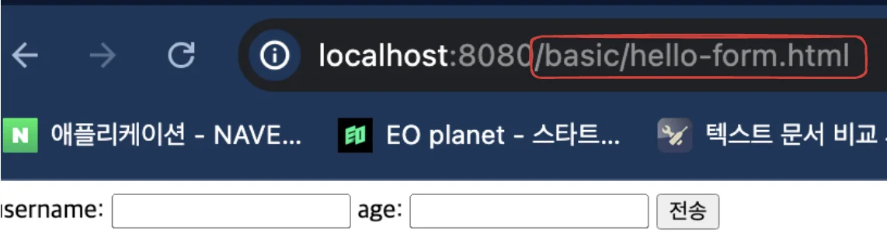

</details>

<details>
<summary><strong>예시 코드 &#45; requestParamV1</strong></summary>

- <code>request&#46;getParameter()</code>

<a id="1c3eda9b0fe181febb94c3fa17f66efe"></a>

```java
package hello.springmvc.basic.request;

import hello.springmvc.basic.HelloData;
import lombok.extern.slf4j.Slf4j;
import org.springframework.stereotype.Controller;
import org.springframework.web.bind.annotation.*;

import javax.servlet.http.HttpServletRequest;
import javax.servlet.http.HttpServletResponse;
import java.io.IOException;
import java.util.Map;

@Slf4j
@Controller
public class RequestParamController {

	/**
	* 반환 타입이 없으면서 이렇게 응답에 값을 직접 집어넣으면, view 조회X 
	*/
   @RequestMapping("/request-param-v1")
   public void requestParamV1(HttpServletRequest request, HttpServletResponse response) throws IOException {
   
       String username = request.getParameter("username");
       int age = Integer.parseInt(request.getParameter("age"));
       
       log.info("username={}, age={}", username, age);
       
       response.getWriter().write("ok");
   }
}
```

- <strong>테스트 </strong>
    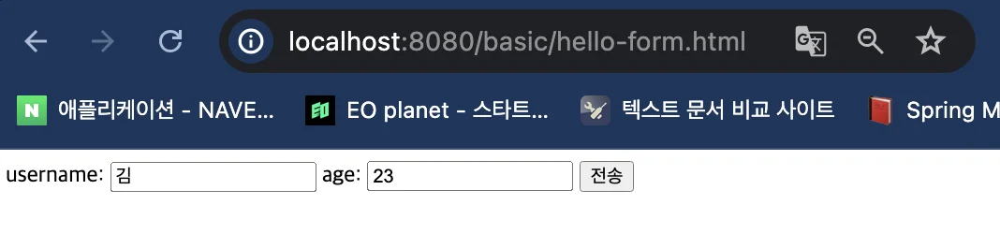

    

    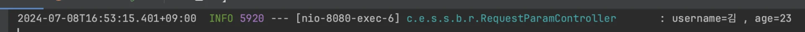

</details>

<a id="1c3eda9b0fe18172b37ec54b670bc014"></a>

### &#64;RequestParam

<details>
<summary><strong><code>&#64;RequestParam</code></strong><strong>을 통한 쿼리 파라미터 받아오기 </strong></summary>

<details>
<summary><strong>예시 코드 &#45; requestParamV2</strong></summary>

<a id="1c3eda9b0fe181deb334ffecd7a81400"></a>

```java
/**
	* @RequestParam 사용
	* - 파라미터 이름으로 바인딩
	* @ResponseBody 추가
	* - View 조회를 무시하고, HTTP message body에 직접 해당 내용 입력 
	*/
@ResponseBody
@RequestMapping("/request-param-v2")
public String requestParamV2(
       @RequestParam("username") String memberName,
       @RequestParam("age") int memberAge) {
       
   log.info("username={}, age={}", memberName, memberAge);
   return "ok";
}
```

</details>

</details>

<details>
<summary><strong><code>&#64;RequestParam</code></strong><strong>, 이름 생략</strong></summary>

> HTTP 파라미터 이름이 변수 이름과 같으면 &#64;RequestParam(name=&#34;xx&#34;) 생략 가능

<details>
<summary><strong>예시 코드 &#45; requestParamV3</strong></summary>

<a id="1c3eda9b0fe181739d1dea75d96d1e3b"></a>

```java
/**
	* @RequestParam 사용
	* HTTP 파라미터 이름이 변수 이름과 같으면 @RequestParam(name="xx") 생략 가능 
	*/
 @ResponseBody
 @RequestMapping("/request-param-v3")
 public String requestParamV3(
         @RequestParam String username,
         @RequestParam int age) {
     log.info("username={}, age={}", username, age);
     return "ok";
}
```

</details>

</details>

<details>
<summary><strong><code>&#64;RequestParam</code></strong> 생략</summary>

> St ring, int 등 단순 타입이면 &#64;RequestParam도 생략

<details>
<summary><strong>예시 코드 &#45; requestParamV4</strong></summary>

<a id="1c3eda9b0fe181bf8822f284d131075c"></a>

```java
/**
 * @RequestParam 사용
 * String, int 등의 단순 타입이면 @RequestParam 도 생략 가능
 */
@ResponseBody
@RequestMapping("/request-param-v4")
public String requestParamV4(String username, int age) {
    log.info("username={}, age={}", username, age);
    return "ok";
}
```

</details>

</details>

<details>
<summary><strong>필수 파라미터  지정 ( </strong><code>&#64;RequestParam(required =</code> <strong>)</strong></summary>

<details>
<summary><strong>예시 코드 &#45; requestParamRequired</strong></summary>

- required 옵션&#58; 필수 파라미터 

<details>
<summary>🧐 <code>null</code> vs <code>“”</code></summary>

<a id="1c3eda9b0fe181b981ebe48f33f7ccbb"></a>

<code>“”</code>&#58; <code>빈 문자</code>를 넣음, 즉 값이 있다고 판단함<br>

</details>

<a id="1c3eda9b0fe18194b83ad53282fad3e4"></a>

```java
/**
 * required = true: 필수 값 지정
    * ex)
    * @RequestParam(required = true) String username
    * username이 없을 시, 오류 발생
 */
@ResponseBody
@RequestMapping("/request-param-required")
public String requestParamRequired(
        @RequestParam(required = true) String username,
        //  int -> Integer,  자바의 기본형에는 null이 들어갈 수 없음
        @RequestParam(required = false) Integer age) {

    log.info("username={}, age={}", username, age);
    return "ok";
}
```

</details>

</details>

<details>
<summary><strong>파라미터&#58; Map, MultiValueMap  </strong></summary>

<details>
<summary><strong>예시 코드 &#45; requestParamMap</strong></summary>

<a id="1c3eda9b0fe181689d56ee3212b885b2"></a>

```java
/**
 * @RequestParam Map, MultiValueMap
 * Map(key=value)
 * MultiValueMap(key=[value1, value2, ...]) ex) (key=userIds, value=[id1, id2])
 */
@ResponseBody
@RequestMapping("/request-param-map")
public String requestParamMap(@RequestParam Map<String, Object> paramMap) {
    log.info("username={}, age={}", paramMap.get("username"),
            paramMap.get("age"));
    return "ok";
}
```

</details>

</details>

<a id="1c3eda9b0fe1813d928ef900f3be370f"></a>

### &#64;ModelAttribute

<details>
<summary><strong>HelloData</strong></summary>

<details>
<summary>롬복 <code>&#64;Data</code></summary>

<a id="1c3eda9b0fe181d9a7a0e82a9364be1e"></a>

자동 적용

- <code>&#64;Getter</code> 

- <code>&#64;Setter</code> 

- <code>&#64;ToString</code> 

- <code>&#64;EqualsAndHashCode</code> 

- <code>&#64;RequiredArgsConstructor</code>  <br>	<br>

</details>

<a id="1c3eda9b0fe181a286d9d251dbce096c"></a>

```java
 package hello.springmvc.basic;
 import lombok.Data;
 
 @Data
 public class HelloData {
     private String username;
     private int age;
 }
```

</details>

<details>
<summary><strong>modelAttributeV1 &#45; &#64;ModelAttribute 적용</strong></summary>

<a id="1c3eda9b0fe18198bb09f79cf316cd43"></a>

```java
/**
	* @ModelAttribute 사용
	* 참고: model.addAttribute(helloData) 코드도 함께 자동 적용됨, 뒤에 model을 설명할 때 자세히 설명
  */
 @ResponseBody
 @RequestMapping("/model-attribute-v1")
 public String modelAttributeV1(@ModelAttribute HelloData helloData) {
     log.info("username={}, age={}", helloData.getUsername(),
 helloData.getAge());
     return "ok";
 }
```

</details>

<details>
<summary><strong>modelAttributeV2 &#45; &#64;ModelAttribute 생략</strong></summary>

<details>
<summary>🧐 <code>&#64;ModelAttribute</code> ,  <code>&#64;RequestParam</code>  생략 가능 &#45;&#62; 구분 안됨</summary>

<a id="1c3eda9b0fe18145873af100cd8c113c"></a>

스프링은 해당 생략시 다음과 같은 규칙을 적용한다&#46;

- <code>String</code> , <code>int</code> , <code>Integer</code> 같은 단순 타입 = <code>&#64;RequestParam</code>

- 나머지 = <code>&#64;ModelAttribute</code> (argument resolver 로 지정해둔 타입 외)<br>

</details>

<a id="1c3eda9b0fe181179f0fdc91f796ccba"></a>

```java
/**
	* @ModelAttribute 생략 가능
	* String, int 같은 단순 타입 = @RequestParam
	* argument resolver 로 지정해둔 타입 외 = @ModelAttribute 
	*/
	
 @ResponseBody
 @RequestMapping("/model-attribute-v2")
 public String modelAttributeV2(HelloData helloData) {
     log.info("username={}, age={}", 
					     helloData.getUsername(),
					     helloData.getAge());
     return "ok";
 }
```

</details>

<a id="1c3eda9b0fe181558a6edac5e4a77e7c"></a>

## HTTP <strong>요청 메시지</strong>

<details>
<summary><strong>👆🏻 </strong><strong><code>요청 파라미터</code></strong><strong> vs</strong> <strong><code>HTTP 메시지 바디</code></strong></summary>

- 요청 파라미터를 조회&#58; <code>&#64;RequestParam</code>, <code>&#64;ModelAttribute</code>

- HTTP 메세지 바디를 직접 조회&#58; <code>&#64;RequestBody</code>

</details>

<details>
<summary>🧐<strong> </strong><strong><code>&#64;ResponseBody</code></strong></summary>

<a id="1c3eda9b0fe1812fa1d9f34930847613"></a>

<code>&#64;ResponseBody</code>를 사용하면 응답 결과를 HTTP 메세지 바디에 직접 담아서 전달할 수 있다&#46; <br> ( 물론 이 경우에도 view 매핑하지 않음)<br>

</details>

<details>
<summary><strong>🧐 ObjectMapper </strong></summary>

- ObjectMapper는 Jackson 라이브러의 클래스 중 하나

- <code>Java 객체</code><strong> </strong>↔ <code>JSON 데이터</code><strong> </strong>
    - <strong>ObjectMapper</strong>를 사용하면<strong> J</strong><strong><u>ava 객체를 JSON 형식으로 직렬화</u></strong>하거나, <strong><u>Java 객체로 역직렬화</u></strong> 할 수 있다&#46; 
        - <strong>직렬화(Serialization)</strong>&#58; <code>객체</code>를 <code>데이터 포맷</code>으로 변환하는 과정
            - <strong>&#91; Object → JSON &#93;</strong>&#58; <code>objectMapper&#46;writeValueAsString(변환할 객체);</code>

        - <strong>역직렬화(Deserialization)</strong>&#58; <code>데이터 포맷</code>을 <code>객체</code>로 변환하는 과정
            - <strong>&#91; JSON → Object &#93;</strong>&#58; <code>objectMapper&#46;readValue(JSON 데이터, 변환될 객체);</code>

<details>
<summary><strong>테스트 코드</strong> </summary>

<a id="1c3eda9b0fe181d0b6b4fbe6acad4622"></a>

```java
package com.example.springmvc1;

import com.fasterxml.jackson.core.JsonProcessingException;
import com.fasterxml.jackson.databind.JsonMappingException;
import com.fasterxml.jackson.databind.ObjectMapper;
import org.junit.jupiter.api.DisplayName;
import org.junit.jupiter.api.Test;
import org.springframework.boot.test.context.SpringBootTest;

@SpringBootTest
public class testObjectMapper {

    private ObjectMapper objectMapper = new ObjectMapper();

    @Test
    @DisplayName("Java 객체 -> JSON ( 직렬화 )")
    void objectToJson(){

        try {
            // Java 객체 생성
            User user = new User("John", 30);

            // Java 객체를 JSON 문자열로 변환
            String jsonString = objectMapper.writeValueAsString(user);

            // JSON 문자열 출력
            System.out.println(jsonString);

        } catch (JsonProcessingException e) {
            throw new RuntimeException(e);
        }


    }

    @Test
    @DisplayName("JSON -> Java 객체 ( 역직렬화 )")
    void jsonToObject(){
        try {
            // JSON 문자열
            String jsonString = "{\"name\":\"John\",\"age\":30}";

            // JSON 문자열을 User 객체로 변환
            User user = objectMapper.readValue(jsonString, User.class);

            // User 객체 출력
            System.out.println("Name: " + user.getName());
            System.out.println("Age: " + user.getAge());

        } catch (JsonProcessingException e) {
            throw new RuntimeException(e);
        }

    }


    static class User {
        private String name;
        private int age;

        // 기본 생성자 필요
        public User() {
        }

        public User(String name, int age) {
            this.name = name;
            this.age = age;
        }

        // Getter와 Setter 필요
        public String getName() {
            return name;
        }

        public void setName(String name) {
            this.name = name;
        }

        public int getAge() {
            return age;
        }

        public void setAge(int age) {
            this.age = age;
        }
    }

}
```

</details>

</details>

<a id="1c3eda9b0fe181d78300f974c98395c4"></a>

### <strong>단순 텍스트</strong>

<details>
<summary>3)<strong> HTTP message body </strong>에 데이터를 직접 담아서 요청</summary>

- HTTP API에서 주로 사용, JSON, XML, Text

- 데이터 형식은 주로 JSON 사용

- POST, PUT, PATCH

</details>

<a id="1c3eda9b0fe181e2b47bd076a51803ca"></a>

요청 파라미터와 다르게 <strong><u>HTTP 메서지 바디</u></strong>를 통해서 <strong><u>데이터가 직접 넘어오는 경우</u></strong>

<a id="1c3eda9b0fe1811584d1cb2007dba864"></a>

<code>&#64;RequestParam</code>, <code>&#64;ModeAttribute</code>를 사용할 수 없다&#46;  

<a id="1c3eda9b0fe181e3ab4fe6bb4dd4ed90"></a>

( HTML Form 형식으로 전달되는 경우는 요청 파라미터 가능)

<details>
<summary><strong>RequestBodyStringController</strong></summary>

<a id="1c3eda9b0fe181ee9c0cde35f4a30d5f"></a>

```java
@Slf4j
@Controller
public class RequestBodyStringController {
 
     @PostMapping("/request-body-string-v1")
     public void requestBodyString(HttpServletRequest request, HttpServletResponse response) throws IOException {
     
         ServletInputStream inputStream = request.getInputStream();
         String messageBody = StreamUtils.copyToString(inputStream, StandardCharsets.UTF_8);
         
         log.info("messageBody={}", messageBody);
         
         response.getWriter().write("ok");
		 }
}
```

</details>

<details>
<summary><strong>requestBodyStringV2  &#45; Input, Output 스트림</strong></summary>

- InputStream(Reader)&#58; HTTP 요청 메세지 바디의 내용을 직접 조회

- OutputStream(Writer)&#58; HTTP 응답 메세지의 바디에 직접 결과 출력

<a id="1c3eda9b0fe18132960ffadfb012a251"></a>

```java
/**
* InputStream(Reader): HTTP 요청 메시지 바디의 내용을 직접 조회 
* OutputStream(Writer): HTTP 응답 메시지의 바디에 직접 결과 출력 
*/

 @PostMapping("/request-body-string-v2")
 public void requestBodyStringV2(InputStream inputStream, Writer responseWriter) throws IOException {
 
     String messageBody = StreamUtils.copyToString(inputStream, StandardCharsets.UTF_8);
     
     log.info("messageBody={}", messageBody);
      
     responseWriter.write("ok");
 }
```

</details>

<details>
<summary><strong>requestBodyStringV3 &#45; HttpEntity</strong></summary>

- <strong>HttpEntity</strong>&#58; HTTP header, body 정보를 편리하게 조회
    - 메세지 바디 정보를 직접 조회

    - 요청 파라미터를 조회하는 기능과 관계 없음 ( <code>&#64;RequestParam</code> ❌, <code>&#64;ModelAttribute</code> ❌ )

- <strong>HttpEntity 응답에도 사용 가능</strong>
    - 메세지 바디 정보를 직접 반환

    - 헤더 정보 포함 가능

    - view 조회 X 

<a id="1c3eda9b0fe1816b9338d1b2f363b8b9"></a>

```java
/**
* HttpEntity: HTTP header, body 정보를 편리하게 조회
* - 메시지 바디 정보를 직접 조회(@RequestParam X, @ModelAttribute X)
* - HttpMessageConverter 사용 -> StringHttpMessageConverter 적용 
*
* 응답에서도 HttpEntity 사용 가능
* - 메시지 바디 정보 직접 반환(view 조회X)
* - HttpMessageConverter 사용 -> StringHttpMessageConverter 적용 
*/

@PostMapping("/request-body-string-v3")
public HttpEntity<String> requestBodyStringV3(HttpEntity<String> httpEntity) {
   String messageBody = httpEntity.getBody();
   log.info("messageBody={}", messageBody);
     
	return new HttpEntity<>("ok");
}
```

</details>

<details>
<summary><strong>requestBodyStringV4 &#45; &#64;RequestBody</strong></summary>

<details>
<summary><code>&#64;RequestBody</code></summary>

<a id="1c3eda9b0fe181f28230cdbca8248297"></a>

<code>&#64;RequestBody</code>를 사용하면 HTTP 메세지 바디 정보를 편리하게 조회할 수 있다&#46; 

<a id="1c3eda9b0fe181bfb8c2db84341bd2cc"></a>

참고로 헤더 정보가 필요하다면 <code>HttpEntity</code>를 사용하거나 <code>&#64;RequestHeader</code>를 사용하면 된다&#46;

<a id="1c3eda9b0fe181a79a77f7f1d6eb1a2f"></a>

이렇게 메세지 바디를 직접 조회하는 기능은 요청 파라미터를 조회하는 <code>&#64;RequestParam</code>, <code>&#64;ModelAttribute</code> 와는 전혀 관계가 없다&#46;

</details>

<a id="1c3eda9b0fe181fa9412dc13bbf1f25c"></a>

```java
/**
	* @RequestBody
	* - 메시지 바디 정보를 직접 조회(@RequestParam X, @ModelAttribute X)
	* - HttpMessageConverter 사용 -> StringHttpMessageConverter 적용 
	*
	* @ResponseBody
	* - 메시지 바디 정보 직접 반환(view 조회X)
	* - HttpMessageConverter 사용 -> StringHttpMessageConverter 적용 
	*/
	
 @ResponseBody
 @PostMapping("/request-body-string-v4")
 public String requestBodyStringV4(@RequestBody String messageBody) {
     log.info("messageBody={}", messageBody);
     return "ok";
 }
```

</details>

<a id="1c3eda9b0fe1818e97decf860c7da0de"></a>

### JSON

<details>
<summary><strong>HttpServletRequest</strong> 사용 시</summary>

- <code>request&#46;getInputStream()</code>

- <code>StreamUtils&#46;copyToString(inputStream, StandardCharsets&#46;UTF&#95;8)</code>

- <code>objectMapper&#46;readValue(messageBody, HelloData&#46;class)</code>

<a id="1c3eda9b0fe181019b5fe77abca22ee6"></a>

```java
public void requestBodyJsonV1(HttpServletRequest request, HttpServletResponse response){

		ServletInputStream inputStream = request.getInputStream();
		String messageBody = StreamUtils.copyToString(inputStream, StandardCharsets.UTF_8);
		HelloData data = objectMapper.readValue(messageBody, HelloData.class);
		
		log.info("username={}, age={}", data.getUsername(), data.getAge());
```

</details>

<details>
<summary><strong><code>&#64;RequestBody</code></strong> 사용 시</summary>

<a id="1c3eda9b0fe1812f9320ee8e297a261c"></a>

stream → string 변환을 자동으로 해줌

- <code>HelloData data = objectMapper&#46;readValue(messageBody, HelloData&#46;class);</code>

<a id="1c3eda9b0fe18188bd17e1c1a27f4b93"></a>

```java
@ResponseBody
@PostMapping("/request-body-json-v2")
public String requestBodyJsonV2(@RequestBody String messageBody) throws IOException {
    HelloData data = objectMapper.readValue(messageBody, HelloData.class);
    log.info("username={}, age={}", data.getUsername(), data.getAge());
```

</details>

<details>
<summary><strong><code>&#64;ResponseBody</code></strong><strong> </strong>사용 시</summary>

<a id="1c3eda9b0fe181a58f8dc2febea6a600"></a>

HTTP Response Message에 return 값 담아서 넘김

<a id="1c3eda9b0fe181299ac5e342bed5b922"></a>

```java
@ResponseBody
@PostMapping("/request-body-json-v5")
public HelloData requestBodyJsonV5(@RequestBody HelloData data) {
    log.info("username={}, age={}", data.getUsername(), data.getAge());
    return data;
}
```

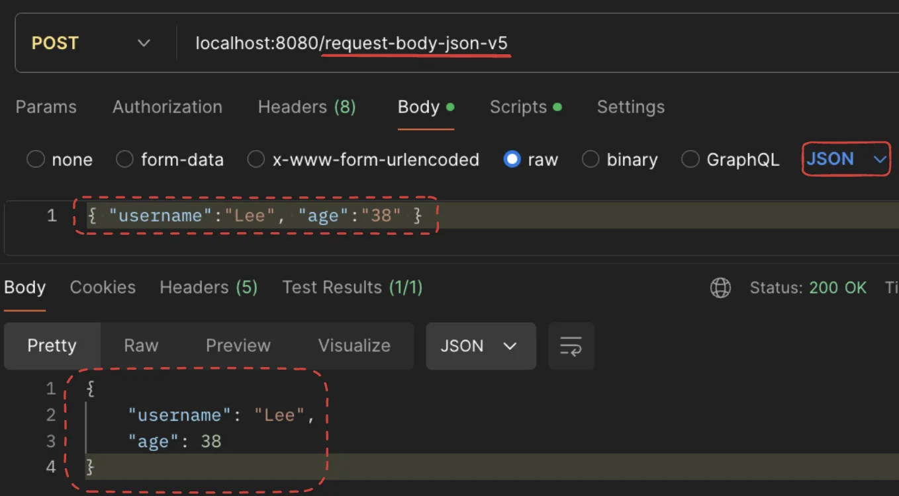

</details>

---

<details>
<summary><strong>RequestBodyJsonController</strong></summary>

<a id="1c3eda9b0fe1813a843af537936d201e"></a>

```java
@Slf4j
@Controller
public class RequestBodyJsonController {

    private ObjectMapper objectMapper = new ObjectMapper();
   
}
```

</details>

<details>
<summary><strong>requestBodyJsonV1 &#45; HttpServletRequest </strong></summary>

<a id="1c3eda9b0fe181dbab7cd18153309a76"></a>

```java
@PostMapping("/request-body-json-v1")
public void requestBodyJsonV1(HttpServletRequest request, HttpServletResponse response) throws IOException {

    ServletInputStream inputStream = request.getInputStream();
    String messageBody = StreamUtils.copyToString(inputStream, StandardCharsets.UTF_8);

    log.info("messageBody={}", messageBody);
    HelloData data = objectMapper.readValue(messageBody, HelloData.class);
    log.info("username={}, age={}", data.getUsername(), data.getAge());

    response.getWriter().write("ok");
}
```

</details>

<details>
<summary><strong>requestBodyJsonV2  &#45; &#64;RequestBody 문자 변환</strong></summary>

- <code>&#64;RequestBody</code>

- <code>objectMapper&#46;readValue</code>&#58; <strong>JSON(string) → Object (역직렬화)</strong>

<a id="1c3eda9b0fe1814ab210ef35a76ecf60"></a>

```java
/**
 * @RequestBody
 * HttpMessageConverter 사용 -> StringHttpMessageConverter 적용
 *
 * @ResponseBody
 * - 모든 메서드에 @ResponseBody 적용
 * - 메시지 바디 정보 직접 반환(view 조회X)
 * - HttpMessageConverter 사용 -> StringHttpMessageConverter 적용
 */
@ResponseBody
@PostMapping("/request-body-json-v2")
public String requestBodyJsonV2(@RequestBody String messageBody) throws IOException {
    HelloData data = objectMapper.readValue(messageBody, HelloData.class);
    log.info("username={}, age={}", data.getUsername(), data.getAge());
    return "ok";
}
```

</details>

<details>
<summary><strong>requestBodyJsonV3 &#45; &#64;RequestBody 객체 변환</strong></summary>

<a id="1c3eda9b0fe1817eb261c2609a986b3c"></a>

```java
/**
* @RequestBody 생략 불가능 (생략 시, @ModelAttribute가 작용됨)
* HttpMessageConverter 사용 -> MappingJackson2HttpMessageConverter (content-type: application/json)
*/
@ResponseBody
@PostMapping("/request-body-json-v3")
public String requestBodyJsonV3(@RequestBody HelloData data) {
		log.info("username={}, age={}", data.getUsername(), data.getAge());
		return "ok";
}
```

</details>

<details>
<summary><strong>requestBodyJsonV4 &#45; HttpEntity</strong></summary>

<a id="1c3eda9b0fe181ebb790e3880cf401cc"></a>

```java
@ResponseBody
@PostMapping("/request-body-json-v4")
public String requestBodyJsonV4(HttpEntity<HelloData> httpEntity){
    HelloData data = httpEntity.getBody();
    log.info("username={}, age={}", data.getUsername(), data.getAge());
    return "ok";
}
```

</details>

<details>
<summary><strong>requestBodyJsonV5 &#45; &#64;RequestBody&#95;객체 변환, &#64;ResponseBody&#95;JSON 변환 및 반환 (⭐️)</strong></summary>

<a id="1c3eda9b0fe181ff8bd2fe8e6556b237"></a>

```java
/**
 * @RequestBody 생략 불가능(@ModelAttribute 가 적용되어 버림)
 * HttpMessageConverter 사용 -> MappingJackson2HttpMessageConverter (content-type:
application/json)
 *
 * @ResponseBody 적용
 * - 메시지 바디 정보 직접 반환(view 조회X)
 * - HttpMessageConverter 사용 -> MappingJackson2HttpMessageConverter 적용(Accept:
application/json)
 */
@ResponseBody
@PostMapping("/request-body-json-v5")
public HelloData requestBodyJsonV5(@RequestBody HelloData data) {
    log.info("username={}, age={}", data.getUsername(), data.getAge());
    return data;
}
```

- PostMan 테스트 
    

</details>

<a id="1c3eda9b0fe18153ab2dee7f95151f44"></a>

## HTTP <strong>응답 </strong>

<details>
<summary><strong>스프링(서버)에서 응답 데이터 만드는 방법 ( 3 )</strong></summary>

<details>
<summary><strong>1) 정적 리소스</strong></summary>

<a id="1c3eda9b0fe181d7a15fdfa99465a6ea"></a>

예) 웹 브라우저에 <strong><u>정적인 HTML, css, js</u></strong>를 제공할 때는 <strong><u>정적 리소스</u></strong>를 사용한다&#46;<br>

</details>

<details>
<summary><strong>2) 뷰 템플릿 사용</strong></summary>

<a id="1c3eda9b0fe1812895a4fe4485e9ccc1"></a>

예) 웹 브라우저에 <strong><u>동적인 HTML을 제공</u></strong>할 때는 뷰 템플릿을 사용한다&#46;<br>

</details>

<details>
<summary><strong>3) HTTP 메시지 사용 ( ⭐️ ) </strong></summary>

<a id="1c3eda9b0fe18118b794e84d2ac97622"></a>

<strong><u>HTTP API를 제공</u></strong>하는 경우에는 HTML이 아니라 <strong><u>데이터를 전달</u></strong>해야 하므로, <br><strong><u>HTTP 메시지 바디</u></strong>에<strong> </strong><strong><u>JSON 같은 형식으로 데이터를 실</u></strong><strong>어 보</strong>낸다&#46;<br>

</details>

</details>

<a id="1c3eda9b0fe18169b199fff4b2257f2d"></a>

### <strong>정적 리소스</strong>, <strong>뷰 템플릿</strong>

<details>
<summary><strong>🧐 </strong><code>String 반환</code><strong>  vs </strong><code>View or HTTP 메세지</code></summary>

- 예시 코드
    <a id="1c3eda9b0fe18149a6f2d08dc17fb45d"></a>

    ```java
    // @ResponseBody 
    @RequestMapping("/response-view-v2")
    public String responseViewV2(Model model) {
    		model.addAttribute("data", "hello!");
    		return "response/hello";
    }
    ```

<details>
<summary><strong><code>&#64;ResponseBody</code></strong>가 없는 경우 </summary>

<a id="1c3eda9b0fe18171be4fee9f1878c22f"></a>

<strong><code>&#64;ResponseBody</code></strong>가 없으면 <code>response/hello</code>로 뷰 리졸버가 실행되어 뷰를 찾고, 렌더링 한다&#46; 

- 뷰 리졸버는 해당 리소스를 <code>resources/templates</code> 에서 찾는다 

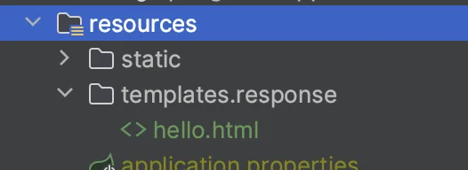

- PostMan 테스트

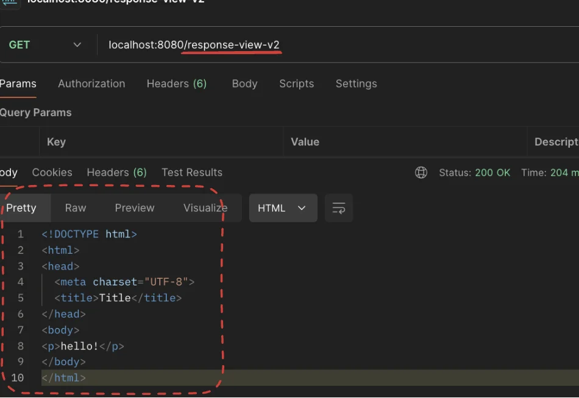

</details>

<details>
<summary><strong><code>&#64;ResponseBody</code></strong>가 있는 경우</summary>

- <code>return 되는 값</code>이 HTTP 응답 메세지에 담겨 넘어간다&#46;
    - String 값(<code>&#34;response/hello&#34;</code>) 반환

    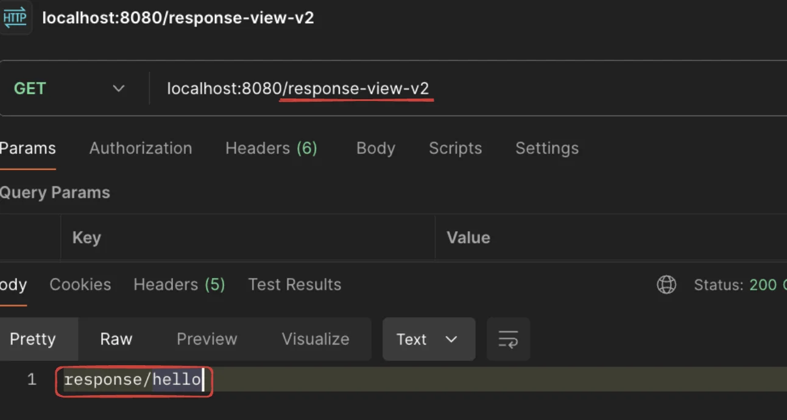

</details>

</details>

<details>
<summary><strong>🧐 </strong><code>Void</code><strong>를 반환하는 경우</strong></summary>

<a id="1c3eda9b0fe18121b212c371a653f056"></a>

<code>&#64;Controller</code> 를 사용하고, <code>HttpServletResponse</code> , <code>OutputStream(Writer)</code> 같은 HTTP 메시지 바디를 처리하는 파라미터가 없으면 요청 URL을 참고해서 논리 뷰 이름으로 사용

- 요청 URL&#58; <code>/response/hello</code>

- 실행&#58; <code>templates/response/hello&#46;htm</code>l

<a id="1c3eda9b0fe1813eb7dcc60e966b4033"></a>

<strong>참고로 이 방식은 명시성이 너무 떨어지고 이렇게 딱 맞는 경우도 많이 없어서, 권장하지 않는다&#46;</strong>

</details>

<details>
<summary><strong>🧐 HTTP 메세지</strong></summary>

<a id="1c3eda9b0fe1811ca1b2eac7cdd6463f"></a>

<code>&#64;ResponseBody</code>, <code>HttpEntity</code>를 사용하면, 뷰 템플릿을 사용하는 것이 아니라, HTTP 메세지 바디에 직접 응답 데이터를 출력할 수 있다&#46;

</details>

<details>
<summary><strong>정적 리소스</strong></summary>

- <strong>정적 리소스</strong>&#58; 해당 파일을 변경 없이 그대로 서비스하는 것

- 스프링 부트는 클래스패스의 다음 디렉토리에 있는 정적 리소스를 제공한다&#46;
    - <code>/static</code> , <code>/public</code>, <code>/resources</code>, <code>/META&#45;INF/resources</code>

- <code>src/main/resources</code>는 리소스를 보관하는 곳이고, 또 클래스패스의 시작 경로이다&#46;<br>따라서 다음 디렉토리에 리소스를 넣어두면 <strong><u>스프링 부트가 정적 리소스로 서비스를 제공</u></strong>한다&#46;
    - <strong>정적 리소스 경로&#58; </strong><code>src/main/resources/static</code>
        - 해당 경로에 파일이 들어있으면 웹 브라우저에서 다음과 같이 실행하면 된다&#46;
            - <strong>Path</strong>&#58; <code>src/main/resources/static/basic/hello&#45;form&#46;html</code>

            - <strong>URI</strong>&#58; <code>http&#58;//localhost&#58;8080/basic/hello&#45;form&#46;html&#96;</code>

</details>

<details>
<summary><strong>뷰 템플릿</strong></summary>

- <strong>View Template</strong>을 거쳐서 HTML이 생성되고, <strong>View</strong> 가 응답을 만들어서 전달한다&#46;

- 일반적으로 <strong><u>HTML을 동적으로 생성</u></strong>하는 용도로 사용하지만, 다른 것들도 가능하다&#46; <br>뷰 템플릿이 만들 수 있는 것이라면 뭐든지 가능하다&#46;

- 스프링 부트는 기본 뷰 템플릿 경로를 제공한다&#46;
    - <code>src/main/resources/templates</code>

<details>
<summary><strong>뷰 템플릿 생성</strong></summary>

> <strong>src/main/resources/templates/response/hello&#46;html</strong>

<a id="1c3eda9b0fe181c98202cafceeb12154"></a>

```html
 <!DOCTYPE html>
 <html xmlns:th="http://www.thymeleaf.org">
 <head>
     <meta charset="UTF-8">
     <title>Title</title>
 </head>
<body>
 <p th:text="${data}">empty</p>
</body>
</html>
```

</details>

<details>
<summary><strong>ResponseViewController &#45; 뷰 템플릿 호출 컨트롤러</strong></summary>

<a id="1c3eda9b0fe181efa8e8f4c854520bea"></a>

```java
package com.example.springmvc1.springmvc.basic.response;

import org.springframework.stereotype.Controller;
import org.springframework.ui.Model;
import org.springframework.web.bind.annotation.RequestMapping;
import org.springframework.web.servlet.ModelAndView;

@Controller
public class ResponseViewController {

    @RequestMapping("/response-view-v1")
    public ModelAndView responseViewV1() {
        ModelAndView mav = new ModelAndView("response/hello")
                .addObject("data", "hello!");
        return mav;
    }

    @RequestMapping("/response-view-v2")
    public String responseViewV2(Model model) {
        model.addAttribute("data", "hello!");
        return "response/hello";
    }

    @RequestMapping("/response/hello")
    public void responseViewV3(Model model) {
        model.addAttribute("data", "hello!");
    }
}
```

</details>

</details>

<details>
<summary><strong>Thymeleaf</strong></summary>

<details>
<summary>의존성 추가 </summary>

<a id="1c3eda9b0fe181c1a33ae53c8990a85f"></a>

```groovy
implementation 'org.springframework.boot:spring-boot-starter-thymeleaf'
```

</details>

- 스프링 부트가 자동으로 <code>ThymeleafViewResolver</code> 와 필요한 스프링 빈들을 등록함

<details>
<summary><code>application&#46;properties</code>&#58; 아래의 설정 ( 기본값 )</summary>

<a id="1c3eda9b0fe18128bbb5c607da95a418"></a>

```groovy
spring.thymeleaf.prefix=classpath:/templates/
spring.thymeleaf.suffix=.html
```

</details>

</details>

<a id="1c3eda9b0fe181b890f5d63d2f8802e7"></a>

### HTTP API, <strong>메시지 바디에 직접 입력</strong>

<a id="1c3eda9b0fe181bc878ed0a23ac4ec8b"></a>

HTTP API를 제공하는 경우, HTML이 아닌 데이터를 전달해야 하므로, HTTP 메세지 바디에 JSON 같은 형식으로 데이터를 실어 보낸다&#46; 

> 🤔 <strong>HTML이나 뷰 템플릿을 사용</strong>해도 <strong><u>HTTP 응답 메세지 바디</u></strong><u>에 </u><strong><u>HTML 데이터가 담겨서 전달</u></strong><u>된</u>다&#46; <br>여기서 설명하는 내용은 <strong><u>정적 리소스나 뷰 템플릿을 거치지 않</u></strong>고, <strong>직접 HTTP 응답 메세지를 전달하는 경우</strong>를 말한다&#46;

<details>
<summary><strong>🧐 HttpStatus 코드 설정 방법 ( 2 )</strong></summary>

<details>
<summary><strong>1&#46; ResponseEntity</strong></summary>

- <code>ResponseEntity(반환 데이터, </code><strong><code>HttpStatus&#46;코드번호</code></strong><code>)</code>
    - ex) 
        <a id="1c3eda9b0fe18173af10c5e7639adee9"></a>

        ```java
        @GetMapping("/response-body-json-v1")
        public ResponseEntity<HelloData> responseBodyJsonV1() {

        			.  .  .
        			
        	return new ResponseEntity<>(helloData, HttpStatus.OK)
        }
        ```

</details>

<details>
<summary><strong>2&#46; </strong><strong><code>&#64;ResponseStatus()</code></strong></summary>

- <code>&#64;ResponseStatus(</code><strong><code>HttpStatus&#46;코드번호</code></strong><code>)</code>
    - <strong>ex)  200 OK 설정</strong>
        <a id="1c3eda9b0fe1812fbf90e5d92bf161fa"></a>

        ```java
        @ResponseStatus(HttpStatus.OK)
        @ResponseBody
        @GetMapping("/response-body-json-v2")
        public HelloData responseBodyJsonV2() {

        		 .   .  .
        ```

</details>

</details>

<details>
<summary>🧐 <strong>왜 ResponseEntity에 </strong><strong><code>HttpStatus</code></strong><strong>를 설정하는가?</strong></summary>

<details>
<summary><strong>의문 발생 코드</strong></summary>

> 왜 ResponseEntity에 <strong>HttpStatus </strong>코드를 담아 보내는가?

<a id="1c3eda9b0fe1814bb293e6ddd96da2e4"></a>

```java
return new ResponseEntity<>(helloData, HttpStatus.NOT_FOUND
```

</details>

> <code>HttpStatus&#46;OK</code> → <code>HttpStatus&#46;NOT&#95;FOUND</code> 

<a id="1c3eda9b0fe18142bb94c31209d53e44"></a>

정상 응답 시, 200 상태코드로 설정한 것을  아래와 같이 404 상태 코드로 변경함

<a id="1c3eda9b0fe181e4875acf0c3d139829"></a>

```java
@GetMapping("/response-body-json-v1")
public ResponseEntity<HelloData> responseBodyJsonV1() {
    HelloData helloData = new HelloData();
    helloData.setUsername("userA");
    helloData.setAge(20);

    return new ResponseEntity<>(helloData, HttpStatus.NOT_FOUND);
}
```

<a id="1c3eda9b0fe18116b87ffb374748bab6"></a>

위와 같이 설정을 할 시, 정상 응답처리가 되어도 404 상태코드로 나옴<br>즉, 스프링에서 자동으로 상태코드를 응답하는 것보다 <strong><u>ResponseEntity를 통해서 설정</u></strong>하는 것이 <strong><u>더 우선순위가 높</u></strong>다는 것을 알 수 있음&#46;

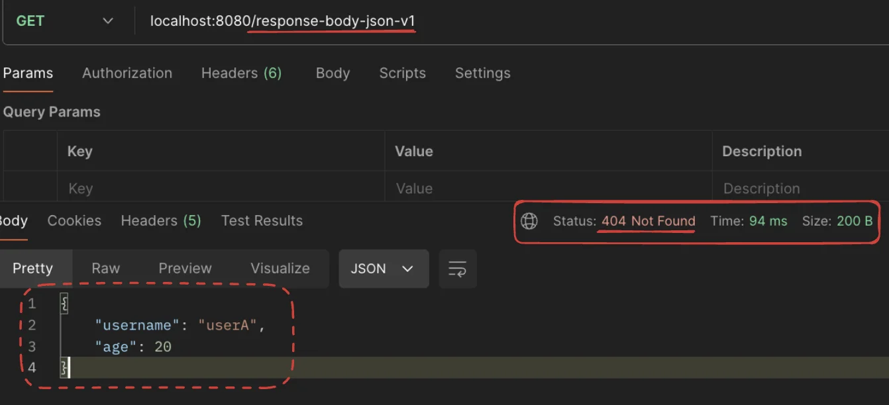

> <strong>🧐 그렇다면 왜 직접 상태코드를 명시하는가?</strong>

<a id="1c3eda9b0fe181d9b090e790a83f1e7d"></a>

스프링 부트에서는 자동으로 상태코드를 설정한다&#46; 

<a id="1c3eda9b0fe181c9ad55cf9e213d30b6"></a>

그 예로 <code>&#64;GetMapping</code> 메서드가 정상적으로 데이터를 반환하면 기본적으로 <code>200 OK</code> 상태 코드가 설정된다&#46; 

<a id="1c3eda9b0fe181b89a9dc4fa041fbb56"></a>

하지만 <strong>특정 상황에서는 다른 상태 코드를 설정</strong>해야 할 필요가 있다&#46;

<a id="1c3eda9b0fe18108b673f13be6b7bda9"></a>

예를 들어, <strong><u>데이터가 없는 경우 404 Not Found</u></strong>, <strong><u>권한이 없는 경우 403 Forbidden</u></strong> 등을 반환하는 것이 올바르다&#46;  

<a id="1c3eda9b0fe1813cb388c6ede10e81ce"></a>

이를 위해, <strong>좀더 유연하게 개발자가 특정 상황에 맞는 상태코드를 설정</strong>할 수 있도록 <br>ResponseEntity를 통해서 상태코드를 직접 명시할 수 있게 설계되었다&#46;

</details>

<details>
<summary><strong>🧐 </strong><strong><code>&#64;RestController</code></strong><strong> </strong></summary>

> <code>&#64;Controller</code> &#43; <code>&#64;RestController</code>

- 뷰 템플릿을 사용하는 것이 아니라, <strong><u>HTTP 메시지 바디에 직접 데이터를 입력</u></strong>한다&#46;

</details>

<details>
<summary><strong>전체 코드  &#45; ResponseBodyController</strong></summary>

<a id="1c3eda9b0fe1819fb4e1f2324d9164f1"></a>

```java
package com.example.springmvc1.springmvc.basic.response;

import com.example.springmvc1.springmvc.basic.HelloData;
import jakarta.servlet.http.HttpServletRequest;
import jakarta.servlet.http.HttpServletResponse;
import lombok.extern.slf4j.Slf4j;
import org.springframework.http.HttpStatus;
import org.springframework.http.ResponseEntity;
import org.springframework.stereotype.Controller;
import org.springframework.web.bind.annotation.GetMapping;
import org.springframework.web.bind.annotation.RequestMapping;
import org.springframework.web.bind.annotation.ResponseBody;
import org.springframework.web.bind.annotation.ResponseStatus;
import org.springframework.web.servlet.ModelAndView;

import java.io.IOException;


@Slf4j
@Controller
public class ResponseBodyController {

    @GetMapping("/response-body-string-v1")
    public void reponseBodyV1(HttpServletResponse response) throws IOException {
        response.getWriter().write("ok");
    }

    /**
     * HttpEntity, ResponseEntity(Http Status 추가)
     *
     * @return
     */
    @GetMapping("/response-body-string-v2")
    public ResponseEntity<String> responseBodyV2() {
        return new ResponseEntity<>("ok", HttpStatus.OK);
    }

    @ResponseBody
    @GetMapping("/response-body-string-v3")
    public String responseBodyV3() {
        return "ok";
    }

    @GetMapping("/response-body-json-v1")
    public ResponseEntity<HelloData> responseBodyJsonV1() {
        HelloData helloData = new HelloData();
        helloData.setUsername("userA");
        helloData.setAge(20);

        return new ResponseEntity<>(helloData, HttpStatus.OK);
    }

    @ResponseStatus(HttpStatus.OK)
    @ResponseBody
    @GetMapping("/response-body-json-v2")
    public HelloData responseBodyJsonV2() {
        HelloData helloData = new HelloData();
        helloData.setUsername("userA");
        helloData.setAge(20);

        return helloData;
    }
}

```

</details>

---

<details>
<summary><strong>reponseBodyV1 &#45; HttpServletResponse</strong></summary>

<a id="1c3eda9b0fe181728b7be5ad4355ed4a"></a>

```java
@GetMapping("/response-body-string-v1")
public void reponseBodyV1(HttpServletResponse response) throws IOException {
    response.getWriter().write("ok");
}
```

</details>

<details>
<summary><strong>responseBodyV2 &#45; ResponseEntity</strong></summary>

<a id="1c3eda9b0fe181838e57e0df8105de62"></a>

```java
/**
 * HttpEntity, ResponseEntity(Http Status 추가)
 *
 * @return
 */
@GetMapping("/response-body-string-v2")
public ResponseEntity<String> responseBodyV2() {
    return new ResponseEntity<>("ok", HttpStatus.OK);
}
```

</details>

<details>
<summary><strong>reponseBodyV3 &#45; </strong><strong><code>&#64;ResponseBody</code></strong></summary>

<a id="1c3eda9b0fe1812786ebf8f6a327bca9"></a>

```java
@ResponseBody
@GetMapping("/response-body-string-v3")
public String responseBodyV3() {
    return "ok";
}
```

</details>

<details>
<summary><strong>reponseBodyJsonV1 &#45; ResponseEntity</strong></summary>

<a id="1c3eda9b0fe181dda9c7c58f483cebc7"></a>

```java
@GetMapping("/response-body-json-v1")
public ResponseEntity<HelloData> responseBodyJsonV1() {
    HelloData helloData = new HelloData();
    helloData.setUsername("userA");
    helloData.setAge(20);

    return new ResponseEntity<>(helloData, HttpStatus.OK);
}
```

</details>

<details>
<summary><strong>reponseBodyJsonV2 &#45; </strong><strong><code>&#64;ResponseStatus()</code></strong></summary>

<a id="1c3eda9b0fe18159b983ee26053cae2b"></a>

```java
@ResponseStatus(HttpStatus.OK)
@ResponseBody
@GetMapping("/response-body-json-v2")
public HelloData responseBodyJsonV2() {
    HelloData helloData = new HelloData();
    helloData.setUsername("userA");
    helloData.setAge(20);

    return helloData;
}
```

</details>

<a id="1c3eda9b0fe181569721c7082b7b5008"></a>

## HTTP <strong>메시지 컨버터</strong>

> 🧐 <code>response&#46;getWriter()&#46;write(&#34;ok&#34;)</code>를 통해서 직접 http 메세지 바디에 내용을 넣어 전달할 수 있지만 매우 불편하고 번거로웠다&#46;
> 
> <a id="1c3eda9b0fe181a78b39e327a9dced08"></a>
> 
> 그러나 <strong><u>HTTP 메서지 컨버터</u></strong>를 사용하면 <strong>자동</strong>으로  <strong><u>return 되는 값</u></strong>을 해당되는 형식으로  변환 및 http 메세지 바디 넣어 전달하여 굉장히 단순하고 편리하게 문제를 해결할 수 있다&#46; 

> 📌 <strong>스프링 MVC &#45;  HTTP 메세지 컨버터 적용</strong>
> 
> > 아래와 같은 <strong><code>애노테이션</code></strong>이나 <strong><code>HttpEntity</code></strong>를 사용하면<strong><u> 스프링 MVC가 HTTP 메세지 컨버터를 통해 자동으로 해당되는 형식을 HTTP 메세지 바디에 넣어 전달</u></strong>한다&#46;
> 
> - <strong><code>HTTP 요청</code></strong><strong>&#58; </strong><strong><code>&#64;RequestBody</code></strong><strong>, </strong><strong><code>HttpEntity(RequestEntity)</code></strong>
> 
> - <strong><code>HTTP 응답</code></strong><strong>&#58; </strong><strong><code>&#64;ResponseBody</code></strong><strong>, </strong><strong><code>HttpEntity(ResponseEntity)</code></strong><strong> </strong>
> 
> <details>
> <summary>ex) <code>&#64;ResponseBody</code> </summary>
> 
> 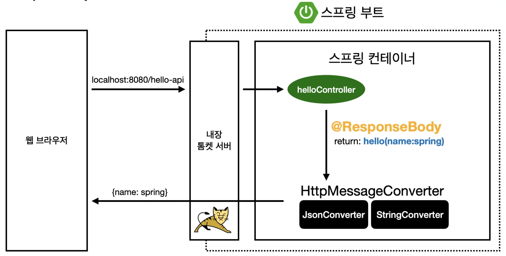
> 
> - <code>&#64;ResponseBody</code> 사용
>     - HTTP body에 문자 내용 직접 반환
> 
>     - <code>viewResolver</code> 대신에 <code>HttpMassageConverter</code> 동작
>         - 기본 문자 처리&#58; <code>StringHttpMessageConverter</code> 
> 
>         - 기본 객체 처리&#58; <code>MappingJackson2HttpMessageConverter</code>
> 
>         - byte  처리 등등 기타 여러 HttpMessageConverter가 기본으로 등록되어 있다&#46;
> 
> </details>

<details>
<summary><strong>HTTP 메세지 컨버터 인터페이스</strong></summary>

- <code>canRead()</code>, <code>canWrite()</code>&#58; 메세지 컨버터가<strong> 해당 </strong><strong><code>클래스</code></strong><strong>, </strong><strong><code>미디어타입</code></strong><strong>을 지원하는지 체크</strong>

- <code>read()</code>, <code>write()</code>&#58; 메세지 컨버터를 통해서 메세지를 읽고 쓰는 기능

<a id="1c3eda9b0fe181a99e30d970f08d18cd"></a>

```java
package org.springframework.http.converter;

public interface HttpMessageConverter<T> {
     boolean canRead(Class<?> clazz, @Nullable MediaType mediaType);
     boolean canWrite(Class<?> clazz, @Nullable MediaType mediaType);
     
     List<MediaType> getSupportedMediaTypes();
     
     T read(Class<? extends T> clazz, HttpInputMessage inputMessage)
             throws IOException, HttpMessageNotReadableException;
             
     void write(T t, @Nullable MediaType contentType, HttpOutputMessageoutputMessage)
}
```

</details>

<details>
<summary><strong>스프링 부트 기본 메세지 컨버터</strong></summary>

> 스프링 부트는 다양한 메세지 컨버터를 제공하는데, <strong><code>대상 클래스 타입</code></strong>과 <strong><code>미디어 타입</code></strong>을 <strong><u>체크</u></strong>하여 <strong><u>사용 여부를 결정</u></strong>한다&#46;<br><u>해당하는 타입이 아니면 다음 메세지 컨버터로 우선순위가 넘어간다&#46;</u> 

> 📌 <strong>HttpMessageConverter 우선순위</strong>
> 
> - 0 = <code>ByteArrayHttpMessageConverter</code>
> 
> - 1 = <code>StringHttpMessageConverter</code>
> 
> -  2 = <code>MappingJackson2HttpMessageConverter</code>

<details>
<summary><strong>ByteArrayHttpMessageConverter</strong></summary>

<details>
<summary><strong>🧐 코드</strong></summary>

<details>
<summary>전체 코드</summary>

<a id="1c3eda9b0fe181f9b778eae137666e85"></a>

```java
package org.springframework.http.converter;

import java.io.IOException;

import org.springframework.http.HttpInputMessage;
import org.springframework.http.HttpOutputMessage;
import org.springframework.http.MediaType;
import org.springframework.lang.Nullable;
import org.springframework.util.StreamUtils;

public class ByteArrayHttpMessageConverter extends AbstractHttpMessageConverter<byte[]> {

	public ByteArrayHttpMessageConverter() {
		super(MediaType.APPLICATION_OCTET_STREAM, MediaType.ALL);
	}


	@Override
	public boolean supports(Class<?> clazz) {
		return byte[].class == clazz;
	}

	@Override
	public byte[] readInternal(Class<? extends byte[]> clazz, HttpInputMessage message) throws IOException {
		long length = message.getHeaders().getContentLength();
		return (length >= 0 && length < Integer.MAX_VALUE ?
				message.getBody().readNBytes((int) length) : message.getBody().readAllBytes());
	}

	@Override
	protected Long getContentLength(byte[] bytes, @Nullable MediaType contentType) {
		return (long) bytes.length;
	}

	@Override
	protected void writeInternal(byte[] bytes, HttpOutputMessage outputMessage) throws IOException {
		StreamUtils.copy(bytes, outputMessage.getBody());
	}

	@Override
	protected boolean supportsRepeatableWrites(byte[] bytes) {
		return true;
	}
}
s
```

</details>

---

<details>
<summary>1&#46; 클래스 정의 </summary>

- <code>AbstractHttpMessageConverter&#60;byte&#91;&#93;&#62;</code> 상속
    -  바이트 배열을 변환하기 위한 HTTP 메시지 변환기 의미

<a id="1c3eda9b0fe18107b234f5f0c893870c"></a>

```java
public class ByteArrayHttpMessageConverter extends AbstractHttpMessageConverter<byte[]> {
```

</details>

<details>
<summary>2&#46; 생성자</summary>

<details>
<summary><strong>🧐 application/octet&#45;stream</strong></summary>

- 파일이나 데이터를 바이너리 형태로 전송할 때 사용하는 MIME 타입

- 컴퓨터에서 사용하는 모든 파일은 기본적으로 0과 1로 이루어진 바이너리 데이터이다&#46;<br>예를 들어, 사진 파일이나 음악 파일은 바이너리 데이터이다&#46; <br>이 데이터를 그대로 전송할 때 “application/octet&#45;stream”을 사용한다&#46;

- “application/octet&#45;stream”은 파일의 내용이 무엇인지 알 수 없을 때 사용하는 포장지라고 생각하면 된다&#46; 어떤 종류의 데이터든 포장해서 보낼 수 있다&#46;

</details>

<details>
<summary>🧐 <strong>모든 미디어 타입 (&#42;/&#42;)</strong></summary>

-  데이터를 표현하는 형식의 모든 미디어 타입을 의미

- <strong>예시</strong>
    - 텍스트 파일&#58; “text/plain”

    - HTML 파일&#58; “text/html”

    - JSON 데이터&#58; “application/json”

    - 이미지 파일&#58; “image/png”, “image/jpeg”

    - 비디오 파일&#58; “video/mp4”

</details>

- ByteArrayHttpMessageConverter의 인스턴스 생성
    - 해당 변환기는 application/octet&#45;stream 및 모든 미디어 타입을 지원함&#46;
        - <strong>application/octet&#45;stream</strong>&#58; 어떤 바이너리 데이터든 처리할 수 있다&#46;

        - <strong>모든 미디어 타입</strong>&#58; 어떤 형식의 데이터든 처리할 수 있다&#46;

<a id="1c3eda9b0fe181329e24e5defc13577f"></a>

```java
	public ByteArrayHttpMessageConverter() {
		super(MediaType.APPLICATION_OCTET_STREAM, MediaType.ALL);
	}
```

</details>

<details>
<summary>3&#46; 메서드 </summary>

<details>
<summary>클래스 지원 여부 확인</summary>

<a id="1c3eda9b0fe1811e9f74dab19a539118"></a>

```java
@Override
public boolean supports(Class<?> clazz) {
	return byte[].class == clazz;
}
```

</details>

<details>
<summary>읽기 메서드</summary>

<a id="1c3eda9b0fe1818d85daf210c71c7b86"></a>

```java
@Override
public byte[] readInternal(Class<? extends byte[]> clazz, HttpInputMessage message) throws IOException {
	long length = message.getHeaders().getContentLength();
	return (length >= 0 && length < Integer.MAX_VALUE ?
			message.getBody().readNBytes((int) length) : message.getBody().readAllBytes());
}
```

</details>

<details>
<summary>콘텐츠 길이 가져오기</summary>

<a id="1c3eda9b0fe181faad9cf8d5d262e4a2"></a>

```java
@Override
protected Long getContentLength(byte[] bytes, @Nullable MediaType contentType){
	return (long) bytes.length;
}
```

</details>

<details>
<summary>쓰기 메서드</summary>

<a id="1c3eda9b0fe181639495eafecef9a10b"></a>

```java
@Override
protected void writeInternal(byte[] bytes, HttpOutputMessage outputMessage) throws IOException {
	StreamUtils.copy(bytes, outputMessage.getBody());
}
```

</details>

<details>
<summary>반복 가능한 쓰지 지원 여부</summary>

<a id="1c3eda9b0fe18130ae63c7e4c3152ed9"></a>

```java
@Override
protected boolean supportsRepeatableWrites(byte[] bytes) {
	return true;
}
```

</details>

</details>

</details>

> <strong><code>ByteArrayHttpMessageConverter</code></strong>&#58; <code>byte&#91;&#93;</code> 데이터 처리
> 
> - 클래스 타입&#58; <code>byte&#91;&#93;</code>, 미디어타입&#58; <code>&#42;</code><em><code>/&#42;</code></em><em> </em>
> 
> - 요청 예시)  
>     - <code>&#64;RequestBody byte&#91;&#93; data</code>
> 
> - 응답 예시)
>     -  <code>&#64;ResponseBody return byte&#91;&#93;</code>
> 
>     - 쓰기 미디어타입&#58; <code>application/octet&#45;stream</code>

</details>

<details>
<summary><strong>StringHttpMessageConverter</strong></summary>

<details>
<summary>🧐 <strong>코드 </strong></summary>

<details>
<summary>전체코드</summary>

<a id="1c3eda9b0fe181ae8491fa9a3b5e3d97"></a>

```java
package org.springframework.http.converter;

import java.io.IOException;
import java.nio.charset.Charset;
import java.nio.charset.StandardCharsets;
import java.util.ArrayList;
import java.util.List;

import org.springframework.http.HttpHeaders;
import org.springframework.http.HttpInputMessage;
import org.springframework.http.HttpOutputMessage;
import org.springframework.http.MediaType;
import org.springframework.lang.Nullable;
import org.springframework.util.Assert;
import org.springframework.util.StreamUtils;

public class StringHttpMessageConverter extends AbstractHttpMessageConverter<String> {

	private static final MediaType APPLICATION_PLUS_JSON = new MediaType("application", "*+json");

	public static final Charset DEFAULT_CHARSET = StandardCharsets.ISO_8859_1;

	@Nullable
	private volatile List<Charset> availableCharsets;

	private boolean writeAcceptCharset = false;

	public StringHttpMessageConverter() {
		this(DEFAULT_CHARSET);
	}

	public StringHttpMessageConverter(Charset defaultCharset) {
		super(defaultCharset, MediaType.TEXT_PLAIN, MediaType.ALL);
	}

	public void setWriteAcceptCharset(boolean writeAcceptCharset) {
		this.writeAcceptCharset = writeAcceptCharset;
	}


	@Override
	public boolean supports(Class<?> clazz) {
		return String.class == clazz;
	}

	@Override
	protected String readInternal(Class<? extends String> clazz, HttpInputMessage inputMessage) throws IOException {
		Charset charset = getContentTypeCharset(inputMessage.getHeaders().getContentType());
		long length = inputMessage.getHeaders().getContentLength();
		byte[] bytes = (length >= 0 && length <= Integer.MAX_VALUE ?
				inputMessage.getBody().readNBytes((int) length) : inputMessage.getBody().readAllBytes());
		return new String(bytes, charset);
	}

	@Override
	protected Long getContentLength(String str, @Nullable MediaType contentType) {
		Charset charset = getContentTypeCharset(contentType);
		return (long) str.getBytes(charset).length;
	}


	@Override
	protected void addDefaultHeaders(HttpHeaders headers, String s, @Nullable MediaType type) throws IOException {
		if (headers.getContentType() == null ) {
			if (type != null && type.isConcrete() && (type.isCompatibleWith(MediaType.APPLICATION_JSON) ||
					type.isCompatibleWith(APPLICATION_PLUS_JSON))) {
				// Prevent charset parameter for JSON.
				headers.setContentType(type);
			}
		}
		super.addDefaultHeaders(headers, s, type);
	}

	@Override
	protected void writeInternal(String str, HttpOutputMessage outputMessage) throws IOException {
		HttpHeaders headers = outputMessage.getHeaders();
		if (this.writeAcceptCharset && headers.get(HttpHeaders.ACCEPT_CHARSET) == null) {
			headers.setAcceptCharset(getAcceptedCharsets());
		}
		Charset charset = getContentTypeCharset(headers.getContentType());
		StreamUtils.copy(str, charset, outputMessage.getBody());
	}

	protected List<Charset> getAcceptedCharsets() {
		List<Charset> charsets = this.availableCharsets;
		if (charsets == null) {
			charsets = new ArrayList<>(Charset.availableCharsets().values());
			this.availableCharsets = charsets;
		}
		return charsets;
	}

	private Charset getContentTypeCharset(@Nullable MediaType contentType) {
		if (contentType != null) {
			Charset charset = contentType.getCharset();
			if (charset != null) {
				return charset;
			}
			else if (contentType.isCompatibleWith(MediaType.APPLICATION_JSON) ||
					contentType.isCompatibleWith(APPLICATION_PLUS_JSON)) {
				// Matching to AbstractJackson2HttpMessageConverter#DEFAULT_CHARSET
				return StandardCharsets.UTF_8;
			}
		}
		Charset charset = getDefaultCharset();
		Assert.state(charset != null, "No default charset");
		return charset;
	}

	@Override
	protected boolean supportsRepeatableWrites(String s) {
		return true;
	}

}

```

</details>

---

<details>
<summary>1&#46;  클래스 선언</summary>

>  AbstractHttpMessageConverter&#60;String&#62;를 상속하여, String 객체를 처리하기 위한 특수한 변환기

<a id="1c3eda9b0fe1814d9fe4d6a6bf3239bf"></a>

```java
public class StringHttpMessageConverter extends AbstractHttpMessageConverter<String> {
```

</details>

<details>
<summary>2&#46;  상수, 필드</summary>

- <code>APPLICATION&#95;PLUS&#95;JSON</code>&#58; JSON과 유사한 미디어 타입을 처리하기 위한 MediaType

- <code>DEFAULT&#95;CHARSET</code>&#58; 기본 문자셋으로 ISO&#45;8859&#45;1을 사용

- <code>availableCharsets</code>&#58; 사용할 수 있는 문자셋 목록

- <code>writeAcceptCharset</code>&#58; Accept&#45;Charset 헤더를 작성할지 여부를 나타내는 불리언 값

<a id="1c3eda9b0fe1811bbc1de1b4872d31f0"></a>

```java
private static final MediaType APPLICATION_PLUS_JSON = new MediaType("application", "*+json");
public static final Charset DEFAULT_CHARSET = StandardCharsets.ISO_8859_1;
@Nullable
private volatile List<Charset> availableCharsets;
private boolean writeAcceptCharset = false;
```

</details>

<details>
<summary>3&#46; 생성자</summary>

> 기본 생성자는 DEFAULT&#95;CHARSET을 사용<br>매개변수가 있는 생성자는 다른 기본 문자셋을 지정할 수 있게 함&#46;

<a id="1c3eda9b0fe181298e44ef02542de1e6"></a>

```java
public StringHttpMessageConverter() {
    this(DEFAULT_CHARSET);
}

public StringHttpMessageConverter(Charset defaultCharset) {
    super(defaultCharset, MediaType.TEXT_PLAIN, MediaType.ALL);
}
```

</details>

<details>
<summary>4&#46; 메서드 </summary>

<details>
<summary> <code>writeAcceptCharset</code> </summary>

> Accept&#45;Charset 헤더를 작성할지 여부를 설정

<a id="1c3eda9b0fe18193acc5e9b7d6d2a54a"></a>

```java
public void setWriteAcceptCharset(boolean writeAcceptCharset) {
    this.writeAcceptCharset = writeAcceptCharset;
}
```

</details>

<details>
<summary> <code>supports</code>  </summary>

> 변환기가 주어진 클래스를 지원하는지 확인한다&#46; <br>여기서는 String 클래스만 지원한다&#46;

<a id="1c3eda9b0fe181ebb041f1767c994e3e"></a>

```java
@Override
public boolean supports(Class<?> clazz) {
    return String.class == clazz;
}
```

</details>

<details>
<summary> <code>readInternal</code> </summary>

> HTTP 입력 메시지를 읽고 적절한 문자셋을 사용하여 String으로 변환

<a id="1c3eda9b0fe181c2b4f2dcc7c8694511"></a>

```java
@Override
protected String readInternal(Class<? extends String> clazz, HttpInputMessage inputMessage) throws IOException {
    Charset charset = getContentTypeCharset(inputMessage.getHeaders().getContentType());
    long length = inputMessage.getHeaders().getContentLength();
    byte[] bytes = (length >= 0 && length <= Integer.MAX_VALUE ?
            inputMessage.getBody().readNBytes((int) length) : inputMessage.getBody().readAllBytes());
    return new String(bytes, charset);
}
```

</details>

<details>
<summary><code>getContentLength</code> </summary>

> HTTP 출력 메시지에 String을 쓸 때의 콘텐츠 길이를 계산

<a id="1c3eda9b0fe18194ba40f98a84af0022"></a>

```java
@Override
protected Long getContentLength(String str, @Nullable MediaType contentType) {
    Charset charset = getContentTypeCharset(contentType);
    return (long) str.getBytes(charset).length;
}
```

</details>

<details>
<summary><code>addDefaultHeaders</code> </summary>

> HTTP 출력 메시지에 기본 헤더를 추가하여 Content&#45;Type 헤더가 올바르게 설정되도록 한다&#46;<br>특히 JSON 미디어 타입에 대해서는 charset 매개변수를 추가하지 않는다&#46; 

<a id="1c3eda9b0fe1819ca8a2dadee98a79b7"></a>

```java
@Override
protected void addDefaultHeaders(HttpHeaders headers, String s, @Nullable MediaType type) throws IOException {
    if (headers.getContentType() == null ) {
        if (type != null && type.isConcrete() && (type.isCompatibleWith(MediaType.APPLICATION_JSON) ||
                type.isCompatibleWith(APPLICATION_PLUS_JSON))) {
            headers.setContentType(type);
        }
    }
    super.addDefaultHeaders(headers, s, type);
}
```

</details>

<details>
<summary><code>writeInternal</code> </summary>

> String을 HTTP 출력 메시지에 적절한 문자셋을 사용하여 쓴다&#46; <br>또한 writeAcceptCharset이 활성화된 경우 Accept&#45;Charset 헤더를 설정한다&#46;

<a id="1c3eda9b0fe181c08fe6e25183ec6b1b"></a>

```java
@Override
protected void writeInternal(String str, HttpOutputMessage outputMessage) throws IOException {
    HttpHeaders headers = outputMessage.getHeaders();
    if (this.writeAcceptCharset && headers.get(HttpHeaders.ACCEPT_CHARSET) == null) {
        headers.setAcceptCharset(getAcceptedCharsets());
    }
    Charset charset = getContentTypeCharset(headers.getContentType());
    StreamUtils.copy(str, charset, outputMessage.getBody());
}
```

</details>

<details>
<summary><code>getAcceptedCharsets</code> </summary>

> 허용되는 문자셋 목록을 반환한다&#46; <br>목록이 초기화되지 않은 경우 모든 사용 가능한 문자셋으로 초기화 한다&#46;

<a id="1c3eda9b0fe181a28067f257f2ffaa65"></a>

```java
protected List<Charset> getAcceptedCharsets() {
    List<Charset> charsets = this.availableCharsets;
    if (charsets == null) {
        charsets = new ArrayList<>(Charset.availableCharsets().values());
        this.availableCharsets = charsets;
    }
    return charsets;
}
```

</details>

<details>
<summary><code>getContentTypeCharset</code> </summary>

>  HTTP 메시지의 Content&#45;Type 헤더를 기반으로 사용할 문자셋을 결정한다&#46;<br> JSON과 유사한 경우 기본적으로 UTF&#45;8을 사용한다&#46;

<a id="1c3eda9b0fe181cba5c4f7ad3b5358d6"></a>

```java
private Charset getContentTypeCharset(@Nullable MediaType contentType) {
    if (contentType != null) {
        Charset charset = contentType.getCharset();
        if (charset != null) {
            return charset;
        }
        else if (contentType.isCompatibleWith(MediaType.APPLICATION_JSON) ||
                contentType.isCompatibleWith(APPLICATION_PLUS_JSON)) {
            return StandardCharsets.UTF_8;
        }
    }
    Charset charset = getDefaultCharset();
    Assert.state(charset != null, "No default charset");
    return charset;
}
```

</details>

<details>
<summary><code>supportsRepeatableWrites</code> </summary>

> 변환기가 반복 가능한 쓰기를 지원하는지 여부를 나타낸다<br>여기서는 true를 반환하여 반복 가능한 쓰기를 지원한다

<a id="1c3eda9b0fe18172b7d9db3fb604a7c2"></a>

```java
@Override
protected boolean supportsRepeatableWrites(String s) {
    return true;
}
```

</details>

</details>

</details>

> <strong><code>StringHttpMessageConverter</code></strong><strong>&#58; </strong><code>String</code> 데이터 처리
> 
> - 클래스 타입&#58; <code>String</code>, 미디어타입&#58; <code>&#42;/&#42;</code>
> 
> - 요청 예시)
>     - <code>&#64;RequestBody String data</code>
> 
> - 응답 예시) 
>     - <code>&#64;ResponseBody return “ok”;</code> 
> 
>     - 쓰기 미디어타입&#58; <code>text/plain</code>

</details>

<details>
<summary><strong>MappingJackson2HttpMessageConverter</strong></summary>

<details>
<summary><strong>🧐 코드</strong></summary>

<details>
<summary>전체 코드</summary>

<a id="1c3eda9b0fe181bda0b3e0fe65603890"></a>

```java
package org.springframework.http.converter.json;

import java.io.IOException;
import java.util.Collections;
import java.util.List;

import com.fasterxml.jackson.core.JsonGenerator;
import com.fasterxml.jackson.databind.ObjectMapper;

import org.springframework.http.MediaType;
import org.springframework.lang.Nullable;

public class MappingJackson2HttpMessageConverter extends AbstractJackson2HttpMessageConverter {

	private static final List<MediaType> problemDetailMediaTypes =
			Collections.singletonList(MediaType.APPLICATION_PROBLEM_JSON);


	@Nullable
	private String jsonPrefix;


	public MappingJackson2HttpMessageConverter() {
		this(Jackson2ObjectMapperBuilder.json().build());
	}

	public MappingJackson2HttpMessageConverter(ObjectMapper objectMapper) {
		super(objectMapper, MediaType.APPLICATION_JSON, new MediaType("application", "*+json"));
	}

	public void setJsonPrefix(String jsonPrefix) {
		this.jsonPrefix = jsonPrefix;
	}

	public void setPrefixJson(boolean prefixJson) {
		this.jsonPrefix = (prefixJson ? ")]}', " : null);
	}

	@Override
	protected List<MediaType> getMediaTypesForProblemDetail() {
		return problemDetailMediaTypes;
	}

	@Override
	protected void writePrefix(JsonGenerator generator, Object object) throws IOException {
		if (this.jsonPrefix != null) {
			generator.writeRaw(this.jsonPrefix);
		}
	}
}
```

</details>

---

<details>
<summary>1&#46; 클래스 선언</summary>

> AbstractJackson2HttpMessageConverter를 상속받아 Jackson을 사용한 JSON 변환 기능을 확장

<a id="1c3eda9b0fe181fb9c3efd2ad85fb2d0"></a>

```java
public class MappingJackson2HttpMessageConverter extends AbstractJackson2HttpMessageConverter {
```

</details>

<details>
<summary><strong>2&#46; 정적 필드</strong></summary>

<a id="1c3eda9b0fe18159b57fdfe0a07c7115"></a>

```java
private static final List<MediaType> problemDetailMediaTypes =
        Collections.singletonList(MediaType.APPLICATION_PROBLEM_JSON);
```

</details>

<details>
<summary>3&#46; <strong>인스턴스 필드</strong></summary>

<a id="1c3eda9b0fe181cf8620d89adaa1ed07"></a>

```java
@Nullable
private String jsonPrefix;
```

</details>

<details>
<summary>4&#46; <strong>생성자</strong></summary>

<a id="1c3eda9b0fe1813fb019c3f76e34be74"></a>

```java
public MappingJackson2HttpMessageConverter() {
    this(Jackson2ObjectMapperBuilder.json().build());
}
```

<a id="1c3eda9b0fe1811291ede537d87eb7cf"></a>

```java
public MappingJackson2HttpMessageConverter(ObjectMapper objectMapper) {
    super(objectMapper, MediaType.APPLICATION_JSON, new MediaType("application", "*+json"));
}
```

</details>

<details>
<summary><strong>5&#46; 메서드</strong></summary>

<details>
<summary><code>setJsonPrefix</code></summary>

> jsonPrefix 필드를 설정하는 데 사용한다&#46;<br>입력된 문자열을 jsonPrefix에 저장함

<a id="1c3eda9b0fe18131baead5541298aeae"></a>

```java
public void setJsonPrefix(String jsonPrefix) {
    this.jsonPrefix = jsonPrefix;
}
```

</details>

<details>
<summary><code>setPrefixJson</code></summary>

>  boolean 값을 받아 jsonPrefix를 설정한다&#46;<br><code>true</code>인 경우 보안 접두사 “)&#93;}’, “를 설정하고, <code>false</code>인 경우 null로 설정한다&#46;

<a id="1c3eda9b0fe1819d81fdfc659f763061"></a>

```java
public void setPrefixJson(boolean prefixJson) {
    this.jsonPrefix = (prefixJson ? ")]}', " : null);
}
```

</details>

<details>
<summary><code>getMediaTypesForProblemDetail</code></summary>

>  변환기가 문제 세부 사항을 처리할 수 있도록 미디어 타입 목록을 반환한다&#46;

<a id="1c3eda9b0fe181d0a829c5947e503254"></a>

```java
@Override
protected List<MediaType> getMediaTypesForProblemDetail() {
    return problemDetailMediaTypes;
}
```

</details>

<details>
<summary><code>writePrefix</code></summary>

> jsonPrefix가 null이 아닌 경우 JsonGenerator를 사용하여 JSON 출력에 접두사를 쓴다&#46; <br>이를 통해 JSON 출력에 미리 설정된 접두사를 추가할 수 있다&#46;

<a id="1c3eda9b0fe1812b88bceabfd9972e5a"></a>

```java
@Override
protected void writePrefix(JsonGenerator generator, Object object) throws IOException {
    if (this.jsonPrefix != null) {
        generator.writeRaw(this.jsonPrefix);
    }
}
```

</details>

</details>

</details>

> <strong><code>MappingJackson2HttpMessageConverter</code></strong>&#58; application/json
> 
> - <strong>클래스 타입&#58; </strong><strong><code>객체</code></strong><strong> or </strong><strong><code>HashMap</code></strong><strong>,</strong> <strong>미디어타입</strong>&#58; <code>application/json</code>
> 
> - 요청 예시)
>     - <strong><code>&#64;RequestBody HelloData data</code></strong>
> 
> - 응답 예시)
>     - <strong><code>&#64;ResponseBody return helloData</code></strong>
> 
>     - 쓰기 미디어타입&#58; <code>application/json</code> 관련

- <strong><u>자바 객체를 JSON 형식으로 변환</u></strong>하기 위해 사용

- <strong>Jackson 라이브러리를 사용</strong>하여 변환을 수행하며,<u> </u><strong><u>보안 목적</u></strong><strong>으로 </strong><strong><u>JSON에 접두사를 추가</u></strong><strong>할 수 있</strong>다&#46;

- 주로 Spring 애플리케이션에서 <strong><u>자동으로 JSON 응답을 처리</u></strong>하는 데 사용된다&#46;

</details>

</details>

<details>
<summary><strong>HTTP 요청, 응답 처리 동작 과정 </strong></summary>

<details>
<summary><strong>HTTP 요청 데이터 읽기</strong></summary>

1. HTTP 요청 받음, 컨트롤러에서 <strong><code>&#64;RequestBody</code></strong>, <strong><code>HttpEntity 파라미터</code></strong>를 사용

1. <strong><u>메세지 컨버터가 메세지를 읽을 수 있는지 확인</u></strong>하기 위해 <code>canRead()</code> 호출
    <a id="1c3eda9b0fe181d28abcdd19626808c8"></a>

    ```java
    boolean canRead(Class<?> clazz, @Nullable MediaType mediaType);
    ```

    -  대상 클래스 타입을 지원 여부 확인
        - ex) <code>&#64;RequestBody</code>의 대상 클래스 (<strong><code>byte&#91;&#93;</code></strong><strong>, </strong><strong><code>String</code></strong><strong>, </strong><strong><code>HelloData</code></strong>)

    -  HTTP 요청의 Content&#45;Type 미디어타입 지원 여부 확인
        - ex) <strong><code>text/plain</code></strong><strong>, </strong><strong><code>application&#46;json</code></strong><strong>, </strong><strong><code>&#42;/&#42;</code></strong>

1. <code>canRead()</code> 조건을 만족하면 <code>read()</code>를 호출해서 객체를 생성하고, 반환

</details>

<details>
<summary><strong>HTTP 응답 데이터 생성</strong></summary>

1. 컨트롤러에서 <strong><code>&#64;ResponseBody</code></strong>, <strong><code>HttpEntity</code></strong>로 값이 반환된다&#46;

1. <strong><u>메세지 컨버터가 메세지를 쓸 수 있는지 확인</u></strong>하기 위해 <code>canWrite()</code>를 호출
    <a id="1c3eda9b0fe181b2a96dc275100fbd22"></a>

    ```java
    boolean canWrite(Class<?> clazz, @Nullable MediaType mediaType);
    ```

    - 대상 클래스 타입을 지원 여부 확인
        - ex) <strong><code>return</code></strong>의 대상 클래스 (<strong><code>byte&#91;&#93;</code></strong><strong>, </strong><strong><code>String</code></strong><strong>, </strong><strong><code>HelloData</code></strong>)

    - HTTP 요청의 Accept 미디어 타입을 지원 여부 확인 (더 정확히는 <code>&#64;RequestMapping</code> 의 <code>produces</code> )
        - ex) <strong><code>text/plain</code></strong><strong>, </strong><strong><code>application&#46;json</code></strong><strong>, </strong><strong><code>&#42;/&#42;</code></strong>

1. <code>canWrite()</code> 조건을 만족하면 <code>write()</code> 를 호출해서 HTTP 응답 메시지 바디에 데이터를 생성


</details>

</details>

<details>
<summary>ex) <strong>할당되는 메세지 컨버터</strong></summary>

- 클래스 타입&#58; <code>String</code>, 미디어 타입&#58; <code>application/json</code>
    <a id="1c3eda9b0fe181e7a00fcba78c5bd70b"></a>

    ```plaintext
    content-type: application/json

    @RequestMapping
    void hello(@RequestBody String data) {}
    ```

    <a id="1c3eda9b0fe18136ae1bdf84c8a5afd9"></a>

    → <strong>StringHttpMessageConverter</strong>

- 클래스 타입&#58; <code>객체(class)</code>, 미디어 타입&#58; <code>application/json</code>
    <a id="1c3eda9b0fe18132bbb2e8f9c6ef2a88"></a>

    ```plaintext
    content-type: application/json

    @RequestMapping
    void hello(@RequestBody HelloData 크data) {}
    ```

    <a id="1c3eda9b0fe1812494edef239ec2f601"></a>

    → <strong>MappingJackson2HttpMessageConverter</strong><br>크

- 클래스 타입&#58; <code>객체(class)</code>, 미디어 타입&#58; <code>text/html</code>
    <a id="1c3eda9b0fe18159af4be2ebea55d268"></a>

    ```plaintext
    content-type: text/html

    @RequestMapping
    void hello(@RequestBody HelloData data) {}

    ```

    <a id="1c3eda9b0fe1817fa21bfa3701f43a97"></a>

    <strong>→</strong><strong> 해당되는 메세지 컨버더가 존재하지 않음</strong><strong> </strong>(❌)

    > 클래스 타입은 객체로서 <strong>MappingJackson2HttpMessageConverter</strong> 에 해당되지만,<br>미디어 타입인 <code>text/htm</code>에 해당되는 Converter가 존재하지 않는다&#46; 따라서 해당 HTTP 요청은 처리되지 않는다&#46;

<details>
<summary><strong>🧐 AbstractHttpMessageConverter&#45;canRead()</strong></summary>

<a id="1c3eda9b0fe181fbb535fe7c81a77edf"></a>

아래와 같이 기본 컨터버들이 추상화된 AbstractHttpMessageConverter를 상속하여 구현된다&#46; 

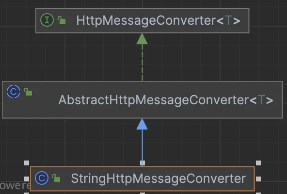

<a id="1c3eda9b0fe1817db460c37ddb032bfb"></a>

<br>따라서 해당 클래스의 canRead() 메서드를 찾아본 결과 아래와 같다&#46;

<a id="1c3eda9b0fe181d89522e604fa0dd5d6"></a>

```java
@Override
public boolean canRead(Class<?> clazz, @Nullable MediaType mediaType) {
	return supports(clazz) && canRead(mediaType);
}
```

<a id="1c3eda9b0fe1817e8980ff0671534dae"></a>

```java
protected boolean canRead(@Nullable MediaType mediaType) {
	if (mediaType == null) {
		return true;
	}
	for (MediaType supportedMediaType : getSupportedMediaTypes()) {
		if (supportedMediaType.includes(mediaType)) {
			return true;
		}
	}
	return false;
}
```

<a id="1c3eda9b0fe18148a320d753a39de9d0"></a>

위 코드를 보면 <strong><u>클래스 타입 </u></strong><u>과 </u><strong><u>미디어타입</u></strong><u>을 검증</u>하는 것을 확인할 수 있다&#46; 

</details>

</details>

<a id="1c3eda9b0fe18101b5f2d05648777207"></a>

## <strong>요청 매핑 헨들러 어뎁터 구조</strong>

- argument resolver
    <a id="1c3eda9b0fe181b7a41dcce38e8be2f0"></a>

    argument를 찾는 것 

<a id="1c3eda9b0fe1812f8d92f8409ed0d346"></a>

해당 argument resolver 중에서 http 메세지 바디에 있는 걸로 뭔가 처리해야 된다 라고 한다면 이때 메세지 컨버터가 호출된다&#46; 

<a id="1c3eda9b0fe181978144cf098b60d0e4"></a>

스프링에서 확장 포인트를 아는 것이 중요하다&#46;
