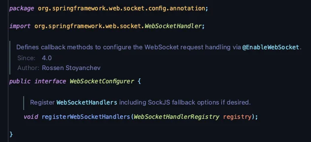

<details>
<summary>reference</summary>

<a id="1c3eda9b0fe18104951fc97723856c69"></a>

‣

<a id="1c3eda9b0fe1810c8a31eba9426106c4"></a>

‣<br><br>

</details>

<a id="1c3eda9b0fe181a2b034f5c09d7c8f37"></a>

## WebSocketConfigurer

---

> 📖 
> 
> <a id="1c3eda9b0fe181b597cedb3e99c49b21"></a>
> 
> WebSocketConfigurer는 Spring Framework에서 WebSocket 설정을 구성하기 위해 제공되는 인터페이스이다&#46;

<details>
<summary><strong>WebSocketConfigurer</strong></summary>



- 패키지&#58; <code>org&#46;springframework&#46;web&#46;socket&#46;config&#46;annotation</code>

- 인터페이스&#58; <code>WebSocketConfigurer</code>

- 주요 메서드
    - <code>registerWebSocketHandlers(WebSocketHandlerRegistry registry)</code>

<a id="1c3eda9b0fe18193896fdfaf1a334db7"></a>

<u>WebSocketConfigurer 인터페이스</u>는 일반적으로 <code>&#64;EnableWebSocket</code> 과 함꼐 사용되거나 Java 기반 구성 클래스에서 WebSocketConfigurer를 확장하여 사용한다&#46;

<a id="1c3eda9b0fe1816ab393de2d88403e82"></a>

이를 통해 <strong><u>클라이언트가 연결</u></strong>할 수 있는 <strong>WebSocket 엔드포인트</strong>를 <u>사용자 정의하고 등록</u>할 수 있다&#46;

</details>

<details>
<summary>주요 구성 요소 </summary>

- <code>WebSocketHandlerRegistry</code>
    - <u>WebSocket 핸들러를 등록</u>하고, <u>엔드포인트 매핑</u> 및 <u>구성 옵션을 설정</u>할 수 있는 레지스트리

- <code>WebSocketHandler</code>
    - WebSocket 메세지를 처리하는 핵심 인터페이스 

    - 해당 인터페이스의 구현체는 <strong><u>메시지를 수신, 전송</u></strong>하거나 <strong><u>연결 상태가 변경</u></strong>될 때의 <u>동작을 정의</u>함

- <code>Intercepter</code>
    - WebSocket HandShake 요청을 가로채어 인증, 로깅 또는 헤더 수정과 같은 사용자 정의 처리를 수행할 수 있는 구성요소 

</details>

<details>
<summary>사용법</summary>

> WebSocketConfigurer를 사용하여 Spring 애플리케이션에서 간단한 WebSocket 엔드포인트를 설정법

<details>
<summary>1&#46; 의존성 추가 &#45; Gradle</summary>


</details>

<details>
<summary>2&#46; WebSocket 핸들러 생성</summary>

<a id="1c3eda9b0fe1814d92b6d6e3dca0f977"></a>

<u><code>WebSocketHandler</code></u><u> 인터페이스</u>를 구현하거나 <code>TextWebSocketHandler</code>와 같은 구현체를 확장하여 생성 

<details>
<summary>ex) </summary>

<a id="1c3eda9b0fe1815681bfeb7a6747ac3e"></a>

```java
import org.springframework.web.socket.TextMessage;
import org.springframework.web.socket.WebSocketSession;
import org.springframework.web.socket.handler.TextWebSocketHandler;

public class MyWebSocketHandler extends TextWebSocketHandler {

    @Override
    public void afterConnectionEstablished(WebSocketSession session) throws Exception {
        // 연결이 설정된 후 호출됨
        session.sendMessage(new TextMessage("연결이 설정되었습니다."));
    }

    @Override
    protected void handleTextMessage(WebSocketSession session, TextMessage message) throws Exception {
        // 수신 메시지 처리
        String payload = message.getPayload();
        // 수신한 메시지를 에코
        session.sendMessage(new TextMessage("에코: " + payload));
    }

    // handleTransportError, afterConnectionClosed 등의 메서드를 오버라이드 할수 있음
    }
```

</details>

</details>

<details>
<summary>3&#46; <strong>WebSocketConfigurer 구현</strong></summary>

<a id="1c3eda9b0fe181648affeab8dfe6fe49"></a>

WebSocket 핸들러를 등록하기 위해 <code>WebSocketConfigurer</code>를 구현하는 구성 클래스를 생성

<a id="1c3eda9b0fe1815c9f05c6155ed93f29"></a>

```java
import org.springframework.context.annotation.Configuration;
import org.springframework.web.socket.config.annotation.EnableWebSocket;
import org.springframework.web.socket.config.annotation.WebSocketConfigurer;
import org.springframework.web.socket.config.annotation.WebSocketHandlerRegistry;

@Configuration
@EnableWebSocket
public class WebSocketConfig implements WebSocketConfigurer {

    private final MyWebSocketHandler myWebSocketHandler;

    public WebSocketConfig(MyWebSocketHandler myWebSocketHandler) {
        this.myWebSocketHandler = myWebSocketHandler;
    }

    @Override
    public void registerWebSocketHandlers(WebSocketHandlerRegistry registry) {
        registry.addHandler(myWebSocketHandler, "/ws-endpoint")
                .setAllowedOrigins("*") // 모든 출처 허용; 필요에 따라 조정
                .withSockJS(); // SockJS 폴백 옵션 활성화
    }
}
```

- <code>&#64;Configuration</code>&#58; 해당 클래스가 구성 클래스임을 표시

- <code>&#64;EnableWebSocket</code><strong>&#58; WebSocket 지원 활성화</strong>

- <code>registerWebSocketHandlers</code>
    - WebSocket 핸들러를 등록하고 특정 URL 경로에 매핑

- <code>addHandler</code>
    - 지정된 경로 (/ws&#45;endpoint)에서 WebSocket 연결을 처리할 핸들러를 추가

- <code>setAllowedOrigins</code>
    - 교차 출처 요청을 허용할 출처를 지정

    - <code>&#34;&#42;&#34;</code>는 모든 출처를 허용하지만, 보안을 위해 허용된 출처를 지정하는 것이 권장된다&#46;

- <code>withSockJS</code>
    - 네이티브 WebSocket을 지원하지 않는 브라우저를 위한 SockJS 폴백 옵션 활성화 

    - 주요 키워드&#58; <code>WebSocket 에뮬레이션 (Emulation)</code>, <code>SockJS</code>

</details>

<details>
<summary>4&#46; <strong>SockJS 구성 (선택 사항)</strong></summary>

- SockJS는 네이티브 WebSocket을 지원하지 않는 브라우저를 위한 폴백 옵션을 제공한다&#46;

- SockJS를 사용하는 경우 클라이언트 측 코드가 호환되도록 해야함&#46;

</details>

<details>
<summary>5&#46; 클라이언트 측 구현</summary>

- 네이티브 WebSocket API를 사용하여 WebSocket 엔드포인트에 연결하는 간단한 JavaScript 예제

<details>
<summary>ex) WebSocket</summary>

<a id="1c3eda9b0fe181f59fdff29684f70258"></a>

```java
const socket = new WebSocket('ws://localhost:8080/ws-endpoint');

socket.onopen = function(event) {
    console.log('WebSocket 연결이 설정되었습니다.');
    socket.send('안녕하세요, 서버!');
};

socket.onmessage = function(event) {
    console.log('서버로부터 수신:', event.data);
};

socket.onclose = function(event) {
    console.log('WebSocket 연결이 종료되었습니다.');
};

socket.onerror = function(error) {
    console.error('WebSocket 오류:', error);
};
```

</details>

<details>
<summary>ex) SockJS</summary>

<a id="1c3eda9b0fe181a9ad24c879390e6b42"></a>

```java
const sock = new SockJS('/ws-endpoint');

sock.onopen = function() {
    console.log('SockJS 연결이 설정되었습니다.');
    sock.send('안녕하세요, 서버!');
};

sock.onmessage = function(e) {
    console.log('서버로부터 수신:', e.data);
};

sock.onclose = function() {
    console.log('SockJS 연결이 종료되었습니다.');
};
```

</details>

</details>

<details>
<summary>6&#46; 고급 구성</summary>

<details>
<summary><strong>인터셉터 추가</strong></summary>

<a id="1c3eda9b0fe181e09a68fb5a7f8cbbf4"></a>

WebSocket 핸드셰이크 동안 인증과 같은 작업을 처리하기 위해 인터셉터를 추가할 수 있다&#46;

<a id="1c3eda9b0fe181ed972ed7671da0dfaa"></a>

```java
import org.springframework.web.socket.server.support.HttpSessionHandshakeInterceptor;

// ...

@Override
public void registerWebSocketHandlers(WebSocketHandlerRegistry registry) {
    registry.addHandler(myWebSocketHandler, "/ws-endpoint")
            .addInterceptors(new HttpSessionHandshakeInterceptor())
            .setAllowedOrigins("https://yourdomain.com")
            .withSockJS();
}
```

</details>

<details>
<summary><strong>STOMP를 사용한 메시징</strong></summary>

<a id="1c3eda9b0fe181b9b3c2ef7f69ae67f8"></a>

<u>더 복잡한 메시징 패턴</u>을 위해 STOMP를 WebSocket 위에서 사용할 수 있다&#46;

<a id="1c3eda9b0fe1815db9b7fd66cca15c3b"></a>

이는 <code>MessageBrokerRegistry</code>와 <code>&#64;EnableWebSocketMessageBroker</code>를 사용하는 추가 구성이 필요하다&#46;

<a id="1c3eda9b0fe1815598ecd1bb14e744bb"></a>

```java
import org.springframework.context.annotation.Configuration;
import org.springframework.messaging.simp.config.MessageBrokerRegistry;
import org.springframework.web.socket.config.annotation.*;

@Configuration
@EnableWebSocketMessageBroker
public class StompWebSocketConfig implements WebSocketMessageBrokerConfigurer {

    @Override
    public void registerStompEndpoints(StompEndpointRegistry registry) {
        registry.addEndpoint("/stomp-endpoint")
                .setAllowedOrigins("https://yourdomain.com")
                .withSockJS();
    }

    @Override
    public void configureMessageBroker(MessageBrokerRegistry registry) {
        registry.enableSimpleBroker("/topic", "/queue"); // 인메모리 브로커
        registry.setApplicationDestinationPrefixes("/app");
    }
}
```

- <code>&#64;EnableWebSocketMessageBroker</code>&#58; 메시지 브로커를 기반으로 WebSocket 메시지 처리를 활성화

- <code>registerStompEndpoints</code>&#58; 클라이언트가 연결할 수 있는 STOMP 엔드포인트를 등록

- <code>configureMessageBroker</code>&#58; 수신 및 송신 메시지의 목적지 접두사를 설정하고, 인메모리 브로커를 활성화

</details>

</details>

</details>

<details>
<summary>주의점</summary>

- 보안
    - <code>&#34;&#42;&#34;</code> 대신 허용된 출처를 명시적으로 지정

    - WebSocket 엔드포인트를 보호하기 위해 인증 및 권한 부여 메커니즘을 구현

    - 프로덕션 환경에서는 보안 WebSocket (wss&#58;//)을 사용

- 확장성
    - 대규모 애플리케이션의 경우, 단순한 인메모리 브로커 대신 RabbitMQ 또는 Kafka와 같은 전용 메시지 브로커를 고려

    - SockJS와 STOMP를 사용하여 폴백 및 복잡한 메시징 패턴 처리

- 오류
    - WebSocketHandler 내에서 적절한 오류 처리를 구현 → 예외 관리 및 연결 안정성 유지

- 자원관리
    - 고트래픽 애플리케이션에서 자원 누수를 방지하기 위해 WebSocket 세션을 모니터링하여 관리

</details>

---

<details>
<summary>&#91; 코드 &#93; WebSocketConfigurer 인터페이스 구현</summary>

<a id="1c3eda9b0fe1817d91ccc136e59d00dc"></a>

```java
@Configuration
@EnableWebSocket
public class WebSocketConfig implements WebSocketConfigurer {

    private final MyWebSocketHandler myWebSocketHandler;

    public WebSocketConfig(MyWebSocketHandler myWebSocketHandler) {
        this.myWebSocketHandler = myWebSocketHandler;
    }   
    
    @Override
    public void registerWebSocketHandlers(WebSocketHandlerRegistry registry) {
        registry.addHandler(myWebSocketHandler, "/ws-endpoint")
                .setAllowedOrigins("*") // 모든 출처 허용; 필요에 따라 조정
                .withSockJS(); // SockJS 폴백 옵션 활성화
    }
}
```

</details>
