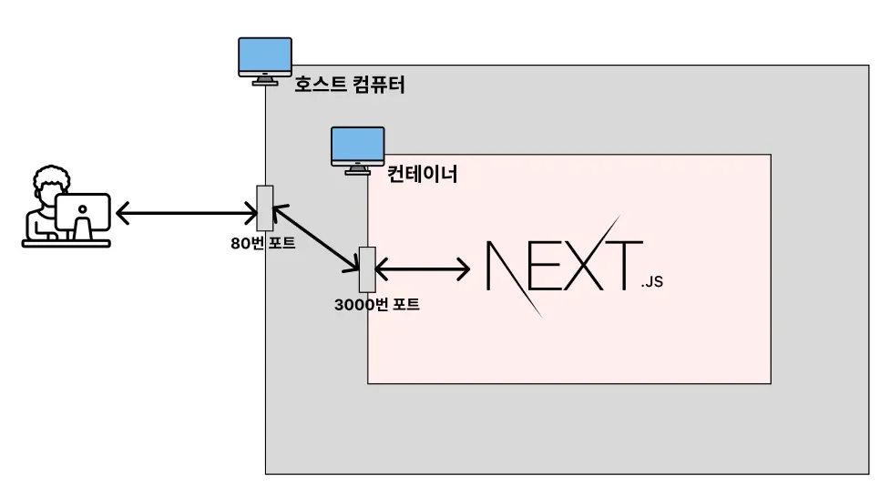
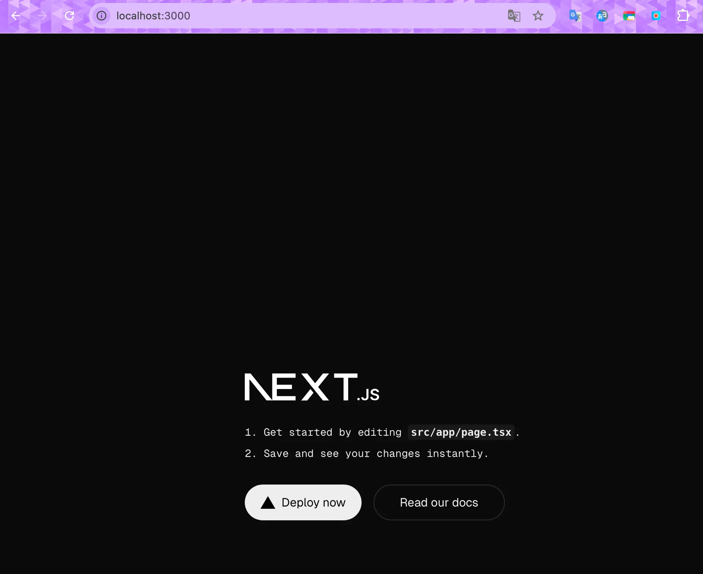

<a id="1c3eda9b0fe1818484acda64103fde3d"></a>

## 웹 프론트엔드 프로젝트(Next&#46;js) Docker로 배포

---



1. <strong>Next&#46;js 프로젝트 생성 </strong>
    <a id="1c3eda9b0fe181bb9067efdce3ea150b"></a>

    ```bash
    npx create-next-app@latest
    ```

1. <strong><code>Dockerfile</code></strong> 작성
    <a id="1c3eda9b0fe1811a9694d38023f67ab2"></a>

    ```docker
    FROM node:20-alpine

    WORKDIR /app

    COPY . .

    RUN npm install

    RUN npm run build

    EXPOSE 3000

    ENTRYPOINT [ "npm", "run", "start" ]
    ```

    - <code>alpine</code> 
        - 불필요한 프로그램을 포함하지 않고 이미지 크기를 최소화한 버전

        - 실제 배포 할 때도 되도록이면 <code>alpine</code> 버전을 사용한다&#46; 

1. &#46;<strong><code>dockerignore</code></strong> 작성
    <a id="1c3eda9b0fe18149917adbbb966e288a"></a>

    ```docker
    node_modules
    ```

    <a id="1c3eda9b0fe1819c808eeaa4974965e2"></a>

    이미지 생성 시, npm install을 통해 필요한 의존성을 설치한다&#46; <br>따라서 호스트 컴퓨터에 있는 <code>node&#95;modules</code>는 컨테이너로 복사할 필요가 없다&#46; 

1. 이미지 빌드, 실행
    <a id="1c3eda9b0fe181d69db8d588e44b6d09"></a>

    ```bash
    docker build -t my-web-server .

    docker image ls

    docker run -d -p 3000:3000 my-web-server

    docker ps
    ```

1. <strong><a href="http://localhost:80">localhost&#58;80</a></strong><strong> 접속</strong>
    

1. <strong>실행시킨 컨테이너 중지 / 삭제, 이미지 삭제</strong>
    <a id="1c3eda9b0fe18132a139ee128978b819"></a>

    ```bash
    docker stop {컨테이너 ID}
    docker rm {컨테이너 ID}
    docker image rm {이미지 ID}
    ```
