<a id="1c3eda9b0fe181dcace4da3aa99e8178"></a>

## Docker로 MySQL 실행

---

<a id="1c3eda9b0fe18142bfb6c485769fdad0"></a>

### &#91; Volume ❌ &#93;Docker로 <code>MySQL</code> 실행 

<details>
<summary>dockerhub  &#45; mysql</summary>

[mysql &#45; Official Image &#124; Docker Hub]()

</details>

<details>
<summary><strong>1&#46; MySQL 이미지를 바탕으로 컨테이너 실행</strong></summary>

> 💡 
> 
> <a id="1c3eda9b0fe18194a3f9e44679c39461"></a>
> 
> <code>docker pull</code> 생략 가능
> 
> - <code>docker run</code> 시, 해당하는 이미지가 없다면 Dockerhub에서 다운 받아 실행함

<a id="1c3eda9b0fe181128528d49a11e8848f"></a>

```docker
docker run -e MYSQL_ROOT_PASSWORD=password123 -p 3306:3306 -d mysql
```

<details>
<summary><code>&#45;e</code>&#58; 환경 변수 설정</summary>

<details>
<summary>Dockerhub의 MySQL 공식 문서를 보면 환경 변수로 <code>MYSQL&#95;ROOT&#95;PASSWORD</code>를 정해주어야만 정상적으로 컨테이너가 실행된다고 적혀있다&#46;</summary>

- ‣

</details>

<details>
<summary>환경변수  확인</summary>

<a id="1c3eda9b0fe1812e8c1de23f98540a11"></a>

```bash
docker exec -it [MySQL 컨테이너 ID] bash

echo $MYSQL_ROOT_PASSWORD # MYSQL_ROOT_PASSWORD라는 환경변수 값 출력

export # 설정되어 있는 모든 환경변수 출력
```

</details>

</details>

</details>

<details>
<summary>2&#46; 컨테이너 실행 확인</summary>

<a id="1c3eda9b0fe1813c8298f2ac814091f0"></a>

```bash
docker ps
```

</details>

<details>
<summary>3&#46; 컨테이너 실행시킬 때 에러 없이 잘 실행 됐는지 로그 확인</summary>

<a id="1c3eda9b0fe181739a6ee787610d3fbe"></a>

```bash
$ docker logs [컨테이너 ID 또는 컨테이너명]
```

</details>

<details>
<summary><strong>4&#46; DBeaver 연결 확인</strong></summary>

<details>
<summary>🤬 오류 &#45; <strong>Public Key Retrieval is not allowed</strong></summary>

> ‣

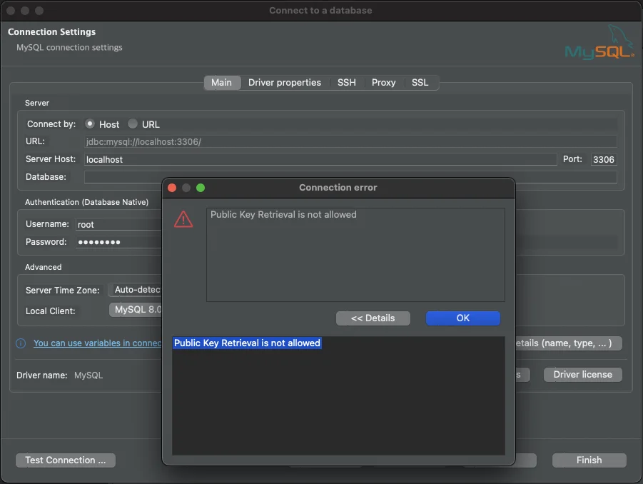

<a id="1c3eda9b0fe18146b05fc8124f00024d"></a>

<code>Driver</code> <code>properties</code> 옵션 변경

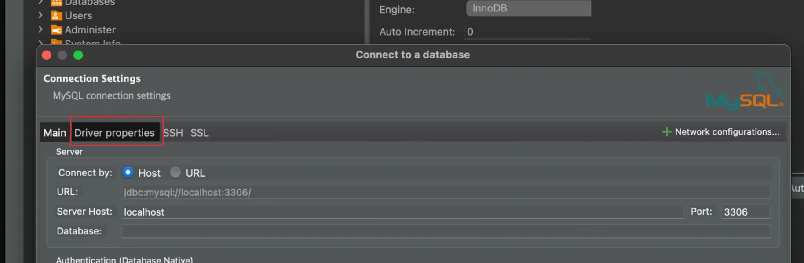

- useSSL&#58;  <code>false</code>
    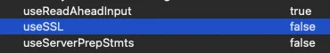

-  allow PublicKeyRetrieval&#58; <code>true</code>
    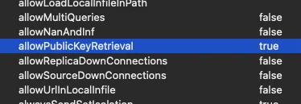

</details>

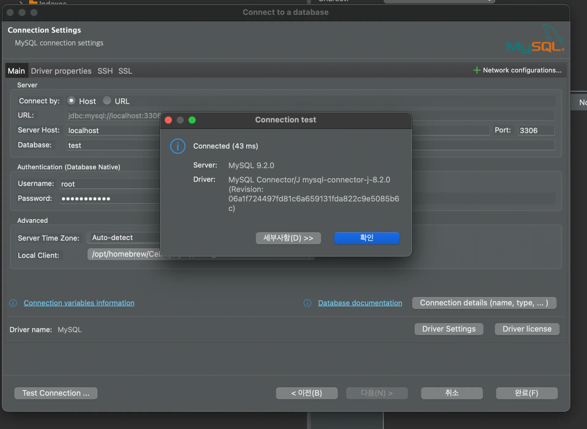

- 정상 연결 확인

</details>

> 컨테이너 MySQL 접속

<details>
<summary>MySQL 컨테이너 접속</summary>

<a id="1c3eda9b0fe1812592ead9bc9f3524f7"></a>

```bash
docker exec -it [MySQL 컨테이너 ID] bash
```

</details>

<details>
<summary>컨테이너 bash 에서 MySQL 접속</summary>

<a id="1c3eda9b0fe18188b241cd9593a97977"></a>

```bash
mysql -u root -p
```

- 패스워드 입력
    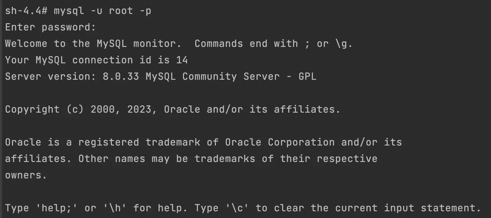

</details>

<details>
<summary>MySQL 접근에 성공 했다면 DB 조회</summary>

<a id="1c3eda9b0fe1810fa359f298f540a3c1"></a>

```bash
mysql> show databases;
```

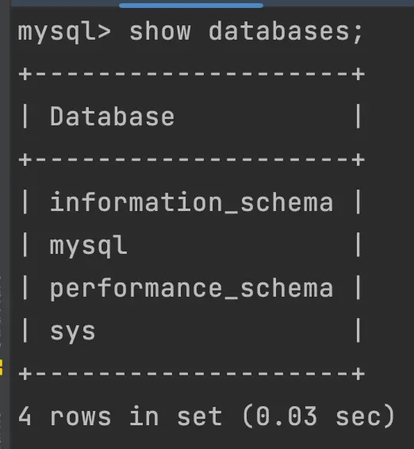

</details>

<details>
<summary>DB 생성</summary>

<a id="1c3eda9b0fe18159ac58d38837235bd8"></a>

```bash
# mydb DB 생성
mysql> create database mydb;

# 생성된 DB 조회
mysql> show databases;
```

</details>

<details>
<summary>컨테이너 재실행 후, 생성한 DB 확인 &#91; DB 영속성 ❌ &#93;</summary>

<a id="1c3eda9b0fe18193a413f26d4b8d7963"></a>

```bash
# 실행 중인 컨테이너 ID 확인
docker ps

# 컨테이너 종료 및 삭제
docker stop [MySQL 컨테이너 ID]
docker rm [MySQL 컨테이너 ID]


# 컨테이너 생성
docker run -e MYSQL_ROOT_PASSWORD=password123 -p 3306:3306 -d mysql

# 컨테이너 내부 bash 접속
docker exec -it [컨테이너 ID] bash

# mysql 접속 ->  password 입력
mysql -u root -p

# 전체 DB 조회
show databases;
  # 컨테이너 삭제 후 재생성 시, 이전에 생성한 DB가 조회되지 않음
```

- DB 조회 결과 
    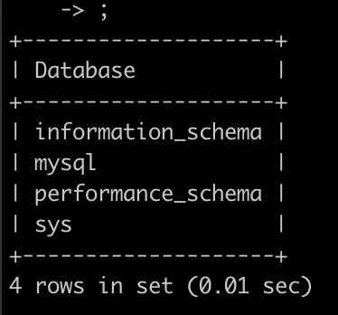

    - 이전 컨테이너에서 생성한 DB가 사라졌다&#46; 
        <a id="1c3eda9b0fe18100bb48cbc43b6a02da"></a>

        즉, 데이터에 대한 영속성이 지원되지 않는다&#46; 

</details>

<a id="1c3eda9b0fe181eabe2dda2381e99c9c"></a>

### &#91; Volume O  &#93; 볼륨(Volume)을 활용한 <code>MySQL</code> 컨테이너 띄우기

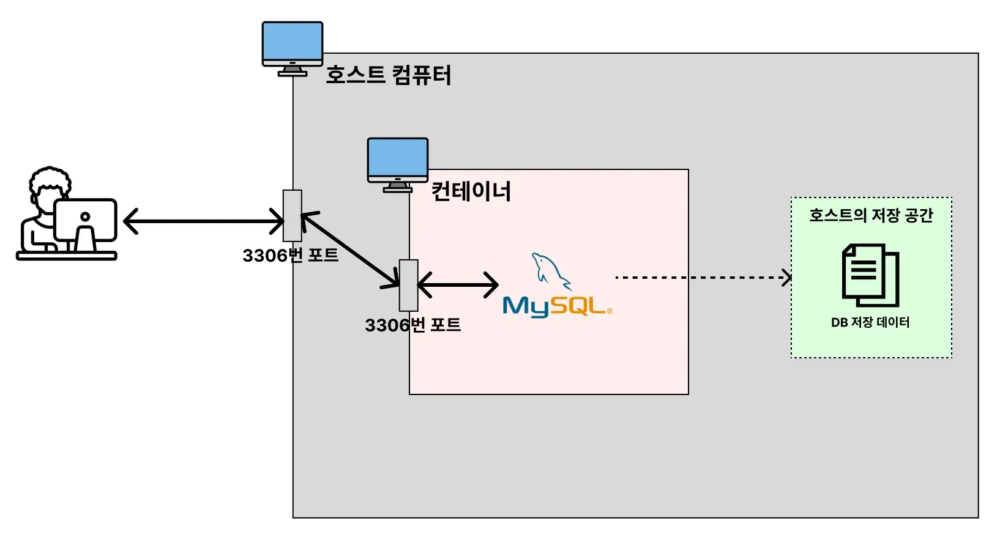

<details>
<summary>1&#46; MySQL 데이터를 저장할 volume 폴더 생성</summary>

<a id="1c3eda9b0fe181e28471c64862d1058d"></a>

```bash
cd /Users/{사용자이름}

mkdir Develop

# $(whoami): 현재 로그인한 사용자 계정명을 가져옴
cd /Users/$(whoami)/Develop
```

</details>

<details>
<summary>2&#46; mysql 컨테이너 실행 &#45; volume 설정 추가 </summary>

<a id="1c3eda9b0fe1814ba4bbec46ec5b4bc8"></a>

```bash
# 현재 폴더 경로 확인
pwd

# docker run -e MYSQL_ROOT_PASSWORD=password123 -p 3306:3306 -v {호스트의 절대경로}/mysql_data:/var/lib/mysql -d mysql
docker run -e MYSQL_ROOT_PASSWORD=password123 -p 3306:3306 -v /Users/igyeongseob/Develop/docker-mysql/mysql_data:/var/lib/mysql -d mysql

```

</details>

<details>
<summary>3&#46; 컨테이너 접속 및 DB 생성</summary>

<a id="1c3eda9b0fe1812a9a29d55035726981"></a>

```bash
# 컨테이너 ID 확인
docker ps 

# 컨테이너 내부 bash 접속
docker exec -it [컨테이너 ID] bash

# MySQL 접속
mysql -u root -p

# DB 생성
mysql> create database mydb;

# 전체 DB 조회
mysql> show databases;
```

- DB 생성 확인
    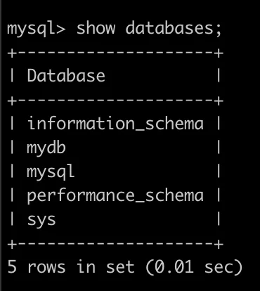

</details>

<details>
<summary>4&#46; 컨테이너 삭제 후, 다시 생성하여 확인</summary>

<a id="1c3eda9b0fe1819eaf0bda10a04178c4"></a>

```bash
# 컨테이너 종료
docker stop [MySQL 컨테이너 ID]
docker rm [MySQL 컨테이너 ID]

# 비밀번호 바꿔서 컨테이너 생성
docker run -e MYSQL_ROOT_PASSWORD=password1234 -p 3306:3306 -v /Users/igyeongseob/Develop/docker-mysql/mysql_data:/var/lib/mysql -d mysql

docker exec -it [MySQL 컨테이너 ID] bash
mysql -u root -p 

# DB 조회 
show databases;
```

- 이전 컨테이너에 생성한 DB 확인
    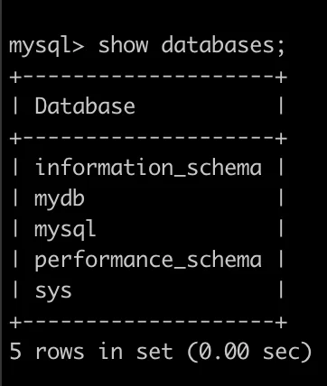

</details>

<details>
<summary><strong>🤬 오류</strong> &#45; password 변경 시, mysql 접속 오류 발생</summary>

<a id="1c3eda9b0fe181828a8fe4350202c0dd"></a>

```bash
# 컨테이너 종료
docker stop [MySQL 컨테이너 ID]
docker rm [MySQL 컨테이너 ID]

# 비밀번호 바꿔서 컨테이너 생성
docker run -e MYSQL_ROOT_PASSWORD=pwd1234 -p 3306:3306 -v /Users/igyeongseob/Develop/docker-mysql/mysql_data:/var/lib/mysql -d mysql

docker exec -it [MySQL 컨테이너 ID] bash
mysql -u root -p 

# DB 조회 
show databases;
```

- <strong><u>Volume으로 설정해둔 폴더</u></strong>에 <strong><u>이미 비밀번호 정보</u></strong>가 <strong><u>저장 </u></strong>되버렸기 때문에

- 새로 컨테이너 생성 시, <strong><u>mysql 비밀번호를 변경</u></strong>하면 <strong><u>mysql 연결이 되지 않</u></strong>는다&#46; 

</details>

> ⚠️ 
> 
> <a id="1c3eda9b0fe1813b9670f9088adf4dab"></a>
> 
> <strong>주의</strong>
> 
> <a id="1c3eda9b0fe18167b19bc9148196d8e1"></a>
> 
> <strong><u>mysql&#95;data 디렉토리</u></strong><strong>를 </strong><strong>미리 만들면 안</strong><strong>된다&#46;</strong>
> 
> <a id="1c3eda9b0fe18106bbf5c6d12917aaef"></a>
> 
> 그래야 처음 이미지를 실행시킬 때 mysql 내부에 있는 <code>/var/lib/mysql</code> 파일들을 호스트 컴퓨터로 공유받을 수 있다
> 
> -  <code>mysql&#95;data</code> 디렉토리를 미리 만들어놓을 경우, <u>기존 컨테이너의 </u><u><code>/var/lib/mysql</code></u><u> 파일들을 전부 삭제한 뒤에 </u><u><code>mysql&#95;data</code></u><u>로 덮어씌워 버린다&#46; </u>

<details>
<summary>🧐 왜 DB에 관련된 데이터가 저장되는 곳이 <code>/var/lib/mysql</code> 인가</summary>

-  Dockerhub MySQL의 공식 문서
    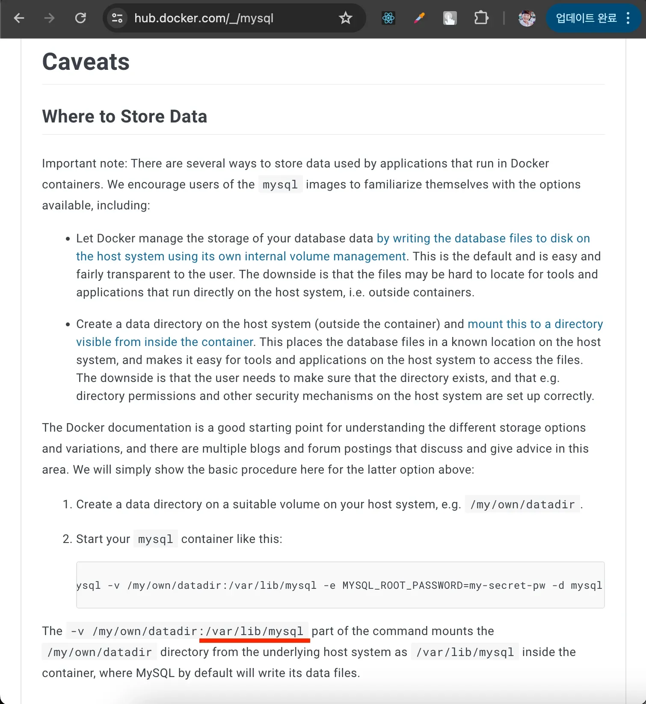

</details>

---
