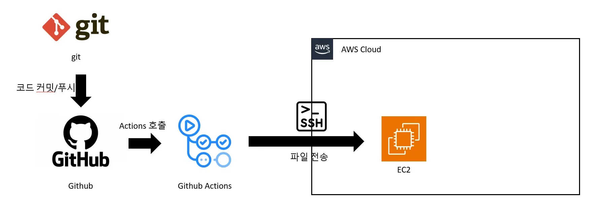
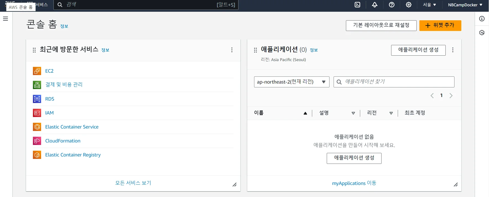
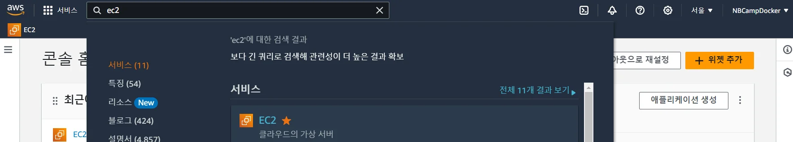
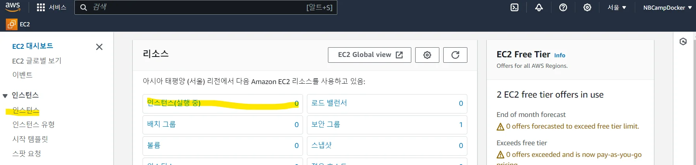
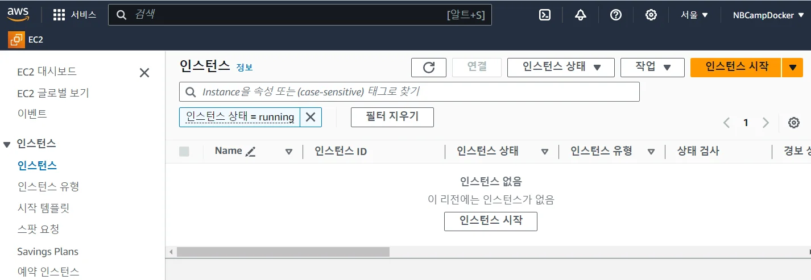
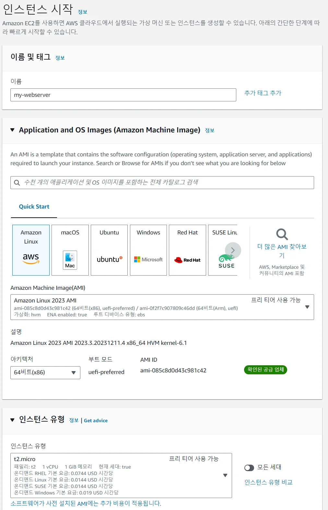
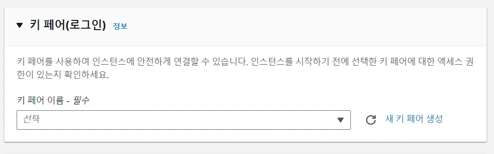
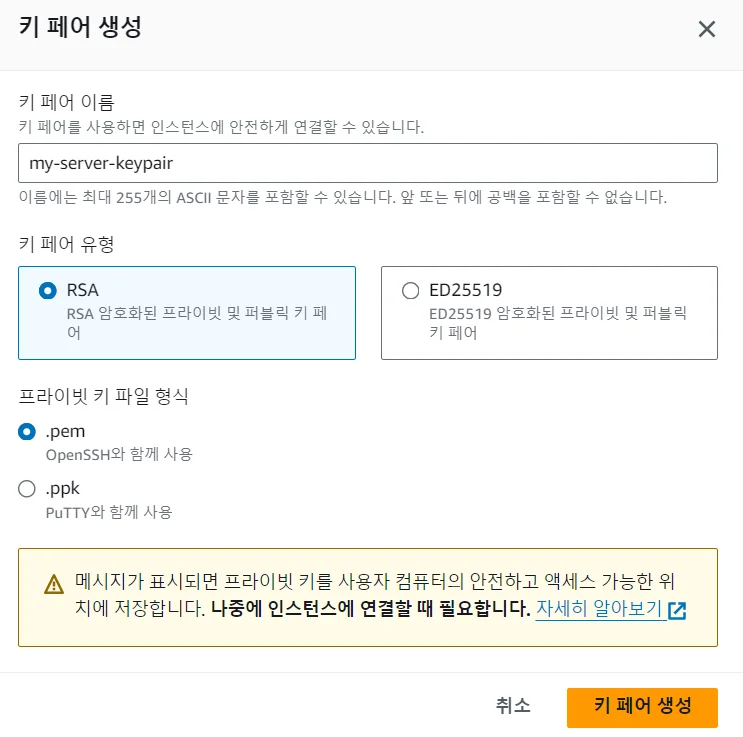
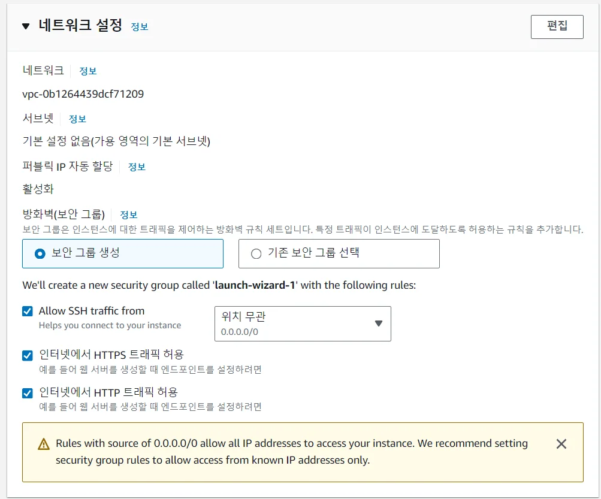

<a id="1c3eda9b0fe181acbf91c76a58f2b789"></a>

## Github Actions, Github repository, AWS ec2를 활용한 CI/CD

---



<details>
<summary>EC2 인스턴스 생성</summary>

<a id="1c3eda9b0fe18134902efb755f2d979a"></a>

<a href="#/post/1c3eda9b-0fe1-8191-816d-cc5d3d2a6d54">페이지</a> 

<details>
<summary>EC2 설정</summary>

- 왼쪽 위 검색창에서 ec2 를 입력 후 선택
    

    

    - 별표를 해서 자주 찾는 메뉴로 등록하시면 편리합니다&#46;

- ec2 화면에서 ‘인스턴스’ 를 선택
    

- 인스턴스 시작 버튼 클릭
    

- 인스턴스 생성 
    

    - 이름 &#58; <code>my&#45;server</code>

    - Amazon Machine Image(AMI) &#58; <code>Amazon Linux 2023 AMI</code>

    - 인스턴스 유형 &#58; <code>t2&#46;micro</code>

- 키 페어 생성
    

    - ‘새 키 페어 생성’ 클릭
        

    - 키 페어 이름 &#58; <code>my&#45;server&#45;keypair</code>

    - 키 페어 유형&#58; <code>RSA</code>

    - 프라이빗 키 파일 형식&#58; <code>pem</code>

    - ‘키 페어 생성’ 후 다운로드

- 네트워크 설정
    

    - <code>보안 그룹 생성</code> 선택

    - <code>Allow SSH traffic from</code> , ‘위치 무관’ 선택

    - <code>인터넷에서 HTTPS 트래픽 허용</code> 선택

    - <code>인터넷에서 HTTP 트래픽 허용</code> 선택

- <code>인스턴스 시작</code> 클릭

</details>

</details>

<details>
<summary>AWS EC2</summary>

1. EC2 터미널 접속

1. EC2에 jdk 설치
    <a id="1c3eda9b0fe18181915dcfc773dc9407"></a>

    ```bash
    sudo yum install -y java-17-amazon-corretto-devel
    ```

1. ec2에 docker, docker&#45;compose 설치
    <a id="1c3eda9b0fe181d1b0c8ed84d7f6f18e"></a>

    ```bash
    sudo yum install docker

    # Docker 서비스 시작
    sudo systemctl start docker

    # Docker 서비스 작동 상태 확인
    sudo systemctl status docker

    # Docker 서비스를 운영체제 부팅시 자동 시작하도록 설정
    sudo systemctl enable docker

    # docker 명령어를 sudo 없이 사용하기 위해 계정을 docker 그룹에 소속 (계정 재접속 필요)
    sudo usermod -aG docker ec2-user

    # docker-compose 설치
    sudo curl -L https://github.com/docker/compose/releases/latest/download/docker-compose-$(uname -s)-$(uname -m) -o /usr/local/bin/docker-compose

    # 권한 부여
    sudo chmod +x /usr/local/bin/docker-compose
    ```

</details>

<a id="1c3eda9b0fe181e5a382fc821221fdfe"></a>

### 서버  설정
