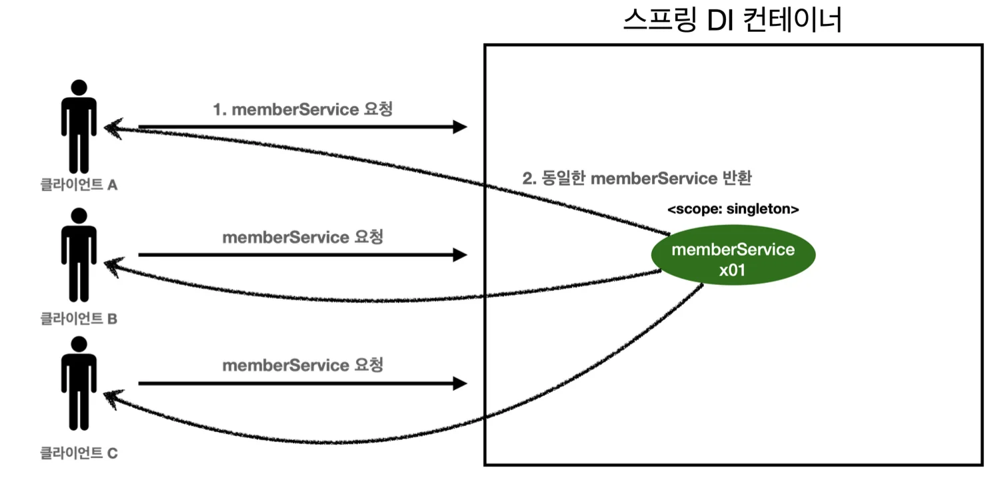
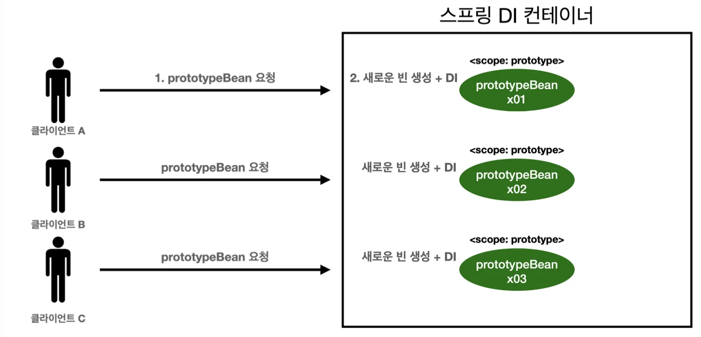
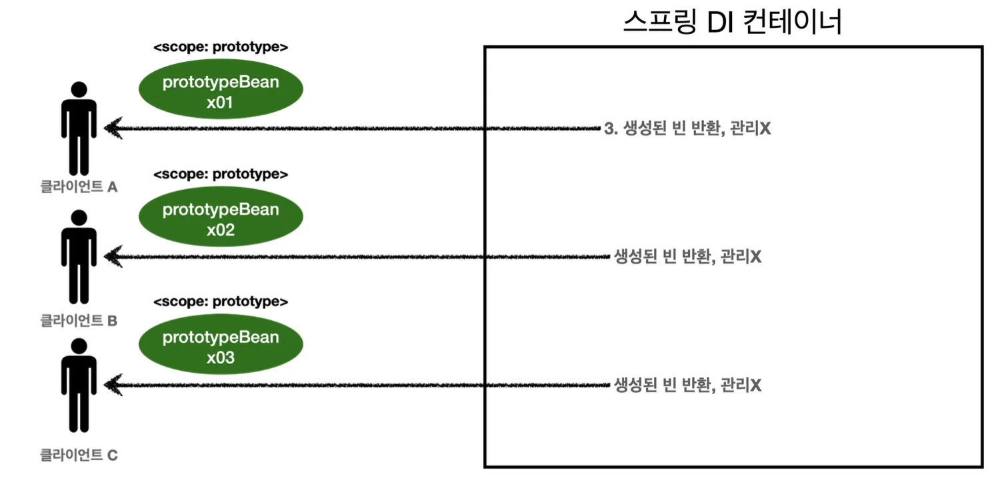

<a id="1c3eda9b0fe181ea86dac7c716f14399"></a>

싱글톤 스코프의 빈을 조회하면 스프링 컨테이너는 항상 같은 인스턴스의 스프링 빈을 반환한다&#46; 

<a id="1c3eda9b0fe181ee9bc6e3eddce981a3"></a>

반면, 프로토타입 스코프를 스프링 컨테이너에 조회하면 스프링 컨테이너는 항상 새로운 인스턴스를 생성해서 반환한다&#46;

<a id="1c3eda9b0fe181f697efd6da029960d7"></a>

###  싱글톤 빈 요청

---



> 1&#46; 싱글톤 스코프의 빈을 스프링 컨테이너에 요청한다&#46; <br>2&#46; 스프링 컨테이너는 본인이 관리하는 스프링 빈을 반환한다&#46;<br>3, 이후에 스프링 컨테이너에 같은 요청이 와도 같은 객체 인스턴스의 스프링 빈을 반환한다&#46; 

<a id="1c3eda9b0fe181e08bd6c8e5a8cde037"></a>

### 프로토타입 빈 요청

---



> 1&#46; 프로토타입 스코프의 빈을 스프링 컨테이너에 요청(조회)<br>2&#46; 스프링 컨테이너는 이 시점에서 프로토타입 빈을 생성하고, 필요한 의존관계를 주입함



> 3&#46; 생성한 프로토타입 빈을 클라이언트에 반환<br>4&#46; 이후에 스프링 컨테이너에 같은 요청이 오면 항상 새로운 프로토타입 빈을 생성해서 반환

> 👉🏻 <strong>프로토타입의 빈 요청</strong>에선 <strong>스프링 컨테이너가 프로토타입의 빈을 생성하고, 의존관계 주입, 초기화까지만 처리</strong>한다&#46;  <strong>클라이언트에 빈을 반환</strong>하고, <strong>이후 </strong><strong>스프링 컨테이너는 생성된 프로토타입 빈을 관리하지 않</strong>는다&#46; 프로토타입 빈을 관리할 책임은 해당 빈을 받는 클라이언트에 있다&#46; <br>→ <code>&#64;PreDestroy</code> 같은 <strong>종료 메서드가 호출되지 않</strong>는다&#46; 

<a id="1c3eda9b0fe1814dbfdfcccadc170293"></a>

### 싱글톤 스코프 빈 테스트

> <code>&#64;Configuration</code> →  <code>&#64;Scope(&#34;singleton&#34;)</code>

<a id="1c3eda9b0fe18189bf18f21e5cee6510"></a>

```java
package hello.core.scope;

import jakarta.annotation.PostConstruct;
import jakarta.annotation.PreDestroy;
import org.junit.jupiter.api.Test;
import org.springframework.context.annotation.AnnotationConfigApplicationContext;
import org.springframework.context.annotation.Scope;

import static org.assertj.core.api.Assertions.*;

public class SingletonTest {

    @Test
    void singletonBeanFInd(){
        AnnotationConfigApplicationContext ac = new AnnotationConfigApplicationContext(SingletonBean.class);
        SingletonBean singletonBean1 = ac.getBean(SingletonBean.class);
        SingletonBean singletonBean2 = ac.getBean(SingletonBean.class);
        System.out.println("singletonBean1 = " + singletonBean1);
        System.out.println("singletonBean2 = " + singletonBean2);
        assertThat(singletonBean1).isSameAs(singletonBean2);

        ac.close();
    }

    @Scope("singleton")
    static class SingletonBean {
        @PostConstruct
        public void init() {
            System.out.println("SingletonBean.init");
        }

        @PreDestroy
        public void destroy() {
            System.out.println("SingletonBean.destroy");
        }
    }

}
```

<a id="1c3eda9b0fe1812c8601ff9f6623bfc0"></a>

<strong>실행결과</strong>

<a id="1c3eda9b0fe181f9ad52e4b570bb25dd"></a>

```plaintext
 SingletonBean.init
 singletonBean1 = hello.core.scope.PrototypeTest$SingletonBean@54504ecd
 singletonBean2 = hello.core.scope.PrototypeTest$SingletonBean@54504ecd
 org.springframework.context.annotation.AnnotationConfigApplicationContext -
 Closing SingletonBean.destroy
```

<a id="1c3eda9b0fe181f8b973e210b9d3afc1"></a>

빈 초기화 메서드를 실행, 같은 인스턴스의 빈을 조회, 종료 메서드까지 정상 호출 되는 것을 확인ㄴ

<a id="1c3eda9b0fe181b58aa7f94dfb62b174"></a>

### 프로토타입 스코프 빈 테스트

> <code>&#64;Configuration</code> →  <code>&#64;Scope(&#34;prototype&#34;)</code>

<a id="1c3eda9b0fe181a0b82bcdb2e0a83f5d"></a>

```java
package hello.core.scope;

import jakarta.annotation.PostConstruct;
import jakarta.annotation.PreDestroy;
import org.junit.jupiter.api.Test;
import org.springframework.context.annotation.AnnotationConfigApplicationContext;
import org.springframework.context.annotation.Scope;

import static org.assertj.core.api.Assertions.assertThat;

public class PrototypeTest {
    @Test
    void prototypeBeanFind(){
        AnnotationConfigApplicationContext ac = new AnnotationConfigApplicationContext(PrototypeBean.class);
        System.out.println("find prototypeBean1");
        PrototypeBean prototypeBean1 = ac.getBean(PrototypeBean.class);

        System.out.println("find prototypeBean2");
        PrototypeBean prototypeBean2 = ac.getBean(PrototypeBean.class);

        System.out.println("prototypeBean1 = " + prototypeBean1);
        System.out.println("prototypeBean2 = " + prototypeBean2);
        assertThat(prototypeBean1).isNotSameAs(prototypeBean2);

        ac.close();
    }

    @Scope("prototype")
    static class PrototypeBean {
        @PostConstruct
        public void init() {
            System.out.println("PrototypeBean.init");
        }

        @PreDestroy
        public void destroy() {
            System.out.println("PrototypeBean.destroy");
        }
    }

}
```

<a id="1c3eda9b0fe18164959dfdd7171fa5c5"></a>

<strong>실행 결과</strong>

<a id="1c3eda9b0fe181d2a694f4f7d9dbed03"></a>

```plaintext
find prototypeBean1
PrototypeBean.init
find prototypeBean2
PrototypeBean.init
prototypeBean1 = hello.core.scope.PrototypeTest$PrototypeBean@2235eaab
prototypeBean2 = hello.core.scope.PrototypeTest$PrototypeBean@17503f6b
```

> 싱글톤 빈은 스프링 컨테이너 생성 시점에 초기화 메서드가 실행 되지만, <strong>프로토타입 스코프의 빈</strong>은 <strong>스프링 컨테이너에서 빈을 조회할 때 생성</strong>되고, 이때 <strong>초기화 메서드기실행</strong>된다&#46;<br><strong>프로토타입 빈을 2번 조회</strong>했으므로 <strong>완전히 다른 스프링 빈이 생성</strong>되고, <strong>초기화도 2번 실행</strong>된 것을 확인할 수 있다&#46;<br><br>또한 싱글톤 빈은 스프링 컨테이너가 관리하기 때문에 스프링 컨테이너가 종료될 때 빈의 종료 메서드가 실행되지만, <strong>프로토타입 빈</strong>은 <strong>스프링 컨테이너가 생성과 의존관계 주입 그리고 초기화 까지만 관여</strong>하고, 더는 관리하지 않는다&#46; 따라서 프로토타입 빈은 <strong>스프링 컨테이너가 종료될 때 종료 메서드(</strong><strong><code>&#64;PreDestroy</code></strong><strong>)가 실행되지 않</strong>는다&#46;

<a id="1c3eda9b0fe181da9a14cd753a996657"></a>

### <strong>프로토타입 빈의 특징 정리</strong>

---

<a id="1c3eda9b0fe181ca81e3c1bfcebbd1bb"></a>

스프링 컨테이너에 <strong>요청(조회)할 때 마다 해당 빈  새로 생성</strong>되며, 이때<strong> 초기화 메서드가 호출</strong>된다&#46;<br><strong>스프링 컨테이너</strong>는 <strong>프로토타입 빈의 생성과 의존관계 주입 그리고 초기화까지만 관여</strong>함 따라서 <strong><u>종료 메서드가 호출되지 않</u></strong>음<br>프로토타입 빈은 스프링 컨테이너에서 클라이언트에 해당 빈 전달 후 더이상 관리를 하지 않기 때문에, 프로토타입 빈을 조회한 <strong>클라이언트가 해당 빈을 관리</strong>해야 한다&#46; 따라서  <strong>종료 메서드에 대한 호출도 클라이언트가 직접 해</strong>야한다&#46;
