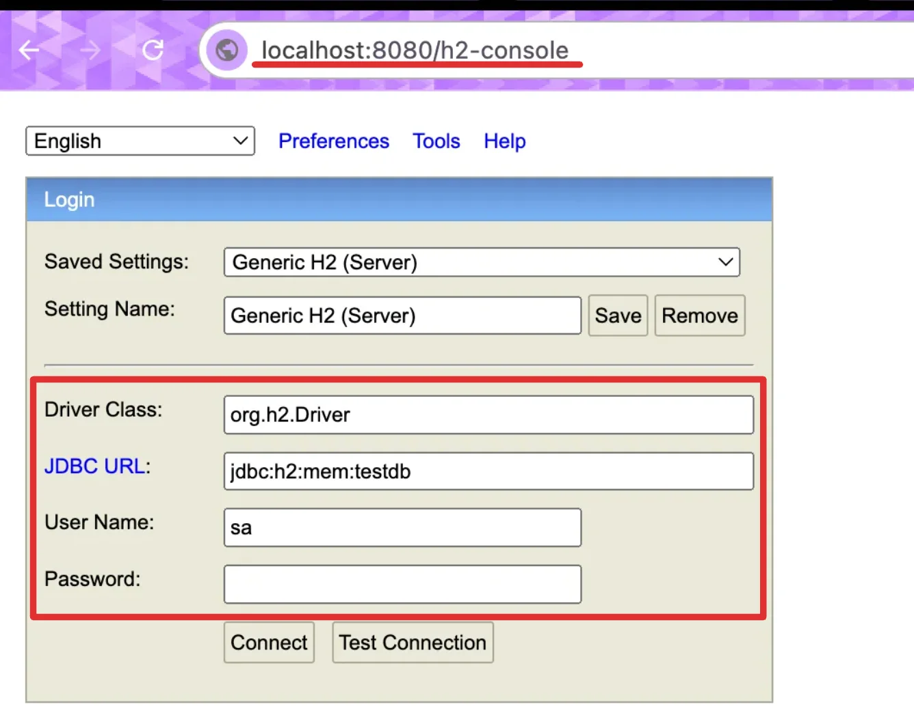
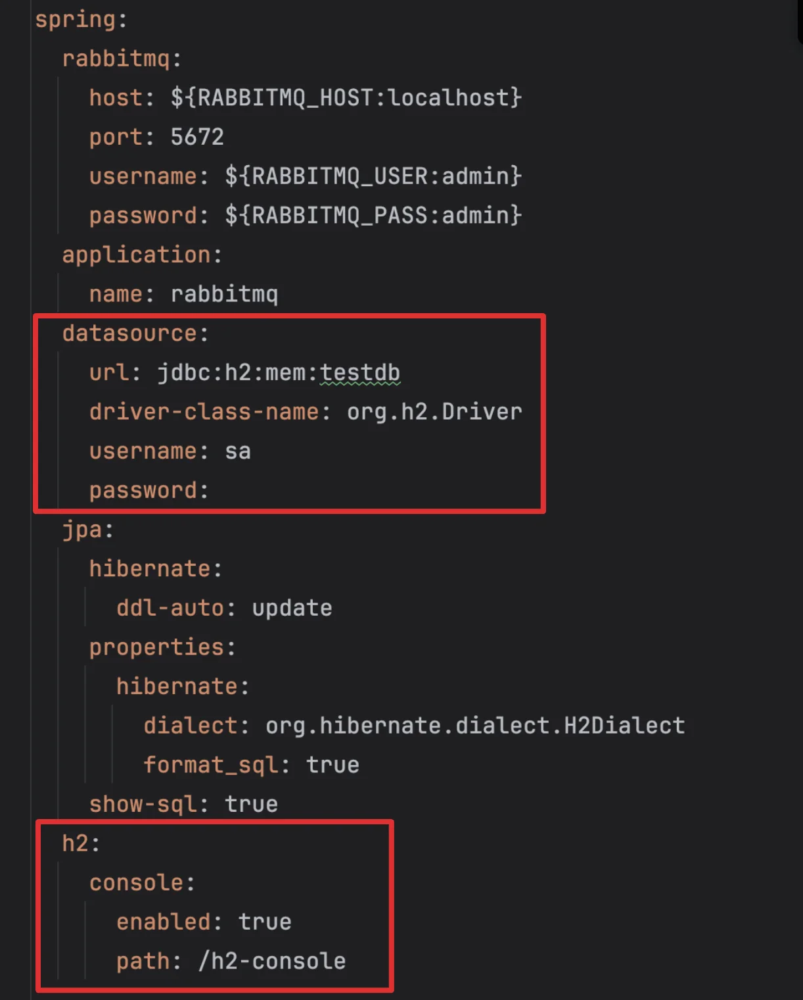
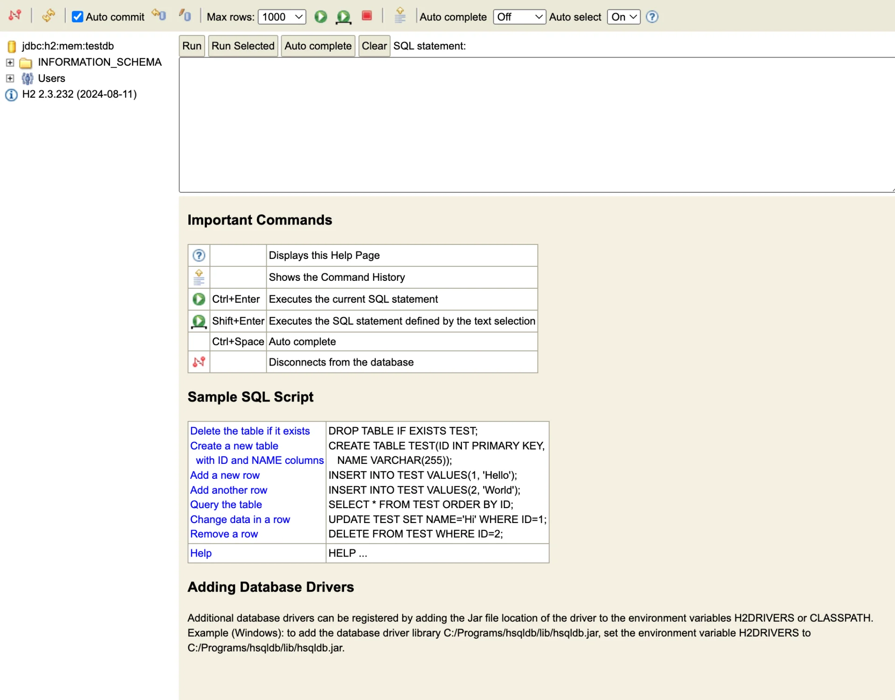

<a id="1c3eda9b0fe1811ab3a7e11a5042a974"></a>

## 스프링 부트, H2 연동

---

<details>
<summary>1&#46; 의존성 추가&#58; <code>build&#46;gradle</code></summary>

<a id="1c3eda9b0fe181a786b4efefc0d64fe9"></a>

```groovy
implementation 'org.springframework.boot:spring-boot-starter-data-jpa' // JPA 의존성
runtimeOnly 'com.h2database:h2' // H2 데이터베이스 의존성
```

</details>

<details>
<summary>2&#46; h2 설정 정보 입력&#58; <code>application&#46;yml</code></summary>

<a id="1c3eda9b0fe181058e47f3bdedb2f348"></a>

```yaml
spring:
  rabbitmq:
    host: ${RABBITMQ_HOST:localhost}
    port: 5672
    username: ${RABBITMQ_USER:admin}
    password: ${RABBITMQ_PASS:admin}
  application:
    name: rabbitmq
  datasource:
    url: jdbc:h2:mem:testdb
    driver-class-name: org.h2.Driver
    username: sa
    password:
  jpa:
    hibernate:
      ddl-auto: update
    properties:
      hibernate:
        dialect: org.hibernate.dialect.H2Dialect
        format_sql: true
    show-sql: true
  h2:
    console:
      enabled: true
      path: /h2-console

server:
  port: 8080
```

</details>

<details>
<summary>3&#46; h2 console 로그인</summary>





- <code>h2&#46;console&#46;path</code> 로 console path 설정
    - 아래 예시에서는 <code>localhost&#58;8080/h2&#45;console</code> 을 통해 <strong><u>h2 콘솔</u></strong> 접속

- datasource에 정의한 <code>url</code>, <code>driver&#45;class&#45;name</code>, <code>username</code>, <code>password</code>를 입력하여 콘솔 로그인



</details>
