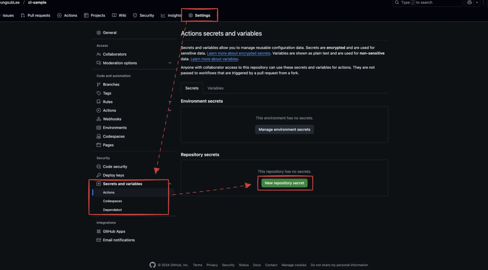
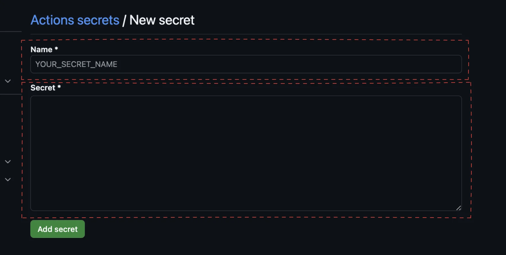
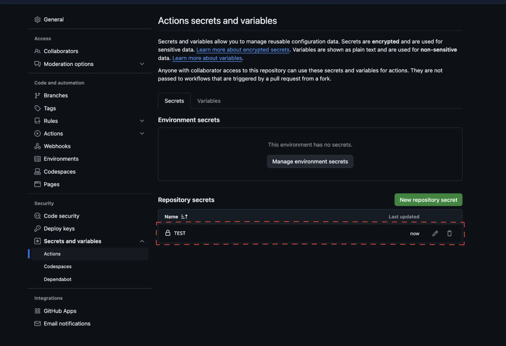
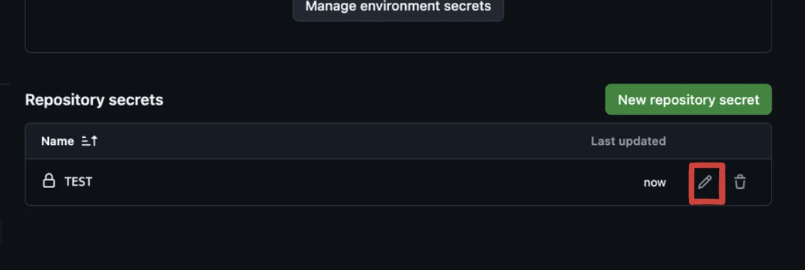
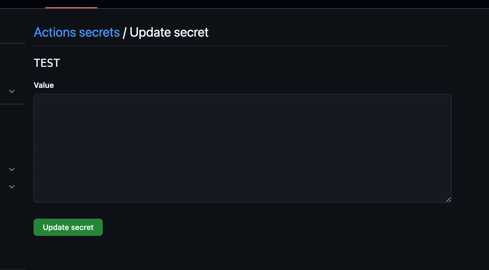

> <a href="#/post/1c3eda9b-0fe1-8114-a6b3-c20271564094">페이지</a> 

## Gitbub에서 action의 환경변수 설정하기 

---

### 환경변수 설정

1&#46; 환경변수 설정 화면으로 이동

- 환경변수를 설정하고자 하는 repository로 이동

- setting &#45; Secrets and variables 
    - Actaions &#45; <code>&#46;github/workspaces/&#46;yml</code>의 환경 변수 

    - Codespaces

    - Dependbot

- new repository secret 클릭

2&#46;  환결변수 설정 &#45; 환경 변수의 key, value 값 정의

3&#46; 아래와 같이 생성한 변수들의 목록을 확인 가능

### 환경변수의 value 값 업데이트 

1&#46; 수정 버튼 클릭

2&#46; value 값 업데이트 

- 이전에 생성한 값은 다시 볼 수 없음, 덮어쓰기

