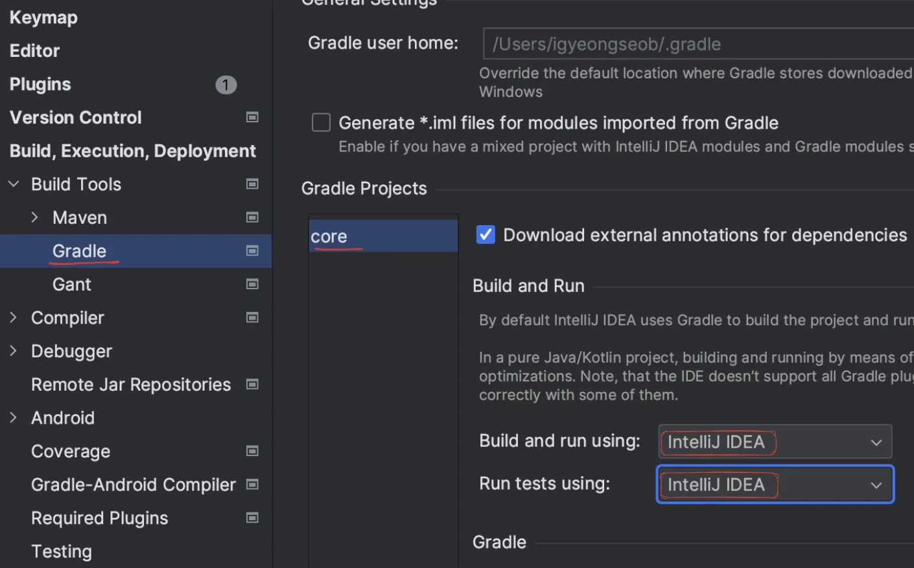
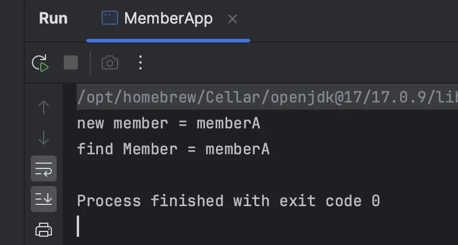
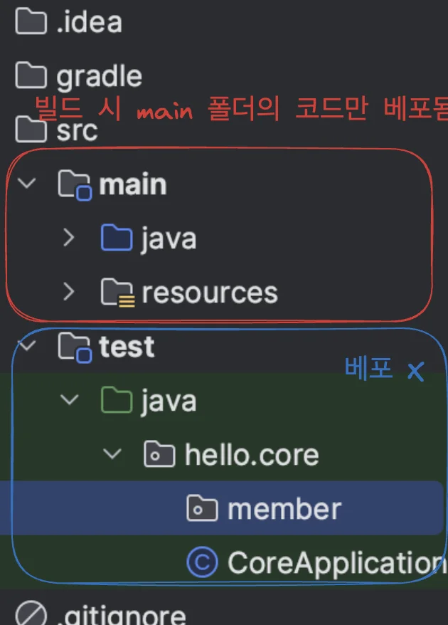
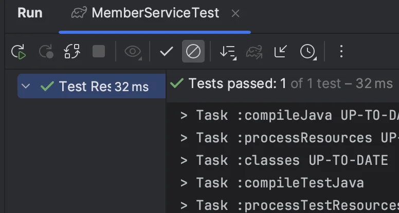
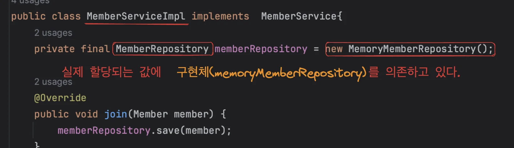

> 테스트 코드는 선택이 아니다&#46; 필수로 작성법을 알아야 한다&#46; 

<a id="1c3eda9b0fe18140a751f2a652e8a9f2"></a>

## 순수한 자바 → 테스트 

> 스프링 없이 순수한 자바 코드로만 테스트 진행<br>메인 메서드로 테스트하는 것은 한계가 있다&#46; (좋은 방법 아님)<br>→ <strong>Junit 테스트 프레임 워크 사용 권장</strong>

<a id="1c3eda9b0fe181c78234faef128c0006"></a>

### &#91; Error &#93;  <code>Process &#39;command &#39;&#46;&#46;&#46; &#39; finished with non&#45;zero exit value 1</code>

> 1번만으로 해결됨, <a href="https://velog.io/@blackbean99/Java-finished-with-non-zero-exit-value-1-%EC%97%90%EB%9F%AC-%ED%95%B8%EB%93%A4%EB%A7%81">링크 </a>참조

<details>
<summary><strong>1&#46; 빌드 환경 IntelliJ IDEA로 설정</strong></summary>



</details>

<details>
<summary><strong>2&#46; Java Version 설정</strong></summary>

<a id="1c3eda9b0fe181c79aeedd2187634fb2"></a>

<code>java &#45;&#45;verion</code> 를 입력해서 나온 버전과 JVM Version을 같게 설정

</details>

<a id="1c3eda9b0fe181038adbc1f347d22120"></a>

### MemberApp

<a id="1c3eda9b0fe181bfbe52fb1fa827ba77"></a>

```java
package hello.core;

import hello.core.member.Grade;
import hello.core.member.Member;
import hello.core.service.MemberService;
import hello.core.service.MemberserviceImpl;

public class MemberApp {
    public static void main(String[] args) {
        MemberService memberService = new MemberserviceImpl();
        Member member = new Member(1L, "memberA", Grade.VIP); .
        memberService.join(member);

        Member findMember = memberService.findMember(1L);
        System.out.println("new memebr = " + member.getName());
        System.out.println("findMember.getName() = " + findMember.getName());
    }
}
```

- 테스트 success



> <code>1L</code>은 <strong>long 타입</strong>이어서 <code>L</code>을 붙임, 그냥 <strong><u>1만 쓰면 컴파일 오류</u></strong>남

<a id="1c3eda9b0fe181bd8449e9beb40bd8ff"></a>

## Junit을 통한 테스트 (권장)

<details>
<summary>build 시, main 폴더의 코드만 베포됨</summary>



</details>

<a id="1c3eda9b0fe181a98692ec2bd981f94b"></a>

### MemberServiceTest

<a id="1c3eda9b0fe181c7aa52d3cc7f68934a"></a>

```java
package hello.core.member;

import hello.core.service.MemberService;
import hello.core.service.MemberserviceImpl;
import org.junit.jupiter.api.Assertions.*;
import org.junit.jupiter.api.Test;

public class MemberServiceTest {
    MemberService memberService = new MemberserviceImpl();

    @Test
    void join() {
        //given
        Member member = new Member(1L, "memberA", Grade.VIP);

        //when
        memberService.join(member);
        Member findMember = memberService.findMember(1L);

        //then
        Assertions.assertThat(member).isEqualTo(findMember);
    }
}
```

- Test Success



<a id="1c3eda9b0fe1810c9b73e7cb34b87118"></a>

## <strong>회원 도메인 설계의 문제점</strong>

> • 다른 저장소로 변경할 때 OCP 원칙을 잘 준수 되는지<br>• DIP가 잘 지켜지는 지



<a id="1c3eda9b0fe181788876f99b71506c34"></a>

### ⇒ 의<strong>존관계가 인터페이스 뿐만 아니라 </strong><strong>구현까지 모두 의존</strong><strong>하는 문제점이 있음 (DIP, OCP 위반)</strong>

> <strong>주문 도메인  구현 후, 문제점과 해결 방안을 설명한다고 하심, 해당 부분까지 학습 후 다시 정리</strong>
