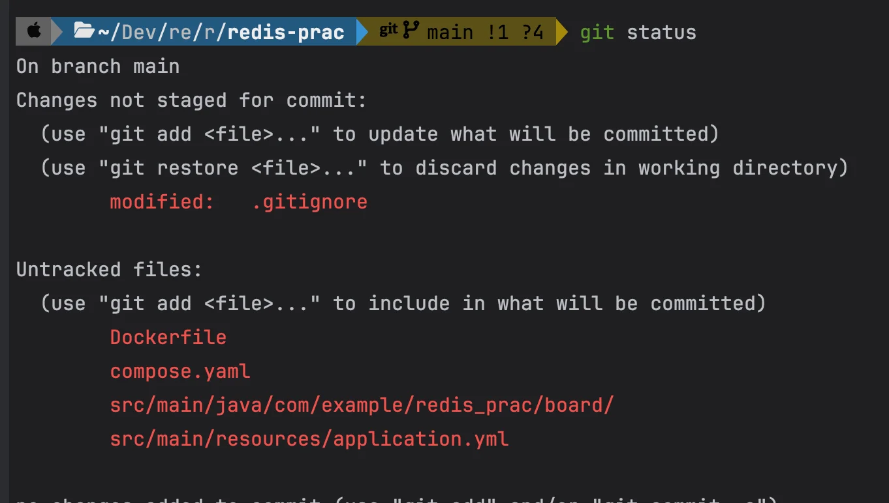
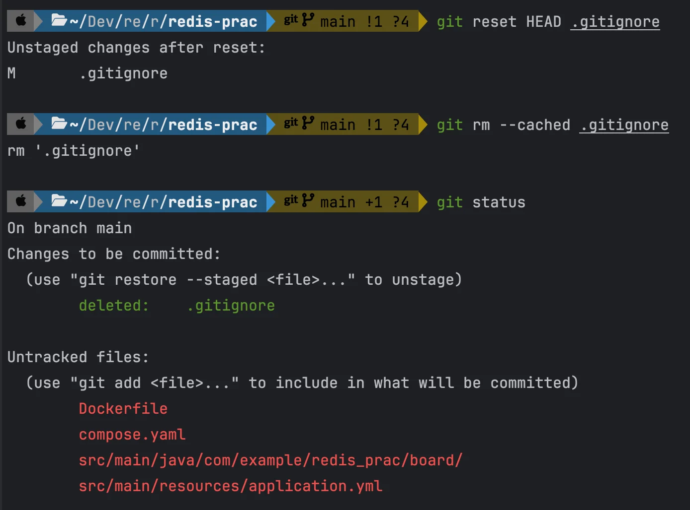

<a id="1c3eda9b0fe181cba6afdf27f5df9151"></a>

```bash
# .gitignore를 커밋에서 제거 (파일은 유지)
git reset HEAD .gitignore

#  .gitignore를 Git에서 추적하지 않도록 설정
git rm --cached .gitignore

# .gitignore를 제거한 변경 사항을 다시 커밋
git commit -m "Remove .gitignore from repository tracking"

# 원격 반영 (필요한 경우)
git push origin main  
```




