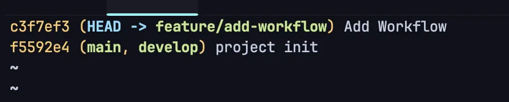

1. 특정 커밋 해시 확인
    <a id="1c3eda9b0fe18159b93fff22a9ea188a"></a>

    ```bash
    git log --oneline
    ```

    

1. <strong>브랜치를 특정 커밋으로 리셋 (Soft 또는 Mixed Reset)</strong>
    <a id="1c3eda9b0fe1815e99dde5c7532b4ea2"></a>

    ```bash
    git reset --soft e4f5g6h

    # --soft: 이후의 커밋은 staged 상태로 유지.
    # --mixed: 이후의 커밋은 unstaged 상태로 유지
    ```

<a id="1c3eda9b0fe1814992b5d7e3b29b8110"></a>

<strong>3&#46; 선택적으로 임시 브랜치 생성 (권장)</strong>

- 기존 브랜치를 손상시키지 않으려면 임시 브랜치를 생성

<a id="1c3eda9b0fe181fdab3cf1fbdec107d8"></a>

```bash
git checkout -b temp-branch
```

1. <strong>&#46; 특정 커밋까지만 푸시</strong>
    <a id="1c3eda9b0fe1817da00ac6193b359401"></a>

    ```bash
    git push origin temp-branch
    ```

1. <strong>기존 브랜치로 복구 (선택 사항)</strong>
    - 푸시한 후 기존 브랜치로 되돌아가고, 다른 커밋들을 복구

    <a id="1c3eda9b0fe18124bf3ff8c5c1dfaef4"></a>

    ```bash
    git checkout main

    git reset --hard HEAD@{1} # 이전 상태로 복구 -> 적업 내용이 날라감...
    ```

1. 작업 내용 복구 &#45; <code>git reflog</code>
    <a id="1c3eda9b0fe181e1a5d8dc2bb2260eed"></a>

    1&#46;  최근 작업의 모든 기록을 확인 가능

    <a id="1c3eda9b0fe181e59629cfe9a99f3d33"></a>

    ```bash
    git reflog
    ```

    <details>
    <summary>결과 예시 </summary>

    <a id="1c3eda9b0fe1810fbdc6df3355bbe2ea"></a>

    ```bash
    b1c2d3e (HEAD -> main) HEAD@{0}: reset: moving to HEAD@{1}
    a1b2c3d HEAD@{1}: commit: Added feature X
    e4f5g6h HEAD@{2}: commit: Refactored module Y
    ```

    

    </details>

    1.  이전 상태로 복구 
        - 원하는 커밋 상태로 복구

        - eset이 아닌 checkout으로 작업 내역을 보존할 수 있다&#46;

        <a id="1c3eda9b0fe181f18e8af3b8747fd980"></a>

        ```bash
        git checkout -b recover-branch a1b2c3d

        # a1b2c3d: 복구하려는 커밋 해시
        # 새로운 브랜치 recover-branch로 체크아웃하여 기존 작업 내용을 복원
        ```

    1. <strong>파일 복구 확인 </strong>
        - 복구된 브랜치에서 파일과 변경 사항이 복원되었는지 확인

        - 필요에 따라 작업을 추가적으로 수정

    1. <strong>다시 원래 브랜치로 병합 (선택 사항)</strong>
        - 복구한 브랜치의 내용을 원래 브랜치로 병합

        <a id="1c3eda9b0fe18177b2abc3df2a13fec1"></a>

        ```bash
        git checkout [ 병할할 브런치 ]
        git merge recover-branch # 복구를 위해 임시 생성한 브랜치 
        ```


<a id="1c3eda9b0fe181b4b6ecfc3d71e58358"></a>

Tip)  <strong>git stash로 작업 보존 습관화</strong>

- reset 명령 전에 작업 내용을 안전하게 보존하려면 항상 stash를 활용
    <a id="1c3eda9b0fe1818380eee54c83b28fa4"></a>

    ```bash
    git stash

    git stash pop
    ```
