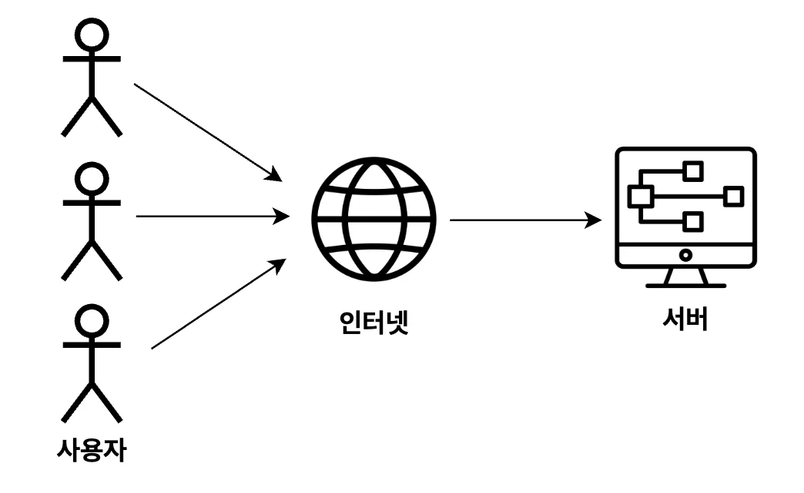
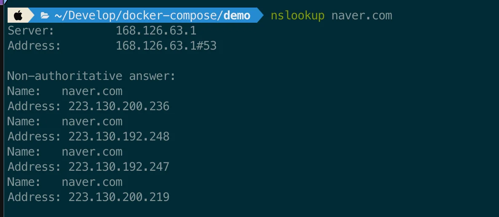
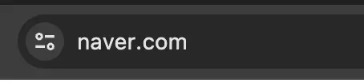

### 베포  (Deployment)

---

개발자들은 <strong><u>“이제 기능 구현도 끝났고 테스트도 끝났으니 </u></strong><strong><u>배포</u></strong><strong><u>하자&#33;&#34;</u></strong>라는 말을 자주 한다&#46; 여기서 <strong>배포</strong>란 무슨 뜻일까? <strong>배포(Deployment)란 다른 사용자들이 인터넷을 통해서 사용할 수 있게 만드는 걸 의미한다&#46;</strong> 쉽게 얘기해서 우리가 만든 웹 페이지나 서버를 다른 사람들이 사용하려면 인터넷 상에 배포가 돼있어야 한다&#46; 

자신의 컴퓨터에서 개발을 할 때는 localhost라는 주소로 테스트도 하고 개발을 한다&#46; 하지만 이 localhost는 다른 컴퓨터에서는 접근이 불가능한 주소이다&#46; 배포를 하게 되면 IP(ex&#46; 124&#46;16&#46;2&#46;1)나 도메인(ex&#46; www&#46;naver&#46;com)과 같이 고유의 주소를 부여받게 되고, 다른 컴퓨터에서 그 주소로 접속할 수 있게 된다&#46; 이게 바로 배포(Deployment)다&#46; 

따라서 어떤 서비스를 완성했다면, 그 다음 단계로 해야 하는 게 <strong><u>배포(Deployment)</u></strong>이다&#46; 코딩을 배울 때도 기본적인 백엔드 서버를 만들 수 있는 역량이 갖춰졌다면, 그 다음에 배워야 하는 게 <strong><u>배포(Deployment)</u></strong>이다&#46; 

### EC2 ( Elastic Compute Cloud )

> ✏️ 
> 
> 
> 
> <strong><u>컴퓨터를 빌려서 원격으로 접속해 사용하는 서비스</u></strong>
> 
> 
> 
>  →<code>EC2</code>를 쉽게 얘기하면 <strong><u>하나의 컴퓨터</u></strong>를 의미한다&#46;

<code>EC2 ( Elastic Compute Cloud )</code>를 왜 배우는 가?

서버를 배포하기 위해서는 컴퓨터가 필요하다&#46; 

내가 가진 컴퓨터에서 서버를 베포해 다른 사용자들이 인테넷을 통해 접근할 수 있게 만들 수도 있다&#46;

하지만 내 컴퓨터로 서버를 베포하는 경우, <strong><u>24동안 컴퓨터를 켜</u></strong>놔야 하며,

<u>외부에서 인터넷을 통해 내 컴퓨터에 접근</u> 가능하도록 만들다보니<strong>, </strong><strong><u>보안적으로도 위험</u></strong>할 수 있다&#46;

이러한 점들 때문에 클라우드 서비스를 많이 사용하며 이 중 AWS EC2를 많이 사용한다&#46; 

-  AWS는 컴퓨터를 빌리는 것(EC2) 외에도 AWS EC2는 여러 부가기능들(로깅, 오토스케일링, 로드밸런싱 등)이 많다&#46;

실무

현업에서도 실제 서버를 배포할 때 AWS EC2를 아주 많이 사용한다&#46; 

- <strong><u>백엔드 서버를 배포</u></strong>해야 할 때면 EC2에 서버를 배포해서 사용함ㄴ

> <strong>🧐 그러면</strong><strong><u> 프론트엔드 웹 페이지를 배포</u></strong><strong>할 때는 AWS EC2를 사용하는가?</strong>

프론트엔드를 베포 시, EC2를 사용할 수 있지만,  <code>vercel</code>, <code>netlify</code> 또는 <code>AWS S3</code>를 사용해서 주로 배포한다&#46;

### IP, PORT

<strong>IP</strong>

> ✏️ 
> 
> 
> 
> 네트워크 상에서의 <strong><u>특정 컴퓨터를 가리키는 주소</u></strong>
> 
> - ex) <strong><code>13&#46;250&#46;15&#46;132</code></strong>

IP는 특정 컴퓨터의 주소를 가리킨다&#46; 

예를 들면, <code>naver&#46;com</code>이라는 서비스도 IP 주소를 가지고 있다&#46;

 

<strong>PORT</strong>

> ✏️ 
> 
> 
> 
> 한 컴퓨터 내에서 <strong><u>실행되고 있는 특정 프로그램의 주소</u></strong>이다&#46; 
> 
> - ex) <strong><code>13&#46;250&#46;15&#46;132</code></strong><strong><code>&#58;3000</code></strong>

한 컴퓨터 내에서 여러 프로그램이 실행되고 있을 것이다&#46; 내가 지금 사용하고 있는 노트북만 보더라도 크롬, 카카오톡, 슬랙, VSCode 등 여러가지 프로그램이 동시에 실행되고 있다&#46; 실제 서버를 운영하는 컴퓨터도 동일하다&#46; 하나의 컴퓨터에서 여러가지의 프로그램이 실행된다&#46; 

그럼 외부에서 특정 컴퓨터 내부에 있는 Spring Boot라는 서버에 통신을 하고 싶다고 가정하자&#46; 하지만 외부에서 IP 주소만 알아서는 실행되고 있는 여러 프로그램 중 어떤 프로그램과 통신을 해야 할 지 알 수가 없다&#46; 그래서 특정 서버와 통신을 할 때는 <strong><u>IP 주소</u></strong>와 서버가 실행되고 있는 <strong><u>포트 번호</u></strong>까지 알고 있어야 한다&#46; 

브라우저 창에 포트 번호를 입력하지 않는 이유?

위 설명에서 분명 특정 서버와 통신하기 위해서는 <strong><u>IP 주소</u></strong>와 <strong><u>포트 번호</u></strong>를 둘 다 알아야 된다고 했다&#46; 

그러나 도메인 주소를 통해서 알 수 있는 건 <strong><u>IP주소</u></strong> 뿐이다

🧐 어떻게 <strong><u>포트 번호</u></strong>를 입력해주지도 않았는데 어떻게 정상적으로 통신을 하는 것인가?

주소창에 도메인 주소를 입력해서 엔터를 누르면, <strong><u>브라우저(크롬, 익스플로러 등)는 기본적으로 80번 포트로 통신</u></strong>

을 보낸다&#46; 

따라서 포트 번호를 입력하지 않아도 정상적으로 통신이 가능했다&#46;

만약 80번 포트로 통신하고 싶지 않고, 3000번 포트로 통신하고 싶다면 아래와 같이 주소창에 입력해야 한다&#46; 

잘 알려진 포트 ( <code>well&#45;known port</code> )

> ✏️ 
> 
> 
> 
> 포트 번호는 <strong><u>0 &#126; 65,535번</u></strong>까지 사용할 수 있다&#46; 그 중에서 <strong><u>0 &#126; 1023번</u></strong>까지의 포트 번호는 주요 통신을 위한 규약에 따라 이미 정해져 있다&#46; 이렇게 <strong><u>규약을 통해 역할이 정해져있는 포트 번호</u></strong>를 보고 <strong><u>잘 알려진 포트(well&#45;known port)</u></strong>라고 부른다&#46; 

- 규약으로 정해져 있는 포트 번호 중 자주 사용되는 포트 번호
    - <strong><u>22번 (SSH, Secure Shell Protocol)</u></strong> &#58; 원격 접속을 위한 포트 번호
        - EC2 인스턴스에 연결할 때 22번 포트를 사용한다&#46;

    - <strong><u>80번 (HTTP)</u></strong> &#58; HTTP로 통신을 할 때 사용

    - <strong><u>443번 (HTTPS)</u></strong><strong> </strong>&#58; HTTPS로 통신을 할 때 사용

> ☝🏻 
> 
> 
> 
> 위에서 정해놓은 규약을 꼭 지키지 않아도 된다&#46; 즉, 규약으로 정해져 있는 포트 번호와 다르게 사용해도 된다
> 
> 
> 
> 예를 들어, 특정 서버와 HTTP 통신을 할 때 80번 포트를 쓰지 않고 3000번 포트나 8080번 포트를 써도 상관 없다&#46;

