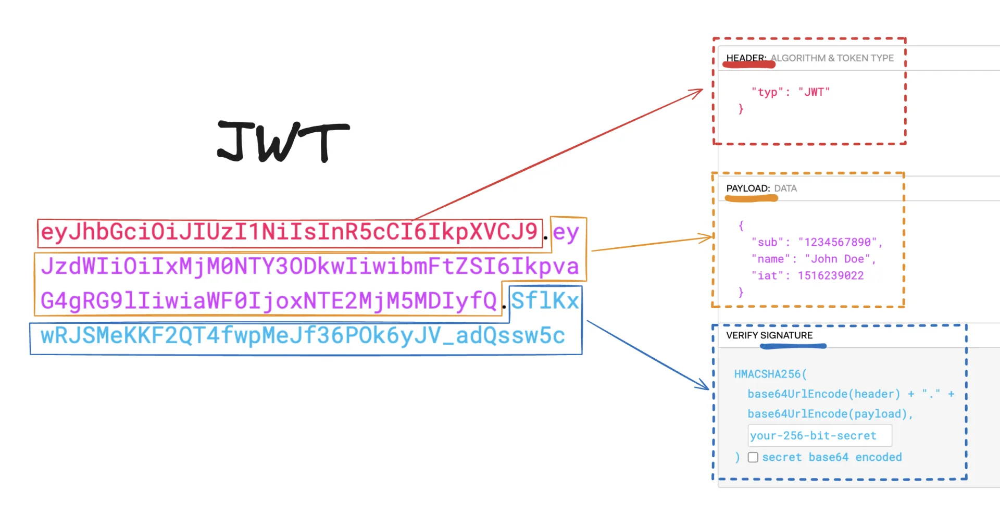

## JWT

---

> 📖 
> 
> 
> 
> JWT 토큰 <code>HEADER</code>, <code>PAYLOAD</code>, <code>SIGNATUR</code>로 이루어진 토큰이다&#46;
> 
> - 주된 목적은 정보 보호가 아닌, <u>위조 방지</u>에 있다&#46;

[JWT&#46;IO]()

공개 클레임

비공개 클레임

