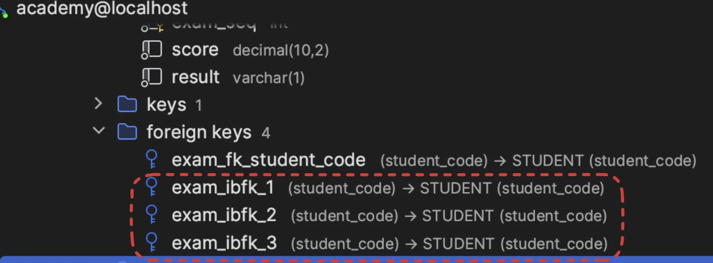

<a id="1c3eda9b0fe181c09b22dab9d7682b84"></a>

<a href="#/post/1c3eda9b-0fe1-8171-896b-c9dbb540d403">페이지</a> &#58; 실습 &#45; 2) <code>ALTER</code>, <code>ADD</code>

<a id="1c3eda9b0fe18110b667ec02e95c79e8"></a>

정리내용 따로 가져옴

> 📌 <strong>제약조건을 설정할 시</strong>에는 <code>CONSTRAINT</code>를 통해 <strong><u>제약조건의 이름을 명시</u></strong>해야한다&#46; 

<a id="1c3eda9b0fe1810e82f5c2deb59ff526"></a>

<code>ADD</code> 는 기존의 테이블에 열을 추가한다&#46;

<a id="1c3eda9b0fe1814987dadf8857025672"></a>

<code>ADD CONSTRAINT</code>는 기존 필드에 제약조건을 추가한다&#46; 

<a id="1c3eda9b0fe181c3957fd2040ad07f53"></a>

<strong> </strong>

<a id="1c3eda9b0fe181bbad3ac6e73f8a01bb"></a>

```sql
ALTER TABLE EXAM ADD PRIMARY KEY(student_code, exam_seq);
```

<a id="1c3eda9b0fe18108873cc95ed99a6624"></a>

그러나 위의 sql을 실행시켜 보면  기존에 존재한 <code>student&#95;code</code>, <code>exam&#95;seq</code> 필드들에 PK 제약 조건이 추가된다&#46;


<a id="1c3eda9b0fe181ce9f26fb23c08f5d70"></a>

이를 통해서 <code>ADD</code>도 <strong><u>기존에 존재하는 필드에 제약조건을 추가</u></strong>한다는 것을 알수 있다&#46; <br>( 설마<a href="https://www.w3schools.com/sql/sql_ref_add.asp"> w3 doc</a> 에서 사기를 친 것인가&#46;&#46;?)

<a id="1c3eda9b0fe18105814bc85fa3f28423"></a>

그렇다면  ‘🧐 아래의 두 코드의 차이점은 무엇인가?’ 라는 의문점이 또 생긴다&#46; 

- 1) 제약조건 명 ❌
    <a id="1c3eda9b0fe1817bade2e2c6494eb624"></a>

    ```sql
    ALTER TABLE EXAM ADD FOREIGN KEY(student_code) REFERENCES STUDENT(student_code);
    ```

- 2) 제약조건 이름 명시&#58; <code>CONSTRAINT exam&#95;fk&#95;student&#95;code</code>
    <a id="1c3eda9b0fe18135896cc1b8529a14f0"></a>

    ```sql
    ALTER TABLE EXAM ADD CONSTRAINT exam_fk_student_code FOREIGN KEY(student_code) REFERENCES STUDENT(student_code);
    ```

<a id="1c3eda9b0fe181049dd2c54dbe5a630d"></a>

첫번째 SQL문을 실행한 결과 아래와 같이 FK를 중복해서 계속 생성하는 것을 확인할 수 있었다&#46; 



<a id="1c3eda9b0fe181cca695e4fafa010eae"></a>

또한 제약조건 명을 붙인 2번째 SQL문은 아래와 같이 중복 실행하면 이미 존재하는 제약조건이라는 오류를 발생시켜 중복 생성을 방지해 주었다&#46;


<a id="1c3eda9b0fe18115b978c4d57d69ca70"></a>

따라서  <code>ADD</code>를 통해서도 제약조건을 추가할 수 있지만 위와 같이 <strong>제약조건의 명칭을 자동으로 생성</strong>하여<strong> 동일한 제약 조건을 계속해서 생성</strong>한다&#46;

<a id="1c3eda9b0fe1810c87b8f8e1c8ec3fa8"></a>

그러므로 <strong>제약조건을 설정할 시</strong>에는 <code>CONSTRAINT</code>를 통해 <strong><u>제약조건의 이름을 명시</u></strong>해야한다&#46; <br>
