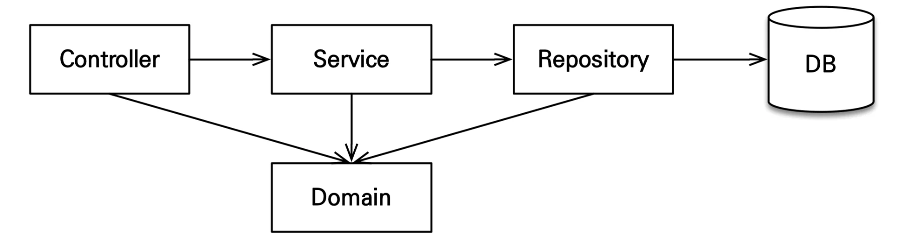

<strong>예제를 단순화 하기 위해 다음 기능은 구현X</strong>

- 로그인과 권한 관리X

- 파라미터 검증과 예외 처리X

- 상품은 도서만 사용

- 카테고리는 사용X

- 배송 정보는 사용X

앱 아키텍쳐,  3 Layout &#91; controller &#45; service &#45; repository &#93;

<strong>계층형 구조 사용</strong>

- controller, web&#58; 웹 계층

- service&#58; 비즈니스 로직, 트랜잭션 처리

- repository&#58; JPA를 직접 사용하는 계층, 엔티티 매니저 사용

- domain&#58; 엔티티가 모여 있는 계층, 모든 계층에서 사용

<strong>패키지 구조 </strong>

- jpabook&#46;jpashop
    - domain 

    - exception 

    - repository 

    - service

    - web

