<a id="1c3eda9b0fe181f7871bfdf90d106343"></a>

### 요구사항 분석

<details>
<summary><strong>View</strong></summary>

<details>
<summary>main</summary>

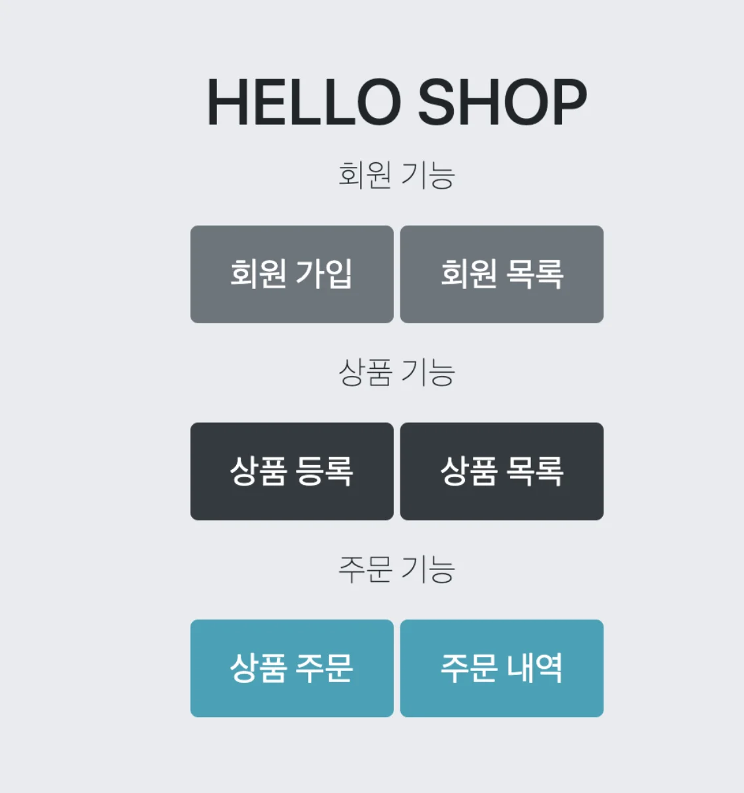

</details>

</details>

<details>
<summary><strong>기능 분석</strong></summary>

<details>
<summary><strong>회원 기능</strong></summary>

- 회원 등록

- 회원 조회<br>

</details>

<details>
<summary><strong>상품 기능</strong></summary>

- 상품 등록

- 상품 수정

- 상품 조회<br>

</details>

<details>
<summary><strong>주문 기능 </strong></summary>

- 상품 주문

- 주문 내역 조회

- 주문 취소<br>

</details>

<details>
<summary><strong>기타 요구사항 </strong></summary>

<details>
<summary>상품 재고 관리가 필요</summary>

- 상품 주문 시 해당되는 주문량 만큼 해당 상품의 재고량에서 빼야함

- 상품 취소 시 해당되는 주문량을 해당 상품의 재고량에 다시 더해줘야 함<br>

</details>

- 상품 종류&#58; 도서, 음반, 영화

- 상품 카테고리 구분

- 상품 주문 시 배송 정보를 입력할 수 있다&#46;

</details>

</details>

<a id="1c3eda9b0fe181daa742e6d990a9a0a4"></a>

### 관계도

- <strong>도메인</strong>
    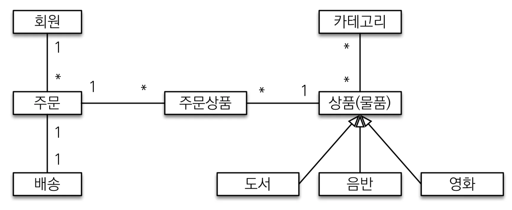

- <strong>엔티티 </strong>
    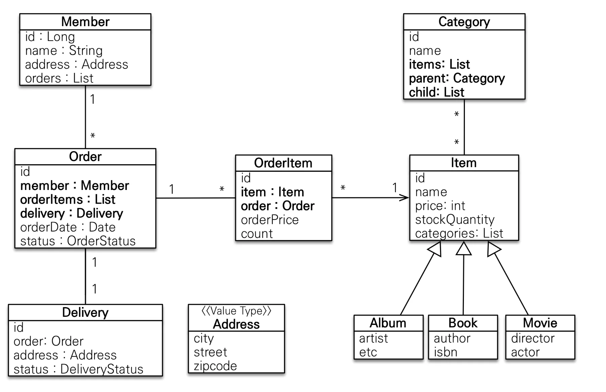

- <strong>테이블</strong>
    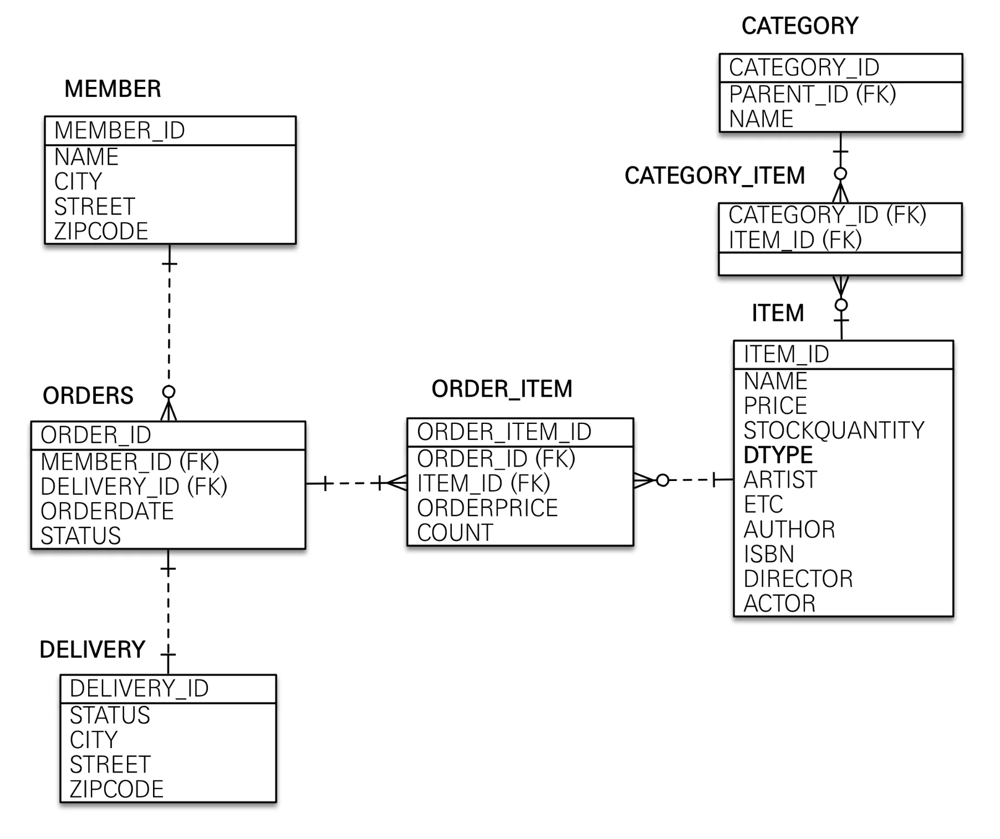

<details>
<summary><strong>도메인(엔티티) 분석</strong></summary>

<details>
<summary>회원 ( Member )</summary>

- 이름(name) &#45; <code>String</code>

- 주소(Address) &#45; <code>임베디드 값 타입</code>

- 주문(Orders) &#45; <code>List</code>

</details>

<details>
<summary>주문 ( Order )</summary>

- 상품을 주문한 회원 정보 ( Member ) &#45; <code>&#64;ManyToOne</code>

- 배송 정보 ( Delivery ) &#45; <code>&#64;OneToOne</code>

- 주문 날짜 &#45; <code>LocalDateTime</code>

- 주문 상태(status) &#45; <code>Enum</code>&#58; &#91; 주문(<code>ORDER</code>), 취소(<code>CANCEL</code>) &#93; 

</details>

<details>
<summary><strong>상품 ( Item )</strong></summary>

- 이름 &#45; <code>String</code>

- 가격 &#45; <code>int</code>

<details>
<summary>재고수량 (<code>stockQuantity</code>)  &#45; <code>int</code></summary>

- 상품 주문 → 재고 수량 ↓

- 상품 취소 → 재고 수량 ↑

</details>

<details>
<summary>상품 종류&#58; <code>도서</code>, <code>음반</code>, <code>영화</code></summary>

<a id="1c3eda9b0fe1810fa7a1ffa1ae61d15f"></a>

상품이라는 공통 속성에 해당되어 <strong><u>상속 구조</u></strong>로 설계

- <code>단일 테이블 전략</code> 사용
    > 참조&#58;  <a href="#/post/1c3eda9b-0fe1-8166-8e97-e7979e3a9461">페이지</a>

    - 단일 테이블 전략 사용 시 아래와 같이 모든 컬럼이 하나의 테이블에 담기는 단점이 있지만 성능적인 면에서는 우수하다&#46;
        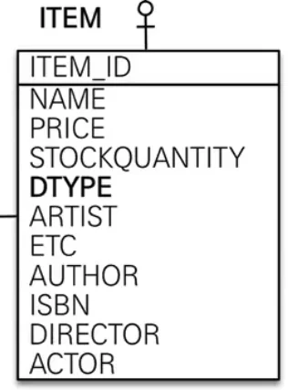

    - 주요 Anotation
        - <code>&#64;Inheritance</code>

        - <code>&#64;DiscriminatorColumn</code>

        - <code>&#64;DiscriminatorValue</code>

</details>

</details>

<details>
<summary>배송 ( Delivery )</summary>

> 각 주문마다 하나의 배송 정보 생성된다&#46;

-  주문 상태 &#45; <code>Enum</code>

- 주소 &#45; <code>Address</code> (아래 참조)

</details>

<details>
<summary><strong>카테고리 ( Category )</strong></summary>

- <code>prarent</code>, <code>child</code> 로 부모, 자식 카테고리를 연결한다&#46; 

</details>

<details>
<summary>주소 ( Address )</summary>

> 👉🏻 
> 
> <a id="1c3eda9b0fe181cfb8aaefa79f55e186"></a>
> 
> 값 타입(임베디드 타입), 특정 속성들 <strong><u>캡슐화</u></strong>
> 
> - <code>&#64;Embaddable</code>, <code>&#64;Embadded</code>
>     > 참조&#58; <a href="#/post/1c3eda9b-0fe1-8151-b1a2-ff37ca80fa02">페이지</a> 

- 도시(city) &#45; <code>Stirng</code>

- 도로명(street) &#45; <code>Stirng</code>

- 우편번호(zipcode) &#45; <code>Stirng</code>

</details>

</details>

<details>
<summary><strong>연관관계 매핑 분석</strong></summary>

<details>
<summary><strong>회원 ↔ 주문&#58; </strong><strong><code>1&#58;N</code></strong></summary>

- 회원은 여러 상품을 주문을 할 수 있다&#46;
    > ⚠️ 참고<br>회원이 주문을 하기 때문에, 회원이 주문리스트를 가지는 것은 얼핏 보면 잘 설계한 것 같지만, 객체 세상은 실제 세계와는 다르다&#46; 실무에서는 회원이 주문을 참조하지 않고, 주문이 회원을 참조하는 것으로 충분하다&#46; 여기 서는 <u>일대다, 다대일의 양방향 연관관계를 설명하기 위해서 추가</u>했다<br><br>즉, 실무에서는 <u>주문과 회원의 연관관계(</u><u><code>주문 → 회원</code></u><u>)</u>는   <u><code>N&#58;1</code></u><u> 단방향</u>으로 만 설계하는 것이 올바르다&#46;

</details>

<details>
<summary><strong>주문 ↔ 배송&#58; </strong><strong><code>1&#58;1</code></strong></summary>

- 한 개의 주문에는 한 번의 배송만 가능하다&#46; 

</details>

<details>
<summary><strong>주문 ↔ 상품&#58; </strong><strong><code>1&#58;N</code></strong></summary>

- 한번의 주문에는 여러개의 상품이 담길 수있다&#46; 

</details>

<details>
<summary><strong>주문 상품 ↔ 상품(Product)&#58; </strong><strong><code>N&#58;1</code></strong></summary>

- 한 개의 상품은 여러 주문에 담길 수 있다&#46; 

</details>

<details>
<summary><strong>상품 ↔ 카테고리&#58; </strong><strong><code>N&#58;M</code></strong><strong>  →  </strong><strong><code>1&#58;N</code></strong><strong>, </strong><strong><code>M&#58;1</code></strong> </summary>

- 한개의 상품에는 여러개의 카테고리가 해당 될 수 있다&#46;

- 하나의 카테고리에는 여러개에 상품이 포함 될 수 있다&#46;<br>

> ⚠️ <code>N&#58;M</code>  → <code>1&#58;N</code>, <code>M&#58;1</code><br><code>다대다</code> 관계는 실무에서는 사용하지 않는다&#46; <br>따라서 중간 엔티티를 추가하여 <code>일대다</code>, <code>다대일</code> 관계로 풀어서 재설계 한다&#46; 
> 
> > 참조&#58; <a href="#/post/1c3eda9b-0fe1-81c0-8042-cd1992dc52fd">페이지</a> 

</details>

</details>

<a id="1c3eda9b0fe181b08c44e43f2a4c3bb4"></a>

## 엔티티 개발

<details>
<summary><strong>회원 ( Member )</strong></summary>


<details>
<summary><strong>&#91; 코드 &#93; Member</strong></summary>

- Id 값 자동 생성&#58; <code>&#64;GeneratedValue(strategy = GenerationType&#46;xxx)</code>

<details>
<summary>값 타입(임베디드)&#58; <code>&#64;Embaddatble</code>, <code>&#64;Embadded</code></summary>

- 값 타입(임베디드)를 통해 특정 속성을 가지는 필드들을 캡슐화 처리

</details>

<details>
<summary><code>1&#58;N</code> 연관관계 매핑 &#58;  <code>&#64;OneToMany</code></summary>

- <code>&#64;OneToMany</code>는 지연로딩이 default 값이다&#46; 따라서 그냥 사용하면 된다&#46; 
    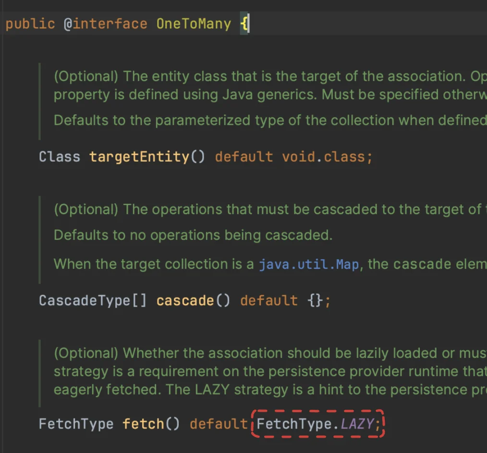

</details>

<a id="1c3eda9b0fe1811f8c9ad2dfea8af942"></a>

```java
package com.prac.jpa1.domain.member;


import com.prac.jpa1.domain.order.Order;
import jakarta.persistence.*;
import lombok.Getter;
import lombok.NoArgsConstructor;
import lombok.Setter;

import java.util.ArrayList;
import java.util.List;

@Entity
@Getter
@Setter  // 작은 프로젝트라서 사용, 실무에서는 생성자를 통해서만 주입
public class Member {

    @Id @GeneratedValue
    @Column(name="member_id")
    private Long id;

    private String name;

    @Embedded
    private Adress adress;  // ?? 왜 오류가 나지? -> 값 타입(임베디드) 설정을 하지 않음

    @OneToMany(mappedBy = "member")
    private List<Order> orders = new ArrayList<>();
}

```

</details>

</details>

<details>
<summary><strong>주문 ( Order )</strong></summary>


<details>
<summary><strong>&#91; 코드 &#93; Order</strong></summary>

<details>
<summary><code>&#64;Table(name=”orders”)</code></summary>

- 테이블명이 <code>ORDER</code> 가 아니라 <code>ORDERS</code> 인 것은 데이터베이스가 <code>order by</code> 때문에 <strong>예약어</strong>로 잡고 있는 경우가 많다&#46; 그래서 관례상 <code>ORDERS</code> 를 많이 사용한다&#46;

</details>

- Id 값 자동 생성&#58; <code>&#64;GeneratedValue(strategy = GenerationType&#46;xxx)</code>

<details>
<summary><code>N&#58;1</code> 연관관계 매핑&#58; <code>&#64;ManyToOne</code>, <code>&#64;JoinColumn</code></summary>

<details>
<summary><code>&#64;ManyToOne(</code><u><code>fetch = FetchType&#46;</code></u><strong><u><code>LAZY</code></u></strong><code>)</code></summary>

>  <a href="#/post/1c3eda9b-0fe1-8190-a480-c8a2753c4b22">페이지</a> 

- <code>&#64;ManyToOne</code>은  즉시로딩(<strong>EAGER</strong>)이 기본 값 이다&#46;<br> 따라서  <strong><u>지연로딩(LAZY) 설정</u></strong>을 해줘야 한다&#46;
    

</details>

<details>
<summary><code>&#64;JoinColumn</code></summary>

> 참조&#58; <a href="#/post/1c3eda9b-0fe1-81c0-8042-cd1992dc52fd">페이지</a> &#45; <code>&#64;JoinColumn</code> 

- 회원(Member) 엔티티와의 다대일 연관관계가 형성된다&#46;
    - Member &#58; Order = <code>1 &#58; N</code>

- 연관관계의 매핑이 테이블의 Join 과 유사한 방식으로 동작하기 위해서는 <br><u><code>N</code></u><u> 관계를 가지는 엔티티</u>를<strong> </strong><strong><code>연관관계의 주인</code></strong>으로 설정해야 한다&#46; 
    > 참조&#58; <a href="#/post/1c3eda9b-0fe1-81c0-8042-cd1992dc52fd">페이지</a> &#45; <code>&#64;OneToMany</code> &#95;<code>1=연관관계의 주인</code>

- 즉, <u><code>N</code></u><u> 관계를 가지는 엔티티</u>에 <code>&#64;JoinColumn</code>을 사용하여 연관관계를 형성할 다른 주체(엔티티)를 지정해줘야 한다&#46;

- 지정하려는 엔티티는<code> id 값(PK)</code>으로 구분되며 해당하는 id 값은 테<strong><u>이블 반영 시 </u></strong><code>외래 키(Foreign key)</code>로 매핑되어 <strong><u>두 테이블을 join 처리</u></strong>한다&#46; 


</details>

</details>

<details>
<summary><code>1&#58;N</code> 연관관계 매핑&#58; <code>&#64;OneToMany(</code><strong><u><code>mappedBy</code></u></strong><code>=””)</code></summary>

- 양방향 연관관계 매핑을 형성하기 위해서는 아래와 같다&#46;
    <a id="1c3eda9b0fe181d9a216f8354a9d822a"></a>

    ```java
    @OneToMany(mapppedBy="연관관계 주인 필드명")
    ```

    <details>
    <summary>🧐 연관관계 주인 필드명</summary>

    <a id="1c3eda9b0fe181f58960c842dbead125"></a>

    ‘연관관계 주인 필드명’은 말 그대로 ‘연관관계의 주인의 필드 이름’을 말한다&#46;

    <a id="1c3eda9b0fe1812daafbd31fa90c1b52"></a>

    아래의 예시에서는 OrderItem에서의 <code>&#64;ManyToOne</code> Anotation을 가진, 연관관계의 주인인 필드의 이름 즉, order를 말한다&#46; 

    - OrderItem
        <a id="1c3eda9b0fe181e68701fa56ffd8ef89"></a>

        ```java
        public class OrderItem {

            @Id @GeneratedValue(strategy = GenerationType.IDENTITY)
            @Column(name="order_item_id")
            private Long id;

            @ManyToOne
            @JoinColumn(name="order_id")
            private Order order;
        ```

    <a id="1c3eda9b0fe1818ba55af2555d6ef26f"></a>

    해당하는 <strong><u>연관관계의 주인 필드명</u></strong>인 <code>order</code>를 <code>&#64;OneToMany</code>의 <code>mappedBy</code> 속성에 명시하여 양방향 연관관계를 형성시킬 수 있다&#46;

    - Order
        <a id="1c3eda9b0fe18156b361e9ba7d3385c5"></a>

        ```java
        public class Order {

        		.  .  .

        		@OneToMany(mappedBy = "order")
            private List<OrderItem> orderItems = new ArrayList<>();
        ```

    </details>

<details>
<summary>양방향 연관관계 매핑(역방향 참조)</summary>

> ☝🏻 해당 참조값은 엔티티에서만 형성되는 연관관계이다&#46; 
> 
> <a id="1c3eda9b0fe181f3a88cddf792b2a6fa"></a>
> 
> 테이블에서는 반영되지 않는다&#46;
> 
> <a id="1c3eda9b0fe181689bd3e8482af825e2"></a>
> 
> 즉, 해당 필드는 읽기 전용 속성이며, 데이터의 변경이 일어나도 테이블에 반영되지 않는다 
> 
> - 양방향 &#45; 역방향 참조  <code>mappedBy</code>
>     
> 
>     > 👉🏻 <strong>양방향 연관관계&#58; 역방향 참조 </strong><strong><code>mappedBy</code></strong>
>     > 
>     > <a id="1c3eda9b0fe18177bcb6e95410702568"></a>
>     > 
>     > 읽기만 가능 ( 해당 엔티티가 수정되어도 DB에 적용되지 않음 )
>     > 
>     > - <strong><code>&#64;OneToMany( mappedBy = {연관관계 주인 필드명})</code></strong>

</details>

- 지연로딩(LAZY)가 기본 값이므로 그냥 사용

</details>

<details>
<summary><code>1&#58;1</code> 연관관계 매핑&#58; <code>&#64;OneToOne</code></summary>

<a id="1c3eda9b0fe18145a1d8c8e76513120c"></a>

```java
@OneToOne(fetch = FetchType.LAZY)
@JoinColumn( name="연관관계를 형성할 테이블의 PK명" )


@OneToOne( mappedBy="연관관계 주인 필드명", fetch = FetchType.LAZY )
```

- 연관관계의 주인을 둘 다 명시할 수 있다&#46; 

- <code>&#64;ManyToOne</code>, <code>&#64;OneToMany</code> 와 설정 방식은 동일하다&#46;

</details>

<details>
<summary>영속성 전이 ( <strong>Cascasde</strong> ) </summary>

<a id="1c3eda9b0fe1812c8592fa7ba1cbc588"></a>

```java
@OneToMany(mappedBy = "", cascade = CascadeType.ALL)
```

- 부모 엔티티 저장 시 연관되어 있는 하위 자식 엔티티까지 한번에 저장한다&#46;

- 즉, <code>1&#58;N</code> 연관관계에서 1의 관계를 가지는 엔티티가 저장될 때, N의 관계를 갖는 엔티티를 한번에 저장한다&#46;<br>

</details>

<details>
<summary><code>Enum</code> OrderStatus&#58; <em><code>ORDER</code></em>, <em><code>CANCEL</code></em></summary>

<details>
<summary><code>&#64;Enumerated(EnumType&#46;STRING)</code></summary>

> 참조&#58; <a href="#/post/1c3eda9b-0fe1-8189-9f31-fb44df5e5970">페이지</a> 

<details>
<summary><strong>enum 타입 매핑 &#45; &#64;Enumerated(EnumType</strong><strong>&#46;</strong><em><strong>STRING</strong></em><strong>)</strong></summary>

- <strong>자바 enum 타입을 매핑할 때 사용</strong>
    - DB에는 enum 타입이 존재하지 않음, 따라서 <code>&#64;Enumerated</code>를 통해 사용함

<details>
<summary>🧐 default&#58; <code>EnumType&#46;ORDINAL;</code> </summary>

<a id="1c3eda9b0fe181438e9af5cc8286567a"></a>

```java
@Target({ElementType.METHOD, ElementType.FIELD})
@Retention(RetentionPolicy.RUNTIME)
public @interface Enumerated {
    EnumType value() default EnumType.ORDINAL;
}
```

</details>

| 속성  | 설명  | 기본값 |
| --- | --- | --- |
| value  | • EnumType&#46;ORDINAL&#58; enum 순서를 데이터베이스에 저장<br>• EnumType&#46;STRING&#58; enum 이름을 데이터베이스에 저장 | EnumType&#46;ORDINAL |

> ⚠️ <strong>STRING 사용 </strong>
> 
> > &#64;Enumerated(<strong>EnumType&#46;</strong><em><strong>STRING</strong></em><strong>)</strong>
> 
> <a id="1c3eda9b0fe18198949afab4d8aa790b"></a>
> 
> ```java
> @Entity
> public class Member {
>    .  .  .
> 	
> 		@Enumerated(EnumType.STRING)
> 		private RoleType roleType;
> ```
> 
> <a id="1c3eda9b0fe181a4a5adfd11c2dbb930"></a>
> 
> String 사용 시, 아래와 같이 String 타입으로 저장되어 값이 추가되어도 기존의 값과 충돌하지 않음
> 
> 
> 
> <details>
> <summary><strong>사용 X </strong><strong>&#45;</strong><strong> </strong><strong>&#64;Enumerated(EnumType&#46;</strong><strong>ORIDINAL</strong><strong>)</strong></summary>
> 
> > oridinal 타입은<strong> Integer 타입으로 생성</strong>된다&#46; 따라서 추가 요구사항(guest)을 더하여 DB 값을 저장할 경우 <strong>기존의 값과 충돌</strong>되는 오류가 발생한다&#46; <br>→ 운영 서버에서 사용 시, 해결 불가능한 버그 발생함
> 
> 
> 
> </details>

</details>

</details>

</details>

<details>
<summary>연관관계 메서드</summary>

- JPA의 객체지향 컨셉을 활용한 방법

- 양방향 연관관계 시, 연관관계 메서드를 통해 한번에 참조값을 설정한다&#46;

<details>
<summary>&#91; 코드 &#93; addMember</summary>

- ManyToOne
    <details>
    <summary>역방향 연관관계 설정</summary>

    <a id="1c3eda9b0fe18182ad66c13928284bf1"></a>

    <code>1의 관계</code>를 갖는 Member 엔티티에서 orders를 가져와 member를  넣어줌

    <a id="1c3eda9b0fe181059cf5d8308dc38f3d"></a>

    ```java
    @Entity
    @Getter
    @Setter
    public class Member {

    			.  .  .

    		@OneToMany(mappedBy = "member")
        private List<Order> orders = new ArrayList<>();
    ```

    <a id="1c3eda9b0fe181f6af9bd7c6a52cb487"></a>

    ```java
    member.getOrders.add(this);
    ```

    </details>

<a id="1c3eda9b0fe181029551c95bf2eec01e"></a>

```java
public void addMember(Member member){
		this.member = member;
		member.getOrders.add(this);
}
```

</details>

<details>
<summary>&#91; 코드 &#93; addOrderItem</summary>

- OneToMany
    <details>
    <summary>정방향 연관관계 설정</summary>

    - <code>orderItems(List&#60;OrderItem&#62;)</code>에 인자로 받는 orderItem 넣어줌
        <a id="1c3eda9b0fe181f88113eef2156771c8"></a>

        ```java
        @OneToMany(mappedBy = "order", cascade = CascadeType.ALL)
        private List<OrderItem> orderItems = new ArrayList<>();
        ```

    </details>

<a id="1c3eda9b0fe181259899f98f9200e241"></a>

```java
public void addOrderItem(OrderItem orderItem) {
		orderItems.add(orderItem);
		orderItem.setOrder(this);
}
```

</details>

<details>
<summary>&#91; 코드 &#93; setDelivery</summary>

- OneToOne

<a id="1c3eda9b0fe18104b6bbc41f7985b65c"></a>

```java
public void setDelivery(Delivery delivery) {
		this.delivery = delivery;
		delivery.setOrder(this);
}
```

</details>

</details>

<a id="1c3eda9b0fe181ce9dfbfead3c630e27"></a>

```java
package com.prac.jpa1.domain;

import com.prac.jpa1.domain.enums.OrderStatus;
import jakarta.persistence.*;
import lombok.Getter;
import lombok.NoArgsConstructor;
import lombok.Setter;

import java.time.LocalDateTime;
import java.util.ArrayList;
import java.util.List;

@Entity
@Table(name = "orders")
@Getter @Setter
public class Order {

    @Id @GeneratedValue
    @Column(name="order_id")
    private Long id;

    @ManyToOne(fetch = FetchType.LAZY)
    @JoinColumn(name = "member_id")
    private Member member;

    @OneToMany(mappedBy = "order", cascade = CascadeType.ALL)
    private List<OrderItem> orderItems = new ArrayList<>();

    @OneToOne(cascade = CascadeType.ALL, fetch = FetchType.LAZY)
    @JoinColumn(name="delivery_id")
    private Delivery delivery;

    private LocalDateTime orderDate;

    @Enumerated(EnumType.STRING)
    private OrderStatus status;


    //== 연관관계 메서드 ==//
    public void addMember(Member member) {
        this.member = member;
        member.getOrders().add(this);
    }

    public void addOrderItem(OrderItem orderItem) {
        orderItems.add(orderItem);
        orderItem.setOrder(this);
    }

    public void setDelivery(Delivery delivery) {
        this.delivery = delivery;
        delivery.setOrder(this);
    }
}

```

</details>

</details>

<details>
<summary><strong>주문상품 ( OrderItem )</strong></summary>

> <strong><u>다대다 연관관계 재설계</u></strong>를 위한 <strong><u>중간 테이블</u></strong>

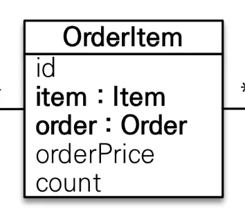

<details>
<summary><strong>&#91; 코드 &#93; OrderItem</strong></summary>

<a id="1c3eda9b0fe181cc98e7ed4ddba693e9"></a>

```java
package com.prac.jpa1.domain.order;

import com.prac.jpa1.domain.Item;
import jakarta.persistence.*;
import lombok.Getter;
import lombok.NoArgsConstructor;
import lombok.Setter;

@Entity
@Table(name ="order_item")
@Getter @Setter
public class OrderItem {

    @Id @GeneratedValue
    @Column(name="order_item_id")
    private Long id;
		
		@ManyToOne(fetch = FetchType.LAZY)
    @JoinColumn(name="item_id")
    private Item item;            // 주문 상품

    @ManyToOne(fetch = FetchType.LAZY)
    @JoinColumn(name="order_id")
    private Order order;          // 주문

    private Integer orderPrice;   // 주문 가격
    private Integer count;        // 주문 수량
}

```

</details>

</details>

<details>
<summary><strong>상품 ( Item )</strong></summary>


- 상속 매핑을 통한 아이템 세분화 
    > → <a href="#/post/1c3eda9b-0fe1-8166-8e97-e7979e3a9461">페이지</a> &#45; 상속 매핑

    <details>
    <summary>단일 테이블 전략</summary>

    

    - <code>&#64;Inheritance(strategy = InheritanceType&#46;SINGLE&#95;TABLE)</code>

    - or <code>&#64;Ingeritance</code>
        <details>
        <summary><code>defualt</code>&#58; 단일테이블</summary>

        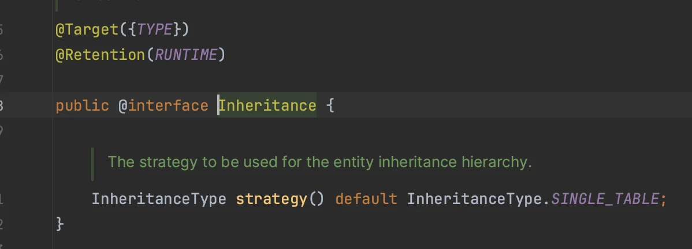

        </details>

    > 중복과 명시성 중 명시적인 표현이 훨씬 더 중요하다고 하셨다&#46;<br>따라서 default 값이 single table 전략임에도 명시적으로 표현하기 위해 &#64;Inheritance에 stratey의 타입을 <code>SINGLE&#95;TABLE</code>로 표현했다&#46;

    <a id="1c3eda9b0fe181b99759cca19dc1219a"></a>

    ```java
    @Inheritance(strategy = InheritanceType.SINGLE_TABLE) 
    ```

    </details>

    <details>
    <summary>Type 컬럼을 통한 하위 엔티티 구분&#58; <code>&#64;DiscriminatorColumn</code>, <code>&#64;DiscriminatorValue</code></summary>

    <a id="1c3eda9b0fe181ebad93c01019f5db7b"></a>

    단일 테이블 전략은 상속 처리되는 모든 엔티티들을 합쳐서 하나의 테이블로 만드는 전략이다&#46; <br>따라서 각 하위 엔티티들을 구분할 컬럼 및 값을 설정 해줘야 한다&#46; &#46;

    ---

    <details>
    <summary>상속처리 되는 상위 엔티티&#58; <code>Item</code>     </summary>

    - <code>&#64;DiscriminatorColumn</code>&#58;  타입 컬럼명 설정

    <a id="1c3eda9b0fe18138aebef3f68eae8420"></a>

    ```java
    @Entity
    @Inheritance
    @DiscriminatorColumn(name = "ITME_TYPE")
    public abstract class Item {

    		.  .  . 
    ```

    </details>

    <details>
    <summary>상속 받는 하위 엔티티들&#58; <code>Album</code>, <code>Book</code>, <code>Movie</code></summary>

    - <code>&#64;DiscriminatorValue</code>를 통해 타입 컬럼의 값 설정 <br> 즉, 구분할 하위 엔티티 이름 명시 

    <a id="1c3eda9b0fe1813fb471f61cd591774f"></a>

    ```java
    @Entity
    @DiscriminatorValue("Movie")
    public class Movie extends Item {
    		. . .
    ```

    </details>

    </details>

<details>
<summary><strong>&#91; 코드 &#93; Item ( 상위 엔티티 )</strong></summary>

- 단일테이블 전략&#58; <code>&#64;Inheritance(strategy = InheritanceType&#46;</code><em><code>SINGLE&#95;TABLE</code></em><code>)</code>

<details>
<summary><code>&#64;DiscriminatorColumn(name=””)</code> </summary>

<a id="1c3eda9b0fe181628793fddcb5879de9"></a>

하위 엔티티의 타입 값이 담길 <strong><u>컬럼 </u></strong>생성

<details>
<summary><code>&#64;DiscriminatorValue(name=””)</code></summary>

<a id="1c3eda9b0fe181719c1ac33534897190"></a>

해당 Anotation으로 하위 엔티티의 타입 값을 명시 그러면 위에 생성한 컬럼에 해당 값이 할당된다&#46;<br>

</details>

</details>

<details>
<summary><code>&#64;ManyToMany </code>( 실무에선 안씀 )</summary>

- 역방향 참조값&#58; 이전 <code>&#64;OneToMany</code>와 동일하게 mappedBy 속성값만 명시
    <a id="1c3eda9b0fe181de852ae8b54f564057"></a>

    ```java
    @ManyToMany(mappedBy = "items")
    private List<Category> categories = new ArrayList<>();
    ```

</details>

<details>
<summary>&#64;ManyToMany → &#64;ManyToOne , &#64;OneToMany</summary>

> 위 정리 내용 참조

</details>

<a id="1c3eda9b0fe181d7abaad460e1abd5bb"></a>

```java

package com.prac.jpa1.domain;

import jakarta.persistence.*;
import lombok.Getter;
import lombok.Setter;

import java.util.ArrayList;
import java.util.List;

@Entity
@Inheritance
@DiscriminatorColumn(name = "ITME_TYPE")
@Getter @Setter
public abstract class Item {

    @Id @GeneratedValue
    @Column(name = "item_id")
    private Long id;
    
    private String name;
    private int price;
    private int  stockQuantity;

		@ManyToMany(mappedBy = "items")
    private List<Category> categories = new ArrayList<>();
}

```

</details>

---

<details>
<summary>&#91;<strong> 코드 &#93; Album </strong></summary>

<a id="1c3eda9b0fe181328845d88894bfa5d9"></a>

```java
package com.prac.jpa1.domain.items;

import com.prac.jpa1.domain.Item;
import jakarta.persistence.DiscriminatorValue;
import jakarta.persistence.Entity;
import lombok.Getter;
import lombok.Setter;

@Entity
@DiscriminatorValue("Album")
@Getter @Setter
public class Album extends Item {

    private String artist;
    private String etc;
}

```

</details>

<details>
<summary><strong>&#91; 코드 &#93; Book</strong></summary>

<a id="1c3eda9b0fe181fdafb2ff8507288288"></a>

```java
package com.prac.jpa1.domain.items;

import com.prac.jpa1.domain.Item;
import jakarta.persistence.DiscriminatorValue;
import jakarta.persistence.Entity;
import lombok.Getter;
import lombok.Setter;

@Entity
@DiscriminatorValue("Book")
@Getter @Setter
public class Book extends Item {
    
    private String author;
    private String isbn;
}

```

</details>

<details>
<summary><strong>&#91; 코드 &#93; Movie</strong></summary>

<a id="1c3eda9b0fe181a887aafe6c0625ef56"></a>

```java
package com.prac.jpa1.domain.items;

import com.prac.jpa1.domain.Item;
import jakarta.persistence.DiscriminatorValue;
import jakarta.persistence.Entity;
import jdk.jfr.Enabled;
import lombok.Getter;
import lombok.Setter;

import java.util.ArrayList;
import java.util.List;

@Entity
@DiscriminatorValue("Movie")
@Getter @Setter
public class Movie extends Item {

    private String director;
    private String actor;
}

```

</details>

</details>

<details>
<summary><strong>카테고리 ( Category )</strong></summary>

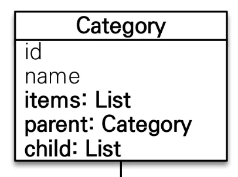

<details>
<summary>🧐 필드를 <code>부모&#45;자식 관계(트리 구조)</code>로 설계하는 방법</summary>

<details>
<summary>🧐 영속성 전이 ( cascade )</summary>

> <strong><u>상위 부모 엔티티(Parent)</u></strong> 저장(persist) → <u>하위 자식 엔티티(</u><strong><u>Child)도 함께 저장</u></strong>

<a id="1c3eda9b0fe18195aee1d580762f6424"></a>

```java
// Parent 
@OneToMany(mappedBy = "parent", cascade = CascadeType.ALL)
private List<Child> childList = new ArrayList<>();
```

</details>

<details>
<summary>🧐 고아객체  ( orphanRemoval )</summary>

> 부모 엔티티와 <strong><u>연관관계가 끊</u></strong>어진 <strong><u>자식 엔티티</u></strong>를 <strong>자동</strong>으로 <strong>삭제</strong>

<details>
<summary>고아 객체(orphanRemoval) 적용</summary>

<a id="1c3eda9b0fe18175bb7ac08049a85463"></a>

```java
@OneToMany(mappedBy = "parent", orphanRemoval = true, cascade = CascadeType.ALL)
private List<Child> childList = new ArrayList<>();
```

</details>

<details>
<summary>동작</summary>

- <code>orphanRemoval = true</code> 설정
    <a id="1c3eda9b0fe18114b695f5b7495590b8"></a>

    ```java
    // Parent
    @OneToMany(mappedBy = "parent", orphanRemoval = true, cascade = CascadeType.ALL)
    private List<Child> childList = new ArrayList<>();
    ```

- 부모 엔티티 조회 후, 해당 리스트에서 자식 엔티티를 컬렉션에서 제거
    <a id="1c3eda9b0fe18155950beab23e4da982"></a>

    ```java
    // JpaMain
    Parent findParent = em.find(Parent.class, parent.getId());
    findParent.getChildList().remove(0); // 자식 엔티티, 컬렉션에서 제거
    ```

- <strong>자동으로 </strong><strong><code>delete</code></strong><strong> </strong>쿼리를 날려 해당 데이터를 테이블에서 삭제
    <a id="1c3eda9b0fe1813a9d8ce6fd8dcbb663"></a>

    ```sql
    Hibernate: 
        /* delete for jpabook.jpashop.domain.enums.Child */delete 
        from
            Child 
        where
            id=?
    ```

</details>

</details>

<details>
<summary>🧐 엔티티를 생성하지 않고 필드로만 존재하는 값들이 어떻게 엔티티와 같이 연관관계를 형성하는가? </summary>

> 질문  재정의) 🧐 필드 값으로 어떻게 계층적(부모&#45;자식) 데이터 모델링 형성하는가?

- 한 테이블 내에 존재하는 데이터들을 <code>parent(Category)</code>라는 컬럼을 추가하여  계층적(부모&#45;자식 관계)으로 데이터를 모델링 하였다&#46; 
    - <strong><code>계층적 데이터 모델링</code></strong><code>(Hierarchical Data Modeling)</code>

- 아래와 같이 한 테이블에서 <code>PARENT</code> 라는 필드를 통해 추상적인 계층구조를 형성한다&#46; 
    


- ex) 
    <details>
    <summary>Category</summary>

    <a id="1c3eda9b0fe181c8bbf2c90f806442b8"></a>

    ```java
    @Entity
    @Getter @Setter
    @NoArgConstructor
    public class Category {

        @Id
        @GeneratedValue(strategy = GenerationType.IDENTITY)
        private Long id;

        private String name;

        // 부모 카테고리의 ID를 저장하는 필드
        private Long parentId;

        public Category(String name, Long parentId) {
            this.name = name;
            this.parentId = parentId;
        }
    }
    ```

    </details>

    <details>
    <summary>테스트 코드</summary>

    <a id="1c3eda9b0fe181728d9bf38c78767ff3"></a>

    ```java
    Category node1 = new Category("name1", null);
    Category node2 = new Category("name2", node1.getId());
    Category node3 = new Category("name3", node2.getId());
    Category node4 = new Category("name4", node2.getId());
    ```

    </details>

    <details>
    <summary>생성된 테이블</summary>

    | id | name | parentId |
    | --- | --- | --- |
    | 1 | name1 | null |
    | 2 | name2 | 1 |
    | 3 | name3 | 2 |
    | 4 | name4 | 2 |

    </details>

    <details>
    <summary>트리구조(<code>추상 자료형(ADT, Abstract Data Type)</code>) 형성</summary>

    

    </details>

    <a id="1c3eda9b0fe181998406ff02f302b49c"></a>

    트리는 추상 자료형 이다&#46; 즉, 배열과 같이 메모리 상에서 물리적으로 연속성을 가지는 자료형 아닌 객체 간에 참조값을 통한 개념적인(추상적인) 관계로 설계되는 자료형이다&#46;

</details>

<details>
<summary>🧐 id 값이 아닌 Category 엔티티 전체를 담아 표현하는가? <br>     너무 무겁게 설계하는 것이 아닌가?</summary>


</details>

<a id="1c3eda9b0fe1814ebf47d9717edc8b7b"></a>

```java
@Entity
public class Category {

			.  .  .

	 // 부모 카테고리를 참조
    @ManyToOne(fetch = FetchType.LAZY)
    @JoinColumn(name = "parent_id")
    private Category parent;

    // 자식 카테고리들을 참조
    @OneToMany(mappedBy = "parent", cascade = CascadeType.ALL, orphanRemoval = true)
    private List<Category> children = new ArrayList<>();
    
```

</details>

<details>
<summary><strong>&#91; 코드 &#93; Category</strong></summary>

<details>
<summary><code>&#64;ManyToMany</code> (실무 사용 X)</summary>

- 정방향 연관관계 설정
    > <code>&#64;ManyToMany</code>는 실무에선 사용하면 안된다&#46; 자세한 내용은 위 정리 내용 참조

    > 역방향 설정은 mappedBy 설정하는 것과 동일하다&#46;

    <a id="1c3eda9b0fe1813892a0d1d283ed36db"></a>

    ```java
    @ManyToMany
    @JoinTable(name="category_item",
            joinColumns = @JoinColumn(name="item_id"),
            inverseJoinColumns = @JoinColumn(name="category_id")
    )
    private List<Item> items = new ArrayList<>();
    ```

</details>

<a id="1c3eda9b0fe18157b4d8e83d5ddf8eaf"></a>

```java
package com.prac.jpa1.domain;

import jakarta.persistence.*;
import lombok.Getter;
import lombok.Setter;

import java.util.ArrayList;
import java.util.List;

@Entity
@Getter @Setter
public class Category {

    @Id
    @GeneratedValue
    @Column(name = "category_id")
    private Long id;

    private String name;

    @ManyToMany
    @JoinTable(name="category_item",
            joinColumns = @JoinColumn(name="item_id"),
            inverseJoinColumns = @JoinColumn(name="category_id")
    )
    private List<Item> items = new ArrayList<>();


    // 부모 카테고리를 참조
    @ManyToOne(fetch = FetchType.LAZY)
    @JoinColumn(name = "parent_id")
    private Category parent;

    // 자식 카테고리들을 참조
    @OneToMany(mappedBy = "parent", cascade = CascadeType.ALL, orphanRemoval = true)
    private List<Category> child= new ArrayList<>();

    //==연관관계 메서드==//
    public void addChildCategory(Category child){
        this.child.add(child);
        child.setParent(this);
    }
}

```

</details>

</details>

<details>
<summary><strong>배달 ( Delivery )</strong></summary>

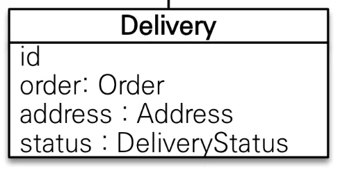

<details>
<summary><strong>&#91; 코드 &#93; Delivery</strong></summary>

<details>
<summary>값 타입( 임베디드)&#58; <code>&#64;Embaddable</code>, <code>&#64;Embadded</code></summary>

- 값 타입을 통한 특정 속성을 가지는 필드들 캡슐화
    <details>
    <summary>예시) 임베디드 적용 </summary>

    <details>
    <summary>Address</summary>

    <a id="1c3eda9b0fe18179aefbe83d4db582b1"></a>

    ```java
    @Getter
    @Embeddable
    @NoArgsConstructor
    public class Adress {

        private String city;
        private String street;
        private String zipcode;
    ```

    </details>

    <details>
    <summary>Delivery</summary>

    <a id="1c3eda9b0fe1812fa412fbcff5510d0e"></a>

    ```java
    public class Delivery {

    		.  .  .
     
        @Embedded
        private Adress adress;
    ```

    </details>

    </details>

</details>

<details>
<summary><code>Enum</code> DeliveryStatus&#58;  <em><code>DELIVERY</code></em>, <em><code>COMPLETE</code></em></summary>

<details>
<summary><code>&#64;Enumerated(EnumType&#46;STRING)</code></summary>

> 참조&#58; <a href="#/post/1c3eda9b-0fe1-8189-9f31-fb44df5e5970">페이지</a> 

<details>
<summary><strong>enum 타입 매핑 &#45; &#64;Enumerated(EnumType</strong><strong>&#46;</strong><em><strong>STRING</strong></em><strong>)</strong></summary>

- <strong>자바 enum 타입을 매핑할 때 사용</strong>
    - DB에는 enum 타입이 존재하지 않음, 따라서 <code>&#64;Enumerated</code>를 통해 사용함

<details>
<summary>🧐 default&#58; <code>EnumType&#46;ORDINAL;</code> </summary>

<a id="1c3eda9b0fe181df897efd59c6ffa479"></a>

```java
@Target({ElementType.METHOD, ElementType.FIELD})
@Retention(RetentionPolicy.RUNTIME)
public @interface Enumerated {
    EnumType value() default EnumType.ORDINAL;
}
```

</details>

| 속성  | 설명  | 기본값 |
| --- | --- | --- |
| value  | • EnumType&#46;ORDINAL&#58; enum 순서를 데이터베이스에 저장<br>• EnumType&#46;STRING&#58; enum 이름을 데이터베이스에 저장 | EnumType&#46;ORDINAL |

> ⚠️ <strong>STRING 사용 </strong>
> 
> > &#64;Enumerated(<strong>EnumType&#46;</strong><em><strong>STRING</strong></em><strong>)</strong>
> 
> <a id="1c3eda9b0fe181d2a488c2be26ad6661"></a>
> 
> ```java
> @Entity
> public class Member {
>    .  .  .
> 	
> 		@Enumerated(EnumType.STRING)
> 		private RoleType roleType;
> ```
> 
> <a id="1c3eda9b0fe181fb9ecfd6ba2fe6db03"></a>
> 
> String 사용 시, 아래와 같이 String 타입으로 저장되어 값이 추가되어도 기존의 값과 충돌하지 않음
> 
> 
> 
> <details>
> <summary><strong>사용 X </strong><strong>&#45;</strong><strong> </strong><strong>&#64;Enumerated(EnumType&#46;</strong><strong>ORIDINAL</strong><strong>)</strong></summary>
> 
> > oridinal 타입은<strong> Integer 타입으로 생성</strong>된다&#46; 따라서 추가 요구사항(guest)을 더하여 DB 값을 저장할 경우 <strong>기존의 값과 충돌</strong>되는 오류가 발생한다&#46; <br>→ 운영 서버에서 사용 시, 해결 불가능한 버그 발생함
> 
> 
> 
> </details>

</details>

</details>

</details>

<a id="1c3eda9b0fe1817abfbbe4202221666c"></a>

```java
,package com.prac.jpa1.domain;

import com.prac.jpa1.domain.enums.DeliveryStatus;
import com.prac.jpa1.domain.member.Adress;
import jakarta.persistence.*;
import lombok.Getter;
import lombok.NoArgsConstructor;
import lombok.Setter;

@Entity
@Getter
@Setter
@NoArgsConstructor
public class Delivery {

    @Id @GeneratedValue
    @Column(name="delivery_id")
    private Long id;
    
    @OneToOne(mappedBy = "delivery", fetch = FetchType.LAZY)
    private Order order;

    @Embedded
    private Adress adress;

    @Enumerated(EnumType.STRING)
    private DeliveryStatus status;
}
```

</details>

</details>

<details>
<summary><strong>주소 ( Address )</strong></summary>

>  Embedded 값 타입으로 <strong><u>캡슐화</u></strong><br>→ <a href="#/post/1c3eda9b-0fe1-8151-b1a2-ff37ca80fa02">페이지</a> 


> 값 타입 값들은 모두 <strong><u>생성자(constructor)로 초기화</u></strong>하여 <strong><u>변경 불가능</u></strong>하게 설계해야 한다&#46; ( <strong><u>Setter 사용 X</u></strong>)<strong> </strong>

<details>
<summary><strong>&#91; 코드 &#93; Address</strong></summary>

- 값 타입(임베디드)&#58;  <code>&#64;Embaddable</code>, <code>&#64;Embadded</code>

<a id="1c3eda9b0fe181b48719e555fe31f34c"></a>

```java
package com.prac.jpa1.domain.member;


import jakarta.persistence.Embeddable;
import lombok.Getter;
import lombok.NoArgsConstructor;

// @Entity X =>  값 타입, 엔티티 X
@Embeddable          // 값 타입 명시
@NoArgsConstructor   // 기본 생성자 필수 
@Getter
public class Adress {

    private String city;
    private String street;
    private String zipcode;
		
		// 생성자를 통한 값 초기화
    public Adress(String city, String street, String zipcode) {
        this.city = city;
        this.street = street;
        this.zipcode = zipcode;
    }
}
```

</details>

</details>

<details>
<summary><strong>Enum 타입</strong></summary>

<details>
<summary><strong>&#91; 코드 &#93; DeliveryStatus</strong></summary>

<a id="1c3eda9b0fe181cb87f3fc7b4a7c6aed"></a>

```java
package com.prac.jpa1.domain.enums;

public enum DeliveryStatus {
    DELIVERY,   // 배송 중
    COMPLETE    // 배송 완료
//
}
```

</details>

<details>
<summary><strong>&#91; 코드 &#93; OrderStatus</strong></summary>

<a id="1c3eda9b0fe1819cb3deda5422f114c3"></a>

```java
package com.prac.jpa1.domain.enums;

public enum OrderStatus {
    ORDER,    // 주문ㅊ
    CANCEL,   // 취소
}

```

</details>

</details>

<a id="1c3eda9b0fe181f48a7cdbe8c72d0484"></a>

## 엔티티 설계 시 주의점 

<details>
<summary><strong>⚠️  Setter 사용</strong></summary>

- 작은 프로젝트라서 사용, 추후 리펙토링 시 Setter 제거 

- 실제 실무에서는 Setter를 열어두면 어디서 데이터가 변경되는지 추적하기 어려우며, 많은 오류가 발생될 수 있는 위험성을 가지고 있다&#46; <br>따라서 엔티티의 데이터는 <strong><u>생성자</u></strong>를 통해서 주입하여 불변성을 유지하며, <br> 필요 시에만 부분적으로 Setter를 추가한다&#46;

</details>

<details>
<summary>🧐 영속성 전이 ( <strong>Cascasde</strong> ) </summary>

- 부모 엔티티 저장 시 연관되어 있는 하위 자식 엔티티까지 한번에 저장한다&#46;<br>즉, <code>1&#58;N</code> 연관관계에서 1의 관계를 가지는 엔티티가 저장될 때, N의 관계를 갖는 엔티티를 한번에 저장한다&#46;

- <code>1</code> 의 관계를 갖는 엔티티에 적용한다&#46; 즉, <code>&#64;OneToMany</code>가 명시된  부모 엔티티에 아래와 같이 적용하면 된다&#46;  
    <a id="1c3eda9b0fe1813caeefe6eed240f48b"></a>

    ```java
    @OneToMany(mappedBy = "category", cascade = CascadeType.ALL)
    private List<CategoryItem> categoryItems = new ArrayList<>();
    ```

</details>

<details>
<summary><strong>⚠️ 모든 연관관계는</strong><strong> 지연로딩 </strong><strong>으로 설정해야 한다&#46; </strong></summary>

<details>
<summary>🧐 <code>N&#43;1</code> 문제</summary>

<a id="1c3eda9b0fe181be9728c57cb99b247f"></a>

<strong><u>연관관계 설정을 즉시로딩</u></strong> 했을 시, <strong><u>해당하는 엔티티를 조회</u></strong>하면 <strong><u>연관관계를 형성한 엔티티들이 같이 조회</u></strong>가 된다&#46; 

<a id="1c3eda9b0fe18193ad00c0ba7b0b5887"></a>

즉,<strong><u> 하나의 엔티티를 조회</u></strong>하였는데 1개의 insert 쿼리가 아닌 <strong><u>즉시로딩으로 설정한 연관된 모든 엔티티들도 같이 insert 쿼리가 발생되는, 1&#43;N 번의 쿼리가 발생</u></strong>된다&#46; 

<a id="1c3eda9b0fe181b8b6c2fc835e51772d"></a>

<br>이를 실무에서 수천 수만 개의 데이터를 조회하기 위해 insert 쿼리를 날리는데, 즉시로딩으로 설정하면 해당 엔티티와 연관관계가 형성된 모든 엔티티들이 수천, 수만번 씩 더해서 insert 쿼리를 날리며 이는, 엄청난 리소스 낭비와 오류를 발생시킨다&#46; 

</details>

<a id="1c3eda9b0fe18158b00dec401d6586d4"></a>

<strong><u>즉시로딩(EAGER)</u></strong>은 <strong><u>예측</u></strong>이 어렵고 <strong><u>어떤 SQL이 실행될 지 추적하기 어렵</u></strong>다&#46;

<a id="1c3eda9b0fe1812681f7c624bea110ae"></a>

특히 JPQL 실행 시, <strong><u><code>N&#43;1</code></u></strong><strong><u>문제</u></strong>가 자주 발생된다&#46; 

<a id="1c3eda9b0fe181aebfc6cbc9e37c4d45"></a>

따라서 실무에서 모든 엔티티의 연관관계는 <strong><u>지연 로딩</u></strong><strong> </strong>으로 설정해줘야 한다&#46;

> 연관된 엔티티를 함께 DB에 조회해야 하는 경우, <strong><u><code>fetch join</code></u></strong>이나 <strong><u><code>엔티티 그래프 기능</code></u></strong>을 사용한다&#46;

<details>
<summary><strong>지연로딩(LAZY) 설정</strong></summary>

> <code>&#64;OneToMany</code>, <code>&#64;ManyToMany</code>는 기본 값이 <strong><u>지연로딩(LAZY)</u></strong><strong> </strong>이므로 따로 설정하지 않아도 된다&#46; 

<details>
<summary><code>&#64;ManyToOne</code></summary>

<details>
<summary>🧐 <code>&#64;ManyToOne</code>&#58; 기본값 &#45; <strong><u>즉시로딩(EAGER)</u></strong></summary>

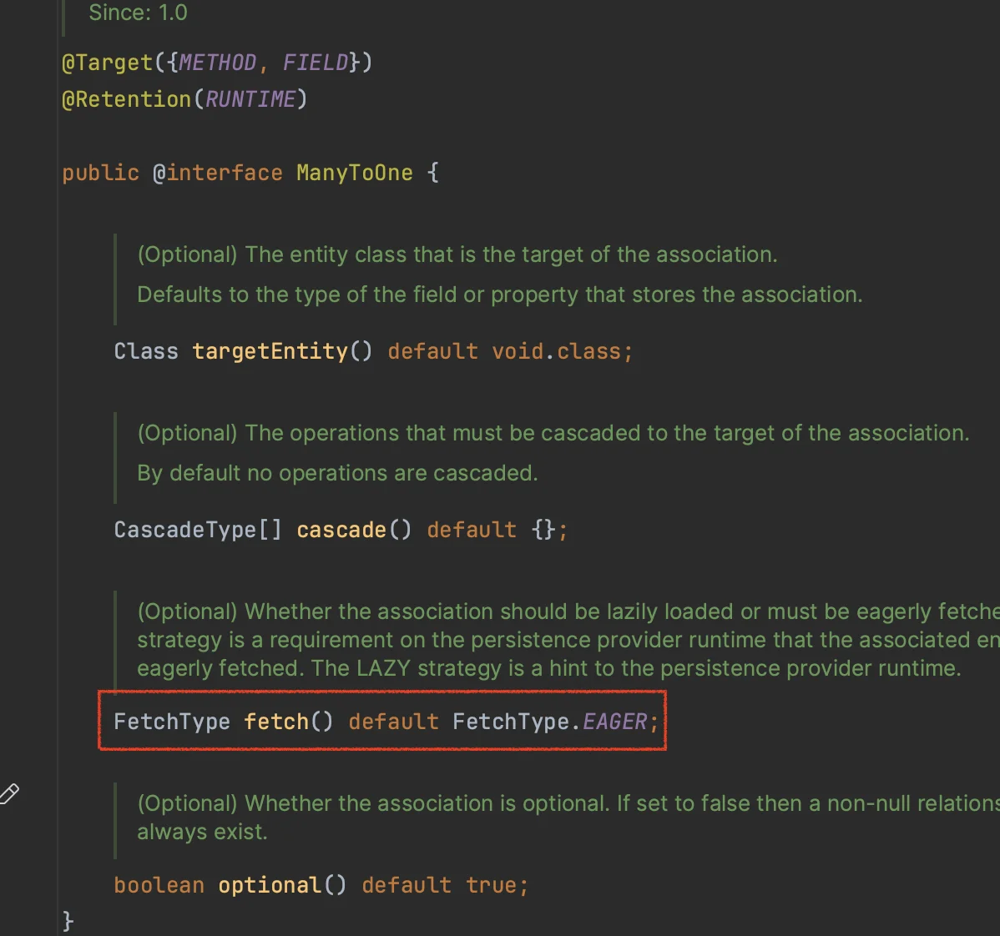

</details>

<a id="1c3eda9b0fe1813c912dc19d056f47ba"></a>

```java
@ManyToOne(fetch = FetchType.LAZY)
```

</details>

<details>
<summary><code>OneToOne</code></summary>

<details>
<summary>🧐 <code>&#64;OneToOne</code>&#58; 기본값 &#45; <strong><u>즉시로딩(EAGER)</u></strong></summary>

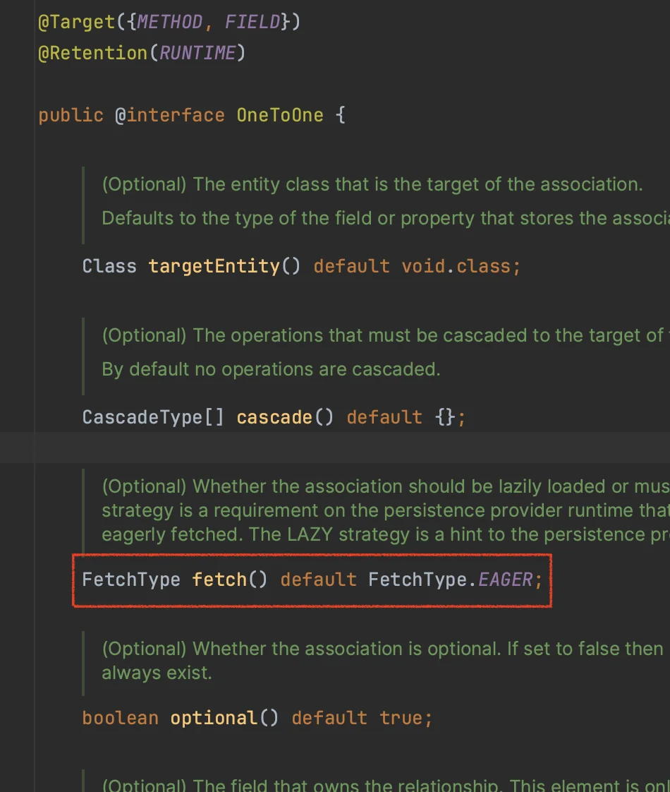

</details>

<a id="1c3eda9b0fe181cfbcc0c23cdac82b8b"></a>

```java
@OneToOne(fetch = FetchType.LAZY)
```

</details>

</details>

</details>

<details>
<summary><strong>⚠️ 실무에서 </strong><strong><code>&#64;ManyToMany</code></strong><strong>는 사용하면 안된다&#46;</strong></summary>

<a id="1c3eda9b0fe18197ae50f8a6bcc2cb4e"></a>

중간 테이블을 만드는 것은 동일하지만, <code>&#64;JoinTable</code>을 통해 만들어진 중간테이블(CATEGORY&#95;ITEM)은 <strong><u>컬럼을 추가할 수 없</u></strong>으며, <strong><u>세밀하게 쿼리를 실행하기 어렵다</u></strong>는 한계가 있다&#46; <br><br>따라서<strong> 중간 엔티티(CategoryItem)을 만들고 </strong><strong><code>&#64;ManyToOne</code></strong><strong>, </strong><strong><code>&#64;OneToMany</code></strong><strong>로 재설계</strong>하여 풀어내야 한다&#46; 

<details>
<summary><strong>🧐 예시) </strong><strong><code>N&#58;M</code></strong><strong>  → </strong><strong><code>N&#58;1</code></strong><strong> ↔ </strong><strong><code>1&#58;M</code></strong></summary>

<details>
<summary><code>N&#58;M</code> ( <code>&#64;ManyToMany</code> )</summary>

<details>
<summary><strong>&#91; 코드 &#93; Item</strong></summary>

<a id="1c3eda9b0fe1812f97c5e8fef1153569"></a>

```java
@Entity
@Inheritance(strategy = InheritanceType.SINGLE_TABLE)
@DiscriminatorColumn(name = "ITME_TYPE")
public abstract class Item {

			.  .  .

		@ManyToMany(mappedBy = "items")
    private List<Category> categories = new ArrayList<>();
```

</details>

<details>
<summary><strong>&#91; 코드 &#93; Category<br></strong></summary>

<a id="1c3eda9b0fe1816f9a31fbb6f3703d26"></a>

```java
@Entity
@Getter @Setter
public class Category {

  .  .  .

		@ManyToMany
		@JoinTable(name="category_item",
		        joinColumns = @JoinColumn(name="item_id"),
		        inverseJoinColumns = @JoinColumn(name="category_id")
		)
		private List<Item> items = new ArrayList<>();
```

</details>

</details>

<details>
<summary><code>N&#58;1</code>  ← 중간 테이블 → <code>1&#58;M</code> </summary>

<details>
<summary><strong>&#91; 코드 &#93;  중간테이블, CategoryItem</strong></summary>

<a id="1c3eda9b0fe1817e8811e1adcfe54701"></a>

```java
package com.prac.jpa1.domain;

import jakarta.persistence.*;
import lombok.Getter;
import lombok.Setter;

@Entity
@Table(name = "category_item")
@Getter
@Setter
public class CategoryItem {

    @Id
    @GeneratedValue
    @Column(name = "category_item_id")
    private Long id;

    @ManyToOne(fetch = FetchType.LAZY)
    @JoinColumn(name = "category_id")
    private Category category;

    @ManyToOne(fetch = FetchType.LAZY)
    @JoinColumn(name = "item_id")
    private Item item;
}

```

</details>

<details>
<summary><strong>&#91; 코드 &#93; Item</strong></summary>

<a id="1c3eda9b0fe18125bba3d2e33eecf99c"></a>

```java
@Entity
@Inheritance(strategy = InheritanceType.SINGLE_TABLE)
@DiscriminatorColumn(name = "ITME_TYPE")
@Getter @Setter
public abstract class Item {

			.   .  .
			
		@OneToMany(mappedBy = "item")
    private List<CategoryItem> categoryItems = new ArrayList<>();
```

</details>

<details>
<summary><strong>&#91; 코드 &#93; Category</strong></summary>

<a id="1c3eda9b0fe1814bb67bee6f354e9329"></a>

```java
@Entity
@Getter @Setter
public class Category {

			.  .  .

		@OneToMany(mappedBy = "category", cascade = CascadeType.ALL)
    private List<CategoryItem> categoryItems = new ArrayList<>();
```

</details>

</details>

<a id="1c3eda9b0fe1819ea572ffd56f023e3e"></a>

 

</details>

</details>

<details>
<summary><strong>⚠️ 값 타입 값들은 모두 </strong><strong><u>생성자(constructor)로 초기화</u></strong><strong>하여 </strong><strong><u>변경 불가능</u></strong><strong>하게 설계해야 한다&#46; ( </strong><strong><u>Setter 사용 X</u></strong><strong>) </strong></summary>

<details>
<summary><strong>ex) &#91; 코드 &#93; Address</strong></summary>

<a id="1c3eda9b0fe1814d81b0df729ee55d2f"></a>

```java
@Getter
@Embeddable          // 값 타입(임베디드) 명시
@NoArgsConstructor   // 기본 생성자 필수 
public class Adress {

    private String city;
    private String street;
    private String zipcode;
		
		// 생성자를 통한 값 초기화
    public Adress(String city, String street, String zipcode) {
        this.city = city;
        this.street = street;
        this.zipcode = zipcode;
    }
}
```

</details>

</details>

<details>
<summary>임베디드 타입( <code>&#64;Embeddable</code>)은 자바 기본 생성자(default constructor)를 <code>public</code> 또는 <code>protected</code> 로 설정해야 한다&#46;</summary>

<a id="1c3eda9b0fe181579188efdae67ab558"></a>

<code>public</code>으로 두는 것 보다는 <code>protected</code> 로 설정하는 것이 그나마 더 안전하다&#46;

<a id="1c3eda9b0fe181c090e0c1133b3dff33"></a>

PA가 이런 제약을 두는 이유는 <u>JPA 구현 라이브러리가 객체를 생성</u>할 때 리플랙션 같은 기술을 사용할 수 있도 록 지원해야 하기 때문이다&#46;

</details>

<details>
<summary>컬렉션 &#45;  필드에서 초기화</summary>


</details>

<details>
<summary>테이블, 컬럼 명 생성 전략</summary>


</details>
