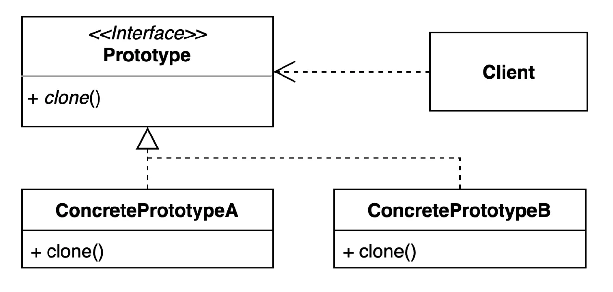
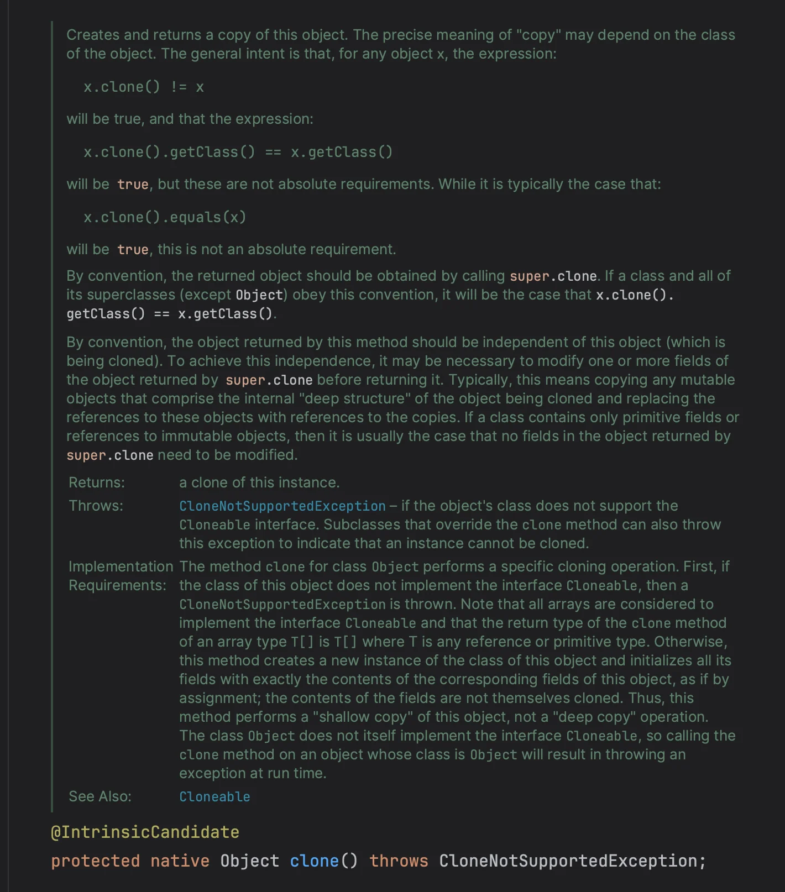
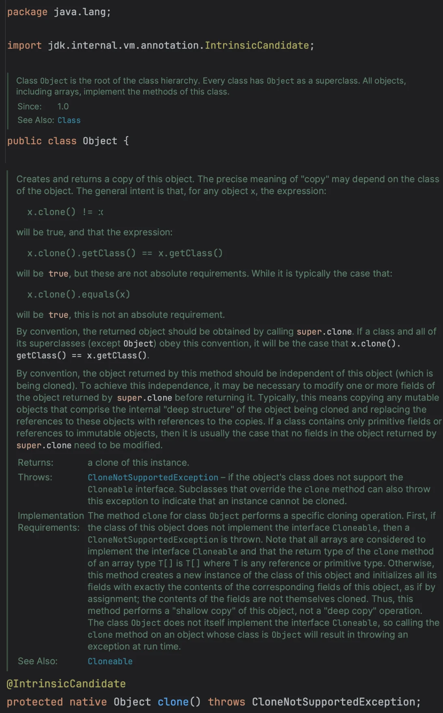
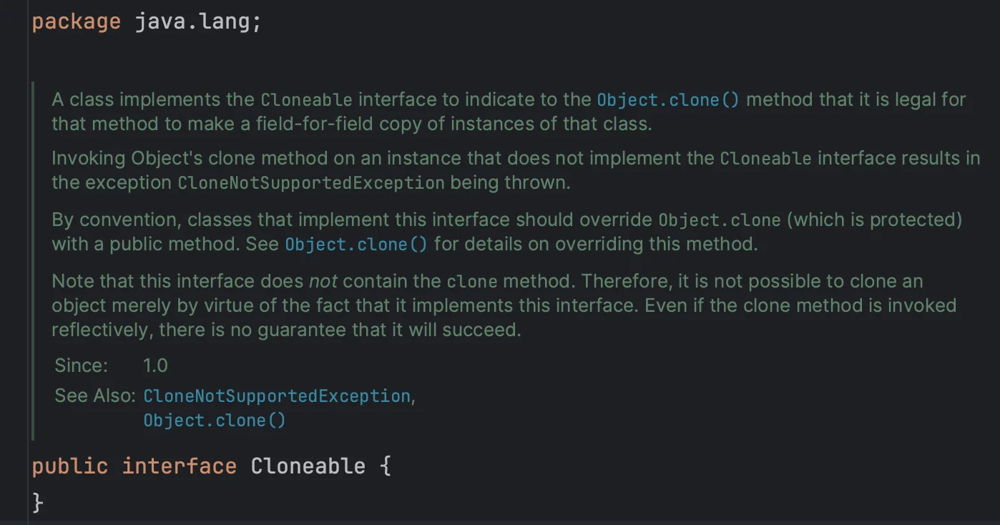
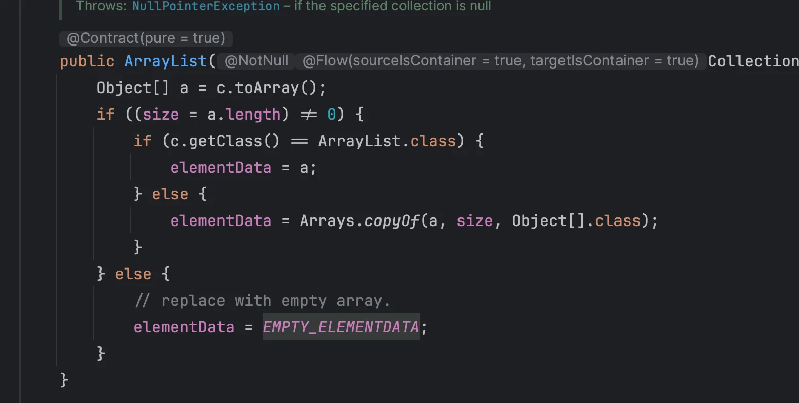
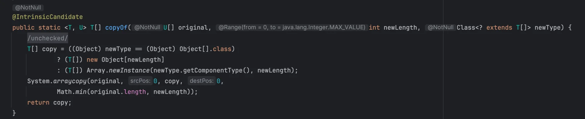

<a id="1c4eda9b0fe180a3a71fcda254ad5d9c"></a>

## 프로토타입 ( Prototype ) 패턴

---

> ✏️ 
> 
> 
> 
> <a id="1c5eda9b0fe18035a0bff203c65e82c8"></a>
> 
> 기존 인스턴스를 복제하여 새로운 인스턴스를 만드는 방법론이다&#46; 
> 
> - <strong><u>복제 기능을 갖</u></strong><strong>추고 있는 </strong><strong><u>기존 인스턴스</u></strong><u>를 프로토타입으로 사용</u>해 <strong>새 인스턴스를 만</strong>들 수<br>있다&#46;

<a id="1c4eda9b0fe1803e90edc685d39ec81b"></a>

### 1&#46; 기본 예제

<a id="1c4eda9b0fe18068a901fdc73f2a7f01"></a>

### 2&#46; 프로토타입 패턴 적용

> ✏️ 
> 
> <a id="1c5eda9b0fe180138550c2d28bfa512d"></a>
> 
> 프로토타입 패턴은 <strong><u>기존 인스턴스를 복사하여 새로운 인스턴스를 만</u></strong>드는 패턴이다&#46;
> 
> <a id="1c5eda9b0fe180b68307dbcfba20a738"></a>
> 
> 이는 <code>Object&#46;clone()</code> 을 오버라이딩하여 구현 가능하다&#46; 
> 
> <details>
> <summary><code>clone()</code> 메서드는 <code>protected</code>로 선언되어, 명시적으로 <code>Cloneable</code>을 구현해야 사용 가능하다&#46; </summary>
> 
> <a id="1c5eda9b0fe180c0a42ef0bd528b825f"></a>
> 
> ```java
> public class GithubIssue implements Cloneable {
> 
> 		. . .
> 		
> 		@Override
>     protected Object clone() throws CloneNotSupportedException {
>         GithubRepository repository = new GithubRepository();
>         repository.setUser(this.repository.getUser());
>         repository.setName(this.repository.getName());
> 
>         GithubIssue githubIssue = new GithubIssue(repository);
>         githubIssue.setId(this.id);
>         githubIssue.setTitle(this.title);
> 
>         return githubIssue;
>     }
> }
> ```
> 
> </details>
> 
> <details>
> <summary><code>Object&#46;clone()</code></summary>
> 
> 
> 
> </details>

<details>
<summary>🧐 Object 클래스 와 Cloneable 인터페이스 간의 연관관계가 없는데, 어떻게 동작을 제어할 수 있는가?</summary>

<a id="1c5eda9b0fe1801ea68ef33717d1e653"></a>

### 배경

---





<a id="1c5eda9b0fe180e1b12ecc0407ed0bdc"></a>

위 Object 클래스와 Cloneable 인터페이스를 확인해보면, 두 객체 사이 상속관계나 협력관계 등<br>어떤 연관성도 성립되지 않은 것을 확인할 수 있다&#46; 

<a id="1c5eda9b0fe180c0b4c1d0a4b5424e8e"></a>

그러나 Object&#46;clone() 사용 시, 명시적으로 Cloneable 인터페이스를 구현처리하지 않으면 <br><code>CloneNotSupportedException</code>이 발생된다&#46;

<a id="1c5eda9b0fe180ee9ff7de70d8ea96b3"></a>

어떻게  이런 동작이 가능한가? 

<a id="1c5eda9b0fe1805cad75ff2bab1d27b4"></a>

### 본문

---

> ✏️ 
> 
> <a id="1c5eda9b0fe18008914fe07be2cc894e"></a>
> 
> <strong><code>Cloneable 인터페이스</code></strong>는 <strong><u>표시(marker) 인터페이스</u></strong>이며,<br><code>Object&#46;clone()</code>메서드는 <strong><u>내부적으로 해당 객체가</u></strong><strong> </strong><strong><code>Cloneable</code></strong><strong><u>을 구현했는지 검사</u></strong>하고<br>구현하지 않았으면 <code>CloneNotSupportedException</code>을 던지도록 설계되어 있다&#46;
> 
> - 상속이나 협력 관계 없이, <u>JVM</u> 또는 <u>Object 클래스의 native 코드</u>가 특별하게 처리한다&#46;

<details>
<summary>1&#46; <code>Object&#46;clone()</code> 시그니처</summary>

<a id="1c5eda9b0fe180a4958fc7b01fc97a99"></a>

```java
@IntrinsicCandidate
protected native Object clone() throws CloneNotSupportedException;
```

- <code>native 메서드</code>&#58; 자바 코드가 아닌 <strong>C/C&#43;&#43; 같은 JVM 내부 구현</strong>에 의해 동작한다&#46; 

- <code>&#64;IntrinsicCandidate</code>&#58;  <strong><u>JVM</u></strong>이 해당 메서드를 <strong><u>직접 최적화</u></strong><strong> </strong>또는 <strong><u>특별 처리</u></strong><strong>한다는 표시이다&#46;</strong>

- <code>protected</code>&#58; 서브 클래스만 접근 가능

</details>

<details>
<summary>2&#46; <code>Cloneable</code> 인터페이스</summary>

<a id="1c5eda9b0fe180de80eeec5e88acbde3"></a>

```java
public interface Cloneable {
}
```

- 메서드가 하나도 없는 <code>Marker Interface</code> 이다&#46;
    - 단순히 <u>복제 가능 여부</u>만 JVM 알려주는 역할을 한다&#46; 

- 대표적인 Marker Interface&#58; <code>Serializable</code>, <code>Remote</code> 등

</details>

<details>
<summary><strong>3&#46; </strong><code>Clone()</code><strong> 동작 흐름</strong></summary>

1. 어떤 객체에서 clone() 호출

1. <code>Object&#46;clone()</code> (native)이 실행됨

1. 내부에서 아래와 같은 로직을 수행
    <a id="1c5eda9b0fe180ce908dfea938b74869"></a>

    ```java
    // 개념적인 동작, 실제 내부 코드와 다름
    if (!(this instanceof Cloneable)) {
        throw new CloneNotSupportedException();
    }
    ```

    - 해당 객체가 Cloneable을 구현하지 않았으면 예외를 던진다&#46; 

</details>

<a id="1c5eda9b0fe1800a85cbff975582ee59"></a>

### 왜 이렇게 동작되도록 만들었는가?

<a id="1c5eda9b0fe180e892c0f6c8d564b458"></a>

<code>Object&#46;clone()</code>은 모든 객체가 가질 수 있는 기본 기능이다&#46; 

<a id="1c5eda9b0fe18026a6f1cf4e672a008d"></a>

그러나 복제가 위험한 클래스도 많기 때문에 강제로 Cloneable을 구현해야만 사용 가능하게 제한한 것이다&#46; 

- 복제 필요 시, Cloneable 구현하여 <code>Object&#46;clone()</code> 오버라이딩

<a id="1c5eda9b0fe180ffb1f4cd52ba099881"></a>

### 정리

| 구분 | <strong>설명</strong> |
| --- | --- |
| <code>Cloneable</code> | 단순 Marker Interface (아무 메서드 없음) |
| <code>Object&#46;clone()</code> | native 메서드, 내부에서 instanceof Cloneable 검사 |
| <code>작동 방식</code> | <strong>JVM 레벨에서 특별 처리</strong>로 동작&#46; 코드 상 관계 없음 |
| <code>목적</code> | 복제를 명시적으로 허용하는 객체만 복사하게 하기 위함 (안전장치) |

</details>

<details>
<summary><strong>&#91; 🤬 문제 &#93; </strong><strong><code>Object&#46;clone()</code></strong>은 기본적으로 <strong><u>‘얕은 복사 ( shallow copy )’</u></strong>를 지원한다&#46;</summary>

<details>
<summary><strong>&#91; 🤬문제 &#93;</strong> 얕은 복사 ( shallow copy )</summary>

<a id="1c5eda9b0fe180e799a4ff9bc4215137"></a>

```java
@Overicde
protected Object clone() throws CloneNotSupportedException {
		return super.clone();    <- ✅ shallow copy
}
```

<a id="1c5eda9b0fe18085b32eca4b208c4aa0"></a>

```java
public class GithubIssue implements Cloneable{
    private int id;
    private String title;
    private GithubRepository repository;    <- ❗️복사 인스턴스에서 그대로 참조해서 사용
```

<a id="1c5eda9b0fe1803d95a2e0ac78e2773e"></a>

따라서 복사 인스턴스에서 얕은 복사를 하는 내부 객체가 변경되면, 원본 인스턴스의 값도 같이 변경된다&#46; 

<a id="1c5eda9b0fe180599906ebc042b12710"></a>

→ <code>불변성</code>이 꺠진다&#46; 

</details>

<details>
<summary>&#91; 😎 해결 &#93; 깊은 복사 ( Deep Copy )</summary>

<a id="1c5eda9b0fe180e6807ada29f40793b5"></a>

```java
// Deep Copy
@Override
protected Object clone() throws CloneNotSupportedException {
    GithubRepository repository = new GithubRepository();
    repository.setUser(this.repository.getUser());
    repository.setName(this.repository.getName());

    GithubIssue githubIssue = new GithubIssue(repository);
    githubIssue.setId(this.id);
    githubIssue.setTitle(this.title);

    return githubIssue;
}
```

<a id="1c5eda9b0fe180d583c4c27631945d0a"></a>

따라서 예제와 같이 <code>clone()</code> 메서드를  내부에서 인스턴스를 생성하여 복사하는 <strong><u>‘깊은 복사 ( deep copy )’ </u></strong>형태로 구현하여  <strong><u>원본 객체의 </u></strong><strong><u>불변성</u></strong><strong><u>을 지킬 수 있다</u></strong>

</details>

</details>

<a id="1c5eda9b0fe18071afacf4edc60ffc33"></a>

### 코드

[DesignPattern&#95;with&#95;jave/src/main/java/&#95;01&#95;creational&#95;patterns/&#95;05&#95;prototype/&#95;02&#95;after at main · gyungsubLee/DesignPattern&#95;with&#95;jave]()

<details>
<summary>&#91; 코드 &#93; GithubRepository</summary>

<a id="1c5eda9b0fe18017b8eada2af753fbc0"></a>

```java
package _01_creational_patterns._05_prototype._02_after;

public class GithubRepository {
    private String user;
    private String name;

    public String getUser() {
        return user;
    }

    public void setUser(String user) {
        this.user = user;
    }

    public String getName() {
        return name;
    }

    public void setName(String name) {
        this.name = name;
    }
}
```

</details>

<details>
<summary>&#91; 코드 &#93; GithubIssue &#45; Object&#46;clone 오버라이딩</summary>

<a id="1c5eda9b0fe18046a5a2e0c26023502f"></a>

```java
public class GithubIssue implements Cloneable{
    private int id;
    private String title;
    private GithubRepository repository;

    public GithubIssue(GithubRepository repository) {
        this.repository = repository;
    }

    public int getId() {
        return id;
    }

    public String getTitle() {
        return title;
    }

    public GithubRepository getRepository() {
        return repository;
    }

    public void setId(int id) {
        this.id = id;
    }

    public void setTitle(String title) {
        this.title = title;
    }

    public String getUrl() {
        return String.format(
                "https://github,com/%s/%s/issues/%d",
                repository.getUser(),
                repository.getName(),
                this.getId());
    }
		
		
    // Cloneable - Object.clone() 오버라이딩 -> 프로토타입 패턴 구현
    // Deep Copy
    @Override
    protected Object clone() throws CloneNotSupportedException {
        GithubRepository repository = new GithubRepository();
        repository.setUser(this.repository.getUser());
        repository.setName(this.repository.getName());

        GithubIssue githubIssue = new GithubIssue(repository);
        githubIssue.setId(this.id);
        githubIssue.setTitle(this.title);

        return githubIssue;
    }

    @Override
    public boolean equals(Object o) {
        if (this == o) return true;
        if (o == null || getClass() != o.getClass()) return false;
        GithubIssue that = (GithubIssue) o;
        return id == that.id && Objects.equals(title, this.title) && Objects.equals(repository, that.repository);
    }

    @Override
    public int hashCode() {
        return Objects.hash(id, title, repository);
    }
}
```

</details>

<details>
<summary>&#91; 코드 &#93; App</summary>

<a id="1c5eda9b0fe18011854ace3dbdc13827"></a>

```java
public class App {
    public static void main(String[] args) throws CloneNotSupportedException {
        GithubRepository repository = new GithubRepository();
        repository.setUser("whiteship");
        repository.setName("live-study");

        GithubIssue githubIssue = new GithubIssue(repository);
        githubIssue.setId(1);
        githubIssue.setTitle("1주차 과제: JVM은 무엇이며 자바 코드는 어떻게 실행하는 것인가.");

        String url = githubIssue.getUrl();
        System.out.println(url);  // https://github,com/whiteship/live-study/issues/1

        // 인스턴스 복사 - Deep Copy
        GithubIssue clone = (GithubIssue) githubIssue.clone();
        System.out.println(clone);

        repository.setUser("LEE");

        System.out.println(clone != githubIssue);    // ture
        System.out.println(clone.equals(githubIssue));  // false
        System.out.println(clone.getClass() == githubIssue.getClass());  // true
        System.out.println(clone.getRepository() == githubIssue.getRepository());   // false

        System.out.println(clone.getUrl());   // https://github,com/whiteship/live-study/issues/1
    }
}
```

</details>

<a id="1c4eda9b0fe180bd8e24c19e31d5c401"></a>

### 3&#46; 프로토타입 패턴의 장•단점

> ✅ 장점

- 복잡한 객체를 만드는 과정을 숨길 수 있다&#46;

- 기존 객체를 복제하는 과정이 새 인스턴스를 만드는 것보다 비용(시간 또는 메모리)적인 면에서 효율적일 수 있다&#46; 
    - 동일한 작업이 복잡하거나, DB 및 네트워크에 접근한다면 <strong><u>기존 인스턴스를 복제하여 사용</u></strong>하는 것이 더 비용적으로 더 이득이 있다&#46;

- 추상적인 타입을 리턴 할 수 있다&#46;

> 🤬 단점

- 복제한 객체를 만드는 과정 자체가 복잡할 수 있다&#46; 
    - 특히, 순환 참조가 있는 경우

<a id="1c4eda9b0fe18001a469f9c1214673c7"></a>

### 4&#46; 실무 사용

> ✏️ 
> 
> <a id="1c4eda9b0fe18082b870f3d4e5710160"></a>
> 
> <strong>실무 사용</strong>
> 
> - 자바 Object 클래스의 clone 메소드와 Cloneable 인터페이스
> 
> - shallow copy와 deep copy
> 
> - ModelMapper

<a id="1c5eda9b0fe18023a33af04b1472db0c"></a>

### 코드

[DesignPattern&#95;with&#95;jave/src/main/java/&#95;01&#95;creational&#95;patterns/&#95;05&#95;prototype/&#95;03&#95;java at main · gyungsubLee/DesignPattern&#95;with&#95;jave]()

<details>
<summary>1&#46; Collection &#45; ArrayList</summary>

<details>
<summary>&#91; 코드 &#93; Student</summary>

<a id="1c5eda9b0fe18044980fc75de507366e"></a>

```java
package _01_creational_patterns._05_prototype._03_java;

public class Student {

    String name;

    public Student(String name) {
        this.name = name;
    }

    @Override
    public String toString() {
        return "Student{" +
                "name='" + name + '\'' +
                '}';
    }
}

```

</details>

<a id="1c5eda9b0fe18094bbeac1d045957d97"></a>

```java
package _01_creational_patterns._05_prototype._03_java;

import java.util.ArrayList;
import java.util.List;

public class JavaCollectionExample {
    public static void main(String[] args) {
        Student keesun = new Student("keesun");
        Student whiteship = new Student("whiteship");
        List<Student> students = new ArrayList<>();
        students.add(keesun);
        students.add(whiteship);

        ArrayList<Student> clone = new ArrayList<>(students);
        System.out.println(clone);
    }
}

```

<details>
<summary>ArrayList &#45; constructor</summary>



</details>

<details>
<summary>copyOf()</summary>



</details>

</details>

<details>
<summary>2&#46; ModelMapper</summary>

<details>
<summary>&#91; 코드 &#93; GithubIssueData</summary>

<a id="1c5eda9b0fe1808d9bfef6e0828ebffb"></a>

```java
package _01_creational_patterns._05_prototype._03_java;

public class GithubIssueData {
    private int id;
    private String title;
    private String repositoryUser;
    private String repositoryName;

    public int getId() {
        return id;
    }

    public void setId(int id) {
        this.id = id;
    }

    public String getTitle() {
        return title;
    }

    public void setTitle(String title) {
        this.title = title;
    }

    public String getRepositoryUser() {
        return repositoryUser;
    }

    public void setRepositoryUser(String repositoryUser) {
        this.repositoryUser = repositoryUser;
    }

    public String getRepositoryName() {
        return repositoryName;
    }

    public void setRepositoryName(String repositoryName) {
        this.repositoryName = repositoryName;
    }

    @Override
    public String toString() {
        return "GithubIssueData{" +
                "id=" + id +
                ", title='" + title + '\'' +
                ", repositoryUser='" + repositoryUser + '\'' +
                ", repositoryName='" + repositoryName + '\'' +
                '}';
    }
}

```

</details>

<a id="1c5eda9b0fe1808db765e9e2cd51b433"></a>

```java
import org.modelmapper.ModelMapper;

public class ModelMapperExample {

    public static void main(String[] args) {
        GithubRepository repository = new GithubRepository();
        repository.setUser("whiteship");
        repository.setName("live-study");

        GithubIssue githubIssue = new GithubIssue(repository);
        githubIssue.setId(1);
        githubIssue.setTitle("1주차 과제: JVM은 무엇이며 자바 코드는 어떻게 실행하는 것인가.");

        // NOTE: 'ModelMapper.map(원본 인스턴스, 형식)' - 프로토타입 패턴 사용한 클론 객체 생성
        ModelMapper modelMapper = new ModelMapper();
        GithubIssueData githubIssueData = modelMapper.map(githubIssue, GithubIssueData.class);
        System.out.println(githubIssueData);

        githubIssueData.setRepositoryName("수정1");
        System.out.println(githubIssueData);
    }
}
```

</details>
