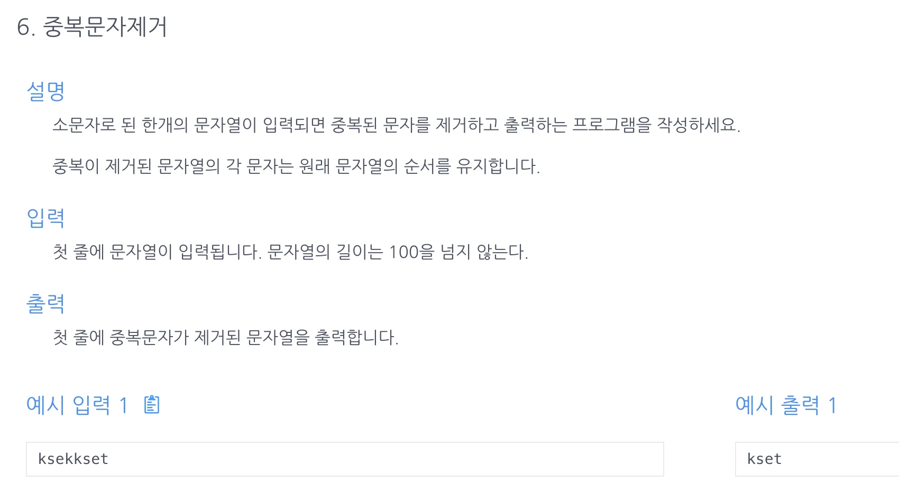

<a id="1c3eda9b0fe181b7a06accee6d2bd707"></a>

## 문제)



<a id="1c3eda9b0fe181c0aa57d1aeb5bfcf92"></a>

```java
ksekkset
```

<a id="1c3eda9b0fe1816e9917dfc467da6b3f"></a>

## 풀이) 

<a id="1c3eda9b0fe1817ba071e36c3488d856"></a>

### 풀이1) map(조회&#58; O(1))

<a id="1c3eda9b0fe181a2bb18d5b04b491035"></a>

```java
import java.util.HashMap;
import java.util.Scanner;

public class Main {
    // map: 조회 O(1), 따라서
    public String solution(String str) {
        String answer = "";
        HashMap<Character, String> map = new HashMap<Character, String>();
        for ( char s : str.toCharArray()) {
            if (map.containsKey(s)) {
                continue;
            }
            answer += s;
            map.put(s, "exist");
        }
        return answer;
    }
    public static void main(String[] args){
        Main m = new Main();
        Scanner sc=new Scanner(System.in);
        String str = sc.nextLine();
        System.out.print(m.solution(str));
    }
}
```

<a id="1c3eda9b0fe1811a9f4ddd0487511255"></a>

### 풀이2) ArrayList, contains()

<a id="1c3eda9b0fe1816db14ae7f13522f70b"></a>

```java
import java.util.ArrayList;
import java.util.Scanner;

public class Main {
    public String solution(String s){
        ArrayList<Character> includeList = new ArrayList<>();
        String answer = "";
        for(char x : s.toCharArray()){
            if(includeList.contains(x)) continue;
            includeList.add(x);
            answer += x;
        }
        return answer;
    }
    public static void main(String[] args) {
        Main m = new Main();
        Scanner sc = new Scanner(System.in);
        String str = sc.next();
        System.out.println(m.solution(str));

    }
}
```

<a id="1c3eda9b0fe181b58cdee0d69d07f2d3"></a>

### 강의 풀이) String&#46;charAt(index), str&#46;indexOf(value) 

<a id="1c3eda9b0fe18166bfb1f8fb74eaeeb1"></a>

String&#46;charAt(index)&#58; 문자열을 배열과 같이 처리해줌, 문자열에서 해당하는 인덱스 문자 리턴

<a id="1c3eda9b0fe181cd9ae9c82c32a775f2"></a>

String&#46;indexOf(value)&#58; 해당하는 문자의 인덱스값 리턴 ⇒  문자가 중복된 경우, 가장 처음에 존재하는 문자의 인덱스를 리턴함&#46; 

<a id="1c3eda9b0fe181afaf0ee40f550f5e3f"></a>

```java
import java.util.*;
public class Main {
    public String solution(String str) {
        String answer = "";
        for(int i=0; i<str.length(); i++){
            char current = str.charAt(i);
            if(i==str.indexOf(current))answer+=current;
        }
        return answer;
    }

    public static void main (String[] args){
        Main m = new Main();
        Scanner sc = new Scanner(System.in);
        String str =sc.next();
        System.out.println(m.solution(str));
    }
}
```
