<a id="1c3eda9b0fe181159440dff21014f408"></a>

### <strong>🤔 Id 값 존재</strong>해야 레코드가 생성된다&#46; 

> <strong>Primary key 값이 존재</strong>야 테이블에서 <strong>데이터를 인식하고 레코드를 추가</strong>한다&#46; 

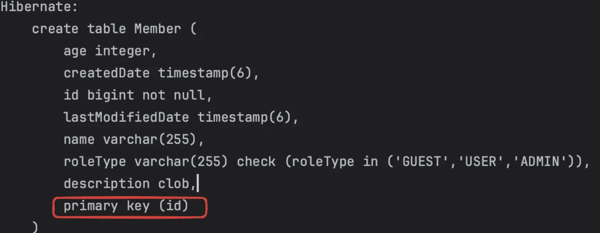

> 위 DDL 실행문을 보면 <strong>기본 키(primary key)</strong> 값이 <strong>id</strong> 값으로 설정된 것을 확인 할 수 있다&#46;<br>따라서 <strong>id 값이 존재해야 DB에서 PK 값을 인식하여 레코드를 생성</strong>한다&#46; 

<a id="1c3eda9b0fe181b09c92cba0ebcff279"></a>

```java
Member member = new Member();
member.setId(100L);
em.persist(member);

tx.commit();
```

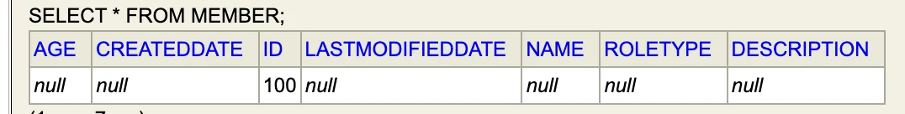

> 📌 <strong>정리</strong>
> 
> - <strong>객체와 테이블 매핑</strong>&#58; <code>&#64;Entity</code>, <code>&#64;Table</code>
> 
> - <strong>필드와 컬럼 매핑</strong>&#58; <code>&#64;Column</code>
> 
> - <strong>기본 키 매핑</strong>&#58; <code>&#64;Id</code>
> 
> - <strong>연관관계 매핑</strong>&#58; <code>&#64;ManyToOne</code>, <code>&#64;JoinColumn</code>  
>     - ex) 팀 ↔ 회원, 해당하는 회원이 어느 팀에 속해 있는지, 연관관계 매핑 시
>         - 1&#58;1 (<code>&#64;OneToOne</code>)
> 
>         - 1&#58;다 (<code>&#64;OneToMany</code>)
> 
>         - 다&#58;1 (<code>&#64;ManyToOne</code>)
> 
>         - <del>다&#58;다 (</del><del><code>&#64;ManyToMany</code></del><del>)</del>
> 
>     > 자세한 내용은 다음 챕터 참조  

<a id="1c3eda9b0fe181ffa0d0f35ddf250567"></a>

## 객체와 테이블 매핑

> Entity ( JPA 객체 ) ←  매핑 → 테이블 ( DB ) 

<a id="1c3eda9b0fe181faa6b8d5ebd127dfb5"></a>

### <code>&#64;Entity</code>

> 📌 <strong><u><code>&#64;Entity</code></u></strong><strong><u>가 붙은 클래스</u></strong>를 <strong>JPA가 관리</strong>하며 <strong>엔티티</strong>라 하다&#46;
> 
> - JPA는 Entity를 기준으로 DB에 해당하는 테이블을 생성 및 매핑한다&#46;
> 
> > JPA를 사용한 DB 테이블과 매핑할 객체 = 엔티티( &#64;Entity &#43; class )
> 
> - <strong><u>기본 생성자 필수</u></strong>
>     - <u>파라미터 x</u>
> 
>     - 접근자&#58; <code>public</code>, <code>protect</code>  (<code>private</code> ❌ )
> 
> - <code>final 클래스</code>, <code>enum</code>, <code>interface</code>, <code>inner 클래스</code> ❌ 
> 
> - 저장할 필드에 <code>final</code> 사용 X

<details>
<summary><code>&#64;Entity</code> 속성 &#45; <code>name</code></summary>

- JPA에서 사용할 엔티티 이름 지정

- default&#58; 클래스 이름을 그대로 사용    
    - ex) Member(class) → member(table)

    - <strong><u>중복되는 클래스 이름 없</u></strong>으면 <strong><u>default 사용(속성 적용 X)</u></strong>

<details>
<summary>ex)</summary>

<a id="1c3eda9b0fe181468f56ce0bee2c451c"></a>

```java
@Entity(name="")
public class Member {
   .  .  .
```

</details>

</details>

<a id="1c3eda9b0fe1819d9fd1c5e865f55a8d"></a>

### <code>&#64;Table</code>

> 엔티티와 매핑할 테이블 지정

| 속성 | 기능 | 기본값 |
| --- | --- | --- |
| name | 매핑(생성)할 테이블 이름 | 엔티티 이름을 사용 |
| catalog | 데이터베이스 catalog 매핑 |  |
| schema | 데이터베이스 shema 매핑 |  |
| uniqueConstraints | DDL 생성 시에 유니크 제약 조건 생성 |  |

- ex) <code>&#64;Table(name=&#34;MBR&#34;)</code>
    > ⚠️ <strong>DB에 ‘MBR’ 테이블 생성이 안</strong> 되어있다면  <strong>쿼리가 실행  되지 않</strong>음

<a id="1c3eda9b0fe181dc9db0ff1f4e4c2ab9"></a>

## 데이터베이스 스키마(DDL) 자동 생성 (<code>hibernate&#46;hbm2ddl&#46;auto</code>)

> 📌 ◦ 애플리케이션 실행 시점에서 DDL(create, alter, drop, truncate) 자동 생성 <br>   → DB,table이 생성, 변경, 삭제 시점에서 자동 생성<br>• 테이블 중심 → <strong>객체 중심</strong>으로 개발 가능<br>• 데이터베이스 방언(Diallect) 을 활용해서 데이터 베이스에 맞는 적절한 DDL 생성<br>   이렇게<strong> </strong><strong>생성된 DDL은 개발 장비에서만 사용</strong><br>       →  생성된 DDL은 운영 서버에서 사용하지 않거나, 수정 후 사용

<details>
<summary>🧐<strong> 데이터베이스 스키마?</strong></summary>


</details>

<details>
<summary><a href="https://cbw1030.tistory.com/71">🧐 </a><strong><a href="https://cbw1030.tistory.com/71">SQL&#58; </a></strong><strong><a href="https://cbw1030.tistory.com/71"><code>DDL</code></a></strong><strong><a href="https://cbw1030.tistory.com/71">, </a></strong><strong><a href="https://cbw1030.tistory.com/71"><code>DML</code></a></strong><strong><a href="https://cbw1030.tistory.com/71">, </a></strong><strong><a href="https://cbw1030.tistory.com/71"><code>DCL</code></a></strong><strong><a href="https://cbw1030.tistory.com/71">?</a></strong></summary>

<a id="1c3eda9b0fe181a183a9d658b5bab3f8"></a>

→  <a href="#/post/1c3eda9b-0fe1-81d1-803d-e9d68b415784">페이지</a> 

</details>

<details>
<summary>🧐 ANSI SQL,  방언(<strong>Dialect</strong>)?</summary>

<a id="1c3eda9b0fe181c08047d23b78ccd760"></a>

→ <a href="#/post/1c3eda9b-0fe1-8109-85b9-f247fdd53003">페이지</a> 

</details>

<a id="1c3eda9b0fe18147b6afda0204b7e4e0"></a>

### DDL(스키마) 자동 생성 (<code>hibernate&#46;hbm2ddl&#46;auto</code> )

| 옵션  | 설명 |
| --- | --- |
| <code>create</code> | 기존테이블 삭제 후 다시 생성<br>(DROP &#43; CREATE) |
| <code>create&#45;drop</code> | create와 같으나 종료시점에 테이블 DROP |
| <code>update</code> | 변경 내용만 반영 ( <strong>운영DB 사용X</strong> )<br>삭제 X, 추가만 가능 |
| <code>vaildate</code> | Entity 와 table이 정상 매핑되었는지 확인 |
| <code>none</code> | 사용하지 않음 ( 관례 ) |

<details>
<summary><strong>ex) create  </strong> →   <code>drop</code> &#43; <code>create</code></summary>


> drop, create 쿼리 날림

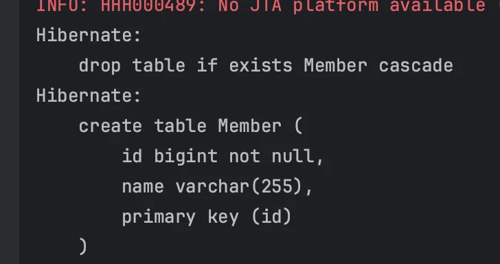

</details>

<details>
<summary><strong>ex) create&#45;drop </strong>  →   <code>drop</code> &#43; <code>create</code> &#43; <code>drop</code></summary>


<a id="1c3eda9b0fe18126a751caa198126cbf"></a>

```java
Member member = new Member(100L, "A");
em.persist(member);
tx.commit();
```


</details>

<details>
<summary><strong>ex) update </strong>  →  <code>alter</code> </summary>

<details>
<summary><code>&#64;Id</code> 필드 값 추가 →  <code>alter</code>(DDL) 테이블 컬럼 수정</summary>

<a id="1c3eda9b0fe181a4a7c7fe58ec20675d"></a>

```java
// Member
@Entity
public class Member {

    @Id
    private Long id;
    private String name;
    private String prac;
```

<a id="1c3eda9b0fe18112a292e9171f22dbc6"></a>

```java
// JapMain
Member member = new Member(100L, "A", "A");
em.persist(member);
tx.commit();
```

> <code>alter</code> SQL 실행됨


</details>

<details>
<summary>삭제(<code>em&#46;remove()</code>)  → <code>delete</code>(DML)</summary>


<a id="1c3eda9b0fe1818192b4f39fca8524e2"></a>

```java
Member member1 = em.find(Member.class, 100L);
em.remove(member1);
tx.commit();
```

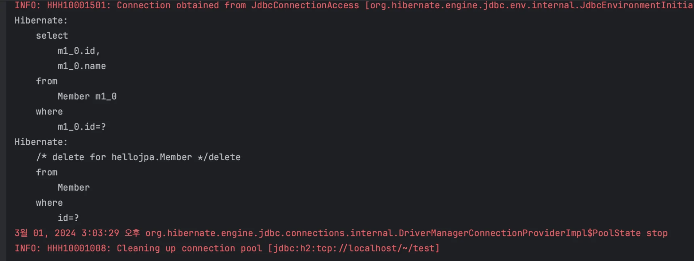

</details>

</details>

<details>
<summary><strong>ex) validate</strong>  →  테이블에 없는 필드값 정의 시 <strong><code>PersistenceException</code></strong><strong>, </strong><strong><code>SchemaManagementException</code></strong> </summary>


<a id="1c3eda9b0fe181139cf2d30c96029483"></a>

```java
@Entity
public class Member {

    @Id
    private Long id;
    private String name;
    private String prc;

  .   .   .
```

> 테이블에 없는 속성 값을 필드에 추가할 시 아래와 같은 오류가 발생된다&#46; <br>→ <strong><code>PersistenceException</code></strong><strong>, </strong><strong><code>SchemaManagementException</code></strong> 


</details>

<details>
<summary><strong>ex) none</strong></summary>


> auto 사용 ❌

<a id="1c3eda9b0fe18175a44de6d26bc85129"></a>

관례상 none 이라고 표시, 막 적어도 동일

</details>

<a id="1c3eda9b0fe181819e72d7eb1d07e98c"></a>

### 운영 장비에는 절대 <code>create</code>, <code>create&#45;drop</code>, <code>update</code> 사용 ❌

> <strong>• </strong><strong><u>로컬 개발 서버에서만 사용</u></strong><strong>, </strong><strong><u>테스트 서버, 운영 서버에는 절대 사용 금지 </u></strong><br>• <strong>권장) </strong><strong><u>직접 스크립트 짜서 테스트 서버에 테스트 해보고 문제 없을 시, 운영 서버에 적용</u></strong>

> 📌 <strong>가급적 </strong><strong><u>개발서버</u></strong><strong>나</strong><del><strong>,</strong></del><strong> </strong><strong><u>테스트 서버</u></strong><strong>에서도 </strong><strong><code>create</code></strong><strong>, </strong><strong><code>create&#45;drop</code></strong><strong>, </strong><strong><code>update</code></strong><strong> 사용 ❌</strong>
> 
> - 개발 초기 단계(로컬 서버) → create, update 
> 
> - 테스트 서버(여러명의 개발자가 함께 사용하는 중간 서버)  → update or <strong><code>validate</code></strong> 
>     > <strong>절대 </strong><strong><code>create</code></strong><strong>사용 금지&#33;&#33; </strong><br>→  create 사용 시<strong> 테이블</strong><u> </u><strong><u>DROP</u></strong><strong> 발생</strong>, 기존 테이블 데이터 다 날아감
> 
> - 스테이징, 운영 서버 → <strong><code>vaildate</code></strong> or <strong><code>none</code></strong>

> ⚠️ <strong>Case)</strong> <strong>큰 장애 발생 2건,</strong>  <strong><code>create</code></strong>,<strong> </strong><strong> </strong><strong><code>update</code></strong><strong> </strong><strong><u>테스트서버</u></strong><strong>, </strong><strong><u>운영서버</u></strong><strong>에 사용하여 데이터 날아감</strong><br>데이터가 몇천만건 있는 상태에서 alter를 잘못 사용하면 테이블 수정되면서 전체 시스템 중단 되는 대장애 발생…<br>→ <strong><u>애플리케이션 로딩 시점에 시스템이 자동으로 alter를 날린다는 것은 굉장히 위험<br></u></strong>
> 
> <a id="1c3eda9b0fe181aba221db98c3893fe2"></a>
> 
> 개발 서버에서 테스트하다가 설정 들이 꼬이면서 실행되어 운영 테이블 몇개가 사라짐
> 
> <a id="1c3eda9b0fe1811583e3d1b0ba5a7c0e"></a>
> 
> update도 잘못되면 alter column이 나간다&#46;  
> 
> <a id="1c3eda9b0fe181cd9fb5db471d0317e2"></a>
> 
>    → 데이터베이스 lock 걸림, 몇분 동안 서비스가 중단됨
> 
> - <strong><code>update</code></strong><strong> (ALTER)</strong> 사용 금지
> 
> - <strong><code>create</code></strong>, <strong><code>create&#45;drop</code></strong><strong> (DROP) 당연히 사용 금지 </strong>
> 
> - <strong>작성한 스크립트를 가급적 얼터 테이블 또는 DB에다가</strong><strong><u> 테스트</u></strong><strong> 하고 적용</strong>
> 
> - <strong><u>웹 어플리케이션 계정</u></strong>은 <strong><code>alter</code></strong>나, <strong><code>drop</code></strong>을 못하도록 <strong><u>계정 자체를 분리</u></strong>해야 한다&#46;

> 👍🏻 Tip) 자동으로 만드는 스크립트 운영서버에 적용할 때, 가급적 다듬어서 넘김
> 
> <details>
> <summary>스크립트 예시 &#45; </summary>
> 
> 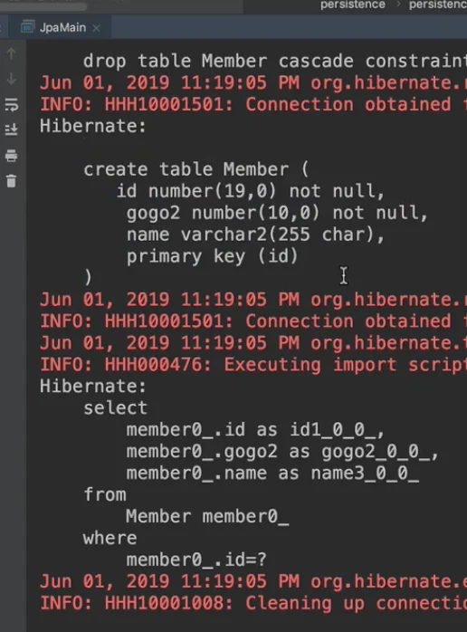
> 
> </details>

<a id="1c3eda9b0fe18147bad7f2709ae3b5e4"></a>

### 데이터베이스 방언(Dialect) 값에 따른 변화 (<strong><code>hibernate&#46;dialect</code></strong><strong>) </strong>

> 방언에 따른 DB의 SQL을 적절하게 맞춰 실행해줌

<details>
<summary><strong>Oracle </strong>( <strong><code>org&#46;hibernate&#46;dialect&#46;OracleDialect</code></strong><strong> </strong>)  </summary>

<a id="1c3eda9b0fe18117a70aff7af6c8739f"></a>

```java
<property name="hibernate.dialect" 
					value="org.hibernate.dialect.OracleDialect"/>
```

> 오라클은 가변문자 기본값이 <strong><u>varchar2</u></strong>이기 때문에 아래와 같이 <strong><u>varchar2로 생성</u></strong>되는 것을 확인할 수 있다&#46; 


</details>

<a id="1c3eda9b0fe181b38293d43b7c14e994"></a>

### 추가 제약 조건 &#45;DDL 생성 기능 

> <strong>DDL 생성 시에만 영향</strong>을 준다&#46; (런타임 영향 X)<br>→ <strong>데이터베이스에만 영향</strong>을 줌 (JPA 실행에는 영향 X) 

<details>
<summary><strong><code>unique = true</code></strong><strong>&#58; </strong><strong><u>유니크를 적용한 컬럼</u></strong><strong>에 </strong><strong><u>동일한 값이 추가</u></strong><strong>되는 경우, </strong><strong><u>해당 Entity DB에 추가 X</u></strong></summary>

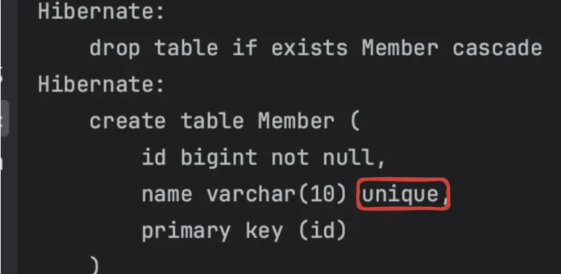

<details>
<summary>Case1) <strong><u>유니크 컬럼에 이미 존재하는 값이 포함된 Entity</u></strong>는<strong> DB에 추가되지 않</strong>음</summary>

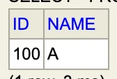

<a id="1c3eda9b0fe181c0874ff71d26f889d6"></a>

```java
Member member1 = new Member(110L, "A");  // 유니크 컬럼 name에 "A" 값 존재
em.persist(member1);

tx.commit();
```

> 아래와 같이 insert 쿼리 정상 실행되지만 <br>DB에 값은 추가되지 않음

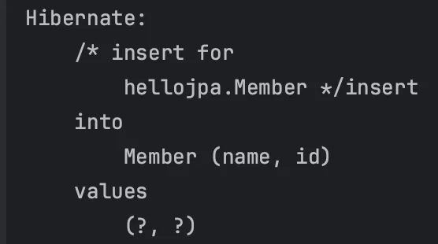


</details>

<details>
<summary>Case2) 아래와 같이 <strong><u>unique 필드에 동일한 값의 엔티티 2개를 추가하여 커밋 </u></strong>시, <strong>DB에 두개의 엔티티 모두 추가되지 않</strong>음</summary>

<a id="1c3eda9b0fe1815c8441ee11d9e9090e"></a>

```java
Member member1 = new Member(100L, "A");
em.persist(member1);

Member member2 = new Member(110L, "A");
em.persist(member2);

tx.commit();
```

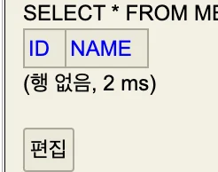

</details>

</details>

<details>
<summary>유니크 제약조건 추가</summary>

<a id="1c3eda9b0fe18157b4d8f4ad97e70f51"></a>

<strong>&#64;Table(uniqueConstraints = {&#64;UniqueConstraint( name = &#34;NAME&#95;AGE&#95;UNIQUE&#34;,<br>columnNames = {&#34;NAME&#34;, &#34;AGE&#34;} )})</strong>

</details>

<a id="1c3eda9b0fe1813f848cc00d5cd59425"></a>

## 필드와 컬럼 매핑

> 📌 <strong>매핑 어노테이션</strong>
> 
> | Anotation | 설명 |
> | --- | --- |
> | &#64;Column | 컬럼 매핑 |
> | &#64;Enumerated | enum 타입 매핑 |
> | <del>&#64;Temporal<br></del>→ <br>• LocalDate(연월), <br>• LocalDateTime(연월일) | 날짜 타입 매핑 |
> | &#64;Lob | BLOB, CLOB 매핑 |
> | &#64;Transient | 특정 필드를 컬럼에 매핑하지 않음(매핑 무시) |

> /icons/checkmark-line_red.svg <strong>요구사항</strong>
> 
> - 회원, 일반 회원과 관리자로 구분
> 
> - 회원 가입일, 수정일 포함
> 
> - 회원 설명 필드 존재 (필드 길이 제한 x)

<a id="1c3eda9b0fe181aa9ec6c52d7cd56dd0"></a>

### 컬럼 매핑 &#45; &#64;Column 

| 속성 | 설명 | 기본값 |
| --- | --- | --- |
| name | 필드와 매핑할 테이블의 컬럼 이름 | 객체 필드 이름 |
| insertable,<br>updatable | 등록, 변경  가능 여부 | TRUE |
| nullable(DDL) | null 값의 허용 여부 설정, <br>false 설정 = not null 제약조건  |  |
| unique(DDL) | &#64;Table의 uniqueConstraints와 같지만 한 컬럼에 간단한 유니크 제약조건을 걸 때 사용한다&#46;  |  |
| columnDefinition | 데이터베이스 컬럼 정보를 직접 줄 수 있다&#46;<br>ex) varchar(100) default ‘EMPTY’ | 필드의 자바 타입과 방언 정보를 사용해 적절한 컬럼 타입 생성 |
| length(DDL) | 문자 길이 제약조건, String 타입에만 사용한다&#46; | 255 |
| precision,<br>scale(DDL) | BigDecimal 타입에서 사용한다(BigInteger도 사용할 수 있다)&#46; precision은 소수점을 포함한 전체 자 릿수를, scale은 소수의 자릿수 다&#46; 참고로 double, float 타입에는 적용되지 않는다&#46; 아주 큰 숫자나 정 밀한 소수를 다루어야 할 때만 사용한다&#46; | precision=19, scale=2 |

<a id="1c3eda9b0fe1819bb7d0e1941640456b"></a>

### enum 타입 매핑 &#45; &#64;Enumerated(<strong>EnumType</strong><strong>&#46;</strong><em><strong>STRING</strong></em><strong>)</strong>

<details>
<summary>🧐 default&#58; <code>EnumType&#46;ORDINAL;</code> </summary>

<a id="1c3eda9b0fe1815ba8b0d25f84cc1f6c"></a>

```java
@Target({ElementType.METHOD, ElementType.FIELD})
@Retention(RetentionPolicy.RUNTIME)
public @interface Enumerated {
    EnumType value() default EnumType.ORDINAL;
}
```

</details>

<a id="1c3eda9b0fe1814797e5db8b6d084b9f"></a>

<strong>자바 enum 타입을 매핑할 때 사용</strong>

<a id="1c3eda9b0fe18101ab1fd604ce95ab27"></a>

⇒ DB에는 enum 타입이 존재하지 않음, 따라서 <code>&#64;Enumerated</code>를 통해 사용함

| 속성  | 설명  | 기본값 |
| --- | --- | --- |
| value  | • EnumType&#46;ORDINAL&#58; enum 순서를 데이터베이스에 저장<br>• EnumType&#46;STRING&#58; enum 이름을 데이터베이스에 저장 | EnumType&#46;ORDINAL |

> ⚠️ <strong>STRING 사용 </strong>
> 
> > &#64;Enumerated(<strong>EnumType&#46;</strong><em><strong>STRING</strong></em><strong>)</strong>
> 
> <a id="1c3eda9b0fe181939043f23a127026e1"></a>
> 
> ```java
> @Entity
> public class Member {
>    .  .  .
> 	
> 		@Enumerated(EnumType.STRING)
> 		private RoleType roleType;
> ```
> 
> <a id="1c3eda9b0fe1816ca6d7da0128410680"></a>
> 
> String 사용 시, 아래와 같이 String 타입으로 저장되어 값이 추가되어도 기존의 값과 충돌하지 않음
> 
> 
> 
> <details>
> <summary><strong>사용 X </strong><strong>&#45;</strong><strong> </strong><strong>&#64;Enumerated(EnumType&#46;</strong><strong>ORIDINAL</strong><strong>)</strong></summary>
> 
> > oridinal 타입은<strong> Integer 타입으로 생성</strong>된다&#46; 따라서 추가 요구사항(guest)을 더하여 DB 값을 저장할 경우 <strong>기존의 값과 충돌</strong>되는 오류가 발생한다&#46; <br>→ 운영 서버에서 사용 시, 해결 불가능한 버그 발생함
> 
> 
> 
> </details>

<a id="1c3eda9b0fe1812ea7d4fa5068976c2d"></a>

### 날짜 타입 매핑 &#45; LocalDate, LocalDateTime

- LocalDate&#58; 연월   → DB date 

- LocalDateTime&#58; 연월일   → DB timestamp

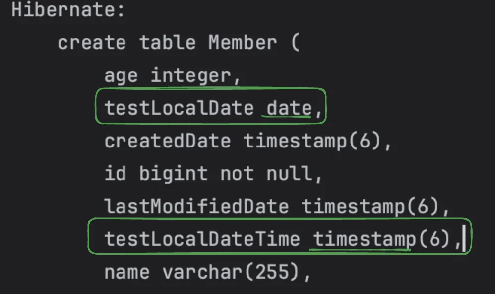

> ☝🏻 자바의 Date 타입에는 날짜, 시간이 합쳐서 쓰지만, 데이터베이스는 DATE(날짜), 시간(TIME), TIMESTAMP(날짜&#43;시간) 3개 구분해서 쓴다&#46; <br>따라서 매핑 정보(TemporalType&#46;정보)를 줘야한다&#46; 
> 
> <details>
> <summary>TemporalType</summary>
> 
> <a id="1c3eda9b0fe181fc91d6f9b141a2cb1e"></a>
> 
> ```java
> package jakarta.persistence;
> 
> public enum TemporalType {
>     DATE,
>     TIME,
>     TIMESTAMP;
> 
>     private TemporalType() {
>     }
> }
> ```
> 
> </details>

<a id="1c3eda9b0fe1819cb793e1bca4174008"></a>

### &#64;Lob

> varchar 크기(255byte) 를 넘는 큰 컨텐츠를 사용할 때, &#64;Lob 사용<br>지정 속성 X

<a id="1c3eda9b0fe1819da1bfcf0f85b10ee4"></a>

매핑하는 <strong>필드 타입</strong>이<strong> </strong><strong><u><code>문자</code></u></strong><strong>면 </strong><strong><u><code>CLOB</code></u></strong><strong><u> 매핑</u></strong><strong>, </strong><strong><u><code>나머지</code></u></strong><strong><u>는 </u></strong><strong><u><code>BLOB </code></u></strong><strong><u>매핑</u></strong>

- <code>CLOB</code>&#58; <strong>String, char&#91;&#93;, java&#46;sql&#46;CLOB</strong>

- <code>BLOB</code>&#58; <strong>byte&#91;&#93;, java&#46;sql&#46; BLOB</strong>

<a id="1c3eda9b0fe18134b099c99ea32b4a47"></a>

### <strong>매핑 무시 &#45;  &#64;Transient </strong>

> <strong><u>메모리상</u></strong><strong>에서만 </strong><strong><u>임시</u></strong><strong>로 </strong><strong><u>어떤 값을 보관</u></strong><strong>하고 싶을 때 사용<br>→  필드 매핑 X,</strong>  <strong>데이터베이스에 저장 X, 조회 X</strong>

<a id="1c3eda9b0fe181f5b6ddf233eca01b58"></a>

```java
@Transient
private Integer temp;
```

<a id="1c3eda9b0fe1810883ead1c4a71531f4"></a>

## 기본 키(Primary Key) 매핑

> 📌 <strong>  기본 키 매핑 방법</strong>
> 
> - 직접 할당&#58; <code>&#64;Id</code> 만 사용 (잘 안씀)
> 
> <details>
> <summary><strong>자동생성&#58; </strong><strong><code>&#64;GeneratedValue(strategy = GenerationTyoe&#46;&#91;옵션&#93;) </code></strong></summary>
> 
> <details>
> <summary><strong>🧐 GenerationType</strong></summary>
> 
> <a id="1c3eda9b0fe181958987f63d08fe3a9c"></a>
> 
> ```java
> package jakarta.persistence;
> 
> public enum GenerationType {
>     TABLE,
>     SEQUENCE,
>     IDENTITY,
>     UUID,
>     AUTO;
> 
>     private GenerationType() {
>     }
> }
> ```
> 
> </details>
> 
> <details>
> <summary>🧐 <strong>default&#58;</strong> <code>GenerationType&#46;AUTO</code></summary>
> 
> <a id="1c3eda9b0fe181feb391f276d6e12f60"></a>
> 
> ```java
> @Target({ElementType.METHOD, ElementType.FIELD})
> @Retention(RetentionPolicy.RUNTIME)
> public @interface GeneratedValue {
>     GenerationType strategy() default GenerationType.AUTO;
> 
>     String generator() default "";
> }
> ```
> 
> </details>
> 
> - <strong> </strong><strong><code>IDENTITY</code></strong>&#58; 데이터베이스 위임, MYSQL
> 
> - <strong><code>SEQUENCE</code></strong>&#58; 데이터베이스 시퀀스 오브젝트 사용, ORACLE
>     <a id="1c3eda9b0fe181c9955cea89ae2d0904"></a>
> 
>     → &#64;SequenceGenerator 필요
> 
> - <strong><code>TABLE</code></strong>&#58; 키 생성용 테이블 사용, 모든 DB에서 사용
>     <a id="1c3eda9b0fe1819c90eecd6e519358a7"></a>
> 
>     → &#64;TableGenerator 필요
> 
> <details>
> <summary><strong><code>UUID</code></strong><strong>&#58; </strong>자동 생성되는 ID 값을 <code>UUID</code> 로 설정</summary>
> 
> <details>
> <summary><strong>🧐 UUID</strong></summary>
> 
> - <u>UUID(Universally Unique Identifier)</u>는 <strong>전 세계적으로 유일한 식별자를 생성하기 위한 표준</strong>이다&#46;
>     - RFC 4122는 UUID의 생성 방법을 정의한 문서이다&#46;
> 
> - UUID는 일반적으로 <strong><u>128비트</u></strong><strong> 크기</strong>로, <strong><u>무작위로 생성</u></strong>되기 때문에<strong><u> 중복될 가능성이 거의 없</u></strong>다&#46;
> 
> - ex)  550e8400&#45;e29b&#45;41d4&#45;a716&#45;446655440000
> 
> <a id="1c3eda9b0fe18151a4addbeee0f3d8e1"></a>
> 
> <br>
> 
> </details>
> 
> <details>
> <summary><strong>🧐 ID 값이 데이터베이스에 위임되어 자동 생성되는 것이 아닌가?</strong></summary>
> 
> <details>
> <summary>🧐 <strong>영속성 제공자(persistence provider)</strong></summary>
> 
> <a id="1c3eda9b0fe18104912aeb918d247123"></a>
> 
> JPA 구현체로, 데이터베이스와 상호작용을 처리한다&#46;
> 
> - ex)  Hibernate 
>     -  널리 사용되는 JPA 구현체 
> 
> </details>
> 
> <details>
> <summary>🧐 <strong>데이터 베이스 위임</strong></summary>
> 
> - <strong><u>데이터베이스</u></strong><u>가 </u><strong><u>기본 키 값을 자동 생성</u></strong><u>하는 방식</u>
> 
> - <strong>ex) MySQL &#45; </strong> <code>AUTO&#95;INCREMENT</code> 속성
>     - 데이터베이스에 위임하여 기본 키를 자동으로 증가시킴
> 
>     - 영속성 제공자가 데이터베이스에 엔티티를 저장할 때, <u>데이터베이스가 자동으로 키를 생성</u>합니다
> 
> </details>
> 
> <a id="1c3eda9b0fe1811d9828c8b442efb2b5"></a>
> 
> <strong>영속성 제공자(persistence provider)</strong>가 RFC 4122 표준에 따라 UUID를 생성하여 엔티티의 기본 키로 사용한다&#46;<br>즉,  <strong><u>JPA 구현체인 Hibernate(애플리케이션 레벨)</u></strong>에서 <strong><u>UUID가 생성</u></strong>되고, 생성된 UUID가 데이터베이스에 저장된다&#46;<br><u>이 과정에서 데이터베이스는 UUID의 생성 과정에 관여하지 않</u>는다&#46;<br>
> 
> </details>
> 
> > “Indicates that the persistence provider must assign primary keys for the entity by generating an RFC 4122 Universally Unique IDentifier”<br><br>“영속성 제공자가 RFC 4122 표준에 따라 범용 고유 식별자(UUID)를 생성하여 엔티티의 기본 키를 할당해야 함을 나타냅니다&#46;”
> 
> <details>
> <summary><strong>장•단점</strong></summary>
> 
> - <strong>데이터 무결성</strong>&#58; UUID는 고유하기 때문에 기본 키로 사용하면 데이터 중복을 방지하는 데 유리하다&#46;
> 
> - <strong>비교 및 정렬 성능</strong>&#58; UUID는 비교 및 정렬 시 성능이 떨어질 수 있으므로, 큰 데이터셋을 처리할 때는 주의가 필요하다&#46;
> 
> - <strong>데이터베이스 호환성</strong>&#58; 일부 데이터베이스는 UUID 타입을 기본적으로 지원하지 않을 수 있으므로, 데이터베이스에서 UUID를 저장하는 방식(예&#58; 문자열, 바이너리 등)을 미리 고려해야 한다&#46;
> 
> </details>
> 
> <details>
> <summary>ex) <br></summary>
> 
> <a id="1c3eda9b0fe181eb9cf4f3ba6fdfb32d"></a>
> 
> ```java
> @Entity
> public class User {
> 
>     @Id
>     @GeneratedValue(generator = "UUID")
>     private UUID id;
> ```
> 
> </details>
> 
> </details>
> 
> - <strong> </strong><strong><code>AUTO</code></strong><strong>&#58;</strong> 방언에 따라 자동 지정, <strong>default</strong>
> 
> </details>

<details>
<summary>🤔 id의 어떤 타입 지정? <strong><code>Long</code></strong></summary>

<a id="1c3eda9b0fe1819d8ef2e3cc6d8e102b"></a>

int → 애매, 0이 들어감

<a id="1c3eda9b0fe18103900bfd7ce3dafe5c"></a>

Integer → 애매, 10억 넘어가면 다시 1부터 시작

<a id="1c3eda9b0fe181faab44d8b0fe228745"></a>

⇒ 결론, <strong> </strong><strong><code>Long</code></strong><strong> </strong><strong>사용</strong>

- Integer → <code>Long</code>, 요즘은  애플리케이션 전체로 볼때 성능 거의 영향을 주지 않음

- 10억을 넘어갈때, 타입을 바꾸는 것이 오히려 더 힘들기 때문에, <br>이런 경우 Long 타입을 사용한다&#46;<br>

</details>

<details>
<summary>직접 할당 ( <code>&#64;Id </code>)</summary>

<a id="1c3eda9b0fe181d1aa92dc1dd071f637"></a>

```java
// Member
@Entity
public class Member {
    
    @Id
    private String id;
    @Column(name = "name")
    private String username;
    
    public void setId(String id) {
        this.id = id;
    }

    public void setUsername(String username) {
        this.username = username;
   }
}
```

<a id="1c3eda9b0fe18106a7c9d11f08cd8cc7"></a>

```java
// JapMain
Member member = new Member();
member.setId("ID_A");
member.setUsername("A");
em.persist(member);

tx.commit();
```

</details>

<a id="1c3eda9b0fe181cb859bd4192f5c490b"></a>

### <strong>IDENTITY 전략</strong>

> 📌 <strong>IDENTITY 전략</strong>
> 
> - <strong><u>기본 키(Primary Key) 생성</u></strong>을 <strong><u>데이터베이스에 위임</u></strong>하는 전략
>     - 주로 MySQL, PostgreSQL, SQL Server, DB2 에서 사용
>         -  ex) <strong>MySQL</strong> &#45; <code>AUTO&#95;INCREMENT</code>
> 
> - JPA는 보통 트랜잭션 커밋 시점에 INSERT SQL 실행하지만, <br><strong><u>IDENTITY 전략</u></strong>은 <strong><code>em&#46;persist()</code></strong> 시점에서 <strong><u>INSERT가 실행 후 </u></strong> <strong>DB에서 식별자(PK)  값을 가져와 조회</strong>함
> 
> - <strong>AUTO&#95;INCREMENT</strong>는 <u>데이터베이스에서 INSERT SQL이 실행된 이후</u>에 ID 값을 알수 있다&#46; (<strong>버퍼링 사용 불가</strong>, 자세한 내용 아래 참조)

<details>
<summary><strong>⚠️ </strong><strong>Identity 전략은 버퍼링(SQL 모아서 한번에 보내기) 사용 불가</strong></summary>

> ☝🏻 버퍼링이 성능적으로 크게 매리트가 있지는 않다

<a id="1c3eda9b0fe1817bbe8df4f7af974f5c"></a>

영속성컨텍스트에서 엔티티가 저장되면 아래와 같이 1차 캐시에서 관리된다&#46;  <br>엔티티는 PK값으로 식별되기 때문에 영속성컨텍스트 내부에 존재하는 엔티티는 대응하는 <u>PK 값이 </u><strong><u>필수적</u></strong><u>으로  존재</u>해야 한다&#46;  

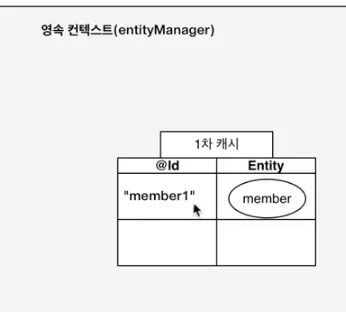

<a id="1c3eda9b0fe181d990dae9f0435cb6b8"></a>

그러나 Identity 전략에서 PK(id) 값을 <code>insert id null</code> 로 쿼리 날리고 DB에서 값이 생성될 때 알 수 있다&#46;

<a id="1c3eda9b0fe181ae857ad286a6a45c49"></a>

이는 <strong><u>‘영속성컨텍스트의 엔티티가 커밋 시점까지  PK값 없이 관리된다’ </u></strong>는 의미이다&#46;

<a id="1c3eda9b0fe1814ea387c3b9b819dace"></a>

 (일반적으로 커밋 시점에 쿼리 flush 발생)

<a id="1c3eda9b0fe1815586f3c1a0db0afa5c"></a>

따라서  <strong>Identity 전략</strong>에서는 커밋 시점이 아닌 <u>영속성컨텍스트에  </u><strong><u>저장(</u></strong><strong><u><code>em&#46;persisit()</code></u></strong><strong><u>)되는 시점</u></strong>에,<u> 바로 </u><strong><u>SQL문</u></strong>이<strong><u> flash</u></strong>가 되어<u> </u><strong><u>DB에서 ID(PK)값을 생성</u></strong>하고<strong><u> 가져온다&#46;</u></strong>

<a id="1c3eda9b0fe18172bff6e71aa2fd43ce"></a>

→ 쓰기 지연 SQL 저장소를 통한 버퍼링 사용 불가

<details>
<summary>🧐 1차 캐시에 저장되나? 아님 건너뛰고 바로 생성되나?</summary>

<a id="1c3eda9b0fe181feb8c4e40e65c6036c"></a>

해당 내용을 판별하기 위해 <strong>1차 캐시&#45; 동일성(identity) </strong>보장 특성을 응용했다&#46; <br>

<a id="1c3eda9b0fe181b383c1f91e93159c8a"></a>

```java
Member member = new Member();
member.setUsername("C");

System.out.println("=========================");

em.persist(member);

Long id = member.getId();

System.out.println("=========================");

Member a = em.find(Member.class, id);
Member b = em.find(Member.class, id);
System.out.println(a == b);  // true 
```

<a id="1c3eda9b0fe18106ad4ceabcc084a8e2"></a>

2개의 참조값 비교(<code>true</code>)를 통해 <strong>DB에서 생성된 PK값을 가져와 1차 캐시에 저장</strong>된다는 것을 알수 있다&#46; 

</details>

<a id="1c3eda9b0fe1813d80fed563408a2375"></a>

 테스트(JapMain) 실행 시 

<a id="1c3eda9b0fe1814da978f8b4e1b03a37"></a>

```java
// JapMain
Member member = new Member();
member.setUsername("C");

System.out.println("=========================");

em.persist(member);

System.out.println("member.getId = "+ member.getId());
 
System.out.println("=========================");

tx.commit();
```

<a id="1c3eda9b0fe18132bb69e732b0f8700b"></a>

아래와 같이 commit 시점이 아닌 <strong>저장 시점</strong>에서<strong><u> insert문이 실행</u></strong>되는 것을 알수 있다&#46; 

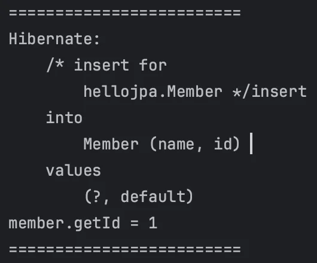

</details>

<details>
<summary><strong>사용 예시</strong></summary>

<a id="1c3eda9b0fe181728251e88a09846f2e"></a>

```java
@Entity
public class Member {

		@Id
		@GeneratedValue(strategy = GenerationType.IDENTITY)
		private Long id;  // 숫자 타입만 가능, String -> Error
```

</details>

<details>
<summary><strong>H2, MySQL &#45; SQL 비교 </strong></summary>

- H2
    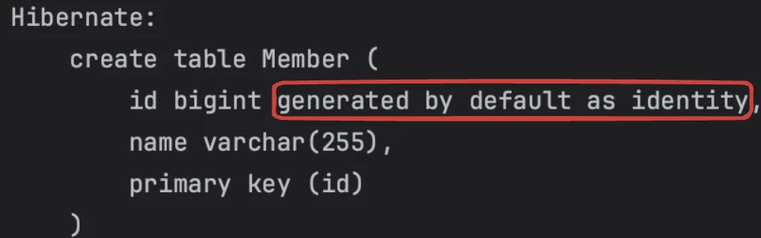

- MySQL
    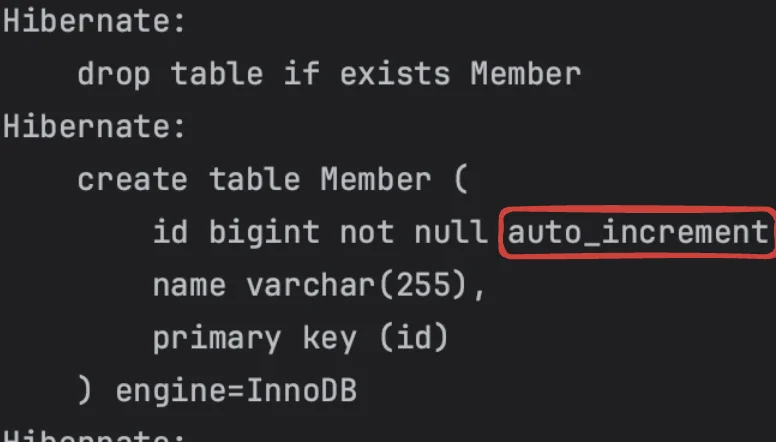

</details>

<details>
<summary><strong>코드</strong></summary>

<details>
<summary><strong>Member</strong></summary>

<a id="1c3eda9b0fe1812eb9e0e4b46bc486c0"></a>

```java
@Id
@GeneratedValue(strategy = GenerationType.IDENTITY)
private Long id;
```

</details>

<details>
<summary><strong>JapMain</strong></summary>

<a id="1c3eda9b0fe1816fa1fff5fba615f036"></a>

```java
try {
    Member member = new Member();
    member.setUsername("A");
    em.persist(member);

    tx.commit();
}
```

</details>

<details>
<summary>ID 를 입력하지 않아도 아래와 같이 자동으로 생성</summary>

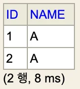

</details>

</details>

<a id="1c3eda9b0fe1816aad95f6b97df3f123"></a>

### SEQUENCE 전략

> 📌 <strong>SEQUENCE 전략</strong>
> 
> - <strong>유일한 값을 순서대로 생성</strong>하는 특별한 데이터베이스 오브젝트
>     - <strong>오라클, PostgreSQL, DB2, H2 </strong>데이터베이스에서 사용
>         - ex) 오라클 &#45; <code>SEQUENCE</code>

<details>
<summary><strong>사용 예시</strong></summary>

<a id="1c3eda9b0fe181c28335c46c1004ec85"></a>

```java
@Entity
@SequenceGenerator(
		name = “MEMBER_SEQ_GENERATOR",
		sequenceName=“MEMBER_SEQ", // 매핑할 데이터베이스 시퀀스 이름
		initialValue = 1, llocationSize = 1)
public class Member {
		@Id
		@GeneratedValue(strategy = GenerationType.SEQUENCE, generator = "MEMBER_SEQ_GENERATOR")
		private Long id;
```

</details>

<details>
<summary><strong>시퀀스 지정 속성 &#45;  </strong><strong><code>&#64;SequenceGenerator</code></strong></summary>

> ☝🏻 <strong>allocationSize 기본값 = 50 </strong>

| 속성 | 설명 | 기본값 |  |
| --- | --- | --- | --- |
| name | 식별자 생성기 이름 | 필수 |  |
| sequenceName | 데이터베이스에 등록되어 있는 시퀀스 이름 | hibernate&#95;sequence |  |
| initialValue | DDL 생성 시에만 사용됨, 시퀀스 DDL을 생성할 때 <strong>처음 시작하는 수</strong>를 지정 | 1 |  |
| <strong>allocationSize</strong> | <strong>시퀀스 한 번 호출에 증가하는 수</strong>(성능 최적화에 사용)<br><strong>데이터베이스 시퀀스 값이 하나씩 증가하도록 설정되어 있으면 반드시 1로 설정해야 한다&#46;</strong> | <strong>50</strong> |  |
| catalog, schema | 데이터베이스 catalog, schema 이름 |  |  |

</details>

<details>
<summary><strong>SEQUENCE 전략, 최적화(</strong><strong><code>allocationSize</code></strong><strong>)</strong></summary>

> 📌 <strong>Point</strong>
> 
> - <strong><code>allocationSize</code></strong><strong>속성</strong>을 통해 <strong><u>미리 DB에서 설정한 개수(default&#58; 50)</u></strong>만큼 <strong>웹서버에 가</strong>져와  <strong><u>메모리에서 해당 범위만큼 PK값 지정(&#43;&#43;연산)</u></strong><strong>하는 방식</strong>
> 
> - 범위 초과 시 설정한 <code>allocationSize</code>값 만큼 다음 범위 재호출(next call)
> 
> - 여러 <strong><u>웹서버(WAS)가 있</u></strong><u>어도 </u><strong><u>동시성 이슈 없이 실행 가능</u></strong>함
> 
> - ex) <code>allocationSize =50</code>→ 호출1&#58;  <code>51</code>(1&#126;50), 호출2&#58; <code>101</code> (51 &#126; 100)

<details>
<summary><strong>🧐 SEQUENCE 전략  &#45; 성능 이슈</strong></summary>

<a id="1c3eda9b0fe181d382d3c749328a246d"></a>

저장 시점(<code>em&#46;persist()</code>)에 DB&#45;시퀀스에서 PK값을 가져온다&#46; <br>따라서 저장할 때마다 네트워크 <code>next call </code>비용 발생 

<details>
<summary><strong>Sequence 전략 &#45;  영속성컨텍스트 PK 설정 </strong></summary>

<a id="1c3eda9b0fe18119b719ee996f29088c"></a>

```java
Member member = new Member();
member.setUsername("C");

System.out.println("=========================");
em.persist(member);
System.out.println("member.getId = " + member.getId());
System.out.println("=========================");

tx.commit();
```

<a id="1c3eda9b0fe18135957fe8003d305f95"></a>

스키마와 시퀀스가 먼저 생성되고 

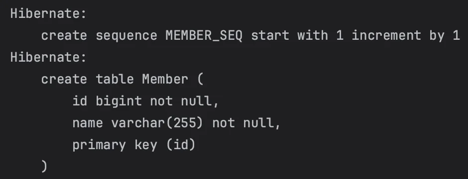

<a id="1c3eda9b0fe181f7b4e6cbcf1f77a8cd"></a>

<strong><br>저장 시점(</strong><strong><code>em&#46;persist()</code></strong><strong>)에 내부적으로 JPA가 생성된 시퀀스 Id값을 가져와(select) 1차 캐시에 엔티티의 PK값으로 사용한다&#46;<br>이후 커밋 시점에서 insert문 flash되어 DB에 값을 넣는다&#46;  <br>따라서 identity 전략과 달리 버퍼링 쓰기가 가능하다&#46;</strong>

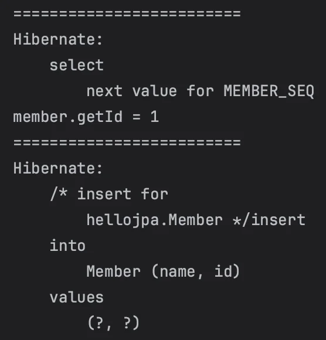

</details>

</details>

<details>
<summary><strong>🧐 </strong><strong>Error) </strong><code>allocationSize = 50</code> 적용 시,  <strong>MappingException</strong></summary>

- <strong>문제</strong>
    <a id="1c3eda9b0fe1813ab0c1fe513e38977d"></a>

    ```java
    he increment size of the [MEMBER_SEQ] sequence is set to [50] in the entity mapping while the associated database sequence increment size is [1].
    ```

- <strong>원인 </strong>
    - 전에 생성한 시퀀스 &#45; &#91; Increment By 속성&#58; 1 &#93; 이 남아있어 새로 생성한 50값과 충돌되어 발생한 오류
        - <a href="https://www.inflearn.com/questions/197643/sequencegenerator-%EB%A5%BC-%ED%86%B5%ED%95%9C-%EC%8B%9C%ED%80%80%EC%8A%A4-%EC%83%9D%EC%84%B1%EC%8B%9C-%EC%97%90%EB%9F%AC">커뮤니티</a> 참조

- <strong>해결) 전에 생성한 시퀀스 삭제</strong>
    <a id="1c3eda9b0fe181e7811afe2d6e344ef4"></a>

    ```java
    drop sequence [이전에 생성한 시퀀스 이름]
    ```

</details>

<details>
<summary><strong>☝🏻 권장) allocationSize는 50&#126;100 정도로 너무 크지 않는 값으로 설정한다&#46;</strong></summary>

- allocationSize value 를 <strong>너무 큰값으로 설정</strong>하는 경우 (ex&#46; 10000),<br>웹서버를 내리는 시점에서 이미 호출되어 설정된 범위의 값들은 다 날라간다&#46;<br>

- ex) <code>allocationSize=l0000</code>일 때, 50까지 메모리에서 사용하다가 웹서버가 다운되고 다시 실행되면 재호출이 일어나<br><strong><u>&#91; 10001 &#126; 20000 &#93; 까지 범위가 재설정</u></strong>되어<strong>&#91; 51 &#126; 10000 &#93; 까지 숫자 공백</strong>이 생긴다&#46; <br>DB에 다음 데이터를 저장하는데는 크게 상관이 없지만, 괜히 낭비가 되기 때문에 <strong><u>allocationSize는 50&#126;100 정도로 너무 크지 않는 값으로 설정</u></strong>해야 한다&#46;

</details>

<details>
<summary>Test1) <code>allocationSize = 50</code></summary>

> /icons/checkmark-line_gray.svg JapMain  2번 실행 시, 다 채우지 않고 건너뜀 (1,2,3 ) → (51, 52, 53)<br>→  1&#126;50까지 영속선컨텍스트의 1차캐시로 저장 후 한번에 쿼리 날리는 것 같음?( 추측)<br><br>따라서 JapMain 첫 실행 시, 설장한 <code>allocationSize</code> 값을 초과하여 2번 호출되는 경우로 테스트 진행(Test2)

<details>
<summary><strong>JpaMain</strong></summary>

<a id="1c3eda9b0fe181ed8b1ae4a51107584c"></a>

```java
// JapMain

Member member1 = new Member();
member1.setUsername("A");

Member member2 = new Member();
member2.setUsername("B");

Member member3 = new Member();
member3.setUsername("C");

System.out.println("=========================");

em.persist(member1);  // 1, 51
em.persist(member2);  // MEM    첫 호출에서 지정된 범위 내에선
em.persist(member3);  // MEM    ++연산 실행되게 만든 듯?

// 51이 넘어가는 경우, 다시 next call -> 101 까지 가져옴

System.out.println("member2.getId = " + member1.getId());
System.out.println("member3.getId = " + member2.getId());
System.out.println("member1.getId = " + member3.getId());

System.out.println("=========================");

tx.commit();
```

</details>

<details>
<summary><strong>출력값</strong></summary>

<a id="1c3eda9b0fe1813cab72c9557f9d5355"></a>

```xml
Hibernate: 
    create table Member (
        id bigint not null,
        name varchar(255) not null,
        primary key (id)
    )
=========================
Hibernate: 
    select
        next value for MEMBER_SEQ
Hibernate: 
    select
        next value for MEMBER_SEQ
member2.getId = 1
member3.getId = 2
member1.getId = 3
=========================
Hibernate: 
    /* insert for
        hellojpa.Member */insert 
    into
        Member (name, id) 
    values
        (?, ?)
Hibernate: 
    /* insert for
        hellojpa.Member */insert 
    into
        Member (name, id) 
    values
        (?, ?)
Hibernate: 
    /* insert for
        hellojpa.Member */insert 
    into
        Member (name, id) 
    values
        (?, ?)
```

</details>

</details>

<details>
<summary>Test2) <code>allocationSize = 4</code></summary>

<details>
<summary>JapMain</summary>

<a id="1c3eda9b0fe181b6930bdb9804f877a1"></a>

```java
Member member1 = new Member();
member1.setUsername("A");

Member member2 = new Member();
member2.setUsername("B");

Member member3 = new Member();
member3.setUsername("C");

Member member4 = new Member();
member4.setUsername("D");

Member member5 = new Member();
member5.setUsername("E");

System.out.println("=========================");

em.persist(member1);  // 1, 4   1번 호출
em.persist(member2);  // MEM
em.persist(member3);  // MEM
em.persist(member4);  // MEM
em.persist(member5);  // 5, 9   2번 호출

System.out.println("member1.getId = " + member1.getId());
System.out.println("member2.getId = " + member2.getId());
System.out.println("member3.getId = " + member3.getId());
System.out.println("member4.getId = " + member4.getId());
System.out.println("member5.getId = " + member5.getId());

System.out.println("=========================");

tx.commit();
```

</details>

> 시퀀스의 현재값이 9인 것으로 보아 2번 호출된 것을 알수 있다&#46; 

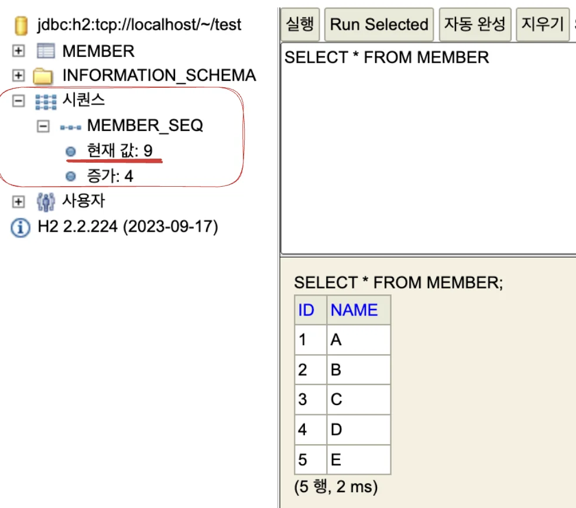

</details>

</details>

<a id="1c3eda9b0fe1813da526c2a80dfe9c09"></a>

### TABLE 전략

> 운영 서버에서는 사용하기 부담스럽다<br> <strong>⇒ 잘 안씀, 그냥 있다고 알아만 둘것</strong>
> 
> > ☝🏻 <strong>권장) 이미 DB에서 관례로 사용하는 것들이 존재, 그냥 관례 사용</strong>

> /icons/checkmark-line_pink.svg 키 생성 전용 테이블을 하나 만들어 데이베이스 시퀀스를 모방하는 전략<br><br>모든 데이터베이스 적용 가능하다는 장점이 있지만, 테이블을 직접 사용해, lock 등 성능 이슈 존재<br>시퀀스 오브젝트랑 달리 숫자를 도출하는데 최적화가 안되어았어 성능이 떨어짐

<details>
<summary><strong>사용 예시 </strong></summary>

- <strong><code>&#64;TableGenerator( 속성 )</code></strong> &#58;  키 생성 전용 테이블 생성

- <strong><code>&#64;GeneratedValue(strategy = GenerationType</code></strong><code>&#46;</code><strong><code>TABLE</code></strong><code>, </code><strong><code>generator</code></strong><code> </code><strong><code>=</code></strong><code> </code><strong><code>&#34;식별자 생성기 이름&#34;</code></strong><strong><code>)</code></strong>&#58; 키 생성 전용 테이블 식별자 입력, 자동 기본키 생성

<a id="1c3eda9b0fe181deaf55dd09b4520669"></a>

```java
@Entity
@TableGenerator(
        name = "MEMBER_SEQ_GENERATOR",    // 식별 이름
        table = "MY_SEQUENCES",           // 키 생성 테이블 명
        pkColumnValue = “MEMBER_SEQ",     // 시퀀스 컬럼명
				allocationSize = 1                // 호출 시 증가되는 값
)
public class Member {

		@Id
		@GeneratedValue(
				strategy = GenerationType.TABLE,      // 전략 타입
	      generator = "MEMBER_SEQ_GENERATOR"    // 적용할 키 생성 테이블 식별자 명 
		)
		private Long id;
  
   .   .   .
```

</details>

<details>
<summary><strong>키 생성 전용 테이블 생성 옵션 &#45; &#64;TableGenerator</strong></summary>

| 속성 | 설명 | 기본값 |
| --- | --- | --- |
| name | 식별자 생성기 이름 | 필수 |
| table | 키 생성 테이블명 | hibernate&#95;sequences |
| pkColumnName | 시퀀스 컬럼명 | sequence&#95;name |
| valueColumnNa | 시퀀스 값 컬럼명 | next&#95;val |
| pkColumnValue | 키로 사용할 값 이름 | 엔티티 이름 |
| initialValue | 초기 값, 마지막으로 생성된 값이 기준이다&#46; |  0 |
| <strong>allocationSize</strong> | <strong>시퀀스 한 번 호출에 증가하는 수</strong>(성능 최적화에 사용됨)  | <strong>50</strong> |
| catalog, schema | 데이터베이스 catalog, schema |  |
| uniqueConstraints(DDL) |  유니크 제약 조건 지정 가능 |  |

</details>

<details>
<summary><strong>실행</strong></summary>

<details>
<summary><code>Entity</code>&#58; Member</summary>

- <code>&#64;TableGenerator( 속성 )</code> &#58;  키 생성 전용 테이블 생성

- <code>&#64;GeneratedValue(strategy = GenerationType&#46;TABLE, generator = &#34;MEMBER&#95;SEQ&#95;GENERATOR&#34;)</code>&#58; 식별

<a id="1c3eda9b0fe18141af52e3b1c219f1e8"></a>

```java
// Member
@Entity
@TableGenerator(
        name = "MEMBER_SEQ_GENERATOR",    // 식별 이름
        table = "MY_SEQUENCES",           // 키 생성 테이블 명
        pkColumnValue = “MEMBER_SEQ",     // 시퀀스 컬럼명
				allocationSize = 1                // 호출 시 증가되는 값
)
public class Member {

		@Id
		@GeneratedValue(
				strategy = GenerationType.TABLE,      // 전략 타입
	      generator = "MEMBER_SEQ_GENERATOR"    // 적용할 키 생성 테이블 식별자 명 
		)
		private Long id;
```

</details>

<details>
<summary><code>Test</code>&#58; JapMain</summary>

<a id="1c3eda9b0fe181269b70fbe2ef8e5934"></a>

```java
// JapMain
Member member = new Member();
member.setUsername("C");
em.persist(member);
```

</details>

> <strong>2개 테이블 ( Member</strong>, <strong>My&#95;SEQUENCES</strong> ) 생성(create)

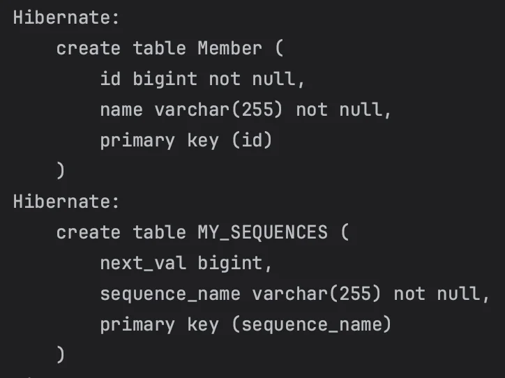

> <code>table = &#34;MY&#95;SEQUENCES&#34;, next&#95;val( 기본값)</code> 컬럼 생성 및 값 적용

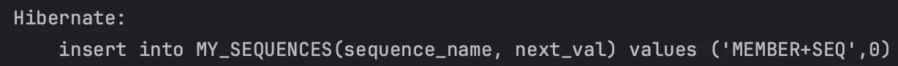

> 키 생성 테이블(MY&#95;SEQUENCES) 에서 value(NEXT&#95;VAL) 값 가져와 Id에 적용<br>→ allocationSize 값 만큼 증가되서 적용 <br>→ 재호출 시 키 생성 테이블 이전값 덮어씀

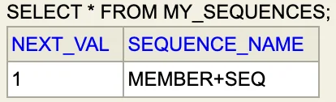

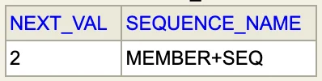

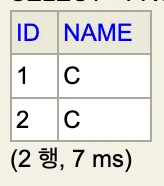

</details>

<a id="1c3eda9b0fe181e98d92df9c64a6b5ac"></a>

### 권장하는 식별자 전략

> 📌 <strong>기본 키 제약 조건</strong>
> 
> - <code>null</code><strong> ❌,</strong>  <strong><u>유일</u></strong><strong>, </strong><strong><u>변하면 안</u></strong>된다 
> 
> - <strong>설계 어려움,  why? 먼 미래까지 적용되어야 함</strong><strong><br></strong><strong>먼 미래(5년, 10년 … 비지니스가 살아남는 그 순간까지…)</strong> 해당 조건을 만족하는  <strong>자연키(비지니스 적으로 의미있는 키  ex&#46; 주민번호, 전화번호 등</strong>) 는 찾기 어렵다&#46;<strong> </strong>
> 
> - <strong>대리키(대체키, 비지니스와 상관없는 generate value, random value 등) 사용</strong>
> 
> <details>
> <summary><strong> 🧐 암호화해야 하는 개인정보 </strong></summary>
> 
> > ‘정보통신망법, 개인정보보호법’에 의해 비밀번호 암호화(Encryption) 의무화
> 
> 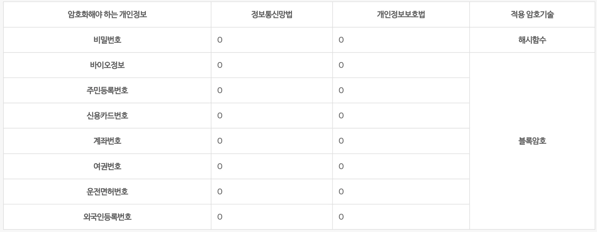
> 
> </details>
> 
> <details>
> <summary>ex) 자연키 &#45; 주민번호 설정 (실제 예전 사례 )</summary>
> 
> <a id="1c3eda9b0fe1813f9c9ded96516ea5ce"></a>
> 
> 모회사에 있을 때, 회원 테이블 PK를 <strong><u>주민번호</u></strong>로 설정, <u>나라에서 주민번호 보관 금지</u>시킴
> 
> <a id="1c3eda9b0fe181418face73cc5bc975d"></a>
> 
> → 조인 시 포린키로 PK를 들고 있어야 함
> 
> <a id="1c3eda9b0fe18163acb0cc653ea79911"></a>
> 
> → 회원 테이블 뿐만 아니라 회원키를 조인한 모든 테이블 마이그레이션…&#46;
> 
> <a id="1c3eda9b0fe18143bf7dd9198527b081"></a>
> 
> <strong>⇒ 대체키(랜던값, Generator value, sequence) 사용했으면 회원 테이블의 주민번호 값만 수정하면 되었음</strong>
> 
> </details>
> 
> > 🔥 <strong>권장) </strong><strong><u>Long형</u></strong><u>(10억 이상 가능)</u><strong><u> </u></strong><strong>&#43;</strong><strong><u> 대체키</u></strong><strong> &#43; </strong><strong><u>키 생성전략 사용(</u></strong>AUTO&#95;INCREMENT<strong>, </strong><u>시퀀스,  UUID, 랜던 값 조합한 회사 내 룰…)</u>

<a id="1c3eda9b0fe181df8289d8e340e8094a"></a>

## 실전 예제1 ) 요구사항 분석, 기본 매핑(데이터 중심 설계)

> ⚠️ <strong>데이터 중심 설계의 문제점</strong><strong><br></strong>데이터 중심 설계는 <strong>DB 테이블 모델을 기준으로 엔티티를 설계</strong>한다&#46;<br><br>따라서 <strong>테이블의 외래키를 객체에 그대로 가져</strong>와 <u>그래프 탐색 불가</u> 등 제약이 존재한다&#46;<br>또한 참조값이 없어 UML 도 잘못 입력된다&#46;

<a id="1c3eda9b0fe1818db9abdf767fe81b4e"></a>

### 설계

<details>
<summary><strong>도메인 모델 분석</strong></summary>

<details>
<summary><strong>요구사항</strong></summary>

- 회원 → <strong>상품 주문</strong> 가능

- 주문 시 <strong>여러 종류의 상품 선택</strong> 가능

</details>

<details>
<summary><strong>기능 목록</strong></summary>

<details>
<summary>회원 기능</summary>

- 회원 등록

- 회원 조회

</details>

<details>
<summary>상품 기능</summary>

- 상품 등록

- 상품 수정

- 상품 조회

</details>

<details>
<summary>주문 기능</summary>

- 상품 주문

- 주문 내역 조회

- 주문 취소

</details>

</details>

> 📌 <strong>도메인 모델 </strong><strong>&#91; 회원  &#45; 주문 &#45; 주문 상품 &#45; 상품 &#93;</strong>
> 
> 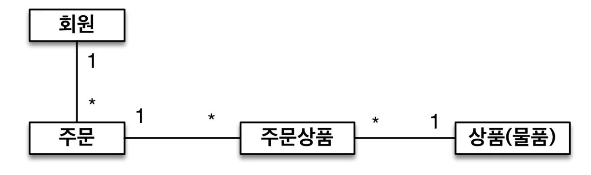
> 
> - 회원, 주문&#58; <strong>일대다</strong><br>→ <strong>회원 </strong>여러 번 <strong>주문</strong>  가능
> 
> - 주문, 상품&#58; <strong>다대다</strong><br>→ <strong>주문</strong>할 때 여러 <strong>상품</strong>을 선택 가능<br>→  <strong>같은 상품</strong>도 <strong>여러 번 주문</strong> 가능
> 
> - <strong><u>주문상품 모델을 만</u></strong>들어  <strong><u>일대다, 다대일</u></strong> 관계로 수정

<a id="1c3eda9b0fe18127b0eace2df4d4cbcf"></a>

<br>

</details>

<details>
<summary><strong>테이블 설계</strong></summary>

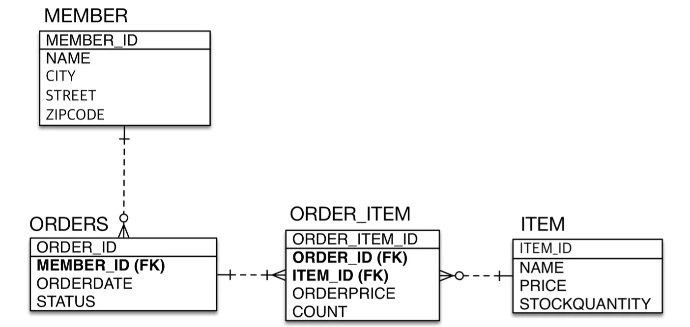

</details>

<details>
<summary><strong>엔티티 설계와 매핑</strong></summary>

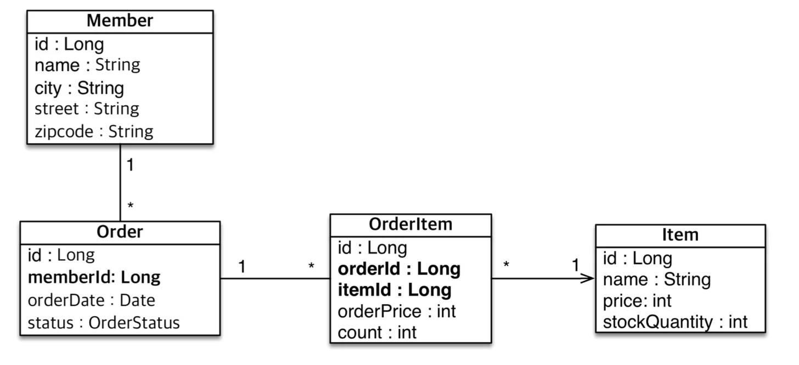

</details>

<a id="1c3eda9b0fe181b79a0dfa3db43a00bc"></a>

### 구현

<a id="1c3eda9b0fe1811cb985f36c63c08ae7"></a>

### <strong>JPA 엔티티 구현 </strong>

<details>
<summary><strong> jpabook&#46;jpashop</strong></summary>

<details>
<summary><strong>domain</strong></summary>

<details>
<summary><strong>Membe</strong>r</summary>

<a id="1c3eda9b0fe1814b955ec60603204912"></a>

```java
package jpabook.jpashop.domain;

import jakarta.persistence.*;

import java.time.LocalDateTime;

@Entity
@Table(name = "ORDERS")  // DB에 기본으로 ORDER가 '예약어'로 걸려있음 (안되어 있는 DB도 있음)
public class Order {
    @Id @GeneratedValue
    @Column(name = "ORDER_ID")
    private Long id;

    @Column(name = "MEMBER_ID")
    private Long memberId;
    private LocalDateTime oderDate;

    @Enumerated(EnumType.STRING)   // ORIGIN: 충돌 오류 발생
    private OrderStaus staus;

    public Order() {
    }

    public Order(Long id, Long memberId, LocalDateTime oderDate, OrderStaus staus) {
        this.id = id;
        this.memberId = memberId;
        this.oderDate = oderDate;
        this.staus = staus;
    }

    public Long getId() {
        return id;
    }

    public Long getMemberId() {
        return memberId;
    }

    public LocalDateTime getOderDate() {
        return oderDate;
    }

    public OrderStaus getStaus() {
        return staus;
    }

    // setter 필요 시 추가
}

```

</details>

<details>
<summary><strong>Item</strong></summary>

<a id="1c3eda9b0fe18145b799d86e2f931475"></a>

```java
package jpabook.jpashop.domain;

import jakarta.persistence.Column;
import jakarta.persistence.Entity;
import jakarta.persistence.GeneratedValue;
import jakarta.persistence.Id;

@Entity
public class Item {

    @Id @GeneratedValue
    @Column(name = "ITEM_ID")
    private Long id;
    private String name;
    private int price;
    private int stockQuantity;

    public Item(Long id, String name, int price, int stockQuantity) {
        this.id = id;
        this.name = name;
        this.price = price;
        this.stockQuantity = stockQuantity;
    }

    public Long getId() {
        return id;
    }

    public String getName() {
        return name;
    }

    public int getPrice() {
        return price;
    }

    public int getStockQuantity() {
        return stockQuantity;
    }

    // Setter 필요 시 추가
}

```

</details>

<details>
<summary><strong>Order</strong></summary>

<a id="1c3eda9b0fe181b0b72cf8c291c40d10"></a>

```java
package jpabook.jpashop.domain;

import jakarta.persistence.*;

import java.time.LocalDateTime;

@Entity
@Table(name = "ORDERS")  // DB에 기본으로 ORDER가 '예약어'로 걸려있음 (안되어 있는 DB도 있음)
public class Order {
    @Id @GeneratedValue
    @Column(name = "ORDER_ID")
    private Long id;

    @Column(name = "MEMBER_ID")
    private Long memberId;
    private LocalDateTime oderDate;

    @Enumerated(EnumType.STRING)   // ORIGIN: 충돌 오류 발생
    private OrderStaus staus;

    public Order() {
    }

    public Order(Long id, Long memberId, LocalDateTime oderDate, OrderStaus staus) {
        this.id = id;
        this.memberId = memberId;
        this.oderDate = oderDate;
        this.staus = staus;
    }

    public Long getId() {
        return id;
    }

    public Long getMemberId() {
        return memberId;
    }

    public LocalDateTime getOderDate() {
        return oderDate;
    }

    public OrderStaus getStaus() {
        return staus;
    }

    // setter 필요 시 추가
}

```

</details>

<details>
<summary><strong>OrderItem</strong></summary>

<a id="1c3eda9b0fe18170b290c8287c06b643"></a>

```java
package jpabook.jpashop.domain;

import jakarta.persistence.Column;
import jakarta.persistence.Entity;
import jakarta.persistence.GeneratedValue;
import jakarta.persistence.Id;

@Entity
public class OrderItem {
    @Id @GeneratedValue
    @Column(name = "ORDER_ITEM_ID")
    private Long id;

    @Column(name = "ORDER_ID")
    private Long orderId;

    @Column(name = "ITEM_ID")
    private Long itemId;
    private int orderPrice;
    private int count;

    public Long getId() {
        return id;
    }

    public void setId(Long id) {
        this.id = id;
    }

    public Long getOrderId() {
        return orderId;
    }

    public void setOrderId(Long orderId) {
        this.orderId = orderId;
    }

    public Long getItemId() {
        return itemId;
    }

    public void setItemId(Long itemId) {
        this.itemId = itemId;
    }

    public int getOrderPrice() {
        return orderPrice;
    }

    public void setOrderPrice(int orderPrice) {
        this.orderPrice = orderPrice;
    }

    public int getCount() {
        return count;
    }

    public void setCount(int count) {
        this.count = count;
    }
}

```

</details>

<details>
<summary><strong>OrderStatus</strong> ( enum )</summary>

<a id="1c3eda9b0fe181c99fade0cc29cd7305"></a>

```java
package jpabook.jpashop.domain;

public enum OrderStaus {
    ORDER, CANCEL
}

```

</details>

</details>

<details>
<summary><strong>JpaMain</strong></summary>

<a id="1c3eda9b0fe181ca8417fc55d418ec51"></a>

```java
package jpabook;

import jakarta.persistence.EntityManager;
import jakarta.persistence.EntityManagerFactory;
import jakarta.persistence.EntityTransaction;
import jakarta.persistence.Persistence;

import java.util.List;

public class JapMain {
    public static void main(String[] args) {
        Persistence persistence = new Persistence();
        EntityManagerFactory emf = persistence.createEntityManagerFactory("hello");
        EntityManager em = emf.createEntityManager();

        EntityTransaction tx = em.getTransaction();
        tx.begin();

        try {

            tx.commit();
        } catch (Exception e){
            tx.rollback();
        } finally {
            em.close();
        }
        emf.close();
    }
}

```

</details>

</details>

<details>
<summary><strong>Error)</strong> 데이터베이스 연결(japshop) 오류</summary>

>  <a href="https://atoz-develop.tistory.com/entry/H2-Database-%EC%84%A4%EC%B9%98-%EC%84%9C%EB%B2%84-%EC%8B%A4%ED%96%89-%EC%A0%91%EC%86%8D-%EB%B0%A9%EB%B2%95">reference</a>

<a id="1c3eda9b0fe1815c876dc52cae3c2092"></a>

데이터베이스 첫 생성 시 설정 → X

<a id="1c3eda9b0fe1817295ccd16edecba6d8"></a>

<strong>해결</strong>&#58; <a href="#/post/1c3eda9b-0fe1-812f-a219-ed3e704812fb">페이지</a> 

</details>

<details>
<summary><strong>🤔  </strong><strong><a href="https://en.wikipedia.org/wiki/Camel_case">CamelCase</a></strong> or <strong>언더스코어</strong>(<strong><code>&#95;</code></strong>) </summary>

> <strong>회사마다 규칙이 있음 그 규칙 따르면 됨</strong>

<a id="1c3eda9b0fe181709ee9c58a9d347cfb"></a>

대문자 표기 or 소문자 표기<br><br><code>자바</code>&#58; <strong>카멜 케이스</strong>     ex) itemOrder<br> <code>DB</code>&#58; <strong>언더스코어    </strong>    ex) ITEM&#95;ORDER or item&#95;order<br>    → 대소문자 구분이 안되어(요즘은 가능) 언더스코어 방식 관례로 사용<br><br>스프링에서 hibernate 사용시, 기본 설정으로 카밀케이스 방식 → 언더스코어(소문자) 바꿔 DB에 입력함

</details>

<details>
<summary><strong>👍🏻 권장) </strong><strong><u><code>constructor(생성자)</code></u></strong><u>를 통해서</u><strong><u> 값을 설정</u></strong>한다&#46; <strong><u><code>getter</code></u></strong><strong><u>는 가급적 만</u></strong>들어주고   <strong><u><code>setter</code></u></strong><strong><u>필요할 때만 최소한</u></strong>으로 <strong><u> 사용</u></strong>한다<strong>&#46;</strong></summary>

- <code>Getter</code>는 가급적 만들어 주는 것이 좋다&#46;

- <code>Setter </code>경우, 막 만들면 아무데서나 설정(set) 가능하기 때문에 코드 추적 및 유지보수에 좋지 않다&#46;

- <strong><code>constructor(생성자)</code></strong><strong> &#43; 필요할 때만 부분적으로 </strong><strong><code>setter</code></strong><strong> 사용</strong>

</details>
