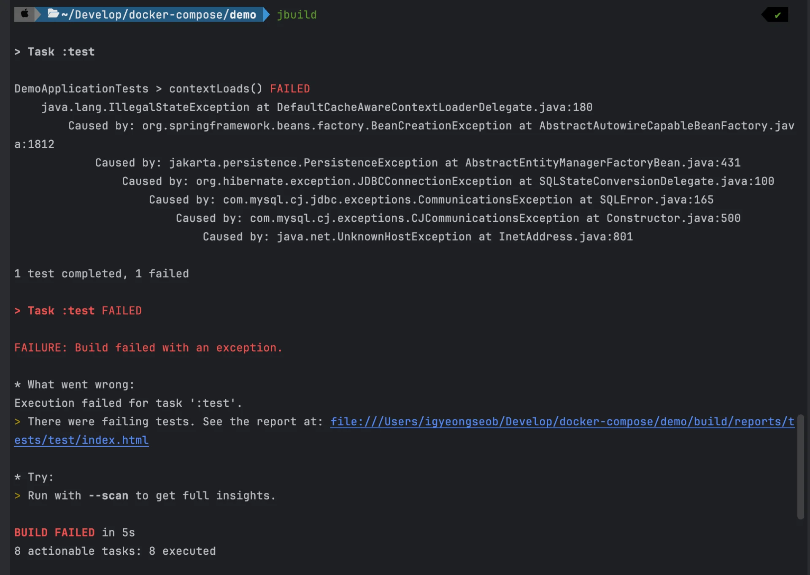
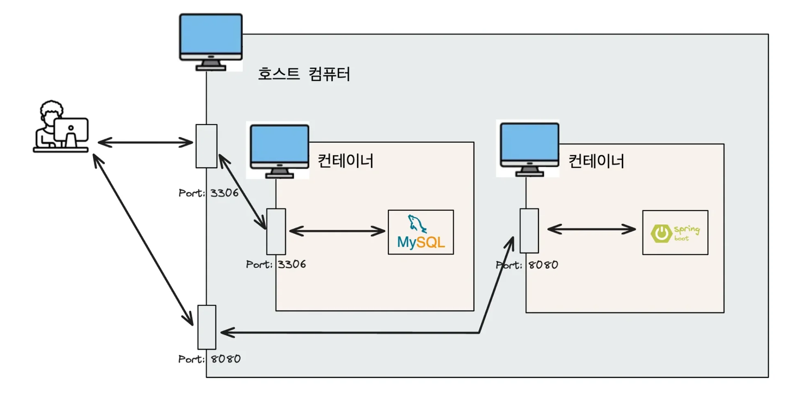
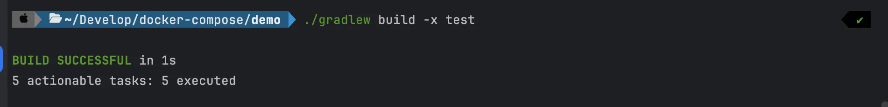

<a id="1c3eda9b0fe181f8b87cdaec09cf54b4"></a>

## &#91; 오류 &#93; MySQL ddl&#45;auto 설정 추가 시, jar 파일 build  안됨

---



- <strong>오류 메시지 분석 (UnknownHostException&#58; my&#45;db)</strong>
    <a id="1c3eda9b0fe1819d8fd3cb3487367495"></a>

    ```plaintext
    Caused by: com.mysql.cj.jdbc.exceptions.CommunicationsException at SQLError.java:165
    Caused by: com.mysql.cj.exceptions.CJCommunicationsException at Constructor.java:500
    Caused by: java.net.UnknownHostException at InetAddress.java:801
    ```

<a id="1c3eda9b0fe181d385f8d0c141e47d3b"></a>

### 원인

---

<a id="1c3eda9b0fe18115a3b2f8cfe9935bc3"></a>

<strong>ddl&#45;auto</strong>

<a id="1c3eda9b0fe181b99c14d3e3c380d43f"></a>

```yaml
spring:
  jpa:
    hibernate:
      ddl-auto: update
```

<a id="1c3eda9b0fe18149b067e9f41f8499e8"></a>

<strong><u><code>ddl&#45;auto</code></u></strong><strong><u> 설정 추가</u></strong><strong> 시, </strong>Hibernate는 <strong><u>애플리케이션 시작 시점에 DB에 연결</u></strong><strong>하여 </strong><strong><u>테이블을 확인</u></strong><strong>하고,<br> 필요하면 </strong><strong><u>테이블을 생성/수정</u></strong><strong>한다&#46; </strong>

<a id="1c3eda9b0fe181b2b008df35d38ad4af"></a>

즉, <code>ddl&#45;auto</code>가 <code>update</code> 또는 <code>create</code>로 설정되어 있으면 <strong><u>JAR 빌드 중에도 DB 연결을 확인</u></strong><strong>한다</strong>

<a id="1c3eda9b0fe181bfbc92f724fb32acd2"></a>

이때(JAR 빌드), Hibernate가 DB 연결을 확인하는 과정에서 <code>UnknownHostException</code> 발생되었다&#46; 

<a id="1c3eda9b0fe1817a9f65f636e8f8ef73"></a>

이는, <strong>Spring Boot 애플리케이션(my&#45;server)</strong>에서<strong><u> MySQL 컨테이너</u></strong><strong><u>(</u></strong><strong><u><code>my&#45;db</code></u></strong><strong><u>)</u></strong><strong><u>를 찾을 수 없</u></strong>기 때문에 발생한 오류이다&#46;

<a id="1c3eda9b0fe181b4888ef600e0dae6ef"></a>

죽, <code>my&#45;db</code>라는 호스트를 찾을 수 없다는 것은 <strong><u>MySQL 컨테이너가 실행 중이 아니거나 네트워크에서 접근할 수 없다는 의미</u></strong><strong>이다&#46;</strong>

<a id="1c3eda9b0fe1813d89acda50c8c08ec2"></a>

<strong>Docker Compose</strong>



<a id="1c3eda9b0fe1811daa20fb4d87a0e4e7"></a>

프로젝트의 구성 환경은 Spring Boot, MySQL을 각각 컨테이너 환경으로 구성했다&#46; 

<a id="1c3eda9b0fe181c691a6ce321f73596f"></a>

그리고 이를 docker compose를 통해 실행 및 관리한다&#46; 즉, <strong><u>Docker 네트워크 내부</u></strong>에서 <strong><u>컨테이너를 관리</u></strong>한다&#46;

<a id="1c3eda9b0fe181db8133c1ce7e6fee71"></a>

따라서  <code>docker compose up</code>을 통해 컨테이너를 띄우면  Docker 네트워크 내부에 컨테이너들이 존재하여 <strong><code>Spring Boot 컨테이너(my&#45;server)</code></strong><strong>가 </strong><strong><code>MySQL 컨테이너(my&#45;db)</code></strong><strong>를 찾을 수 있다&#46;</strong>

<details>
<summary>compose&#46;yml</summary>

<a id="1c3eda9b0fe18167925febf64f0583b6"></a>

```yaml
services:
  my-server:
    container_name: my-server
    build: .
    ports:
      - 8080:8080
    depends_on:
      my-db:
        condition: service_healthy
  my-db:
    container_name: my-db
    image: mysql
    environment:
      MYSQL_ROOT_PASSWORD: pwd1234
      MYSQL_DATABASE: mydb
    volumes:
      - ~/Develop/docker-mysql/mysql_data:/var/lib/mysql
    ports:
      - 3306:3306
    healthcheck:
      test: ["CMD", "mysqladmin", "ping"]
      interval: 5s
      retries: 10
```

</details>

<details>
<summary>application&#46;yml</summary>

<a id="1c3eda9b0fe1819d9abce67670b8a852"></a>

```yaml
	jdbc:mysql://my-db:3306/mydb # Docker 내부 DNS가 my-db를 올바른 컨테이너 IP로 해석
```

</details>

<a id="1c3eda9b0fe181aab209df76f1dfc44c"></a>

하지만, <strong><u>JAR 파일을 로컬 환경에서 실행</u></strong>하면 <strong>Docker 네트워크의 DNS를 사용할 수 없</strong>다&#46;

<a id="1c3eda9b0fe181988143dfa08ed08089"></a>

```yaml
jdbc:mysql://my-db:3306/mydb
```

<a id="1c3eda9b0fe181ee8851e0d30af551bc"></a>

즉, <code>jdbc&#58;mysql&#58;//my&#45;db&#58;3306/mydb</code>에서의 <code>my&#45;db</code> 는 <strong><u>Docker 네트워크 내부</u></strong><strong><u>에서만 인식 가능한 가상 호스트</u></strong>이기 때문에 <strong><u>OS(윈도우, 맥, 리눅스)의 네트워크</u></strong><strong>에서 </strong><code>my&#45;db</code><strong>라는 </strong><strong><u> mysql 컨테이너를 찾을 수 없</u></strong><strong>어 DB 연결 오류가 발생된다&#46; </strong>

<a id="1c3eda9b0fe18109a8fce7e7deb9026f"></a>

### 해결 &#45; 테스트 profile 추가

---

- test 실행 제외 후, build
    <a id="1c3eda9b0fe1810fa54bcf6fcb302adb"></a>

    ```bash
    ./gradlew build -x test
    ```

    

<a id="1c3eda9b0fe1814d868df4d3949ef018"></a>

테스트 환경에서 DB없이도 실행 가능하도록 설정을 변경한다&#46;

<a id="1c3eda9b0fe1810abe7bdab09191cf91"></a>

→ JAR 빌드 시 DB에 연결하지 않도록 <strong><u>test 프로필을 활용</u></strong><strong>하</strong>여 해결한다&#46;

> ✏️ 
> 
> <a id="1c3eda9b0fe1818d8aa3ebb54e1340ea"></a>
> 
> ### <strong>Profile 네이밍 패턴 &#91; </strong><strong><code>application</code></strong><strong><code>&#45;{profile}</code></strong><strong><code>&#46;yml</code></strong><strong>&#93;<br></strong>
> 
> <a id="1c3eda9b0fe181c8b8f7c4eeecf26422"></a>
> 
> Spring Boot 에서는 위와 같은 네이밍 패턴을 자동으로 인식하고 저장한다&#46; 
> 
> 1. <code>application&#46;yml</code>&#58; 기본 설정, 공통 설정
> 
> 1. <code>application&#45;dev&#46;yml</code>&#58; 개발 환경
> 
> 1. <code>application&#45;test&#46;yml</code>&#58; 테스트 환경
> 
> 1. <code>application&#45;prod&#46;yml</code>&#58; 운영 환경<br>
> 
> <a id="1c3eda9b0fe1815d98abf3f18138eff6"></a>
> 
>  실행 시 <code>&#45;&#45;spring&#46;profiles&#46;active=dev </code>같은 설정을 주면 자동으로 <code>application&#45;dev&#46;yml</code>을 로드한다&#46;<br>
