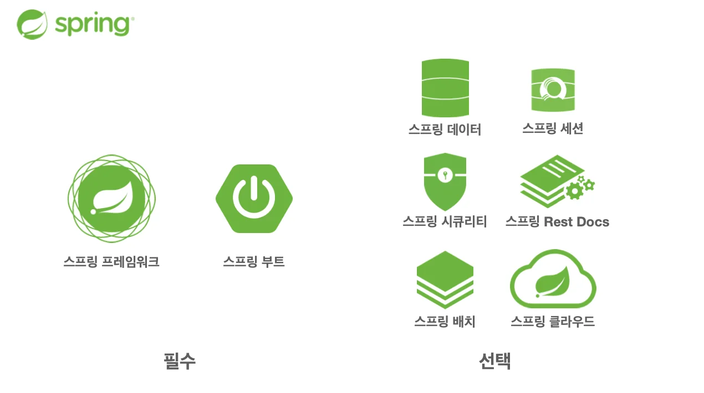

스프링은 여러가지 기술의 ??이다&#46;

## 스프링 프레임워크

- <strong>핵심 기술</strong>&#58; 스프링 DI 컨테이너, AOP, 이벤트, 기타

- <strong>웹 기술</strong>&#58; 스프링 MVC, 스프링 WebFlux

- <strong>데이터 접근 기술&#58;</strong> 트랜잭션, JDBC, ORM 지원, XML 지원

- <strong>기술 통합&#58; </strong>캐시, 이메일, 원격접근, 스케줄링

- <strong>테스트&#58;</strong> 스프링 기반 테스트 지원

- <strong>언어&#58;</strong> 코틀린, 그루비

- 최근에는 스프링 부트를 통해서 스프링 프레임워크의 기술들을 편리하게 사용

## 스프링 부트

- 스프링을 편리하게 사용할 수  있도록 지원, 최근에는 기본으로 사용

- 단독으로 실행할 수 있는 스프링 애플리케이션을 쉽게 생성

- Tomcat 같은 웹 서버를 내장해서 별도의 웹 서버를 설치하지 않아도됨&#46;

- 손쉬운 빌드 구성을 위한 starter 종속성 제공

- 스프링 과 3rd parth(외부) 라이브러리 자동 구성

- 메트릭, 상태 확인, 외부 구성 같은 프로덕션 준비 기능 제공

- 관례에 의한 간결한 설정

스프링 부트는 스프링 프레임워크와 별도로 사용 가능하지 않다&#46; 

스프링 부트는 스프링데이터, 세션 … 등 여러가지 기술들을 중간에서 편리하게 사용할 수 있도록 돕는 프레임워크에 포함되는 기본 기술일 뿐이다&#46; 

물론 스프링을 쓰면 자동으로 프레임워크도 가져오고 한다&#46; 

## <code>스프링</code> 단어의 의미는 ? 

- 스프링이라는 단어는 문맥에 따라 다르게 사용된다&#46; 
    - 스프링 DI 컨테이너 기술

    - 스프링 프레임워크

    - 스프링 부트, 스프링 프레임워크 등을 모두 포함한 스프링 생태계 

## 스프링은 왜 만들었나?

> 🤔 이 기술은 왜 만들었는가? 이 기술의 핵심 컨셉은 뭐냐?

스프링은 객체 지향 언어(자바)가 가진 강력한 특징을 극대화 시키는 프레임워크다&#46; 

따라서<strong> 스프링</strong>은 <strong>좋은 객체 지향</strong> 애플리케이션을 개발할 수 있게 도와주는 프레임워크이다&#46;

### 왜 스프링이 만들어 졌는가?

이전 파트에서도 설명되었지만, 스프링이 나오기 전, EJB 사용했던 시기에는 EJB를 상속받고 하면서 굉장히 지저분하게 EJB 의존적으로 개발을 하였다&#46; 그럼으로써 객체 지향의 좋은 장점들을 하나도 구현되지 않은 애플리케이션이 개발되었다&#46; 

따라서 이러한 문제를 해결하고자, 객체 지향적 프로그래밍을 구현하고자 여러 노력들의 결과가 결국 스프링이다&#46; 

스프링의 본질을 알면 얼마나 스프링이 객체 지향 프로그래밍을 잘 할 수 있도록 고민하고 설계했는지 알 수 있다&#46;
