<a id="1c3eda9b0fe1816d9686c3207625f5fc"></a>

## Docker Image

---

> 📖 
> 
> <a id="1c3eda9b0fe181c4af87fd9687b74e9d"></a>
> 
> Docker Container 서비스를 위한 이미지는 Container 런타임에 <strong><u>필요한 바이너리, 라이브러리, 설정 값</u></strong> 등을 포함한다&#46; 
> 
> - 변경되는 상태값을 보유하지 않음 ( <code>stateless</code> )
> 
> - 변하지 않음 ( <code>Immutable</code>, <code>Read&#45;Only</code> )

<details>
<summary>Docker 이미지 이해</summary>

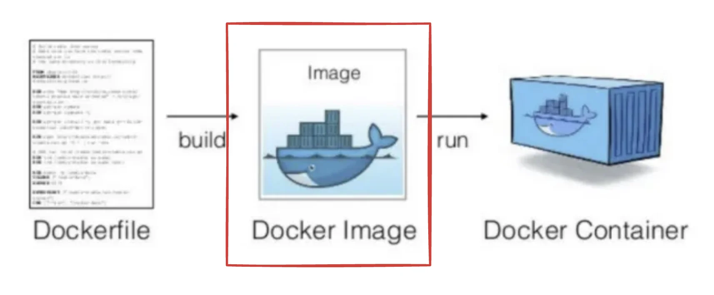

> JAR 파일과 같이 실행되지 않는 OS이다&#46;

- <strong>상태 저장 없음(Stateless)</strong>
    - 애플리케이션과 관련된 모든 파일과 라이브러리를 포함하고 있기 때문에, <br>다른 환경에서도 동일한 애플리케이션을 실행 가능하다&#46;

- <strong>불변성(Immutable)</strong>
    - 이미지는 한번 생성되면 변경할 수 없다&#46;

    - 도커 이미지는 필요한 파일만 포함하고 있기 때문에, 용량이 작으며,<br> 이미지를 변경할 필요가 있을 경우에는 새로운 이미지를 생성해야 한다&#46;

</details>

<details>
<summary>Docker 이미지 받아오기 ( 도커 허브 )</summary>

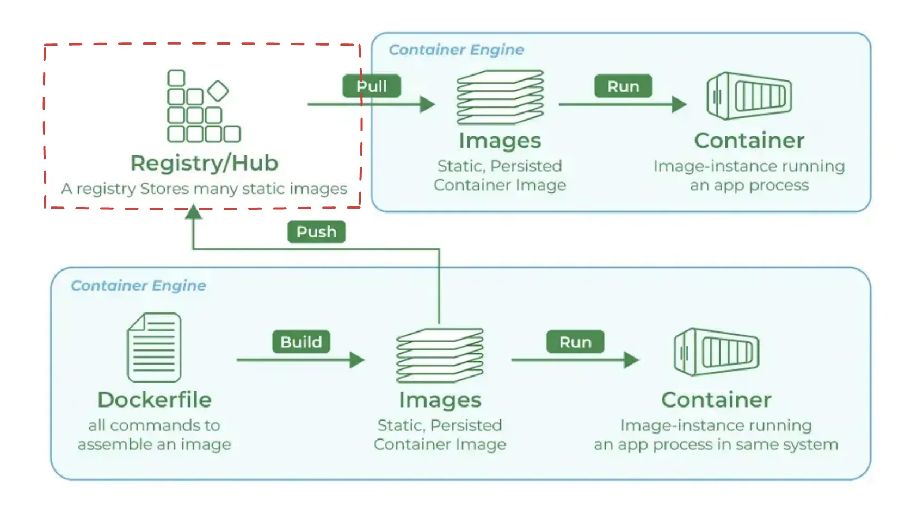

<a id="1c3eda9b0fe181bf8ff4dbd7f7c78e4c"></a>

도커 이미지는 registry/hub 라는 특정 공간에 저장되어 있다&#46; 

<a id="1c3eda9b0fe181deabe4f4d24b067706"></a>

이 중 공개된 대표적인 공간이 <a href="https://hub.docker.com/">도커 허브</a>이다 &#46;

- 도커 허브에서 <u>이미지를 제공 받</u>거나 <u>이미지를 제공</u>한다&#46;
    [Docker Hub Container Image Library &#124; App Containerization]()

- 기업마다 private registory가 존재할 수 있다&#46;

- 공개된 저장소(도커 허브)에서 받아온 <code>Docker file</code>을 통해 <code>Image</code>를 만들고 ( <code>build</code> )
    - 공개된 저장소(도커 허브)에 업로드 가능함

- 생성 <code>Image</code>를  <code>Container</code>에서 실행시킬 수 있다&#46; ( <code>Run</code> )

</details>

---

<details>
<summary>실습 1 &#45; 여러 이미지 다운 받고 상세정보 확인해보기</summary>

<details>
<summary>🤬 오류 &#45; <code>docker image inspect</code> 실행 오류 발생</summary>

- Container 실행이 중지된 경우 해당 cmd가 작동되지 않을 수 있다&#46; 

- 그런 경우, 아래와 같이 container를 실행시킨 후, cmd를 입력하면 정상 동작한다&#46; 
    - container ID 확인
        <a id="1c3eda9b0fe181e391a3f6ef11b1e710"></a>

        ```bash
        docker ps -a
        ```

    - container ID를 입력하여 실행
        <a id="1c3eda9b0fe181e48f9af92778a36a61"></a>

        ```bash
        docker start 2fc528ac2c41 # 컨테이너 ID 
        ```

    - 정상 동작 확인
        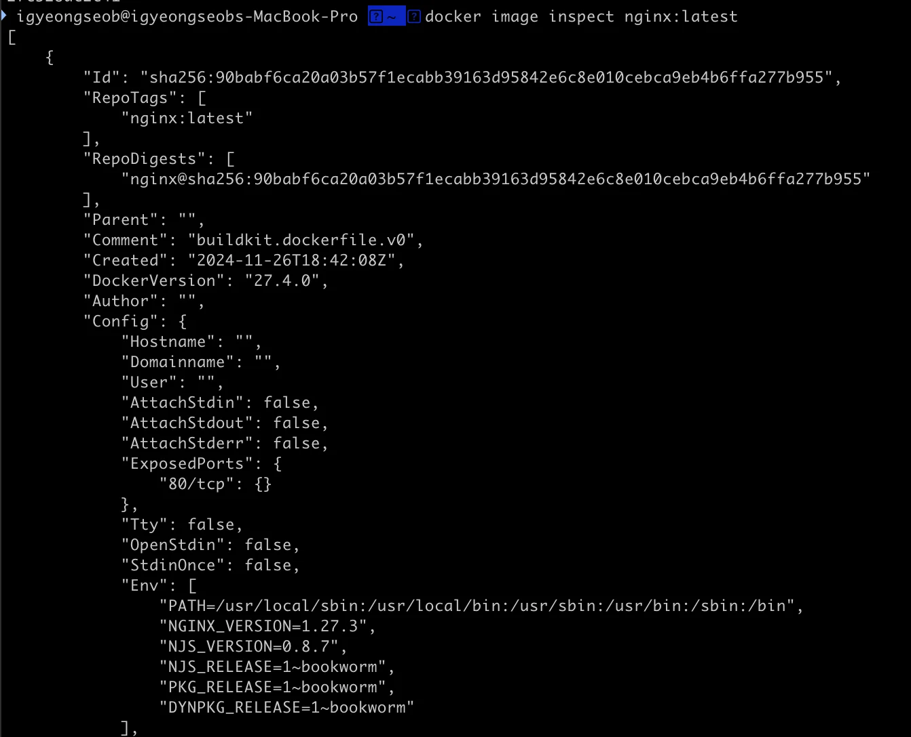

</details>

---

<a id="1c3eda9b0fe181b1895ee6082a27508e"></a>

```bash
# 특정 Dockerfile 다운 ( 다운 받은 file을 build 하여 image 생성)
docker pull  [ 이미지 ]

# 특정 Docker Image 내부 구조(JSON) 출력
docker image inspect [ 이미지 ]

# 특정 Docker Image 내부 변수 출력
docker image inspect --format="{{.변수명}} [ 이미지 ]

# Dockerfile 구조 확인
docker image history [ 이미지 ]
```

<details>
<summary>이미지 다운 받기 &#45; <code>docker pull  &#91; 이미지 &#93;</code></summary>

- 특정 이미지 다운 받기 
    <a id="1c3eda9b0fe18132abdbed31719bc100"></a>

    ```bash
    docker pull nginx:latest  # :lastest - 최신(마지막) 버전 다운
    ```

- 설치  확인 
    <a id="1c3eda9b0fe181839f23eb41ea781fed"></a>

    ```bash
    docker images
    ```

    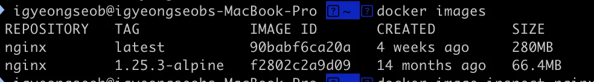

    <a id="1c3eda9b0fe18110aac6e2e552764244"></a>

    위와 같이  목록에 해당  이미지가 출력되면 설치가 정상적으로 진행됨

</details>

<details>
<summary>이미지 구조 확인해 보기 &#45; <code>docker image inspect &#91; 이미지 &#93;</code></summary>

<a id="1c3eda9b0fe181cbaef8f7ce6581b5ec"></a>

```bash
docker image inspect nginx:latest
```

<a id="1c3eda9b0fe181eeaef3e42e2822f12c"></a>

아래와 같이 JSON 구조로 되었있는 것을 확인 가능함

<details>
<summary>결과 값</summary>

<a id="1c3eda9b0fe18174b051c021e5370297"></a>

```bash
[
    {
        "Id": "sha256:90babf6ca20a03b57f1ecabb39163d95842e6c8e010cebca9eb4b6ffa277b955",
        "RepoTags": [
            "nginx:latest"
        ],
        "RepoDigests": [
            "nginx@sha256:90babf6ca20a03b57f1ecabb39163d95842e6c8e010cebca9eb4b6ffa277b955"
        ],
        "Parent": "",
        "Comment": "buildkit.dockerfile.v0",
        "Created": "2024-11-26T18:42:08Z",
        "DockerVersion": "27.4.0",
        "Author": "",
        "Config": {
            "Hostname": "",
            "Domainname": "",
            "User": "",
            "AttachStdin": false,
            "AttachStdout": false,
            "AttachStderr": false,
            "ExposedPorts": {
                "80/tcp": {}
            },
            "Tty": false,
            "OpenStdin": false,
            "StdinOnce": false,
            "Env": [
                "PATH=/usr/local/sbin:/usr/local/bin:/usr/sbin:/usr/bin:/sbin:/bin",
                "NGINX_VERSION=1.27.3",
                "NJS_VERSION=0.8.7",
                "NJS_RELEASE=1~bookworm",
                "PKG_RELEASE=1~bookworm",
                "DYNPKG_RELEASE=1~bookworm"
            ],
            "Cmd": [
                "nginx",
                "-g",
                "daemon off;"
            ],
            "Image": "",
            "Volumes": null,
            "WorkingDir": "",
            "Entrypoint": [
                "/docker-entrypoint.sh"
            ],
            "OnBuild": null,
            "Labels": {
                "maintainer": "NGINX Docker Maintainers <docker-maint@nginx.com>"
            },
            "StopSignal": "SIGQUIT"
        },
        "Architecture": "arm64",
        "Variant": "v8",
        "Os": "linux",
        "Size": 68524807,
        "GraphDriver": {
            "Data": null,
            "Name": "overlayfs"
        },
        "RootFS": {
            "Type": "layers",
            "Layers": [
                "sha256:035a390a8e98a1f63466237957754e9052803a1fa0feb6158b7438e2111cfa84",
                "sha256:10ef1f0cf67fd4753c121cd0833838ca1401cca304e904a6e57a38730c489bbf",
                "sha256:9b651195f31519803b6ce183613cbb748cb674d2aa5642c5fee79f394d0798cf",
                "sha256:604d839395d21011697b44a8e493f2ff4c4ee742cbe1b1a5fa1b1f14a929e9c3",
                "sha256:a15579a54566f4d4aefd820eba3f4bd4b4e152856ae59a5d1a1749448ed50717",
                "sha256:7437eeb1bdb15a103054d145e2394d068394da14e50c3854995926e4201b49dd",
                "sha256:80fef7cc043a76d6a0ecf9ca599cceec5aa149c51c0ecf77126ff1a8554a0661"
            ]
        },
        "Metadata": {
            "LastTagTime": "2024-12-25T05:24:11.763226336Z"
        }
    }
]
```

</details>

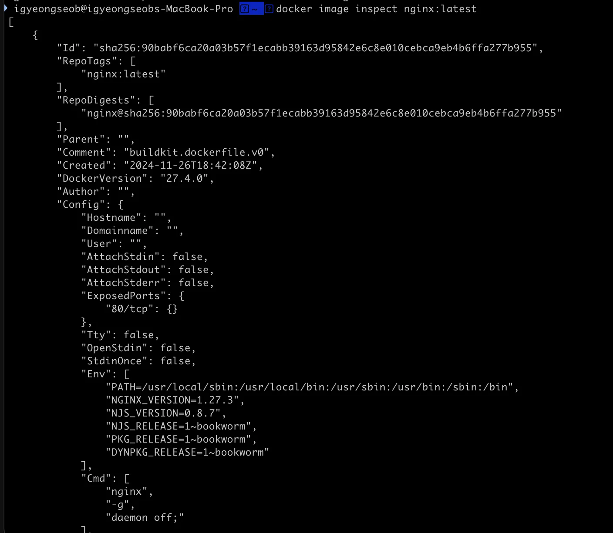

</details>

<details>
<summary>이미지 구조의 JSON 내부의 특정 변수 값 출력  <br>&#45; <code>docker image inspect &#45;&#45;format=&#34;{{&#46;변수명}} &#91; 이미지 &#93;</code></summary>

- 생성된 이미지의 내부 구조 정보를 json 형태로 제공한다&#46;

- 따라서 아래와 같이 JSON 내부의 특정 변수 값만을 출력할 수 있다&#46;

---

<details>
<summary>Case 1) Os</summary>

<a id="1c3eda9b0fe1810d847fd4147bd0ec1c"></a>

```bash
docker image inspect --format="{{.Os}}" nginx:latest  # 결과값: linux
```

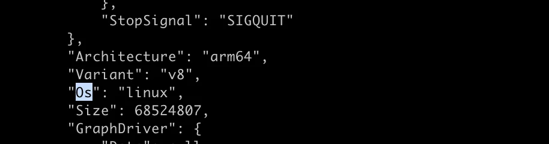

</details>

<details>
<summary>Case 2) RepoTags</summary>

<a id="1c3eda9b0fe181bb9ca1f51186c5aab6"></a>

```bash
docker image inspect --format="{{.RepoTags}}" nginx:latest # 결과값:[nginx:latest]
```

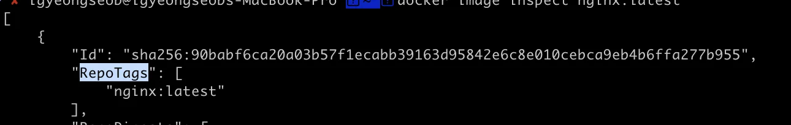

</details>

<details>
<summary>Case 3) Config&#46;ExposedPorts</summary>

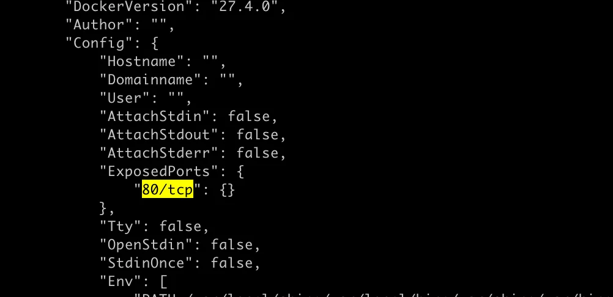

<a id="1c3eda9b0fe1814dbf98ec2f818a7773"></a>

```bash
docker image inspect --format="{{.Config.ExposedPorts}}" nginx:latest
# 결과값: map[80/tcp:{}]
```

</details>

<details>
<summary>Case 4) 여러 변수 검색 가능 &#45; RepoTags, Os</summary>

<a id="1c3eda9b0fe181e08c14f43e1e9256be"></a>

```bash
docker image inspect --format="{{.RepoTags}} {{.Os}}" nginx:latest
# 결과값: [nginx:latest] linux
```

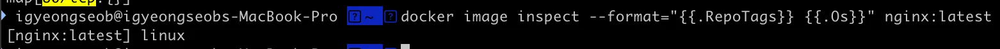

</details>

</details>

<details>
<summary><code>Dockerfile</code>  계층 구조 확인 &#45; <code>docker image history</code>, <code>docker pull</code></summary>

<details>
<summary>1&#46; <code>docker image history</code></summary>

<a id="1c3eda9b0fe181f78adcee35397dab65"></a>

```bash
docker image history nginx:latest
```

- 결과 값
    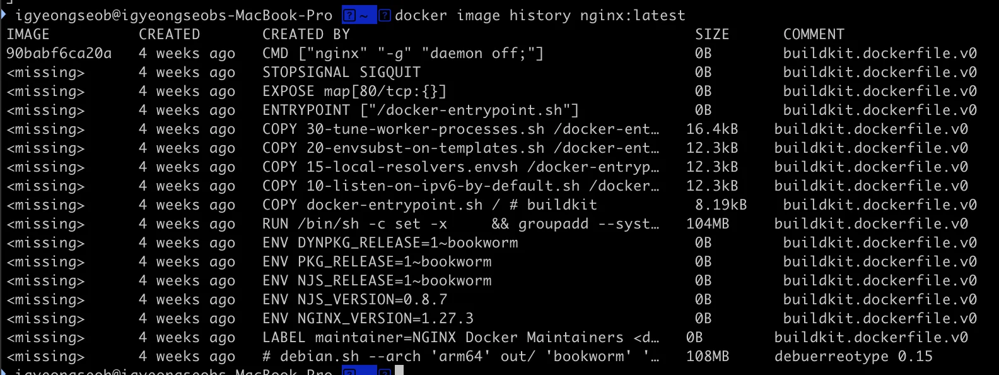

    <a id="1c3eda9b0fe181029f3cf01c0a82c00d"></a>

    위와 같이 여러 개의 계층 구조로 구성되는 것을 확인 가능함

</details>

<details>
<summary>2&#46; <code>docker pull</code></summary>

- 이미지 Pull(다운) 이후, 여러 개의 파일을 다운 받는 것을 확인 가능

<a id="1c3eda9b0fe1818eaee6d0ef490a743a"></a>

```bash
# 이미지 다운
docker pull nginx:latest

# 출력 결과 
latest: Pulling from library/nginx
a378f10b3218: Pull complete
5b5e4b85559a: Pull complete
508092f60780: Pull complete
59c24706ed13: Pull complete
1a8747e4a8f8: Pull complete
ad85f053b4ed: Pull complete
3000e3c97745: Pull complete
Digest: sha256:add4792d930c25dd2abf2ef9ea79de578097a1c175a16ab25814332fe33622de
Status: Downloaded newer image for nginx:latest
docker.io/library/nginx:latest
```

</details>

</details>

</details>

<details>
<summary>실습 2 &#45; Docker <code>login</code>, <code>logout</code></summary>

> hub&#46;docker&#46;com에서 회원가입 후 실행

<a id="1c3eda9b0fe18100924dcbf697d564e3"></a>

```bash
docker login # 로그인

docker logout # 로그아웃 
```

<details>
<summary>로그아웃 후  다시 로그인 진행 과정</summary>

<a id="1c3eda9b0fe181488cffcdf34c060293"></a>

로그인을 진행하려고 했더니 로그인이 이미 되어있음

- <del>로그인을 한적 없는 것 같은데&#46;&#46;? </del>

<a id="1c3eda9b0fe181858f28c8c5de72119a"></a>

따라서 실습을 위해 로그아웃을 하고 다시 로그인을 진행함

- 로그아웃&#58; <code>docker logout</code>

- 로그인&#58; <code>docker login</code>

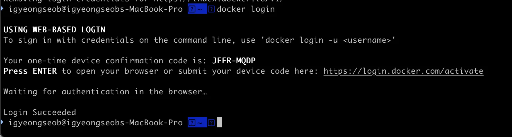

<a id="1c3eda9b0fe181dd81fdec468ff5bb97"></a>

로그아웃 이후,  로그인 시 위와 같이 인증을 위한 내용이 출력됨 

<a id="1c3eda9b0fe181fc83e3f4734dd4844e"></a>

Enter 입력 시,  아래와 같이 브라우저 인증 화면이 열림

- 해당 내용은  출력 메세지 확인

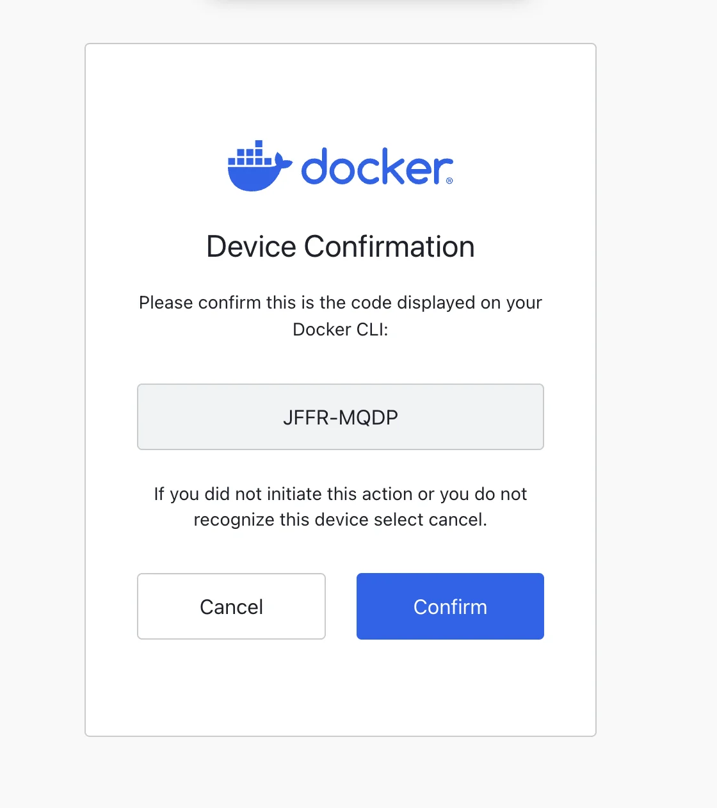

<a id="1c3eda9b0fe18197a3b4d9d7ee4fb716"></a>

confirm 클릭 시, 아래와 같이 인증이 되고 로그인이 완료됨

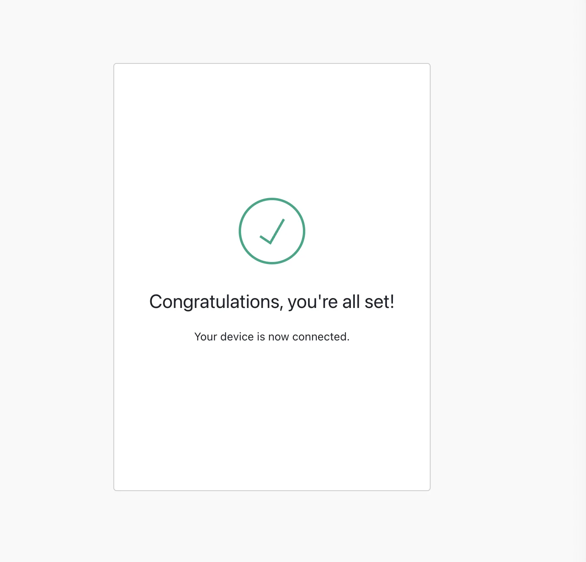

<details>
<summary>🤬 로그아웃 시, 아래와 같이 이미지 다운이 되지 않음 ( access denied  )</summary>

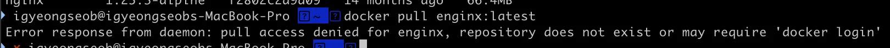

</details>

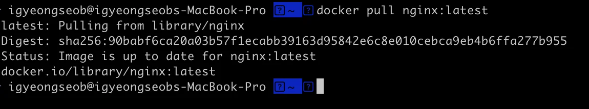

<a id="1c3eda9b0fe181bea060ef91948b1c89"></a>

로그인 이후 위와 같이 이미지 다운이 정상 동작하는 것을 확인 가능함

- 이전에 다운을 했기 때문에  실제 다운이 되지는 않았음

</details>

<details>
<summary>명령을 통해 등록 후 관리되는 Access Token 리스트 확인</summary>

- Settings
    [bookmark]()

- Settings/Access Token List 확인
    [bookmark]()

</details>

</details>

<details>
<summary>Docker Desktop 확인</summary>

> Images &#45; Local 

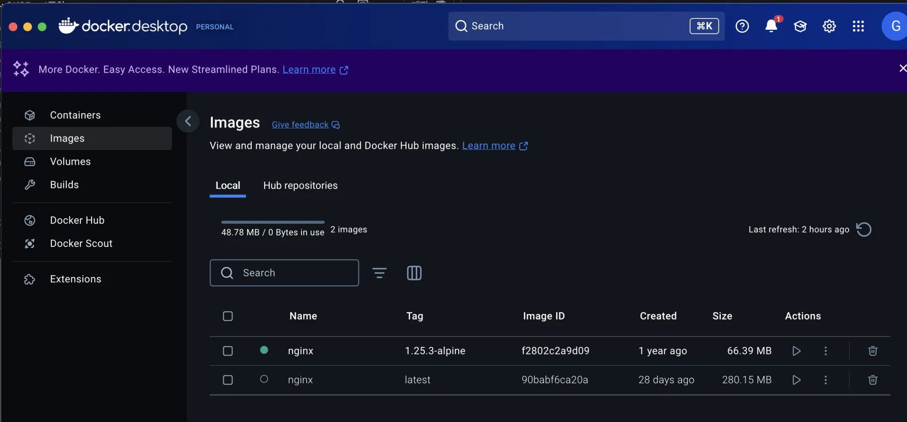

<a id="1c3eda9b0fe181cc817dc281ebdf30fd"></a>

로컬 환경에 다운 받은 이미지를 Docker Desktop에서도 위와 같이 확인이 가능하다&#46;

</details>
