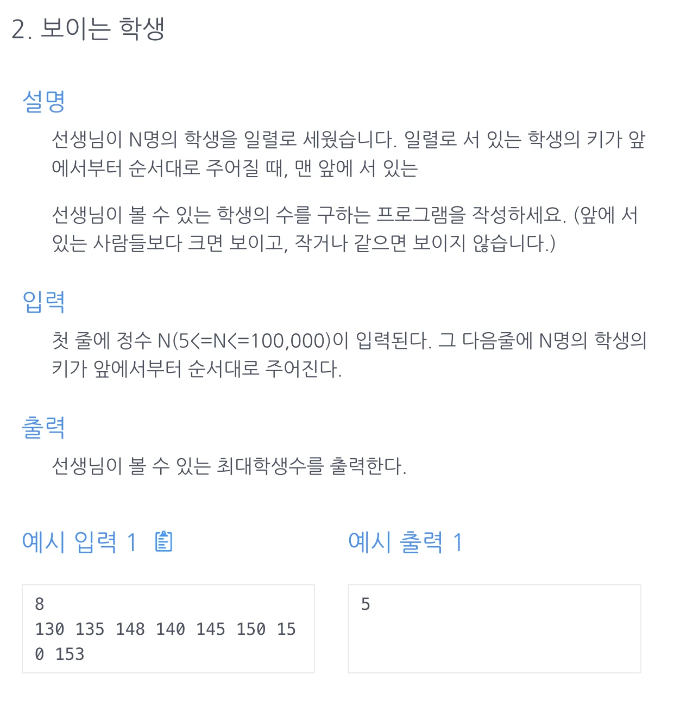

<a id="1c3eda9b0fe181a59724ee8a7abf8061"></a>

## 문제)



<a id="1c3eda9b0fe181918237d2078621107b"></a>

## 풀이)

<a id="1c3eda9b0fe181659381ec7de6a69929"></a>

### 내 풀이) (강의 풀이 동일)

<a id="1c3eda9b0fe181a1851ee2c395f66b06"></a>

```java
import java.util.ArrayList;
import java.util.Scanner;

public class Main {
    public int solution(int n, int[] arr){

        int len=arr[0], answer = 1;
        for(int i=1; i<n; i++){
            if(len < arr[i]){
                len = arr[i];
                answer++;
            }
        }
        return answer;
    }
    public static void main(String[] args) {
        Main m = new Main();
        Scanner sc = new Scanner(System.in);
        int n = sc.nextInt();
        int[] arr= new int[n];
        for(int i=0; i<n; i++){
            arr[i]= sc.nextInt();
        }
        System.out.println(m.solution(n, arr));
    }
}
```
