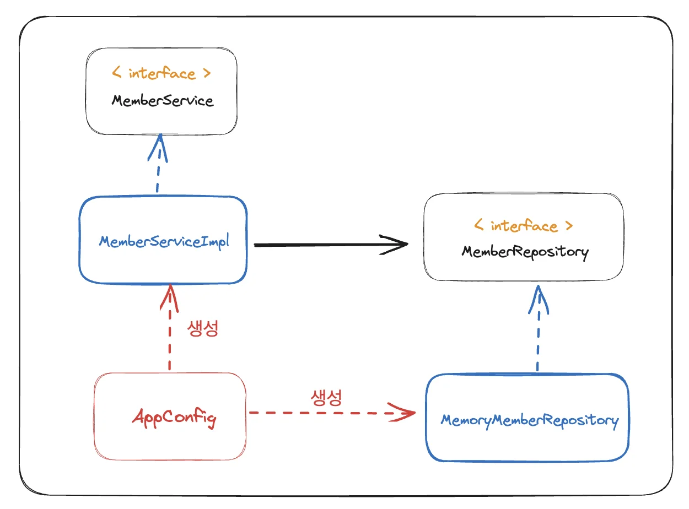
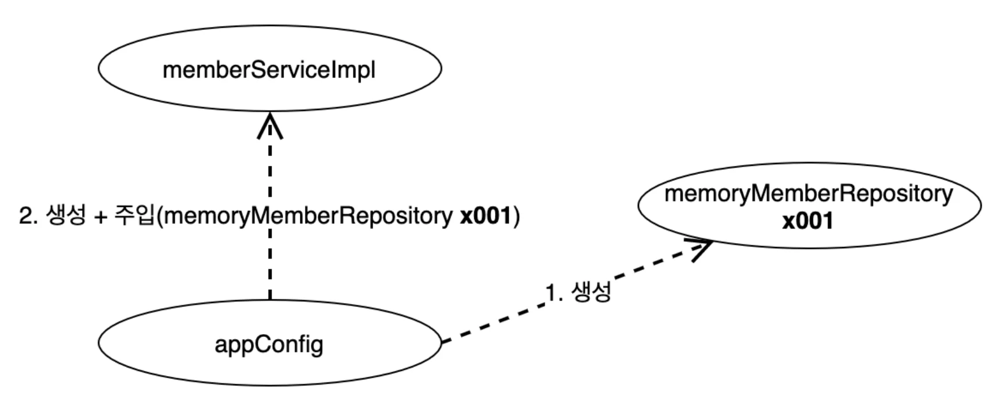

<a id="1c3eda9b0fe181469a75cc9c236d9161"></a>

### <strong>객체 지향 &#45; </strong><strong><code>다형성</code></strong><strong> ( 운전자 &#45; 자동차)</strong>


> 👉🏻 <strong>역할 및 구현체</strong>
> 
> - 운전자 역할&#58; <code>Client</code>
> 
> - 자동차 역할&#58; <code>interface</code> 
> 
> - 자동차 구현&#58; <code>instance</code>     &#91;  K3, 아반떼, 테슬라  &#93;

<a id="1c3eda9b0fe1817c902fe81a286bbf72"></a>

운전자는 <strong><code>K3</code></strong>를 타다가 <strong><code>아반떼</code></strong><strong> </strong>로 자동차를 바꿔도 운전할 수 있다&#46;<br>왜냐하면 <strong><u>자동차의 종류(구현)만 변화</u></strong>되었을 뿐, <strong><u>자동차 내부 동작(역할)은 동일</u></strong>하기 때문이다&#46; 

<a id="1c3eda9b0fe1813bb0bde33293928303"></a>

<strong><u>자동차 변경</u></strong>되어도 <strong><u>운전자가 운전하는 하는데 필요한 운전면허증, 운전 방법 등 이러한 요소들에 영향을 주지 않</u></strong>는다&#46; 

<a id="1c3eda9b0fe181a1a3ecf75b9a3c1c7d"></a>

즉, 자동차(<code>instace</code>)가 변해도 자동차의 역할(<code>interface</code>)은 변하지 않으며, 운전자(<code>client</code>)에게도 아무런 영향을 주지 않는다&#46; 

<a id="1c3eda9b0fe18150967bc973643d63a3"></a>

→ <strong><u>운전자(instance)는 자동차 역할(interface)에  대해서만 의존</u></strong>함&#46;

<a id="1c3eda9b0fe181b39a8ef685b15e7c48"></a>

이러한 방식을<u> </u><u>‘유연하고 변경이 용이하다’</u> 라고 표현하며, 이러한 방식이 <strong><u>객체지향의 </u></strong><strong><u>다향성</u></strong><strong><u>의 특징</u></strong>이다&#46; 

<a id="1c3eda9b0fe18190a2b3f32fd3a2b7d0"></a>

## 관심사 분리

---

> 👉🏻 <strong>강의 PPT에서 발췌</strong>
> 
> <a id="1c3eda9b0fe181d3a82fc62d2d7c58f5"></a>
> 
> 애플리케이션을 하나의 공연이라 생각해보자&#46; 각각의 인터페이스를 배역(배우 역할)이라 생각하자&#46; 
> 
> <a id="1c3eda9b0fe1810c84f2d822bd2e1555"></a>
> 
> 그런데&#33; 실제 배역 맞는 배우를 선택하는 것은 누가 하는가?<br>로미오와 줄리엣 공연을 하면 로미오 역할을 누가 할지 줄리엣 역할을 누가 할지는 배우들이 정하는게 아니다&#46; 이전 코드는 마치 <strong>로미오 역할(인터페이스)</strong>을 하는 <strong><code>남자 주인공(구현체, 배우)</code></strong>이 <strong>줄리엣 역할(인터페이스)</strong>을 하는 <strong><code>여자 주인공(구현체, 배우)</code></strong>을 <strong><u>직접 초빙하는 것과 같</u></strong>다&#46; 
> 
> <a id="1c3eda9b0fe1815b8a01da3eb7326b9c"></a>
> 
> → <code>MemberServiceImpl</code> 에서  <code>MemberRepository</code> 와 <code>MemoryMemberRepository</code>를 생성(new)
> 
> <a id="1c3eda9b0fe181899ae4c8f4939afd88"></a>
> 
> 남자 주인공은 <u>공연도 해</u>야하고<u> 동시에 여자 주인공도 공연에 직접 초빙</u>해야 하는 <strong>다양한 책임</strong>을 가지고 있다&#46;

<a id="1c3eda9b0fe18176a2fec417831e7de6"></a>

### 관심사 분리

- 배우는 본인의 역할인 배역을 수행하는 것에만 집중해야 한다&#46;

- 로미오 배우는 어떤 여자 주인공이 선택되더라도 똑같이 공연을 할 수 있어야 한다&#46;

- 공연을 구성하고, 담당 배우를 섭외하고, 역할에 맞는 배우를 지정하는 책임을 담당하는 별도의 <strong><code>공연 기획자</code></strong><strong>가</strong> 필요하다&#46;  <strong>공연 기획자</strong>를 만들고 <u>배우와 공연 기획자의 </u><strong><u>책임을 확실히 분리</u></strong>해야한다&#46;

<a id="1c3eda9b0fe181a4b8d7ceef5ff516d3"></a>

## DI (Dependency Injection, 의존성(생성자) 주입)  &#91;공연 기획자 생성&#93;

---



> • 객체의 생성과 연결은 <code>AppConfig</code> 가 담당한다&#46;<br>• <strong>DIP 완성</strong>&#58; <code>MemberServiceImpl</code> 은 <code>MemberRepository</code>(추상, 인터페이스) 에만 의존함<br>• <strong>관심사 분리</strong>&#58; 객체를 생성하고 연결하는 역할 과 실행하는 역할이 명확히 분리됨

<details>
<summary><strong>AppConfig</strong></summary>

<a id="1c3eda9b0fe18187bfa9f698056cffd8"></a>

```java
package hello.core;

import hello.core.discount.FixDiscountPolicy;
import hello.core.service.MemberService;
import hello.core.service.MemberServiceImpl;
import hello.core.order.OrderService;
import hello.core.order.OrderServiceImpl;
import hello.core.repository.MemoryMemberRepository;

public class AppConfig {
    public MemberService memberService() {
        return new MemberServiceImpl(new MemoryMemberRepository());
    }

    public OrderService orderService() {
        return new OrderServiceImpl(new MemoryMemberRepository(),new FixDiscountPolicy());
    }
}
```

</details>

<details>
<summary><strong>MemberServiceImpl </strong></summary>

<a id="1c3eda9b0fe1810b8b92eb505268b814"></a>

```java
package hello.core.service;

import hello.core.member.Member;
import hello.core.repository.MemberRepository;

public class MemberServiceImpl implements MemberService {
    private final MemberRepository memberRepository;

    public MemberServiceImpl(MemberRepository memberRepository) {
        this.memberRepository = memberRepository;
    }

    @Override
    public void join(Member member) {
        memberRepository.save(member);
    }

    @Override
    public Member findMember(Long memberId) {
        return memberRepository.findById(memberId);
    }
}
```

</details>

<details>
<summary><strong>OrderServiceImpl</strong></summary>

<a id="1c3eda9b0fe18193a526ce314b66cff8"></a>

```java
package hello.core.order;

import hello.core.discount.DiscountPolicy;
import hello.core.member.Member;
import hello.core.repository.MemberRepository;


public class OrderServiceImpl implements OrderService {
    private final MemberRepository memberRepository;
    private final DiscountPolicy discountPolicy;

    public OrderServiceImpl(MemberRepository memberRepository, DiscountPolicy discountPolicy) {
        this.memberRepository = memberRepository;
        this.discountPolicy = discountPolicy;
    }

    @Override
public Order createOrder(Long memberId, String itemName, int itemPrice) {
        Member member = memberRepository.findById(memberId);
        int discountPrice = discountPolicy.discount(member, itemPrice);
        return new Order(memberId, itemName, itemPrice, discountPrice);
    }
}
```

</details>

<a id="1c3eda9b0fe1814582f1e69b9041d31e"></a>

### DI(Dependency Injection, 의존관계 주입)



> • <code>appConfig</code> 객체는 <code>memoryMemberRepository</code> 객체를 생성하고 그 참조값을 생성하면서(인자로 넘기면서) 생성자로 전달한다&#46;<br>• 클라이언트인 <code>memberServiceImpl</code> 입장에서 보면 의존관계를 마치 외부에서 주입해주는 것과 같아 <strong>DI(Dependency Injection),  의존관계(의존성) 주입</strong> 이라 한다&#46;

<a id="1c3eda9b0fe1816d921de8f93ba6a308"></a>

### 순수 자바 테스트 코드에 AppConfig 적용

> 직접 구현체를 생성하는 대신, <code>AppConfig</code>를 통해 구현체를 생성 및 주입(의존관계 주입,DI) <br>따라서 직접 인스턴스 생성 대신, <code>AppConfig &#46;생성 함수</code> 참조 

<a id="1c3eda9b0fe181829b56f2de2f5bd4d4"></a>

```java
======================== 이전 코드 ============================= 
MemberService memberService = new MemberServiceImp();
OrderService orderService = new OrderServiceImp()

====================== DI, 의존관계 주입 ========================

AppConfig appConfig = new AppConfig();
MemberService memberService = appConfig.memberService();
OrderService orderService = appConfig.orderService();
```

<details>
<summary><strong>MemberApp</strong></summary>

<a id="1c3eda9b0fe18148b5bfe6af969ca901"></a>

```java
package hello.core;

import hello.core.member.Grade;
import hello.core.member.Member;

import hello.core.service.MemberService;
import hello.core.service.MemberServiceImpl;

public class MemberApp {

    public static void main(String[] args) {
        AppConfig appConfig = new AppConfig();
        MemberService memberService = appConfig.memberService();
        Member member = new Member(1L, "memberA", Grade.VIP);
        memberService.join(member);

        Member findMember = memberService.findMember(1L);
        System.out.println("new member = " + member.getName());
        System.out.println("find Member = " + findMember.getName());
    }
}
```

</details>

<details>
<summary><strong>OrderApp</strong></summary>

<a id="1c3eda9b0fe18172b7e2f9700e9c7f42"></a>

```java
package hello.core;

import hello.core.member.Grade;
import hello.core.member.Member;
import hello.core.service.MemberService;
import hello.core.service.MemberServiceImpl;
import hello.core.order.Order;
import hello.core.order.OrderService;
import hello.core.order.OrderServiceImpl;

public class OrderApp {
    public static void main(String[] args) {
        AppConfig appConfig = new AppConfig();
        MemberService memberService = appConfig.memberService();
        OrderService orderService = appConfig.orderService();
        long memberId = 1L;
        Member member = new Member(memberId, "memberA", Grade.VIP);
        memberService.join(member);

        Order order = orderService.createOrder(memberId, "itemA", 10000);
        System.out.println("order = " + order);

    }
}
```

</details>
