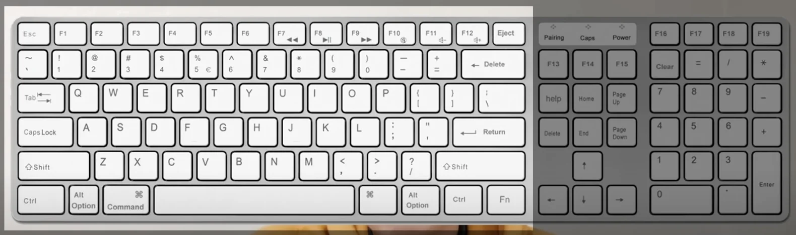
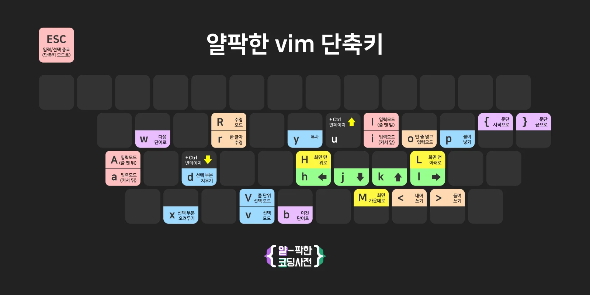

> 
> 
> 
> 
> <strong>목차</strong>
> 
> - [개요](#1c3eda9b0fe181feb8f2c268376b10ea)
> - [사용법](#1c3eda9b0fe1812c9417ff4d7dcee2bb)
> - [추가 reference](#1c3eda9b0fe181b1978ddda62aa48c9f)

[video](https://www.youtube.com/watch?v=qn1soztN7k4&t=87s)

### 개요

Vim의 단축키는 위 그림과 같이 해당 부분에 단축키가 모여 있다&#46; 마우스나, 방향키, 숫자 키보드도 사용하지 않아서 한번 익숙해지면 개발 시 굉장히 편하다&#46;

대부분의 개발툴에서 vim 모드를 플러그인이나 선택기능으로 사용 가능하다

즉, 한번 익혀두면 대부분 툴에서 사용 가능하다&#46;

## 사용법

<strong>단축키 입력 모드</strong>

시작 상태, 텍스트 입력 X

단축키만 입력 가능한 상태

<strong>텍스트 입력 모드</strong>

<code>I</code>&#58; 줄 맨 앞 <code>A</code>&#58; 줄 맨 뒤

<code>i</code>&#58; 커서 앞  

<code>a</code>&#58; 커서 뒤

 

### 추가 reference

---

<a href="https://www.google.com/search?sca_esv=a9f733130965a78f&#38;sca_upv=1&#38;q=vim+%ED%82%A4%EB%A7%B5&#38;tbm=isch&#38;source=lnms&#38;sa=X&#38;ved=2ahUKEwjg24yYrMaFAxXikK8BHX4ZCnUQ0pQJegQIDxAB&#38;biw=748&#38;bih=732&#38;dpr=2">vim &#45; keymap</a>

- <a href="https://vim-adventures.com/">🔗 Vim Adventures</a> &#58; 게임 형식으로 Vim 학습

- <a href="https://openvim.com/">🔗 OpenVim</a> &#58; 주요 기능들을 쉽게 가이드해주는 웹 튜토리얼

- <a href="http://vimgenius.com/">🔗 VimGenius</a> &#58; 퀴즈 형식으로 Vim을 연습할 수 있는 사이트
