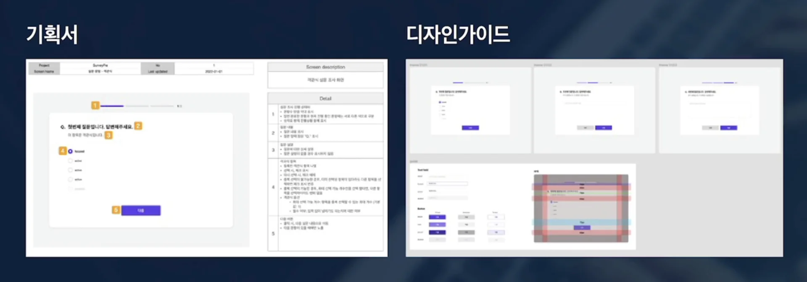
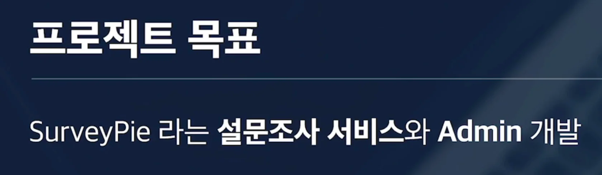

### 진행방식

---

React는 장단점이 확실한 라이브러리이다&#46; 

따라서 어떻게 사용하는 지에 따라 득이 될 수 있고, 실이 될 수 있다&#46; 

이를 앞으로의 프로젝트를 통해 알아본다&#46; 

실제 실무에서 처럼, 기획서와 요구사항, 와이어프레임을 기준으로 개발을 진행한다&#46;

## 프로젝트 &#45; SurveyPie

---

설문조사 서비스

- 설문조사 서비스

- 설문 조사를 관리하는 어드미

### 요구사항
