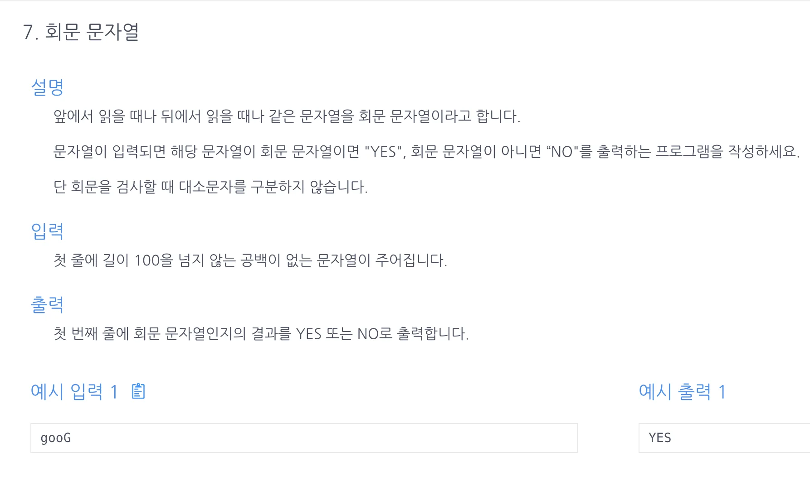

<a id="1c3eda9b0fe1817fa6ffc6e74fa9b2c4"></a>

## 문제)



<a id="1c3eda9b0fe181a6b90fd8280ef1771e"></a>

## 풀이)

<a id="1c3eda9b0fe181528bb2d6f820a82c9e"></a>

### 내 풀이) 투포인터

<a id="1c3eda9b0fe181d29227c4684a82018c"></a>

```java
import java.util.Scanner;

public class Main {
    public String solution(String str) {
        char[] s = str.toUpperCase().toCharArray();
        int l=0, r=s.length-1;
        while(l<r){
            if(s[l] != s[r])return "NO";
            l++; r--;
        }
        return "YES";
    }
    public static void main(String[] args){
        Main m = new Main();
        Scanner sc=new Scanner(System.in);
        String str = sc.nextLine();
        System.out.print(m.solution(str));
    }
}
```

<a id="1c3eda9b0fe1816d866ff0eefaa78dc8"></a>

### 강의 풀이1) 인덱스(str&#46;charAt()) → 투포인터

<a id="1c3eda9b0fe181b5ad84e0c66fe1517d"></a>

```java
import java.util.Scanner;

public class Main {
    public String solution(String str) {
	      str = str.toUpperCase();
        int len=str.length();
        for(int i=0; i<len/2; i++){
            if(str.charAt(i) != str.charAt(len-i-1)) return "NO";
        }
        return "YES";
    }
    public static void main(String[] args){
        Main m = new Main();
        Scanner sc=new Scanner(System.in);
        String str = sc.nextLine();
        System.out.print(m.solution(str));
    }
}
```

<a id="1c3eda9b0fe181569eebf1088ae5d65b"></a>

### 강의 풀이2&#45;1 ) StringBuilder(), toUpperCase()

<a id="1c3eda9b0fe18114bb3fd77d63ffa2bb"></a>

```java
import java.util.Scanner;

public class Main {
    public String solution(String str) {
        String answer="NO";
        str = str.toUpperCase();
        String tmp = new StringBuilder(str).reverse().toString();
        if(str.equals(tmp)) answer="YES";
        return answer;
    }
    public static void main(String[] args){
        Main m = new Main();
        Scanner sc=new Scanner(System.in);
        String str = sc.nextLine();
        System.out.print(m.solution(str));
    }
}
```

<a id="1c3eda9b0fe1814aae35c44c3293118d"></a>

### 강의 풀이2&#45;2) StringBuilder(), IgnoreCase()&#58; 대문자구별 무시

<a id="1c3eda9b0fe181aa887ce756b61a9dc2"></a>

```java
import java.util.Scanner;

public class Main {
    public String solution(String str) {
        String answer="NO";
        String tmp = new StringBuilder(str).reverse().toString();
        if(str.equalsIgnoreCase(tmp)) answer="YES";
        return answer;
    }
    public static void main(String[] args){
        Main m = new Main();
        Scanner sc=new Scanner(System.in);
        String str = sc.nextLine();
        System.out.print(m.solution(str));
    }
}
```
