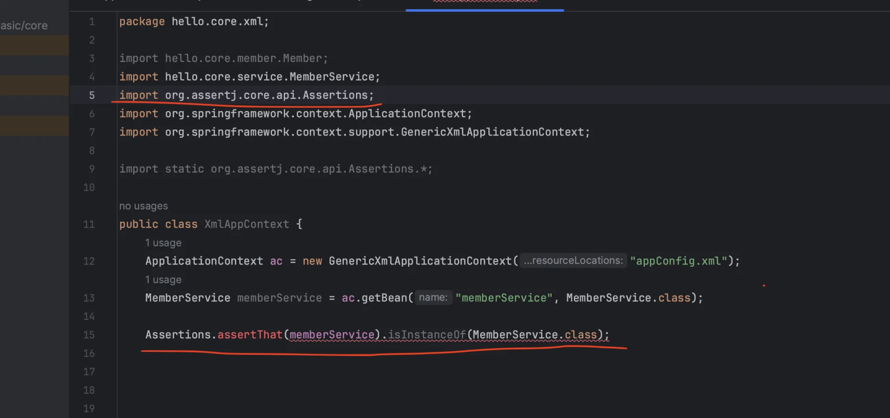
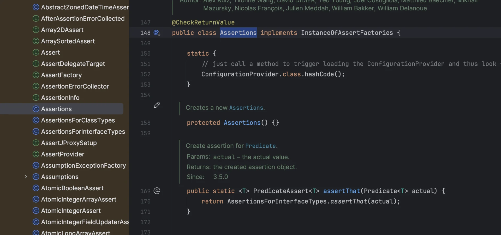
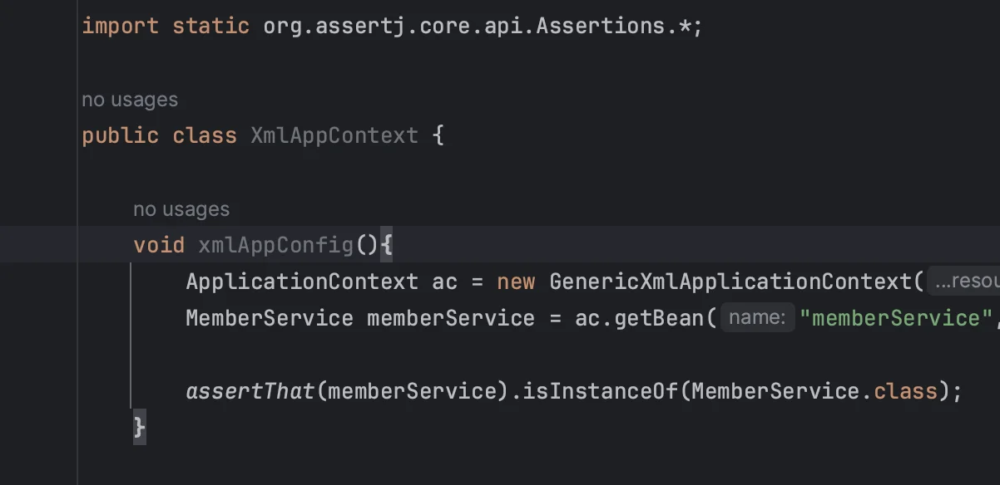
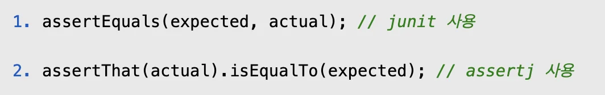

> /icons/crayon_gray.svg <strong>스프링 핵심 원리 &#45; 기본편</strong>
> 
> -  객체 지향 설계, 스프링 핵심 원리
> 
> - 스프링을 사용할 때 필수로 알아야 하는 핵심 기능

<a id="1c3eda9b0fe18190b032ec30497609ee"></a>

## 

[1. 객체 지향 설계, 스프링](#/post/1c3eda9b-0fe1-819c-8635-f03b9bfcf63a)

[1.1 - 스프링 탄생 역사](#/post/1c3eda9b-0fe1-819a-bae7-fb9a94223466)

[1.2  - 스프링이란?](#/post/1c3eda9b-0fe1-818a-835c-fec1a7e8bb97)

[1.3 - 좋은 객체지향 프로그램이란?](#/post/1c3eda9b-0fe1-8106-a21a-f1b7a1883901)

[1.4 - 객체 지향 설계 5 원칙(SOLID)](#/post/1c3eda9b-0fe1-8111-8e58-e6875a73e007)

[1.5 - 객체 지향 설계와 스프링](#/post/1c3eda9b-0fe1-8124-9e83-edaf39385cfb)

[2. 스프링 핵심 원리 이해1 - 예제 만들기](#/post/1c3eda9b-0fe1-8165-8232-d506473119c9)

[2.1 - 프로젝트 생성](#/post/1c3eda9b-0fe1-81f0-9ed2-f51b843ba81f)

[2.2 - 비지니스 요구사항 및  설계](#/post/1c3eda9b-0fe1-81c2-aaca-c6c9650c0d9c)

[2.3 - 회원 도메인 설계](#/post/1c3eda9b-0fe1-81f2-894c-f2651ac3e00c)

[2.4 - 회원 도메인 개발](#/post/1c3eda9b-0fe1-810a-93ba-ceed16e721d1)

[2.5 - 회원 도메인 실행 및  테스트](#/post/1c3eda9b-0fe1-817d-ab1c-f191e1ab7774)

[2.6 - 주문, 할인 도메인 설계](#/post/1c3eda9b-0fe1-81e3-bc11-c0c90b1998d1)

[2.7 - 주문, 할인 도메인 개발](#/post/1c3eda9b-0fe1-8192-b6a2-ec8f0f019481)

[2.8 - 주문, 할인 도메인 실행 및 테스트](#/post/1c3eda9b-0fe1-8169-9c13-c22d6b691594)

[3. 스프링 핵심 원리 이해2 - 객체 지향 원리 적용](#/post/1c3eda9b-0fe1-8178-bdb3-d5bce9411ee0)

[3.1 - 새로운 할인 정책 개발](#/post/1c3eda9b-0fe1-816e-b662-d39b83cd0d81)

[3.2 - 새로운 할인 정책 적용과 문제점](#/post/1c3eda9b-0fe1-81d0-b3c0-dd1995d91fca)

[3.3 - 관심사 분리](#/post/1c3eda9b-0fe1-818c-81c7-ef9e927f1359)

[3.4 - AppConfig 리팩터링](#/post/1c3eda9b-0fe1-81bf-8074-d280983d9e9b)

[3.5 - 새로운 구조와 할인 정책 적용](#/post/1c3eda9b-0fe1-8195-a0d8-f48980d81546)

[3.7 좋은 객체 지향 설계의 5가지 원칙(SOLID)](#/post/1c3eda9b-0fe1-8172-a336-dd711857d017)

[3.8 - IoC, DI, 컨테이너](#/post/1c3eda9b-0fe1-8113-875c-da1894568c75)

[3.9 - 스프링으로 전환하기](#/post/1c3eda9b-0fe1-8170-9126-ebbe815cb709)

[4. 스프링 컨테이너, 스프링 빈](#/post/1c3eda9b-0fe1-815d-9bd5-cc60b1067631)

[4.1 - 스프링 컨테이너 생성](#/post/1c3eda9b-0fe1-81c0-9c0e-c6b23d10b649)

[4.2 - 컨테이너에 등록된 모든 빈 조회](#/post/1c3eda9b-0fe1-81c7-a9c7-fb6146f4b7dd)

[4.3 - 스프링 빈 조회(기본)](#/post/1c3eda9b-0fe1-8193-911c-fec3eca48123)

[4.4 - 스프링 빈 조회(동일한 타입이 둘 이상)](#/post/1c3eda9b-0fe1-81f5-be2e-c07fb8dc0b3f)

[4.5 - 스프링 빈 조회(상속 관계)](#/post/1c3eda9b-0fe1-81a0-a4ed-ce069ee59fb3)

[4.6 - BeanFactory와 ApplicationContext](#/post/1c3eda9b-0fe1-8128-94b6-c39471b3994e)

[4.7 - 다양한 설정 형식 지원(자바, XML)](#/post/1c3eda9b-0fe1-81be-a841-c526b88fa120)

[4.8 - 스프링 빈 설정 메타 정보, BeanDefinition](#/post/1c3eda9b-0fe1-81f2-9846-de8315a321a0)

[5. 싱글톤 컨테이너](#/post/1c3eda9b-0fe1-8123-a7d2-e204569f1845)

[5.1 - 웹 애플리케이션, 싱글톤](#/post/1c3eda9b-0fe1-8153-b20f-c9aad15c97f1)

[5.2 - 싱글톤 패턴](#/post/1c3eda9b-0fe1-8115-800e-d0d634dda9c9)

[5.3 - 싱글톤 컨테이너](#/post/1c3eda9b-0fe1-81ca-bf28-f14bc7216667)

[5.4  - 싱글톤 방식의 주의점](#/post/1c3eda9b-0fe1-819e-ab2c-f9edf06cb2e6)

[5.5 - @Configuration, 싱글톤](#/post/1c3eda9b-0fe1-81c7-838f-e42958736b8b)

[5.6 - @Configuration, 바이트코드 조작](#/post/1c3eda9b-0fe1-819b-b57f-f4f2c35ff6b7)

[6. 컴포넌트 스탠](#/post/1c3eda9b-0fe1-81a5-b7c3-e0f26b95978f)

[6.1 - 컴포넌트 스캔과 의존관계 자동 주입](#/post/1c3eda9b-0fe1-8153-8975-dbd2e14d044e)

[6.2 - 탐색 위치와 기본 스캔 대상](#/post/1c3eda9b-0fe1-8154-b119-f47fcfadf593)

[6.3 - 필터](#/post/1c3eda9b-0fe1-81cc-b115-d7206daf7226)

[6.4 - 중복 등록, 충돌](#/post/1c3eda9b-0fe1-815e-b61b-ec9f0431193e)

[7. 의존관계 자동 주입](#/post/1c3eda9b-0fe1-8165-a640-df507fcd9529)

[7.1 - 다양한 의존관계 주입 방법](#/post/1c3eda9b-0fe1-815a-b495-d41e57fe6a1d)

[7.2 - 옵션 처리](#/post/1c3eda9b-0fe1-8153-9a46-d17d70aa638d)

[7.3 - 생성자 주입 선택해라!](#/post/1c3eda9b-0fe1-81d8-9f33-f3d9edbaeb91)

[7.4 - 롬복과 최신 트랜드](#/post/1c3eda9b-0fe1-81a3-ab67-d3a675671d33)

[7.5 - 조회 빈이 2개 이상 → Error](#/post/1c3eda9b-0fe1-81ca-83dc-c3327a378c9c)

[7.6 - @Autowired 필드 명, @Qualifier, @Primary](#/post/1c3eda9b-0fe1-815e-af6d-f3a8b26eb766)

[7.7 - 애노테이션 직접 만들기](#/post/1c3eda9b-0fe1-81e1-be67-fca94d0918d8)

[7.8 - 조회한 빈이 모두 필요할 때, List, Map](#/post/1c3eda9b-0fe1-816a-9d73-c1fc84719e97)

[7.9 - 자동, 수동의 올바른 실무 운영 기준](#/post/1c3eda9b-0fe1-81f3-9602-d4a33831b901)

[8. 빈 생명주기 콜백](#/post/1c3eda9b-0fe1-81f3-83ed-ca61dd87fd15)

[8.1 - 빈 생명주기 콜백](#/post/1c3eda9b-0fe1-819b-b068-cf95aab3513b)

[8.2 - 인터페이스 InitializingBean, DisposableBe](#/post/1c3eda9b-0fe1-81cd-b4c8-c667a00d07ef)

[8.3 - 빈 등록 초기화, 소멸 메서드 지정](#/post/1c3eda9b-0fe1-8167-8069-db2a9f35c681)

[8.4 - 애노테이션 @PostConstruct, @PreDestroy](#/post/1c3eda9b-0fe1-81b0-87cc-d5858cb2e8d7)

[9. 빈 스코프](#/post/1c3eda9b-0fe1-8101-9345-fa26878476f3)

[9.8 - 스코프와 프록시](#/post/1c3eda9b-0fe1-8115-88cf-caf9182dba03)

[9.7 - 스코프와 Provider](#/post/1c3eda9b-0fe1-81e9-819d-f99961062639)

[9.6 - request 스코프 예제 만들기](#/post/1c3eda9b-0fe1-8177-ba20-ea1ba2c222b6)

[9.5 - 웹 스코프](#/post/1c3eda9b-0fe1-8139-a47b-c343349393f6)

[9.4 프로토타입 , 싱글톤  - Provider](#/post/1c3eda9b-0fe1-813d-ade3-f8678994b7b0)

[9.3 - 프로토타입 스코프, 싱글톤 빈 - 문제점](#/post/1c3eda9b-0fe1-81a8-92d2-fd8aa2528471)

[9.2 - 프로토타입 스코프](#/post/1c3eda9b-0fe1-8179-80d1-eef8d87f3b3e)

[9.1 - 빈 스코프란?](#/post/1c3eda9b-0fe1-8149-b581-f57a5aa9eeac)

<a id="1c3eda9b0fe181f8ae45c36a6a7a2df3"></a>

### Notes

<details>
<summary><code>도메인</code>이란?</summary>

<a id="1c3eda9b0fe181648433e596cc77000e"></a>

도메인(domain)이라는 용어는 소프트웨어의 특정 문제 영역을 의미한다&#46;

> <strong>회원 도메인 <br></strong>회원과 관련된 <u>데이터 모델, 비지니스 로직, 데이터베이스 </u>등 <strong>회원 정보를 처리하는 범위의 총칭</strong>을 의미함&#46;<br>이는, <strong>회원 가입, 조회, 수정, 삭제 등을 포함한 회원 데이터와 관련된 요소들을 의미하는 용어로 사용</strong>됨

<a id="1c3eda9b0fe181cb9e3ad7977c9ee60a"></a>

<br>

</details>

<details>
<summary><code>Error</code> &#45; Assertions&#46;assertThat 을 못 가져옴</summary>

<a id="1c3eda9b0fe18128b54fdc10d1914753"></a>

라이브러리를 찾아보니 떡하니 존재하는데 왜 못가져옴? 이해가 안되네…





<a id="1c3eda9b0fe181d4b0bceb7600652d97"></a>

### <del>⇒ test &#45; annotation(</del><del><code>&#64;Test</code></del><del>)  을 빼먹음</del> 

<a id="1c3eda9b0fe181618b86eed8c51f75b5"></a>

→ … &#64;test를 지워도 됨…

<a id="1c3eda9b0fe181318164ca194311785d"></a>

→ 강의 코드 복붙했더니 잘 됨… 뭐가 문제지?? 

<a id="1c3eda9b0fe1817995bef270f3c765c0"></a>

### ⇒  클래스의 테스트 메소드 안에서만  지원됨

<a id="1c3eda9b0fe1819393e0fc7c482cf14d"></a>

아래와 같이 테스트 메소드 안에서 사용하니 정상적으로 가져옴&#46;



</details>

<details>
<summary><a href="https://m42-orion.tistory.com/97">&#91; 테스트 &#93; </a><strong><a href="https://m42-orion.tistory.com/97">Junit, assertj 차이</a></strong></summary>

<a id="1c3eda9b0fe18173b633f5998f618bee"></a>

assertj가 가독성이 더 좋다<br>ex) 



<a id="1c3eda9b0fe18186b375ecf460e7d882"></a>

→ assertj 사용 시, 검사 대상과 기댓값을 알기 쉬움, 가독성이 좋음

</details>

<details>
<summary>Junit5&#45;<code>assertThrow()</code> &#58; 예외처리? ( 실패 케이스 테스트)</summary>

> assertThrows(Class&#60;&#62; classType, Executable executable)

- 첫번째 인자로 발생할 예외 클래스의 타입을 받음

- executable을 실행하여 예외가 발생할 경우 classType과 발생된 Exception이 같은타입인지 체크
    <a id="1c3eda9b0fe18168a78de5b22f30c062"></a>

    (상속관계도 포함)

    <a id="1c3eda9b0fe181cbab77f8894d0f4821"></a>

    ```java
    // ex)
    assertThrows(
    		NoSuchBeanDefinitionException.class,
    		()->ac.getBean("beanB", BeanB.class));
    ```

</details>

<a id="1c3eda9b0fe18160bc87c6c0f4d008ae"></a>

<code>assertj&#46;Assertion&#46;assertThat()&#46;</code><u><code>isNotNull()</code></u>
