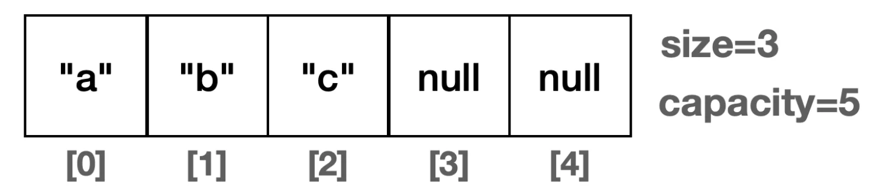
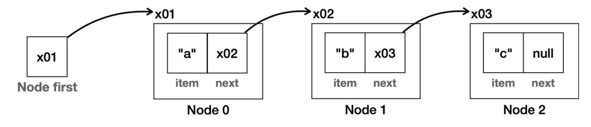
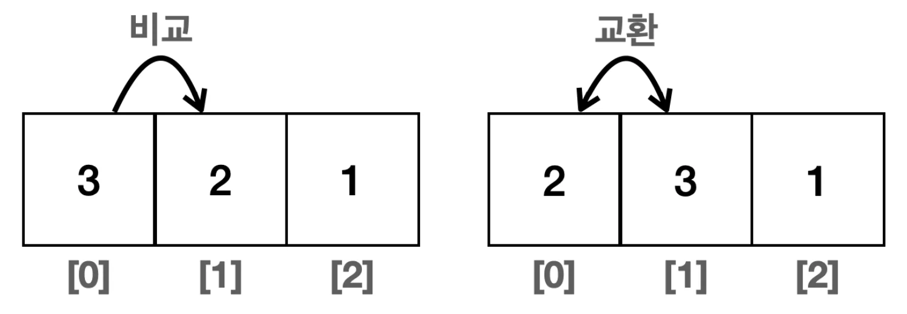
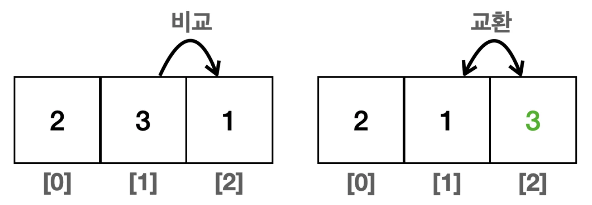
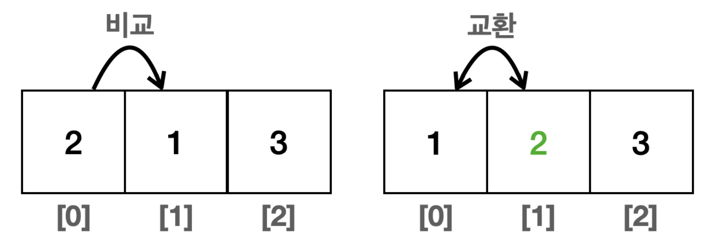
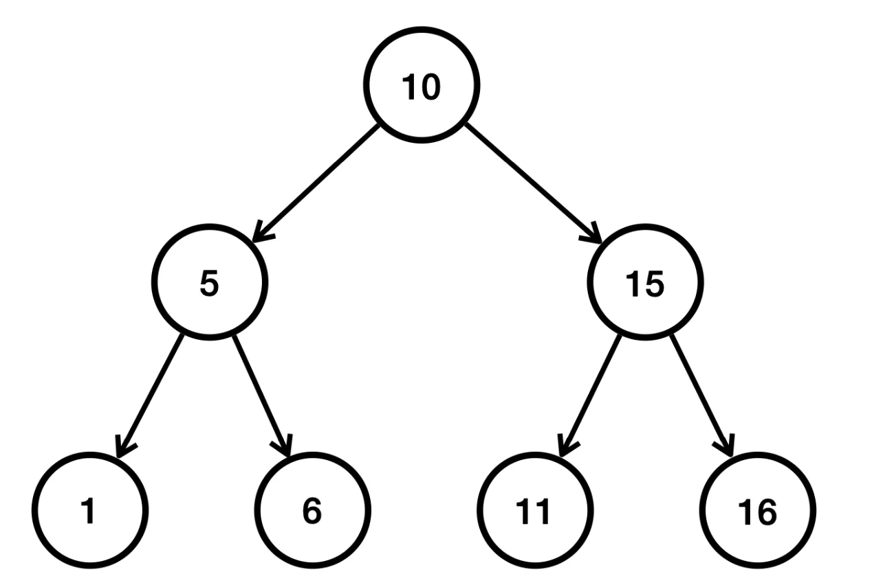
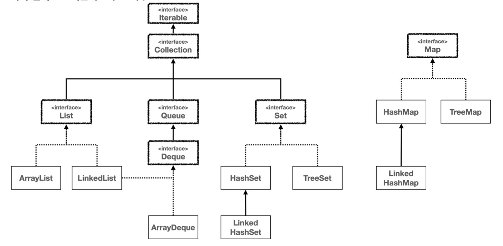

> ✏️ 
> 
> <a id="1d6eda9b0fe18024816afee15d3a2fba"></a>
> 
> <strong>실무 선택 가이드</strong>
> 
> ---
> 
> - <code>List</code>의 경우 대부분<code>ArrayList</code>를 사용
> 
> - <code>Set</code>의 경우 대부분 <code>HashSet</code>을 사용한다&#46; 
> 
> - <code>Map</code>의 경우 대부분 <code>HashMap</code>을 사용한다&#46; 
> 
> - <code>Queue</code>의 경우 대부분 <code>ArrayDeque</code>를 사용한다&#46; 

<a id="1d6eda9b0fe1800f8037feec38086510"></a>

## 순회&#58; <code>Iterable</code>, <code>Iterator</code>

<a id="1d6eda9b0fe18004924dc7377a64b585"></a>

### 1&#46; 직접 구현하는 <code>Iterable</code>, <code>Iterator</code>

---

> ☝🏻 
> 
> <a id="1d6eda9b0fe18087afedc56fa93e06cc"></a>
> 
> 자료 구조에 순회는 자료 구조에 들어있는 데이터를 차례대로 접근해서 처리하는 것을 순회라 한다&#46;<br>그런데 <strong><u>다양한 자료 구조가 있</u></strong>고, 각각의 자료 구조마다 <strong><u>데이터를 접근하는 방법이 모두 다르다&#46;</u></strong>
> 
> ---
> 
> - 배열리스트
>     
> 
> - 연결리스트
>     
> 
> <a id="1d6eda9b0fe18034a101e629a346eb48"></a>
> 
> 예를 들어 배열리스트는 <code>index</code>를 <code>size</code>까지 차례로 증가하면서 순회를 하며,
> 
> <a id="1d6eda9b0fe18075bb7ed375de3b6507"></a>
> 
> 연결리스트는 node&#46;next를 사용하여 node 끝이 <code>null</code>일 때까지 순회한다&#46; 
> 
> <a id="1d6eda9b0fe18071951bdd8a7ff96a7c"></a>
> 
> 이렇듯 각 자료 구조의 순회 방법이 서로 다르다&#46; 

> ✏️ 
> 
> <a id="1d6eda9b0fe180b5b9bcc486dc43696b"></a>
> 
>  <strong><code>Iterable</code></strong><strong> , </strong><strong><code>Iterator</code></strong><strong> </strong>인터페이스
> 
> ---
> 
> - <code>I</code><strong><code>terable</code></strong> &#58; &#34;<strong><u>반복 가능한&#34;</u></strong>이라는 뜻이다&#46;
> 
> - <strong><code>Iterator</code></strong> &#58; <strong><u>&#34;반복자&#34;</u></strong>라는 뜻이다&#46;

<details>
<summary><strong><u>다양한 자료 구조 순회</u></strong>에 대한 문제점 및 해결&#58;<code>Iterable</code>, <code>Iterator</code></summary>

<a id="1d6eda9b0fe180a1a3b1c775948f2e23"></a>

배열 리스트, 연결 리스트, 해시 셋, 연결 해시 셋, 트리 셋 등등 다양한 자료 구조가 있다&#46; 

<a id="1d6eda9b0fe1806cac07f34b78789eee"></a>

각각의 자료 구조마다 순회하 는 방법이 서로 다르기 때문에, 각 자료 구조의 순회 방법을 배워야 한다&#46; 그리고 순회 방법을 배우려면 자료 구조의 내 부 구조도 알아야 한다&#46; 결과적으로 너무 많은 내용을 알아야 하는 것이다&#46;

<a id="1d6eda9b0fe180f29065c81932f8efc3"></a>

 하지만 자료 구조를 사용하는 개발자 입장에 서 보면 단순히 자료 구조에 들어있는 모든 데이터에 순서대로 접근해서 출력하거나 계산하고 싶을 뿐이다&#46;

<a id="1d6eda9b0fe180e081dff49c3f342853"></a>

자료 구조의 구현과 관계 없이 모든 자료 구조를 동일한 방법으로 순회할 수 있는 일관성 있는 방법이 있다면, 자료 구조 를 사용하는 개발자 입장에서 매우 편리할 것이다&#46;

<a id="1d6eda9b0fe1801bbfccc63f882eb060"></a>

자바는 이런 문제를 해결하기 위해 <code>Iterable</code> 과 <code>Iterator</code> 인터페이스를 제공한다&#46;

</details>

<details>
<summary><strong><code>Iterable</code></strong> 인터페이스의 주요 메서드</summary>

<a id="1d6eda9b0fe180a18e24fbda4e9d22f3"></a>

```java
public interface Iterable<T> {
   Iterator<T> iterator();
}
```

- 단순히 <code>Iterator</code> 반복자를 반환한다&#46;

</details>

<details>
<summary><strong><code>Iterator</code></strong> 인터페이스의 주요 메서드</summary>

<a id="1d6eda9b0fe180848070f2e398611f74"></a>

```java
public interface Iterator<E> {
		boolean hasNext();
		E next();
}
```

- <code>hasNext()</code>&#58; 다음 요소가 있는지 확인한다&#46; 다음 요소가 없으면 <code>false</code>를 반환한다&#46; 

- <code>next()</code>&#58; 다음 요소를 반환한다&#46; 내부에 있는 위치를 다음으로 이동한다&#46;

</details>

<a id="1d6eda9b0fe1800a9d4aea8d83b1cff3"></a>

Collection 데이터 선형 탐색 ( 순회 )

- 자료 구조에 다음 요소가 있는지 확인
    - 있으면 다음 요소를 꺼내는 과정을 반복

    - 없다면 종료

<a id="1d6eda9b0fe180f3b400d521ebc28470"></a>

### 코드 

<details>
<summary>&#91; 코드 &#93; MyArrayIterator  &#45; <strong><code>Iterator</code></strong></summary>

<a id="1d6eda9b0fe1809b929ac0f0c593d784"></a>

```java
import java.util.Iterator;

public class MyArrayIterator implements Iterator<Integer> {
		
		private int currentIndex = -1;
		private int[] targetArr;
		
		public MyArrayIterator(int[] targetArr) {
				this.targetArr = targetArr;
		}
		
		@Override
		public boolean hasNext() {
				return currentIndex < targetArr.length - 1;
		}
		
		@Override
		public Integer next() {
				return targetArr[++currentIndex];
		}
}
```

- <code>index</code>는 <code>0</code>부터 시작하기 때문에 <code>currentIndex</code>를 <code>&#45;1</code>로 초기화한다&#46; 

- targer 배열의 마지막 인덱스(<code>targetArr&#46;length&#45;1</code>) 와 현재 인덱스트가 같을 경우, 탐색 종료

</details>

<details>
<summary>&#91; 코드 &#93; MyArray &#45; <strong><code>Iterable</code></strong></summary>

<a id="1d6eda9b0fe180a782dbfdaf363ff0ff"></a>

```java
import java.util.Iterator;

public class MyArray implements Iterable<Integer> {
		
		private int[] numbers;
		
		public MyArray(int[] numbers) {
				this.numbers = numbers;
		}
		
		@Override
		public Iterator<Integer> iterator() {
				return new MyArrayIterator(numbers);
    }
}
```

</details>

<details>
<summary>&#91; 코드 &#93; MyArray &#45; <code>client</code></summary>

<a id="1d6eda9b0fe1804d8f11d2d7a5d013f5"></a>

```java
import java.util.Iterator;

public class MyArrayMain {
 
		public static void main(String[] args) {
				
				MyArray myArray = new MyArray(new int[]{1, 2, 3, 4});
				
				Iterator<Integer> iterator = myArray.iterator();
		
				System.out.println("iterator 사용");
				
				while (iterator.hasNext()) {
						Integer value = iterator.next();
						System.out.println("value = " + value);
				}		
		}
}
```

</details>

<details>
<summary>실행 결과</summary>

<a id="1d6eda9b0fe180ef879cd243170d6390"></a>

```plaintext
iterator 사용
value = 1
value = 2
```

</details>

<a id="1d6eda9b0fe180a392c3c62f4e5c19ed"></a>

### NOTES

<a id="1d6eda9b0fe180c09f61da301d20677c"></a>

### 2&#46; 향상된 for 문

<a id="1d6eda9b0fe1803d8a31ea650ea40e8f"></a>

### 3&#46; 자바가 제공하는 Iterable, Iterator

<a id="1d6eda9b0fe180cd9a9acdd8019ec9af"></a>

## 정렬&#58; <code>Comparable</code>, <code>Comparator</code>

<a id="1d6eda9b0fe180af8305f8c985295a8f"></a>

### 1&#46; <code>Arrays&#46;sort()</code>

---

> ✏️ 
> 
> <a id="1d6eda9b0fe180b7b41acee13711bd63"></a>
> 
> 아래 설명은 가장 단순한 정렬의 예시이다&#46;
> 
> - 실제로 정렬 성능을 높이기 위한 다양한 알고리즘이 존재한다&#46;
> 
> <a id="1d6eda9b0fe1808489e1c411abcdbd5f"></a>
> 
> 자바는 초기에는 퀵소트를 사용했다가 현재는 다음과 같은 정렬 알고리즘을 사용한다&#46;
> 
> - 데이터가 작을 때(32개 이하)&#58;<strong><code>듀얼 피벗 퀵소트(Dual&#45;Pivot QuickSort)</code></strong>
> 
> - 데이터가 많을 때&#58;  <strong><code>팀소트(TimSort)</code></strong>
> 
> ---
> 
> <a id="1d6eda9b0fe180d4bcc7c641b328e72f"></a>
> 
> 해당 알고리즘은 평균 <code class="language-math">O(nlogn)</code>의  성능을 가진다&#46; 

<a id="1d6eda9b0fe180a0859ed314078057a3"></a>

### 코드

<details>
<summary>&#91; 코드 &#93; SortMain1</summary>

<a id="1d6eda9b0fe180f382ddeb03bdb0c8c5"></a>

```java
import java.util.Arrays;

public class SortMain1 {
		public static void main(String[] args) {
				Integer[] array = {3, 2, 1};
				
				System.out.println(Arrays.toString(array));
				
				System.out.println("기본 정렬 후"); 
				
				Arrays.sort(array);
				System.out.println(Arrays.toString(array));
		} 
}
```

</details>

<details>
<summary>실행 결과</summary>

<a id="1d6eda9b0fe180419acccc25f43c1adc"></a>

```plaintext
[3, 2, 1]
기본 정렬 후
[1, 2, 3]
```

- <code>Arrays&#46;sort()</code> 를 사용하면 배열에 들어있는 데이터를 순서대로 정렬할 수 있다&#46;
    - 정렬 전&#58; &#91;3, 2, 1&#93;

    - 정렬 후&#58; &#91;1, 2, 3&#93;

</details>

<a id="1d6eda9b0fe180a0b408d3bdd5a25383"></a>

### Notes

<details>
<summary><strong>정렬 알고리즘 동작</strong></summary>

- <strong>동작 1</strong>
    

    - 먼저 가장 왼쪽에 있는 데이터와 그 다음 데이터를 비교한다&#46;

    - 3과 2를 비교했을 때 3이 더 크기 때문에 둘을 교환한다&#46;

- <strong>동작 2</strong>
    

    - 다음 차례 둘을 비교한다&#46; 

    - 3  과 1 비교 시, 3이 더 크기 때문에 둘을 교환한다&#46; 

    - 이렇게 처음부터 끝까지 비교하면 마지막 항목은 가장 큰 값이 된다&#46;
        - 위 에시&#58;  <code>3</code> ( 3이 가장 큼 )

- <strong>동작 3</strong>
    

    - 처음으로 돌아와서 다시 비교를 시작한다&#46;

    - 2와 1을 비교했을 때 2가 더 크기 때문에 둘을 교환한다&#46;

    - 최종적으로 1, 2, 3으로 정렬된다&#46;

</details>

<a id="1d6eda9b0fe1805a9129d2e7f20b5178"></a>

### 2&#46; <code>Comparator</code>

---

> ✏️ 
> 
> <a id="1d6eda9b0fe18069985afd7a6083e68b"></a>
> 
> 비교자( <code>Comparator</code> )를 사용하면 정렬의 기준을 자유롭게 변경할 수 있다&#46;
> 
> - 이름 그대로 두 값을 비교할 때 비교 기준을 직접 제공할 수 있다&#46;

<a id="1d6eda9b0fe180b3a969d07b24c9cda1"></a>

### 코드

<details>
<summary>&#91; 코드 &#93; SortMain2</summary>

<a id="1d6eda9b0fe1800485d6f8cfca599908"></a>

```java
import java.util.Arrays;
import java.util.Comparator;

public class SortMain2 {
		public static void main(String[] args) {
				Integer[] array = {3, 2, 1}; 
				System.out.println(Arrays.toString(array));
				 
				System.out.println("Comparator 비교");
				Arrays.sort(array, new AscComparator()); 
				System.out.println("AscComparator:" + Arrays.toString(array));
				
				Arrays.sort(array, new DescComparator()); 
				System.out.println("DescComparator:" + Arrays.toString(array)); 
				Arrays.sort(array, new AscComparator().reversed()); // DescComparator와 같다.
				
				System.out.println("AscComparator.reversed:" + Arrays.toString(array))
		} 
		
		static class AscComparator implements Comparator<Integer> {
				@Override
				public int compare(Integer o1, Integer o2) {
						System.out.println("o1=" + o1 + " o2=" + o2)
						return (o1 < o2) ? -1 : ((o1 == o2) ? 0 : 1)
				}
		}
		
		static class DescComparator implements Comparator<Integer> {
				@Override
				public int compare(Integer o1, Integer o2) {
						System.out.println("o1=" + o1 + " o2=" + o2)
						return (o1 < o2) ? -1 : ((o1 == o2) ? 0 : 1) * -1;
				}
		}		
}
```

</details>

<details>
<summary>실행 결과</summary>

<a id="1d6eda9b0fe1803aaff3d63bd1648e73"></a>

```plaintext
[3, 2, 1]
Comparator 비교
o1=2 o2=3
o1=1 o2=2 
AscComparator:[1, 2, 3]

o1=2 o2=1
o1=3 o2=2
DescComparator:[3, 2, 1]

o1=3 o2=2
o1=2 o2=1
AscComparator.reversed:[3, 2, 1]
```

</details>

<a id="1d6eda9b0fe180019214c2c1d2649f7a"></a>

### Notes

<details>
<summary>비교자 ( <code>Comparator</code> )</summary>

> ✏️ 
> 
> <a id="1d6eda9b0fe180faaa75cce18669aced"></a>
> 
> <code>Arrays&#46;sort()</code> 를 사용할 때 비교자( <code>Comparator</code> )를 넘겨주면 알고리즘에서 어떤 값이 더 큰지 두 값을 비교할 때, 비교자를 사용한다&#46;

<a id="1d6eda9b0fe180dc8359de114f4910cf"></a>

```java
static class AscComparator implements Comparator<Integer> {
   @Override
   public int compare(Integer o1, Integer o2) {
       System.out.println("o1=" + o1 + " o2=" + o2);
       return (o1 < o2) ? -1 : ((o1 == o2) ? 0 : 1);
	 } 
}
     
static class DescComparator implements Comparator<Integer> {
   @Override
   public int compare(Integer o1, Integer o2) {
       System.out.println("o1=" + o1 + " o2=" + o2);
       return (o1 < o2) ? -1 : ((o1 == o2) ? 0 : 1) * -1;
	 } 
}
```

<a id="1d6eda9b0fe180298bc4ecc854bb4233"></a>

```java
Arrays.sort(array, new AscComparator()). // 오름차순 정렬
Arrays.sort(array, new DescComparator()) // 내림차순 정렬
```

- <code>DescComparator</code>
    - DescComparator를 사용하면 내림차순 정렬이 된다&#46;

    -  마지막에 <code>&#45;1</code> 을 곱해주었기 때문에 이렇게 하면 양수는 음수로, 음수는 양수로 반환된다&#46;<br>따라서 오름차순 정렬을 반전시킬 수 있다&#46;

</details>

<details>
<summary><code>reversed()</code></summary>

<a id="1d6eda9b0fe18094b5e8f6a0b660b5cb"></a>

```java
new AscComparator().reversed(). // 내림차순 정렬
```

- 정렬을 반대로 하고 싶으면 <code>reversed()</code> 메서드를 사용해도 된다&#46;
    -  비교의 결과를 반대로 변경한다&#46;

    -  <code>&#45;1</code> 을 곱한 것과 같은 결과가 나온다&#46;

</details>

<a id="1d6eda9b0fe1805e859bebfade1cb676"></a>

### 3&#46; <code>Comparable</code>, <code>Comparator</code> &#45; 사용자 정의 객체

---

> ✏️ 
> 
> <a id="1d6eda9b0fe180cb90fae04eca10a0e3"></a>
> 
> 자바가 기본으로 제공하는 <code>Integer</code> , <code>String</code> 같은 객체를 제외하고 <code>MyUser</code> 와 같이 직접 만든 객체를 정렬하려면 어떻게 해야 하는가? 
> 
> <a id="1d6eda9b0fe180b2b436f43db067ee77"></a>
> 
> <strong><u>직접 만든 객체들</u></strong>이기 때문에<strong><u> 정렬을 할 때 어떤 객체가 더 큰지 알려</u></strong>줘야 한다&#46;
> 
> <a id="1d6eda9b0fe180619231cafb914b60fe"></a>
> 
> 이때 <strong><u>Comparable </u></strong><strong>인터페이스를 구현</strong>하여 두 객체를 비교할 수 있다&#46;
> 
> - 해당 인터페이스는 이름 그대로 비교 가능한, 비교할 수 있는 이라는 뜻으로, <strong><u>객체에 비교 기능을 추가</u></strong>해 준다&#46;
> 
> ---
> 
> <details>
> <summary> <code>Comparable</code> 인터페이스</summary>
> 
> <a id="1d6eda9b0fe18022af7dfe9ed67e4585"></a>
> 
> ```java
> public interface Comparable<T> {
>      public int compareTo(T o);
> }
> ```
> 
> - 자기 자신과 인수로 넘어온 객체를 비교해서 반환
>     1. <code>this </code><strong><code>&#60;</code></strong><code> o</code>, 현재 객체가 인수로 주어진 객체보다 더 작으면 <strong><u>음수</u></strong>
>         - 예(<code>&#45;1</code> )
> 
>     1. <code>this </code><strong><code>=</code></strong><code> o</code>, 두 객체의 크기가 같으면 <u>0</u>
> 
>     1. <code>this </code><strong><code>&#62;</code></strong><code> o</code>, 현재 객체가 인수로 주어진 객체보다 더 크면 <strong><u>양수</u></strong>
>         - 예(<code>1</code> )
> 
> </details>

<a id="1d6eda9b0fe180848fa0d66f3767a7fd"></a>

### 코드 

> Case 1 ) 기본 정렬&#58; <code>age</code>

<details>
<summary>&#91; 코드 &#93; MyUser</summary>

<a id="1d6eda9b0fe180a79103f9651071ad4d"></a>

```java
public class MyUser implements Comparable<MyUser> {
		
		private String id;
		private int age;
		
		public MyUser(String id, int age) {
				this.id = id;
				this.age = age;
		}
		
		public String getId() {
				return id;		
		}
		
		public int getAge() {
				return age;
		}
		
		@Override
		public int compareTo(MyUser o) {
		    return this.age < o.age ? -1 : (this.age == o.age ? 0 : 1);
		}
		
		@Override
		public String toString() {
		    return "MyUser{" +
		            "id='" + id + '\'' +
								", age=" + age +
								'}';
		}
}
```

- <code>compareTo()</code> 구현을 보면 여기서는 정렬의 기준을 나이( <code>age</code> )로 정했다&#46;

- <code>&#45;1</code>을 곱하지 않았기 때문에 <code>MyUser</code> 클래스의 기본 정렬 방식은 오름차순이다&#46;

- <code>Comparable</code> 을 통해 구현한 순서를 <u>자연 순서(Natural Ordering)</u>라 한다&#46;

</details>

<details>
<summary>&#91; 코드 &#93; SortMain3</summary>

<a id="1d6eda9b0fe18048836cfc1615beecfa"></a>

```java
import java.util.Arrays;

public class SortMain3 {
		public static void main(String[] args) {
				MyUser myUser1 = new MyUser("a", 30);
        MyUser myUser2 = new MyUser("b", 20);
        MyUser myUser3 = new MyUser("c", 10);
        
        MyUser[] array = {myUser1, myUser2, myUser3}; 
        System.out.println("기본 데이터"); 
        System.out.println(Arrays.toString(array));
        
        System.out.println("Comparable 기본 정렬"); 
        Arrays.sort(array); 
        System.out.println(Arrays.toString(array));   
    }
}
```

</details>

<details>
<summary>실행 결과</summary>

<a id="1d6eda9b0fe180d6b093eabfd0993b8c"></a>

```plaintext
기본 데이터
[MyUser{id='a', age=30}, MyUser{id='b', age=20}, MyUser{id='c', age=10}]

Comparable 기본 정렬
[MyUser{id='c', age=10}, MyUser{id='b', age=20}, MyUser{id='a', age=30}]
```

</details>

> Case 2 ) 다른 방식 정렬&#58; <code>id</code>

<details>
<summary>&#91; 코드 &#93; IdComparator</summary>

<a id="1d6eda9b0fe180439eb6d52486f8860b"></a>

```java
public class IdComparator implements Comparable<MyUser> {
		
		@Override
		public int compare(MyUser o1, MyUser o2) {
				return o1.getId().compareTo(o2.getId());
		}
}
```

- 아이디를 기준으로 정렬

</details>

<details>
<summary>&#91; 코드 &#93; SortMain4</summary>

<a id="1d6eda9b0fe18089881dc7e7d5e052da"></a>

```java
import java.util.Arrays;

public class SortMain4 {
		public static void main(String[] args) {
				MyUser myUser1 = new MyUser("a", 30);
        MyUser myUser2 = new MyUser("b", 20);
        MyUser myUser3 = new MyUser("c", 10);
        
        MyUser[] array = {myUser1, myUser2, myUser3}; 
        System.out.println("기본 데이터"); 
        System.out.println(Arrays.toString(array));
        
        System.out.println("Comparable 기본 정렬"); 
        Arrays.sort(array); 
        System.out.println(Arrays.toString(array)); 
        
				//추가
				System.out.println("IdComparator 정렬"); 
				Arrays.sort(array, new IdComparator());
				System.out.println(Arrays.toString(array));
				
				System.out.println("IdComparator().reversed() 정렬"); 
				Arrays.sort(array, new IdComparator().reversed());
				System.out.println(Arrays.toString(array));  
    }
}
```

</details>

<details>
<summary>실행 결과</summary>

<a id="1d6eda9b0fe180d2bbaecef70db37856"></a>

```plaintext
기본 데이터
[MyUser{id='a', age=30}, MyUser{id='b', age=20}, MyUser{id='c', age=10}]

Comparable 기본 정렬
[MyUser{id='c', age=10}, MyUser{id='b', age=20}, MyUser{id='a', age=30}]

IdComparator 정렬
[MyUser{id='a', age=30}, MyUser{id='b', age=20}, MyUser{id='c', age=10}]

IdComparator().reversed() 정렬
[MyUser{id='c', age=10}, MyUser{id='b', age=20}, MyUser{id='a', age=30}]
```

</details>

<a id="1d6eda9b0fe1808f9af2c95756382011"></a>

### NOTES

<details>
<summary>기본 정렬&#58; <code>Arrays&#46;sort(array)</code> </summary>

- 기본 정렬 시도

- 이때는 객체가 스스로 가지고 있는 <code>Comparable</code> 인터페이스를 사용해서 비교한다&#46;

- <code>MyUser</code> 가 구현한 대로 나이( <code>age</code> ) 오름차순으로 정렬된 것을 확인할 수 있다&#46; <code>MyUser</code> 의 자연적인 순서를 사용했다&#46;

</details>

<details>
<summary>다른 방식 정렬&#58; <code>Arrays&#46;sort(array, Comparator)</code></summary>

> ✏️ 
> 
> <a id="1d6eda9b0fe180169948f18a29c686ad"></a>
> 
> ```java
> Arrays.sort(array, Comparator)
> ```
> 
> <a id="1d6eda9b0fe180e484ebf2d542f69411"></a>
> 
> 기본 정렬이 아닌  <strong><u>정렬 방식을 지정</u></strong>하고 싶다면 <code>Arrays&#46;sort</code> 의 인수로 비교자( <code>Comparator</code> )를 만들어서 넘겨 주면 된다
> 
> - 비교자를 따로 전달하면 객체가 기본으로 가지고 있는 <code>Comparable</code> 을 무시하고, 별도로 전달한 비 교자를 사용해서 정렬한다&#46;

- 위 예시 경우, <strong><u>아이디로 정렬 방식으로 변경</u></strong>하기 위해 커스텀한 <code>IdComparator</code>를  두번째 인자로 넘겨 정렬한다&#46; 
    <a id="1d6eda9b0fe180c9b245e7e08a18f82c"></a>

    ```java
    // IdComparator
    public class IdComparator implements Comparable<MyUser> {
    		
    		@Override
    		public int compare(MyUser o1, MyUser o2) {
    				return o1.getId().compareTo(o2.getId());
    		}
    }

    // SortMain4
    Arrays.sort(array, new IdComparator());
    Arrays.sort(array, new IdComparator().reversed());
    ```

</details>

<details>
<summary><strong>&#91; ⚠️ 주의 &#93;</strong><strong> </strong>만약 <strong><code>Comparable</code></strong> 구현 <strong>❌</strong>, <strong><code>Comparator</code></strong> 제공 <strong>❌</strong>  → 런타임 오류 발생 ( <strong>ClassCastException</strong> )</summary>

<a id="1d6eda9b0fe180628314d7be14950e38"></a>

```java
java.lang.ClassCastException: class collection.compare.MyUser cannot be cast to
 class java.lang.Comparable
```

- <code>Comparator</code> 가 없으니, 객체가 가지고 있는 기본 정렬을 사용해야 한다&#46; 이때 <code>Comparable</code> 을 사용한다&#46; 그런데 <code>Comparable</code> 을 찾는데 없으니, 예외가 발생한다

</details>

> 🗒️ 
> 
> <a id="1d6eda9b0fe1805ab909caa0f6cd37c0"></a>
> 
> <strong><code>Comparable</code></strong><strong>, </strong><strong><code>Comparator</code></strong><strong> 정리</strong>
> 
> ---
> 
> <a id="1d6eda9b0fe180fbb3d6ceed7a16af8f"></a>
> 
> 객체의 기본 정렬 방법은 객체에 <code>Comparable</code> 를 구현해서 정의한다&#46;
> 
> <a id="1d6eda9b0fe180eca384f5c560b5d176"></a>
> 
> 이렇게 하면 객체는 이름 그대로 비교할 수 있는 객체가 되고 기본 정렬 방법을 가진다&#46; 
> 
> <a id="1d6eda9b0fe18029a539e23fba517760"></a>
> 
> 그런데 기본 정렬 외에 다른 정렬 방법을 사용해야 하는 경우 비교자<br>( <code>Comparator</code> )를 별도로 구현해서 정렬 메서드에 전달하면 된다&#46; 이 경우 <strong><u>전달한 Comparator</u></strong> 가 <strong><u>항상 우선권</u></strong>을 가진다&#46;
> 
> - 자바가 제공하는 <code>Integer</code> , <code>String</code> 같은 기본 객체들은 대부분 <code>Comparable</code> 을 구현해 두었다&#46;<br>

<a id="1d6eda9b0fe1804484a5d00e9b6370f0"></a>

### 4&#46; <code>Comparable</code>, <code>Comparator</code> &#45; List

---

> ✏️ 
> 
> <a id="1d6eda9b0fe1807a84c6d3acf060f1eb"></a>
> 
> 정렬은 배열 뿐만 아니라 <em><strong>순서가 있는 </strong></em><em><strong><code>List</code></strong></em><em><strong> 같은 자료 구조 </strong></em>에도 사용할 수 있다&#46;

<a id="1d6eda9b0fe180eead0ae034fd6d771f"></a>

### 코드 

<details>
<summary>&#91; 코드 &#93; MyUser</summary>

<a id="1d6eda9b0fe1808688e9d6f0f9a9ce5d"></a>

```java
public class MyUser implements Comparable<MyUser> {
		
		private String id;
		private int age;
		
		public MyUser(String id, int age) {
				this.id = id;
				this.age = age;
		}
		
		public String getId() {
				return id;		
		}
		
		public int getAge() {
				return age;
		}
		
		@Override
		public int compareTo(MyUser o) {
		    return this.age < o.age ? -1 : (this.age == o.age ? 0 : 1);
		}
		
		@Override
		public String toString() {
		    return "MyUser{" +
		            "id='" + id + '\'' +
								", age=" + age +
								'}';
		}
}
```

- <code>compareTo()</code> 구현을 보면 여기서는 정렬의 기준을 나이( <code>age</code> )로 정했다&#46;

- <code>&#45;1</code>을 곱하지 않았기 때문에 <code>MyUser</code> 클래스의 기본 정렬 방식은 오름차순이다&#46;

- <code>Comparable</code> 을 통해 구현한 순서를 <u>자연 순서(Natural Ordering)</u>라 한다&#46;

</details>

<details>
<summary>&#91; 코드 &#93; SortMain4</summary>

<a id="1d6eda9b0fe1808f9e24cf7ea1fc9d2e"></a>

```java
import java.util.Arrays;

public class SortMain3 {
		public static void main(String[] args) {
				MyUser myUser1 = new MyUser("a", 30);
        MyUser myUser2 = new MyUser("b", 20);
        MyUser myUser3 = new MyUser("c", 10);
        
        List<MyUser> list = new LinkedList<>(); 
        list.add(myUser1);
				list.add(myUser2);
				list.add(myUser3);
        System.out.println("기본 데이터"); 
        System.out.println(list);
        
        System.out.println("Comparable 기본 정렬"); 
        list.sort(null);
        // Collections.sort(list);
        System.out.println(list);
        
        System.out.println("IdComparator 정렬"); 
        list.sort(new IdComparator()); 
        // Collections.sort(list, new IdComparator()); 
        System.out.println(list);  
    }
}
```

</details>

<details>
<summary><strong>실행 결과</strong></summary>

<a id="1d6eda9b0fe18005abddf1ac1252e39b"></a>

```plaintext
기본 데이터
[MyUser{id='a', age=30}, MyUser{id='b', age=20}, MyUser{id='c', age=10}]

Comparable 기본 정렬
[MyUser{id='c', age=10}, MyUser{id='b', age=20}, MyUser{id='a', age=30}]

IdComparator 정렬
[MyUser{id='a', age=30}, MyUser{id='b', age=20}, MyUser{id='c', age=10}]
```

</details>

<a id="1d6eda9b0fe180db80c5c5709a304367"></a>

### NOTES

<details>
<summary><strong><code>Collections&#46;sort(list)</code></strong></summary>

- 리스트는 순서가 있는 컬렉션이므로 정렬할 수 있다&#46;

- 이 메서드를 사용하면 기본 정렬이 적용된다&#46;

- 하지만 이 방식보다는 객체 스스로 정렬 메서드를 가지고 있는 <code>list&#46;sort()</code> 사용을 더 권장한다&#46; 참고로 둘의 결과는 같다&#46;

</details>

<details>
<summary><strong><code>list&#46;sort(null)</code></strong></summary>

- 별도의 비교자가 없으므로 <code>Comparable</code> 로 비교해서 정렬한다&#46;

- 자연적인 순서로 비교한다&#46;

- 자바 1&#46;8 부터 사용

</details>

<details>
<summary><strong><code>Collections&#46;sort(list, new IdComparator())</code></strong></summary>

- 별도의 비교자로 비교하고 싶다면 다음 인자에 비교자를 넘기면 된다&#46;

- 하지만 이 방식보다는 객체 스스로 정렬 메서드를 가지고 있는 <code>list&#46;sort()</code> 사용을 더 권장한다&#46;

- 참고로 둘의 결과는 같다&#46;

</details>

<details>
<summary><strong><code>list&#46;sort(new IdComparator())</code></strong></summary>

- 전달한 비교자로 비교한다&#46;

- 자바 1&#46;8 부터 사용

</details>

<a id="1d6eda9b0fe180d09373ff0479b3f8ce"></a>

### 5&#46; Tree <strong>구조 와 정렬</strong>

> ✏️ 
> 
> <a id="1d6eda9b0fe180c8b7eee72674b940af"></a>
> 
> <code>TreeSet</code> 과 같은 이진 탐색 트리 구조는 데이터를 보관할 때, 데이터를 정렬하면서 보관한다&#46;
> 
> <a id="1d6eda9b0fe1807e936cecf3af71853b"></a>
> 
> 따라서 <strong><u>정렬 기준을 제공하는 것이 필수</u></strong>다&#46;
> 
> <details>
> <summary>이진 탐색 트리</summary>
> 
> 
> 
> <a id="1d6eda9b0fe1802b9f7ffd5ccaf566e0"></a>
> 
> 이진 탐색 트리는 데이터를 저장할 때 왼쪽 노드에 저장해야 할 지, 오른쪽 노드에 저장해야 할 지 비교가 필요하다&#46; 따라서 <code>TreeSet</code> , <code>TreeMap</code> 은 <code>Comparable</code> 또는 <code>Comparator</code> 가 필수이다&#46;
> 
> </details>

<a id="1d6eda9b0fe180b29d0dfeb7a2e55c65"></a>

### 코드

<details>
<summary>&#91; 코드 &#93; SortMain5</summary>

<a id="1d6eda9b0fe18026a046ed064fa91f76"></a>

```java
package collection.compare;

import java.util.TreeSet;

public class SortMain5 {

		public static void main(String[] args) {
				MyUser myUser1 = new MyUser("a", 30);
				MyUser myUser2 = new MyUser("b", 20);
				MyUser myUser3 = new MyUser("c", 10);
				
				TreeSet<MyUser> treeSet1 = new TreeSet<>(); 
				treeSet1.add(myUser1); 
				treeSet1.add(myUser2); 
				treeSet1.add(myUser3); 
				System.out.println("Comparable 기본 정렬"); 
				System.out.println(treeSet1);
				
				TreeSet<MyUser> treeSet2 = new TreeSet<>(new IdComparator());
				treeSet2.add(myUser1);
				treeSet2.add(myUser2);
				treeSet2.add(myUser3);
				System.out.println("IdComparator 정렬");
				System.out.println(treeSet2);
		}
}
```

</details>

<details>
<summary>실행 결과</summary>

<a id="1d6eda9b0fe1802ca2afe940f4335c57"></a>

```plaintext
Comparable 기본 정렬
[MyUser{id='c', age=10}, MyUser{id='b', age=20}, MyUser{id='a', age=30}]

IdComparator 정렬
[MyUser{id='a', age=30}, MyUser{id='b', age=20}, MyUser{id='c', age=10}]
```

</details>

<a id="1d6eda9b0fe18002b76edc54d6fea9e9"></a>

### NOTES

<details>
<summary>TreeSet &#45; <code>Comparable</code>, <code>Comparator</code></summary>

<a id="1d6eda9b0fe18089bb20ca6e3818ccc3"></a>

```java
new TreeSet<>();
```

- <code>TreeSet</code>을 생성할 때 별도의 비교자를 제공하지 않으면 객체가 구현한 <code>Comparable</code>을 사용한다&#46;

<a id="1d6eda9b0fe1801e9a8bee863fddd326"></a>

```java
new TreeSet<>(new IdComparator())
```

- <code>TreeSet</code>을 생성할 때 별도의 비교자를 제공하면 <code>Comparable</code>대신 비교자(<code>Comparator</code>)를 사용해서 정렬한다&#46;

<a id="1d6eda9b0fe18095afc4d0f0efb4e9b9"></a>

<br>

</details>

<details>
<summary><strong>&#91; ⚠️ 주의 &#93;</strong><strong> </strong>만약 <code>Comparable</code> 도 구현하지 않고, <code>Comparator</code> 도 제공하지 않으면 다음과 같은 런타임 오류가 발생한다&#46;</summary>

<a id="1d6eda9b0fe180b3908fc574caae39d0"></a>

```java
java.lang.ClassCastException: class collection.compare.MyUser cannot be cast to
 class java.lang.Comparable
```

</details>

> 🗒️ 
> 
> <a id="1d6eda9b0fe1802a859bf89761f767e2"></a>
> 
> 정리
> 
> ---
> 
> <a id="1d6eda9b0fe180748165cfd6937a6736"></a>
> 
> 자바의 정렬 알고리즘은 매우 복잡하고, 또 거의 완성형에 가깝다&#46;<br>자바는 개<strong>발자가 </strong><strong><u>복잡한 정렬 알고리즘은 신경 쓰지 않</u></strong><strong>으면서</strong> 정렬의 기준만 간단히 변경할 수 있도록, 정렬의 기준을 <code>Comparable</code> , <code>Comparator</code> 인터페이스를 통해 추상화해 두었다&#46;
> 
> - 객체의 정렬이 필요한 경우&#58;  <code>Comparable</code> 을 통해 기본 자연 순서 제공
> 
> - 다른 정렬 기준이 추가로 필요한 경우&#58; <code>Comparator</code>  제공

<a id="1d6eda9b0fe1803b99efdd3d4422b3c1"></a>

### 컬렉션 유틸

<details>
<summary><strong>1&#46; 정렬</strong></summary>

> ✏️ 
> 
> <a id="1d6eda9b0fe180cb9e30ecc8822d90e8"></a>
> 
> <strong>Collections 정렬 관련 메서드</strong>
> 
> ---
> 
> - <code>max</code> &#58; 정렬 기준으로 최대 값을 찾아서 반환한다&#46;
> 
> - <code>min</code> &#58; 정렬 기준으로 최소 값을 찾아서 반환한다&#46;
> 
> - <code>shuffle</code> &#58; 컬렉션을 랜덤하게 섞는다&#46;
> 
> - <code>sort</code> &#58; 정렬 기준으로 컬렉션을 정렬한다&#46;
> 
> - <code>reverse</code> &#58; 정렬 기준의 반대로 컬렉션을 정렬한다&#46;

<a id="1d6eda9b0fe1807b87abc1ad8208414c"></a>

### 코드

<details>
<summary>&#91; 코드 &#93; CollectionsSortMain</summary>

<a id="1d6eda9b0fe1807fae53d512cddf7396"></a>

```java
package collection.utils;

import java.util.ArrayList;

import java.util.Collections;

public class CollectionsSortMain {
		public static void main(String[] args) {
				List<Integer> list = new ArrayList<>();
				list.add(1);
				list.add(2);
				list.add(3);
				list.add(4);
				list.add(5);
				
				Integer max = Collections.max(list);
				Integer min = Collections.min(list);
				
				System.out.println("max = " + max);
				System.out.println("min = " + min);
				
				System.out.println("list = " + list);
				Collections.shuffle(list);
				System.out.println("shuffle list = " + list);
				
				Collections.sort(list);
				System.out.println("sort list = " + list);
				
				Collections.reverse(list);
				System.out.println("reverse list = " + list);
		} 
}
```

</details>

<details>
<summary>실행 결과</summary>

<a id="1d6eda9b0fe1801cacefd5d4cb7c7b2a"></a>

```java
max = 5
min = 1
list = [1, 2, 3, 4, 5]
shuffle list = [2, 4, 1, 5, 3] //랜덤 
sort list = [1, 2, 3, 4, 5]
reverse list = [5, 4, 3, 2, 1]
```

</details>

</details>

<details>
<summary><strong>2&#46; 편리한 컬렉션 생성</strong></summary>

> ✏️ 
> 
> <a id="1d6eda9b0fe180d3a567fffd69f35085"></a>
> 
> <code>of(…)</code>&#58; 불변 컬렉션 생성
> 
> ---
> 
> - <code>List&#46;of(&#46;&#46;&#46;)</code> 를 사용하면 컬렉션을 편리하게 생성할 수 있다&#46; 단, 이때는 가변이 아니라 <strong><u>불변 컬렉션이 생성</u></strong>된다&#46; 
> 
> - <code>List</code> , <code>Set</code> , <code>Map</code> 모두 <code>of()</code> 메서드를 지원한다

<a id="1d6eda9b0fe18022ad0bfe72d56d7674"></a>

### 코드

<details>
<summary>&#91; 코드 &#93; CollectionsSortMain</summary>

<a id="1d6eda9b0fe180cab22dc4c9f39f43f3"></a>

```java
package collection.utils;

import java.util.List;
import java.util.Map;
import java.util.Set;

public class OfMain {

		public static void main(String[] args) {
				// 편리한 불변 컬렉션 생성
				List<Integer> list = List.of(1, 2, 3);
				Set<Integer> set = Set.of(1, 2, 3);
				Map<Integer, String> map = Map.of(1, "one", 2, "two");
				
				System.out.println("list = " + list);
				System.out.println("set = " + set);
				System.out.println("map = " + map);
				System.out.println("list class = " + list.getClass());
				
				//java.lang.UnsupportedOperationException 예외 발생
				//list.add(4);
		} 
}
```

</details>

<details>
<summary>실행 결과</summary>

<a id="1d6eda9b0fe1808c89b1d76c5dc4759c"></a>

```java
list = [1, 2, 3]
set = [1, 2, 3]
map = {1=one, 2=two}
list class = class java.util.ImmutableCollections$ListN
```

</details>

</details>

<details>
<summary><strong>3&#46; 불변 컬렉션 과 가변 컬렉션 전환</strong></summary>

> ✏️ 
> 
> <a id="1d6eda9b0fe18025b4c9e3701ae45c7b"></a>
> 
> <strong><u>불변 리스트</u></strong><strong> ↔ </strong><strong><u>가변 리스트</u></strong>
> 
> ---
> 
> - &#91; 불변 리스트 → 가변 리스트 &#93;
>     -  <code>new ArrayList&#60;&#62;()</code> 
> 
> - &#91; 가변 리스트 →  불변 리스트 &#93;
>     - <code>Collections&#46;unmodifiableList()</code> 
> 
>     - 다양한 <code>unmodifiableXxx()</code> 가 존재

<a id="1d6eda9b0fe1800d8cbad4676b1fae72"></a>

### 코드

<details>
<summary>&#91; 코드 &#93; ImmutableMain</summary>

<a id="1d6eda9b0fe1802091f5d1ff50758d9a"></a>

```java
package collection.utils;

import java.util.ArrayList;
import java.util.Collections;
import java.util.List;

public class ImmutableMain {

		public static void main(String[] args) {
				
				// 불변 리스트 생성
				List<Integer> list = List.of(1, 2, 3);
				
				// 가변 리스트
				ArrayList<Integer> mutableList = new ArrayList<>(list); 
				mutableList.add(4);
				System.out.println("mutableList = " + mutableList); 
				System.out.println("mutableList class = " + mutableList.getClass());

				// 불변 리스트
				List<Integer> unmodifiableList = Collections.unmodifiableList(mutableList);
				System.out.println("unmodifiableList class = " +unmodifiableList.getClass());
				//예외 발생 java.lang.UnsupportedOperationException
				// unmodifiableList.add(5);
		}
}
```

</details>

<details>
<summary>실행 결과</summary>

<a id="1d6eda9b0fe180c68b37f01531a098dd"></a>

```java
mutableList = [1, 2, 3, 4]
mutableList class = class java.util.ArrayList
unmodifiableList class = class
java.util.Collections$UnmodifiableRandomAccessList
```

</details>

</details>

<details>
<summary><strong>4&#46;  빈 리스트 생성</strong></summary>

> ✏️ 
> 
> <a id="1d6eda9b0fe1809492accace6305ccc8"></a>
> 
> <strong>빈 리스트 생성</strong>
> 
> ---
> 
> - <code>빈 가변 리스트</code>&#58; 원하는 컬렉션의 구현체를 직접 생성
> 
> - <code>빈 불변 리스트는 2가지 생성 방법</code>
>     > ☝🏻 
>     > 
>     > <a id="1d6eda9b0fe1800293f9ef161977cfa0"></a>
>     > 
>     > <code>List&#46;of()</code>가 더 간결하고 <code>List&#46;of(1,2,3)</code>도 불변이기 때문에 사용법에 일관성이 있다&#46; <br><strong><u>자바 9 이상을 사용</u></strong><strong> </strong>한다면 이 기능을 권장한다&#46; 
> 
>     - <code>Collections&#46;emptyList()</code> &#58; <u>자바5</u>부터 제공되는 기능
> 
>     - <code>List&#46;of()</code>&#58; <u>자바9</u>부터 제공되는 최신 기능

<a id="1d6eda9b0fe18092950ae15c933161c7"></a>

### 코드

<details>
<summary>&#91; 코드 &#93; EmptyListMain</summary>

<a id="1d6eda9b0fe1802faeeffb411f83a8e2"></a>

```java
package collection.utils;

import java.util.ArrayList;
import java.util.Collections;
import java.util.LinkedList;
import java.util.List;

public class EmptyListMain {

		public static void main(String[] args) {
				//빈 가변 리스트 생성
				List<Integer> list1 = new ArrayList<>(); List<Integer> list2 = new LinkedList<>();
				
				//빈 불변 리스트 생성
				List<Integer> list3 = Collections.emptyList(); //자바5
				List<Integer> list4 = List.of(); //자바9
				
				System.out.println("list3 = " + list3.getClass());
				System.out.println("list4 = " + list4.getClass());
		}
}
```

</details>

<details>
<summary>실행 결과</summary>

<a id="1d6eda9b0fe180748729c8257e1a123b"></a>

```plaintext
list3 = class java.util.Collections$EmptyList
list4 = class java.util.ImmutableCollections$ListN
```

</details>

</details>

<details>
<summary>5&#46; 리스트 생성 &#91; 레거시 &#93;&#58; <code>Arrays&#46;asList()</code></summary>

> ✏️ 
> 
> <a id="1d6eda9b0fe1803d9988dd25d786eaaf"></a>
> 
> <code>Arrays&#46;asList</code> 메서드를 사용 리스트를 생성할 수 있다&#46;	
> 
> - 해당 메서드는 자바 1,2부터 존재했다&#46; 
> 
> - 자바 9 이상을 사용한다면 <u><code>List&#46;of()</code></u><u>를 권장</u>한다&#46; 
> 
> - 만약 <strong><u>리스트 내부의 요소를 변경</u></strong>해야 하는 경우 (단, 리스트의 크기는 변경할 수 없음) <code>Arrays&#46;asList()</code> 를 사용한다&#46; 
> 
> <details>
> <summary>ex) </summary>
> 
> <a id="1d6eda9b0fe180eca0a0df9483c0bbec"></a>
> 
> ```java
> List<Integer> list = Arrays.asList(1, 2, 3);
> List<Integer> list = List.of(1, 2, 3);
> ```
> 
> </details>

<a id="1d6eda9b0fe1800da0d5f33456f553b1"></a>

<code>Arrays&#46;asList()</code> 로 생성된 리스트는 <strong>고정된 크기를 가지지만, 요소들은 변경할 수 있다&#46;</strong> 즉, 리스트의 길이 는 변경할 수 없지만, 기존 위치에 있는 요소들을 다른 요소로 교체할 수 있다&#46;

- <code>set()</code> 을 통해 요소를 변경할 수 있다&#46;

- <code>add()</code> , <code>remove()</code> 같은 메서드를 호출하면 예외가 발생한다&#46; 크기를 변경할 수 없다&#46;
    - <code>java&#46;lang&#46;UnsupportedOperationException</code> 발생

- 고정도 가변도 아닌 애매한 리스트이다&#46;

</details>

<details>
<summary>6&#46; 멀티스레드 동기화&#58; <code>Collections&#46;synchronizedList</code> </summary>

> ✏️ 
> 
> <a id="1d6eda9b0fe18025800deb0d20f68154"></a>
> 
> <code>Collections&#46;synchronizedList</code> 
> 
> ---
> 
> <a id="1d6eda9b0fe1801fabe5d4b562c30edd"></a>
> 
> 멀티스레드 상황에서 동기화 문제가 발생하지 않는 안전한 리스트 생성 가능
> 
> - 동기화 작업으로 인해 일반 리스트보다 성능은 더 느리다&#46;

<a id="1d6eda9b0fe180439dcec2e0100803b7"></a>

### 코드

<details>
<summary>&#91; 코드 &#93; EmptyListMain</summary>

<a id="1d6eda9b0fe1806eaa46fdf60377558e"></a>

```java
package collection.utils;

import java.util.ArrayList;
import java.util.Collections;
import java.util.List;

public class SyncMain {

		public static void main(String[] args) {
				ArrayList<Integer> list = new ArrayList<>();
				list.add(1);
				list.add(2);
				list.add(3); 
				List<Integer> list2 = new LinkedList<>();
				
				System.out.println("list class = " + list.getClass());
				List<Integer> synchronizedList = Collections.synchronizedList(list);
				System.out.println("synchronizedList class = " + synchronizedList.getClass());
		}
}
```

</details>

<details>
<summary>실행 결과</summary>

<a id="1d6eda9b0fe180c386c2f4cd92be2ec6"></a>

```plaintext
list class = class java.util.ArrayList
synchronizedList class = class
java.util.Collections$SynchronizedRandomAccessList
```

</details>

</details>

| <strong>기능</strong> | <strong>메서드</strong> | <strong>설명</strong> |
| --- | --- | --- |
| <strong>정렬</strong> | sort(), reverse() | 오름차순, 역순 정렬 |
| <strong>최댓값/최솟값</strong> | max(), min() | 컬렉션에서 최댓값/최솟값 추출 |
| <strong>섞기</strong> | shuffle() | 리스트 요소들을 무작위로 섞음 |
| <strong>불변 컬렉션 생성</strong> | List&#46;of(), Set&#46;of(), Map&#46;of() | 자바 9 이상 |
| <strong>불변 → 가변</strong> | new ArrayList&#60;&#62;(list) | 복사 후 수정 가능 |
| <strong>가변 → 불변</strong> | Collections&#46;unmodifiableList() | 수정 불가 컬렉션 |
| <strong>빈 리스트 생성</strong> | emptyList(), List&#46;of() | 비어있는 리스트 생성 |
| <strong>동기화</strong> | synchronizedList() | 멀티스레드 환경에서 안전한 리스트 생성 |

<a id="1d6eda9b0fe180a485dddd4670c62659"></a>

### <strong>컬렉션 프레임워크 전체 정리 </strong>

---

> 📖 
> 
> <a id="1d6eda9b0fe180a1a112fa5465e7089a"></a>
> 
> <strong>Collection 프레임워크</strong>
> 
> ---
> 
> 
> 
> - 자바 컬렉션 프레임워크는<strong> 데이터 그룹을 저장하고 처리</strong>하기 위한 <strong><u>통합 아키텍처</u></strong>를 제공한다&#46;
> 
> - 해당 프레임워크는 인터페이스, 구현, 알고리즘으로 구성되어 있으며<br><strong><u>다양한 타입의 컬렉션을 효율적으로 처리</u></strong>할 수 있게 해준다&#46; 

<details>
<summary><strong>Collection 인터페이스의 필요성</strong></summary>

> ✏️ 
> 
> <a id="1d6eda9b0fe180ef8aa8df91d4c0149c"></a>
> 
> <code>Collection</code> 인터페이스는 자바 컬렉션 프레임워크의 가장 기본적인 인터페이스로, 자바에서 데이터 그룹을 다루는데 필요한 가장 기본적인 메서드들을 정의한다&#46; 
> 
> - 다양한 컬렉션 타입들이 공통적으로 따라야 하는 기본 규약 정의(추상화)
> 
> - <code>List</code>, <code>Set</code>, <code>Queue</code> 와 같은 <u>더 구체적인 컬렉션 인터페이스</u>들은 <strong><u>모두 Collection 인터페이스를 확장(extend)</u></strong>하여, 공통된 메서드들을 상속 받고 추가적인 기능이나 특성을 제공한다&#46; 
> 
> - 이러한 설계는 자바 컬렉션 프레임워크의 <strong><u>일관성, 재사용성을 높</u></strong>여준다&#46; 

- <code>일관성</code>
    - 모든 컬렉션 타입들이 Collection 인터페이스를 구현함으로써 모든 컬렉션들이 기본적인 동작을 공유한다는 것을 보장한다&#46;

    - 이는 개발자가 <strong><u>다양한 타입의 컬렉션</u></strong>을 다룰 때 <strong>일관된 방식으로 접근</strong>할 수 있게 해준다&#46;

- <code>재사용성</code>
    - Collection 인터페이스에 정의된 메서드들은 <u>다양한 컬렉션 타입들에 공통으로 적용</u>된다&#46; &#91; 상속 ( <code>extends</code>) &#93;

    - 이는 코드의 <strong><u>재사용성을 높</u></strong>이고, <strong><u>유지보수를 용이</u></strong>하게 한다&#46; 

- <code>확장성</code>
    - <strong><u>새로운 컬렉션 타입을 만들 때 </u></strong><strong><u>Collection 인터페이스를 구현</u></strong>함으로써 기존에 정의된 알고리즘과 도구를 사용할 수 있게 된다&#46; 

    - 이는<strong> 프레임워크의 확장성을 향상</strong>시킨다&#46; 

- <code>다형성</code>
    - Collection 인터페이스를 사용함으로써 <strong><u>다양한 컬렉션 타입들을 </u></strong><strong><u>같은 타입으로 다룰 수 있</u></strong>다&#46; 

    - 이는 <code>다형성</code>을 활용해서 <strong><u>유연한 코드를 작성</u></strong>할 수 있게 한다&#46; 

</details>

<details>
<summary><strong>Collection 인터페이스의 주요 메서드</strong></summary>

<details>
<summary>&#91; 코드 &#93; Iterable</summary>

<a id="1d6eda9b0fe180c5867af03eca805841"></a>

```java
public interface Iterable<T> {
    
    Iterator<T> iterator();
  
    default void forEach(Consumer<? super T> action) {
        Objects.requireNonNull(action);
        for (T t : this) {
            action.accept(t);
        }
    }

    default Spliterator<T> spliterator() {
        return Spliterators.spliteratorUnknownSize(iterator(), 0);
    }
}
```

</details>

<details>
<summary>&#91; 코드 &#93; Collection</summary>

<a id="1d6eda9b0fe1806fb55cf840c5e60dbc"></a>

```java
public interface Collection<E> extends Iterable<E> {

    int size();

    boolean isEmpty();

    boolean contains(Object o);

    Iterator<E> iterator();

    Object[] toArray();

    <T> T[] toArray(T[] a);

    default <T> T[] toArray(IntFunction<T[]> generator) {
        return toArray(generator.apply(0));
    }

    boolean add(E e);

    boolean remove(Object o);

    boolean containsAll(Collection<?> c);

    boolean addAll(Collection<? extends E> c);

    boolean removeAll(Collection<?> c);

    default boolean removeIf(Predicate<? super E> filter) {
        Objects.requireNonNull(filter);
        boolean removed = false;
        final Iterator<E> each = iterator();
        while (each.hasNext()) {
            if (filter.test(each.next())) {
                each.remove();
                removed = true;
            }
        }
        return removed;
    }

    boolean retainAll(Collection<?> c);

    void clear();

    boolean equals(Object o);

    int hashCode();

    @Override
    default Spliterator<E> spliterator() {
        return Spliterators.spliterator(this, 0);
    }

    default Stream<E> stream() {
        return StreamSupport.stream(spliterator(), false);
    }

    default Stream<E> parallelStream() {
        return StreamSupport.stream(spliterator(), true);
    }
}
```

</details>

> ✏️ 
> 
> <a id="1d6eda9b0fe180c29ac3edad7c88768d"></a>
> 
> <code>Collection</code> 은 <u><code>Map</code></u><u>을 제외</u>한 모든 컬렉션 타입의 부모이다&#46; 
> 
> <a id="1d6eda9b0fe1801d8c36fc800aacdf5f"></a>
> 
> 따라서 모든 컬렉션을 받아서 유연하게 처리할 수 있다&#46;
> 
> - 컬렉션 인터페이스는 <code>iterator</code>를 제공한다&#46;
> 
> - 단순히 순회가 목적이면 <code>Collection</code>을 사용하면 모든 컬렉션 타입의 데이터를 순회할 수 있다&#46;

<a id="1d6eda9b0fe18039acf0c248a551aa2e"></a>

<strong>Collection 인터페이스 &#45; 주요 메서드</strong>

|  |  |
| --- | --- |
| 메소드 | 설명 |
| <strong><code>add(E e)</code></strong> | 컬렉션에 요소 추가 |
| <strong><code>remover(Object o)</code></strong><strong> </strong> | 인자로 받는 객체를 컬렉션에서 제거 |
| <strong><code>size()</code></strong><strong> </strong> | 컬렉션에 포함된 요소의 수 반환 |
| <strong><code>isEmpty()</code></strong> | 컬렉션이 비어있는지 확인 |
| <strong><code>contains(Object o)</code></strong> | 컬렉션이 특정 요소를 포함하고 있는지 확인 |
| <strong><code>iterator()</code></strong> | 컬렉션의 요소에 접근하기 위한 반복자 반환 |
| <strong><code>clear()</code></strong> | 컬렉션의 모든 요소 제거 |

</details>

<details>
<summary><strong>자바 컬렉션 프레임워크의 핵심 인터페이스 및 구현, 알고리즘</strong></summary>

> <strong>인터페이스</strong>

|  |  |
| --- | --- |
| 인터페이스  | 설명 |
| <strong><code>Collection</code></strong> | • 단일 루트 인터페이스로 <strong><u>모든 컬렉션 클래스</u></strong>가 <strong>해당 인터페이스를 상속</strong> 받는다&#46; <br>• <code>List</code>, <code>Set</code>, <code>Queue</code> 등의  인터페이스가 여기에 포함된다&#46;  |
| <strong><code>List</code></strong> | • <code>순서</code>&#58; ✅, <code>중복</code>&#58; ✅ <br>    &#45; 순서가 있고, 중복 요소를 허용한다&#46; <br>• <strong><u>인덱스</u></strong>를 통해 요소 접근 가능 &#45; <code>O(1)</code><br>• ex) <code>ArrayList</code>, <code>LinkedList</code> |
| <strong><code>Set</code></strong> | •  <code>순서</code>&#58; ❌, <code>중복</code>&#58; ❌<br>    &#45; 중복 요소를 허용하지 않는 컬렉션<br>• 특정 위치가 없기 때문에 <strong>인덱스</strong>를 통해 요소 접근 <strong><u>불가능</u></strong><br>• ex) <code>ArrayDeque</code>, <code>LinkedList</code>, <code>PriorityQueue</code> |
| <strong><code>Queue</code></strong> | • FIFO 자료구조<br>• 성능상 <code>ArrayDeque</code> 구현체 사용을 권장한다&#46;<br>• ex) <code>ArrayDeque</code>, <code>LinkedList</code>, <code>PriorityQueue</code> |
| <strong><code>Map</code></strong> | • 키와 값 쌍으로 요소를 저장하는 객체 &#91; key&#58;value &#93;<br>• Map은 <code>Collection</code> 인터페이스를 <u>상속받지 않</u>는다&#46;<br>• ex) <code>HashMap</code>, <code>LinkedHashMap</code>, <code>TreeMap</code>  |

> <strong>구현</strong>

|  |  |
| --- | --- |
| <strong>인터페이스</strong>  | 구현체 |
| <strong><code>List</code></strong><strong> </strong> | • <strong><code>ArrayList</code></strong>&#58; <strong><u>배열</u></strong><br>• <strong><code>LinkedList</code></strong>&#58; <strong><u>연결리스트</u></strong> |
| <strong><code>Set</code></strong><strong> </strong> | • <strong><code>HashSet</code></strong>&#58; <strong><u>해시 테이블</u></strong><br>• <strong><code>LinkedHashSet</code></strong>&#58; <strong><u>해시 테이블</u></strong> &#43; <strong><u>연결리스트</u></strong><br>• <strong><code>TreeSet</code></strong><strong>&#58; </strong><u>레드&#45;블랙 트리</u> |
| <strong><code>Map</code></strong> | • <strong><code>HashMap</code></strong><strong>&#58; 해시 테이블</strong><br>• <strong><code>LikedHashMap</code></strong>&#58; <strong><u>해시 테이블</u></strong> &#43; <strong><u>연결리스트</u></strong> <br>• <strong><code>TreeMap</code></strong><strong>&#58; </strong><u>레드&#45;블랙 트리</u> |
| <strong><code>Queue</code></strong> | • <strong><code>LinkedList</code></strong>&#58; 연결리스트 <br><strong>• </strong><strong><code>ArrayDeque</code></strong>&#58; 배열 기반 원형 큐 ( <strong>대부분 ArrayDeque가 빠름</strong> )  |

> <strong>알고리즘</strong>

- 컬렉션 프레임워크는 데이터를 처리하고 조작하기 위한 다양한 알고리즘을 제공한다&#46; 

- 이러한 알고리즘은 <strong><u>각각의 자료 구조 자체적으로 기능을 제공</u></strong>하기도 하고 

- <strong><code>Collections</code></strong> 와 <strong><code>Arrays</code></strong> 클래스에 <strong><u>정적 메소드 형태</u></strong><u>로도 구현</u>되어 있다

</details>

> ✏️ 
> 
> <a id="1d6eda9b0fe1805dafb9c5288a769563"></a>
> 
> <strong>선택 가이드</strong>
> 
> ---
> 
> <details>
> <summary>1️⃣ <strong><u>순서가 중요</u></strong><strong>하고 </strong><strong><u>중복이 허용</u></strong><strong>되는 경우&#58; </strong><strong><code>List</code></strong><strong> &#91; </strong><strong><code>ArrayList</code></strong><strong>, </strong><strong><code>LinkedList</code></strong><strong> &#93;</strong></summary>
> 
> - <strong>순서와 중복 요소를 허용하는 List 자료구조 사용</strong>
> 
> - <strong>ArrayList가 일반적이지만</strong>
> 
> - <strong>추가 / 삭제 작업이 앞쪽에서 빈번한 경우, </strong><strong><code>LinkedList</code></strong><strong>가 성능상 더 좋은 선택이다&#46; </strong>
> 
> </details>
> 
> <details>
> <summary>2️⃣ <strong>중복을 허용하지 않는 경우&#58; </strong><strong><code>Set</code></strong><strong> &#91; </strong><strong><code>HashSet</code></strong><strong>, </strong><strong><code>LinkedHashSet</code></strong><strong> , </strong><strong><code>TreeSet</code></strong><strong> &#93;</strong></summary>
> 
> - <strong>&#91; 순서 ❌ &#93;</strong>&#58; <strong><code>HashSet</code></strong> 
> 
> - <strong>&#91; 순서 </strong><strong>O </strong><strong>&#93;</strong>&#58; <strong><code>LinkedHashSet</code></strong>
> 
> - <strong>&#91; 정렬된 순서 &#93;</strong>&#58; <strong><code>TreeSet</code></strong>
> 
> </details>
> 
> <details>
> <summary>3️⃣<strong> 요소를 키&#45;값 쌍으로 저장하려는 경우&#58;</strong> <strong><code>Map</code></strong> &#91; <strong><code>HashMap</code></strong>, <strong><code>LinkedHashMap</code></strong>, <strong><code>TreeMap</code></strong> <strong>&#93;</strong></summary>
> 
> > <strong><u>요소를 키&#45;값 쌍</u></strong>으로 저장하려는 경우<strong> </strong><strong>Map 자료구조</strong>를 사용한다&#46;
> 
> - <strong>&#91; 순서 ❌ &#93;</strong>&#58; <strong><code>HashMap</code></strong> 
> 
> - <strong>&#91; 순서 </strong><strong>O </strong><strong>&#93;</strong>&#58; <strong><code>LinkedHashMap</code></strong>
> 
> - <strong>&#91; 정렬된 순서 &#93;</strong>&#58; <strong><code>TreeMap</code></strong>
> 
> </details>
> 
> <details>
> <summary>4️⃣<strong> 요소를 처리하기 전에 보관해야 하는 경우&#58;</strong> <strong><code>Queue</code></strong>, <strong><code>Deque</code></strong></summary>
> 
> - 스택, 큐 구조 모두 <code>ArrayDeque</code> 를 사용하는 것이 가장 빠르다&#46;
> 
> - 만약 우선순위에 따라 요소를 처리해야 한다면 <code>PriorityQueue</code> 고려
> 
> </details>

<a id="1d6eda9b0fe18027a60dfb43d776af87"></a>

### 문제와 풀이
