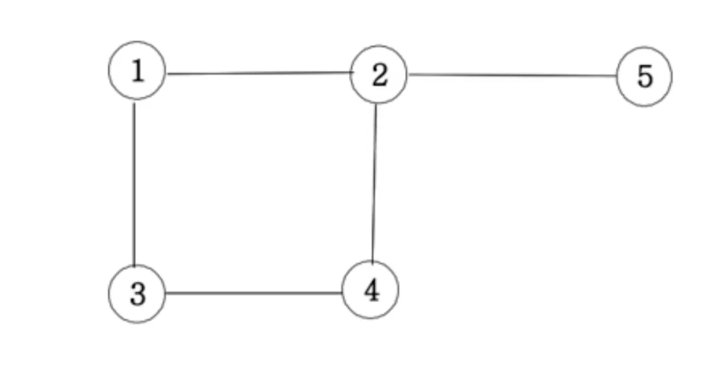
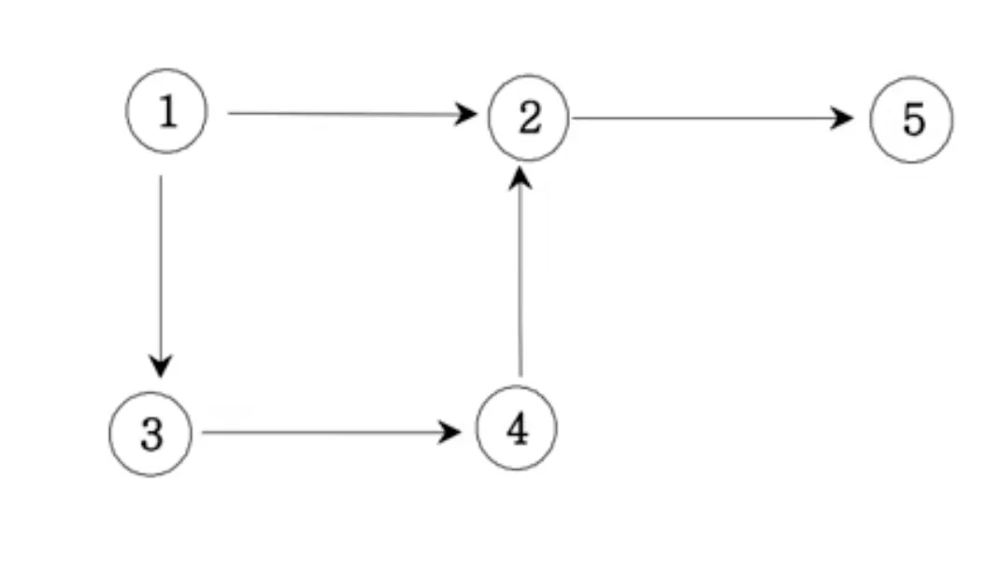
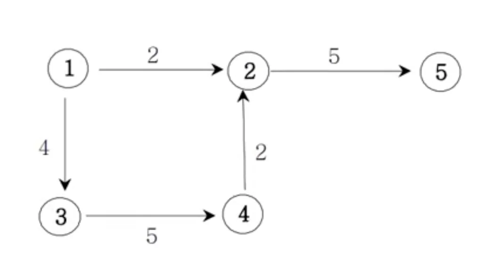
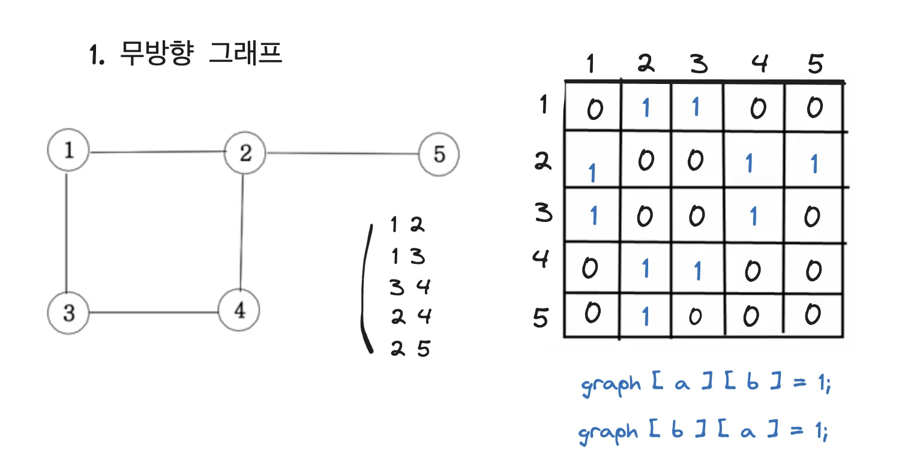
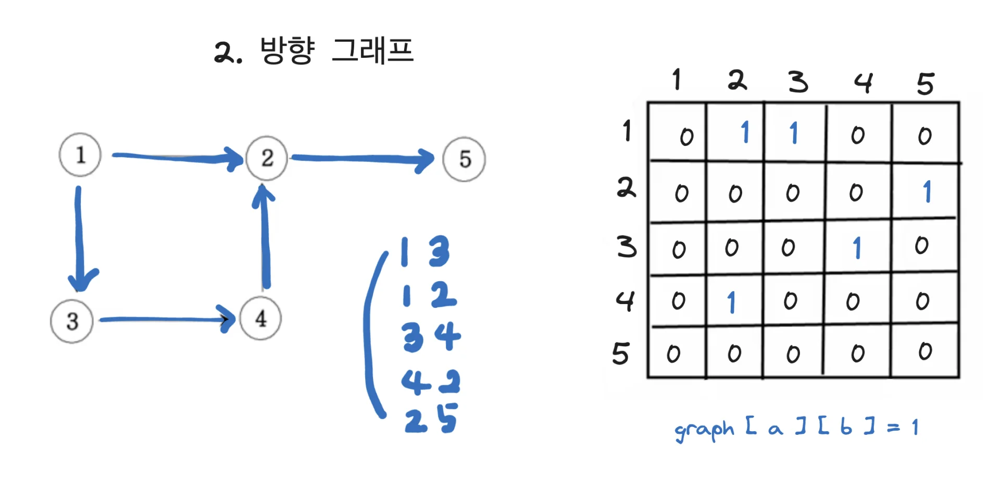
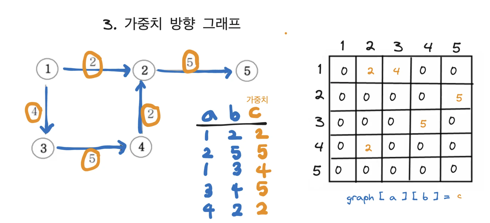

<a id="1c3eda9b0fe181b8a55cd49c0d2060af"></a>

# 문제

<a id="1c3eda9b0fe18168b96fe21b46114b3e"></a>

## 1&#46; 무방향 그래프



<a id="1c3eda9b0fe1817c9d56f7a5820283a0"></a>

## 2&#46; 방향 그래프



<a id="1c3eda9b0fe1816dbc28f57a6c7199ed"></a>

## 3&#46; 가중치 방향 그래프 



<a id="1c3eda9b0fe181828b4de315b914c484"></a>

# 풀이

<a id="1c3eda9b0fe1818a8618cde8ba069112"></a>

## 1) 무방향 그래프



<details>
<summary>입력값</summary>

<a id="1c3eda9b0fe181d7a1b0d9f8e591a9fe"></a>

```java
5 5
1 2
1 3
3 4
4 2
2 5
```

</details>

<a id="1c3eda9b0fe181968fe2cd4cb6a1d5ab"></a>

### 구현1) 이중 배열(int&#91;&#93;&#91;&#93;)

<a id="1c3eda9b0fe181a19e74fd840a435413"></a>

```java
import java.lang.reflect.Array;
import java.util.*;

public class Main {
    static int n, m;
    static int[][] graph;


    public static void main(String args[]) {
        Main T = new Main();
        Scanner sc = new Scanner(System.in);
        n = sc.nextInt();
        m = sc.nextInt();
        graph = new int[n + 1][n + 1];
        for (int i = 0; i < m; i++) {
            int a = sc.nextInt();
            int b = sc.nextInt();
            graph[a][b] = 1;
            graph[b][a] = 1;
        }
        System.out.println(graph);
        System.out.println();
    }
}
```

<a id="1c3eda9b0fe1811e9d66f3deb2ee19da"></a>

### 구현2) 이중 ArrayList

<a id="1c3eda9b0fe1815ea78ef99d532f365e"></a>

```java
import java.lang.reflect.Array;
import java.util.*;

public class Main {
    static int n, m;
    static ArrayList<ArrayList<Integer>> graph;


    public static void main(String args[]) {
        Main T = new Main();
        Scanner sc = new Scanner(System.in);
        n = sc.nextInt();
        m = sc.nextInt();
        graph = new ArrayList<ArrayList<Integer>>();
        for(int i=0; i<=n; i++){
            graph.add(new ArrayList<Integer>());
        }
        for (int i = 0; i < m; i++) {
            int a = sc.nextInt();
            int b = sc.nextInt();
            graph.get(a).add(b);
            graph.get(b).add(a);
        }
        System.out.println(graph);
        System.out.println();
    }
}
```

<a id="1c3eda9b0fe181749090e26be2e6d43f"></a>

## 2) 방향 그래프



<details>
<summary>입력값</summary>

<a id="1c3eda9b0fe181528d04dc0acc94019d"></a>

```java
5 5
1 2
1 3
3 4
4 2
2 5
```

</details>

<a id="1c3eda9b0fe18177b901c15759bceb2d"></a>

### 구현1) 이중배열(int&#91;&#93;&#91;&#93;)

<a id="1c3eda9b0fe18189bedfe363715269a7"></a>

```java
import java.lang.reflect.Array;
import java.util.*;

public class Main {
    static int n, m;
    static int[][] graph;


    public static void main(String args[]) {
        Main T = new Main();
        Scanner sc = new Scanner(System.in);
        n = sc.nextInt();
        m = sc.nextInt();
        graph = new int[n + 1][n + 1];
        for (int i = 0; i < m; i++) {
            int a = sc.nextInt();
            int b = sc.nextInt();
            graph[a][b] = 1;
        }
        System.out.println(graph);
        System.out.println();
    }
}
```

<a id="1c3eda9b0fe1817ba4b1d7d49489cbcc"></a>

### 구현2) 이중 ArrayList

<a id="1c3eda9b0fe181ff8e40edc65db4b05b"></a>

```java
import java.lang.reflect.Array;
import java.util.*;

public class Main {
    static int n, m;
    static ArrayList<ArrayList<Integer>> graph;


    public static void main(String args[]) {
        Main T = new Main();
        Scanner sc = new Scanner(System.in);
        n = sc.nextInt();
        m = sc.nextInt();
        graph = new ArrayList<ArrayList<Integer>>();
        for(int i=0; i<=n; i++){
            graph.add(new ArrayList<Integer>());
        }
        for (int i = 0; i < m; i++) {
            int a = sc.nextInt();
            int b = sc.nextInt();
            graph.get(a).add(b);
        }
        System.out.println(graph);
        System.out.println();
    }
}
```

<a id="1c3eda9b0fe181e896d8cb8b3534a42f"></a>

## 3) 가중치 방향 그래프



<details>
<summary>입력값</summary>

<a id="1c3eda9b0fe181a2a2c8d6466510198a"></a>

```java
5 5
1 2 2
1 3 4
3 4 5
4 2 2
2 5 5
```

</details>

<a id="1c3eda9b0fe181308739f79712385d6a"></a>

### 구현1) 이중배열

<a id="1c3eda9b0fe181349f7fd2a0aef1449b"></a>

```java
import java.lang.reflect.Array;
import java.util.*;

public class Main {
    static int n, m;
    static int[][] graph;


    public static void main(String args[]) {
        Main T = new Main();
        Scanner sc = new Scanner(System.in);
        n = sc.nextInt();
        m = sc.nextInt();
        graph = new int[n + 1][n + 1];
        for (int i = 0; i < m; i++) {
            int a = sc.nextInt();
            int b = sc.nextInt();
            int c = sc.nextInt();
            graph[a][b] = c;
        }
        System.out.println(graph);
        System.out.println();
    }
}
```
