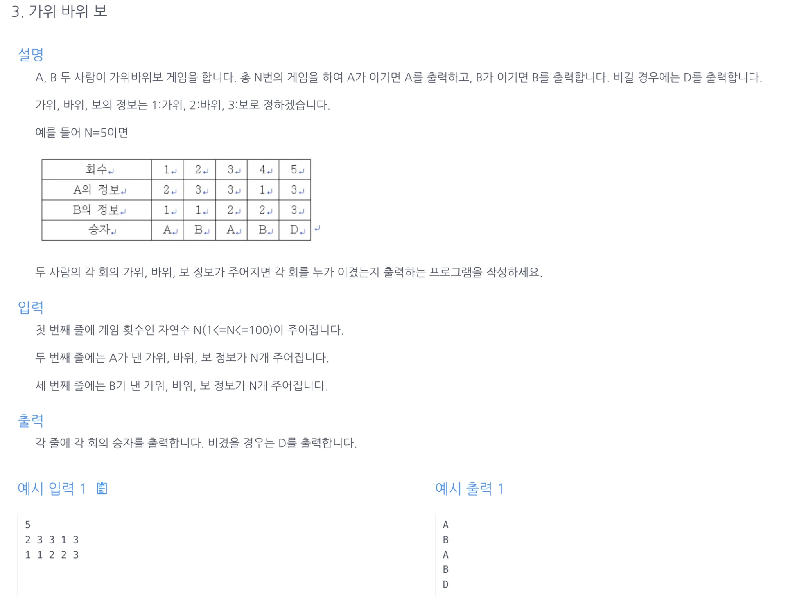

<a id="1c3eda9b0fe1814a8622f7b4c0f1e89b"></a>

## 문제)



<a id="1c3eda9b0fe181dda435e06cb7d5fd1c"></a>

## 풀이)

<a id="1c3eda9b0fe1818490f9f53e487b6467"></a>

### 내 풀이) switch&#45;case (모든 경우의 수 다 입력, 비효율적)

<a id="1c3eda9b0fe181e490c8fbaef4e45b6c"></a>

```java
import java.util.ArrayList;
import java.util.Scanner;

public class Main {
    public String rSPCalculate(int a, int b){
        // 가위1 > 보3, 바위2 > 가위1, 보3 > 바위2
        String result="";
        switch (a) {
            case 1:
                if (b == 1){
                    result="D";
                    break;
                } else if (b==2){
                    result="B";
                    break;
                } else {
                    result="A";
                    break;
                }
            case 2:
                if (b==1){
                    result="A";
                    break;
                } else if (b==2){
                    result="D";
                    break;
                } else {
                    result="B";
                    break;
                }
            case 3:
                if (b == 1){
                    result="B";
                    break;
                } else if (b==2){
                    result="A";
                    break;
                } else {
                    result="D";
                    break;
                }
        }
        return result;
    }

    public ArrayList<String> solution(int n, int[] arrA, int[] arrB){
        ArrayList<String> answer = new ArrayList<>();
        for(int i=0; i<n; i++){
            answer.add(rSPCalculate(arrA[i], arrB[i]));
        }
        return answer;
    }
    public static void main(String[] args) {
        Main m = new Main();
        Scanner sc = new Scanner(System.in);
        int n = sc.nextInt();
        int[] arrA= new int[n];
        int[] arrB= new int[n];

        for(int i=0; i<n; i++){
            arrA[i]= sc.nextInt();
        }
        for(int i=0; i<n; i++){
            arrB[i]= sc.nextInt();
        }
        for (String x : m.solution(n, arrA, arrB)){
            System.out.println(x);
        }
    }
}
```

<a id="1c3eda9b0fe181cda601d7f8a7cb148e"></a>

### 강의 풀이) 비기는 경우, A가 이기는 경우 → else 처리(b가 이기는 경우)

<a id="1c3eda9b0fe1811e88beedac4ffadeb5"></a>

3가지의 결과 값을 도출해 낸다&#46; 따라서 2개의 결과 값이 모든 조건을 입력후 else 처리를 하면 굳이 번거롭게 나머지의 경우를 입력하지 않아도 된다&#46; 

<a id="1c3eda9b0fe181639795d744d07b2be5"></a>

```java
import java.util.Scanner;

public class Main {
    public String solution(int n, int[] a, int[] b){
        String answer = "";
        for(int i=0; i<n; i++){
            if(a[i]==b[i]) answer+="D";
            else if(a[i]==1 && b[i]==3) answer += "A";
            else if(a[i]==2 && b[i]==1) answer += "A";
            else if(a[i]==3 && b[i]==2) answer += "A";
            else answer += "B";
        }
        return answer;
    }
    public static void main(String[] args) {
        Main m = new Main();
        Scanner sc = new Scanner(System.in);
        int n = sc.nextInt();
        int[] arrA= new int[n];
        int[] arrB= new int[n];

        for(int i=0; i<n; i++){
            arrA[i]= sc.nextInt();
        }
        for(int i=0; i<n; i++){
            arrB[i]= sc.nextInt();
        }
        for (char x : m.solution(n, arrA, arrB).toCharArray()) System.out.println(x);
    }
}
```
