<details>
<summary>Reference</summary>

- <a href="https://nbcamp.gitbook.io/java-handbook">자바 핸드북</a>

- <a href="https://online.spartacodingclub.kr/enrolleds/6634afb0df474d318508cfbb/rounds/6634949e090fb76be6a1155e/roadmap">강의 링크</a>

- <a href="https://beautiful-college-c84.notion.site/b9e8f6c744b242c59aa2c39d72a56102?pvs=25">1주차 자료</a>

- <a href="https://beautiful-college-c84.notion.site/becc203a08514b329d39a34062dfa2e2?pvs=25">2주차 자료</a>

- <a href="https://beautiful-college-c84.notion.site/1eb3937dd9114bfca9e00cefe8ee8cbb?pvs=25">3주차 자료</a>

- <a href="https://beautiful-college-c84.notion.site/9d65f023dd42459985b2af9fad684619?pvs=25">4주차 자료</a>

- <a href="https://beautiful-college-c84.notion.site/9d9d053bd2f146c0b35af6fe151da0a9?pvs=25">5주차 자료</a>

</details>

> ❗ 
> 
> <a id="338eda9b0fe180709dace143a29ff0b1"></a>
> 
> 설명이 너무 추상적인 관계로 더이상 진행을 중단함 
> 
> - 상세한 내용은 &#91;인프런&#93; 김영한 &#45; 자바 로드맵 확인

<a id="1c3eda9b0fe1818da3f7c9bd34bbd09a"></a>

## Chapter 1 &#45;  JVM, 변수

<a id="1c3eda9b0fe181c0a1aacc5b9ba23d1e"></a>

### 1&#46;1 &#45; Java 역사

<details>
<summary>자바 역사, 특징</summary>

- ‘언어’는 사람과 사람과의 소통을 위해 사용된다&#46; <br>이렇듯 프로그래밍 ‘언어&#39;도 사람과 컴퓨턴 간에  소통을 위해 사용된다 
    > 컴퓨터는 <code>‘0’</code> 과 ‘<code>1’ </code>밖에 이해하지 못한다&#46; 

- 프로그래밍의 모든 것은 시스템이며 시스템은 <code>input</code>  과 <code>output</code>으로 이루어진다&#46; 
    -  동일한 input 값 입력 시, 동일한 output 값 도출 
        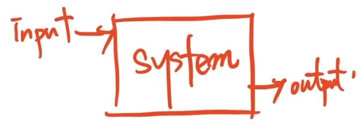

<details>
<summary>언어의 역사</summary>

<details>
<summary>🧐 기계식 데이터 타입과, 자료형 데이터 타입의 차이는?</summary>

<details>
<summary>기계식 데이터 타입</summary>

- <u>하드웨어</u>가 실제로 데이터를 처리하는 방식과 관련된 데이터 타입 즉, <strong><u>CPU</u></strong>와 <strong><u>메모리</u></strong>에서 <strong><u>사용</u></strong>하는 <u>데이터 표현 방식</u>
    - 비트 (bit), 바이트 (byte), 워드 (word) 등

- 실제로 메모리에서 데이터를 0과 1로 어떻게 저장하고 해석하는지와 관련되어 있다&#46;
    - 32비트 시스템 → 정수형 데이터가 32 비트로 표현됨

</details>

<details>
<summary>자료형 데이터 타입 </summary>

- <strong>프로그래밍 언어</strong>에서 데이터를 정의하고 사용하는 방식
    - 기본 타입&#58; int, double, char, String  등

    - reference 타입&#58; List, Map

</details>

<details>
<summary>??</summary>

- 8비트, 1바이트 → char 타입

- 16비트, 2바이트 → short 타입

- 32비트, 4바이트 → int 타입

- 64비트, 8바이트 → long 타입

</details>

</details>

<details>
<summary>A 언어</summary>

- 첫 개발 언어라는 의미 → A Programming Language의 약자

- 발표&#58; 1960년

- 핵심 기능
    - <code>I/O</code>, <code>문맥</code>

    - 프로그램(시스템)을 만들기 위한 기본적인 기능(<code>I/O</code>, <code>문맥</code>)만 구현됨

</details>

<details>
<summary>B 언어</summary>

- Bell 사에서 개발  → B  언어 

- 발표&#58; 1960년

- 핵심 기능
    - A 언어 기능( <code>I/O</code>, <code>문맥</code>)  &#43; <code>기계식 데이터 타입</code>, <code>연산 기능</code>, <code>메서드</code> 

    - 기본 기능(<code>I,O</code>, <code>문맥</code>)에 데이터를 담을 수 있는 <code>타입</code>이 생시고, 데이터를 <code>연산</code>하고 묶어서 관리할 수 있는 <code>메서드</code> 구현이 가능해짐

</details>

<details>
<summary>C 언어</summary>

- B언어에 비해 더 좋은 언어라는 의미로 알파벳 B 다음인 알파벳 C를 따서 C언어

- 발표&#58; 1970년

- 핵심 기능
    -  B 언어 기능 &#43;  <code>자료형 데이터 타입</code> &#43; <code>자료구조</code>

    - B언어의 기능에 <strong>다양한 </strong><u>데이터 타입</u><strong>을 정의</strong>하고 <strong><u>자료구조</u></strong><strong>를 담</strong>을 수 있게 됨

</details>

<details>
<summary>Java 언어</summary>

- 어디서나 마시는 커피처럼 어디서나 동작 가능한, 자바 커피에서 이름을 따서 만든 Java 언어

- 발표&#58; 1990년

- 핵심 기능
    -  C언어 기능 &#43; 공통 실행환경(JVM) &#43; 클래스 &#43; 객체(인스턴스) 

    - 프로그램(시스템)을 만들기 위한 기본적인 기능(<code>I/O</code>, <code>문맥</code>)만 구현


</details>


</details>

</details>

<a id="1c3eda9b0fe18107b191d3233ca7c318"></a>

### 1&#46;2 &#45; JVM, JRE, JDK

<details>
<summary>🧐 Compiled, Interpreted, java 특성</summary>


<details>
<summary>컴파일(번역)</summary>

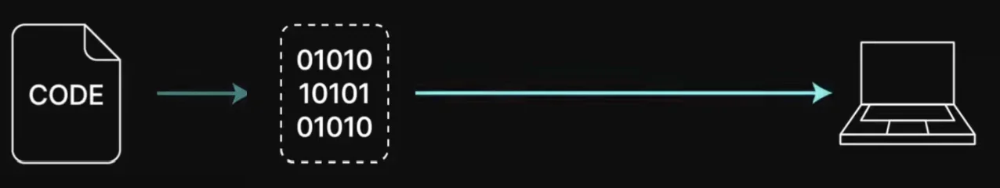

- 코드를 실행 전, <code>미리</code> 컴퓨터가 읽을 수 있는 언어로 변환

- 번역 과정이 번거롭지만, 이 과정에서 많은 문제들이 걸러지고, 실행 속도가 빠르다&#46; 

</details>

<details>
<summary>인터프리터(통역)</summary>

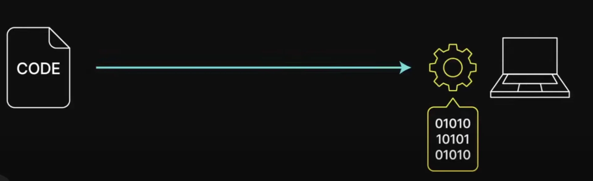

- 사람이 작성한 코드가 컴퓨터로 전달되어, 통역을 해주는 프로그램인 인터프린터가 
    <a id="1c3eda9b0fe181308f16d82d5cf8983f"></a>

    실시간으로(한줄 씩) 번역하여 컴퓨터에게 전달돼 실행이 됨

- 개발이 더 간편하지만, 오류에 취약하며, 실행이 더 느림

</details>

<a id="1c3eda9b0fe18140ad0ae1ba2c1a8cba"></a>

C 계열 과, Java 등 언어들을 미리 번역되는 컴파일 되는 언어이다&#46; 

</details>

<details>
<summary>JVM &#45; 우테코 </summary>

<details>
<summary><a href="https://www.youtube.com/watch?v=GU254H0N93Y&#38;t=16s">JVM 구조</a></summary>

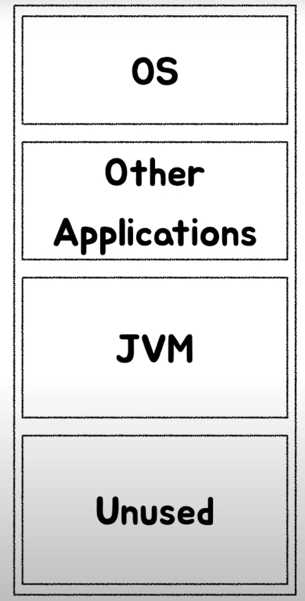

- 자바 프로그램을 실행하면 그림처럼 JVM 프로세스가 메모리의 한 공간에서 상주한다&#46; 

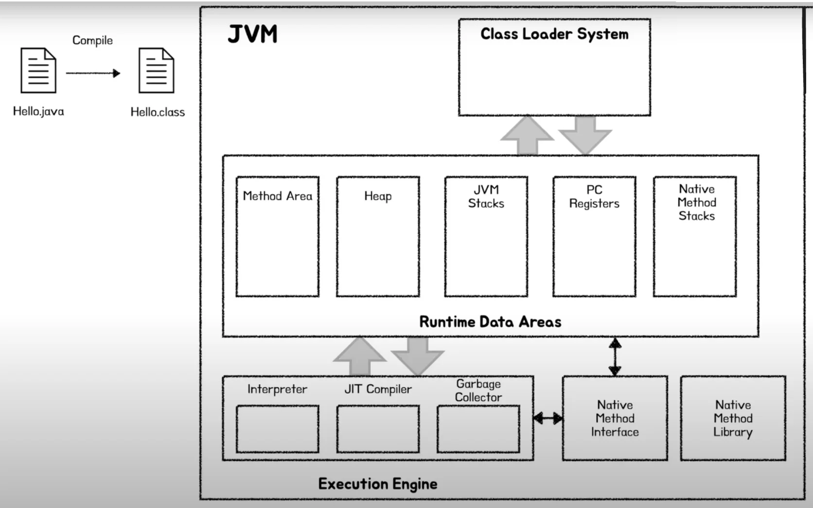

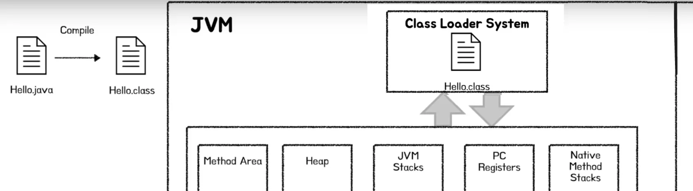

- 자바 컴파일러&#58;  <code>&#46;java</code> → <code>&#46;class</code>

- 클래스 로더 
    - 클래스 파일 안에는  바이트 코드 및 클래스 안에 어떤 필드(field)가 몇게 선언돼 있는지, 메서드는 몇개고 이름이 뭔지 등이 클래스에 대한 모든 정보가 담겨있다&#46; 

    - 클래스 로더 시스템은 이 클래스 파일을 메모리에 올리고 검증하고 static(정적, 컴파일 이후 변하지 않는) 변수들을 초기화 하는 등의 역할을 한다&#46; 

    - 클래스 파일에 들어있는 정보가 클래스 로더에 의해 Method Area에 올라간다&#46; 

<details>
<summary>런타임 데이터 영역( Runtime Data Areas )</summary>

<a id="1c3eda9b0fe181fc8442eda20fb38cd1"></a>

JVM이라는 가상 머신에서 사용하는 가상 메모리 

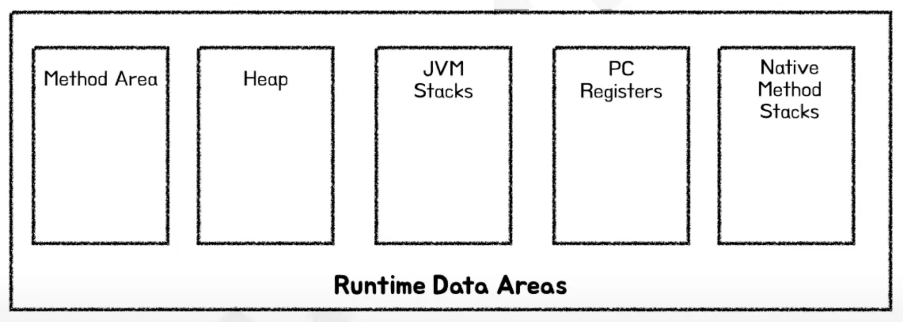

<details>
<summary>Method Area </summary>

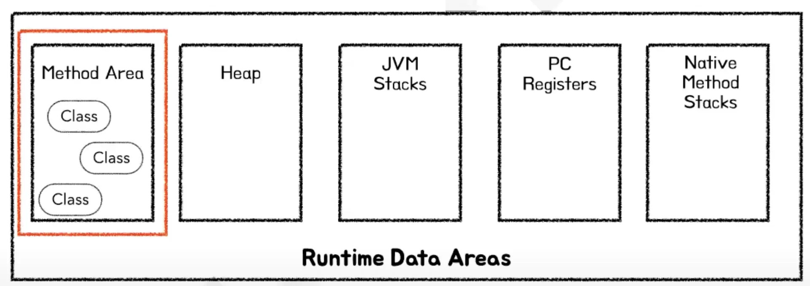

- 클래스에 대한 모든 정보가 여기 저장된다&#46; 

</details>

<details>
<summary>Heap </summary>


- 런타임에 생성되는 모든 객체들이 저장된다&#46; 

</details>

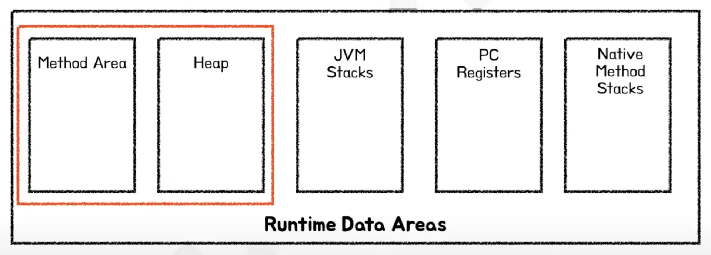

<a id="1c3eda9b0fe1816b92a9e9f0084d1f39"></a>

Method 와 Heap은 모든 스레드가 공유하는 영역이다&#46; 따라서 멀티스레드(multi&#45;thread)를 프로그래밍 할 떄  동기화(Synchronization)에 주의해야 하는 영역이다&#46; 

<details>
<summary>JVM Stacks</summary>

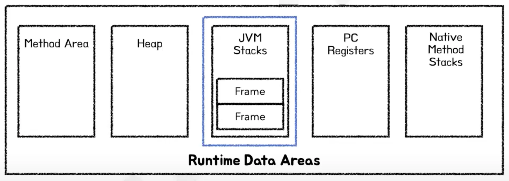

- JVM Stacks는 메서드를 실행하기 위한 정보들이 저장되는 공간이다&#46; 

- 내부에는 프레임(Frame)이라는 자료구조가 들어가 있는데, 이 프레임은 메서드가 하나 호출될 때마다 새로 생기고 메서드가 끝나거나 예외가 터지면 사라진다&#46; 

</details>

<a id="1c3eda9b0fe181e691b2e64de2b5a840"></a>

4&#46;10초 진행 중 

</details>

<details>
<summary>인터프리터 </summary>

- 바이트 코드란 JVM이 알아들을 수 있는 명령어 집합 이다&#46;

- JVM의 목적은 바이트 코드를 기계어로 번역해  CPU에게 작업을 할당하는 것이다&#46;

- 따라서 바이트코드를 기계어로 번역하는 일을 Interpreter가 수행한다&#46; 
    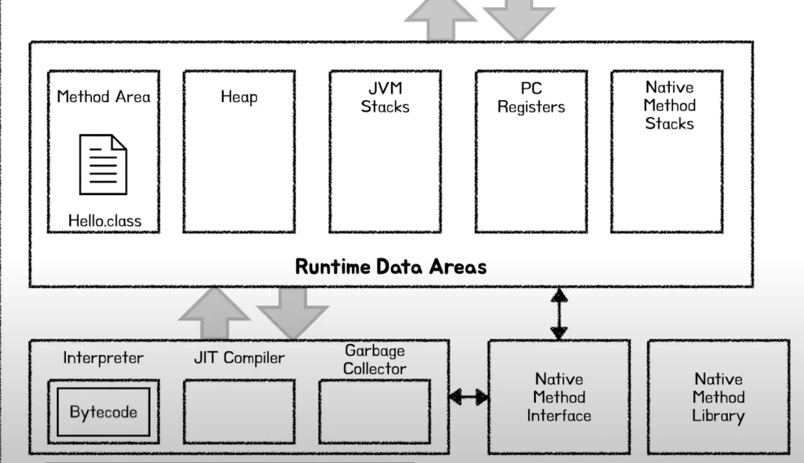

</details>

</details>

<details>
<summary>Runtime Data Area</summary>


</details>

<details>
<summary>JVM Stack</summary>


</details>

<details>
<summary>Method Area &#38; Heap</summary>


</details>

</details>

<details>
<summary>JVM ( Java Virtual Mashine )</summary>

<details>
<summary>Reference</summary>

- ‣

- ‣


</details>

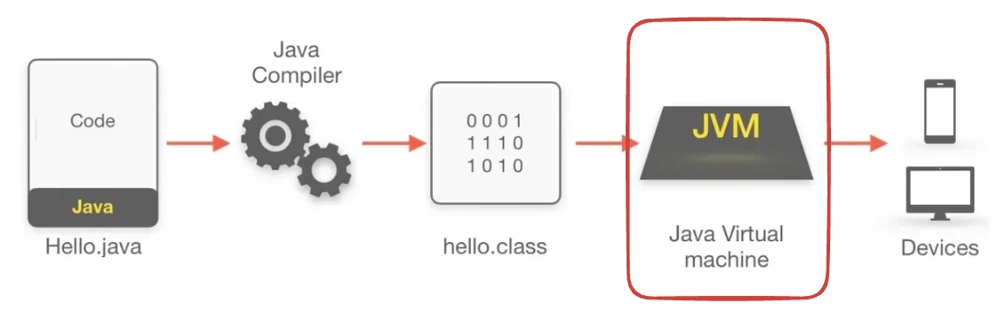

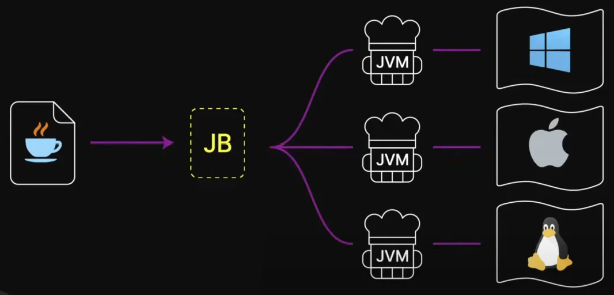

- 위와 같이 <strong><u>자바로 작성한 코드</u></strong>가 <strong><u>자바 컴파일러</u></strong>에 의해  <strong><u>자바 바이트 코드로 변경</u></strong>되고 <strong><u>변경된 바이트 코드</u></strong>가 <strong><u>JVM</u></strong>에 의해 <strong><u>어느 운영체제에서든 실행될 수 있게 변환</u></strong>되어 실행된다&#46; 

- 따라서 사용하는 기기에 JVM이라는 프로그램을 설치하면 어느 운영체제인지, 어떤 언어인지 신경쓰지 않고 편리하게 코드의 실행이 가능하게 한다&#46; 

- JVM은 자바외에도 코틀린, 스칼라, 그루비, Clojure 등의 다른 언어들도 사용 가능하다&#46; 
    - 컴파일 시 <strong><u>자바바이트 코드</u></strong> 변환되기 때문에 가능하다&#46; 

<details>
<summary>구성</summary>


<details>
<summary>바이트 코드</summary>

- 자바 코드(<code>&#46;java</code>)가 컴파일러를 통해 자바 바이트 코드(<code>&#46;class</code>) 변환되어 클래스 로더로 넘어간다&#46; 

</details>

<details>
<summary>인터프리터</summary>

- 운영체제가 읽은 바이트 코드기기(기계)가 실행할 수 있는 기계어로 번역

- 변환된 <strong><u>바이트 코드는</u></strong> 인터프리터를 통해 기계어로 변환되어 CPU에 작업을 할당한다&#46;  

</details>

<details>
<summary>JIT 컴파일러</summary>

- 빠른 java &#46;class 코드 해석기

- 인터프리터의 효율을 높여주는 서포터 해석기 이다&#46; 

</details>

<details>
<summary>메모리영역</summary>

- Java 데이터를 저장하는 영역

- 운영체제로 부터 JVM이 할당받은 메모리 영역

</details>

<details>
<summary>클래스 로더</summary>

- java <code>&#46;class</code> 바이트 코드를 JVM의 메모리 영역이 Runtime Data Area로  넘겨준다&#46; 

</details>

<details>
<summary>가비지 컬렉터</summary>

<details>
<summary>Heap </summary>


- 런타임에 생성되는 모든 객체들이 저장된다&#46; 

</details>

- Heap 메모리 영역에서 런타임 시에 생성된 객체들을 주기적으로 정리한다&#46; 

</details>

</details>

</details>

<details>
<summary>JRE  ( Java Runtime Environment, 자바 실행 환경 )</summary>

- 자바로 짠 코드를 실행 시에는 JRE가 설치되어 있어야 한다&#46; 

<details>
<summary>JRE에는 Java의 표준 라이브러리가 포함되어 있다&#46;</summary>

<a id="1c3eda9b0fe181da99a8e93a2a6276da"></a>

만약 자바가 요리라면, 표준 라이브러리는 요리 기초 가이드북이다&#46;

- 기초 요리 가이드북이 야채의 채써는 방법, 양념장은 어떻게 만드는지, 오븐은 어떻게 쓰는지 등 기초적인 요리 방법에 대해 알려주듯이 

- 자바 표준 라이브러리는  자바 개발 시 사용되는 산술 기능, 출력 기능, 통신 기능 등 널리 사용되는  기초 기능들을 기본으로 제공하여 편리하게 개발할 수있게 해준다&#46; 
    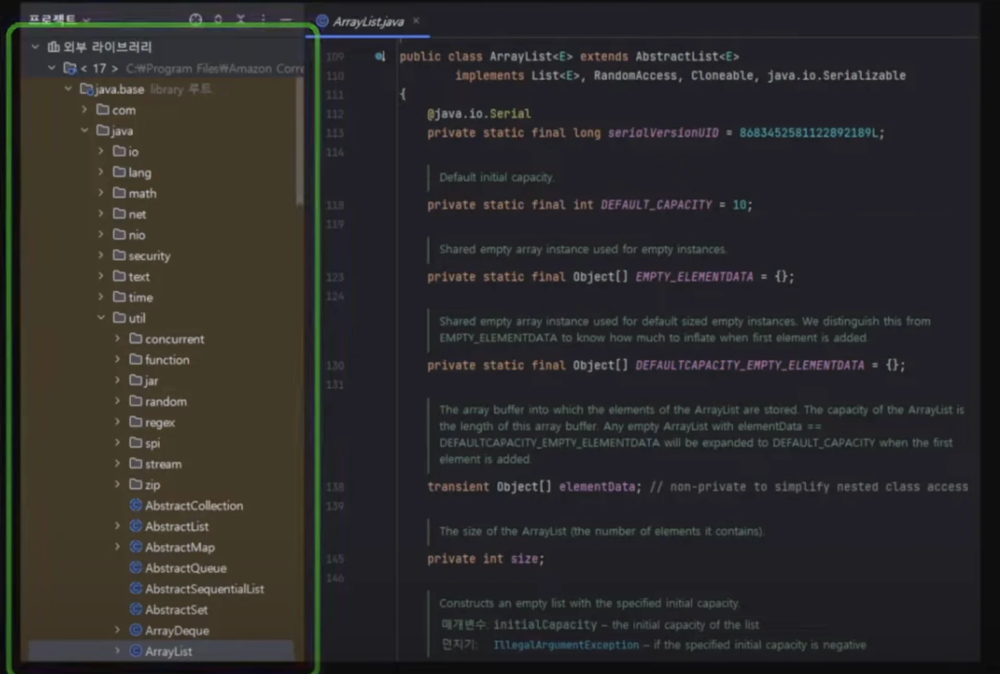

</details>

- 각 종 설정 파일 등 자바 바이트 코드 실행에 필요한 요소들도 포함 된다&#46; 

- <strong>JRE</strong>는 <code>&#46;class</code> 파일만 실행 가능
    - <strong><u>JDK</u></strong> 가  자바 컴파일러(<code>javac</code> 명령)를 통해 자바 코드(<code>&#46;java</code> )을 실행 가능한 자바 바이트 코드(<code>&#46;class</code>) 변환

</details>

<details>
<summary>JDK ( Java Develope Kit )</summary>

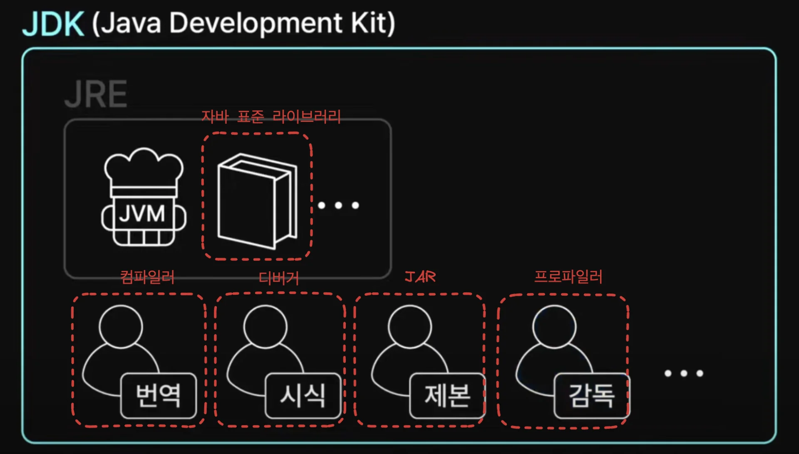

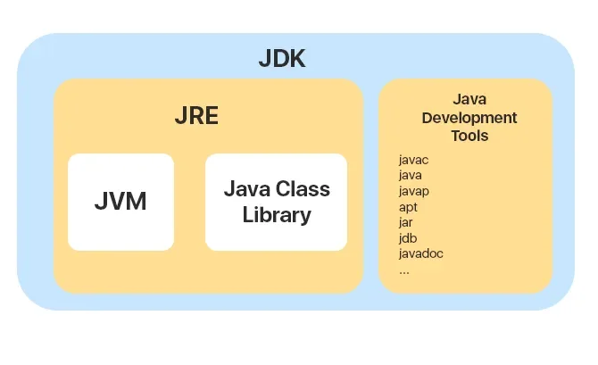

- 개발자가 자바로 프로그래밍하는 전 과정을 도와주는 자바 코드 제작 키트
    - 자바 컴파일러(번역) &#45; 자바 코드 → 자바 바이트 코드

    - 디버거 &#45; 자바  코드를 하나하나 뜯어보고 문제가 없는지 살필 수 있게 도와줌

    - JAR &#45; 컴파일러가 번역한 자바바이트 코드 압축 
        > AWS 사용 시 JAR로 코드를 변경하여 업로드하라는 말이 <br>AWS에서 할당 받은 외부 컴퓨터에서 실행할 수 있게 내 코드를 컴파일 시켜 자바 바이트 코드로 만든 후 JAR로 압축하여 업로드하라는 말이었음, 드디어 이해함

    - 프로파일러 &#45; 성능 모니터링


- JDK 통해 자바를 개발하고 테스트하고 실행한다&#46; <br>이것이 자바로 코딩 시 왜 JDK를 설치하는지에 대한 이유이다&#46; 
    <details>
    <summary>오라클 </summary>

    > 🧐 그렇다면 어디서 자바와 JDK를 만들고 관리하는가?

    <details>
    <summary>Java</summary>

    - 현재 자바 언어는 오라클이라는 회사에서 맡아 관리하고 있다&#46; 

    <details>
    <summary>LTS&#58; 장기 지원 버전</summary>

    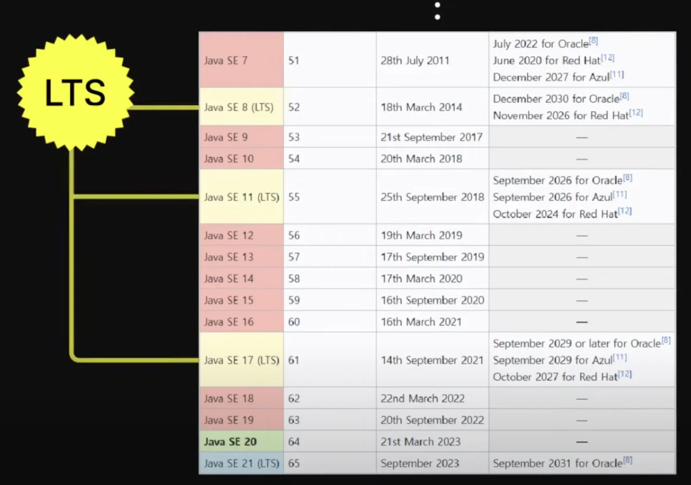

    - 빅맥, 와퍼, 한우불고기 버거 같은 스테디 셀러들 처럼 오래쓰라고 제대로 각 잡고 만든 버전이다&#46;

    - 업데이트, 보안 수정이 장기간 제공되기 때문에, 실무 개발 시 안정적인 LTS 버전을 사용한다&#46; 

    </details>

    <details>
    <summary>실험 버전 </summary>

    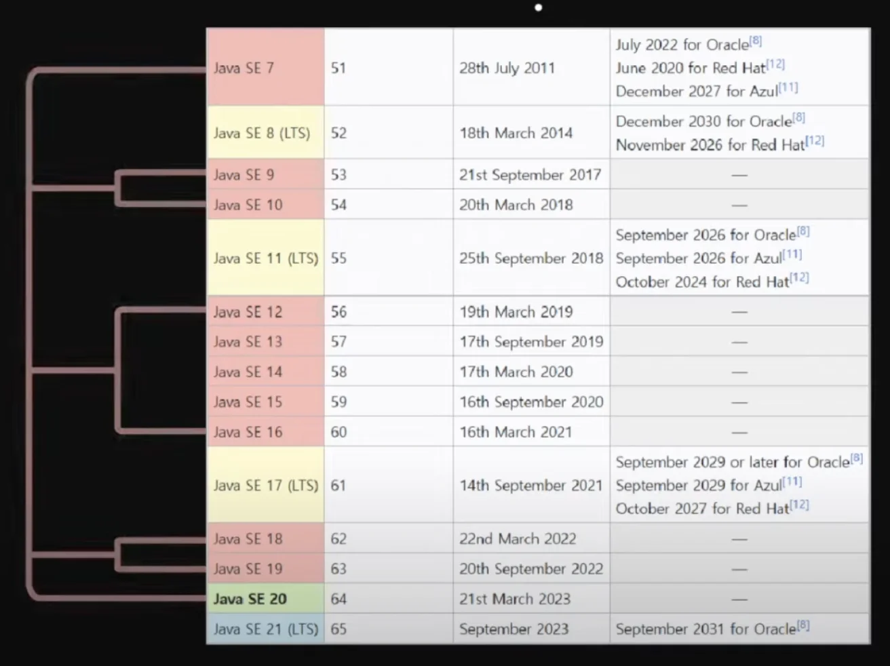

    - 이벤트 메뉴들처럼 잠깐 반짝이고 사라지는 한정 메뉴들처럼 다음 LTS를 위한 실험 버전들이다&#46; 

    - 새로운 기능들을 맛볼순 있으나, 버전 지원이 짧기 때문에 실제품에는 잘 사용하지 않는다&#46; 

    </details>

    </details>

    <details>
    <summary>JDK</summary>

    <details>
    <summary>JDK 유료, 무료 버전</summary>

    

    - 유료 버전에 보다 많은 기능을 제공 

    - Open JDK도 개인이나 소규모 회사에서 사용하기에 충분한 안전성을 가지고 있다&#46; 

    </details>

    <details>
    <summary>JDK는 오라클에서만 만드는 것이 아닌, 다양한 회사들이 무료 또는 유료로 제공하고 있다&#46; </summary>

    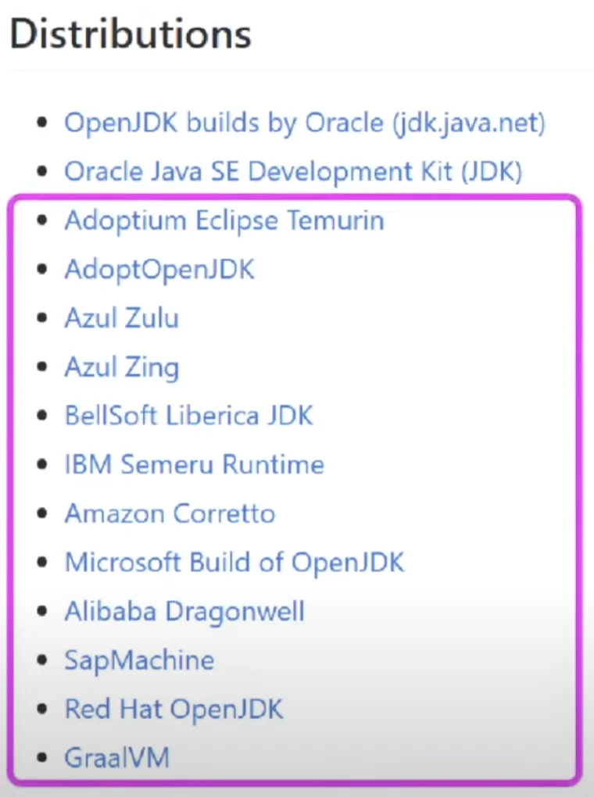

    </details>

    - 즉, 자바의 언어와 표준은 오라클에서 관리하지만 자바로 소프트웨어를 개발하고 실행하는 JDK는 다양한 곳에서 만들어져 출시된다&#46; 
        - <a href="http://whichjdk.com">whichjdk&#46;com</a> 에서 각각의 특성과 권장 용도를 살펴볼 수 있다&#46; 
            - ex) Amazon Corretto → AWS 환경에서 동작하는데 최적화

    - 따라서 어느 용도로, 어느 규모의 조직이나 회사에 따라 자바 프로그램을 개발하고 사용할 것인가에 따라 그에 맞는 JDK를 사용하면 된다&#46; 

    </details>

    </details>

</details>

<a id="1c3eda9b0fe181debd5dc9ffc96d7415"></a>

### 1&#46;3 &#45; 변수, 상수, 타입

<details>
<summary>reference</summary>

<a id="1c3eda9b0fe18106b54ef6b25588ebda"></a>

‣

<a id="1c3eda9b0fe181bb9253c9b6d3a1be97"></a>

<a href="https://beautiful-college-c84.notion.site/b9e8f6c744b242c59aa2c39d72a56102">페이지</a> 

</details>

<details>
<summary>변수, 상수</summary>

<details>
<summary>저장공간 선언, 값 할당</summary>

<a id="1c3eda9b0fe18181a096f48a07509683"></a>

```java
타입 변수명       // 저장공간 선언
변수명 = 값;      // 값 할당
타입 변수명 = 값;  // 초기화
```

<details>
<summary>ex)</summary>

<a id="1c3eda9b0fe1816491fac85091aa56ac"></a>

```java
int number       // 저장공간 선언
number = 10;     // 값 할당

int number = 10; // 초기화
```

</details>

</details>

<details>
<summary>변수 &#45; 재할당 가능</summary>

> 📌 
> 
> - 기본 선언 = 변수
> 
> - 재할당 가능

- ex)
    <a id="1c3eda9b0fe18158a0e6f6a3529d5b2d"></a>

    ```java
    int number = 10;  // 변수 선언
    number = 12;      // 
    ```

</details>

<details>
<summary>상수 &#45; 재할당 불가, <code>final</code></summary>

> 📌 
> 
> - <code>final</code> 키워드를 통한 상수 선언
> 
> - 불변성

- ex)
    <a id="1c3eda9b0fe181489288f3c8f7a966eb"></a>

    ```java
    final int number = 10; 

    number = 11; // Error
    ```

</details>

</details>

<details>
<summary>기본형<code> </code></summary>

<details>
<summary>논리형&#58; <code>boolean</code> </summary>

- boolean&#58; true, false

- ex)
    <a id="1c3eda9b0fe1815aa7fccf1a5bf2f237"></a>

    ```java
    boolean flag = true; 

    flag = false;
    ```

</details>

<details>
<summary>문자형&#58; <code>char</code>, 작은 따옴표(<code>’’</code>) 사용</summary>

- char&#58; <strong><u>문자 하나</u></strong>만 저장

- ex)
    <a id="1c3eda9b0fe1815cbe03fd6992564974"></a>

    ```java
    char alphabet = 'A'; 
    ```

</details>

<details>
<summary>정수형&#58; <code>byte</code>, <code>short</code>, <code>int</code>, <code>long</code> </summary>

- 정수형 숫자(0, &#45;1, 1, 99…) 값을 저장
    > 📌 
    > 
    > - 각 변수의 범위를 넘는 값이 할당되면 오버플로우 발생 → 오류
    > 
    > - 따라서 각 타입들의 변수 범위를 알고 사용해야 한다&#46; 

    <details>
    <summary><code>byte</code>(1byte)&#58; &#45;128 &#126; 127</summary>

    <a id="1c3eda9b0fe18186b2a0f72f267f28fa"></a>

    ```java
    byte num = 125;
    ```

    <details>
    <summary>ex) 오버플로우</summary>

    - byte 타입에 <code>128</code> 할당
        <a id="1c3eda9b0fe18129890ed71ef64fbe88"></a>

        ```java
        byte num = 128;

        System.out.println(num);
        ```

    - 오버플로우 시 오류 메세지
        <a id="1c3eda9b0fe181d6920dd95a44cfceaa"></a>

        ```plaintext
         error: incompatible types: possible lossy conversion from int to byte
        // 오류: 호환되지 않는 유형: int에서 byte로의 손실 변환이 가능합니다.
        ```

    </details>

    </details>

    <details>
    <summary><code>short</code>(2byte)&#58;  &#45;32,768 &#126; 32,767</summary>

    <a id="1c3eda9b0fe18158948cd5c50522c2d9"></a>

    ```java
    short shortNumber = 32767;
    ```

    </details>

    <details>
    <summary><code>int</code>(4byte)&#58;  &#45;21억 &#126; 21억</summary>

    <a id="1c3eda9b0fe181bca053d95d6c8b8fff"></a>

    ```java
    int intNumber = 2147483647
    ```

    </details>

    <details>
    <summary><code>long</code>(8byte)&#58; 9백경 정도</summary>

    > 💬 
    > 
    > <a id="1c3eda9b0fe181cbb3c7c884d44a93f9"></a>
    > 
    > <code>long</code>의 데이터 값(리터럴)을 구분하기 위해, 값 뒤에 <code>L</code>을 붙인다&#46; 

    <a id="1c3eda9b0fe181f38620e0610c1704b4"></a>

    ```java
    long longNumber = 2147483647L;
    ```

    </details>

</details>

<details>
<summary>실수형&#58; <code>float</code>, <code>double</code> </summary>

<details>
<summary>🧐 <strong>float는 </strong><strong><code>4byte</code></strong><strong>만 쓰는데 어떻게 </strong><strong><u>long 보다 더 넓은 범위</u></strong><strong>를 표현 가능한가?</strong></summary>

- float라는 단어의 뜻은 ‘부동’이라는 의미를 가지고 있으며 소수점이 움직인다는 의미의 ‘부동 소수점 방식’으로 숫자를 저장한다&#46;
    <details>
    <summary>🧐 부동 소수점 방식</summary>

    <a id="1c3eda9b0fe181c28efdc3f4053cc58a"></a>

    기수와 지수를 구분해서 이 값들을 곱한 값을 저장(표현)하는 방식이다&#46; <br>

    

    

    > float 가 long 보다 더 넓은 범위를 표현하기 때문에 자동 형변환이 불가능하다&#46;

    <a id="1c3eda9b0fe18137a3b4e67b093d9440"></a>

    ```java
    long longNumber = 3.14f;
    ```

    </details>

</details>

- 소수점 실수(0&#46;12, 0&#46;999 …)값 저장
    > 📌 
    > 
    > - 실수도 동일하게, 각 변수 타입의 범위를 초과하는 수가 하당되면 오버플로우 발생

    <details>
    <summary><code>float</code>(4byte)&#58;  <code>3&#46;4 &#42; &#45;10^38</code> &#126; <code>3&#46;4 &#42; 10^38</code>(long 보다 큼), <strong><u>소수점 7자리 까지</u></strong></summary>

    > 💬 
    > 
    > <a id="1c3eda9b0fe1819fb40ecf9a4034d772"></a>
    > 
    > <code>float</code> 데이터의 값(리터럴)을 구분하기 위해, 값 뒤에 <code>f</code>를 붙인다&#46; 

    <a id="1c3eda9b0fe18178aabdf2417264821f"></a>

    ```java
    float floatNumber = 0.123f;
    ```

    </details>

    <details>
    <summary><code>double</code>(8byte)&#58;  <code>1&#46;7 &#42; &#45;10^308</code> &#126; <code>1&#46;7 &#42; 10^308</code>(long 보다 큼), <strong><u>소수점 16자리 까지</u></strong></summary>

    <a id="1c3eda9b0fe181478449c2397410c272"></a>

    ```java
    double doubleNumber = 0.123123123;
    ```

    </details>

</details>

</details>

<details>
<summary>참조형</summary>

<details>
<summary>String&#58; 문자열</summary>

- 문자열 저장
    <a id="1c3eda9b0fe181008a2fd1ca422780b5"></a>

    ```java
    String message = "Hello World";
    ```

</details>

<details>
<summary>그 외&#58; Object, Array, List …</summary>

- 단일 저장공간에 담을 수 없는 값을 저장
    <a id="1c3eda9b0fe1812d82aad5bf3a8c9cd8"></a>

    ```java
    List<int> alphabet = [0,1,2,3]; // 기본형 변수 여러개 저장
    ```

</details>

</details>

<details>
<summary> 래퍼 클래스</summary>

<details>
<summary>🧐 왜 래퍼 클래스를 사용하는가?</summary>

- 자바의 핵심 기능은 객체지향이다&#46; 

- 기본 타입은 이러한 객체지향의 특성(클래스)에서 벗어나 있기 떄문에, 래퍼 클래스를 통해 객체지향의 많은 기능을 활용 할 수있게 한다&#46;

</details>

> 📌 
> 
> <a id="1c3eda9b0fe181199103e4505ed3c341"></a>
> 
> 래퍼 클래스(Wrapper Class)
> 
> - 말 그대로 ‘<strong><u>기본형 변수</u></strong>를 <strong><u>클래스로 한번 랩핑(감싼)’</u></strong>한 타입이다&#46; 
> 
> - 이렇게 클래스로 감싸, 내장된 다양한 메서드를 편리하게 사용할 수있다&#46;

- <code>박싱</code>&#58; 기본 타입 → 래퍼 클래스

- <code>언박싱</code>&#58; 래퍼 클래스 → 기본 타입
    - ex) <code>박싱</code>&#58; int ↔ Integer &#58;<code>언박싱</code>

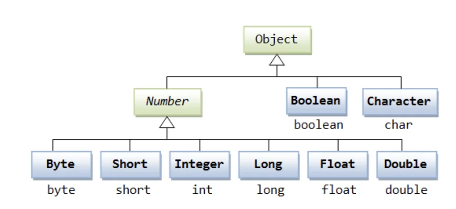

> 첫 글자를 대문자로 변경하여 정의

| 기본 타입 | 래퍼 클래스 |
| --- | --- |
| byte | Byte |
| short | Short |
| int | Integer |
| long | Long |
| float | Float |
| double | Double |
| char | Character |
| boolean | Boolean |

</details>

<details>
<summary>숫자, 문자&#58; <code>아스키 코드(ASCII)</code></summary>

>  <strong>ASCII,  American Standard Code for Information Interchange, 미국정보교환표준부호)</strong>

<details>
<summary>🧐 캐스팅 (<code>(type)</code>)</summary>

- 캐스팅(casting)&#58; <code>()</code>을 사용하여 타입을 변환

<details>
<summary>ex) int → double</summary>

<a id="1c3eda9b0fe181839f65f2da2064965a"></a>

```java
int num = 10;
double doubleNum = (double) num; 
```

</details>

</details>

<details>
<summary>아스키 코드&#58; 각 알파벳 대문자, 소문자에 해당하는 숫자가 약속되어 있다&#46; </summary>

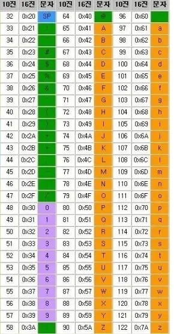

</details>

<details>
<summary>ex)  <code>캐스팅</code>(<code>()</code>)을 통한 <strong><u>숫자 ↔문자</u></strong><u> 형변환</u>, <code>ASCII</code> </summary>

<details>
<summary>숫자 → 문자&#58; <code>(char)</code></summary>

<a id="1c3eda9b0fe18186964ac99232711777"></a>

```java
public static void main(String[] args) {
		Scanner sc = new Scanner(System.in);

		int asciiNumber = sc.nextInt();
		char ch = (char)asciiNumber; // 형변환: 숫자 -> 문자

		System.out.println(ch);  // 97 -> a
}
```

</details>

<details>
<summary>문자 → 숫자&#58; (int)</summary>

<a id="1c3eda9b0fe181c6bb62d953d3135de6"></a>

```java
public static void main(String[] args) {
		Scanner sc = new Scanner(System.in);

		char letter = sc.nextLine().charAt(0); // 첫번째 글자만 받아옴
		int asciiNumber = (int)letter; // 형변환: 문자 -> 숫자 

		System.out.println(asciiNumber);
}
```

</details>

</details>

</details>

<details>
<summary>문자, 문자열</summary>

<details>
<summary>선언 관점</summary>

- 문자 (char)
    - 문자 1개만 저장

    - 작은 따옴표(<code>’’</code>) 사용

    <a id="1c3eda9b0fe181e0a00aee449e73c3be"></a>

    ```java
    char alphabet = 'A';
    ```

- 문자열 (String)
    - 문자 여러개를 문장 형태로 저장,

    - 쌍따옴표(<code>””</code>) 사용

    <a id="1c3eda9b0fe1818fba3ecab5013a1400"></a>

    ```java
    String message = "Hello World";
    ```

</details>

<details>
<summary>저장 관점</summary>

- 문자 (char)
    - 문자 뒤에 &#92;0(<strong>널문자</strong>)가 없다&#46;

    - 1개의 문자(1 byte)만 쓰기 때문에 끝이 정해져 있어 데이터만 저장하면 된다 

- 문자열 (String)
    - 문장의 끝에 <code>&#92;0(널문자)</code>가 함께 저장된다&#46; 

    - 몇 개의 문자(byte)를 쓸지 모르기 때문에 끝을 표시해야 한다&#46;

    

</details>

</details>

<details>
<summary>기본형 vs 참조형</summary>

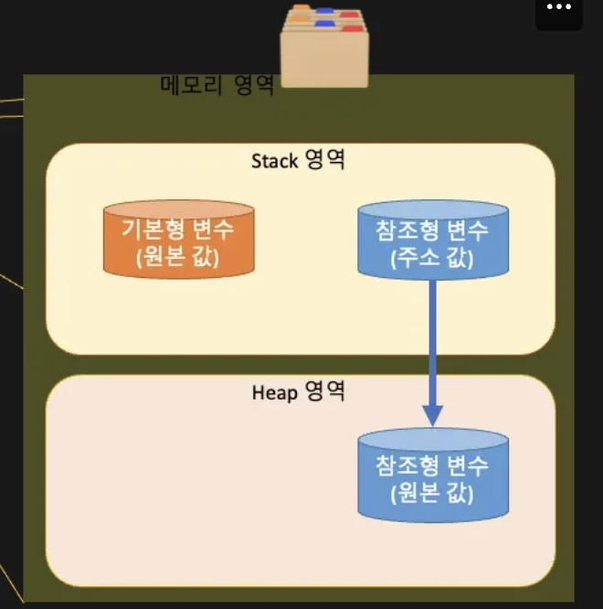

- 기본형 변수 → 실제 값 저장
    - Stack 영역에 원본 값 존재

- 참조형 변수 → 원본 값의 주소 값을 저장
    - Stack 영역에어는 주소 값 존재
        - 참조형 변수의 원본 값은 Heap 영역에 저장된다&#46;

</details>

<details>
<summary>형변환 </summary>

<details>
<summary>직접 형변환&#58; 캐스팅(<code>()</code>)</summary>

- 캐스팅(casting)&#58; <code>()</code>을 사용하여 타입을 변환

<details>
<summary>실수(double, float) → 정수(int)&#58; 소수점 버려짐</summary>

<a id="1c3eda9b0fe181f489cad8b299861230"></a>

```java
double doubleNumber = 10.101010;
float floatNumber = 10.1010

int intNumber;
intNumber = (int)doubleNumber; // double -> int 형변환
intNumber = (int)floatNumber; // float -> int 형변환
```

</details>

<details>
<summary>ex) int → double</summary>

<a id="1c3eda9b0fe181f8bb68ef153ff1f4b8"></a>

```java
int num = 10;
double doubleNum = (double) num; 
```

</details>

</details>

<details>
<summary>자동 형변환</summary>

> 📌 
> 
> <a id="1c3eda9b0fe1816e999dd465822c894e"></a>
> 
> <code>byte(1)</code> → <code>short(2</code>) → i<code>nt(4)</code> → <code>long(8)</code> → <code>float(4)</code> → <code>double(8)</code>

<details>
<summary>1) <code>저장</code>&#58; 작은 크기 → 큰 크기</summary>

- 작은 크기의 타입에서 큰 크기의 타입으로 저장될 때 큰 크기로 형변환이 발생
    - byte → int
        <a id="1c3eda9b0fe1814eada8e0fe31960381"></a>

        ```java
        byte byteNum = 10;
        int intNum = byteNum    // byte -> int 형변환
        System.out.println(intNum);  // 10;
        ```

    - char(1byte)→ int(4byte)
        <a id="1c3eda9b0fe1816b9b38f6d0ed7fe59e"></a>

        ```java
        char char1 = 'a';
        intNum = char1;  // char -> int 형변환
        System.out.println(intNum);  // 97  
        ```

    - int(4byte) → long(8byte)
        <a id="1c3eda9b0fe1819eb281ff1e2629a780"></a>

        ```java
        int intNum = 200;
        long longNum = intNum  // int  -> long 형변환
        System.out.println(doubleNum);   //  200
        ```

    - int(4byte) → double(8byte)
        <a id="1c3eda9b0fe181bd8f8fea77186aa567"></a>

        ```java
        int intNum = 200;
        double doubleNum = intNum  // int  -> double 형변환
        System.out.println(doubleNum);   //  200.0  (소수점이 추가된 실수출력)
        ```

</details>

<details>
<summary>2) <code>계산</code>&#58; 작은 크기, 큰 크기</summary>

-  작은 크기의 타입이 큰 크기의 타입과 계산될 때 자동으로 큰 크기의 타입으로 형변환이 발생
    - int(4byte) <code>&#43;</code> double(8byte) = double
        <a id="1c3eda9b0fe18141b9c2f9986285d87e"></a>

        ```java
        int intNum = 10;
        double doubleNum = 5.5;
        double result1 = intNum + doubleNum;   // double로 형변환
        System.out.println(result1);   // 15.5
        ```

    - int / int = 정수 ( 소수점 버려짐)
        <a id="1c3eda9b0fe181b69fabef9876494e9e"></a>

        ```java
        int intNum = 10;
        int result2 = 10 / 4;
        System.out.println(result2);  // 2, 소수점 버려짐
        ```

    - int / float(실수)  = float( 실수 )
        <a id="1c3eda9b0fe18176a9d7c22ef32450ee"></a>

        ```java
        intNumber = 10;
        double result3 = intNumber / 4.0; // double형 연산 -> 소수점 저장

        System.out.println(result3)      // 2.5 
        ```

</details>

</details>

</details>

<a id="1c3eda9b0fe181d488abec6c49761364"></a>

### 1&#46;4 &#45; 기타

<details>
<summary>main 메서드에 대한 이해</summary>

- Java 프로그램(앱)의 시작점이다&#46; 

- Java 앱은 실행  시, 제일 먼저 클래스의 main 메서드를 실행한다는 것이 JVM의 약속이다&#46;

<a id="1c3eda9b0fe18145b57ce3470859ff7a"></a>

```java
public class Main {
	public static void main(String[] args) {
		System.out.println("Hello world!");
	}
}
```

</details>

<details>
<summary>입력, 출력</summary>

- 입력&#58; <a href="http://System.in"><code>System&#46;in</code></a> &#45; <code>next()</code>
    <a id="1c3eda9b0fe181edaf0fff2195764f04"></a>

    ```java
    Scanner sc = new Scanner(System.in);
    String input = sc.next();
    ```

- 출력&#58; <code>System&#46;out</code> &#45; <code>println()</code>
    <a id="1c3eda9b0fe181cfa2f6e82056f813fa"></a>

    ```java
    Scanner sc = new Scanner(System.in);
    String input = sc.next();  

    System.out.println("입력값 : " + input);  // 입력한 글자 출력
    ```

    <a id="1c3eda9b0fe1811eb27cdfe91f8b9cae"></a>

    ```java
    // 실행 결과
    {입력}
    입력값 : {입력}
    ```

</details>

---

<details>
<summary>연습) 요리 레시피 메모장 만들기</summary>

> 문제에 받아오는 문장 수만큼의 int 값을 추가하여 반복문으로 처리

<details>
<summary>입력 예시</summary>

<a id="1c3eda9b0fe1814cb97dd7255a60a234"></a>

```java
백종원 돼지고기 김치찌개 만들기
4.5 
10
돼지고기는 핏물을 빼주세요.
잘익은 김치 한포기를 꺼내서 잘라주세요.
냄비에 들기름 적당히 두르고 김치를 넣고 볶아주세요.
다진마늘 한스푼, 설탕 한스푼 넣어주세요.
종이컵으로 물 8컵 부어서 센불에 끓여주세요.
핏물 뺀 돼지고기를 넣어주세요.
된장 반스푼, 양파 반개, 청양고추 한개를 썰어서 넣어주세요.
간장 두스푼반, 새우젓 두스푼, 고춧가루 두스푼반 넣어주세요.
중불로 줄여서 오래 끓여주세요~!!	
마지막에 파 쏭쏭 썰어서 마무리하면 돼요^^
```

</details>

<details>
<summary>출력 예시</summary>

<a id="1c3eda9b0fe181c8abf4fb20bd69f834"></a>

```java
[ 백종원 돼지고기 김치찌개 만들기 ]
별점 : 4 (80.0%)
1. 돼지고기는 핏물을 빼주세요.
2. 잘익은 김치 한포기를 꺼내서 잘라주세요.
3. 냄비에 들기름 적당히 두르고 김치를 넣고 볶아주세요.
4. 다진마늘 한스푼, 설탕 한스푼 넣어주세요.
5. 종이컵으로 물 8컵 부어서 센불에 끓여주세요.
6. 핏물 뺀 돼지고기를 넣어주세요.
7. 된장 반스푼, 양파 반개, 청양고추 한개를 썰어서 넣어주세요.
8. 간장 두스푼반, 새우젓 두스푼, 고춧가루 두스푼반 넣어주세요.
9. 중불로 줄여서 오래 끓여주세요~!!	
10. 마지막에 파 쏭쏭 썰어서 마무리하면 돼요^^
```

</details>

<details>
<summary>풀이 코드</summary>

<a id="1c3eda9b0fe181ed9f39dacd030ec194"></a>

```java
import java.util.ArrayList;
import java.util.List;
import java.util.Scanner;

public class Main {


    public List<String> getStringList(int num, Scanner sc) {
        List<String> stringList = new ArrayList<>();

        for (int i = 0; i < num; i++) {
            stringList.add(sc.nextLine());
        }
        return stringList;
    }

    public int calculatePercent(float rate) {
        return (int)(rate * 20);
    }

    public static void main(String[] args) {
        Main main = new Main();
        Scanner sc = new Scanner(System.in);

        String title = sc.nextLine();
        float rate = sc.nextFloat();
        int num = sc.nextInt();
        sc.nextLine();  // nextInt() 사용 시 다음 줄로 건너 뛰어 지지 않아 공백을 받아옴
        List<String> stringList = main.getStringList(num, sc);

        int percent = main.calculatePercent(rate);


        System.out.println("[ " + title + " ]");
        System.out.println("별점: " + rate +" (" + percent + "%)");

        for (int i = 0; i < num; i++) System.out.println((i + 1) + ". " + stringList.get(i));;

    }
}
```

</details>

</details>

<a id="1c3eda9b0fe1815bbd2bf47824567a4b"></a>

## Chapter 2 &#45; 연산자, 조건문, 반복문, 배열, 컬렉션

<a id="1c3eda9b0fe18169b5f0f605bb0574d8"></a>

### 2&#46;1 &#45; 연산자

<details>
<summary>연산자, 피연산자</summary>

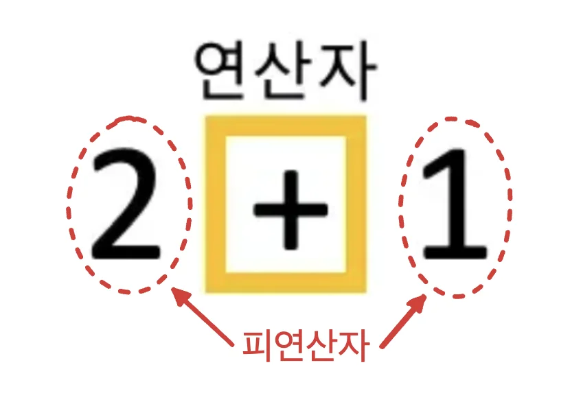

- 연산자 &#58; 덧셈, 뺄셈처럼 계산할 기호 ➕

- 피연산자 &#58; 연산자로 인해 계산되는 숫자 🔢

</details>

---

|  |  |  |
| --- | --- | --- |
| <strong>산술 연산자</strong> | <code>&#43;</code> <code>&#45;</code> <code>&#42;</code> <code>/</code> <code>%</code> <code>&#60;&#60;</code> <code>&#62;&#62;</code> | 사칙 연산과 비트연산 |
| <strong>비교 연산자</strong> | <code>&#62;</code> <code>&#60;</code> <code>&#62;=</code> <code>&#60;=</code> <code>==</code> <code>&#33;=</code> | 크고 작음과 같고 다름을 비교 |
| <strong>논리 연산자</strong> | <code>&#38;&#38;</code> <code>&#124;&#124;</code> <code>&#33;</code> | 그리고(AND)와 또는(OR) 으로 조건을 연결 |
| <strong>대입 연산자</strong> | <code>=</code> <code>&#43;&#43;</code> <code>—&#45;</code> | 우변의 값을 좌변에 저장, 연산 복합 대입 |
| <strong>기타 연산자</strong> | <code>(type)</code> <code>? &#58;</code>  <code>instance of</code> | 형변환 연산자, 삼항 연산자, instance of 연산자 |

<details>
<summary>산술연산자&#58; <code>&#43;</code>, <code>&#45;</code>, <code>&#42;</code>, <code>/</code>, <code>%</code> … </summary>

- <code>&#43;</code>(덧셈), <code>&#45;</code> (뺄셈),  <code>&#42;</code>(곱셈),  <code>/</code>(나눗셈/몫),  

- <code>%</code> (나눗셈/나머지)

<details>
<summary>ex)</summary>

<a id="1c3eda9b0fe181e1bd5af5baa76c356a"></a>

```java
// 사칙 연산
System.out.println(4 + 2); // 6
System.out.println(4 - 2); // 2
System.out.println(4 * 2); // 8
System.out.println(4 / 2); // 2
System.out.println(5 / 2); // 2
System.out.println(2 / 4); // 0
System.out.println(4 % 2); // 0
System.out.println(5 % 2); // 1

// 우선 순위 연산
System.out.println(2 + 2 * 2); // 6
System.out.println((2 + 2) * 2); // 8
System.out.println(2 + (2 * 2)); // 6

// 변수를 이용한 연산
int a = 20;
int b = 10;
int c;

// 덧셈
c = a + b;
System.out.println(c); // 30

// 뺄셈
c = a - b;
System.out.println(c); // 10

// 곱셈
c = a * b;
System.out.println(c); // 200

// 나눗셈 (몫)
c = a / b;
System.out.println(c); // 2

// 나눗셈 (나머지) = 나머지 연산
c = a % b;
System.out.println(c); // 0
```

</details>

</details>

<details>
<summary>비교연산자&#58; <code>&#62;</code>, <code>&#60;</code>, <code>&#62;=</code>, <code>&#60;=</code>, <code>==</code>, <code>&#33;=</code></summary>

- <code>&#62;</code> (크다) , <code>&#60;</code> (작다), <code>&#62;=</code> (크거나 같다), <code>&#60;=</code> (작거나 같다), <code>==</code> (같다), <code>&#33;=</code> (다르다)

- 비교 → boolean( true / false )

<details>
<summary>ex)</summary>

<a id="1c3eda9b0fe181eabc3ceb498134113b"></a>

```java
// 사칙 연산
System.out.println(4 + 2); // 6
System.out.println(4 - 2); // 2
System.out.println(4 * 2); // 8
System.out.println(4 / 2); // 2
System.out.println(5 / 2); // 2
System.out.println(2 / 4); // 0
System.out.println(4 % 2); // 0
System.out.println(5 % 2); // 1

// 우선 순위 연산
System.out.println(2 + 2 * 2); // 6
System.out.println((2 + 2) * 2); // 8
System.out.println(2 + (2 * 2)); // 6

// 변수를 이용한 연산
int a = 20;
int b = 10;
int c;

// 덧셈
c = a + b;
System.out.println(c); // 30

// 뺄셈
c = a - b;
System.out.println(c); // 10

// 곱셈
c = a * b;
System.out.println(c); // 200

// 나눗셈 (몫)
c = a / b;
System.out.println(c); // 2

// 나눗셈 (나머지) = 나머지 연산
c = a % b;
System.out.println(c); // 0
```

</details>

</details>

<details>
<summary>논리연산자&#58; <code>&#38;&#38;</code>, <code>&#124;&#124;</code>, <code>&#33;</code></summary>

- AND&#58; <code>&#38;&#38;</code>, 피연산자 둘다 참

- OR&#58; <code>&#124;&#124;</code>, 피연산자 하나라도 참

- NOT&#58; <code>&#33;</code>, boolean 결과갑 반대로 ( false → true, true → false)

<details>
<summary>ex)</summary>

<a id="1c3eda9b0fe181fca975de3180316407"></a>

```java
// 논리 연산자
boolean flag1 = true;
boolean flag2 = true;
boolean flag3 = false;

System.out.println(flag1); // true
System.out.println(flag2); // true
System.out.println(flag3); // false

// 피연산자 중 하나라도 true 이면 true
System.out.println(flag1 || flag2); // true
System.out.println(flag1 || flag2 || flag3); // true
// 피연산자 모두 true 이면 true
System.out.println(flag1 && flag2); // true (flag1, flag2 모두 true 라서)
System.out.println(flag1 && flag2 && flag3); // false (flag3은 false 라서)

// And 연산
System.out.println((5 > 3) && (3 > 1)); // 5 는 3 보다 크고, 3 은 1 보다 크다 (true)
System.out.println((5 > 3) && (3 < 1)); // 5 는 3 보다 크고, 3 은 1 보다 작다 (false)

// Or 연산
System.out.println((5 > 3) || (3 > 1)); // 5 는 3 보다 크거나, 3 은 1 보다 크다 (true)
System.out.println((5 > 3) || (3 < 1)); // 5 는 3 보다 크거나, 3 은 1 보다 작다 (true)
System.out.println((5 < 3) || (3 < 1)); // 5 는 3 보다 작거나, 3 은 1 보다 작다 (false)

// System.out.println(1 < 3 < 5); // 불가능한 코드

// 논리 부정 연산자
System.out.println(!flag1); // false (flag1 값의 반대)
System.out.println(!flag3); // true (flag3 값의 반대)
System.out.println(!(5 == 5)); // false
System.out.println(!(5 == 3)); // true
```

</details>

</details>

<details>
<summary>대입연산자&#58; <code>=</code>, <code>&#43;&#43;</code>, <code>—&#45;</code></summary>

<details>
<summary>⚠️ 증감연산자(<code>&#43;&#43;</code>,<code>&#45;—</code>) 주의점 ( 위치 )</summary>

- 피연산자 <strong><u>앞, 뒤</u></strong>에 따라 연산 순서가 달라짐
    - 앞&#58; 증감 연산 처리  → 변수 저장

    - 뒤&#58; 변수 저장 →  증감 연산 처리

| 연산자 | 연산자 위치 | 기능 | 연산 예 |
| --- | --- | --- | --- |
| &#43;&#43; | &#43;&#43;{피연산자} | 연산 전에 피연산자에 1 더해줍니다&#46; | <code>val = &#43;&#43;num;</code> <br> • num값&#43;1 후에 val변수에 저장 |
| &#43;&#43; | {피연산자}&#43;&#43; | 연산 후에 피연산자에 1 더해줍니다&#46; | <code>val = num&#43;&#43;;</code><br> • num값을 val변수에 저장 후 num&#43;1 |
| — | —{피연산자} | 연산 전에 피연산자에 1 빼줍니다&#46; | <code>val = —num;</code><br> • num값&#45;1 후에 val변수에 저장 |
| — | {피연산자}— | 연산 후에 피연산자에 1 빼줍니다&#46; | <code>val = num—;</code><br> • num값을 val변수에 저장 후 num&#45;1 |

</details>

- 기본 대입 연산자&#58; <code>=</code>

- 복합 대입 연산자&#58; <code>=</code> &#43; 기본 연산자(<code>&#43;</code>, <code>&#45;</code>, <code>&#42;</code> …) 
    - <code>&#43;=</code>, <code>&#45;=</code>, <code>&#42;=</code> … 

-  <code>&#43;= 1</code> =  <code>&#43;&#43;</code>&#58; 피연산자에 1 더해주기

-  <code>&#45;= 1</code>  =  <code>—&#45;</code>&#58; 피연산자에 1 빼주기

<details>
<summary>ex)</summary>

<a id="1c3eda9b0fe18155acdbf80e89d27dc4"></a>

```java
// 대입 연산자
int number = 10;
number = number + 2;
System.out.println(number); // 12

number = number - 2;
System.out.println(number); // 10

number = number * 2;
System.out.println(number); // 20

number = number / 2;
System.out.println(number); // 10

number = number % 2;
System.out.println(number); // 0

number = number++;
System.out.println(number); // 2

number = number--;
System.out.println(number); // 0

// 복합 대입 연산자
number = 10;

number += 2;
System.out.println(number); // 12

number -= 2;
System.out.println(number); // 10

number *= 2;
System.out.println(number); // 20

number /= 2;
System.out.println(number); // 10

number %= 2;
System.out.println(number); // 0
```

</details>

</details>

<details>
<summary>기타연산자&#58; <code>(type)</code>, <code>? &#58;</code>,  <code>instance of</code></summary>

<details>
<summary>형변환(캐스팅)&#58; <code>(type)</code></summary>

<a id="1c3eda9b0fe181aaa81ac9b95407461c"></a>

```java
// 형변환 연산자
int intNumber = 93 + (int) 98.8; // 93 + 98

double doubleNumber = (double) 93 + 98.8; // 93.0 + 98.8
```

</details>

<details>
<summary>삼항 연산자&#58;  <code>(조건) ? Truthy &#58; Falsy</code> </summary>

<a id="1c3eda9b0fe181378adae021a0bb4eae"></a>

```java
// 삼항 연산자
int x = 1;
int y = 9;

boolean b = (x == y) ? true : false;
System.out.println(b); // false

String s = (x != y) ? "정답" : "땡";
System.out.println(s); // 땡

int max = (x > y) ? x : y;
System.out.println(max); // 9

int min = (x < y) ? x : y;
System.out.println(min); // 1
```

</details>

<details>
<summary>intance of&#58; <code>객체명 instance of 클래스명</code></summary>

- 피연산자가 해당하는 클래스의 자식인지 검사

- 3주차 정리

</details>

</details>

---

<details>
<summary>연산자 우선순위&#58; <code>산술</code> &#62; <code>비교</code> &#62; <code>논리</code> &#62; <code>대입</code></summary>

<a id="1c3eda9b0fe1819383f8e33d32965f96"></a>

```java
// 연산자 우선순위
int x = 2;
int y = 9;
int z = 10;

boolean result = x < y && y < z; // <,> 비교연산자 계산 후 && 논리 연산자 계산
System.out.println(result); // true

result = x + 10 < y && y < z; // +10 산술연산자 계산 후 <,> 비교연산자 계산 후 && 논리 연산자 계산
System.out.println(result); // false

result = x + 2 * 3 > y; // 산술연산자 곱센 > 덧셈 순으로 계산 후 > 비교연산자 계산
System.out.println(result); // false (8>9)

result = (x + 2) * 3 > y; // 괄호안 덧셈 연산 후 괄호 밖 곱셈 계산 후 > 비교연산자 계산
System.out.println(result); // true (12>9)
```

</details>

<details>
<summary>산술변환</summary>

> 1주차 &#45; ‘자동 형변환’과 내용 동일 l

- 크기가 더 큰 타입으로 형변환
    - byte → short → int → long → float → double

<details>
<summary>ex)</summary>

<a id="1c3eda9b0fe181fabc4dc8f39925f0a9"></a>

```java
// 산술변환 
public class Main {

	public static void main(String[] args) {

		short x = 10;
		int y = 20;

		int z = x + y; // 결과값은 더 큰 표현타입인 int 타입의 변수로만 저장할 수 있습니다.

		long lx = 30L;
		long lz = z + lx; // 결과값은 더 큰 표현타입인 long 타입의 변수로만 저장할 수 있습니다.

		float fx = x; // 결과값은 더 큰 표현타입인 float 타입의 변수로만 저장할 수 있습니다.
		float fy = y; // 결과값은 더 큰 표현타입인 float 타입의 변수로만 저장할 수 있습니다.
		float fz = z; // 결과값은 더 큰 표현타입인 float 타입의 변수로만 저장할 수 있습니다.
		System.out.println(lz);
		System.out.println(fx);
		System.out.println(fy);
		System.out.println(fz);
	}

}
```

</details>

</details>

<details>
<summary>비트 연산</summary>

- 비트&#58; 0, 1

- <code>&#60;&#60;</code>(왼쪽으로 자릿수옮기기)

- <code>&#62;&#62;</code>(오른쪽으로 자릿수옮기기)

<details>
<summary>ex) </summary>

<a id="1c3eda9b0fe181edaf8ee9326fc728bb"></a>

```java
// 이진수 표기법: 숫자(2)
  // ex1) 3 ->  11(2)
  // ex2) 12 -> 1100(2)

System.out.println(3 << 2); 
// 3: 11(2) => <<2 => 1100(2): 12


System.out.println(3 >> 1); 
// 3: 11(2) => >>1 => 1(2): 1
```

</details>

</details>

<a id="1c3eda9b0fe18157a4e7cee8e96ca5e3"></a>

### 2&#46;2 &#45; 조건문, 반복문

- 조건문 
    <details>
    <summary>🧐 <code>if</code> vs <code>switch</code> </summary>

    - if 문 → 복합 조건 지원 
        - 복합 조건 &#58; 괄호<code>()</code>안에 조건 여러 개를 지정하여 조건문을 수행

    - switch 문 →  <strong><u>피연산자 한 개</u></strong>에 대한 조건만 지원
        <a id="1c3eda9b0fe1818cb7c2edeca7a164ba"></a>

        ⇒ if문은 switch문 보다 상대적으로 코드 중복이 많고, 가독성도 떨어진다&#46;<br>     그러나, 복합 조건을 처리 가능하다&#46;

    <details>
    <summary>ex) <br></summary>

    <a id="1c3eda9b0fe1812894c4e1f2a85d9a35"></a>

    ```java
    // if vs switch
    // switch 문 실습코드를 if 문으로 바꿔보겠습니다.

    // switch 
    int month = 8;
    String monthString = "";
    switch (month) {
        case 1:  monthString = "1월";
                 break;
        case 2:  monthString = "2월";
                 break;
        case 3:  monthString = "3월";
                 break;
        case 4:  monthString = "4월";
                 break;
        case 5:  monthString = "5월";
                 break;
        case 6:  monthString = "6월";
                 break;
        case 7:  monthString = "7월";
                 break;
        case 8:  monthString = "8월"; 
                 break;
        case 9:  monthString = "9월";
                 break;
        case 10: monthString = "10월";
                 break;
        case 11: monthString = "11월";
                 break;
        case 12: monthString = "12월";
                 break;
        default: monthString = "알수 없음";
    }
    System.out.println(monthString); // 8월 출력

    // if 로 변환
    if (month == 1) {
    	monthString = "1월";
    } else if (month == 2) {
    	monthString = "2월";
    } else if (month == 3) {
    	monthString = "3월";
    } else if (month == 4) {
    	monthString = "4월";
    } else if (month == 5) {
    	monthString = "5월";
    } else if (month == 6) {
    	monthString = "6월";
    } else if (month == 7) {
    	monthString = "7월";
    } else if (month == 8) {
    	monthString = "8월";
    } else if (month == 9) {
    	monthString = "9월";
    } else if (month == 10) {
    	monthString = "10월";
    } else if (month == 11) {
    	monthString = "11월";
    } else if (month == 12) {
    	monthString = "12월";
    } else {
    	monthString = "알수 없음";
    }
    System.out.println(monthString); // 8월 출력
    ```

    </details>

    </details>

    <details>
    <summary>if / else if / else 문</summary>

    <a id="1c3eda9b0fe1814f9fa3cf08df1f658e"></a>

    ```java
    if (조건) {
    	. . .
    } else if (조건) {
    	. . .
    } else {
    	. . .
    } 
    ```

    - 조건 1개&#58; <code>if</code>

    - 조건 2개&#58; <code>if / else</code>

    - 조건 3개 ↑&#58; <code>if / else if … / else</code>

    <details>
    <summary>ex) </summary>

    <a id="1c3eda9b0fe18134a8e7ce7f4b45abe4"></a>

    ```java
    [코드스니펫] 조건문
    // 조건문
    boolean flag = true;

    if (flag) {
    	System.out.println("flag 값은 true 입니다."); // flag 값은 true 입니다. 출력
    }
    ```

    </details>

    </details>

    <details>
    <summary>switch / case 문</summary>

    > if문 보다 좀 더 가독성이 좋다&#46;

    > • <code>if ( 피연산자 = 조건 ) { 연산 }<br></code>• <code>else { 연산 }</code>

    - <code>switch ( 피연산자 ) { … }</code>

    <details>
    <summary><code>case 조건 &#58; 연산</code></summary>

    - <code>break</code>(필수)&#58; 해당 case문의 연산문의 끝남 처리 → case문 종료 

    <a id="1c3eda9b0fe181bc8714c561f86dd84c"></a>

    ```java
    case 조건: 연산;
    		break;
    ```

    </details>

    - <code>default&#58; 연산; </code> ( =<code>else</code>)

    <a id="1c3eda9b0fe1819e9d2bd41724d52056"></a>

    ```java
    switch ( 피연산자 ) {
    	case 조건1: 연산1;
    				break;	
    				
    	case 조건2: 연산2;
    				break;	
    				
    			. . .
    			
    	default: 연산n;			
    }
    ```

    <details>
    <summary>ex) </summary>

    <a id="1c3eda9b0fe181b6ae70c3612674031c"></a>

    ```java
    // switch/case 문 

    int month = 8;
    String monthString = "";
    switch (month) {
        case 1:  monthString = "1월";
                 break;
        case 2:  monthString = "2월";
                 break;
        case 3:  monthString = "3월";
                 break;
        case 4:  monthString = "4월";
                 break;
        case 5:  monthString = "5월";
                 break;
        case 6:  monthString = "6월";
                 break;
        case 7:  monthString = "7월";
                 break;
        case 8:  monthString = "8월"; 
                 break;
        case 9:  monthString = "9월";
                 break;
        case 10: monthString = "10월";
                 break;
        case 11: monthString = "11월";
                 break;
        case 12: monthString = "12월";
                 break;
        default: monthString = "알수 없음";
    }
    System.out.println(monthString); // 8월 출력
    ```

    </details>

    </details>

- 반복문
    <details>
    <summary>for 문</summary>

    - <code>for</code> (<code>초기값;</code> <code>조건문;</code> <code>증감 연산</code>(<code>&#43;&#43;</code>, <code>—</code>) )  {<code> 연산 </code>}

    <a id="1c3eda9b0fe1814f856ed66f529cdf70"></a>

    ```java
    for(int i=0; i<arr.length; i++) {
    			.  .  .
    } 
    ```

    <details>
    <summary>ex) </summary>

    <a id="1c3eda9b0fe181079298fc634efff174"></a>

    ```java
    // for 문

    for(int i=0; i < 4; i++) { 
        System.out.println(i + "번째 출력"); 
    }

    // === 출력 ===
    // 0번째 출력
    // 1번째 출력
    // 2번째 출력
    // 3번째 출력
    ```

    </details>

    </details>

    <details>
    <summary>for &#45; each 문</summary>

    - <code>for</code> (<code>하위요소&#95;타입</code> <code>하위요소&#95;명</code> &#58; <code>목록변수</code>)  <code>{ 연산 }</code>

    <a id="1c3eda9b0fe181578b13ee35a3f40459"></a>

    ```java
    for (하위요소_타입 하위요소_명 : list, object... ) { 
    		  .  .  .
    }
    ```

    <details>
    <summary>ex) </summary>

    <a id="1c3eda9b0fe18129a7b8e4d69c6a8f1e"></a>

    ```java
    // for - each 문
    int[] numbers = {3,6,9,12,15};
    for(int number: numbers) {
        System.out.print(number + " "); 
    }

    // === 출력 ===
    // 3 6 9 12 15
    ```

    <a id="1c3eda9b0fe181b18b58dd12cd640f0a"></a>

    <br>

    </details>

    </details>

    <details>
    <summary>while 문</summary>

    - 해당 조건에 속한 경우 계속 반복

    <a id="1c3eda9b0fe1816cbf68ce42c0ed7508"></a>

    ```java
    while ( 조건 ) {    // 조건이 true 인 경우, 계속 반복 실행
    		.  .  .
    }
    ```

    <details>
    <summary>ex)</summary>

    <a id="1c3eda9b0fe181e49816fb8f453bc514"></a>

    ```java
    int number = 0;
    while(number < 3) {
    		number++;
        System.out.println(number + "출력"); 
    }

    // === 출력 ===
    // 1출력
    // 2출력
    // 3출력
    ```

    </details>

    </details>

    <details>
    <summary>do &#45; while 문</summary>

    - 최초 1회 연산 수행 후 조건문을 체크하여 반복 결정

    <a id="1c3eda9b0fe181a6bce2d72a8227908c"></a>

    ```java
    do { 
    		연산 
    } while ( 조건 );
    ```

    <details>
    <summary>ex )</summary>

    <a id="1c3eda9b0fe18148b4c5c5d2fc380e61"></a>

    ```java
    // do-while 문

    int number = 4;
    do {
        System.out.println(number + "출력"); 
        number--;
    } while(number < 3); // 연산을 한번 수행 후 조건문 체크

    // === 출력 ===
    // 4출력
    // 3출력
    ```

    </details>

    </details>

    ---

    <details>
    <summary><code>break</code>&#58; 블럭<code>{}</code> 종료</summary>

    -  <code>for { … break; }</code>&#58; for문 종료

    - <code>while { … break; }</code>&#58; while문 종료

    - <code>for</code> or <code>while</code> {<code> if(순서) { … break; }</code> &#46;&#46;&#46; }&#58; break에서 해당 순서 바로 종료

    <details>
    <summary>ex) </summary>

    <a id="1c3eda9b0fe181dab04fc31555747d9f"></a>

    ```java
    // break 명령

    int number = 0;
    while(number < 3) {
    		number++;
    		if (number == 2) {
    			break;  // 2일때 반복 중단
    		}
        System.out.println(number + "출력"); 
    }

    // === 출력 ===
    // 1출력
    ```

    </details>

    </details>

    <details>
    <summary><code>continue</code>&#58; 해당 순서 패스</summary>

    <details>
    <summary>ex) </summary>

    <a id="1c3eda9b0fe181a698f7ea5ce076f5e9"></a>

    ```java
    // continue 명령
    int number = 0;
    while(number < 3) {
    		number++;
    		if (number == 2) {
    			continue;  // 2일때 반복 패스
    		}
        System.out.println(number + "출력"); 
    }

    // === 출력 ===
    // 1출력
    // 3출력
    ```

    </details>

    </details>

    ---

    <details>
    <summary>&#91; 연습 &#93; </summary>

    <details>
    <summary>1) 구구단 생성</summary>

    <a id="1c3eda9b0fe181abbb55f5cc7326e42b"></a>

    ```java
    // 구구단 생성기

    for (int i = 2; i <= 9; i++) { // 구구단 첫번째 지수 i
    	for (int j = 2; j <= 9; j++) { // 구구단 두번째 지수 j
    		System.out.println(i + "곱하기" + j + "는" + (i * j) + "입니다.");
    	}
    }

    // 출력
    2곱하기2는4입니다.
    2곱하기3는6입니다.
    2곱하기4는8입니다.
    ... 중략 ...
    9곱하기8는72입니다.
    9곱하기9는81입니다.
    ```

    </details>

    <details>
    <summary>2) 선택적 구구단 생성</summary>

    <a id="1c3eda9b0fe181269d0ac8c4ec9064de"></a>

    ```java
    // 선택적 구구단 생성기

    Scanner sc = new Scanner(System.in);
    int passNum = sc.nextInt(); // 출력제외할 구구단수 값
    for (int i = 2; i <= 9; i++) {
    	if (i == passNum) {
    		continue;
    	}
    	for (int j = 2; j <= 9; j++) {
    		System.out.println(i + "곱하기" + j + "는" + (i * j) + "입니다.");
    	}
    }

    // 입력
    2

    // 출력 - 입력값인 2단은 건너띄고 구구단 출력
    3곱하기2는6입니다.
    3곱하기3는9입니다.
    3곱하기4는12입니다.
    ... 중략 ...
    9곱하기8는72입니다.
    9곱하기9는81입니다.
    ```

    </details>

    </details>

<a id="1c3eda9b0fe1819eb342e4a43cf104b1"></a>

### 2&#46;3  &#45; 배열

<details>
<summary>얕은 복사(<strong>Shallow copy) </strong>, 깊은 복사(<strong>Deep copy)</strong></summary>

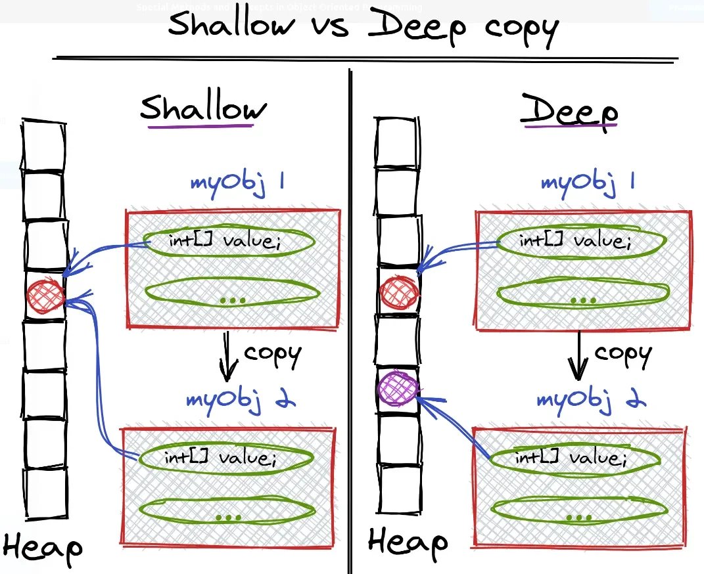

- shallow copy
    - 힙 영역에 있는 원본 값을 공유

    - 하나의 객체에서 값 수정  시, 둘다 수정됨

- deep copy
    - 원본 값을 힙 영역에 복사

    - 두 객체는 독립적, 수정 시 둘다 영향 없음

</details>

<details>
<summary>배열</summary>

- 선언 및 생성
    <a id="1c3eda9b0fe181c299cef736193d6613"></a>

    ```java
    타입[] 변수명 = new 타입[n];
    // n: 생성할 크기 값
    ```

- 순회
    <a id="1c3eda9b0fe1814c8ffbcc4516b719ef"></a>

    ```java
    for(int=0; i<arr.lenght(); i++) {
    		// arr[i] 조작
    }
    ```

- 초기화 ( <code>타입&#91;&#93; = {…}</code> )
    <a id="1c3eda9b0fe181a0bb98da24b4308724"></a>

    ```java
    int[] = { 1, 2, 3};
    ```

- 깊은 복사&#58; <code>for문</code>, <code>&#46;clone()</code>, <code>Arrays&#46;copyOf(배열, 배열길이)</code> 
    <details>
    <summary><code>for 문</code></summary>

    <a id="1c3eda9b0fe1811b8b2dea4e142d4f94"></a>

    ```java
    int[] a = { 1, 2, 3, 4 };
    int[] b = new int[a.length]; 

    for (int i = 0; i < a.length; i++) {
        b[i] = a[i]; // 깊은 복사
    }

    b[0] = 3;
    System.out.println(a[0]); // 깊은 복사이기 때문에 원본 배열은 수정되지 않음
    ```

    </details>

    <details>
    <summary><code>&#46;clone()</code></summary>

    - 2차원 이상 배열 → 얕은 복사 

    <a id="1c3eda9b0fe181d2933eebb0fe6f8185"></a>

    ```java
    int[] a = { 1, 2, 3, 4 };
    int[] b = a.clone(); // b = { 1, 2, 3, 4}
    ```

    </details>

    <details>
    <summary><code>Arrays&#46;copyOf(배열, 배열길이)</code> </summary>

    <a id="1c3eda9b0fe181949b69f70dbbaa5a40"></a>

    ```java
    import java.util.Arrays;

    	
    int[] a = { 1, 2, 3, 4 };
    int[] b = Arrays.copyOf(a, a.length); // ( 배열, 배열 길이 )
    ```

    </details>

</details>

<details>
<summary>다차원 배열</summary>

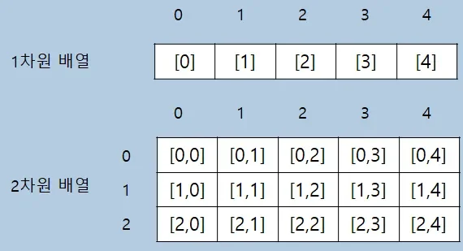

<details>
<summary>선언 및 생성                                                                                                                                                                                                                                                                                                                                                                                                                                                                                                                                                                                                                                                                                                                                                                                         </summary>

<a id="1c3eda9b0fe1817d8c4cf699186c03b7"></a>

```java
* n, m: 생성하 배열 공간의 크기 값

타입[][] 변수명 = new 타입[n][m]

// ex) int[][] doubleIntList = new int[n][m]
```

</details>

<details>
<summary>초기화</summary>

- 중괄호&#58;  <code>{ {}, {} &#46;&#46;&#46; }</code>
    <a id="1c3eda9b0fe181c2a53be6a4e40ba8ef"></a>

    ```java
    int[][] array = {
    	{1, 2, 3},
    	{4, 5, 6}
    };
    ```

- for문 
    <a id="1c3eda9b0fe18184ad96c93b99340b82"></a>

    ```java
    int[][] array = new int[2][3]; 

    for (int i = 0; i < array.length; i++) {
        for (int j = 0; j < array[i].length; j++) {
            arr[i][j] = 0;  
        }
    }
    ```

</details>

<details>
<summary>가변 배열</summary>

<a id="1c3eda9b0fe18126997ae6c0e199a203"></a>

```java
타입[][] array = new 타입[n][];

array[0] = new 타입[m1];
		 .  .  .
array[n-1] = new 타입[mn);
// m1 ~ mn: 가변(변할 수 있는) 길이
```

<details>
<summary>ex)</summary>

<a id="1c3eda9b0fe1819f9e2ed2cb0582fbe0"></a>

```java
int[][] array = new int[3][];

array[0] = new int[2];
array[1] = new int[4];
array[2] = new int[1];

int[][] array2 = {
    {10, 20},
    {10, 20, 30, 40},
    {10}
};
```

</details>

</details>

- 실습
    <details>
    <summary>가변 2차원 배열 조회</summary>

    <a id="1c3eda9b0fe181afb26cc45c798e8e9d"></a>

    ```java
    int[][] array = {
    	{10, 20, 30},
    	{10, 20, 30, 40},
    	{10, 20}
    };

    for (int i = 0; i < array.length; i++) {      // 1차원 길이
    	for (int j = 0; j < array[i].length; j++) { // 2차원 길이
    		System.out.println(array[i][j]); // 2중 반복문으로 i, j 인덱스 순회
    	}
    }

    // 출
    10
    20
    30
    10
    20
    30
    40
    10
    20

    ```

    </details>

    <details>
    <summary>최대값 구하기</summary>

    <a id="1c3eda9b0fe181d0a347f40659c8fa05"></a>

    ```java
    int[] arr = { 3, 2, 1, 5, 1 };

    // 최대값 초기값 세팅
    int max = arr[0];

    for (int num : arr) {
        if (num > max) { // 비교 후 최댓값 저장
            max = num;
        }
    }

    System.out.println(max);    // 최댓값 = 5
    ```

    </details>

    <details>
    <summary>최소값 구하기 </summary>

    <a id="1c3eda9b0fe1817b9f2fc4a24b0f404c"></a>

    ```java
    int[] arr = { 3, 2, 1, 5, 1 };
     
    // 최소값 초기값 세팅
    int min = arr[0];

    // 최소값 구하기
    for (int num : arr) {
        if (num < min) { // 비교 후 최솟값 저장
            min = num;
        }
    }

    System.out.println(min);   // 최솟값  = 1
    ```

    </details>

</details>

<a id="1c3eda9b0fe181ecb043c0110484a282"></a>

### 2&#46;4 &#45; 컬렉션

<details>
<summary>List ( ArrayList )</summary>

<a id="1c3eda9b0fe181f3805fdf22c111f379"></a>

```java
List<타입> 변수명 = new ArrayList<>();
```

<details>
<summary>메서드</summary>

- 저장&#58; <code>&#46;add(값)</code>

- 수정&#58; <code>&#46;set(index, value)</code>

- 제거&#58; <code>&#46;remove(index)</code>

<details>
<summary>조회</summary>

- 특정요소&#58; <code>&#46;get(index)</code>

<details>
<summary>전체&#58; <code>&#46;toString()</code></summary>

-  <code>return  “&#91; 값1, 값2, …&#93;”</code>

</details>

</details>

- 초기화&#58; <code>&#46;claer()</code>

</details>

<details>
<summary>ex)</summary>

<a id="1c3eda9b0fe181bc90c5ec9121220d79"></a>

```java
ArrayList<Integer> intList = new ArrayList<Integer>(); // 선언 및 생성
		
intList.add(1);
intList.add(2);
intList.add(3);

System.out.println(intList.get(0)); // 1 출력
System.out.println(intList.get(1)); // 2 출력
System.out.println(intList.get(2)); // 3 출력
System.out.println(intList.toString()); // [1,2,3] 출력

intList.set(1, 10); // 1번순번의 값을 10으로 수정합니다.
System.out.println(intList.get(1)); // 10 출력


intList.remove(1); // 1번순번의 값을 삭제합니다.
System.out.println(intList.toString()); // [1,3] 출력

intList.clear(); // 전체 값을 삭제합니다.
System.out.println(intList.toString()); // [] 출력
```

</details>

</details>

<details>
<summary>LinkedList</summary>

- <strong><u>참조 값</u></strong> 통해 물리적이 아닌 <strong><u>논리적인(추상적인) 배열</u></strong>을 구성하는 자료구조

<details>
<summary>collection &#45; LinkedList</summary>

<a id="1c3eda9b0fe18175a9ade20e1cd96ab7"></a>

```java
LinkedList<타입> 변수명 = new LinkedList<>();
```

<details>
<summary>메서드</summary>

<details>
<summary>저장</summary>

- <code>&#46;add(값)</code>&#58; 

- <code>&#46;add(index, 값)</code>&#58; 

</details>

<details>
<summary>조회</summary>

- 요소 조회&#58; <code>&#46;get(index)</code>

- 전체 조회&#58; <code>&#46;toString()</code>

</details>

<details>
<summary>수정</summary>

- <code>&#46;set(index, 값)</code>

</details>

<details>
<summary>삭제</summary>

- <code>&#46;remove(index)</code>

</details>

<details>
<summary>초기화</summary>

- <code>&#46;clear()</code>

</details>

</details>

<details>
<summary>ex)</summary>

<a id="1c3eda9b0fe181a2add1df9dbf8e341d"></a>

```java
import java.util.LinkedList;

public class Main {

	public static void main(String[] args) {
		LinkedList<Integer> linkedList = new LinkedList<>();

		linkedList.add(1);
		linkedList.add(2);
		linkedList.add(3);
		
		// 조회 
		System.out.println(linkedList.get(0)); // 1
		System.out.println(linkedList.get(1)); // 2 
		System.out.println(linkedList.get(2)); // 3 
		System.out.println(linkedList.toString()); // [1,2,3] 
		
		// 중
		linkedList.add(2, 4); // 2번 순번에 4 값을 추가합니다.
		System.out.println(linkedList); // [1,2,4,3] 출력

		linkedList.set(1, 10); // 1번순번의 값을 10으로 수정합니다.
		System.out.println(linkedList.get(1)); // 10 출력

		linkedList.remove(1); // 1번순번의 값을 삭제합니다.
		System.out.println(linkedList); // [1,4,3] 출력

		linkedList.clear(); // 전체 값을 삭제합니다.
		System.out.println(linkedList); // [] 출력
	}
}
```

</details>

</details>

<details>
<summary>&#43;) 직접 구현</summary>

<details>
<summary>Node</summary>

<a id="1c3eda9b0fe18102afd6cfda15f2529f"></a>

```java
class Node {
    protected int val;
    protected Node next;

    Node(int val, Node next) {
        this.val = val;
        this.next = next;
    }
}
```

</details>

<details>
<summary>LikedList</summary>

<a id="1c3eda9b0fe18191b06ed01e9c8d6db5"></a>

```java
class LinkedList {
    private static Node head = null;

    // 생성
    public void add(int value) {
        // LinkedList 초기화
        if(head == null){
            head = new Node(value, null);
            return;
        }

        Node node = head;
        while(node.next != null){
            node = node.next;
        }

        node.next = new Node(value, null);
    }

    // 조회
    public int get(int index){
        if(head == null){
            System.out.println("조회할 노드개 존재하지 않습니다.");
            return -1;
        }

        Node node = head;
        while(index>0){
            node = node.next;
            index--;
        }


        return node.val;
    }


    // 수정
    public void update(int index, int value){
        if(index < 0) {
            System.out.println("index는 0이상부터 가능합니다.");
            return;
        }

        int prtIdx = index;

        Node node = head;

        while(index>0){
            if(node.next==null){
                System.out.println("해당하는 index = " + prtIdx + " 의 노드는 존재하지 않습니다.");
                return;
            }
            node = node.next;
            index--;
        }
        node.val=value;

        System.out.println(prtIdx + "번째 node 값이 " + value +"로 수정 됐습니다.");
    }

    // 제거
    public int remove(){
        if(head==null){
            System.out.println("삭제할 노드가 존재하지 않습니다.");
            return -1;
        }
        Node node = head;

        head = node.next;
        return node.val;
    }
}
```

</details>

<details>
<summary>Main &#45; 테스트</summary>

<a id="1c3eda9b0fe18107a8e1fea45dd1adaa"></a>

```java
public class Main {
    public static void main(String[] args) {
        LinkedList list = new LinkedList();
        list.add(1);
        list.add(2);
        list.add(3);

        // 조회
        System.out.println(list.get(2));  // 3
        System.out.println(list.get(1));  // 2
        System.out.println(list.get(0));  // 1

        // 수정
        list.update(1, 5);
        System.out.println(list.get(1));  // 5

        // 삭제
        System.out.println(list.remove());  // 2
        System.out.println(list.remove());  // 3 , update
        System.out.println(list.remove());  // 0
        System.out.println(list.remove());  // -1

    }
}

```

</details>

<details>
<summary>전체 코드</summary>

<a id="1c3eda9b0fe181d68c44f4ecbe99aea6"></a>

```java

import java.util.ArrayList;
import java.util.List;
import java.util.Scanner;


class Node {
    protected int val;
    protected Node next;

    Node(int val, Node next) {
        this.val = val;
        this.next = next;
    }

}

class LinkedList {
    private static Node head = null;

    // 생성
    public void add(int value) {
        // LinkedList 초기화
        if(head == null){
            head = new Node(value, null);
            return;
        }

        Node node = head;
        while(node.next != null){
            node = node.next;
        }

        node.next = new Node(value, null);
    }

    // 조회
    public int get(int index){
        if(head == null){
            System.out.println("조회할 노드개 존재하지 않습니다.");
            return -1;
        }

        Node node = head;
        while(index>0){
            node = node.next;
            index--;
        }


        return node.val;
    }


    // 수정
    public void update(int index, int value){
        if(index < 0) {
            System.out.println("index는 0이상부터 가능합니다.");
            return;
        }

        int prtIdx = index;

        Node node = head;

        while(index>0){
            if(node.next==null){
                System.out.println("해당하는 index = " + prtIdx + " 의 노드는 존재하지 않습니다.");
                return;
            }
            node = node.next;
            index--;
        }
        node.val=value;

        System.out.println(prtIdx + "번째 node 값이 " + value +"로 수정 됐습니다.");
    }

    // 제거
    public int remove(){
        if(head==null){
            System.out.println("삭제할 노드가 존재하지 않습니다.");
            return -1;
        }
        Node node = head;

        head = node.next;
        return node.val;
    }
}
public class Main {
    public static void main(String[] args) {
        LinkedList list = new LinkedList();
        list.add(1);
        list.add(2);
        list.add(3);

        // 조회
        System.out.println(list.get(2));  // 3
        System.out.println(list.get(1));  // 2
        System.out.println(list.get(0));  // 1

        // 수정
        list.update(1, 5);
        System.out.println(list.get(1));  // 5

        // 삭제
        System.out.println(list.remove());  // 2
        System.out.println(list.remove());  // 3 , update
        System.out.println(list.remove());  // 0
        System.out.println(list.remove());  // -1

    }
}

```

</details>

</details>

</details>

<details>
<summary>Stack</summary>

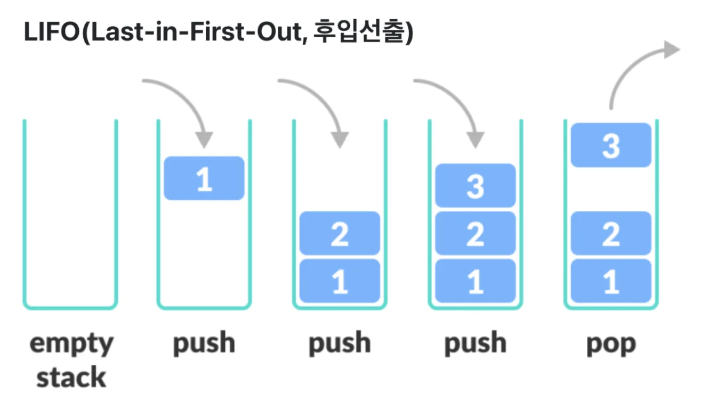

<a id="1c3eda9b0fe18160bbd0d889e08fb3d7"></a>

```java
Stack<타입> 변수명 = new Stack<>();
```

<details>
<summary>메서드</summary>

<details>
<summary>저장</summary>

- <code>&#46;push(값)</code>

</details>

<details>
<summary>조회</summary>

- <code>&#46;peek()</code>&#58; 맨 위의 요소 (가장 마지막 저장)조회

</details>

<details>
<summary>수정</summary>

- 

</details>

<details>
<summary>삭제</summary>

- <code>&#46;pop()</code>&#58; 맨 위의 요소 꺼냄 ( Stack 에서 삭제)

</details>

</details>

<details>
<summary>ex)</summary>

<a id="1c3eda9b0fe1818a819bc3a25f7090ee"></a>

```java
import java.util.Stack;

public class Main {

	public static void main(String[] args) {
		Stack<Integer> intStack = new Stack<Integer>();
		
		// 저장
		intStack.push(1);
		intStack.push(2);
		intStack.push(3);
		
		// Stack 요소 모두 출력
		while (!intStack.isEmpty()) {
		    System.out.println(intStack.pop()); // 3,2,1 
		}

		// 저장 2
		intStack.push(1);
		intStack.push(2);
		intStack.push(3);
		
		// 조회
		System.out.println(intStack.peek()); // 3, 맨 위 요소 조회
		System.out.println(intStack.size()); // 3, 사이즈 조회
		
		// 꺼내기 ( 삭제 )
		System.out.println(intStack.pop()); // 3, 꺼내고 삭제됨
		System.out.println(intStack.size()); // 2 
		
		System.out.println(intStack.pop()); // 2,  ''
		System.out.println(intStack.size()); // 1 

		while (!intStack.isEmpty()) { 
		    System.out.println(intStack.pop()); // 1 
	}
}
```

</details>

</details>

<details>
<summary>Queue ( 연결리스트 )</summary>

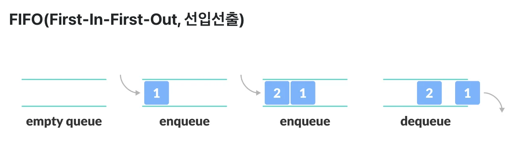

<a id="1c3eda9b0fe1811386cdf58b0bc5e898"></a>

```java
Queue<타입> 변수명 = new LinkedList<>();  
```

<details>
<summary>메서드  </summary>

> N/A&#58; Not Applicable, 해당 사항 없음

|  |  |  |  |  |  |  |
| --- | --- | --- | --- | --- | --- | --- |
| 메서드 | 요소 추가 | 실패 시 반환/예외 | 요소 제거 | 큐가 비어있을 때 반환/예외 | 요소 확인 | 큐가 비어있을 때 반환/예외 |
| <code>add()</code> | 큐 끝에 추가 | 예외 발생 | N/A | N/A | N/A | N/A |
| <code>offer()</code> | 큐 끝에 추가 | <code>false</code> 반환 | N/A | N/A | N/A | N/A |
| <code>remove()</code> | N/A | N/A | 맨 앞 요소 제거 | 예외 발생 | N/A | N/A |
| <code>poll()</code> | N/A | N/A | 맨 앞 요소 제거 | <code>null</code> 반환 | N/A | N/A |
| <code>element()</code> | N/A | N/A | N/A | N/A | 맨 앞 요소 반환 | 예외 발생 |
| <code>peek()</code> | N/A | N/A | N/A | N/A | 맨 앞 요소 반환 | <code>null</code> 반환 |

- 저장
    <details>
    <summary><code>add(값)</code></summary>

    - 끝에 요소 추가

    - 공간 X → <strong>예외 </strong>(<strong> </strong><strong>IllegalStateException </strong>)

    </details>

    <details>
    <summary><code>offer(값)</code></summary>

    - 끝 요소  추가

    - 공간 X → 저장 실패, <code>return false</code>;

    - 공간 O → 저장, <code>return true</code>;

    </details>

- 제거, 값 반환
    <details>
    <summary><code>remove()</code></summary>

    - 맨 앞 요소 제거 및 반환

    - 요소 X → <strong>예외</strong> ( <strong>NoSuchElementException</strong> )

    </details>

    <details>
    <summary><code>poll()</code></summary>

    - 맨 앞 요소 제거 및 반환

    - 요소 X → <code>return null;</code>

    </details>

- 조회
    <details>
    <summary><code>element()</code></summary>

    - 맨 앞 요소 확인

    - 요소 X → <strong>예외</strong> ( <strong>NoSuchElementException</strong> )

    </details>

    <details>
    <summary><code>peek()</code></summary>

    - 맨 앞 요소 확인

    - 요소 X → <code>return null;</code>

    </details>

</details>

</details>

<details>
<summary>Set</summary>

- 순서, 중복 X  &#45; 배열

- <code>Set</code>&#58;  Interface

<details>
<summary><code>HashSet</code>, <code>TreeSet</code>, <code>LinkedHashSet</code>&#58;  구현체</summary>

- <code>HashSet</code> &#58; 가장 빠르며 순서를 전혀 예측할 수 없음

- <code>TreeSet</code> &#58; 정렬된 순서대로 보관하며 정렬 방법을 지정할 수 있음

- <code>LinkedHashSet</code> &#58; 추가된 순서, 또는 가장 최근에 접근한 순서대로 접근 가능

<a id="1c3eda9b0fe1819aa537dd259892adf9"></a>

 보통 <code>HashSet</code> 사용, 순서 보장 필요 시 <code>LinkedHashSet</code>

</details>

<a id="1c3eda9b0fe181ea84d3cf7baa4a3c61"></a>

```java
Set<타입> 변수명 = new HashSet<>();
```

<details>
<summary>메서드</summary>

- 저장&#58; <code>&#46;add(값)</code>

- 삭제&#91;&#58; <code>&#46;remove(값)</code>

- 조회(포함 확인)&#58; <code>&#46;contains(값)</code> 

</details>

<details>
<summary>ex)</summary>

<a id="1c3eda9b0fe181cb9b62d751d3274d60"></a>

```java
import java.util.HashSet;
import java.util.Set;

public class Main {

	public static void main(String[] args) {
		Set<Integer> intSet = new HashSet<Integer>(); 

		// 저장
		intSet.add(1);
		intSet.add(2);
		intSet.add(3);
		intSet.add(3); // 중복된 값은 덮어씀
		intSet.add(3); // 중복된 값은 덮어씀

		for (Integer value : intSet) {
			System.out.println(value); // 1,2,3
		}

		// 조회 -> return boolean
		System.out.println(intSet.contains(2)); // true
		System.out.println(intSet.contains(4)); // false

		// 삭제
		intSet.remove(3); // 3 삭제

		for (Integer value : intSet) {
			System.out.println(value); // 1,2 
		}
	}
}
```

</details>

</details>

<details>
<summary>Map</summary>

- dictionary&#58; <code>key &#58; value</code>

- <code>Map</code>&#58; Interface

<details>
<summary><code>Map</code>, <code>HashMap</code>, <code>TreeMap</code>&#58;  구현체</summary>

- HashMap&#58; 중복 허용하지 않고 순서를 보장하지 않은, null  허용

- TreeMap&#58; key 값 기준으로 정렬 가능, 저장 시 정렬(오름차순)&#58; o(n) 연산

</details>

<a id="1c3eda9b0fe181c7946adb7a19dfa0ba"></a>

```java
Map<key_타입, value_타입> 변수명 = new HashMap<>();
```

<details>
<summary>메서드</summary>

- 저장&#58; <code>&#46;put(key, value)</code>

<details>
<summary>조회</summary>

- value 조회&#58; <code>&#46;get(key)</code>

<details>
<summary>전체 조회</summary>

- <code>&#46;ketSet()</code>&#58;  전체 key 값들 조회

- <code>&#46;values()</code>&#58; 전체 value 값들 조회

</details>

</details>

- 삭제&#58; <code>&#46;remove(key)</code>

</details>

<details>
<summary>ex)</summary>

<a id="1c3eda9b0fe181939713f7295e4fb5fa"></a>

```java
import java.util.Map;

public class Main {

	public static void main(String[] args) {
		Map<String, Integer> intMap = new HashMap<>();

		// 저장 (key, value)
		intMap.put("일", 11);
		intMap.put("이", 12);
		intMap.put("삼", 13);
		intMap.put("삼", 14); // 중복 Key값은 덮어씀
		intMap.put("삼", 15); // 중복 Key값은 덮어씁

		// key 값 전체 출력
		for (String key : intMap.keySet()) {
			System.out.println(key); // 일,이,삼
		}

		// value 값 전체 출력
		for (Integer key : intMap.values()) {
			System.out.println(key); // 11,12,15
		}

		// get()
		System.out.println(intMap.get("삼")); // 15
	}
}
```

</details>

</details>

<details>
<summary>연습) 자료구조 요리 레시피</summary>

<a id="1c3eda9b0fe1816792dbdeb8e1d412c1"></a>

```java
import java.util.ArrayList;
import java.util.List;
import java.util.Scanner;

public class Main {


    public List<String> getStringList(int num, Scanner sc) {
        List<String> stringList = new ArrayList<>();

        for (int i = 0; i < num; i++) {
            stringList.add(sc.nextLine());
        }
        return stringList;
    }

    public int calculatePercent(float rate) {
        return (int)(rate * 20);
    }

    public static void main(String[] args) {
        Main main = new Main();
        Scanner sc = new Scanner(System.in);
				
				String type = sc.nextLine();
        String title = sc.nextLine();
        float rate = sc.nextFloat();
        int num = sc.nextInt();  // 전체 문장 개수 임의로 지정함
        sc.nextLine();  // nextInt() 사용 시 다음 줄로 건너 뛰어 지지 않아 공백을 받아옴
        List<String> stringList = main.getStringList(num, sc);

        int percent = main.calculatePercent(rate);


        System.out.println("[ " + type + " " + title + " ]");
        System.out.println("별점: " + rate +" (" + percent + "%)");

        for (int i = 0; i < num; i++) System.out.println((i + 1) + ". " + stringList.get(i));;

    }
}
```

</details>

[제목 없음](#/post/1ceeda9b-0fe1-8154-8d5d-efc66765d579)

<a id="1c3eda9b0fe181a38b22fe03c34398c8"></a>

## Chapter 3 &#45; 클래스, 상속, 인터페이스

<a id="1c3eda9b0fe1813b9f2ec73a6e777c0e"></a>

### 3&#46;1 &#45; 클래스

> <a href="https://beautiful-college-c84.notion.site/11beda9b0fe180d19947c51365c8c1a9">페이지</a> 
> 
> <details>
> <summary>객체들의 공통된 속성들을 <strong><u>인터페이스로 만들고 상속</u></strong> 처리</summary>
> 
> <details>
> <summary><code>OCP</code>, <code>LSP</code>, <code>DIP</code> </summary>
> 
> - OCP&#58; 변경에는 닫혀있고, 확장에는 열려있다&#46; 
> 
> - LSP&#58; 자식은 부모를 대체할 수 있다&#46;
> 
> - DIP&#58; 의존성 역전, 인터페이스(형식)에 의존해야 한다&#46;
> 
> </details>
> 
> <details>
> <summary>인터페이스를 잘 설계 →  <code>SRP</code>, <code>ISP</code> </summary>
> 
> - SRP&#58; 하나의 객체는 하나의 책임만을 가져야 한다&#46;
> 
> - ISP&#58; 인터페이스 분리, 객체는 필요없는 메서드의 구현을 강요 받으면 안된다&#46; 
> 
> </details>
> 
> </details>

<details>
<summary>‘객체’ 란?</summary>

> 세상에 존재하는 식별 가능한 <strong><u>물체</u></strong>를 뜻 한다&#46;

- 물리적
    - ex) 자동차, 도서관, 계산기…

- 개념적
    - ex) 강의, 배달 주문, 운동…

> 객체는 <strong><u>속성</u></strong>과 <strong><u>행위</u></strong>로 구성되어 있다&#46; 

- 구성&#58; <code>속성</code>, <code>행위</code>
    <details>
    <summary>ex) 자동차 </summary>

    - 속성&#58; 회사, 모델, 색상, 가격, 속도 …

    - 행위&#58;  가속, 브레이크, 기어 변속, 조명, 경적 …

    > 이러한 <strong><u>속성</u></strong>과 <strong><u>행위</u></strong>를 아래와 같이 <code>필드</code>와 <code>메서드</code>로 구현
    > 
    > <a id="1c3eda9b0fe1810cb0cfcaba1fb17568"></a>
    > 
    >    ⇒ <strong><u>객체 모델링</u></strong>
    > 
    > -  현실 세계 객체 →<strong><u> ‘소프트웨어 객체’</u></strong>로 설계 
    > 
    > 

    </details>

</details>

<details>
<summary>객체 간의 협력</summary>

> 🧐 현실 세계에서 객체들 간의 협력을 어떻게 <strong><u>객체 모델링(소프트웨어)하는가?</u></strong>

<details>
<summary>ex) 사람  &#45; 자동차</summary>

<details>
<summary>현실 세계</summary>

- 1) 사람 → 자동차의 가속 페달을 밟음, 자동차 → 가속, 앞으로 이동

- 2) 사람 →  자동차 브레이크 페달을 밞음 자동차 → 감속, 정지

</details>

<details>
<summary>소프트웨어 (자바)</summary>

<details>
<summary>사람</summary>

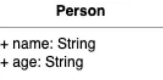

</details>

<details>
<summary>자동차 </summary>

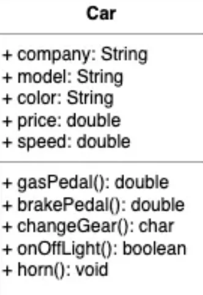

</details>

- 1) 사람이 자동차의 가속 페달을 밟으면 차가 앞으로 간다&#46; 
    - Car 클래스 &#45;  가속 행위(메서드) 정의, <code>gasPedal()</code>

    - Person(사람) 객체 → Car 인스턴스 생성 → Car&#46;<code>gasPedal()</code> 호출

- 2) 사람이 브레이크 페달을 밟으면 차가 감속되며 멈춘다&#46;
    - Car 클래스 &#45;  감속(브레이크) 행위(메서드) 정의, <code>brakePedal()</code>

    -  Person(사람) 객체 → Car 인스턴스 생성 → Car&#46;<code>brakePedal()</code> 호출

</details>

</details>

</details>

<details>
<summary>객체 간의 관계</summary>

- 현실 세계에서의 객체는 수 많은 관계를 맺고 있다&#46;
    - <code>사용 관계</code>,  <code>포함 관계</code>, <code>상속 관계</code>

- 소프트웨어 ( 자바 )
    <details>
    <summary>사용 관계</summary>

    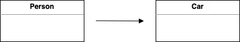

    </details>

    <details>
    <summary>포함 관계</summary>

    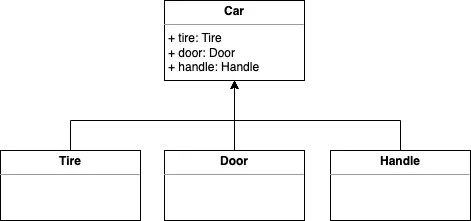

    </details>

    <details>
    <summary>상속 관계 </summary>

    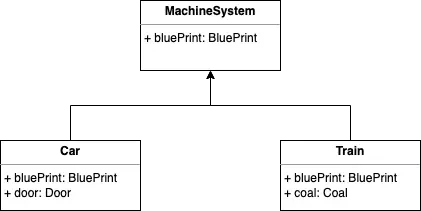

    </details>

</details>

---

<details>
<summary>객체지향 프로그래밍의 특징</summary>

<details>
<summary>🧐 <code>캡슐화</code>, <code>메서드화</code></summary>

> <code>캡슐화</code>에 대한 개념을 잘못 이해하고 있었음

<details>
<summary>캡슐화 </summary>

- 객체의 상태 데이터(필드) <code>private</code> 선언

- 해당 필드를 <code>getter</code>, <code>setter</code>를 통해 외부에서 접근 및 수정

- 이를 통해 외부에서 데이터를 직접 접근하고 못하게 숨기고 , <br>대신 메서드를 통해서만 접근(getter) 및 수정(setter) 가능하게 제한하여

- <strong>코드의 </strong><strong><u>무결성을</u></strong><strong> 유지</strong>하고, <strong>변경에 대해 </strong><strong><u>안전</u></strong><strong>한 구조를 만</strong>든다&#46;

<details>
<summary>ex) </summary>

<a id="1c3eda9b0fe18101a850eb0941024a35"></a>

```java
public class Person {
    private String name;  // private 선언

		// getter
    public String getName() {  // 메서드를 통해서만 접근 가능
        return name;
    }

		// setter
    public void setName(String name) {
        this.name = name;
    }
}
```

</details>

</details>

<details>
<summary>메서드화</summary>

- 단순히 어떤 로직이나 코드를 <strong>하나의 메서드로 분리</strong>하는 것

- 코드의 <strong>재사용성, 가독성 ↑</strong>

<details>
<summary>ex)</summary>

<a id="1c3eda9b0fe181eabda7cfedd086fbe7"></a>

```java
public class Calculator {

		// 메서드화
    public int add(int a, int b) {
        return a + b;
    }
}
```

</details>

</details>

</details>

<details>
<summary><strong>캡슐화(은닉)</strong></summary>

<a id="1c3eda9b0fe181709987e00461c28cec"></a>

속성(필드)와 행위(메서드) 하나로 묶어 객체로 만들어, 외부에서 내부 구현을 알 수 없게 감추는 것을 의미한다&#46; 

- <u>데이터(필드) </u><u><code>private</code></u><u> 선언</u> → <strong>외부 접근 제한</strong>

- 해당 필드를 <u><code>getter</code></u>, <u><code>setter</code></u>를 통해 <u>외부에서 접근 및 수정</u>
    <a id="1c3eda9b0fe181e4b87ae63fa3fa31ef"></a>

    <strong>⇒</strong><strong> 코드의 </strong><strong><u>무결성</u></strong><strong><u>을</u></strong><strong> 유지</strong>, <strong>변경</strong><strong>에 대해 </strong><strong><u>안전</u></strong><strong>한 구조를 형성</strong>

<details>
<summary>ex) </summary>

<a id="1c3eda9b0fe18124aaead084ca05d017"></a>

```java
public class Person {
    private String name;  // private 선언

		// getter
    public String getName() {  // 메서드를 통해서만 접근 가능
        return name;
    }

		// setter
    public void setName(String name) {
        this.name = name;
    }
}
```

</details>

</details>

<details>
<summary>상<strong>속</strong></summary>

> 자세한 내용은 아래의 ‘상속’ 챕터 확인

- <strong><u>부모 클래스의  필드와 메서드</u></strong>를 <u>자식</u> 클래스에서 구체화할 필요없이 <u>참조해서 사용</u> 가능
    <a id="1c3eda9b0fe1816d92a3f4f580c2cb32"></a>

       ⇒ 코드의 재사용성, 유지보수성 ↑

<details>
<summary>ex)  Animal &#45; Dog</summary>

<a id="1c3eda9b0fe181ef96f0feee0beb3b78"></a>

```java
class Animal {
    void eat() {
        System.out.println("동물이 먹고 있습니다.");
    }
}

class Dog extends Animal {
    void bark() {
        System.out.println("강아지가 짖습니다.");
    }
}
```

<a id="1c3eda9b0fe1811f88b3c3d472c783e4"></a>

```java
Dog dog = new Dog();
dog.eat();  // 부모 클래스로부터 상속받은 메서드
dog.bark(); // 자식 클래스에서 새롭게 정의한 메서드
```

</details>

</details>

<details>
<summary>다형성</summary>

- 공통되는 행위를 형식(인터페이스)으로 만들어 상속 처리하여 확장한다&#46;
    - OCP, DIP 준수 

</details>

<details>
<summary>추상화</summary>

- 공통적이고 중요한 것들을 모아 객체를 모델링
    <details>
    <summary>ex) 가속, 브레이크, 속도, 자동차 문, 핸들 … → 자동차 </summary>

    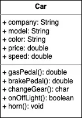

    </details>

</details>

</details>

<details>
<summary>클래스(설계도), 인스턴스(구현체)</summary>


- 붕어빵 틀&#58; 클래스

- 만들어진 붕어빵&#58; 인스턴스 

---

- 클래스 정의&#58; <code>class 클래스명 { … }</code>

- 인스턴스 생성&#58; <code>new 클래스명()</code>

</details>

<details>
<summary>클래스 설계</summary>

<details>
<summary>필드</summary>

<details>
<summary>필드 선언</summary>

- 필드 분류&#58; 고유데이터, 상태 데이터, 객체 데이터

<a id="1c3eda9b0fe1812c82c2e14af1930434"></a>

```java
접근_제어자 타입 필드명 (= 값);
```

<details>
<summary>ex)</summary>

<a id="1c3eda9b0fe18103ba58f8d60be64bca"></a>

```java
private String name;
```

</details>

</details>

<details>
<summary>필드 선언 시, 타입별 기본값</summary>

- 값을 할당(초기화)하지 않은 경우, 타입별 설정된 기본값
    | <strong>데이터 타입</strong> | <strong>기본값</strong> |
    | --- | --- |
    | byte | 0 |
    | char | &#92;u0000 (공백) |
    | short | 0 |
    | int | 0 |
    | long | 0L |
    | float | 0&#46;0F |
    | double | 0&#46;0 |
    | boolean | false |
    | 배열 | null |
    | 클래스 | null |
    | 인터페이스 | null |

</details>

</details>

<details>
<summary>메서드 </summary>

<details>
<summary>메서드 선언</summary>

<a id="1c3eda9b0fe1811ea1c6e93361b8bf28"></a>

```java
접근_제어자 반환_타입 메서드명(매개변수1, ...) {

		.  .  .
		
		return 반환_값;
}
```

</details>

<details>
<summary>외부 접근</summary>

- 1&#46; 인스턴스 생성
    <a id="1c3eda9b0fe181e99b40d6c255c1a067"></a>

    ```java
    Car car = new Car(); 
    ```

- 2&#46; 인스턴스&#95;참조&#95;변수명<code>&#46;메서드명()</code>
    <a id="1c3eda9b0fe1811aae5fda4373d5457b"></a>

    ```java
    car.brakePedal();
    ```

</details>

</details>

<a id="1c3eda9b0fe181e69ccac67abdf40139"></a>

```java
class example {    // 클래스 선언

		// 필드 
		private Stirng 필드1;
		private Stirng 필드2;
				. . .
				
		// 메서드
		public 반환_타입 메서드1(파라미터1, 파라미터2 ...){
		
		}
				.  . .
		
		// 생성자: 클래스 생성(인스턴스) 시, 필드의 값 할당 설정
		// 설정 후, 인스턴스 생성(new) 시 생략된 경우 컴파일 오류 발생 
		public Car(타입 값1, 타입 값2 ...) { 
				this.필드1 = 값1;
				this.필드2 = 값2;		
		}   
}
```

<details>
<summary>ex) 자동차  </summary>

<a id="1c3eda9b0fe18106b6c0d337fd816ab3"></a>

```java
public class Car {    // 클래스 선언

		// 필드 정의
		String company; 
    String model;
    String color; 
    double price; 
    double speed;  
    char gear;
    boolean lights; 

		public Car() {} // 기본 생성자
		

		// 메서드 정의 
		double gasPedal(double kmh) {
        speed = kmh;
        return speed;
    }

    double brakePedal() {
        speed = 0;
        return speed;
    }

		char changeGear(char type) {
        gear = type;
        return gear;
    }

    boolean onOffLights() {
        lights = !lights;
        return lights;
    }

		void horn() {
        System.out.println("빵빵");
    }
}
```

</details>

</details>

<details>
<summary>인스턴스 생성</summary>

<details>
<summary>🧐 메모리 &#45; <code>스택 영역</code>, <code>힙 영역</code></summary>

<details>
<summary>스택(Stack) 영역</summary>

- 메서드 호출 시, 사용되는 <strong><u>지역 변수</u></strong>나 <strong><u>메서드의 실행 정보</u></strong>가 저장되는 영역

- 기본 자료형(int, char …), 참조 변수(객체의 메모리 주소)가 주로 저장됨

</details>

<details>
<summary>힙(Heap) 영역</summary>

- new 키워드로 생성된 객체와 배열이 저장되는 영역

- new 키워드 인스턴스 생성
    - 힙 영역  메모리 할당 즉, 인스턴스의 데이터가 힙 영역에 저장

    - 스택 영역 → 해당 인스턴스의 참조 주소 저장

</details>

</details>

<a id="1c3eda9b0fe18149a5a9c46c7112090e"></a>

```java
타입 변수명 = new 클래스명();   // 인스턴스 생성 후 참조값 변수에 저장
```

- <code>new</code> 키워드를 통해 인스턴스를 생성 후 참조 주소 반환함
    - 힙(Heap) 영역에 메모리가 할당

    -  참조 주소 값, 스택(Stack) 영역에 저장

</details>

<details>
<summary>🧐 <code>오버로딩(Overloading)</code> vs <code>오버라이딩(Overriding)</code> </summary>

<details>
<summary>오버로딩(Overloading)</summary>

-  <strong>같은 이름의 메서드를 여러 개 정의</strong>

- <strong>즉, </strong><strong><u>한 클래스 안</u></strong><strong>에서 </strong><strong><u>같은 이름의 메서드</u></strong><strong>가 </strong><strong><u>서로 다른 방식</u></strong><strong>으로 동작</strong>
    - 매개변수, 타입<em><strong> </strong></em>

<details>
<summary>ex) </summary>

<a id="1c3eda9b0fe181899fcfd7d35c168001"></a>

```java
public class Calculator {
    // 정수를 더하는 메서드
    public int add(int a, int b) {
        return a + b;
    }

    // 실수를 더하는 메서드 (매개변수 타입이 다름)
    public double add(double a, double b) {
        return a + b;
    }

    // 세 개의 정수를 더하는 메서드 (매개변수 개수가 다름)
    public int add(int a, int b, int c) {
        return a + b + c;
    }
}
```

</details>

</details>

<details>
<summary><strong>오버라이딩 (Method Overriding)</strong></summary>

- <strong>자식 클래스에서 </strong><strong><u>상속</u></strong><strong>된 </strong><strong><u>부모 클래스 &#45; 메서드 재정의</u></strong>

<details>
<summary>ex) </summary>

<a id="1c3eda9b0fe1819fbf53f9ebff63f545"></a>

```java
class Animal {
    // 부모 클래스의 메서드
    public void sound() {
        System.out.println("동물이 소리를 냅니다.");
    }
}

class Dog extends Animal {

    // 오버라이딩: 자식 클래스에서 부모 클래스의 메서드를 재정의
    @Override
    public void sound() {
        System.out.println("개가 멍멍 짖습니다.");
    }
}

public class Main {
    public static void main(String[] args) {
        Animal myDog = new Dog();
        myDog.sound(); // "개가 멍멍 짖습니다." 출력
    }
}
```

</details>

</details>

</details>

<details>
<summary>오버로딩</summary>

> 🗣 
> 
> <a id="1c3eda9b0fe181798047f7b5120969ae"></a>
> 
> <strong><u>하나</u></strong>의 <strong><u>메서드 이름</u></strong>으로 <strong><u>여러 기능</u></strong><strong><u> 구현</u></strong> 

- 조건
    - 메서드 이름 동일

    - 매개변수의 개수, 타입, 순서가 달라야함

    <details>
    <summary>접근제어자 차이 → 불가</summary>

    <details>
    <summary>ex)</summary>

    - 동일한 메서드명, 매개변수

    - public → private  (  접근 제어자만 변경됨)<br>⇒ 오버라이드 불가

    </details>

    </details>

<details>
<summary>장점</summary>

<details>
<summary>&#39;하나의 메서드 명’ 으로 상황에 따른 동작을 개별로 정의 할 수 있다&#46;</summary>

<details>
<summary>ex) <code>println()</code></summary>

- 매개변수로 int, String, boolean 등 다양한 타입이 가능하다&#46; 
    <details>
    <summary><strong> &#91; 코드 &#93; println() </strong></summary>

    <a id="1c3eda9b0fe181539b12ed11e3879a5e"></a>

    ```java
    public class PrintStream extends FilterOutputStream
        implements Appendable, Closeable
    {
    			...
    			
    		public void println() {
            newLine();
        }

        public void println(boolean x) {
            if (getClass() == PrintStream.class) {
                writeln(String.valueOf(x));
            } else {
                synchronized (this) {
                    print(x);
                    newLine();
                }
            }
        }

        public void println(char x) {
            if (getClass() == PrintStream.class) {
                writeln(String.valueOf(x));
            } else {
                synchronized (this) {
                    print(x);
                    newLine();
                }
            }
        }

        public void println(int x) {
            if (getClass() == PrintStream.class) {
                writeln(String.valueOf(x));
            } else {
                synchronized (this) {
                    print(x);
                    newLine();
                }
            }
        }

        public void println(long x) {
            if (getClass() == PrintStream.class) {
                writeln(String.valueOf(x));
            } else {
                synchronized (this) {
                    print(x);
                    newLine();
                }
            }
        }

        public void println(float x) {
            if (getClass() == PrintStream.class) {
                writeln(String.valueOf(x));
            } else {
                synchronized (this) {
                    print(x);
                    newLine();
                }
            }
        }

        public void println(double x) {
            if (getClass() == PrintStream.class) {
                writeln(String.valueOf(x));
            } else {
                synchronized (this) {
                    print(x);
                    newLine();
                }
            }
        }

        public void println(char[] x) {
            if (getClass() == PrintStream.class) {
                writeln(x);
            } else {
                synchronized (this) {
                    print(x);
                    newLine();
                }
            }
        }

        public void println(String x) {
            if (getClass() == PrintStream.class) {
                writeln(String.valueOf(x));
            } else {
                synchronized (this) {
                    print(x);
                    newLine();
                }
            }
        }

        public void println(Object x) {
            String s = String.valueOf(x);
            if (getClass() == PrintStream.class) {
                // need to apply String.valueOf again since first invocation
                // might return null
                writeln(String.valueOf(s));
            } else {
                synchronized (this) {
                    print(s);
                    newLine();
                }
            }
        }


    		  ...
    }
    ```

    </details>

</details>

</details>

<details>
<summary>메서드의 이름 절약 가능</summary>

- 오버라이드 불가 시, <code>println()</code>은 아래와 같이 표현해야 했을 것 이다&#46; 
    - <code>printlnInt()</code>, <code>printlnDouble()</code>&#46;&#46;&#46;

</details>

</details>

</details>

<details>
<summary>생성자</summary>

<details>
<summary>☝🏻  JPA( Entity를 사용한 영속성 컨텍스트 )에서는 <strong><u>기본 생성자</u></strong>가 반드시 필요하다</summary>

<a id="1c3eda9b0fe1818cb1d9ef5d8c35321c"></a>

JPA가 내부적으로 리플렉션(Reflection)을 사용하여 엔티티 객체를 생성하기 떄문이다&#46; <br>

</details>

<details>
<summary>🧐 리플렉션 ( Reflection )</summary>

<a id="1c3eda9b0fe1813ab72dd63302155f35"></a>

<strong><u>런타임(프로그램 실행 중)</u></strong>에 클래스나 <strong><u>객체의 메타데이터(속성, 메서드 등)</u></strong>에 <strong><u>접근</u></strong>하고<strong><u> 조작</u></strong>할 수 있는 자바의 기능이다&#46;

<a id="1c3eda9b0fe181dfad0fe57fe87fd643"></a>

쉽게 말해, <strong><u>프로그램이 실행 중</u></strong>일 때, 어떤 객체가 <strong><u>어떤 클래스의 인스턴스</u></strong>인지, <strong><u>해당 클래스</u></strong><strong><u>에는 어떤 </u></strong><strong><u>필드</u></strong><strong><u>와 </u></strong><strong><u>메서드</u></strong><strong><u>가 있</u></strong>는지 <strong><u>확인</u></strong>하고 <strong><u>수정</u></strong>할 수 있는 기능이다&#46; 

</details>

<details>
<summary>생성자 선언 및 호출</summary>

<a id="1c3eda9b0fe181018d04d42a5143ed18"></a>

```java
public Car() {} // 선언

...

Car car = new Car(); // 호출
```

</details>

<details>
<summary>기본 생성자 </summary>

<a id="1c3eda9b0fe181109a86e14d9f0822ea"></a>

```java
class 클래스_이름 {
		
		// 기본 생성자
		public 클래스_이름() {}

}
```

- 클래스명과 동일한 이름을 메서드 명으로 사용

- 반환타입 없음

- 생성메서드 사용 시, 접근 제어자(<code>protected</code>, <code>private</code>)를 통해 컴파일 단계에서 제어 가능

</details>

<details>
<summary>필드 초기화</summary>

- 객체의 필드 초기화(값 할당), Setter가 아닌 생성자를 통해 초기화한다&#46;

<details>
<summary>생성자를 통한 필드 초기화 시, <strong><u>인스턴스 생성 단계</u></strong>에서 <strong><u>필드 초기화</u></strong>를 <strong><u>강제</u></strong>할 수 있다&#46; </summary>

<a id="1c3eda9b0fe181758d4af865bae4e54b"></a>

```java
class Car {
	. . .

 	public Car(String modelName, String colorName, double priceValue) {
	    model = modelName;
	    color = colorName;
	    price = priceValue;
	}
	
	. . .
	

// 생성자를 통해 정의한 필드들의 값이 인자로 입력되지 않는 경우 오류가 발생됨	
Car car = new Car(); // Error

Car car = new Car("model", "color", 80.15);  // 인스턴스 생성

```

</details>

- 실무에서는 가급적 필드를 Setter가 아닌 <strong><u>생성자를 통해 초기화</u></strong>해야하는데, <br>생성자는 <strong><u>인스턴스 생성 시 한번만 필드 초기화(값 할당)</u></strong>를 하기 때문이다&#46;<br>Setter를 사용 시, 앱 동작 중간에 값이 변경될 수 있고, 이는 추적 불가능한 오류를 만든다&#46; 

- 따라서 <strong><u>생성자를 통해 필드를 초기화</u></strong>하여 <strong><u>데이터의 불변성</u></strong>을 지키며 개발해야 한다&#46; 
    - <code>private Setter</code>

<details>
<summary>ex)</summary>

<a id="1c3eda9b0fe1819fae76f2e47bea97ab"></a>

```java
 . . . 

	public Car(String modelName, String colorName, double priceValue) {
	    model = modelName;
	    color = colorName;
	    price = priceValue;
	}


 . . .	
 
 Car car = new Car();  // Error
 
 Car car = new Car("model", "color", 80.15); // 정상 동작
 
```

</details>

</details>

<details>
<summary>생성자 오버로딩</summary>

- 생성자 이름 동일

- 매개변수만 변경하여 정의

- 인스턴스 생성 시, 기능에 따라 부분적으로 필드 초기화 가능

<a id="1c3eda9b0fe181e4a915d6d34e9e3b36"></a>

```java
class 클래스명 {

		private 타입1 필드1;
		private 타입2 필드2;
		 
		 . . .
		 
	
		// 기본 생성자
		public 클래스명() {}
		
		// 생성자1 (오버로딩)
		public 클래스명(타입1 값1 {
				this.필드1 = 값1;
		}
		
		// 생성자2 (오버로딩)
		public 클래스명(타입1 값1, 타입2 값2, ... ) {
				this.필드1 = 값1;
				this.필드2 = 값2;
				  . . .
		}
}
```

</details>

<details>
<summary>lombok</summary>

<a id="1c3eda9b0fe181529db5d4a7c873db2f"></a>

```java
@NoArgsConstructor        // 기본 생성자
@AllArgsConstructor       // 모든 필드 초기화 생성자
@RequiredArgsContructor   // 상수(final) 필드 생성자
```

</details>

</details>

<details>
<summary>클래스 멤버, 인스턴스 멤버</summary>

> <a href="#/post/123eda9b-0fe1-807c-82cc-f5fe9bcc9277">페이지</a> 

<details>
<summary></summary>


</details>

</details>

<details>
<summary>this, this()</summary>

<details>
<summary><code>this</code>&#58; 인스턴스 자신</summary>

- <code>this</code>&#58; 인스턴스(객체) 자신 가르킴

<details>
<summary>객체 내부 멤버에 접근 시, this 키워드가 필수는 아니지만 상황에 따라 필수가 될 수 있다&#46;</summary>

- 아래와 같이, this 키워드 없이 동일한 이름으로 처리하면<br>클래스의 필드가 아닌<strong><u> 매개변수의 변수에 다시 할당 처리</u></strong>가 된다&#46;

- 따라서 필드에는 초기화(값 할당) 되지 않는다&#46;

<a id="1c3eda9b0fe1818988c2dc6ca0937d32"></a>

```java
public class Car {
    private String model;
    private String color;
    private double price;

    public Car(String model, String color, double price) {
        model = model;  // ?
        color = color;  // ?
        price = price;  // ?
    }
}
```

- 아래와 같이 <code>this</code>  키워드를 사용하여 객체의 필드를 명시하여 초기화한다&#46; 
    <a id="1c3eda9b0fe181f59e5cd00d0f7ccc0a"></a>

    ```java
    public class Car {
        private String model;
        private String color;
        private double price;

        public Car(String model, String color, double price) {
            this.model = model;  // this.model은 필드를 가리키고, model은 매개변수를 가리킵니다.
            this.color = color;
            this.price = price;
        }
    }
    ```

</details>

<details>
<summary><code>return this</code></summary>

- this는 인스턴스 자신을 뜻하기 때문에, 메서드에 정의된 return 타입이 해당 인스턴스의 클래스라면 인스턴스 자신의 참조 주소값을 반환한다&#46;
    <a id="1c3eda9b0fe18117913edfe796fa4ced"></a>

    ```java
    public Car returnInstance() {
    		return this;
    } 
    ```

</details>

</details>

<details>
<summary><code>this()</code>&#58; 인스턴스 자신의 생성자 호출</summary>

<details>
<summary>⚠️  반드시 해당 생성자 <strong><u>첫줄</u></strong>에 작성</summary>

- 아래와 같이 <strong><u>this() 키워드로 다른 생성자 호출 </u></strong><strong><u>이전에 코드가 존재</u></strong>하면 <strong><u>오류</u></strong>가 발생

<a id="1c3eda9b0fe18182879fdca762fba4ab"></a>

```java
public Car(String model) {
    System.out.println("model = " + model);
    this(model, "Blue", 50000000);  // Error
}
```

</details>

<details>
<summary><code>this()</code> 사용 전</summary>

<a id="1c3eda9b0fe181ae9b17df2b82ca358b"></a>

```java
public Car(String model) {
    this.model = model;
    this.color = "Blue";
    this.price = 50000000;
}

public Car(String model, String color) {
    this.model = model;
    this.color = color;
    this.price = 50000000;
}

public Car(String model, String color, double price) {
    this.model = model;
    this.color = color;
    this.price = price;
} 
```

</details>

- <code>this()</code> 키워드를 사용하여 <strong><u>오버로딩</u></strong> 시, <strong><u>중복된 코드 제거</u></strong>

<a id="1c3eda9b0fe181e0bf41f851e66523de"></a>

```java
public Car(String model) {
    this(model, "Blue", 50000000);
}

public Car(String model, String color) {
    this(model, color, 100000000);
}

public Car(String model, String color, double price) {
    this.model = model;
    this.color = color;
    this.price = price;
}
```

</details>

<details>
<summary>ex) 자동차</summary>

<details>
<summary>Car</summary>

<a id="1c3eda9b0fe18148b25ffefbecde3d7b"></a>

```java
public class Car {

    static final String COMPANY = "GENESIS"; // 자동차 회사 : GENESIS
    String model; // 자동차 모델
    String color; // 자동차 색상
    double price; // 자동차 가격

    double speed;  // 자동차 속도 , km/h
    char gear = 'P'; // 기어의 상태, P,R,N,D
    boolean lights; // 자동차 조명의 상태


    public Car(String model) {
        this(model, "Blue", 50000000);
    }

    public Car(String model, String color) {
        this(model, color, 100000000);
    }

    public Car(String model, String color, double price) {
        this.model = model;
        this.color = color;
        this.price = price;
    }

    double gasPedal(double kmh, char type) {
        changeGear(type);
        speed = kmh;
        return speed;
    }

    double brakePedal() {
        speed = 0;
        return speed;
    }

    char changeGear(char type) {
        gear = type;
        return gear;
    }

    boolean onOffLights() {
        lights = !lights;
        return lights;
    }

    void horn() {
        System.out.println("빵빵");
    }

    Car returnInstance() {
        return this;
    }
}
```

</details>

<details>
<summary>Main &#45; 테스트</summary>

<a id="1c3eda9b0fe181c4b429fd7b9920567a"></a>

```java
public class Main {
    public static void main(String[] args) {

        // 생성자 오버로딩을 통해 여러 상황에서 자동차 생산
        // 제네시스 자동차를 생산 : static final String COMPANY = "GENESIS"; 상수 고정
        // 모든 자동차는 생산시 기어의 최초 상태 'P' 로 고정 : char gear = 'P'; 직접 대입하여 초기화

        // 모델을 변경하면서 만들 수 있고 색상 : Blue, 가격 50000000 고정
        Car car1 = new Car("GV60");
        System.out.println("car1.model = " + car1.model);
        System.out.println("car1.color = " + car1.color);
        System.out.println("car1.price = " + car1.price);
        System.out.println("car1.gear = " + car1.gear + "\n");

        // 모델, 색상을 변경하면서 만들 수 있고 가격 100000000 고정
        Car car2 = new Car("GV70", "Red");
        System.out.println("car2.model = " + car2.model);
        System.out.println("car2.color = " + car2.color);
        System.out.println("car2.price = " + car2.price);
        System.out.println("car2.gear = " + car2.gear + "\n");

        // GV80 모델, 색상 Black, 가격 120000000 으로 완전하게 고정된 경우
        Car car3 = new Car("GV80", "Black", 120000000);
        System.out.println("car3.model = " + car3.model);
        System.out.println("car3.color = " + car3.color);
        System.out.println("car3.price = " + car3.price);
        System.out.println("car3.gear = " + car3.gear + "\n");

        // this 키워드를 통해 car3 인스턴스 자신을 반환 : car3.returnInstance() = 인스턴스의 주소
        System.out.println(car3.returnInstance().model); // car3의 model
        System.out.println(car3.returnInstance().color); // car3의 color
        System.out.println(car3.returnInstance().price); // car3의 price

    }
}
```

</details>

</details>

</details>

<details>
<summary>접근 제어자</summary>

<details>
<summary>🧐 추상(<code>abstract</code>) 클래스</summary>

- 공통적으로 사용되는 속성이나 메서드를 정의하여 상속으로 구현

<details>
<summary><strong><u>직접 인스턴스 생성(new)이 불가</u></strong>하고 <strong><u>상속을 통해서만 구현 가능</u></strong>하다</summary>

<a id="1c3eda9b0fe1816d8b92defcd1c4b2fc"></a>

```java
// 추상 클래스: 직접 인스턴스 생성 불가, 상속으로만 구현 가능
abstract class Animal {
    String name;
    
    // 추상 메서드: 자식 클래스에서 반드시 구현(오버라이드)
    abstract void makeSound();
    
    // 일반 메서드: 자식 클래스가 상속받을 수 있음
    void sleep() {
        System.out.println(name + " is sleeping.");
    }
}
```

<a id="1c3eda9b0fe181b383e4d3a618dfc002"></a>

```java
class Dog extends Animal {
		// 추상 메서드의 구체적인 구현
    @Override
    void makeSound() {
        System.out.println("Woof Woof!");
    }
}
```

</details>

<details>
<summary>추상 클래스 &#45; <strong><u>추상 메서드 </u></strong></summary>

- 구현 로직 없이 형식만 정의 ( interface 와 유사 )

- 추상메서드는 상속되는 자식클래스에서 반드시 구현(오버라이드)되어야 한다&#46; 

- ex)
    <details>
    <summary>추상 클래스 &#45; 추상 메서드</summary>

    <a id="1c3eda9b0fe181bcb9a2db7742948409"></a>

    ```java
    abstract class Animal {

        // 추상 메서드: 구체적인 구현이 없음, 자식 클래스에서 반드시 구현해야 함
        abstract void makeSound();

    		 . . .
    }
    ```

    </details>

    <details>
    <summary>추상 메서드 &#45; 오버라이드</summary>

    <a id="1c3eda9b0fe18180900becae591ab6df"></a>

    ```java
    class Dog extends Animal {

        // 추상 메서드의 구체적인 구현
        @Override
        void makeSound() {
            System.out.println("Woof Woof!");
        }
    }
    ```

    <a id="1c3eda9b0fe1819b9bcad22ce12171d4"></a>

    ```java
    class Cat extends Animal {

        // 추상 메서드의 구체적인 구현
        @Override
        void makeSound() {
            System.out.println("Meow!");
        }
    }
    ```

    </details>

</details>

<details>
<summary>ex)</summary>

<details>
<summary>추상 클래스&#58; <code>Animal</code></summary>

<a id="1c3eda9b0fe181ccb32cd7e2d25dfcee"></a>

```java
// 추상 클래스: 직접 인스턴스 생성 불가, 상속으로만 구현 가능
abstract class Animal {
    String name;

    // 추상 메서드: 구체적인 구현이 없음, 자식 클래스에서 반드시 구현해야 함
    abstract void makeSound();

    // 일반 메서드: 자식 클래스가 상속받을 수 있음
    void sleep() {
        System.out.println(name + " is sleeping.");
    }
}
```

</details>

<details>
<summary>추상 클래스를 상속하여 구현된 자식 클래스&#58; <code>Dog</code>, <code>Cat</code></summary>

<a id="1c3eda9b0fe18150bfb8eca462ef6d10"></a>

```java
class Dog extends Animal {
    // 추상 메서드의 구체적인 구현
    @Override
    void makeSound() {
        System.out.println("Woof Woof!");
    }
}
```

<a id="1c3eda9b0fe1812baf1acf002f96e5cf"></a>

```java
class Cat extends Animal {
    // 추상 메서드의 구체적인 구현
    @Override
    void makeSound() {
        System.out.println("Meow!");
    }
}
```

</details>

<details>
<summary>Main &#45; 테스트 </summary>

<a id="1c3eda9b0fe18103bfa3d3890b75f99b"></a>

```java
public class Main {
    public static void main(String[] args) {
        Animal dog = new Dog();
        dog.makeSound(); // "Woof Woof!"

        Animal cat = new Cat();
        cat.makeSound(); // "Meow!"
    }
}
```

</details>

</details>

</details>

<details>
<summary>🧐 추상(<code>abstract</code>) 클래스 vs 인터페이스</summary>


</details>

<details>
<summary>접근 제어자&#58; <code>public</code>, <code>protected</code>, <code>default</code>, <code>private</code></summary>

- <code>public</code>&#58; 제한 X, <strong><u>어디서든</u></strong> 접근 가능

- <code>protected</code>&#58; <strong><u>같은 패키지 내 </u></strong>&#43; <strong><u>자손 클래스</u></strong> &#45; 접근 가능

- <code>private</code>(default)&#58;  <strong><u>같은 패키지 내</u></strong>에서만 접근 가능

</details>

<details>
<summary>그 외 제어자&#58; <code>static</code>, <code>final</code>, <code>abstract</code></summary>

- <code>static</code>&#58; 전역 변수

- <code>final</code>&#58; 상수, 재할당 불가

- <code>abstract</code>&#58; 추상 클래스 or 메서드

</details>

<details>
<summary>캡슐화(은닉성)</summary>

- 접근 제어자는 클래스 내부에 선언된 데이터를 보호하기 위해 사용한다&#46;
    - 유효한 값을 유지하고, 함부로 변경하지 못하도록 접근을 제한함

    <a id="1c3eda9b0fe181339867c2ecaa49ca73"></a>

    ⇒ <code>protected</code>, <code>private</code>, <code>default</code>

</details>

<details>
<summary>사용 가능한 제어자</summary>

- 클래스 &#58; <code>public</code>, <code>default</code>, <code>final</code>, <code>abstract</code>

- 메서드 &#58; <code>public</code>, <code>protected</code>, <code>default</code>, <code>private</code>, <code>final</code>, <code>abstract</code>, <code>static</code>

- 멤버 변수 &#58; <code>public</code>, <code>protected</code>, <code>default</code>, <code>private</code>, <code>final</code>, <code>static</code>

- 지역변수 &#58; <code>final</code>

> ⚠️ 
> 
> <a id="1c3eda9b0fe181eda816d6ae494db559"></a>
> 
> <strong>제어자 사용 시 주의 사항</strong>
> 
> - 메서드에 <code>static</code>과 <code>abstract</code>를 함께 사용할 수 없다&#46;
> 
> - 클래스에 <code>abstract</code>와 <code>final</code>을 동시에 사용할 수 없다&#46;
> 
> - <code>abstract</code>메서드의 접근 제어자가 <code>private</code>일 수 없다&#46;
> 
> - 메서드에 <code>private</code>와 <code>final</code>을 같이 사용할 필요는 없다

</details>

<details>
<summary>Getter, Setter</summary>

<details>
<summary>lombok</summary>

<a id="1c3eda9b0fe1810dbedee139eacf7693"></a>

```java
@Getter
@Setter
```

</details>

- Getter&#58; 필드 접근 메서드

- Setter&#58; 필드 값 할당 및 수정 메서드

</details>

</details>

<details>
<summary>package, import</summary>

<details>
<summary>package&#58;  클래스를 식별</summary>

- 도트(<code>&#46;</code>) 로 상위 패키지와 하위 패키지 구분
    - <code>package 상위 패키지&#46;하위 패키지;</code> 

</details>

<details>
<summary>import&#58; 다른 패키지에 있는 클래스 불러옴</summary>

- 동일하게  도트(<code>&#46;</code>) 로 상위 패키지와 하위 패키지 구분
    - <code>import 상위 패키지&#46;하위 패키지;</code> 

</details>

<details>
<summary>ex)</summary>

<details>
<summary>oop&#46;pk1&#46;Car</summary>

<a id="1c3eda9b0fe1817ab23fc205fc5058f8"></a>

```java
package oop.pk1;

public class Car {
    public void horn() {
        System.out.println("pk1 빵빵");
    }
}
```

</details>

<details>
<summary>oop&#46;pk2&#46;Car </summary>

<a id="1c3eda9b0fe1810f8bf9f1f7d7fbd595"></a>

```java
package oop.pk2;

public class Car {
    public void horn() {
        System.out.println("pk2 빵빵");
    }
}
```

</details>

<details>
<summary>Main &#45; 테스트</summary>

<a id="1c3eda9b0fe181f0a3c7f1faa8afbcf5"></a>

```java
package oop.main;

import oop.pk1.Car;

public class Main {
    public static void main(String[] args) {
        Car car = new Car();
        car.horn(); // pk1 빵빵

        oop.pk2.Car car2 = new oop.pk2.Car();
        car2.horn(); // pk2 빵빵
    }
}
```

</details>

</details>

</details>

<a id="1c3eda9b0fe181409b31feca71b9fd89"></a>

### 3&#46;2 &#45; 상속

<details>
<summary>상속 &#45; <code>extends</code></summary>

<a id="1c3eda9b0fe1819e922dc91eed824f7c"></a>

```java
public class 자식클래스 extends 부모클래스 {
		.  . .
}
```

</details>

<details>
<summary>단일 상속, 다중 상속</summary>

<details>
<summary>단일 상속&#58;  클래스</summary>


</details>

<details>
<summary>다중 상속&#58; 인터페이스</summary>


</details>

</details>

<details>
<summary>final &#45; 클래스, 메서드</summary>


</details>

<details>
<summary>Object</summary>


</details>

<details>
<summary>오버라이딩</summary>


</details>

<details>
<summary>다형성</summary>


</details>

<details>
<summary>추상 클래스</summary>


</details>

<a id="1c3eda9b0fe1815787fee5215b070d89"></a>

### 3&#46;3 &#45; 인터페이스

> 📌 
> 
> - 객체지향의 다형성
> 
> - DIP ( Dependency Injaction, 의존성 역전 ) 

<a id="1c3eda9b0fe181958687d8e4e1e3efa4"></a>

인터페이스는 <strong><u>객체가 외부에서 어떻게 동작할지 정의하는 계약(Contract) </u></strong>이다&#46;

<a id="1c3eda9b0fe18138b930e3d57ed7fbf4"></a>

즉, 인터페이스에서 정의되는 <code>필드</code> 와  <code>메서드</code>는 <strong><u>반드시 외부에서 접근 가능 </u></strong>해야한다&#46; 

<details>
<summary>인스턴스 멤버&#58; <code>필드</code>, <code>메서드</code></summary>

> ☝🏻 
> 
> <a id="1c3eda9b0fe181acb684e64fca344a02"></a>
> 
> 해당 키워드(제어자)들은 <strong><u>생략 가능</u></strong>하며, <strong><u>생략 시 컴파일러가 자동으로 추가</u></strong>한다&#46; 

<details>
<summary>필드&#58; <code>public static final</code></summary>

- 전역으로 접근 가능한 상수

- 초기화 필수, 컴파일 오류 발생됨

</details>

<details>
<summary>메서드&#58; <code>public abstract</code></summary>

- 추상 메서드

- 인터페이스 구현(<code>implements</code>) 시 반드시  <code>오버라이드</code>(메서드 구현)

</details>

</details>

<details>
<summary>인터페이스 선언</summary>

> public, default 접근 제어자를 지정 가능

<a id="1c3eda9b0fe181cc9bdacc96723c5c57"></a>

```java
public interface 인터페이스명 { 
		
		// public static final
		타입 필드명 = 필드값; // 초기화 필수, 상수(final) -> 재할당 불가
		
		// public abstract
		타입 메서드명(인자_타입1 인자1, ... );  // 추상 매서드, 오버라이드 필수
		
}
```

<details>
<summary>ex) </summary>

<a id="1c3eda9b0fe181febf5be4ef6ba74267"></a>

```java
public interface 인터페이스명 { 
		public static final char A = 'A';
    static char B = 'B';   // public, final  자동 추가
    final char C = 'C';    // public, static  자동 추가
    char D = 'D';          // public, static, final 자동 추가 

    void turnOn(); // public, abstract 자동 추가 
}
```

</details>

</details>

<details>
<summary>인터페이스 구현 (<code>implements</code>)</summary>

- 인터페이스에서 정의된 추상 메서드는 반드시 오버라이딩(구현) 되어야 한다&#46;

<details>
<summary>만약 인터페이스의 추상 메서드를 일부만 구현해야 한다면, 해당 클래스를 추상 클래스로 변경해 주면 된다&#46; </summary>

<details>
<summary>ex)</summary>

<details>
<summary>1&#46; interface 정의</summary>

<a id="1c3eda9b0fe181bab51af7fd808311e4"></a>

```java
public interface Calculator {
    double add(double a, double b);
    double subtract(double a, double b);
    double multiply(double a, double b);
    double divide(double a, double b);
}
```

</details>

<details>
<summary><strong> 2&#46; 일부 메서드만 구현한 추상 클래스</strong></summary>

<a id="1c3eda9b0fe1814db453c7ac96180ce3"></a>

```java
public abstract class BasicCalculator implements Calculator {

    // add와 subtract는 구현
    @Override
    public double add(double a, double b) {
        return a + b;
    }

    @Override
    public double subtract(double a, double b) {
        return a - b;
    }

    // multiply와 divide는 구현하지 않음
    // 이 메서드들은 하위 클래스에서 구현해야 함
}
```

</details>

<details>
<summary><strong> 3&#46; 하위 클래스에서 나머지 메서드 구현</strong></summary>

<a id="1c3eda9b0fe181139c6afc45fd2efd83"></a>

```java
public class AdvancedCalculator extends BasicCalculator {

    // 나머지 메서드들을 하위 클래스에서 구현
    @Override
    public double multiply(double a, double b) {
        return a * b;
    }

    @Override
    public double divide(double a, double b) {
        if (b == 0) {
            throw new ArithmeticException("Division by zero");
        }
        return a / b;
    }
}
```

</details>

<details>
<summary>4&#46; <strong> 사용 예시</strong></summary>

<a id="1c3eda9b0fe18118a8dec98fa4686ba9"></a>

```java
public class Main {
    public static void main(String[] args) {
        Calculator calculator = new AdvancedCalculator();
        System.out.println(calculator.add(10, 5));      // 15.0
        System.out.println(calculator.subtract(10, 5)); // 5.0
        System.out.println(calculator.multiply(10, 5)); // 50.0
        System.out.println(calculator.divide(10, 5));   // 2.0
    }
}
```

</details>

</details>

</details>

<a id="1c3eda9b0fe181f7b1cdd4b96c140ba3"></a>

```java
public class 클래스명 implements 인터페이스명 { 

			// 추상 메서드 오버라이딩
			@Override
	    public 리턴타입 메서드이름(매개변수, ...) {
			       // 실행문
	    }
}
```

</details>

<details>
<summary>인터페이스 간의 상속 ( <code>extends</code> )</summary>

- 인터페이스 상속
    <a id="1c3eda9b0fe181078570c4865b609286"></a>

    ```java
    interface A {
        void a();
    }

    interface B {
        void b();
    }

    // 두 인터페이스 상속
    interface C extends A, B { }
    ```

- 상속 처리된 인터페이스 구현
    <a id="1c3eda9b0fe1813f971cc156d75e7523"></a>

    ```java
    public class Main implements C {

        @Override
        public void a() {
            System.out.println("A");
        }

        @Override
        public void b() {
    				System.out.println("B");
        }
    }
    ```

</details>

<details>
<summary>클래스 상속(<code>extends</code>) &#43; 인터페이스 구현(<code>implements</code>)</summary>

- 인터페이스 상속
    <a id="1c3eda9b0fe18195a1f2ca9693a3752a"></a>

    ```java
    interface A {
        void a();
    }

    interface B {
        void b();
    }

    // 두 인터페이스 상속
    interface C extends A, B { }
    ```

- 클래스 
    <a id="1c3eda9b0fe1812e90d2d54dc14886ae"></a>

    ```java
    class D {
        void d() {
            System.out.println("D");
        }
    }
    ```

- 클래스 상속 &#43; 인터페이스 구현 (동시에)
    <a id="1c3eda9b0fe1814581d0c979302d5370"></a>

    ```java
    public class Main extends D implements C {

        @Override
        public void a() {
            System.out.println("A");
        }

        @Override
        public void b() {
            System.out.println("B");
        }

        @Override
        void d() {
            super.d();
        }

        public static void main(String[] args) {
            Main main = new Main();
            main.a();
            main.b();
            main.d();
        }
    }
    ```

</details>

<details>
<summary>default 메서드</summary>


</details>

<details>
<summary>static 메서드 </summary>


</details>

---

<details>
<summary>연습) 계산기 만들기</summary>

<details>
<summary>과제) 계산기 구현</summary>

[Java_문법_종합반_이경섭.zip](a0b0a2063966c98c.zip)

<details>
<summary>Step 1, 2 &#45; if문, switch 문</summary>

<details>
<summary>Calculator</summary>

<a id="1c3eda9b0fe181d9bc6fd1615cd3a6c2"></a>

```java
package calculator.Step1_2;

public class Calculator {

    // if 문
    public double calculate1(String operator, int firstNumber, int secondNumber) {
        double answer = 0;

        if (operator.equals("+")) {
            answer = firstNumber + secondNumber;
        } else if (operator.equals("-")) {
            answer = firstNumber - secondNumber;
        } else if (operator.equals("*")) {
            answer = firstNumber * secondNumber;
        } else if (operator.equals("/")) {
            answer = firstNumber / secondNumber;
        } else if (operator.equals("%")) {    // else 문 가능, 더 명시적으로 표현하기 위해 else if 사용
            answer = firstNumber % secondNumber;
        }
        
        return answer;
    }

    // switch 문
    public double calculate2(String operation, double a, double b) {
        switch (operation) {
            case "+": return a + b;
            case "-": return a - b;
            case "*": return a * b;
            case "/": return a / b;
            case "%": return a % b;
            default: throw new UnsupportedOperationException("Unknown operation");
        }
    }

}

```

</details>

<details>
<summary>Main</summary>

<a id="1c3eda9b0fe18177b294cd27ecca5be1"></a>

```java
package calculator.Step1_2;

public class Main {
    public static void main(String[] args) {
        Calculator calculator  = new Calculator();
        System.out.println(calculator.calculate1("%", 10, 20));
        System.out.println(calculator.calculate2("%", 10, 20));
    }
}
```

</details>

</details>

<details>
<summary>Step 3 &#45; 클래스 분리</summary>

- operation
    <details>
    <summary>AddOperation</summary>

    <a id="1c3eda9b0fe1819f950cce2dcfd32936"></a>

    ```java
    package calculator.Step3.operation;

    public class AddOperation{
        public double calculate(double a, double b) {
            return a + b;
        }
    }
    ```

    </details>

    <details>
    <summary>SubstractOperation</summary>

    <a id="1c3eda9b0fe181309e6ecfa23617d308"></a>

    ```java
    package calculator.Step3.operation;

    public class SubstractOperation {
        public double calculate(double a, double b) {
            return a - b;
        }
    }
    ```

    </details>

    <details>
    <summary>MultiplyOperation</summary>

    <a id="1c3eda9b0fe18136a5eaf5b421b1a517"></a>

    ```java
    package calculator.Step3.operation;

    public class MultiplyOperation{
        public double calculate(double a, double b) {
            return a * b;
        }
    }
    ```

    </details>

    <details>
    <summary>DivideOperation</summary>

    <a id="1c3eda9b0fe181a8af8ffe932e889a3e"></a>

    ```java
    package calculator.Step3.operation;

    public class DivideOperation{
        public double calculate(double a, double b) {
            return a / b;
        }
    }
    ```

    </details>

<details>
<summary>Calculator</summary>

<a id="1c3eda9b0fe181638fd3ff0560bfa8af"></a>

```java
package calculator.Step3;

import calculator.Step3.operation.AddOperation;
import calculator.Step3.operation.DivideOperation;
import calculator.Step3.operation.MultiplyOperation;
import calculator.Step3.operation.SubstractOperation;


// @RequiredArgsConstructor
public class Calculator {

    private final AddOperation addOperation;
    private final SubstractOperation substractOperation;
    private final MultiplyOperation multiplyOperation;
    private final DivideOperation divideOperation;

    public Calculator(AddOperation addOperation, SubstractOperation substractOperation, MultiplyOperation multiplyOperation, DivideOperation divideOperation) {
        this.addOperation = addOperation;
        this.substractOperation = substractOperation;
        this.multiplyOperation = multiplyOperation;
        this.divideOperation = divideOperation;
    }

    public double calculate(String operator, int num1, int num2) {
        double answer = 0;

        if(operator.equals("+")){
            answer = addOperation.calculate(num1, num2);
        }else if(operator.equals("-")){
            answer = substractOperation.calculate(num1, num2);
        }else if(operator.equals("*")){
            answer = multiplyOperation.calculate(num1, num2);
        }else if(operator.equals("/")) {
            answer = divideOperation.calculate(num1, num2);
        }
        return answer;
    }
}

```

</details>

<details>
<summary>Main</summary>

<a id="1c3eda9b0fe181869a76eab02f955547"></a>

```java
package calculator.Step3;

import calculator.Step3.operation.AddOperation;
import calculator.Step3.operation.DivideOperation;
import calculator.Step3.operation.MultiplyOperation;
import calculator.Step3.operation.SubstractOperation;

public class Main {
    public static void main(String[] args) {
        Calculator calculator  = new Calculator(new AddOperation(), new SubstractOperation(),
                new MultiplyOperation(), new DivideOperation());
        System.out.println(calculator.calculate("+", 10, 20));
        System.out.println(calculator.calculate("*", 10, 20));

    }
}
```

</details>

</details>

<details>
<summary>Step 4 &#45; 추상 클래스</summary>

- operation
    <details>
    <summary>&#60; 추상(abstract) 클래스 &#62; AbstractOperation</summary>

    <a id="1c3eda9b0fe1812ead66da669161a1ef"></a>

    ```java
    package calculator.Step4.operation;

    public abstract class AbstractOperation {
        public abstract double calculate(double a, double b);
    }
    ```

    </details>

    <details>
    <summary>AddOperation</summary>

    <a id="1c3eda9b0fe18191ad24cc675d74753f"></a>

    ```java
    package calculator.Step4.operation;

    public class AddOperation extends AbstractOperation {

        @Override
        public double calculate(double a, double b) {
            return a + b;
        }
    }

    ```

    </details>

    <details>
    <summary>SubstractOperation</summary>

    <a id="1c3eda9b0fe18138bd41c481417eb967"></a>

    ```java
    package calculator.Step4.operation;

    public class SubstractOperation extends AbstractOperation {
        @Override
        public double calculate(double a, double b) {
            return a - b;
        }
    }

    ```

    </details>

    <details>
    <summary>MultiplyOperation</summary>

    <a id="1c3eda9b0fe1817faa74fd4484c8a313"></a>

    ```java
    package calculator.Step4.operation;

    public class MultiplyOperation extends AbstractOperation {

        @Override
        public double calculate(double a, double b) {
            return a * b;
        }
    }

    ```

    </details>

    <details>
    <summary>DivideOperation</summary>

    <a id="1c3eda9b0fe181b9b9cfe598f851b307"></a>

    ```java
    package calculator.Step4.operation;

    public class DivideOperation extends AbstractOperation {
        @Override
        public double calculate(double a, double b) {
            return a / b;
        }
    }

    ```

    </details>

<details>
<summary>Calculator</summary>

<a id="1c3eda9b0fe18194a8e5e4302eb3a543"></a>

```java
package calculator.Step4;

import calculator.Step4.operation.AbstractOperation;


public class Calculator {

    private AbstractOperation operation;

    public Calculator(AbstractOperation operation) {
        this.operation = operation;
    }


    // Setter를 통해 operation 클래스 수정
    public void setOperation(AbstractOperation operation) {
        this.operation = operation;
    }

    public double calculate(int a, int b) {
        double answer = 0;
        answer = operation.calculate(a, b);
        return answer;
    }

}
```

</details>

<details>
<summary>Main</summary>

<a id="1c3eda9b0fe1814da5cbf7f8fe049c32"></a>

```java
package calculator.Step4;

import calculator.Step4.operation.AddOperation;
import calculator.Step4.operation.DivideOperation;
import calculator.Step4.operation.MultiplyOperation;
import calculator.Step4.operation.SubstractOperation;

public class Main {
    public static void main(String[] args) {
        Calculator calculator  = new Calculator(new AddOperation());
        System.out.println(calculator.calculate(10, 20));
        calculator.setOperation(new MultiplyOperation());
        System.out.println(calculator.calculate(10, 20));
    }
}
```

</details>

</details>

<details>
<summary>Step 5 &#45; 인터페이스, 어댑터 패턴</summary>

- operation
    <details>
    <summary>&#60;interface&#62; Operation</summary>

    <a id="1c3eda9b0fe1817fa57ce053235dd1a3"></a>

    ```java
    package calculator.Step5.operation;

    public interface Operation {
        double calculate(double a, double b);
    }

    ```

    </details>

    <details>
    <summary>AddOperation</summary>

    <a id="1c3eda9b0fe18193823ff687e2e36ca5"></a>

    ```java
    package calculator.Step5.operation;

    public class AddOperation implements Operation {

        @Override
        public double calculate(double a, double b) {
            return a + b;
        }
    }
    ```

    </details>

    <details>
    <summary>SubstractOperation</summary>

    <a id="1c3eda9b0fe181a9b2b9e6950dea10f1"></a>

    ```java
    package calculator.Step5.operation;

    public class SubstractOperation implements Operation {
        @Override
        public double calculate(double a, double b) {
            return a - b;
        }
    }
    ```

    </details>

    <details>
    <summary>MultiplyOperation</summary>

    <a id="1c3eda9b0fe1818598b9fbc55f9c2c10"></a>

    ```java
    package calculator.Step5.operation;

    public class MultiplyOperation implements Operation {

        @Override
        public double calculate(double a, double b) {
            return a * b;
        }
    }
    ```

    </details>

    <details>
    <summary>DivideOperation</summary>

    <a id="1c3eda9b0fe1815a90c2f4dc54fe1d7d"></a>

    ```java
    package calculator.Step5.operation;

    public class DivideOperation implements Operation {
        @Override
        public double calculate(double a, double b) {
            return a / b;
        }
    }
    ```

    </details>

<details>
<summary>Calculator &#45; 어댑터 패턴 적용</summary>

<a id="1c3eda9b0fe181dbafe7c4c691810afc"></a>

```java
public class Calculator {
    private final Map<String, Operation> operationMappingAapter = new HashMap<>();

    public Calculator() {
        initOperationMappingMap();
    }

    private void initOperationMappingMap(){
        operationMappingAapter.put("+", new AddOperation());
        operationMappingAapter.put("-", new SubstractOperation());
        operationMappingAapter.put("*", new MultiplyOperation());
        operationMappingAapter.put("/", new DivideOperation());
    }

    public double calculate(String operator, double a, double b){
        Operation mappingOperation = operationMappingAapter.get(operator);
        if (mappingOperation == null) {
            throw new UnsupportedOperationException("Unknown operation: " + operator);
        }
        return mappingOperation.calculate(a, b);
    }
}
```

</details>

<details>
<summary>Main</summary>

<a id="1c3eda9b0fe18149a0e2cd65e9eaabcf"></a>

```java
package calculator.Step5;

public class Main {
    public static void main(String[] args) {
        Calculator calculator  = new Calculator();

        System.out.println("Addition: " + calculator.calculate("+", 10, 20)); // 30
        System.out.println("Subtraction: " + calculator.calculate("-", 20, 10)); // 10
        System.out.println("Multiplication: " + calculator.calculate("*", 10, 20)); // 200
        System.out.println("Division: " + calculator.calculate("/", 20, 10)); // 2
    }
}
```

</details>

</details>

</details>

</details>

<a id="1c3eda9b0fe1819f8796e2c4b64576cb"></a>

## Chapter 4 &#45; 예외처리, 제네릭

<a id="1c3eda9b0fe181d7840dd7c01b7245d0"></a>

### 4&#46;1 &#45; 예외처리 

<details>
<summary><strong><code>오류</code></strong><strong> </strong><strong>VS </strong><strong><code>예외</code></strong></summary>

> 💡 
> 
> <a id="1c3eda9b0fe181e3b264ebed2b07233d"></a>
> 
> 문제 상황을 대응하는 방법의 첫 번째 단계는 <strong><u>문제를 “정의”하는 것</u></strong>이다&#46; 
> 
> <a id="1c3eda9b0fe181199d53f4a14a376417"></a>
> 
> 프로그래밍 언어들은 문제 상황에 대응하는 프로세스를 갖추고 있고, 당연히 이러한 프로세스의 시작은 문제 상황에 대한 ‘정의’ 에서 시작된다&#46; 
> 
> <a id="1c3eda9b0fe181c6a819c7c5746c33e5"></a>
> 
> 그리고 <strong><u>문제 상황을 구분하기 위한 기준</u></strong>은 일반적으로 <em><strong>‘</strong></em><em><strong><u>회복 가능 여부’</u></strong></em><em><strong> </strong></em>이다&#46;  <br><br>자바에서도 <strong><u>문제 상황</u></strong>에 대한 프로세스가 존재하며, <strong><u>‘회복 가능’ 여부에 따라</u></strong>  <u><code>오류</code></u>와 <u><code>예외</code></u>로 정의한다&#46; 

<details>
<summary><code>오류(Error)</code>는 일반적으로 <u>복구 할 수 없는</u> 즉, <strong><u>회복 불가능</u></strong>한 문제이다&#46;</summary>

- 시스템 자원 부족, 하드웨어 오류, JVM의 중단 등 ‘시스템 레벨’ 이나 환경적 이유에서 발생한다&#46;  ( 코드 문제로도 발생될 수 있음 )
    - ex) <code>OutOfMemoryError</code>, <code>StackOverflowError</code> …

- 오류는 프로그래머가 처리할 수 없다&#46;

- 오류 발생하면 프로그램을 종료하는 것이 일반적이다&#46;<br>따라서 어떠한 프로그램이 종료 되었는지 확인 후 이에 대응해야 한다&#46;

<details>
<summary>ex) StackOverflowError &#45; 무한 재귀 호출 </summary>

<a id="1c3eda9b0fe1810485d3fc4e96132347"></a>

```java
public class ErrorExample {
    public static void main(String[] args) {
        try {
            recurse(); // StackOverflowError 발생
        } catch (StackOverflowError e) {
            System.out.println("This is an Error: " + e.getMessage());
        }
    }

    public static void recurse() {
        recurse(); // 무한 재귀 호출로 스택이 넘침
    }
}
```

<a id="1c3eda9b0fe181e9ad47de0e1a90ef66"></a>

<br>

</details>

</details>

<details>
<summary><code>예외(Exception)</code>는  <strong><u>회복 가능</u></strong>한 문제이다&#46;</summary>

- “회복 가능” 이라는 전제는 <strong><u>‘문제(예외)가 발생되는 상황을 인지’</u></strong> 하고,<strong><u> 그에 맞게 ‘대응’</u></strong>하는 것을 말한다&#46; 

- <strong><u>프로그래머가 처리 할 수 있는 문제</u></strong>로, <strong><u>프로그램 실행 중</u></strong> 예상치 못한 상황이 발생했을 때  나타난다&#46; 

- <strong><u>코드 레벨에서 처리</u></strong>하는 문제 상황에 대한 대응은 <code>‘예외 처리’</code>에 속한다&#46; <br>

</details>

</details>

<details>
<summary>예외(exception) 종류</summary>

<details>
<summary>🤔 컴파일?</summary>

<a id="1c3eda9b0fe181e49891ee853b1278ca"></a>

사람이 사용하는 언어는 컴퓨터가 이해 할 수 없다&#46;

<a id="1c3eda9b0fe181f0a7c4dd8e36bcaebd"></a>

그래서 이를 프로그래밍 언어라는 <strong>특정한 규칙(문법)</strong>이 있는 언어를 사용하여 코드로 작성하고, 그 특정한 규칙을 기준으로  <strong><u>컴퓨터(기계)가 이해할 수 있는 언어로 번역</u></strong>한다&#46;

<a id="1c3eda9b0fe1816c8573cfdac8996869"></a>

이를 <strong>컴파일</strong>이라고 한다&#46; 

<a id="1c3eda9b0fe18166aee2d5345e68a16b"></a>

또한 <strong><u>컴파일 </u></strong><u>되어 컴퓨터가 이해하여 실행 가능한 코드 뭉치</u>를 <strong>프로그램</strong>이라 한다&#46;

</details>

- 코드 실행 관점
    <details>
    <summary>컴파일 에러(예외)</summary>


    </details>

    <details>
    <summary>런타임 에러(예외)</summary>


    </details>

- 예외 처리 관점
    <details>
    <summary>확인된 예외 ( Checked Exception )</summary>

    - 컴파일 시점에서 확인하는 예외

    - 반드시 예외 처리를 해야 하는 예외이다&#46; 

    > ⚠️ 
    > 
    > <a id="1c3eda9b0fe1812fae12e4d0235bb3f9"></a>
    > 
    > 컴파일 에러와 다른 예외이다&#46;<br><br>이미 특정한 문제를 인지하여, 해당하는 예외를 정의하여 컴파일 하는 동안 이 예외에 대한 예외 처리를 했는지 확인(Check) 할 수 있는 예외이다&#46;
    > 
    > <a id="1c3eda9b0fe181c3a618f0fd144be695"></a>
    > 
    > 따라서 Checked Exception에 대한 예외 처리를 하지 않으면 컴파일 에러가 발생한다&#46;<br>

    </details>

    <details>
    <summary>미확인된 예외 ( Unchecked Exception )</summary>

    - 런타임 시점에 확인되는 예외

    - 예외 처리가 필수적이진 않음

    </details>

</details>

<a id="1c3eda9b0fe1818fb7b2e4fe98eb62d5"></a>

### 4&#46;2 &#45; 제네릭

<a id="1c3eda9b0fe18115ba21f673bc701772"></a>

## Chapter 5 &#45; 쓰레드, 람다, 스트림, Optional

[프로세스, 쓰레드](#/post/1ceeda9b-0fe1-812d-980c-d85ecbfde19e)

[멀티 쓰레드](#/post/1ceeda9b-0fe1-8064-907f-da5179de8cc1)

[Thread, Runnable](#/post/1ceeda9b-0fe1-80ae-886f-cf0b13adaccf)

[데몬 쓰레드, 사용자 쓰레드](#/post/1ceeda9b-0fe1-8005-b408-dfcd0a009ef7)

[쓰레드 우선순위, 쓰레드 그룹](#/post/1ceeda9b-0fe1-80fd-a90d-f3fbdf3ddee5)

[쓰레드 상태와 제어](#/post/1ceeda9b-0fe1-80d1-bcd7-efa6326cd9db)

[모던 자바: Java 8 변경점](#/post/1ceeda9b-0fe1-80dc-a88d-e278787f6f8a)

[람다, 스트림](#/post/1ceeda9b-0fe1-8061-ab3b-f983a293ccce)

[Null, Optional](#/post/1ceeda9b-0fe1-80c4-a75d-d6eecdad87f8)
