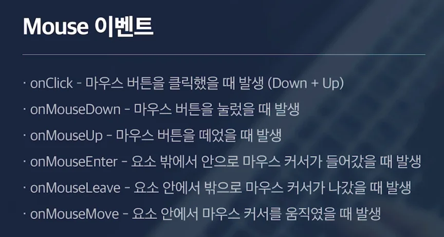
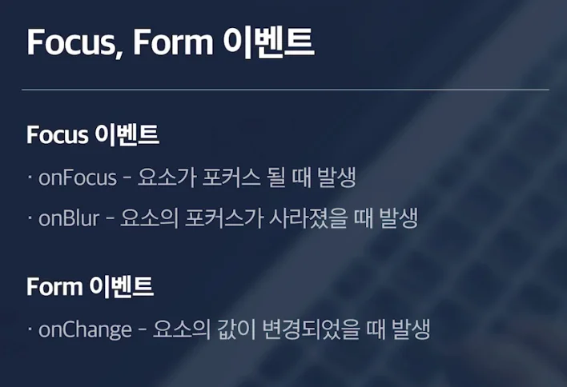

<a id="1c3eda9b0fe181bd817ae38aea4389c8"></a>

## Mouse 이벤트 



- <code>onClick</code>
    - 마우스 클릭 시

- <code>onMouseDown</code>
    - 마우스 눌렀을 때

- <code>onMouseUp</code>
    - 마우스 눌렀던 걸 떼었을 때

- <code>onMouseEnter</code>
    - 요소 밖에서 안으로 마우스 커서가 들어갔을 때

- <code>onMouseLeave</code>
    - 요소 안에서 밖으로 마우스 커서가 나갔을 때

- <code>onMouseMove</code>
    - 요소 안에서 마우스 커서를 움직였을 때

<a id="1c3eda9b0fe18109b6bade7bb8ff54f3"></a>

## Keyboard 이벤트


- <code>onKeyDown</code>
    - 문자가 아닌 다른 키(ctrl, enter &#46;&#46;)들에도 이벤트가 발생됨

- <code>onKeyUp</code>
    - 키를 떼었을 때

- <code>onKeyPress</code>
    - 문자가 입력 되었을 때 발생

<a id="1c3eda9b0fe1811494e9e2569ef9ceef"></a>

## Focus, Form 이벤트 



<a id="1c3eda9b0fe181d9969dfebe74bd10c0"></a>

### Focus 이벤트

- <code>onFocus</code>&#58; 요소에 포커스가 될 때

- <code>onBlur</code>&#58; 요소에 포커스가 사라질 때

<a id="1c3eda9b0fe181919fc8c10531dac584"></a>

### Form 이벤트

- <code>onChange</code>&#58; 요소의 값이 변경되었을 떄

<a id="1c3eda9b0fe181c4b9d6c8ed3cde447a"></a>

### 코드 실습

<a id="1c3eda9b0fe181668d58c261c079fe90"></a>

‣

<a id="1c3eda9b0fe181bb93bcfa9b3584dcdd"></a>

```javascript
function App() {
  return (
    <div className="App">
      <button
        onClick={() => {
          console.log('onClick');
        }}
        onMouseDown={() => {
          console.log('onMouseDown');
        }}
        onMouseUp={() => {
          console.log('onMouseUp');
        }}
      >
        Button
      </button>
      <div
        className="box"
        onClick={() => {
          console.log('onClick');
        }}
        onMouseEnter={() => {
          console.log('onMouseEnter');
        }}
        onMouseLeave={() => {
          console.log('onMouseLeave');
        }}
        onMouseMove={() => {
          console.log('onMouseMove');
        }}
      ></div>
      <div>
        <input
          type="text"
          onKeyDown={() => {
            console.log('onKeyDown');
          }}
          onKeyUp={() => {
            console.log('onKeyUp');
          }}
          onKeyPress={() => {
            console.log('onKeyPress');
          }}
          onFocus={() => {
            console.log('onFocus');
          }}
          onBlur={() => {
            console.log('onBlur');
          }}
          onChange={() => {
            console.log('onChange');
          }}
        />
      </div>
    </div>
  );
}

export default App;
```
