<details>
<summary>🧐 1차 캐시 clear 후, 엔티티에서 id 값 조회 시, 값 정상 출력됨 <br>  어디서 가져오는 것이지?</summary>

<a id="1c3eda9b0fe1811e8ddce83c07df0e74"></a>

id 값은  DB의 시퀀스 값에서 가져와 엔티티의 PK 값으로 엔티티와 함께 저장된다&#46;<br>

<a id="1c3eda9b0fe1810c84e8d1ff908ab106"></a>

1차 캐시를 clear 후, 값을 조회 … ? D<br>

</details>

<a id="1c3eda9b0fe181a9883bdaf2000f4410"></a>

## 프록시 ( 지연 로딩 핵심 개념)

> 👉🏻 Lazy Loading의 이해를 위한 사전 개념<br>→ <strong>실제 사용 값을 사용 시에 쿼리가 날라감</strong>

<a id="1c3eda9b0fe18123b313d86020222e86"></a>

### <code>em&#46;find()</code> vs <code>em&#46;getReference()</code>

<details>
<summary><strong>엔티티 조회&#58;</strong> <code>em&#46;find()</code></summary>

> 데이터베이스를 통해, 실제  엔티티 객체를 조회한다&#46;

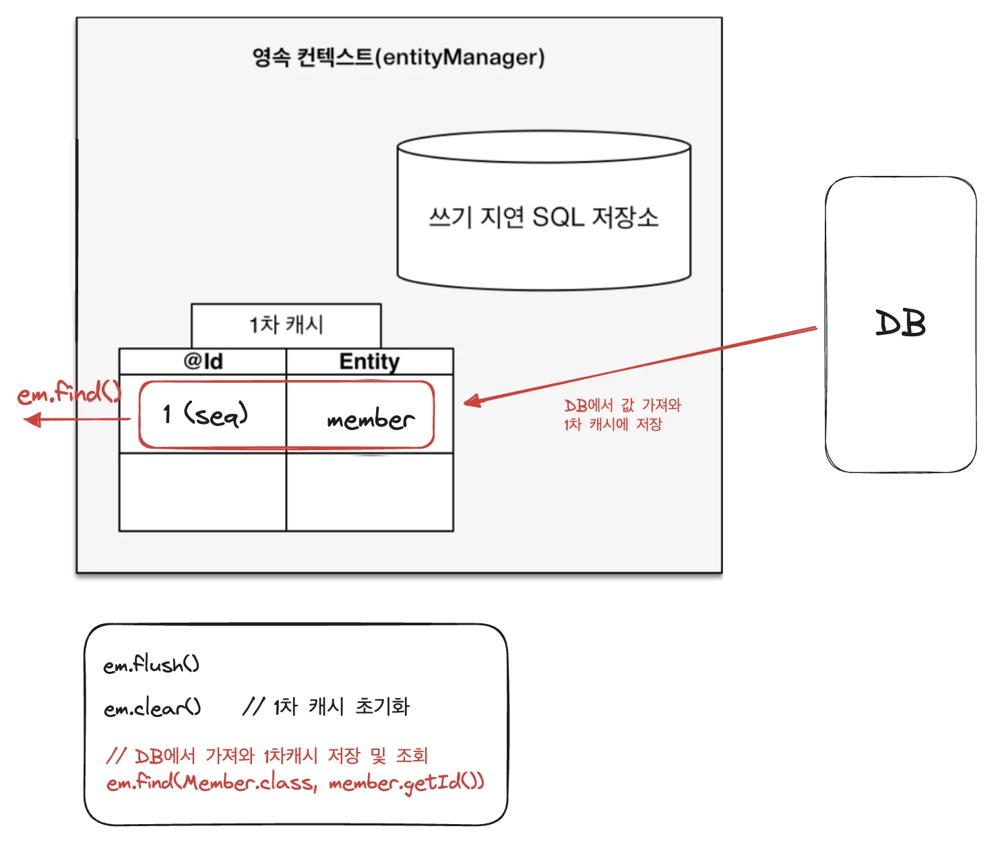

> Select (조회)

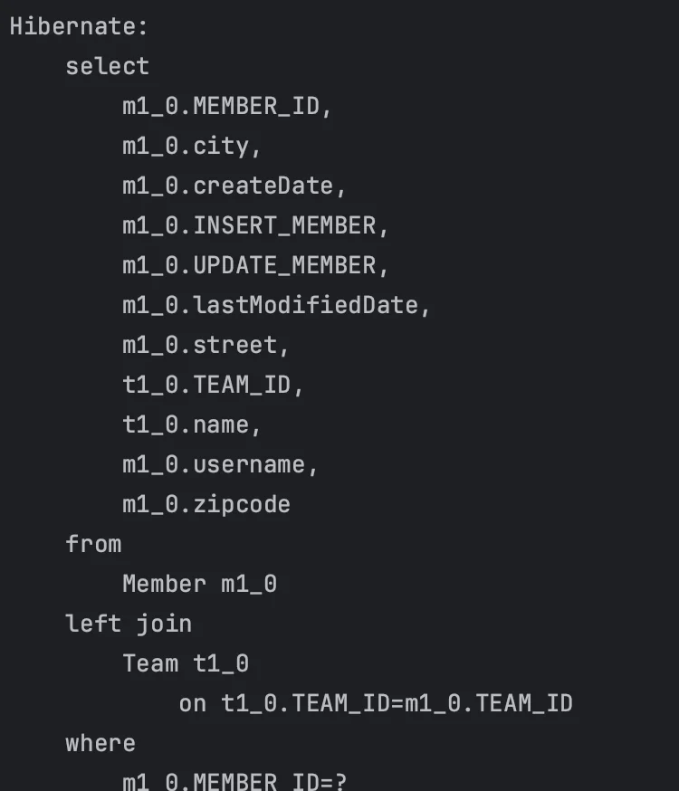

</details>

<details>
<summary><strong>프록시 조회&#58;</strong> <code>em&#46;getReference()</code></summary>

> 데이터베이스 조회를 미루는 가짜(프록시) 엔티티 객체 조회 <br>→ DB에 쿼리를 안날리는데도 조회가 됨

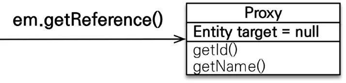

<a id="1c3eda9b0fe18169a893c4ea9274fc0f"></a>

실제 값을 사용할 때, select 쿼리가 날라감

<a id="1c3eda9b0fe18125b412d051699e55d9"></a>

```java
Member findMember = em.getReference(Member.class, member.getId());

// 아래와 같이 실제 값을 사용하는 시점에 쿼리가 날라감 
System.out.println("member.getId = " + findMember.getId());   
System.out.println("member.getUsername = " + findMember.getUsername());
```

</details>

<a id="1c3eda9b0fe181ae9403c90351528509"></a>

### 초기화

> 👉🏻 <strong><code>em&#46;getReference()</code></strong><strong><br></strong>Entity 프록시로 조회, 실제 값을 사용할 때만 쿼리를 날림

<a id="1c3eda9b0fe18101bf3eda67369a3e40"></a>

<strong>• 동작</strong>

> 초가화가  아닌, 실제  사용 시(<code>member&#46;getName()</code>)에 select 쿼리 날림

<a id="1c3eda9b0fe1818e90d3d5d60198f27e"></a>

```java
em.flush();
em.clear();

Member member = em.getReference(Member.class, "id1");
member.getName();
```

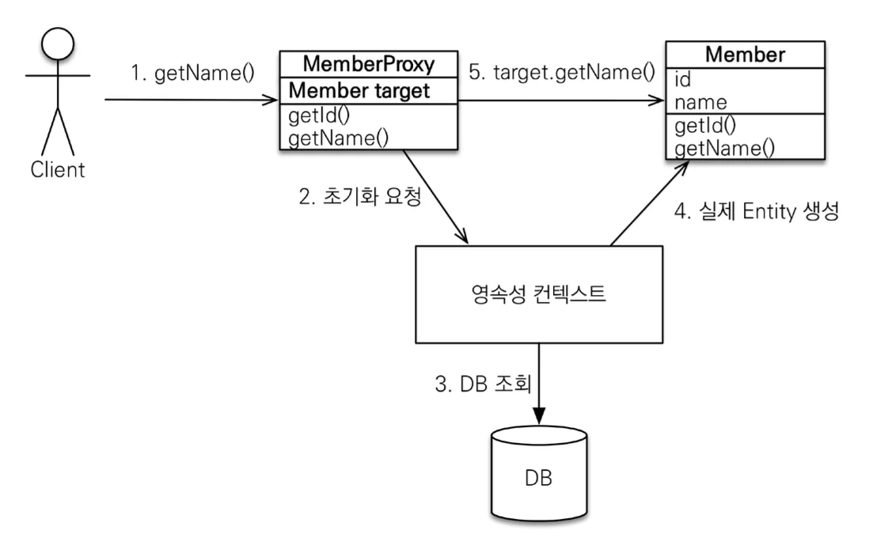

<a id="1c3eda9b0fe1819d969ce3cbf0a9ab55"></a>

### 특징

<a id="1c3eda9b0fe1814f857ecb285d542cf0"></a>

프록시 객체는 <strong>처음 사용 시</strong>에 <strong>한 번만 초기화</strong>하면 된다&#46; 

<a id="1c3eda9b0fe18138bfcef9a670208c93"></a>

<strong>초기화 시</strong>, 실제 엔티티로 바뀌는 것이 아닌, <strong> 실제 엔티티에 접근하는 참조값을 갖는 더미 객체  즉, 프록시를 생성</strong>한다&#46; 

<a id="1c3eda9b0fe1819087e4ece75296450f"></a>

따라서 <strong>프록시 메서드 호출 시, </strong><strong><u>실제 객체의 메소드를 호출</u></strong>한다&#46;

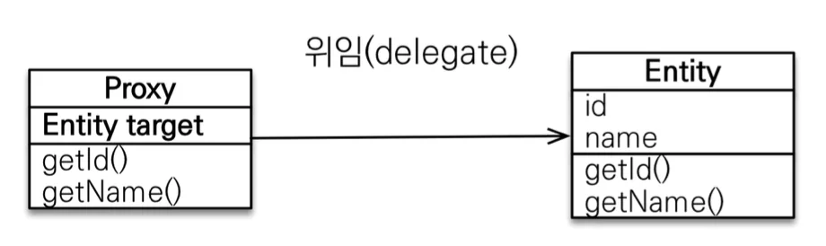

<a id="1c3eda9b0fe18183b9b4da6c1116a846"></a>

<strong> </strong>프록시 객체는 <strong><u>원본 엔티티를 상속</u></strong> 받아서 사용한다&#46; 실제 클래스와 겉모양이 같기 때문에 사용하는 입장에서는 진짜 객체인지 프록시 객체인지 구분하지 않고 사용하면 된다&#46;

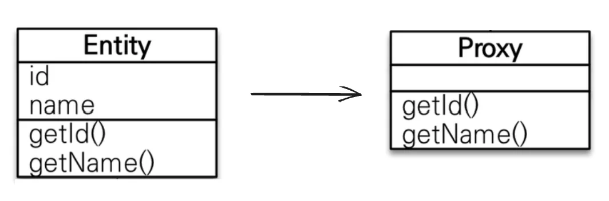

<details>
<summary><strong>⚠️ 타입 체크 시,  주의</strong></summary>

- <code>==</code>  사용 X 

-  <strong><u><code>instance of</code></u></strong><strong><u> 사용</u></strong>

</details>

<a id="1c3eda9b0fe1810daa7dde5138eaca14"></a>

<strong>영속성 컨텍스트에 조회하는 엔티티가 존재하는 경우</strong>, <code>em&#46;getReference()</code>를 호출해도 <strong>실제 엔티티를 반환</strong>한다&#46; 

<a id="1c3eda9b0fe18131ac57fa01a19eb4f2"></a>

영속성 컨텍스트에서 제거된<strong> 준영속 상태</strong>일 때(<strong><code>em&#46;detch(</code></strong><code>엔티티</code><strong><code>)</code></strong>), <strong>프록시를 초기화</strong> 하면 <strong>문제가 발생</strong>한다&#46;

<a id="1c3eda9b0fe1815ebfd0da55499768bb"></a>

### 확인

<details>
<summary><strong>프록시 인스턴스 초기화 여부 확인&#58; </strong><strong><code>PersistenceUnitUtil&#46;isLoaded(Object entity)</code></strong></summary>


</details>

<details>
<summary><strong>프록시 클래스 확인&#58; </strong><strong><code>enity&#46;getClass()</code></strong></summary>

> findMember&#46;<code>getClass()</code>  출력 → <strong>프록시</strong> 확인

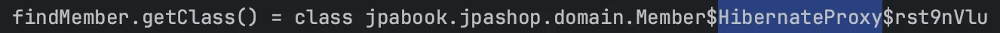

</details>

> ⚠️ JPA 표준에는 <strong>강제 초기화가 존재하지 않</strong>는다&#46; 

<details>
<summary><strong>프록시 강제 초기화&#58; </strong><strong><code>org&#46;hibernate&#46;Hibernate&#46;initialize(entity);</code></strong></summary>


</details>

<details>
<summary><strong>강제 호출&#58;</strong> member&#46;<code>getName()</code></summary>


</details>

<a id="1c3eda9b0fe1812ebd5cd004a9ed5f2e"></a>

## 즉시 로딩과 <u>지연 로딩</u>

<details>
<summary>🧐 Member와 Team 사이에 <strong>다대일</strong><strong> </strong>연관관계가 형성되었을 때, Member를 조회하는 경우 Team 도 같이 딸려와 조회된다&#46; </summary>


<a id="1c3eda9b0fe1814983c7c4d36d095461"></a>

단순히 member 정보만 사용하는 비즈니스 로직인 경우 Team 까지 같이 사용되어 불필요한 비용이 발생된다&#46; 이를 해결하는 것이 Lazy Loading(Proxy 객체)이다&#46;<br>Proxy는 위에서 학습했듯이 실제 사용 시(원본객체의 메서드 실행) 쿼리를 날린다&#46; 

</details>

> 🔑 정리
> 
> > <em><strong><u>실무에선 </u></strong></em><em><strong>무조건 </strong></em><em><strong><u>지연 로딩 </u></strong></em><em><strong>만 사용</strong></em>
> 
> <a id="1c3eda9b0fe181d2a75be3e12005a7c4"></a>
> 
>   → 즉시 로딩 사용 시, 예상하지 못한 SQL 이 발생할 수 있다&#46; 따라서 실무에선 사용 X  
> 
> <details>
> <summary>⚠️  <strong>즉시 로딩은 JPQL에서 N&#43;1 문제를 일으킨다&#46;</strong></summary>
> 
> <details>
> <summary><strong>Member</strong></summary>
> 
> <a id="1c3eda9b0fe181cc9abaca26dbb5a199"></a>
> 
> ```java
> @ManyToOne(fetch = FetchType.EAGER)
> @JoinColumn
> private Team team;
> ```
> 
> </details>
> 
> <details>
> <summary><strong>JapMain</strong></summary>
> 
> <a id="1c3eda9b0fe181c393a5e837e0c6cc60"></a>
> 
> ```java
> Team teamA = new Team();
> teamA.setName("teamA");
> em.persist(teamA);
> 
> Team teamB = new Team();
> teamB.setName("teamA");
> em.persist(teamB);
> 
> Member member1 = new Member();
> member1.setUsername("hello");
> member1.setTeam(teamA);
> 
> em.persist(member1);
> 
> Member member2 = new Member();
> member2.setUsername("hello");
> member2.setTeam(teamA);
> 
> em.persist(member2);
> 
> em.flush();
> em.clear();
> 
> List<Member> result = em.createQuery("select m from Member m", Member.class)
> 								        .getResultList();
> 
> // SQL: select * from Member
> // SQL: select * from Team where TEAM_ID
> 
> for (Member member : result) {
>     System.out.println("member = " + member);
> }
> 
> // member = jpabook.jpashop.domain.Member@27bb4dc5
> // member = jpabook.jpashop.domain.Member@1f179f51
> ```
> 
> </details>
> 
> <details>
> <summary><strong>SQL &#45; 추가 select 쿼리 발생</strong></summary>
> 
> <a id="1c3eda9b0fe181afa27adcadd0c4c65d"></a>
> 
> ```sql
> Hibernate: 
>     /* select
>         m 
>     from
>         Member m */ select
>             m1_0.MEMBER_ID,
>             m1_0.city,
>             m1_0.createDate,
>             m1_0.INSERT_MEMBER,
>             m1_0.UPDATE_MEMBER,
>             m1_0.lastModifiedDate,
>             m1_0.street,
>             m1_0.team_TEAM_ID,
>             m1_0.USERNAME,
>             m1_0.zipcode 
>         from
>             Member m1_0
> Hibernate: 
>     select
>         t1_0.TEAM_ID,
>         t1_0.name 
>     from
>         Team t1_0 
>     where
>         t1_0.TEAM_ID=?
> 
> ```
> 
> </details>
> 
> </details>
> 
> 1. <strong>패치 조인</strong> ( 뒤 JPQL 에서 배움 )
>     <a id="1c3eda9b0fe181b5b130c3cc8d8c5f58"></a>
> 
>     ex) <code>em&#46;createQuery(&#34;select m from Member m join fetch m&#46;team&#34;, Member&#46;class)</code>
> 
> 1. <strong><code>&#64;ManyToOne</code></strong>, <strong><code>&#64;OneToOne</code></strong>은 <strong><u>기본값이 즉시로딩</u></strong>(<strong>EAGER</strong>)이다&#46; 따라서 설정 변경 필요<br>→ <strong><code>&#64;ManyToOne(fetch = FetchType&#46;</code></strong><em><strong><code>LAZY</code></strong></em><strong><code>)</code></strong><strong>  </strong>
> 
> 1. <code>&#64;OneToMany</code>, <code>&#64;ManyToMany</code>는 <u>기본값이 지연로딩(</u><em><strong><u>LAZY</u></strong></em><em><u>)</u></em>이다&#46;

<a id="1c3eda9b0fe18188a3f1d5b838bc2df2"></a>

### 지연 로딩(프록시 객체)

<a id="1c3eda9b0fe181c7a631c582583a0e02"></a>

```java
@ManyToOne(fetch = FetchType.LAZY)  
```

<details>
<summary>사용 예시</summary>

<a id="1c3eda9b0fe181c1bcd6cbaaefe8b785"></a>

```java
// Member
@ManyToOne(fetch = FetchType.LAZY)
@JoinColumn
private Team team;
```

<a id="1c3eda9b0fe1811c8ea8d5086169c934"></a>

```java
// JpaMain
Team team = new Team();
team.setName("teamA");
em.persist(team);

Member member = new Member();
member.setUsername("hello");
member.setTeam(team);

em.persist(member);

em.flush();
em.clear();

Member m = em.find(Member.class, member.getId());

System.out.println("m = " + m.getTeam().getClass());

System.out.println("============================");
m.getTeam().getName();   // 초기화
System.out.println("============================");

tx.commit();
```

<a id="1c3eda9b0fe181a694a4c38279f3028c"></a>

위와 같이 프록시 객체 생성 및 조회, 사용 시 아래와 같이 Member를 조회했을 때, Team 이 조회 되는 것이 아닌  실제 원본 객체의 메서드가 실행될 때, 프록시 객체의 초기화가 발생되어 select 쿼리를 DB에 날린다&#46;

<a id="1c3eda9b0fe1813d90a1cbc5a1d20d87"></a>

```sql
Hibernate: 
    select
        m1_0.MEMBER_ID,
        m1_0.city,
        m1_0.createDate,
        m1_0.INSERT_MEMBER,
        m1_0.UPDATE_MEMBER,
        m1_0.lastModifiedDate,
        m1_0.street,
        m1_0.team_TEAM_ID,
        m1_0.USERNAME,
        m1_0.zipcode 
    from
        Member m1_0 
    where
        m1_0.MEMBER_ID=?
m = class jpabook.jpashop.domain.Team$HibernateProxy$SBytZUcG

============================
Hibernate: 
    select
        t1_0.TEAM_ID,
        t1_0.name 
    from
        Team t1_0 
    where
        t1_0.TEAM_ID=?
============================
```

</details>

<details>
<summary><strong>즉시 로딩</strong></summary>

<a id="1c3eda9b0fe1813988b2c6e04e0d1c13"></a>

```java
@ManyToOne(fetch = FetchType.EAGER)
```

<a id="1c3eda9b0fe181fcbe7ef09c50157d9b"></a>

<code>&#46;getClass()</code> 로 호출 시, 아래와 같이 <strong><u>일반 클래스</u></strong>로 출력됨

<a id="1c3eda9b0fe1810abd8bcc28060056e1"></a>

```java
 System.out.println("m = " + m.getTeam().getClass());
 
 ================ 출력 =====================
 
 m = class jpabook.jpashop.domain.Team
```

</details>

<details>
<summary><strong>지연 로딩 활용</strong></summary>

> 📌 이론적인 얘기임, <strong>실무</strong>에선 <strong>무조건 </strong><strong>지원로딩</strong><strong>(</strong><strong>Lazy</strong><strong>)</strong><strong>만 사용</strong>

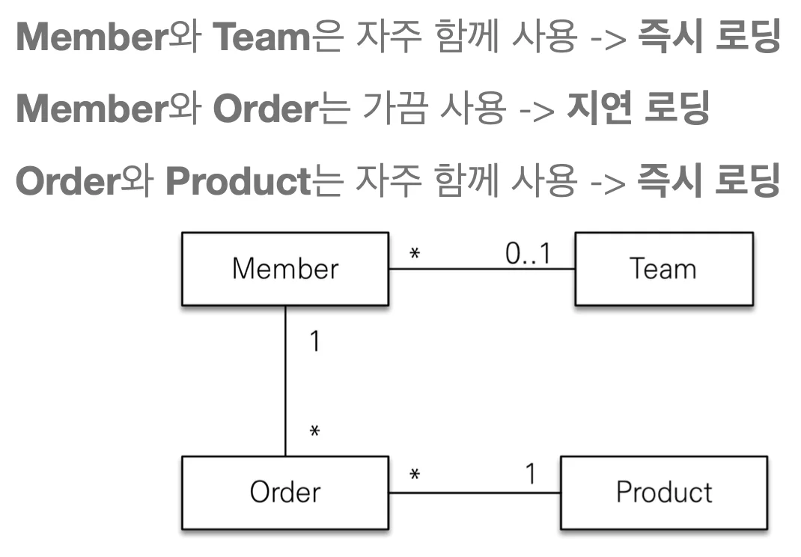

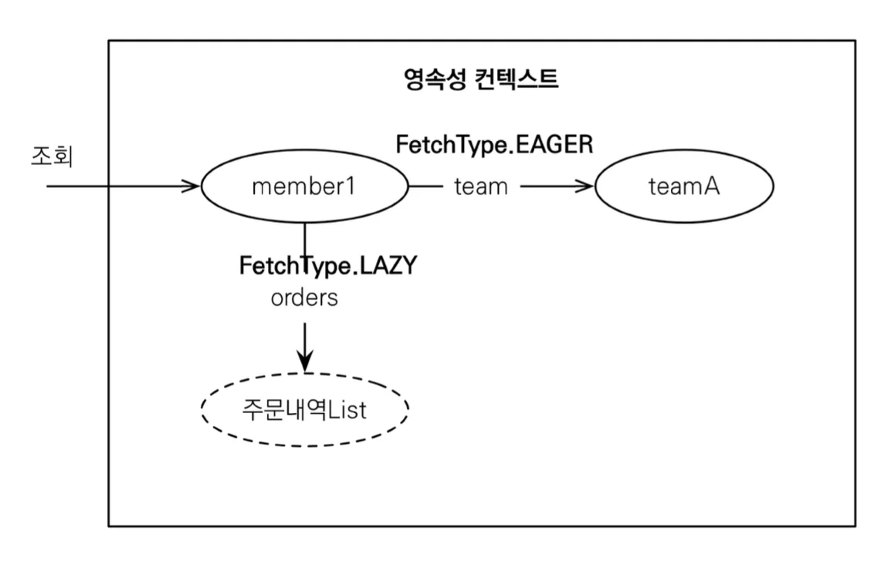

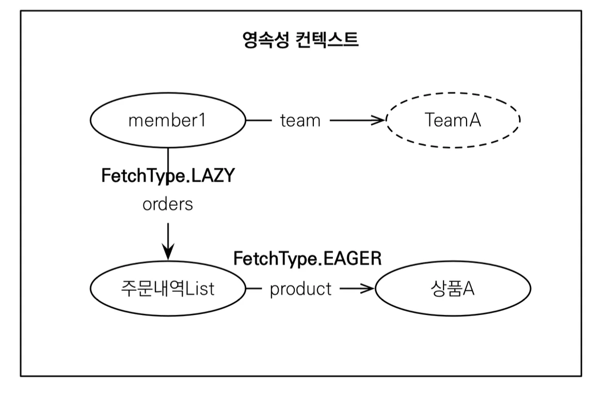

</details>

<a id="1c3eda9b0fe1812f9912f4888f10d4c1"></a>

## 영속성 전이&#58; CASCADE

> 📌 <strong><u>특정 엔티티를 영속 상태</u></strong><strong>(영속성 컨텍스트에 저장)로 만들 때, </strong><strong><u>연관된 엔티티도 함께 영속 상태로 만</u></strong><strong>들고 싶은 때, </strong><strong><u>&#91; 일대다(</u></strong><strong><u><code>&#64;OneToMany</code></u></strong><strong><u>) &#93;</u></strong><strong>, </strong><strong><u>&#91; 일대일(</u></strong><strong><u><code>&#64;OneToOne</code></u></strong><strong><u>) &#93; </u></strong><strong>연관관계 중 일에 해당하는 </strong><strong><u>부모 엔티티에 적용</u></strong><strong>한다&#46;</strong>
> 
> <a id="1c3eda9b0fe181999effc2cc83c6a51b"></a>
> 
> <br>ex) Parent 엔티티를 저장(persist) → Child 엔티티도 함께 저장
> 
> <a id="1c3eda9b0fe18187ac08c2da49045d48"></a>
> 
> ```java
> // Parent 
> @OneToMany(mappedBy = "parent", cascade = CascadeType.ALL)
> private List<Child> childList = new ArrayList<>();
> ```


<a id="1c3eda9b0fe1819db15afbea2d5d45ea"></a>

양방향 연관관계를 가지는 Parent, Child 엔티티를  <strong><u>CASCADE </u></strong><u>없</u>이 <code>child1</code>, <code>child2</code>, <code>parent</code> 엔티티 모두 영속 상태로 저장 및 DB에 insert 하고 싶은 경우 <br>아래와 같이 3번의 저장(<code>em&#46;persist();</code>)을 해야한다&#46;

<details>
<summary>저장 &#45; 3번</summary>

<a id="1c3eda9b0fe181458dedd214f16a8002"></a>

```java
Child child1 = new Child();
Child child2 = new Child();

Parent parent = new Parent();
parent.addChild(child1);
parent.addChild(child2);

em.persist(parent);
em.persist(child1);
em.persist(child2);

tx.commit();
```

<a id="1c3eda9b0fe18125a2def34c0399a4bd"></a>

```sql
Hibernate: 
    /* insert for
        jpabook.jpashop.domain.Parent */insert 
    into
        Parent (name, id) 
    values
        (?, ?)
Hibernate: 
    /* insert for
        jpabook.jpashop.domain.enums.Child */insert 
    into
        Child (name, CHILD, id) 
    values
        (?, ?, ?)
Hibernate: 
    /* insert for
        jpabook.jpashop.domain.enums.Child */insert 
    into
        Child (name, CHILD, id) 
    values
        (?, ?, ?)
```

</details>

<details>
<summary> <code>em&#46;persist(child&#46;&#46;&#46;)</code> 주석 처리 시, <strong>Parent만 </strong><strong><code>insert</code></strong></summary>

<a id="1c3eda9b0fe18153859addba5fa0bab4"></a>

```java
em.persist(parent);
// em.persist(child1);
// em.persist(child2);
```

<a id="1c3eda9b0fe181e7964bede11bbb9291"></a>

```sql
  .   .   .

Hibernate: 
    /* insert for
        jpabook.jpashop.domain.Parent */insert 
    into
        Parent (name, id) 
    values
        (?, ?)
```

</details>

<a id="1c3eda9b0fe1817aadaadfd62cc137b7"></a>

그러나 <strong>CASCADE를 사용</strong>하면 <strong><u>한번의 저장</u></strong>을 통해 하위 요소?들까지 저장할 수 있다&#46;

<details>
<summary><strong>Parent</strong></summary>

<a id="1c3eda9b0fe1812693dcc18dcfc96d18"></a>

```java
@OneToMany(mappedBy = "parent", cascade = CascadeType.ALL)
private List<Child> childList = new ArrayList<>();
```

</details>

<details>
<summary><strong>JpaMain</strong></summary>

<a id="1c3eda9b0fe18199bbcade349874fccf"></a>

```java
Child child1 = new Child();
Child child2 = new Child();

Parent parent = new Parent();
parent.addChild(child1);
parent.addChild(child2);

em.persist(parent);

tx.commit();
```

</details>

<details>
<summary><strong>SQL</strong></summary>

<a id="1c3eda9b0fe181f9b69df76aa38965bc"></a>

```sql
Hibernate: 
    /* insert for
        jpabook.jpashop.domain.Parent */insert 
    into
        Parent (name, id) 
    values
        (?, ?)
Hibernate: 
    /* insert for
        jpabook.jpashop.domain.enums.Child */insert 
    into
        Child (name, CHILD, id) 
    values
        (?, ?, ?)
Hibernate: 
    /* insert for
        jpabook.jpashop.domain.enums.Child */insert 
    into
        Child (name, CHILD, id) 
    values
        (?, ?, ?)
```

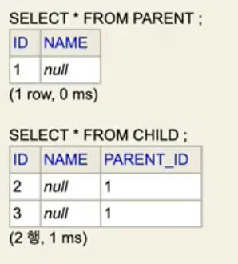

</details>

<a id="1c3eda9b0fe181e387e1cac057bf1076"></a>

### <strong>CASCADE 종류</strong>

- <strong>ALL</strong><strong>&#58; 모두 적용</strong>

- <strong>PERSIST</strong><strong>&#58; 영속</strong>

- <strong>REMOVE&#58; 삭제</strong>

- MERGE&#58; 병합

- REFRESH&#58; REFRESH

- DETACH&#58; DETACH

> ⚠️ <strong>주의&#33;<br></strong>연관관계를 매핑하는 것과 아무 관련이 없다&#46;<br>엔티티를 영속화 할 때 연관된 엔티티도 함께 영속화 하는 편리함을 제공할 뿐이다&#46;
> 
> <a id="1c3eda9b0fe18111bc9cca7cbd007289"></a>
> 
> <strong><u>하나의 부모가 자식들을 관리하는 경우</u></strong><strong>에 사용</strong>한다&#46;
> 
> <a id="1c3eda9b0fe181f7b1e9ec007ca08670"></a>
> 
> <strong>ex)  &#91; 게시판 &#45; 첨부 파일 &#93;</strong>
> 
> <a id="1c3eda9b0fe1810ca539e7410a7527fa"></a>
> 
> 위 예시의 <strong>&#91; Parent &#45; Child &#93; </strong>에서 Child와 연관관계를 형성하는 다른 엔티티 객체가 있는 경우 CASCADE를 사용하면 안된다&#46;

<a id="1c3eda9b0fe18191a694db561a1b071b"></a>

## 고아 객체(<strong>orphanRemoval = true)</strong>

> 📌 고아 객체 제거&#58; <strong>부모 엔티티와 </strong><strong>연관관계가 끊어진 자식 엔티티를 자동으로 삭제</strong>
> 
> <a id="1c3eda9b0fe18172991ce0e4baa84935"></a>
> 
> ```java
> @OneToMany(mappedBy = "parent", orphanRemoval = true, cascade = CascadeType.ALL)
> private List<Child> childList = new ArrayList<>();
> ```

<a id="1c3eda9b0fe181c69718f0e676ad871c"></a>

<code>orphanRemoval = true</code> 설정 후

<a id="1c3eda9b0fe181fdb470d0cfd0852791"></a>

```java
// Parent
@OneToMany(mappedBy = "parent", orphanRemoval = true, cascade = CascadeType.ALL)
private List<Child> childList = new ArrayList<>();
```

<a id="1c3eda9b0fe1814e8d86d18dc4cea7c5"></a>

아래와 같이 부모 엔티티 조회 후, 해당 리스트에서 자식 엔티티를 컬렉션에서 제거하면

<a id="1c3eda9b0fe1813c8188cd5295c514b1"></a>

```java
// JpaMain
Parent findParent = em.find(Parent.class, parent.getId());
findParent.getChildList().remove(0); // 자식 엔티티, 컬렉션에서 제거
```

<a id="1c3eda9b0fe181ce8ff9d9cce73799d7"></a>

 <strong><code>delete</code></strong><strong> </strong>쿼리를 날려 자동으로 해당 데이터를 테이블에서 삭제한다&#46;

<a id="1c3eda9b0fe181ce8714c0c7b512fb6e"></a>

```sql
Hibernate: 
    /* delete for jpabook.jpashop.domain.enums.Child */delete 
    from
        Child 
    where
        id=?
```

> ⚠️ <strong>주의 <br></strong>참조가 제거된 엔티티는 다른 곳에서 참조하지 않는 고아 객체로 보고 삭제하는 기능이다&#46;<br>따라서 <strong><u>참조하는 곳이 </u></strong><strong><u>하나</u></strong>일 때, 즉 <strong><u>특정 엔티티가 개인 소유</u></strong>할 때만 사용해야한다&#46; <br>→ <code>&#64;OneToOne</code>, <code>&#64;OneToMany</code> 만 가능<br><br>※ 참고&#58; <strong>부모를 제거하는 경우 자식도 함께 제거</strong>된다&#46; (  <strong><u>CasecadeType&#46;REMOVE</u></strong> 와 유사 )

<a id="1c3eda9b0fe1812b819fc9e6ca7fc024"></a>

### 영속성 전이 &#43; 고아 객체, 생명주기

> 📌 <code>CascadeType&#46;ALL</code> &#43; <code>orphanRemovel = true</code>

<a id="1c3eda9b0fe18168a6f1dd73cbcc4082"></a>

스스로 생명주기를 관리하는 엔티티는 <code>em&#46;persist()</code>로 영속화, <code>em&#46;remove()</code> 로 제거된다&#46;<br>여기서 위 두 옵션(<strong>CASCADE</strong>, <strong>orphanRemoval</strong>)을 활성화하면 부모 엔티티를 통해 자식 엔티티의 생명주기를 관리할 수 있다&#46;

<a id="1c3eda9b0fe1812498d7f00daf5067a6"></a>

<strong>도메인 주도 설계(DDD</strong>)의 <strong>Aggregate Roo</strong>t 개념을 구현할 때 유용하다&#46;

<a id="1c3eda9b0fe1818ca2e0e0f21b6515e4"></a>

## 실전 예제 5 

> 📌 <strong><u>지연로딩</u></strong><strong> 과 </strong><strong><u>영속성 전이</u></strong><strong> 적용</strong>
> 
> - <strong>모든 연관관계</strong>  → <strong>지연 로딩</strong><strong><br></strong><strong>→ </strong><strong><code>&#64;ManyToOne</code></strong><strong>, </strong><strong><code>&#64;OneToOne</code></strong><strong>은 </strong><strong><u>기본이 즉시 로딩</u></strong><strong>이므로 </strong><strong><u>지연 로딩</u></strong><strong>으로 변경</strong>
> 
> - <strong>부모 엔티티에 영속성 전이(CascadeType) 설정 </strong>
>     - <strong>Order → Delivery</strong>&#58;  영속성 전이 ALL 설정
> 
>     - <strong>Order → OrderItem</strong>&#58;  영속성 전이 ALL 설정

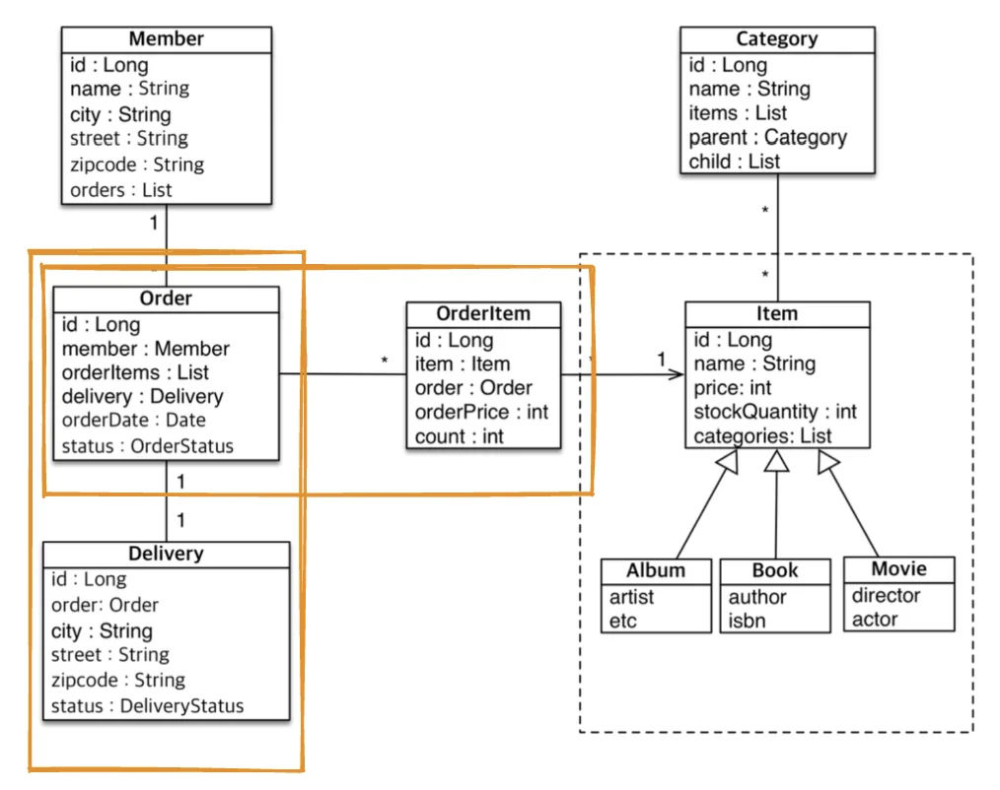

<details>
<summary><strong>Member</strong></summary>

<a id="1c3eda9b0fe181d5a427c1c98644cb85"></a>

```java
@Entity
public class Member extends BaseEntity {

    @Id
    @GeneratedValue
    @Column(name = "MEMBER_ID")
    private Long id;

    @Column(name = "USERNAME")
    private String username;
    private String city;
    private String street;
    private String zipcode;

    @ManyToOne(fetch = FetchType.LAZY)
    @JoinColumn
    private Team team;

    @OneToMany(mappedBy = "member")
    private List<Order> orders = new ArrayList<>();

							.   .   .
```

</details>

<details>
<summary><strong>Order</strong></summary>

<a id="1c3eda9b0fe181eab48bfa7634736080"></a>

```java
package jpabook.jpashop.domain;

import jakarta.persistence.*;
import jpabook.jpashop.domain.enums.OrderStatus;

import java.util.ArrayList;
import java.util.Date;
import java.util.List;

@Entity
@Table(name = "ORDERS")
public class Order {
    @Id
    @GeneratedValue
    @Column(name="ORDER_ID")
    private Long id;

    @ManyToOne(fetch = FetchType.LAZY)
    @JoinColumn(name = "MEMBER_ID")
    private Member member;

    @OneToOne(fetch = FetchType.LAZY, cascade = CascadeType.ALL)
    @JoinColumn(name = "DELIVERY_ID")
    private Delivery delivery;

    @OneToMany(mappedBy = "order", cascade = CascadeType.ALL)
    private List<OrderItem> orderItems = new ArrayList<>();

    @Enumerated(EnumType.STRING)
    private OrderStatus status;

    private Date oderDate;

				   .    .    .
				    
}

```

</details>

<details>
<summary><strong>Delivery</strong></summary>

<a id="1c3eda9b0fe1816da5e0e971c120dbc0"></a>

```java
@Entity
public class Delivery {
    @Id
    @GeneratedValue
    @Column(name="DELIVERY_ID")
    private Long id;

    @OneToOne(mappedBy = "delivery", fetch = FetchType.LAZY)
    private Order order;

    @Enumerated(EnumType.STRING)
    private DeliveryStatus status;

    private String city;
    private String street;
    private String zipcode;
```

</details>

<details>
<summary><strong>OrderItem</strong></summary>

<a id="1c3eda9b0fe18144baf1e87cba6dfd74"></a>

```java
@Entity
@Table(name = "ORDER_ITEM")
public class OrderItem {
    @Id
    @GeneratedValue
    @Column(name = "ORDER_ITEM_ID")
    private Long id;

    @ManyToOne(fetch = FetchType.LAZY)
    @JoinColumn(name="ITEM_ID")
    private Item item;

    @ManyToOne(fetch = FetchType.LAZY)
    @JoinColumn(name="ORDER_ID")
    private Order order;

    private int orderPrice;
    private int count;
```

</details>
