

## EC2 Setting

---

### 리전(Region) 선택

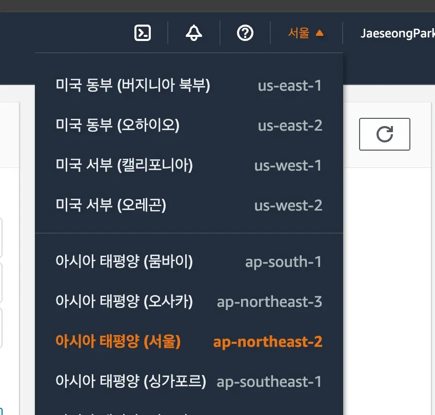

- AWS EC2 시작하기 위해서는 우선적으로 리전(Region)을 먼저 선택해야 한다&#46;

---

리전 ( Region ) 

> ✏️ 
> 
> 
> 
> 리전(Region)은 <strong><u>인프라를 지리적으로 나눠 베포한 각각의 데이터 센터</u></strong>를 의미한다&#46;

<code>EC2</code>는 <strong><u>컴퓨터를 빌려서 원격으로 접속</u></strong>해 사용하는 서비스이다&#46; 

위 그림과 같이 <em><strong>EC2 서비스의 하드웨어 인프라는 전 세계적으로 다양하게 분포 </strong></em>되어 있다&#46;

물리적으로 거리가 가까울수록 더 낮은 비용과 빠른 서비스를 할 수있다&#46;

이렇게 <strong><u>컴퓨터들이 위치한 곳</u></strong>을 AWS에서는 <code>리전(Region)</code>이라 표현한다&#46; 

리전의 특징

1. <strong>AWS는 전 세계적으로 다양한 Region을 보유하고 있다&#46;</strong>
    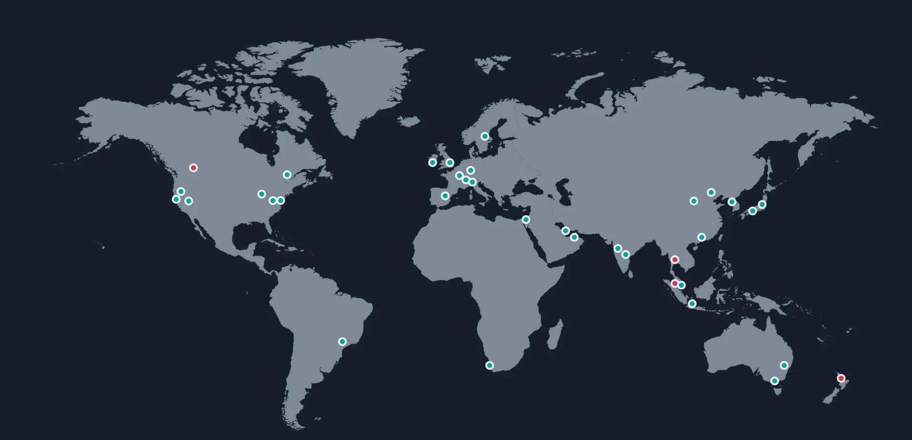

1. <strong>각 Region은 고유의 이름을 가지고 있다&#46; </strong>
    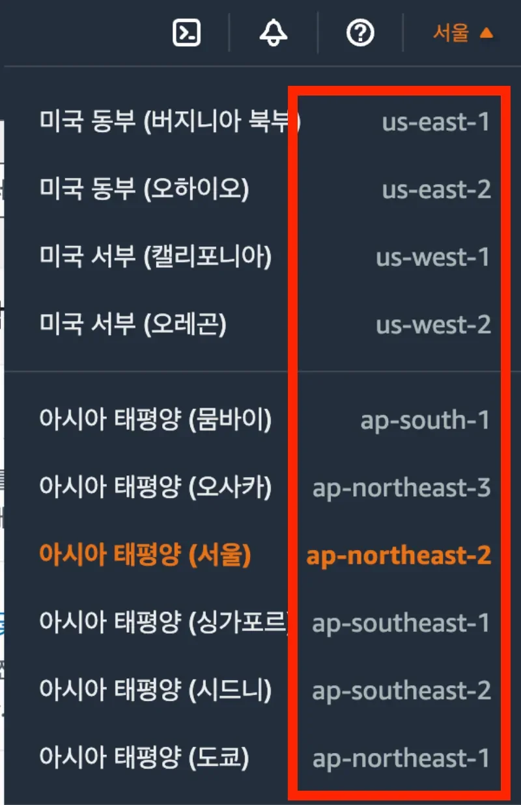

리전 선택의 기준

앱 사용 시 네트워크를 통해 통신을 한다&#46; 

이때,  <strong><u>사용자의 위치</u></strong><strong>와 애플리케이션을 실행시키고 있는 </strong><strong><u>컴퓨터와 위치가 멀면 멀수록 속도가 느려진다&#46;</u></strong><strong> </strong>

따라서 <strong><u>의 주된 사용자들의 위치와 지리적으로 가까운 리전(Region)을 선택</u></strong>하는 것이 유리하다&#46;

- ex) <strong><u>한국 유저들</u></strong>이 주로 사용하는 서비스
    

    → <code>리전</code>&#58; <code>아시아 태평양(서울)</code>

> ☝🏻 
> 
> 
> 
> 많이하는 실수
> 
> 
> 
> <strong><u>아시아 태평양(서울)</u></strong> 리전에서 EC2를 생성해놓고, 실수로 <strong><u>미국 동부(버지니아 북부) 리전</u></strong>에 들어가서 생성한 EC2가 없어졌다고 당황하는 경우가 있다&#46; 
> 
> 
> 
> <strong><u>리전(Region)마다 EC2가 따로따로 관리</u></strong>가 되기 된다&#46; 
> 
> 
> 
> 따라서 <strong><u>해당하는 리전에 생성한 EC2</u></strong>는<strong><u>해당 리전에서만 볼수 있</u></strong>다&#46; 

### 기본 설정

---

1&#46; 이름 및 매그

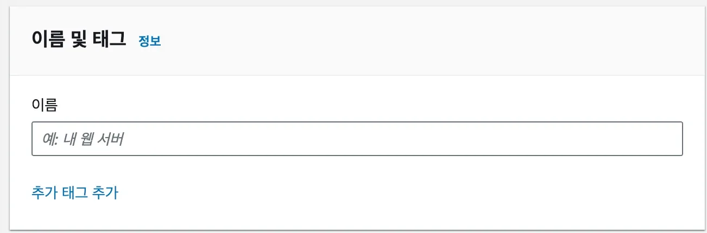

- EC2의 이름을 설정하는 곳

- 이름을 지을 때는 이 컴퓨터가 어떤 역할을 하는지 알아볼 수 있게 작성함
    - ex) <code>instagram&#45;server</code>

2&#46; Application and OS Images (Amazon Machine Image)

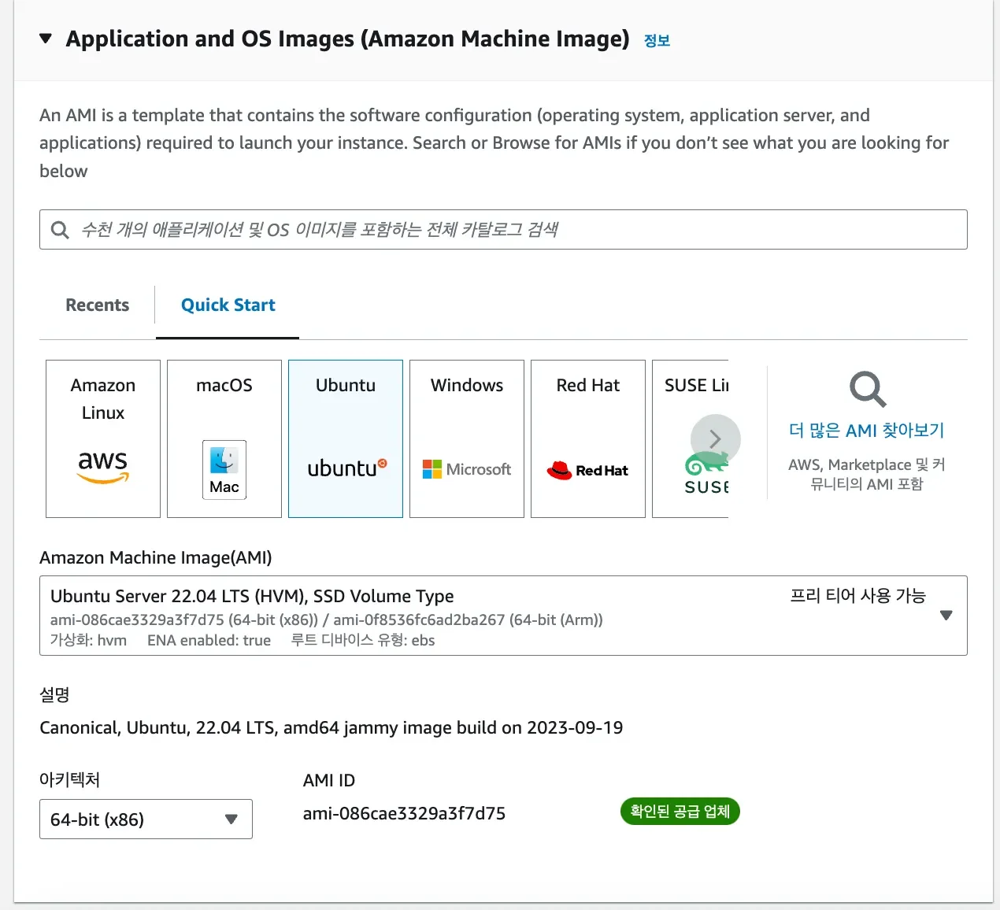

- OS를 선택하는 단계이다&#46; 

- OS(운영체제)란 Mac, Windows 7, Windows 10, Windows 11 같은 것들이 OS이다&#46; 

- 하지만 Windows나 Mac OS는 생각보다 용량도 많이 차지하고 성능도 많이 잡아먹는다&#46;  그래서 <strong><u>서버를 배포할 컴퓨터의 OS</u></strong>는 훨씬 가벼운 <strong><u>Ubuntu</u></strong>를 많이 사용한다&#46; 

3&#46; 인스턴스 유형

<strong><u>인스턴스</u></strong>란, <strong><u>AWS EC2에서 빌리는 컴퓨터 1대를 의미</u></strong>한다&#46; 

> 🧐 그럼 인스턴스 유형은 무슨 뜻 일까?

<strong><u>컴퓨터 사양</u></strong>을 의마한다&#46; 

컴퓨터 사양이 좋으면 좋을 수록 많은 수의 요청을 처리할 수 있고, 무거운 서버나 프로그램을 돌릴 수 있다&#46;

> 실습) 프리 티어에 해당하는 <code>t2&#46;micro</code> 사용

 <strong><u>t2&#46;micro</u></strong>는 학습할 때나 테스트할 때만 쓰는 안 좋은 사양의 컴퓨터라고 생각한지만, 실제 서비스에서 활용해도 될 정도로 나름 괜찮은 사양이다&#46; 하루 방문자 수가 2,000명 정도였던 서비스를 운영했었는데 문제 없이 잘 돌아갔다&#46; 성능에 문제가 직접적으로 생기기 전까지는 너무 걱정하지 않아도 된다&#46;

4&#46; 키 페어 ( 로그인 )

> ✏️ 
> 
> 
> 
> <code>키 페어 ( Key Pair)</code> 란, EC2 컴퓨터에 접근할 때 사용하는 비밀번호와 같다&#46; 
> 
> - 말그대로 열쇠(key, 키)의 역할을 한다&#46; 

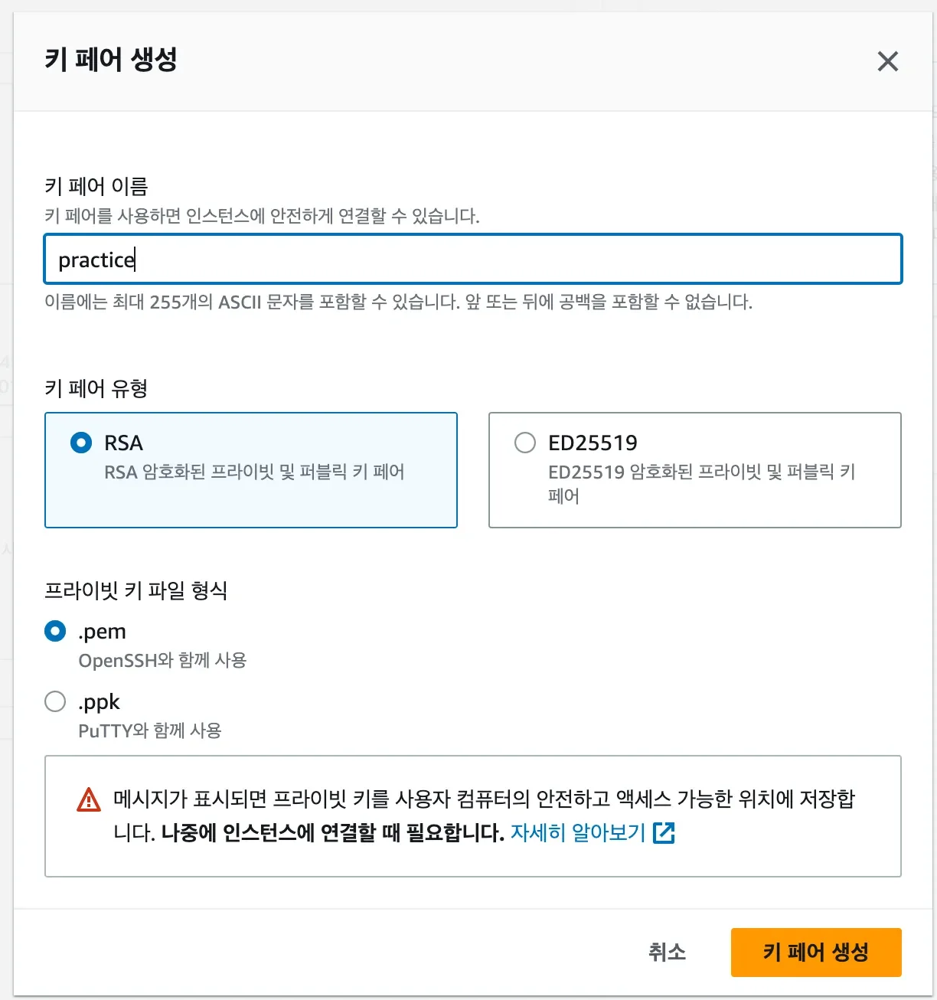

- <strong><u>키 페어 이름</u></strong>은 <strong><u>어떤 EC2에 접근하기 위한 키페어 였는지 </u></strong>알 수 있게 지정해야 한다&#46; 

- <code>RSA</code>와 <code>&#46;pem</code>을 선택한 후에 키 페어를 생성하면 된다&#46;
    - <code>D25519</code>가 뭔지, <code>&#46;ppk</code>가 뭔지는 몰라도 된다&#46; 중요하지 않다&#46;

> ☝🏻 
> 
> 
> 
> <strong><u>키 페어를 생성</u></strong>하면 <strong><u>파일</u></strong>이 하나 다운받아질텐데,해당 파일을 잃어버리지 않게 <strong><u>잘 보관</u></strong>해야 한다&#46; 
> 
> - 참고) 실습에서는  <code>키 페어</code>를 활용해서 EC2에 접근하지 않고, 더 편한 방법으로 접근할 예정임

### 보안 그룹 설정

네트워크 설정

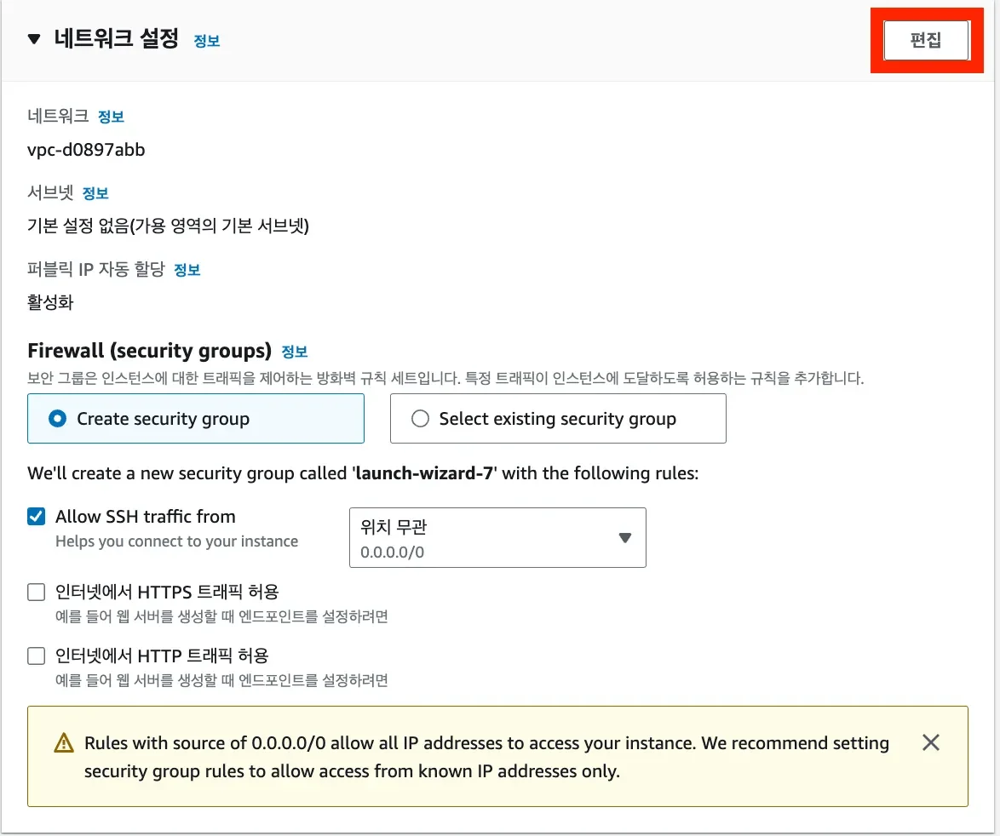

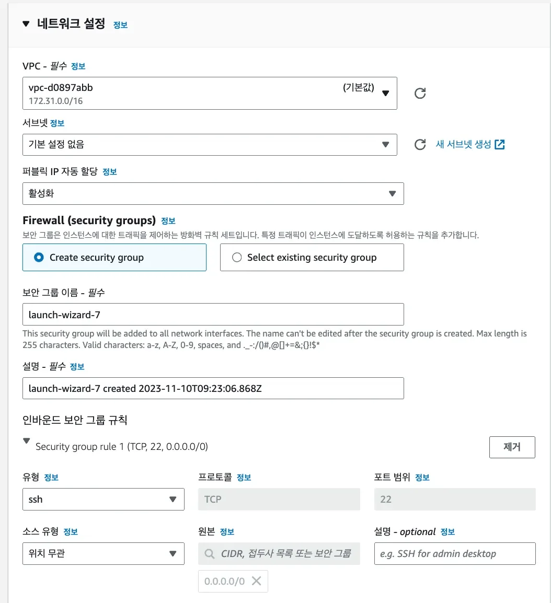

네트워크 설정 칸을 보면 <strong><u>VPC</u></strong> 와 <strong><u>Security Groups(보안 그룹)</u></strong>  이 있다&#46;

VPC라는 개념은 AWS를 입문하는 입장에서는 크게 중요하지 않으니, 넘어가도 된다&#46; 

- VPC를 몰라도 서버를 배포하는 데 아무 문제가 없다&#46; 

-  AWS에 어느 정도 익숙해졌을 때 VPC를 학습을 권장함

그러나 <strong><u>Security Groups(보안 그룹)</u></strong>은 서버를 배포할 때 중요한 개념이다&#46;

보안 그룹 ( Security Group )

---

<strong><u>보안 그룹(Security Group)</u></strong>이란 <strong><u>AWS 클라우드에서의 </u></strong><strong><u>네트워크 보안</u></strong>을 의미한다&#46;

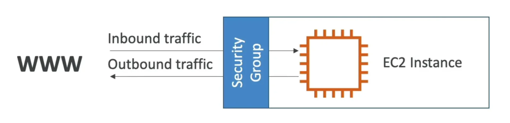

<strong><u>EC2 인스턴스</u></strong>를 <strong><u>집</u></strong>이라고 생각한다면, <strong><u>보안 그룹</u></strong>은 <strong><u>집 바깥 쪽에 쳐져있는 </u></strong><strong><u>울타리와 대문</u></strong>이라고 생각하면 된다&#46; 집에 접근할 때 울타리의 대문에서 접근해도 되는 요청인지 보안 요원이 검사를 하는 것과 비슷하다&#46; 

인터넷에서 일부 사용자가 EC2 인스턴스에 접근(엑세스)하려 한다&#46;

이때, EC2 인스턴스 주위에 방화벽 역할을 할 보안 그룹(Security Group)을 만들고 보안 그룹에 규칙을 지정한다&#46; 

- 보안 그룹을 설정할 때는 허용할 <strong><u>IP 범위</u></strong>와 <strong><u>포트(port)</u></strong>를 설정할 수 있다&#46; 

- <strong><u>인바운드 트래픽(즉, </u></strong><strong><u>외부에서 EC2 인스턴스로 보내는 트래픽)</u></strong>에서 <strong><u>어떤 트래픽만 허용할 지 설정</u></strong> 가능

- <strong><u>아웃바운드 트래픽(즉, </u></strong><strong><u>EC2 인스턴스에서 외부로 나가는 트래픽)</u></strong>에서 어떤 트래픽만 허용할 지 설정 가능

이로 인해, EC2를 안전하게 지킬 수있다&#46;

보안 그룹 설정

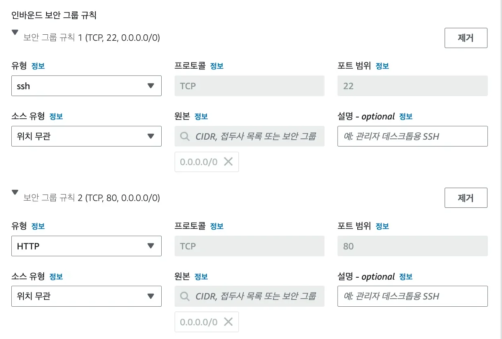

외부에서 EC2로 접근할 포트는 <strong><code>22번 포트</code></strong>와 <strong><u><code>80번 포트</code></u></strong>라고 생각해서 이 2가지에 대해 인바운드 보안 그룹 규칙을 추가했다&#46;

- <code>22번 포트</code>&#58;  EC2에 원격 접속할 때 사용하는 포트

- <code>80번 포트</code>&#58; 백엔드 서버

그리고 어떤 IP에서든 전부 접근할 수 있게 만들기 위해 소스 유형은 <strong><u>위치 무관</u></strong>으로 설정했다&#46; 

### 스토리지 구성

스토리지 구성

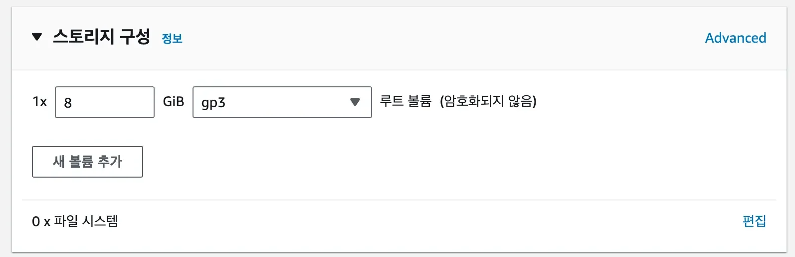

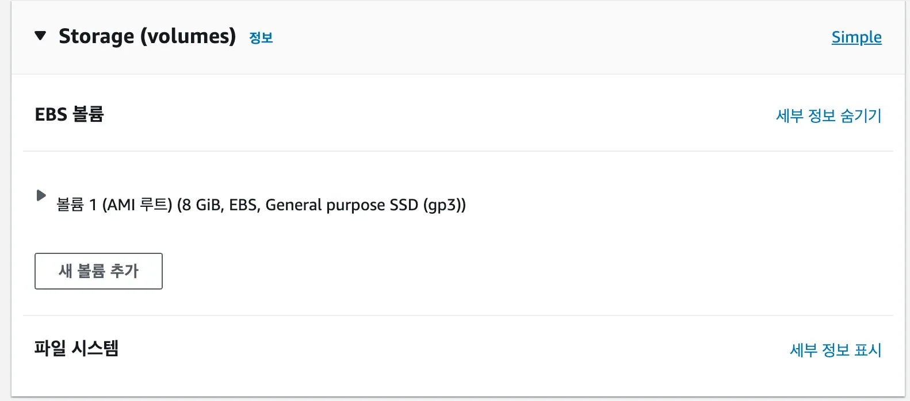

우리가 쓰는 노트북, 테스트탑 등의 기계들은 모두 하드디스크를 가지고 있다&#46; 

하드디스크는 컴퓨터에서 파일을 저장하는 공간이다&#46; EC2도 하나의 컴퓨터이기 때문에 여러 파일들을 저장할 저장 공간 즉, 하드디스크가 필요하다&#46; 

이를 AWS에서는 <code>EBS ( Elastic Block Storage)</code> 서비스를 통해 지원한다&#46;

- EBS란 EC2 안에 부착되어 있는 일종의 하드디스크라 생각하면 된다&#46;

- EBS와 같은 저장 공간을 조금 더 포괄적인 용어로 <strong><code>스토리지(Storage)</code></strong>, <strong><code>볼륨(Volume)</code></strong>이라고 부른다&#46; 

설정

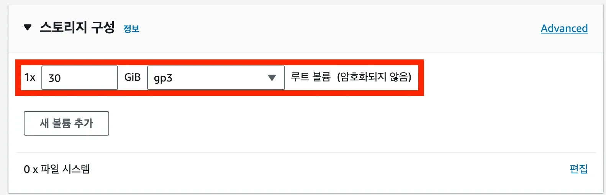

스토리지의 종류를 보면 gp3 이외에도 여러가지 종류의 스토리지가 있다&#46; 

스토리지의 크기는 추후에 늘릴 수도 있으므로 처음 설정할 때 너무 큰 고민을 할 필요는 없다&#46; 

- 실습) 가성비가 좋은 <strong><code>gp3</code></strong> 사용
    -  프리 티어에서 30GiB까지 무료로 제공함

### EC2 접속

1. <strong>세부 정보</strong>
    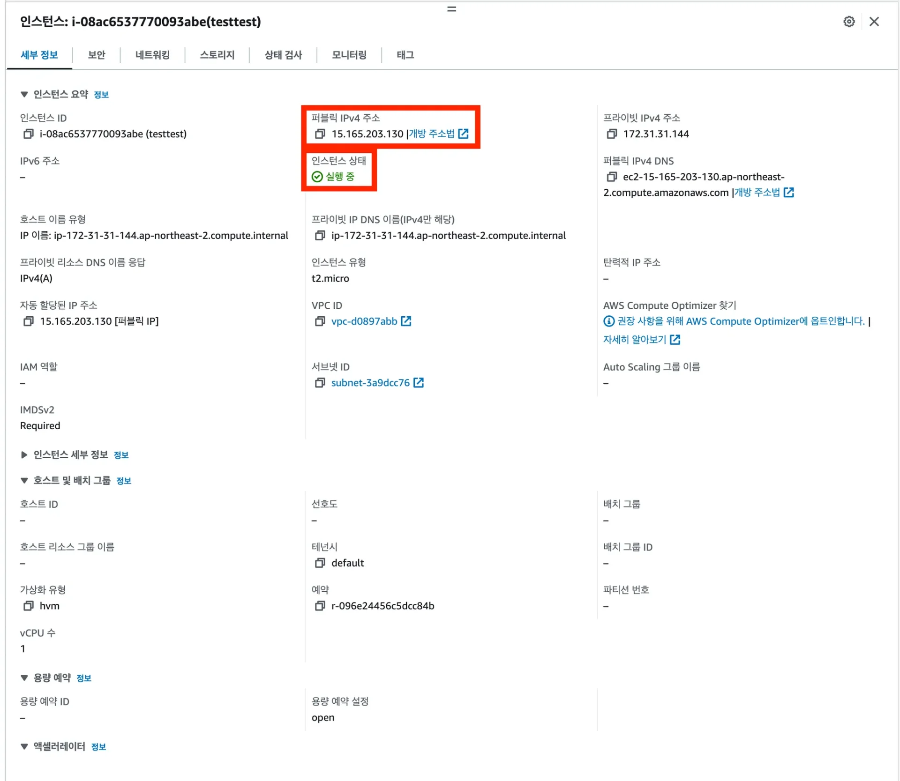

    

    세부 정보에서 눈여겨 봐야 할 부분은 2가지 밖에 없다&#46; 

    

    
<code>퍼블릭 IPv4 주소</code>

    - EC2 인스턴스가 생성되면서 부여받은 IP 주소이다&#46;

    - EC2 인스턴스에 접근하려면 이 IP 주소로 접근하면 된다&#46; 

    

    

    
<strong><code>인스턴스 상태</code></strong>

    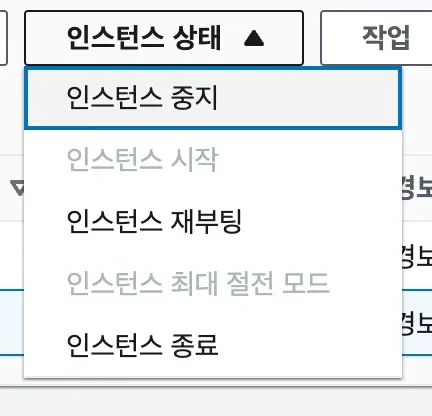

    -  EC2 인스턴스가 <strong><u>실행 중</u></strong>이라는 뜻은 컴퓨터가 켜져있다는 뜻이다&#46; 

    - C2 인스턴스를 <strong><u>중지</u></strong>, <strong><u>재부팅</u></strong>, <strong><u>종료</u></strong>도 할 수 있다&#46; 우리가 쓰는 컴퓨터와 아주 유사하다&#46; 
        - <code>재부팅</code><strong><u>&#58;</u></strong> 말그대로 <strong><u>컴퓨터(EC2)를 재시작</u></strong> 한다&#46;

        - <code>중지</code><strong><u>&#58;</u></strong> <strong><u>컴퓨터(EC2)를 잠시 꺼놓</u></strong>는 걸 의미한다&#46; 

        - <code>종료</code><strong><u>&#58;</u></strong> <u>컴퓨터(EC2)를 아예 삭제</u>시킨다는 걸 의미한다&#46;
            - 주의)  <strong>EC2 인스턴스를 한 번 종료하면 도중에 취소할 수 없다&#46;</strong>

    

1. <strong>보안 (보안 그룹)</strong>
    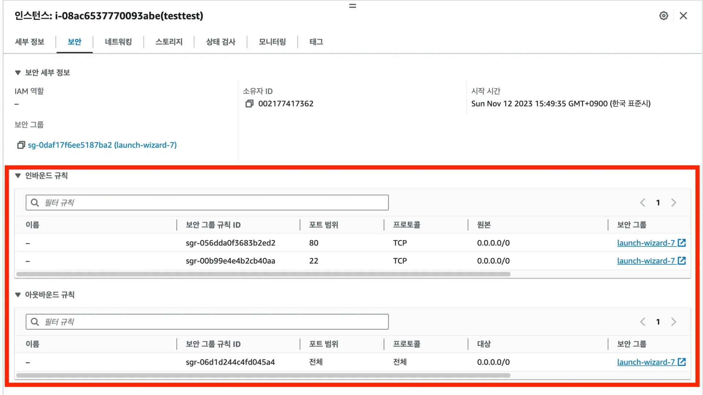

    - 인스턴스 생성 시 설정한 보안 그룹에 대한 정보

1. <strong>네트워크</strong>
    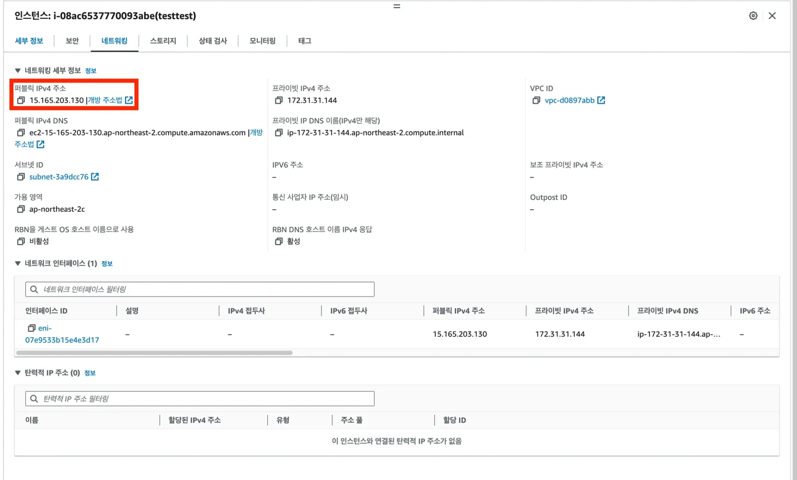

    - 퍼블릭 IPv4 주소는 생성한 EC2 인스턴스의 IP 주소를 뜻한다&#46;

1. <strong>스토리지</strong>
    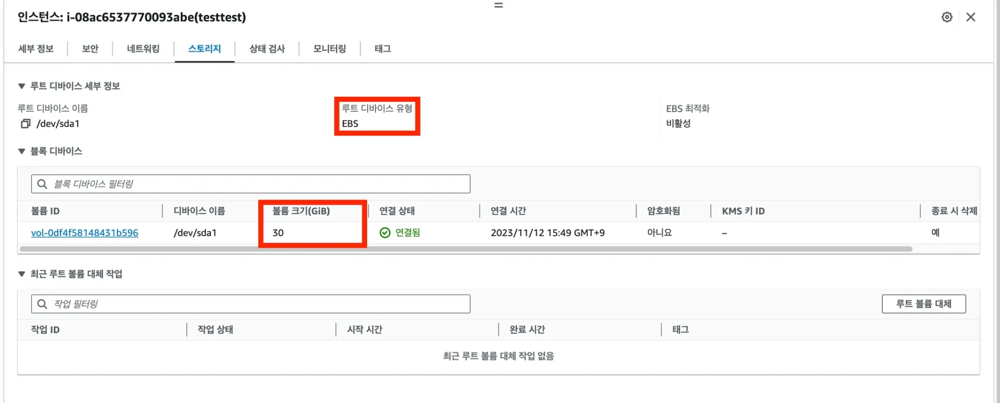

    - 인스턴스 생성 시 설정한 스토리지에 대한 정보가 나온다&#46; 

1. <strong>상태 검사</strong>
    - 잘 안본다&#46;

1. <strong>모니터링</strong>
    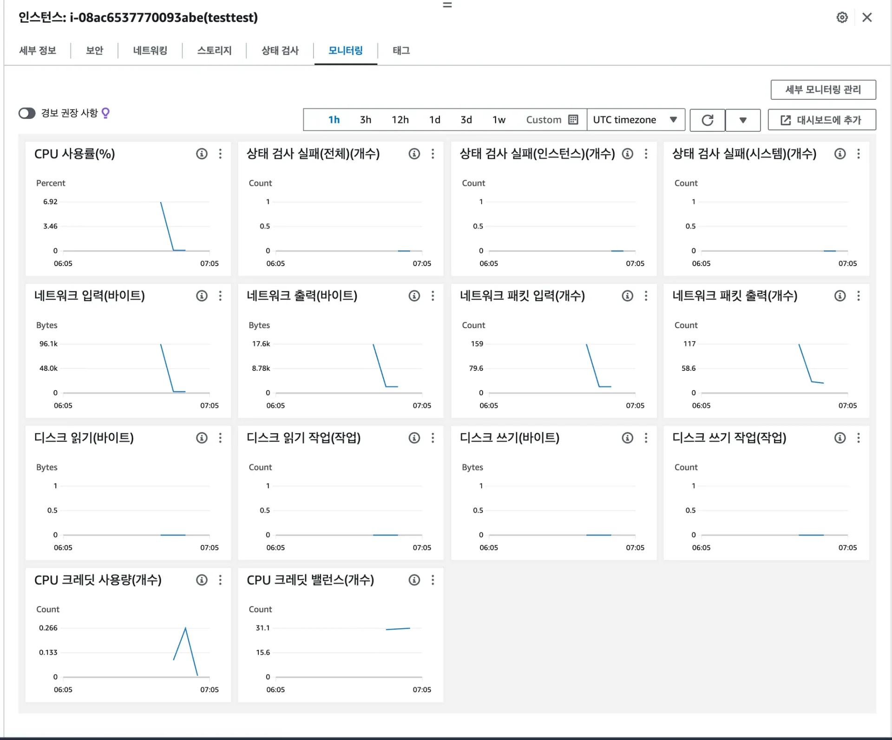

    - EC2 인스턴스에 관련한 여러가지 정보를 볼 수 있는 창이다&#46; 

    - AWS를 처음 입문할 때는 자주 볼 일이 없는 창이지만, 나중에 <strong><u>실제 서버를 운영할 때는 자주 보게되는 창</u></strong>이다&#46;

    -  EC2 인스턴스가 정상적으로 작동하고 있는 지, EC2 인스턴스의 성능을 향상시켜주어야 하는 건 아닌 지 해당지표들을 통해 파악할 수 있다&#46; 

1. <strong>태그</strong>
    > 잘 안본다&#46;

    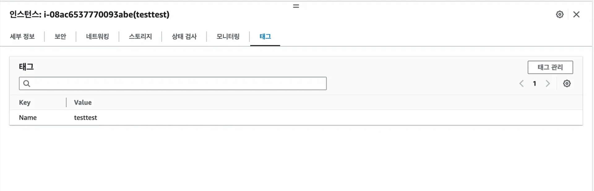

1. EC2 접속
    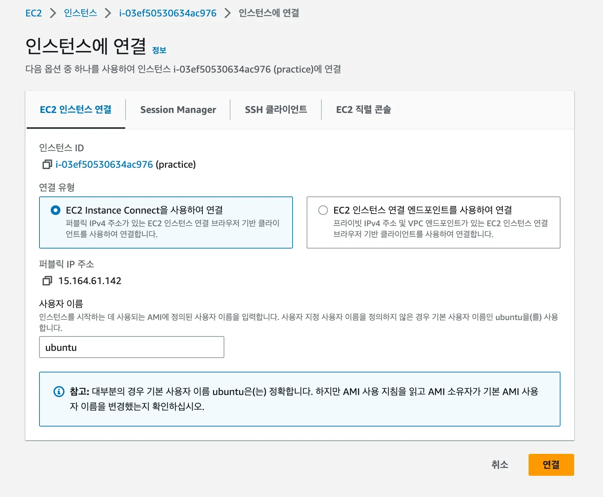

### 탄력적 IP 연결

🧐 탄력적 IP가 왜 필요한가?

EC2 인스턴스를 생성하면 IP를 할당받는다&#46; 하지만 이렇게 할당받은 IP는 <strong><u>임시적인 IP</u></strong>이다&#46; <strong>EC2 인스턴스를 잠깐 중지시켰다가 다시 실행시켜보면 IP가 바뀌어있다</strong>&#46; EC2 인스턴스를 중지시켰다가 다시 실행시킬 때마다 IP가 바뀌면 굉장히 불편하다&#46; 그래서 <strong>중지시켰다가 다시 실행시켜도 바뀌지 않는 </strong><strong><u>고정 IP를 할당</u></strong>받아야 한다&#46; 

→ <strong><code>탄력적 IP</code></strong>

- 현업에서도 EC2 인스턴스를 생성하면 탄력적 IP를 대부분 필수적으로 설정한다&#46;

### 탄력적 IP 설정 방법

- 네트워크 및 보안 &#45; 탄력적 IP 
    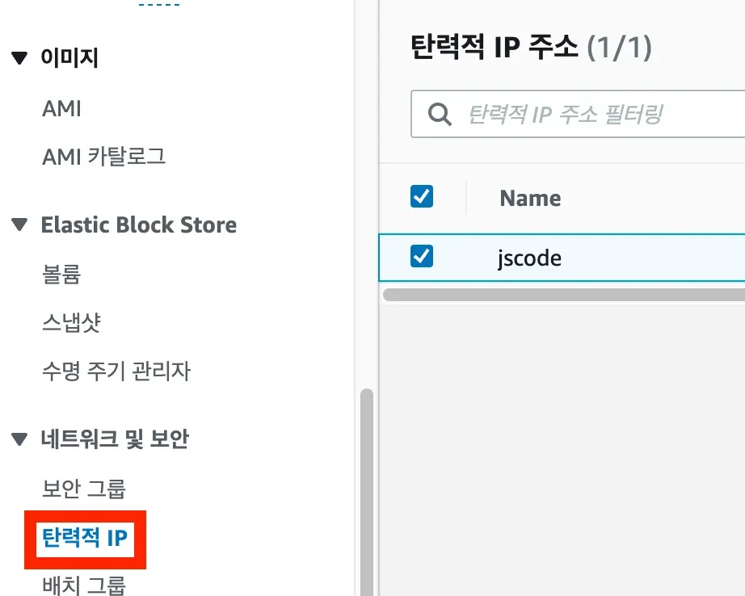

- 적용하려는 인스턴스 checked &#45; 작업 &#45; 탄력적 주소 연결
    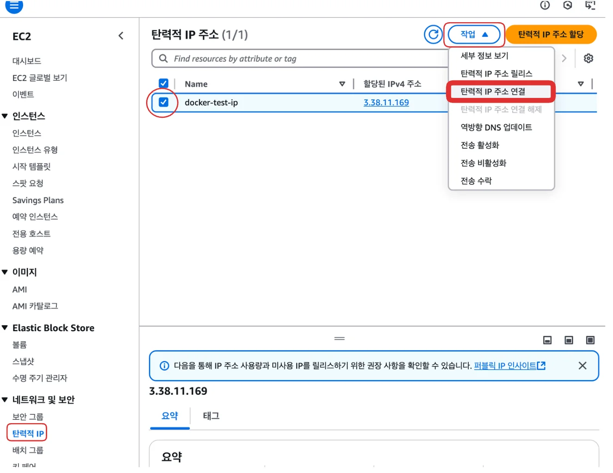

- 인스턴스 선택 후 &#45; 연결 클릭
    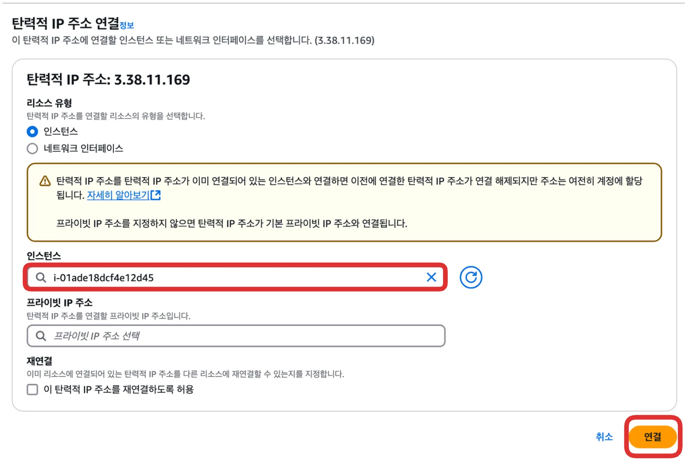

- 인스턴스 중지 후, IP(v4) 주소 확인
    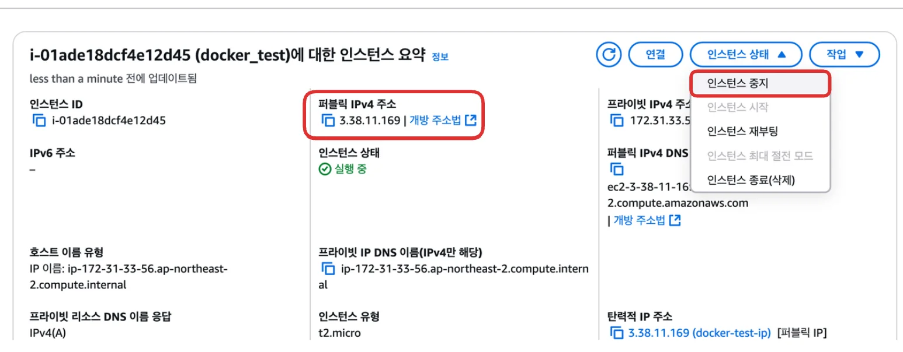

    

    인스턴스 중지 후, 재시작을 해도 IP 주소가 동일하게 유지되는 것을 확인할 수 있음

    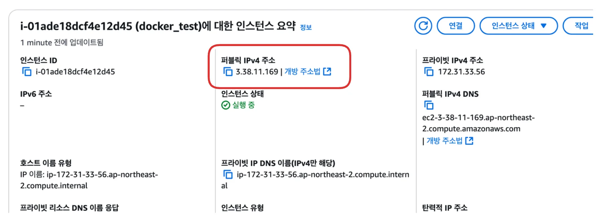
