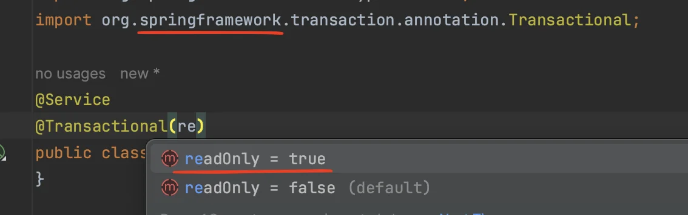

<details>
<summary>회원 개발 정리 내용 ( 코드 정리 및 재구조화 필요)</summary>

<details>
<summary>JPA에 모든 데이터 변경 로직들은 transaction(&#64;Transactional) 안에서 실행되어야 한다&#46;</summary>

- 왜 그래야 하는가?
    - 지연로딩 적용됨
        <a id="1c3eda9b0fe181ff87b3fab413ce0bc3"></a>

        트랜젝션이 적용되어야 영속성 컨텍스트 실행환경이 적용된다&#46;

        <a id="1c3eda9b0fe181298591fec2db50677a"></a>

         즉, 1차 캐시, 프록시 객체 → 지연로딩이 적용된다&#46; 

        <a id="1c3eda9b0fe1813e9b0de765d774ce25"></a>

        더 내용이 있는데 어려워서 뒤에서 설명 준신다고 하심

</details>

<details>
<summary>조회 로직에는 읽기 전용 옵션 <code>&#64;Transaction(readonly = true)</code>을 추가하여 성능적으로 더 개선할 수 있다&#46; </summary>

- 영속성 컨텍스트 flush 안함, 즉 db에 저장 안함

- 더티 체킹 안함, 즉 데이터의 변경을 확인하여 업데이트 하지 않음

- DB에 따라서는 읽기 전용 transaction임을 전달해 리소스를 단순히 읽기용 모드로 제한하여 사용하도록 함
    -  → driver&#58; db야 니가 읽어라<br>

- 조회 로직에만 적용하며, 쓰기 로직에는  <code>readOnly=false</code> 옵션을 적용해야 한다&#46;  

- 헤당 옵션을 수정하지 않고 <code>readOnly=true</code>로 쓰기 옵션 사용 시, 데이터 저장 및 업데이트 처리가 되지 않는다&#46;

</details>

<details>
<summary>회원 중복 검증(validateDuplacateMember) 오류</summary>

<a id="1c3eda9b0fe1811196f0d02c4a4c92f0"></a>

 회원 중복 검증(validateDuplacateMember)  로직은 동일한 회원이 동일한 시간에 가입하는 경우, 해당 회원이 db에 존재하지 않기 때문에 검증을 통과하여 같은 이름을 가지는 회원이 존재하게되는 오류가 발생된다&#46;

<a id="1c3eda9b0fe1816da79bebcf3a58b006"></a>

따라서 실무에서는 비지니스 로직이 에서 검증 처리를 하더라도 한번 더 방어할 수 있는 검증을 추가해야 한다&#46;

<a id="1c3eda9b0fe181d18747e544caba53b1"></a>

즉, 멀티쓰레드 상황을 고려하여 db의 회원 이름에 유니크 제약 조건을 필히 추가해야한다&#46; 

</details>

<details>
<summary>의존성 주입</summary>

<a id="1c3eda9b0fe18108bf85dc9f75e6a578"></a>

<a href="#/post/1c3eda9b-0fe1-81d8-9f33-f3d9edbaeb91">페이지</a> 

- 생성자 1개 시 &#64;Autowired 생략 가능

- final 키워드 &#43; &#64;RequiredArgsConstructor 
    - final 키워드를 통해 생성자 값 누락 시 컴파일 시점에서 체크 가능

    - 변경불가, 불변성 유지

    - 롬복을 통한 final 키워드가 적용된 필드 생성자 자동 생성

</details>

<details>
<summary>스프링부트 사용 시 entityManager 생성자 주입 가능</summary>

- 스프링만 사용 시 엔티티매니저를 사용하려면 <code>&#64;PersistanceContext</code> 애노테이션를 적용해야 한다&#46;

<a id="1c3eda9b0fe181b6aebae66b6acc7efb"></a>

무슨 이점이 있는거지? 

- 5&#46;2 회원서비스 개발 마지막 부분(16분 부터)

- 일관성 있고 간편하기 테스트 가능

</details>

<a id="1c3eda9b0fe181668802e2cdb623ba2b"></a>

5&#46;3 회원 테스트

<details>
<summary>회원 가입 성공</summary>

<details>
<summary>주의) 쿼리 insert문 존재 x</summary>

- save() &#45; em&#46;persist()

- flush가 되지 않기 때문에 insert문 날리지 않음

- em&#46;comit() 사용 시 flush되면서 db로 insert문 날림

- 스프링의 &#64;Transactional은 기본 동작으로 commit이 아닌 rollback을 한다&#46;
    - &#64;Rollback(false) 
        - 기본 동작인 rollback을 commit으로 변경함

        - 따라서 flush가 발생되고 insert 쿼리를 날림

- Rollback 시 스프링이 db에 insert 자체를 하지 않음

- 즉, 영속성컨텍스트가 플러시를 하지 않음
    - Rollback 이 db를 초기화 한다는 의미이기 때문

</details>

<details>
<summary>Rollback 동작에서 db 쿼리를 확인하고 싶은 경우</summary>

- EntityManager를 가져와 flush(<code>em&#46;flush()</code>) 시, insert 쿼리가 날라가는 것을 확인 할 수 있음
    <a id="1c3eda9b0fe1814a84d3da1adb1f9fce"></a>

    ```java
    @Autowired EntityManager em;
         
         .  .  .

          em.flush()
    ```

    > 강제로 flush를 하여 쿼리를 날림, 테스트가 끝날 때 db를 rollback 처리함

    <a id="1c3eda9b0fe181739dbecc5ed9eced77"></a>

    Rollback이 기본 동작인 이유는 테스트가 반복적으로 실행되기 때문에 기본적으로 db에 해당 데이터가 남으면 안된다&#46;

    <a id="1c3eda9b0fe181f4bdd5e4d63c9fd0db"></a>

    따라서 하나의 테스트가 끝나고 자동으로 db를 롤백처리하여 초기화 시켜 동작하게 설계합&#46;

</details>

<details>
<summary>가장 좋은 테스트</summary>

<a id="1c3eda9b0fe181ce9492cb76e32935da"></a>

WAS 띄울 때 조그만 메모리 db를 띄워서 테스트 하는 것이 제일 좋음 

</details>

</details>

<details>
<summary>중복 회원 가입 시 예외처리</summary>

<details>
<summary>Assert&#46;fail()</summary>


</details>

<details>
<summary>try &#45; catch</summary>

<a id="1c3eda9b0fe181a29c4eda38db146a51"></a>

```java
try {
    memberService.join(member2);
} catch (IllegalStateException e) {
    return;
}
```

</details>

</details>

<details>
<summary>테스트 &#45; given , when , then </summary>

> 스파르타 5주차 &#45; 테스트 정리 후 링크 추가

- Given&#58; 주어지는 데이터 값들

- When&#58; 기대되는 값을 도출하기 위한 동작들

- Then&#58; 결과값과 올바른 동작 시 생성되는 값 비교 및 판별하여 테스트 성공, 실패 유무 판별

</details>

<details>
<summary>메모리DB 사용</summary>

- 스프링부트 사용 시 간단하게 사용 가능함

- 기본적으로 main과  test 폴더는 해당 폴더 내부의 application&#46;yml 파일 설정을 우선순위로 가진다&#46;

- 테스트 폴더 안에 application&#46;yml 생성
    <a id="1c3eda9b0fe18171953cefefd24b1c32"></a>

    ```yaml
    spring:
      datasource:
        url: jdbc:h2:mem:test
        
        
        pdf 보고 추가하기
    ```

- 스프링부트 사용 시 기본설정을 메모리로 사용함 따라서 따로 application&#46;yml을 사용하여 설정하지 않아도 됨

</details>

<details>
<summary>테스트 서버에서의 설정과 운영 서버에서의 설정(yml)은 분리해야 한다&#46;</summary>

<a id="1c3eda9b0fe18137be96ddc446044389"></a>

로컬에 띄우는 개발 db에 띄우든 실제 db를 실행 시켜 테스트하는 것은 다르다??

</details>

<details>
<summary>기본 동작 ddl은 create&#45;drop이다&#46;</summary>


</details>

</details>

- [x] 강의가 예전 버전이라 현재 버전과 맞지않아 코드 오류가 많다&#46; <br>→ 수정 필요함

<details>
<summary>🧐 Spring 버전의 Transaction을 사용해야 한다&#46;</summary>

- 트랜젝션(<code>&#64;Transactional</code>)에는 2개의 버전 존재한다&#46; 
    <details>
    <summary>jakarta</summary>

    <a id="1c3eda9b0fe181b29ea0ea3d22c79932"></a>

    ```java
    import jakarta.transaction.Transactional;
    ```

    </details>

    <details>
    <summary>springframework</summary>

    <a id="1c3eda9b0fe18190a2c7d4aca8f1d080"></a>

    ```java
    import org.springframework.transaction.annotation.Transactional;
    ```

    </details>

- springframework 버전의 transaction을  것이 더 많은 기능이 있어 해당 버전의 트랜젝션 사용을 권장한다&#46;
    - <code>springframework</code> 버전을 사용해야 readOnly 옵셥을 사용할 수 있다&#46;
        

</details>

<details>
<summary>🧐 <strong>EntityManager</strong>를 DI를 통해 가져오는 것이 아닌 영속성 컨텍스트에서 가져오는 이유는 무엇인가?</summary>

<details>
<summary>🧐 <code>&#64;PersistenceContext</code></summary>

<a id="1c3eda9b0fe18104a355f3e80a82f2db"></a>

<br>

</details>

<a id="1c3eda9b0fe181a2bfa1e3d21bb4b866"></a>

```java
 @Repository
 public class MemberRepository {
     @PersistenceContext
     private EntityManager em;
```

</details>

<details>
<summary>⚠️  <strong><u>JUnit 5</u></strong>에서는 <em><code>&#64;RunWith(SpringRunner&#46;class)</code></em>를 <strong>사용되지 않</strong>는다&#46;</summary>

<a id="1c3eda9b0fe181e4bb22c5d3beaf0bae"></a>

 JUnit 5는 새로운 확장 모델을 도입하여 이전 JUnit 4에서 사용하던 &#64;RunWith 대신에 <code>&#64;ExtendWith</code>를 사용한다&#46;

<details>
<summary>ex</summary>

<a id="1c3eda9b0fe181c29c30c322a808a191"></a>

```java
import org.junit.jupiter.api.Test;
import org.springframework.boot.test.context.SpringBootTest;
import org.springframework.test.context.junit.jupiter.SpringExtension;
import org.junit.jupiter.api.extension.ExtendWith;

@ExtendWith(SpringExtension.class)  // Spring과 JUnit 5를 통합하는 어노테이션
@SpringBootTest  // Spring Boot 테스트를 위한 환경 설정
public class ExampleTest {

    @Test
    void testExample() {
        assertEquals(2, 1 + 1);
    }
}
```

</details>

</details>

<details>
<summary>⚠️ JUnit 5에서는 <code>&#64;Test(expected = IllegalStateException&#46;class)</code>  해당 방식을 더이상 지원하지 않음  → <em><strong><u><code>assertThrows()</code></u></strong></em></summary>

<details>
<summary><strong>JUnit 4 방식</strong></summary>

<a id="1c3eda9b0fe181a1a4f0c4438633c2e0"></a>

```java
import org.junit.Test;

public class ExampleTest {

    @Test(expected = IllegalStateException.class)  // JUnit 4 방식
    public void testShouldThrowException() {
        // 예외를 발생시키는 코드
        throw new IllegalStateException("예외 발생!");
    }
}
```

</details>

- JUnit 5에서는 <strong><u><code>assertThrows</code></u></strong> 메서드를 사용하여 예외를 테스트한다&#46;
    <a id="1c3eda9b0fe1810faefbdc11d72ff5f1"></a>

    ```java
    assertThrows(Exception.class, () -> { ... })
    ```


<details>
<summary>ex1) exception 던짐</summary>

<a id="1c3eda9b0fe18171a01bd848cfaf6eac"></a>

```java
import org.junit.jupiter.api.Test;
import static org.junit.jupiter.api.Assertions.assertThrows;

public class ExampleTest {

    @Test
    void testShouldThrowException() {  // JUnit 5 방식
    
        // assertThrows를 사용하여 예외 테스트
        assertThrows(IllegalStateException.class, () -> {
            // 예외를 발생시키는 코드
            throw new IllegalStateException("예외 발생!");
        });
    }
}
```

</details>

<details>
<summary>ex2) MemberServiceTest &#45; 중복 회원 예외</summary>

<details>
<summary><strong>MemberService &#45; 중복 회원 유효성 검사 </strong></summary>

<a id="1c3eda9b0fe181cfbaf7d14ad875ee74"></a>

```java
/**
 * 회원가입
 */
@Transactional  // readOnly = false
public Long join(Member member) {

    validateDuplicateMember(member);
    memberRepository.save(member);
    return member.getId();
}

private void validateDuplicateMember(Member member) {
    List<Member> findMembers = memberRepository.findByName(member.getName());

    if (!findMembers.isEmpty()) {
        throw new IllegalStateException("이미 존재하는 회원입니다.");
    }
}
```

</details>

<a id="1c3eda9b0fe181e98eedeca1c5696d4b"></a>

```java
@Test
void 중복_회원_예외() throws Exception{
    // given
    Member member1 = new Member();
    member1.setName("test1");

    Member member2 = new Member();
    member2.setName("test1");

    // when
    Long saveId1 = memberService.join(member1);

    // then
    assertThrows(IllegalStateException.class, ()->{
        memberService.join(member2);  // 예외 발생
    });

}
```

</details>

</details>

<details>
<summary>순수 단위테스트가 아닌 jpa, 메모리db까지 엮어서 테스트 하는 것이기 때문에 스프링이랑 인티그레이션(통합) 해서 진행함</summary>

- &#64;SpringBootTest 

<details>
<summary>&#64;RunWith(SpringRunner&#46;class)</summary>

- JUnit 4 에서만 사용, 5에서는 <code>&#64;ExtendWith</code> 사용함

</details>

- 두 애노테이션을 통해 스프링부트 환경에서 테스트 가능함

>  스프링부트 환경을 인티그레이션(통합) 하여 테스트 하는 것은 많은 자원를 소모하는 무거운 작업이다&#46;<br>실제 실무에서 테스트 작업 시에는 순수한 단위테스트로  작성해야 한다&#46; 

</details>

<a id="1c3eda9b0fe1816ab355cc09df104ef8"></a>

### 코드 

<details>
<summary><strong>&#91; 코드 &#93; 서비스 &#45;  MemberService</strong></summary>

<a id="1c3eda9b0fe1810ca108efc9885ba253"></a>

```java
package com.prac.jpa1.service;


import com.prac.jpa1.domain.Member;
import com.prac.jpa1.repository.MemberRepository;
import lombok.RequiredArgsConstructor;
import org.springframework.stereotype.Service;
import org.springframework.transaction.annotation.Transactional;

import java.util.List;

@Service
@Transactional(readOnly = true)
@RequiredArgsConstructor
public class MemberService {

    private final MemberRepository memberRepository;


    /**
     * 회원가입
     */
    @Transactional  // readOnly = false
    public Long join(Member member) {

        validateDuplicateMember(member);
        memberRepository.save(member);
        return member.getId();
    }

    private void validateDuplicateMember(Member member) {
        List<Member> findMembers = memberRepository.findByName(member.getName());

        if (!findMembers.isEmpty()) {
            throw new IllegalStateException("이미 존재하는 회원입니다.");
        }
    }


    /**
     * 전체 회원 조회
     */
    public List<Member> findMembers(){
        return memberRepository.findAll();
    }


    /**
     * 회원 조회
     */
    public Member findOne(Long memberId){
        return memberRepository.findOne(memberId);
    }

}

```

</details>

<details>
<summary><strong>&#91; 코드 &#93; 저장소 &#45; MemberRepository</strong></summary>

<a id="1c3eda9b0fe181cdbee0d6e0629b9b21"></a>

```java
package com.prac.jpa1.repository;

import com.prac.jpa1.domain.Member;
import jakarta.persistence.EntityManager;
import jakarta.persistence.PersistenceContext;
import lombok.RequiredArgsConstructor;
import org.springframework.stereotype.Repository;

import java.util.List;

@Repository
public class MemberRepository {

    @PersistenceContext
    private EntityManager em;

    public void save(Member member) {
        em.persist(member);
    }

    public Member findOne(Long memberId) {
        return em.find(Member.class, memberId);
    }

    public List<Member> findAll() {
        return em.createQuery("select m from Member m", Member.class)
                .getResultList();
    }

    public List<Member> findByName(String name){
        return em.createQuery("select m from Member m where m.name = :name", Member.class)
                .setParameter("name", name)
                .getResultList();
    }
}

```

</details>

<details>
<summary><strong>&#91; 코드 &#93; 테스트 &#45; MemberServiceTest</strong></summary>

<details>
<summary>회원가입 테스트</summary>

- <code>assertEquals()</code>로 저장한 값 조회하여 비교 
    <a id="1c3eda9b0fe1818dbee5ce01dab16bb6"></a>

    ```java
    @Test
    void 회원가입() throws Exception{
        // given
        Member member = new Member();
        member.setName("LEE");

        // when
        Long saveId = memberService.join(member);

        // then
        assertEquals(member, memberRepository.findOne(saveId));
    }
    ```

</details>

<details>
<summary>중복된 이름으로 회원 가입 시 예외 발생 테스트</summary>

- <strong>MemberService &#45; 중복 회원 유효성 검사 </strong>
    <a id="1c3eda9b0fe181deba2ddd97b0891233"></a>

    ```java
    /**
     * 회원가입
     */
    @Transactional  // readOnly = false
    public Long join(Member member) {

        validateDuplicateMember(member);
        memberRepository.save(member);
        return member.getId();
    }

    private void validateDuplicateMember(Member member) {
        List<Member> findMembers = memberRepository.findByName(member.getName());

        if (!findMembers.isEmpty()) {
            throw new IllegalStateException("이미 존재하는 회원입니다.");
        }
    }
    ```

<a id="1c3eda9b0fe1813eb45afc7b157176d8"></a>

중복된 이름으로 회원 가입하는 경우, 에외처리(IllegalStateException)하여 validation(검증) 하였다&#46; 

<a id="1c3eda9b0fe18186a41efe7e23e91847"></a>

아래 테스트 코드를 통해서 중복된 이름으로 회원 가입 시,

<a id="1c3eda9b0fe181bfb595d6e660e9671d"></a>

```java
// given
Member member1 = new Member();
member1.setName("test1");

Member member2 = new Member();
member2.setName("test1");

// when
Long saveId1 = memberService.join(member1);
```

<a id="1c3eda9b0fe181a7b46dcf44ee5cc09e"></a>

 IllegalStateException가 발생되어 테스트가 정상적으로 완료되는 것을 확인 가능하다&#46;

- <code>assertThrows( Exception&#46;class, 해당하는 Exception 발생 로직 )</code>
    <a id="1c3eda9b0fe181ca809ef3e2bebe5805"></a>

    ```java
    // then
    assertThrows(IllegalStateException.class, ()->{
        memberService.join(member2);  // 예외가 발생해야 한다.
    });
    ```

</details>

<a id="1c3eda9b0fe181f8a84ed74a026b5e0f"></a>

```java
package com.prac.jpa1.service;

import com.prac.jpa1.domain.Member;
import com.prac.jpa1.repository.MemberRepository;
import org.junit.jupiter.api.Test;
import org.springframework.beans.factory.annotation.Autowired;
import org.springframework.boot.test.context.SpringBootTest;
import org.springframework.transaction.annotation.Transactional;

import static org.junit.jupiter.api.Assertions.*;

@SpringBootTest
@Transactional
public class MemberServiceTest {

    @Autowired MemberService memberService;
    @Autowired MemberRepository memberRepository;

    @Test
    void 회원가입() throws Exception{
        // given
        Member member = new Member();
        member.setName("LEE");

        // when
        Long saveId = memberService.join(member);

        // then
        assertEquals(member, memberRepository.findOne(saveId));

    }

    @Test
    void 중복_회원_예외() throws Exception{
        // given
        Member member1 = new Member();
        member1.setName("test1");

        Member member2 = new Member();
        member2.setName("test1");

        // when
        Long saveId1 = memberService.join(member1);

        // then
        assertThrows(IllegalStateException.class, ()->{
            memberService.join(member2);  // 예외가 발생해야 한다.
        });

    }
}
```

</details>
