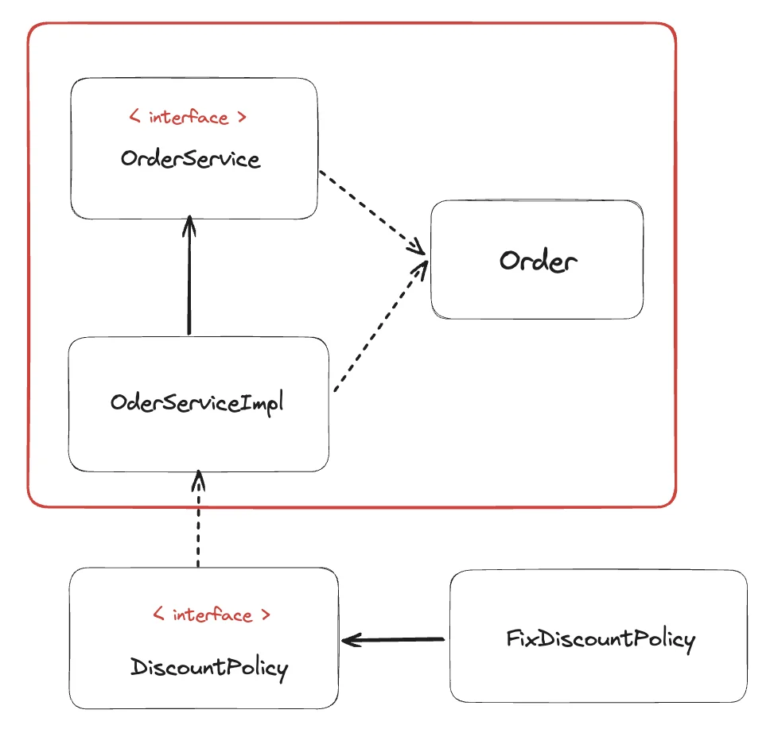

<a id="1c3eda9b0fe1816592acd4669a1358fe"></a>

## 주문 도메인 개발



<a id="1c3eda9b0fe181d2b233d54e9ae712c5"></a>

## Order

<a id="1c3eda9b0fe18194a404d7a05eb6723c"></a>

```java
package hello.core.order;

public class Order {
    private Long memberId;
    private String itemName;
    private int itemPrice;
    private int discountPrice;

    public Order(Long memberId, String itemName, int itemPrice, int discountPrice) {
        this.memberId = memberId;
        this.itemName = itemName;
        this.itemPrice = itemPrice;
        this.discountPrice = discountPrice;
    }

    public int calculatePrice(){
        return itemPrice - discountPrice;
    }

    public Long getMemberId() {
        return memberId;
    }

    public void setMemberId(Long memberId) {
        this.memberId = memberId;
    }

    public String getItemName() {
        return itemName;
    }

    public void setItemName(String itemName) {
        this.itemName = itemName;
    }

    public int getItemPrice() {
        return itemPrice;
    }

    public void setItemPrice(int itemPrice) {
        this.itemPrice = itemPrice;
    }

    public int getDiscountPrice() {
        return discountPrice;
    }

    public void setDiscountPrice(int discountPrice) {
        this.discountPrice = discountPrice;
    }

    @Override
    public String toString() {
        return "Order{" +
                "memberId=" + memberId +
                ", itemName='" + itemName + '\'' +
                ", itemPrice=" + itemPrice +
                ", discountPrice=" + discountPrice +
                '}';
    }
}
```

<a id="1c3eda9b0fe18148930eda83d333da3b"></a>

## &#60; interface &#62; OrderService 

<a id="1c3eda9b0fe1814fbdc4dd1ff3798e84"></a>

```java
package hello.core.order;

public interface OderService {
    Order createOrder(Long memberId, String itemName, int itemPrice);
}
```

<a id="1c3eda9b0fe18171b0f6e63d9a43a7c2"></a>

## OrderServiceImpl

<a id="1c3eda9b0fe181ad892fd6a194810f7e"></a>

```java
package hello.core.order;

import hello.core.discount.DiscountPolicy;
import hello.core.discount.FixDiscountPolicy;
import hello.core.member.Member;
import hello.core.repository.MemberRepository;
import hello.core.repository.MemoryMemberRepository;

public class OderServiceImpl implements OderService {
    MemberRepository memberRepository = new MemoryMemberRepository();
    DiscountPolicy discountPolicy = new FixDiscountPolicy();

    @Override
    public Order createOrder(Long memberId, String itemName, int itemPrice) {
        Member member = memberRepository.findById(memberId);

				// 등급(memberGrade)만 넘길지, member 전체를 넘길지는 알아서 선택
        int discountPrice = discountPolicy.discount(member, itemPrice);  // 할인 정책이 적용된 값
        return new Order(memberId, itemName, itemPrice, discountPrice);
    }
}
```

<a id="1c3eda9b0fe1811c80dbc6b89ac3548a"></a>

## 할인 도메인 개발


<a id="1c3eda9b0fe181b7987af067a0459f30"></a>

### &#60; interface &#62; DiscountPolicy

<a id="1c3eda9b0fe181a88f53df2dfca2756e"></a>

```java
package hello.core.discount;

import hello.core.member.Member;

public interface DiscountPolicy {

    /**
     * @return 할인 대상 금액
     */
    int discount(Member member, int price);
}
```

<a id="1c3eda9b0fe181558feac520cd8bec3a"></a>

### FixDiscountPolicy

<a id="1c3eda9b0fe18195be5ddbf2085dcd61"></a>

```java
package hello.core.discount;

import hello.core.member.Grade;
import hello.core.member.Member;

public class FixDiscountPolicy implements DiscountPolicy{
    private int discountFixAmount = 1000; // 1000원 할인
    @Override
    public int discount(Member member, int price) {
        if (member.getGrade() == Grade.VIP) {
            return discountFixAmount;
        } else {
            return 0;
        }
    }
}
```

<a id="1c3eda9b0fe18110b852d0da4276ab6c"></a>

### 확실히 클래스 다이어그램을 정리하고 개발을 진행하니, 작성과 이해가 원할함  → 이전 챕터에도 적용함
