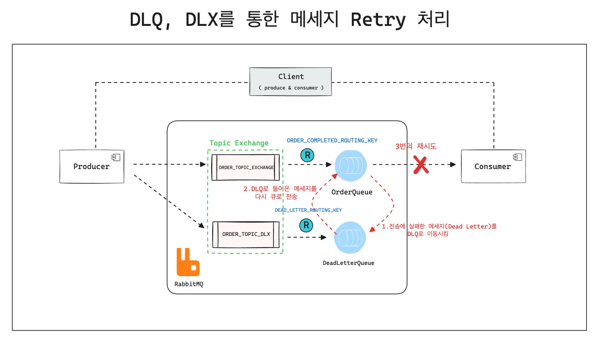
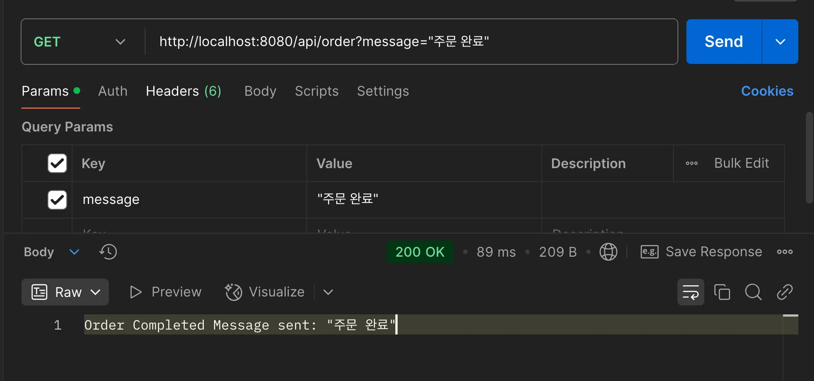
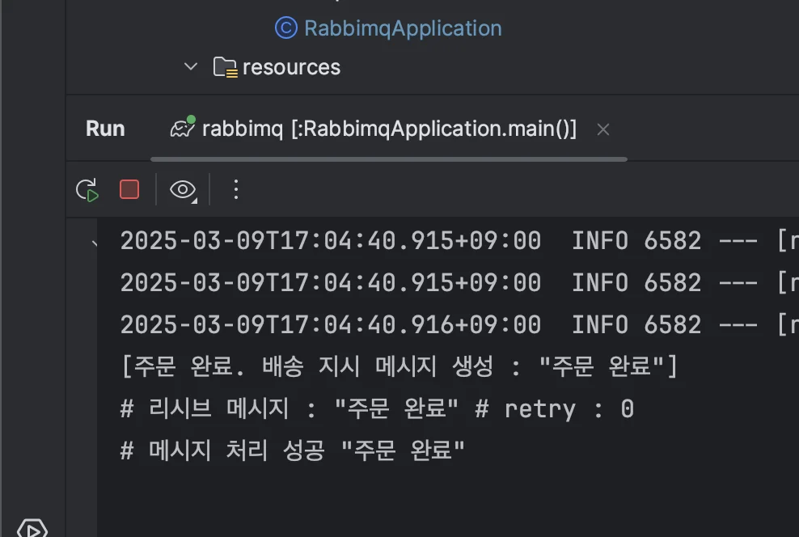
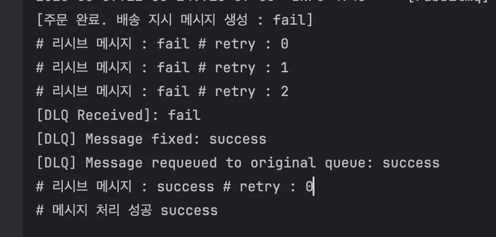

<a id="1c3eda9b0fe181e0a11ad9984a67e6af"></a>

## RetryTemplate을 이용한 DeadLetter 재처리

---

> ✏️ 
> 
> <a id="1c3eda9b0fe181e88491c5b9e22c4997"></a>
> 
> <code>step7</code> 과 동일한 프로세스를 SimpleRetryPolicy 설정 후, RetryTemplate을 통해 개선



<a id="1c3eda9b0fe181a98dddd3166cb79853"></a>

### 코드 

[step8.1: RetryTemplate을 활용한 Retry 처리](https://github.com/gyungsubLee/RabbitMQ_prac/commit/219173084c8e25bd35d9bea501afed3fb46348b0)

<details>
<summary><code>retry 의존성 추가</code>&#58; buil&#46;gradle</summary>

<a id="1c3eda9b0fe181df89f8cd6ea6c68991"></a>

```groovy
dependencies {
	implementation 'org.springframework.retry:spring-retry'
```

</details>

<details>
<summary><code>retry 처리</code>&#58; OrderDeadLetterRetry</summary>

<a id="1c3eda9b0fe1818ea809c311e7dc2201"></a>

```java
package com.prac.rabbimq.step8_1;

import org.springframework.amqp.rabbit.annotation.RabbitListener;
import org.springframework.amqp.rabbit.core.RabbitTemplate;
import org.springframework.stereotype.Component;

/**
 * 데드레터로 들어온 메시지 Requeue 처리
 */
@Component
public class OrderDeadLetterRetry {

    private final RabbitTemplate rabbitTemplate;

    public OrderDeadLetterRetry(RabbitTemplate rabbitTemplate) {
        this.rabbitTemplate = rabbitTemplate;
    }

    @RabbitListener(queues = RabbitMQConfig.DLQ)
    public void processDeadLetter(String message) {
        System.out.println("[DLQ Received]: " + message);

        try {
            // "fail" 메시지를 수정하여 성공적으로 처리되도록 변경
            if ("fail".equalsIgnoreCase(message)) {
                message = "success";
                System.out.println("[DLQ] Message fixed: " + message);
            } else {
                // 이미 수정된 메시지는 다시 처리하지 않음
                System.err.println("[DLQ] Message already fixed. Ignoring: " + message);
                return;
            }

            // 수정된 메시지를 원래 큐로 다시 전송
            rabbitTemplate.convertAndSend(RabbitMQConfig.ORDER_TOPIC_EXCHANGE, RabbitMQConfig.ORDER_COMPLETED_ROUTING_KEY, message );
            System.out.println("[DLQ] Message requeued to original queue: " + message);
        } catch (Exception e) {
            System.err.println("[DLQ] Failed to reprocess message: " + e.getMessage());
        }
    }
}
```

</details>

<details>
<summary><code>config</code>&#58; RetryConfig</summary>

<a id="1c3eda9b0fe18184b90fd120f0a92f79"></a>

```java
package com.prac.rabbimq.step8_1;

import org.springframework.context.annotation.Bean;
import org.springframework.context.annotation.Configuration;
import org.springframework.retry.backoff.FixedBackOffPolicy;
import org.springframework.retry.support.RetryTemplate;
import org.springframework.retry.policy.SimpleRetryPolicy;

@Configuration
public class RetryConfig {

    @Bean
    public RetryTemplate retryTemplate() {
        RetryTemplate retryTemplate = new RetryTemplate();
        // 재시도 정책 설정: 최대 3번 시도
        SimpleRetryPolicy retryPolicy = new SimpleRetryPolicy();
        retryPolicy.setMaxAttempts(3);
        // 백오프 정책 설정: 재시도 간격 1초
        FixedBackOffPolicy backOffPolicy = new FixedBackOffPolicy();
        backOffPolicy.setBackOffPeriod(1000L);
        retryTemplate.setRetryPolicy(retryPolicy);
        retryTemplate.setBackOffPolicy(backOffPolicy);

        return retryTemplate;
    }
}
```

</details>

<details>
<summary><code>config</code>&#58; RabbitMQConfig</summary>

<a id="1c3eda9b0fe181f8be87cb6661edefb2"></a>

```java
package com.prac.rabbimq.step8_1;

import org.springframework.amqp.core.*;
import org.springframework.context.annotation.Bean;
import org.springframework.context.annotation.Configuration;


@Configuration
public class RabbitMQConfig {
    // 큐, 교환기, 라우팅 키 이름 정의
    public static final String ORDER_COMPLETED_QUEUE = "orderCompletedQueue";
    public static final String DLQ = "deadLetterQueue";

    public static final String ORDER_TOPIC_EXCHANGE = "orderExchange";
    public static final String ORDER_TOPIC_DLX = "deadLetterExchange";

    public static final String ORDER_COMPLETED_ROUTING_KEY = "order.completed";
    public static final String DEAD_LETTER_ROUTING_KEY = "dead.letter";

    // 원래 큐에 연결된 Topic Exchange
    @Bean
    public TopicExchange orderExchange() {
        return new TopicExchange(ORDER_TOPIC_EXCHANGE);
    }

    // Dead Letter Exchange
    @Bean
    public TopicExchange deadLetterExchange() {
        return new TopicExchange(ORDER_TOPIC_DLX);
    }

    // 원래 큐 설정
    @Bean
    public Queue orderQueue() {
        return QueueBuilder.durable(ORDER_COMPLETED_QUEUE)
                .withArgument("x-dead-letter-exchange", ORDER_TOPIC_DLX) // DLX 설정
                .withArgument("x-dead-letter-routing-key", DEAD_LETTER_ROUTING_KEY) // DLQ로 이동할 라우팅 키 설정
                .build();
    }

    // Dead Letter Queue 설정
    @Bean
    public Queue deadLetterQueue() {
        return QueueBuilder.durable(DLQ).build();
    }

    // 원래 큐와 Exchange 바인딩
    @Bean
    public Binding orderQueueBinding() {
        return BindingBuilder.bind(orderQueue()).to(orderExchange()).with(ORDER_COMPLETED_ROUTING_KEY);
    }

    // Dead Letter Queue와 Dead Letter Exchange 바인딩
    @Bean
    public Binding deadLetterQueueBinding() {
        return BindingBuilder.bind(deadLetterQueue()).to(deadLetterExchange()).with(DEAD_LETTER_ROUTING_KEY);
    }
}
```

</details>

<details>
<summary><code>producer</code>&#58; OrderProducer</summary>

<a id="1c3eda9b0fe1817aa419e336246f0b9f"></a>

```java
package com.prac.rabbimq.step8_1;

import org.springframework.amqp.rabbit.core.RabbitTemplate;
import org.springframework.stereotype.Component;

@Component
public class OrderProducer {
    private final RabbitTemplate rabbitTemplate;

    public OrderProducer(RabbitTemplate rabbitTemplate) {
        this.rabbitTemplate = rabbitTemplate;
    }

    public void sendShipping(String message) {
        rabbitTemplate.convertAndSend(RabbitMQConfig.ORDER_TOPIC_EXCHANGE, "order.completed", message);
        System.out.println("[주문 완료. 배송 지시 메시지 생성 : " + message + "]");
    }
}
```

</details>

<details>
<summary><code>consumer</code>&#58; OrderConsumer</summary>

<a id="1c3eda9b0fe181f6b5fecd36b00531ed"></a>

```java
package com.prac.rabbimq.step8_1;

import org.springframework.amqp.rabbit.annotation.RabbitListener;
import org.springframework.amqp.rabbit.core.RabbitTemplate;
import org.springframework.retry.support.RetryTemplate;
import org.springframework.stereotype.Component;

@Component
public class OrderConsumer {

    private final RabbitTemplate rabbitTemplate;
    private final RetryTemplate retryTemplate;

    public OrderConsumer(RabbitTemplate rabbitTemplate, RetryTemplate retryTemplate) {
        this.rabbitTemplate = rabbitTemplate;
        this.retryTemplate = retryTemplate;
    }

    @RabbitListener(queues = RabbitMQConfig.ORDER_COMPLETED_QUEUE)
    public void consume(String message) {
        retryTemplate.execute(context -> {
            try {
                System.out.println("# 리시브 메시지 : " + message + " # retry : " + context.getRetryCount());
                // 실패 조건
                if ("fail".equalsIgnoreCase(message)) {
                    throw new RuntimeException(message);
                }
                System.out.println("# 메시지 처리 성공 " + message);
            } catch (Exception e) {
                if (context.getRetryCount() >= 2) {
                    rabbitTemplate.convertAndSend(RabbitMQConfig.ORDER_TOPIC_DLX,
                            RabbitMQConfig.DEAD_LETTER_ROUTING_KEY, message);
                } else {
                    throw e;
                }
            }
            return null;
        });
    }
}

```

</details>

<details>
<summary><code>controller</code>&#58; OrderController</summary>

<a id="1c3eda9b0fe18131b2dfe2e68382933a"></a>

```java
package com.prac.rabbimq.step8_1;

import org.springframework.http.ResponseEntity;
import org.springframework.web.bind.annotation.*;

@RestController
@RequestMapping("/api/order")
public class OrderController {

    private final OrderProducer orderProducer;

    public OrderController(OrderProducer orderProducer) {
        this.orderProducer = orderProducer;
    }

    @GetMapping
    public ResponseEntity<String> sendOrderMessage(@RequestParam String message) {

        orderProducer.sendShipping(message);
        return ResponseEntity.ok("Order Completed Message sent: " + message);
    }
}
```

</details>

---

<details>
<summary>포스트맨 api 호출</summary>

<a id="1c3eda9b0fe181ed82d8cab66ca34610"></a>

```plaintext
http://localhost:8080/api/order?message="주문 완료"
```





</details>

<details>
<summary>curl 테스트</summary>

<a id="1c3eda9b0fe181ed9749ccc4c079025a"></a>

```plaintext
 curl -X GET "http://localhost:8080/api/order?message=fail"
```



</details>
